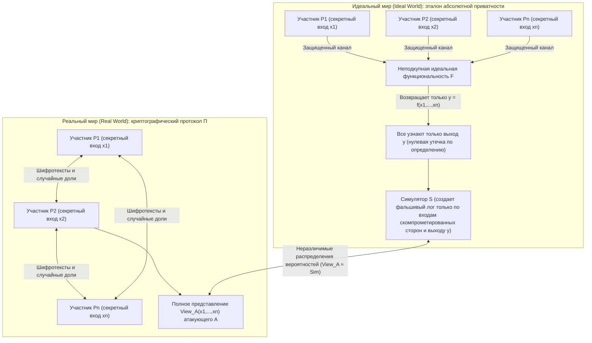
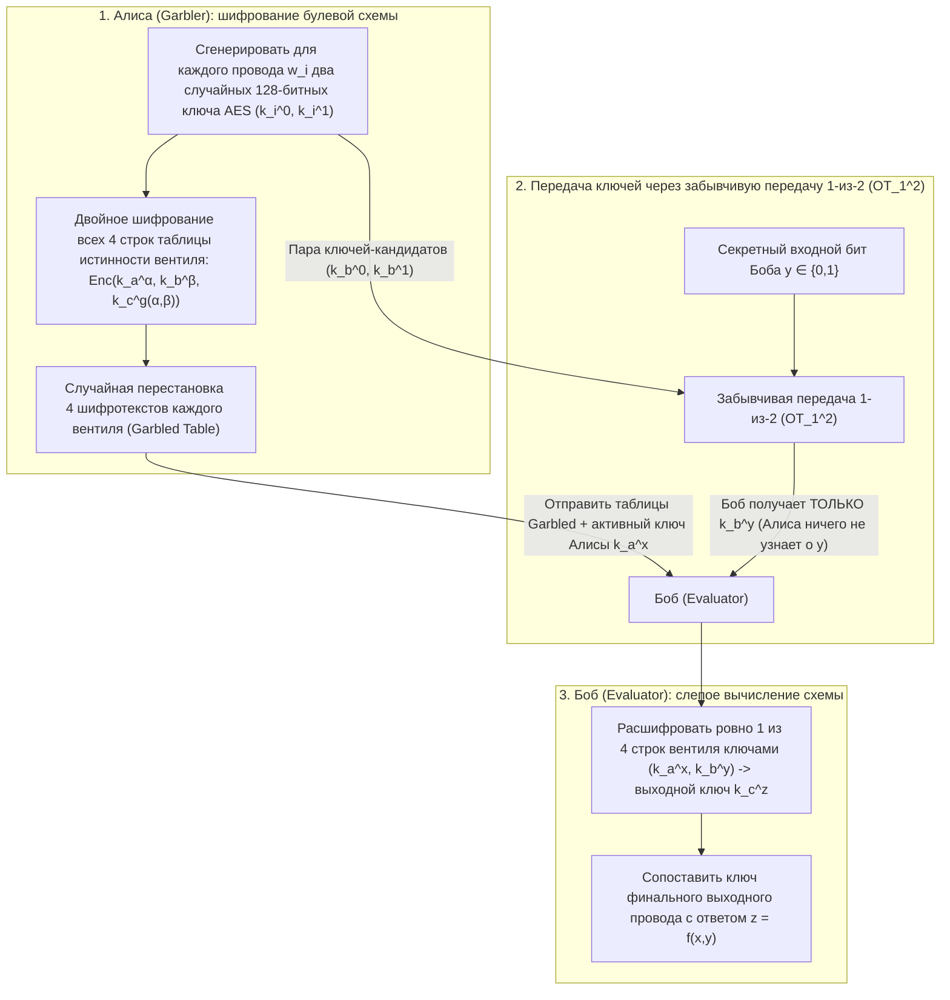

«Несколько больниц хотят совместно анализировать геномы пациентов, соблюдая применимые правовые, договорные и этические требования к обработке этих данных».
«Конкурирующие коммерческие банки хотят совместно отслеживать межбанковские цепочки отмывания денег, не раскрывая друг другу списки клиентов и графы транзакций».

На первый взгляд это кажется логическим противоречием: чтобы вычислить функцию $f(x_1, x_2, \dots, x_n)$, разве не должна некая <strong>доверенная третья сторона (Trusted Third Party, TTP)</strong> сначала собрать все входные данные $x_i$ в открытом виде? Однако в конце 1980-х годов современная криптография доказала поразительную теорему: <strong>При явно заданной модели противника и криптографических предположениях участники могут совместно вычислять функцию; определение безопасности ограничивает дополнительное раскрытие сверх информации, уже выводимой из разрешённых входов и выходов.</strong>

Эта область называется <strong>безопасными многосторонними вычислениями (Secure Multi-Party Computation, MPC)</strong>. В этой статье мы начнем с двух классических мысленных экспериментов и выведем два фундаментальных математических двигателя MPC: <strong>пороговое разделение секрета $(t, n)$ Ади Шамира (интерполяция Лагранжа, протокол BGW и мультипликативные тройки Бивера)</strong> и булев подход на основе <strong>забывчивой передачи (OT) и искаженных схем (Garbled Circuits) Яо</strong>.

---


**Как понимать заявления о безопасности:** Утверждения, что секрет «не раскрывается», действуют только в рамках указанной модели противника, определения безопасности и криптографических предположений. Обычно оценивается дополнительная утечка сверх информации, выводимой из разрешённых входов и выходов; выводы из результатов, реализация, эксплуатация, доступность и боковые каналы требуют отдельного анализа.

## 1. Два парадоксальных мысленных эксперимента: «Средняя зарплата без начальника» и «Проблема миллионеров Яо»

### 1.1 Мысленный эксперимент 1: Как узнать среднюю зарплату троих, не раскрывая личных доходов

Трое инженеров $A, B$ и $C$ хотят узнать свою <strong>среднюю годовую зарплату $\bar{x} = \frac{x_A + x_B + x_C}{3}$</strong>, но никто из них не готов раскрыть свою индивидуальную зарплату $x_A, x_B$ или $x_C$ остальным. С помощью <strong>аддитивного разделения секрета (маскирования одноразовым блокнотом / One-Time Pad)</strong> они решают задачу без посредников:

1. <strong>Случайная маска и первый шепот ($A \to B$)</strong>: Участники выбирают большое публичное число $M$ (например, $M = 10^9$). Инженер $A$ тайно генерирует равномерно распределенное случайное число $r \xleftarrow{\$} \mathbb{Z}_M$, прибавляет к нему свою зарплату $x_A$ и шепчет инженеру $B$ только величину $s_1 = (x_A + r) \bmod M$. Поскольку $r$ распределено равномерно в кольце $\mathbb{Z}_M$, сумма $s_1$ также распределена идеально равномерно независимо от значения $x_A$: по теореме Шеннона взаимная информация равна нулю ($I(X_A; S_1) = 0$). Инженер $B$ узнает ровно <strong>ноль бит</strong> о $x_A$.
2. <strong>Цепочка сложений ($B \to C \to A$)</strong>: $B$ прибавляет свою зарплату $x_B$ и шепчет $s_2 = (x_A + x_B + r) \bmod M$ участнику $C$; $C$ прибавляет $x_C$ и сообщает $s_3 = (x_A + x_B + x_C + r) \bmod M$ обратно участнику $A$.
3. <strong>Снятие маски</strong>: $A$ вычитает свое случайное число $r$ по модулю $M$, получает точную сумму $S = x_A + x_B + x_C$ и объявляет среднее значение $\bar{x} = S / 3$.

> **Ограничение примера с шёпотом:** это учебная иллюстрация, а не безопасный протокол MPC. Предполагаются приватные каналы между соседями, честное поведение и отсутствие сговора. Например, если Боб и Кэрол обменяются наблюдениями, они смогут вместе с объявленной суммой восстановить вход Алисы. Для реального применения нужен протокол, доказанно безопасный в выбранной модели угроз. Кроме того, $M$ должно превышать сумму входов, чтобы избежать перехода через модуль.

> [!NOTE]
> <strong>Почему необходимы минимум 3 участника ($n \ge 3$)?</strong>
> Если бы участников было всего двое ($A$ и $B$), то даже если бы неподкупный ангел сообщил им только среднее $\bar{x} = \frac{x_A + x_B}{2}$, $A$ мгновенно вычислил бы $x_B = 2\bar{x} - x_A$. Это свойство самой математической функции, а не уязвимость протокола. <strong>MPC гарантирует, что в процессе вычислений не утекает ни одного бита сверх того, что логически следует из собственного входа и финального ответа.</strong>

### 1.2 Мысленный эксперимент 2: «Проблема миллионеров» Эндрю Яо (1982)

Сложение линейно, но как быть с <strong>нелинейным сравнением</strong>?
В 1982 году будущий лауреат премии Тьюринга <strong>Эндрю Чи-Чи Яо (Andrew Yao)</strong> в работе *"Protocols for Secure Computations"* сформулировал знаменитую <strong>проблему миллионеров</strong>: два миллионера, Алиса (состояние $x$ млн долларов) и Боб (состояние $y$ млн долларов), хотят вычислить только один булев бит $f(x, y) = [x > y] \in \{0, 1\}$ (кто богаче?), не прибегая к третьей стороне и не раскрывая ни точных сумм $x, y$, ни даже разницы $x - y$.

---

## 2. Математическая формализация безопасности: Парадигма симуляции Идеального и Реального миров

Чтобы строго доказать отсутствие любых утечек, Гольдрайх, Микали и Вигдерсон (GMW 1987) ввели <strong>парадигму симуляции Идеального и Реального миров (Ideal/Real Simulation Paradigm)</strong>:



Реальный протокол $\Pi$ безопасен, если существует полиномиальный алгоритм — <strong>Симулятор $\mathcal{S}$</strong>, который, располагая <em>только входами $\{x_i\}_{i \in I}$ и выходами $\{y_i\}_{i \in I}$ скомпрометированных участников</em>, способен сгенерировать искусственную запись обмена сообщениями, неотличимую от реального представления $\text{View}_I^\Pi(x_1, \dots, x_n)$:
$$\left\{ \mathcal{S}\left(I, \{x_i\}_{i \in I}, \{y_i\}_{i \in I}\right) \right\} \stackrel{c}{\approx} \left\{ \text{View}_I^\Pi(x_1, \dots, x_n) \right\}$$
При этом различают <strong>получестных противников (Semi-Honest / Passive)</strong>, соблюдающих протокол, но анализирующих трафик, и <strong>злонамеренных противников (Malicious / Active)</strong>, активно искажающих сообщения.

---

## 3. Двигатель 1: Пороговое разделение секрета $(t, n)$ Шамира, интерполяция Лагранжа и протоколы BGW / SPDZ

### 3.1 Полиномы над полем $\mathbb{F}_p$ и формула Лагранжа
В 1979 году <strong>Ади Шамир</strong> предложил прятать секрет $s \in \mathbb{F}_p$ ($p > n$ — простое число) в свободный член случайного полинома степени $t - 1$ над конечным полем $\mathbb{F}_p$:
$$P(x) = s + a_1 x + a_2 x^2 + \dots + a_{t-1} x^{t-1} \pmod p$$
Каждый участник $P_i$ получает точку $(x_i = i,\, y_i = P(x_i))$. Любое подмножество $T$ из $t$ участников однозначно восстанавливает $s = P(0)$ с помощью <strong>интерполяционной формулы Лагранжа</strong>:
$$s = P(0) = \sum_{i \in T} y_i \prod_{j \in T,\, j \ne i} \frac{-x_j}{x_i - x_j} \pmod p$$
Для любых $t - 1$ долей каждое возможное значение секрета $s' \in \mathbb{F}_p$ равновероятно ($H(S \mid \text{Shares}_{t-1}) = H(S)$ — безусловная теоретико-информационная стойкость).

### 3.2 Протокол BGW и мультипликативные тройки Бивера
В <strong>протоколе BGW (1988)</strong> <strong>сложение $[a] + [b] = [a + b]$ выполняется локально без единого бита связи</strong>. Однако <strong>умножение $[a] \cdot [b]$</strong> удваивает степень полинома $P(x)Q(x)$ до $2(t-1)$, что требует условия $2t - 1 \le n$ (<strong>честного большинства, Honest Majority</strong>) и раунда понижения степени.
<strong>Дональд Бивер (1991)</strong> решил эту проблему с помощью <strong>мультипликативных троек $([u], [v], [w = u \cdot v \bmod p])$</strong>, генерируемых заранее в офлайн-фазе (основа протокола <strong>SPDZ</strong>). В онлайн-фазе стороны раскрывают только замаскированные разности $d = (x - u) \bmod p$ и $e = (y - v) \bmod p$, после чего вычисляют долю произведения линейно и локально:
$$[x \cdot y] = [w] + d \cdot [v] + e \cdot [u] + d \cdot e \pmod p$$

---

**Пределы зависят от модели противника:** классический BGW допускает $c < n/2$ скомпрометированных участников в пассивной модели (честные, но любопытные); информационно-теоретическая защита от злонамеренных участников обычно требует $c < n/3$ и подходящих предположений о каналах связи. Одна тройка Бивера не задаёт порог и не обеспечивает активную защиту.

## 4. Двигатель 2: Забывчивая передача (OT) и искажённые схемы Яо

В некоторых конструкциях после передачи входов вычисление элементов схемы выполняется локально; общее число раундов связи зависит от протокола OT и его настройки.



<strong>Point-and-Permute</strong> указывает строку для расшифровки, <strong>Free-XOR</strong> позволяет не выполнять гарблинг вентилей XOR, а <strong>Half-Gates</strong> сокращает обмен данными для вентилей AND. Эффект зависит от схемы, реализации, оборудования и сети; универсального коэффициента ускорения нет.

---

## 5. Полная реализация на Python: Разделение секрета Шамира и тройки Бивера над $\mathbb{F}_p$

Пример также возводит каждую зарплату в квадрат с помощью новой тройки Бивера, затем раскрывает сумму и сумму квадратов для вычисления среднего и дисперсии генеральной совокупности. Эти результаты раскрываются стороне, которая их восстанавливает; пример представляет собой учебную симуляцию в одном процессе.

```python
import secrets
from typing import List, Tuple

# 61-bit Mersenne prime p = 2^61 - 1 for our prime finite field F_p
PRIME = (1 << 61) - 1

def mod_inv(a: int, p: int = PRIME) -> int:
    # Modular inverse in F_p via Extended Euclidean Algorithm (Python 3.8+ pow(a, -1, p))
    return pow(a % p, -1, p)

def shamir_share(secret: int, t: int, n: int, p: int = PRIME) -> List[Tuple[int, int]]:
    # Shamir's (t, n) Threshold Secret Sharing:
    # Samples a random degree-(t-1) polynomial P(x) with P(0) = secret and evaluates it at x = 1..n.
    assert 1 <= t <= n < p, "Threshold t and party count n must satisfy 1 <= t <= n < p"
    # P(x) = s + a_1 * x + a_2 * x^2 + ... + a_{t-1} * x^{t-1} (mod p)
    coeffs = [secret % p] + [secrets.randbelow(p) for _ in range(t - 1)]

    shares = []
    for i in range(1, n + 1):
        # Evaluate P(i) using Horner's method
        y = 0
        for c in reversed(coeffs):
            y = (y * i + c) % p
        shares.append((i, y))
    return shares

def lagrange_reconstruct(shares: List[Tuple[int, int]], p: int = PRIME) -> int:
    # Reconstructs P(0) = s from any subset of >= t shares using Lagrange Polynomial Interpolation:
    # s = sum_{i in T} y_i * prod_{j in T, j != i} (-x_j) / (x_i - x_j) (mod p)
    secret = 0
    k = len(shares)
    for i in range(k):
        xi, yi = shares[i]
        num = 1
        den = 1
        for j in range(k):
            if i == j:
                continue
            xj, _ = shares[j]
            num = (num * (-xj)) % p
            den = (den * (xi - xj)) % p
        lambda_i = (num * mod_inv(den, p)) % p
        secret = (secret + yi * lambda_i) % p
    return secret

def mpc_add(shares_a: List[Tuple[int, int]], shares_b: List[Tuple[int, int]], p: int = PRIME) -> List[Tuple[int, int]]:
    # Local homomorphic addition [a] + [b] = [a + b] (Zero communication)
    return [(xa, (ya + yb) % p) for (xa, ya), (xb, yb) in zip(shares_a, shares_b)]

def mpc_sub(shares_a: List[Tuple[int, int]], shares_b: List[Tuple[int, int]], p: int = PRIME) -> List[Tuple[int, int]]:
    # Local homomorphic subtraction [a] - [b] = [a - b] (Zero communication)
    return [(xa, (ya - yb) % p) for (xa, ya), (xb, yb) in zip(shares_a, shares_b)]

def mpc_scalar_mul(scalar: int, shares_a: List[Tuple[int, int]], p: int = PRIME) -> List[Tuple[int, int]]:
    # Local multiplication by a public scalar c * [a] = [c * a] (Zero communication)
    return [(xa, (scalar * ya) % p) for xa, ya in shares_a]

def mpc_add_constant(const: int, shares_a: List[Tuple[int, int]], p: int = PRIME) -> List[Tuple[int, int]]:
    # Adding a public constant [a] + c = [a + c] shifts P(x) by +c at every evaluation point
    return [(xa, (ya + const) % p) for xa, ya in shares_a]

def generate_beaver_triple(t: int, n: int, p: int = PRIME):
    # Offline Preprocessing Phase: Generates a shared random multiplication triple ([u], [v], [w = u * v])
    u = secrets.randbelow(p)
    v = secrets.randbelow(p)
    w = (u * v) % p
    return shamir_share(u, t, n, p), shamir_share(v, t, n, p), shamir_share(w, t, n, p)

def mpc_beaver_mul(
    shares_x: List[Tuple[int, int]],
    shares_y: List[Tuple[int, int]],
    triple: Tuple[List[Tuple[int, int]], List[Tuple[int, int]], List[Tuple[int, int]]],
    t: int,
    p: int = PRIME
) -> List[Tuple[int, int]]:
    # Online Phase: Evaluates [x * y] using a Beaver Multiplication Triple ([u], [v], [w]):
    # 1. Locally compute [d] = [x] - [u] and [e] = [y] - [v]
    # 2. Open masked differences; security depends on fresh, valid, single-use triples and the threat model
    # 3. Locally compute the linear combination [x * y] = [w] + d * [v] + e * [u] + d * e
    shares_u, shares_v, shares_w = triple
    shares_d = mpc_sub(shares_x, shares_u, p)
    shares_e = mpc_sub(shares_y, shares_v, p)

    # Open the masked differences d = x - u and e = y - v using t shares
    d = lagrange_reconstruct(shares_d[:t], p)
    e = lagrange_reconstruct(shares_e[:t], p)

    # Linear combination to obtain degree-(t-1) shares of [x * y]
    term1 = shares_w
    term2 = mpc_scalar_mul(d, shares_v, p)
    term3 = mpc_scalar_mul(e, shares_u, p)
    res = mpc_add(mpc_add(term1, term2, p), term3, p)
    res = mpc_add_constant((d * e) % p, res, p)
    return res

if __name__ == "__main__":
    # 5 MPC servers (n = 5) with reconstruction threshold t = 3 (any 2 servers learn 0 bits)
    t, n = 3, 5
    salaries = [850, 920, 780]  # Example salary units

    # Each engineer splits their secret salary across the 5 servers
    shared_salaries = [shamir_share(s, t, n) for s in salaries]

    # 1. Compute the sum of salaries locally with zero inter-server communication
    sum_shares = shared_salaries[0]
    for s_share in shared_salaries[1:]:
        sum_shares = mpc_add(sum_shares, s_share)

    # Reconstruct the total from any 3 servers (e.g., servers 1, 3, and 5)
    subset_3 = [sum_shares[0], sum_shares[2], sum_shares[4]]
    total_salary = lagrange_reconstruct(subset_3)
    mean_salary = total_salary / len(salaries)
    print(f"Reconstructed total (units): {total_salary:,} (mean: {mean_salary:,.2f})")

    # 2. Compute the sum of squares S_2 = x_A^2 + x_B^2 + x_C^2 using Beaver Multiplication Triples
    sq_sum_shares = shamir_share(0, t, n)
    for s_share in shared_salaries:
        triple = generate_beaver_triple(t, n)
        sq_share = mpc_beaver_mul(s_share, s_share, triple, t)
        sq_sum_shares = mpc_add(sq_sum_shares, sq_share)

    total_sq = lagrange_reconstruct(sq_sum_shares[:t])
    variance = (total_sq / len(salaries)) - (mean_salary ** 2)
    print(f"Reconstructed sum of squares: {total_sq:,} (population variance: {variance:,.2f})")
```

---

## 6. Сравнение технологий защиты приватности (PETs) и реальные внедрения

| Критерий | Многосторонние вычисления (MPC) | Полностью гомоморфное шифрование (FHE) | Доказательства с нулевым разглашением (ZKP) | Доверенная среда исполнения (TEE) |
| :--- | :--- | :--- | :--- | :--- |
| <strong>Решаемая задача</strong> | <strong>Совместное вычисление</strong> функции $f(x_1, \dots, x_n)$ над секретами разных сторон | <strong>Слепые вычисления на одном сервере</strong> над шифротекстами $\text{Enc}(x) \mapsto \text{Enc}(f(x))$ | <strong>Доказательство истинности $f(x, w)=1$</strong> одним доказывающим, уже знающим $w$ | <strong>Аппаратно-изолированное выполнение</strong> в открытом виде внутри анклава CPU |
| <strong>Узкое место</strong> | Стоимость связи зависит от протокола, глубины схемы и сети | Затраты на вычисления и связь зависят от схемы и оборудования; универсального коэффициента замедления нет | Затраты на создание и проверку доказательства зависят от системы и утверждения | Производительность и защищённая память зависят от платформы и нагрузки |
| <strong>Модель доверия</strong> | Безопасность MPC зависит от порога и модели противника конкретного протокола; утечки через результаты, доступность и справедливость оцениваются отдельно. | <strong>Трудность задач на решетках (RLWE)</strong> | <strong>Математическая надежность</strong> (не объединяет чужие секреты сам по себе) | <strong>Доверие производителю чипа (Intel/AMD)</strong>; уязвимость к атакам по сторонним каналам |

К изученным или внедрённым примерам относятся датский аукцион сахарной свёклы, измерение разрыва в оплате труда в Бостоне, проверка паролей, геномные исследования и распределённые подписи. Степень внедрения, модель безопасности и остаточные риски различаются; MPC не заменяет институциональное доверие абсолютной уверенностью.

## 7. Другие PET и их ограничения

Историческая справка: OT Рабина 1981 года (получение сообщения с вероятностью 1/2) отличается от функциональности OT «1-из-2», сформулированной Ивеном, Голдрайхом и Лемпелем в 1985 году.
MPC распределяет входные данные; гарантии зависят от протокола и модели противника. FHE позволяет вычислять над шифротекстами, но не проверяет автоматически вычисление и не предотвращает утечки через результаты. Доказательства с нулевым разглашением подтверждают утверждение без раскрытия свидетеля, но не заменяют совместные вычисления. TEE обрабатывает открытый текст в защищённом оборудовании, которому и его аттестации нужно доверять. Методы можно сочетать; затраты и гарантии зависят от задачи.

## 8. Примеры
На датском аукционе сахарной свёклы 2008 года применялся MPC с тремя сторонами; статья сообщает примерно о 1 200 входах, 30 минутах вычислений и передаче 25 000 тонн производственных прав. BWWC и Boston University публикуют отчёты о разрыве в оплате труда раз в два года; в отчёте BWWC за 2023 год указаны 103 работодателя и 165 000 штатных работников. Google Chrome и Apple документируют разные проверки паролей на основе PSI. Исследование USENIX 2023 года сообщило о боковых каналах в изученной реализации Chrome. GWAS с MPC демонстрировались в исследованиях, но результаты могут раскрывать сведения. Secure Aggregation скрывает отдельные обновления, но не все риски вывода. Пороговые подписи и обновление долей зависят от протокола и условий эксплуатации.

## 9. Заключение
MPC уменьшает централизацию открытых данных, но не устраняет утечки через результаты и операционные, юридические риски или проблемы доступности. Гарантии зависят от модели противника, криптографических предположений, реализации и эксплуатации.

**Область применения примера:** Этот код на Python — учебная симуляция в одном процессе разделения секрета и операций над конечным полем. Это не сетевая система MPC, в которой каждый участник хранит только свою долю. Здесь нет проверок против злонамеренных участников, аутентификации и защищённой передачи, доверенной предварительной обработки и контроля диапазона входных данных и переполнения. Значения, восстановленные `lagrange_reconstruct`, раскрываются восстанавливающей их стороне. Не используйте пример для защиты реальных данных или активов.


## Sources

- [Rabin, “How to Exchange Secrets with Oblivious Transfer” (1981)](https://eprint.iacr.org/2005/187.pdf)
- [Even, Goldreich, and Lempel, “A Randomized Protocol for Signing Contracts” (1985)](https://luca-giuzzi.unibs.it/corsi/Support/papers-cryptography/SigningContracts.pdf)

- [Bogetoft et al., “Secure Multiparty Computation Goes Live” (2009)](https://www.acsu.buffalo.edu/~mblanton/cse715/sugar-beet-auction.pdf)
- [Boston Women’s Workforce Council: Wage Gap Studies](https://thebwwc.org/wage-gap-studies)
- [Google: Better password protections in Chrome](https://security.googleblog.com/2019/12/better-password-protections-in-chrome.html)
- [Apple Platform Security: Password Monitoring](https://support.apple.com/guide/security/password-monitoring-sec78e79fc3b/web)
- [Kwong et al., USENIX Security 2023: Chrome password-check side channels](https://www.usenix.org/conference/usenixsecurity23/presentation/kwong)
- [Cho et al., “Secure genome-wide association analysis using multiparty computation” (2018)](https://pmc.ncbi.nlm.nih.gov/articles/PMC5990440/)
- [Bonawitz et al., Google Research: Practical Secure Aggregation](https://research.google/pubs/practical-secure-aggregation-for-federated-learning-on-user-held-data/)
- [Canetti et al., “UC Non-Interactive, Proactive, Threshold ECDSA” (2020)](https://eprint.iacr.org/2020/492)
- [Kumar et al., “Understanding Information Disclosure from Secure Computation Output” (2025)](https://doi.org/10.1145/3705004)
- [Kolesnikov and Schneider, “Improved Garbled Circuit: Free XOR Gates and Applications” (2008)](https://encrypto.de/papers/KS08XOR.pdf)
- [Zahur, Rosulek, and Evans, “Two Halves Make a Whole: Reducing Data Transfer in Garbled Circuits using Half Gates” (2015)](https://www.cs.virginia.edu/~evans/pubs/ec2015/halfgates.pdf)

- [Stanford University cryptography notes: Oblivious Transfer](https://crypto.stanford.edu/pbc/notes/crypto/ot.html)

- [A Full Proof of the BGW Protocol for Perfectly Secure MPC](https://doi.org/10.1007/S00145-015-9214-4)

- [Yao, “Protocols for Secure Computations” (FOCS 1982)](https://doi.org/10.1109/SFCS.1982.38)
