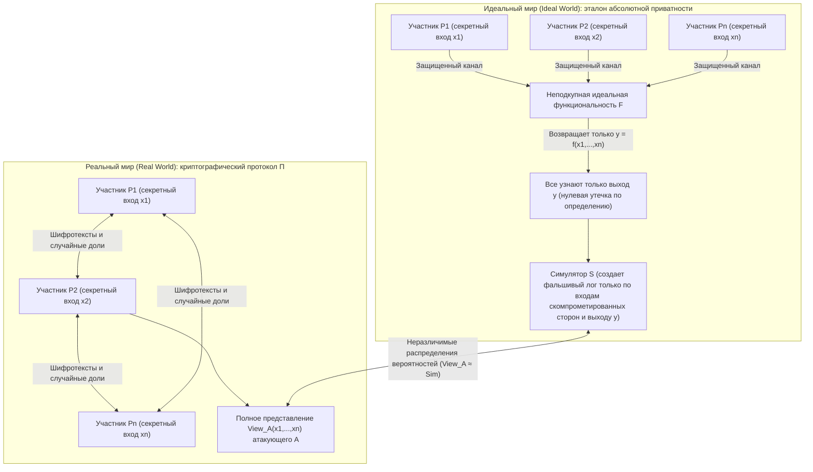
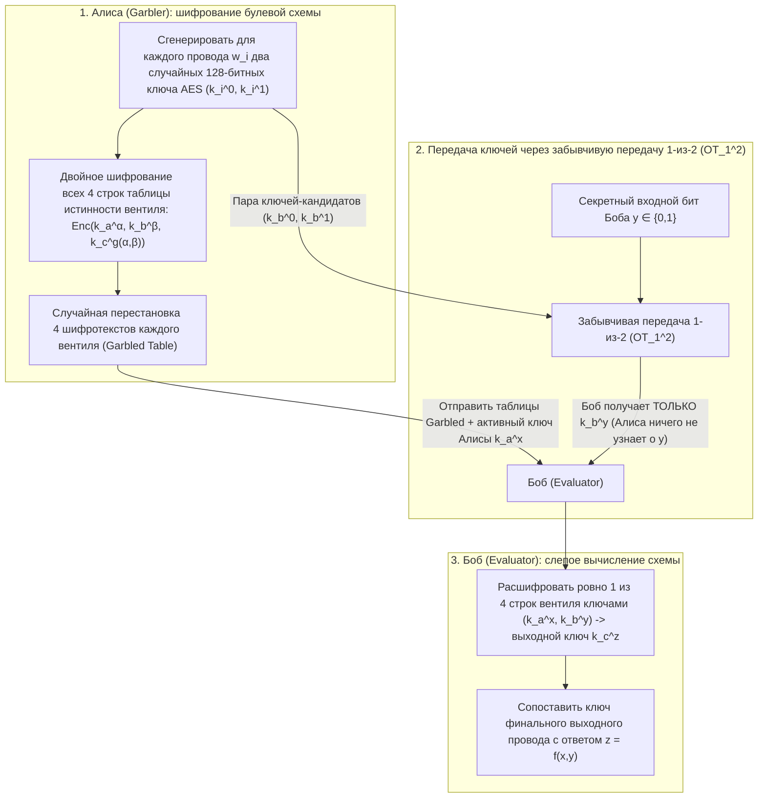

«Несколько онкологических центров хотят объединить геномные данные своих пациентов для проведения статистического исследования (GWAS), но законы о защите персональных данных (GDPR / HIPAA) категорически запрещают передавать за пределы клиники даже один байт исходных данных».
«Конкурирующие коммерческие банки хотят совместно отслеживать межбанковские цепочки отмывания денег, не раскрывая друг другу списки клиентов и графы транзакций».

На первый взгляд это кажется логическим противоречием: чтобы вычислить функцию $f(x_1, x_2, \dots, x_n)$, разве не должна некая <strong>доверенная третья сторона (Trusted Third Party, TTP)</strong> сначала собрать все входные данные $x_i$ в открытом виде? Однако в конце 1980-х годов современная криптография доказала поразительную теорему: <strong>даже при полном отсутствии доверенной третьей стороны не доверяющие друг другу участники могут совместно вычислить любую вычислимую функцию $f(x_1, \dots, x_n)$ так, что каждый узнает точный результат, но никто не получит ни единого дополнительного бита информации о чужих секретных входах $x_i$.</strong>

Эта область называется <strong>безопасными многосторонними вычислениями (Secure Multi-Party Computation, MPC)</strong>. В этой статье мы начнем с двух классических мысленных экспериментов и выведем два фундаментальных математических двигателя MPC: <strong>пороговое разделение секрета $(t, n)$ Ади Шамира (интерполяция Лагранжа, протокол BGW и мультипликативные тройки Бивера)</strong> и булев подход на основе <strong>забывчивой передачи ($\text{OT}_1^2$) Рабина и искаженных схем (Garbled Circuits) Яо</strong>.

---

## 1. Два парадоксальных мысленных эксперимента: «Средняя зарплата без начальника» и «Проблема миллионеров Яо»

### 1.1 Мысленный эксперимент 1: Как узнать среднюю зарплату троих, не раскрывая личных доходов

Трое инженеров $A, B$ и $C$ хотят узнать свою <strong>среднюю годовую зарплату $\bar{x} = \frac{x_A + x_B + x_C}{3}$</strong>, но никто из них не готов раскрыть свою индивидуальную зарплату $x_A, x_B$ или $x_C$ остальным. С помощью <strong>аддитивного разделения секрета (маскирования одноразовым блокнотом / One-Time Pad)</strong> они решают задачу без посредников:

1. <strong>Случайная маска и первый шепот ($A \to B$)</strong>: Участники выбирают большое публичное число $M$ (например, $M = 10^9$). Инженер $A$ тайно генерирует равномерно распределенное случайное число $r \xleftarrow{\$} \mathbb{Z}_M$, прибавляет к нему свою зарплату $x_A$ и шепчет инженеру $B$ только величину $s_1 = (x_A + r) \bmod M$. Поскольку $r$ распределено равномерно в кольце $\mathbb{Z}_M$, сумма $s_1$ также распределена идеально равномерно независимо от значения $x_A$: по теореме Шеннона взаимная информация равна нулю ($I(X_A; S_1) = 0$). Инженер $B$ узнает ровно <strong>ноль бит</strong> о $x_A$.
2. <strong>Цепочка сложений ($B \to C \to A$)</strong>: $B$ прибавляет свою зарплату $x_B$ и шепчет $s_2 = (x_A + x_B + r) \bmod M$ участнику $C$; $C$ прибавляет $x_C$ и сообщает $s_3 = (x_A + x_B + x_C + r) \bmod M$ обратно участнику $A$.
3. <strong>Снятие маски</strong>: $A$ вычитает свое случайное число $r$ по модулю $M$, получает точную сумму $S = x_A + x_B + x_C$ и объявляет среднее значение $\bar{x} = S / 3$.

> [!NOTE]
> <strong>Почему необходимы минимум 3 участника ($n \ge 3$)?</strong>
> Если бы участников было всего двое ($A$ и $B$), то даже если бы неподкупный ангел сообщил им только среднее $\bar{x} = \frac{x_A + x_B}{2}$, $A$ мгновенно вычислил бы $x_B = 2\bar{x} - x_A$. Это свойство самой математической функции, а не уязвимость протокола. <strong>MPC гарантирует, что в процессе вычислений не утекает ни одного бита сверх того, что логически следует из собственного входа и финального ответа.</strong>

### 1.2 Мысленный эксперимент 2: «Проблема миллионеров» Эндрю Яо (1982)

Сложение линейно, но как быть с <strong>нелинейным сравнением</strong>?
В 1982 году будущий лауреат премии Тьюринга <strong>Эндрю Чи-Чи Яо (Andrew Yao)</strong> в работе *"Protocols for Secure Computations"* сформулировал знаменитую <strong>проблему миллионеров</strong>: два миллионера, Алиса (состояние $x$ млн долларов) и Боб (состояние $y$ млн долларов), хотят вычислить только один булев бит $f(x, y) = [x > y] \in \{0, 1\}$ (кто богаче?), не прибегая к третьей стороне и не раскрывая ни точных сумм $x, y$, ни даже разницы $x - y$.

---

## 2. Математическая формализация безопасности: Парадигма симуляции Идеального и Реального миров

Чтобы строго доказать отсутствие любых утечек, Гольдрайх, Микали и Вигдерсон (GMW 1987) ввели <strong>парадигму симуляции Идеального и Реального миров (Ideal/Real Simulation Paradigm)</strong>:



Реальный протокол $\Pi$ безопасен, если существует полиномиальный алгоритм — <strong>Симулятор $\mathcal{S}$</strong>, который, располагая <em>только входами $\{x_i\}_{i \in I}$ и выходами $\{y_i\}_{i \in I}$ скомпрометированных участников</em>, способен сгенерировать искусственную запись обмена сообщениями, неотличимую от реального представления $\text{View}_I^\Pi(x_1, \dots, x_n)$:
$$\left\{ \mathcal{S}\left(I, \{x_i\}_{i \in I}, \{y_i\}_{i \in I}\right) \right\} \stackrel{c}{\approx} \left\{ \text{View}_I^\Pi(x_1, \dots, x_n) \right\}$$
При этом различают <strong>получестных противников (Semi-Honest / Passive)</strong>, соблюдающих протокол, но анализирующих трафик, и <strong>злонамеренных противников (Malicious / Active)</strong>, активно искажающих сообщения.

---

## 3. Двигатель 1: Пороговое разделение секрета $(t, n)$ Шамира, интерполяция Лагранжа и протоколы BGW / SPDZ

### 3.1 Полиномы над полем $\mathbb{F}_p$ и формула Лагранжа
В 1979 году <strong>Ади Шамир</strong> предложил прятать секрет $s \in \mathbb{F}_p$ ($p > n$ — простое число) в свободный член случайного полинома степени $t - 1$ над конечным полем $\mathbb{F}_p$:
$$P(x) = s + a_1 x + a_2 x^2 + \dots + a_{t-1} x^{t-1} \pmod p$$
Каждый участник $P_i$ получает точку $(x_i = i,\, y_i = P(x_i))$. Любое подмножество $T$ из $t$ участников однозначно восстанавливает $s = P(0)$ с помощью <strong>интерполяционной формулы Лагранжа</strong>:
$$s = P(0) = \sum_{i \in T} y_i \prod_{j \in T,\, j \ne i} \frac{-x_j}{x_i - x_j} \pmod p$$
Для любых $t - 1$ долей каждое возможное значение секрета $s' \in \mathbb{F}_p$ равновероятно ($H(S \mid \text{Shares}_{t-1}) = H(S)$ — безусловная теоретико-информационная стойкость).

### 3.2 Протокол BGW и мультипликативные тройки Бивера
В <strong>протоколе BGW (1988)</strong> <strong>сложение $[a] + [b] = [a + b]$ выполняется локально без единого бита связи</strong>. Однако <strong>умножение $[a] \cdot [b]$</strong> удваивает степень полинома $P(x)Q(x)$ до $2(t-1)$, что требует условия $2t - 1 \le n$ (<strong>честного большинства, Honest Majority</strong>) и раунда понижения степени.
<strong>Дональд Бивер (1991)</strong> решил эту проблему с помощью <strong>мультипликативных троек $([u], [v], [w = u \cdot v \bmod p])$</strong>, генерируемых заранее в офлайн-фазе (основа протокола <strong>SPDZ</strong>). В онлайн-фазе стороны раскрывают только замаскированные разности $d = (x - u) \bmod p$ и $e = (y - v) \bmod p$, после чего вычисляют долю произведения линейно и локально:
$$[x \cdot y] = [w] + d \cdot [v] + e \cdot [u] + d \cdot e \pmod p$$

---

## 4. Двигатель 2: Забывчивая передача ($\text{OT}_1^2$) Рабина и искаженные схемы (Garbled Circuits) Яо

Для побитовых сравнений ($x > y$) булевы схемы позволяют выполнить вычисление за константное число раундов $O(1)$:



С помощью <strong>забывчивой передачи 1-из-2 ($\text{OT}_1^2$) Майкла Рабина</strong> Боб получает ключ $k_b^y$ для своего секретного бита $y$, не раскрывая $y$ Алисе. Три современные оптимизации — <strong>Point-and-Permute</strong> (цветные биты указывают точную строку для расшифровки), <strong>Free-XOR</strong> ($k_i^1 = k_i^0 \oplus \Delta$ делает все вентили `XOR` абсолютно бесплатными без шифротекстов и вызовов AES) и <strong>Half-Gates</strong> (сокращение вентиля `AND` до 2 шифротекстов) — ускорили искаженные схемы более чем в $1000$ раз.

---

## 5. Полная реализация на Python: Разделение секрета Шамира и тройки Бивера над $\mathbb{F}_p$

```python
import secrets
from typing import List, Tuple

PRIME = (1 << 61) - 1  # 61-битное простое число Мерсенна p = 2^61 - 1

def mod_inv(a: int, p: int = PRIME) -> int:
    return pow(a % p, -1, p)

def shamir_share(secret: int, t: int, n: int, p: int = PRIME) -> List[Tuple[int, int]]:
    coeffs = [secret % p] + [secrets.randbelow(p) for _ in range(t - 1)]
    shares = []
    for i in range(1, n + 1):
        y = 0
        for c in reversed(coeffs):
            y = (y * i + c) % p
        shares.append((i, y))
    return shares

def lagrange_reconstruct(shares: List[Tuple[int, int]], p: int = PRIME) -> int:
    secret = 0
    k = len(shares)
    for i in range(k):
        xi, yi = shares[i]
        num, den = 1, 1
        for j in range(k):
            if i != j:
                xj, _ = shares[j]
                num = (num * (-xj)) % p
                den = (den * (xi - xj)) % p
        secret = (secret + yi * num * mod_inv(den, p)) % p
    return secret

def mpc_add(sa, sb, p=PRIME):
    return [(xa, (ya + yb) % p) for (xa, ya), (_, yb) in zip(sa, sb)]

def mpc_sub(sa, sb, p=PRIME):
    return [(xa, (ya - yb) % p) for (xa, ya), (_, yb) in zip(sa, sb)]

def mpc_scalar_mul(c, sa, p=PRIME):
    return [(xa, (c * ya) % p) for xa, ya in sa]

def mpc_add_const(c, sa, p=PRIME):
    return [(xa, (ya + c) % p) for xa, ya in sa]

def generate_beaver_triple(t: int, n: int, p: int = PRIME):
    u, v = secrets.randbelow(p), secrets.randbelow(p)
    return shamir_share(u, t, n, p), shamir_share(v, t, n, p), shamir_share((u * v) % p, t, n, p)

def mpc_beaver_mul(sx, sy, triple, t: int, p: int = PRIME):
    su, sv, sw = triple
    d = lagrange_reconstruct(mpc_sub(sx, su, p)[:t], p)
    e = lagrange_reconstruct(mpc_sub(sy, sv, p)[:t], p)
    res = mpc_add(mpc_add(sw, mpc_scalar_mul(d, sv, p), p), mpc_scalar_mul(e, su, p), p)
    return mpc_add_const((d * e) % p, res, p)

if __name__ == "__main__":
    t, n = 3, 5
    salaries = [85000, 92000, 78000]
    shared = [shamir_share(s, t, n) for s in salaries]
    total_shares = shared[0]
    for s in shared[1:]:
        total_shares = mpc_add(total_shares, s)
    print("Восстановленная сумма зарплат:", lagrange_reconstruct(total_shares[:t]))
```

---

## 6. Сравнение технологий защиты приватности (PETs) и реальные внедрения

| Критерий | Многосторонние вычисления (MPC) | Полностью гомоморфное шифрование (FHE) | Доказательства с нулевым разглашением (ZKP) | Доверенная среда исполнения (TEE) |
| :--- | :--- | :--- | :--- | :--- |
| <strong>Решаемая задача</strong> | <strong>Совместное вычисление</strong> функции $f(x_1, \dots, x_n)$ над секретами разных сторон | <strong>Слепые вычисления на одном сервере</strong> над шифротекстами $\text{Enc}(x) \mapsto \text{Enc}(f(x))$ | <strong>Доказательство истинности $f(x, w)=1$</strong> одним доказывающим, уже знающим $w$ | <strong>Аппаратно-изолированное выполнение</strong> в открытом виде внутри анклава CPU |
| <strong>Узкое место</strong> | Очень быстрые операции CPU, но <strong>требуется сетевой обмен на каждый слой умножений</strong> | Всего 1 раунд связи, но <strong>вычисления CPU в $10^3–10^5$ раз медленнее</strong> | Мгновенная проверка, тяжелая генерация доказательства (MSM / FFT) | Почти нативная скорость, но ограниченный объем памяти анклава |
| <strong>Модель доверия</strong> | <strong>Отсутствие сговора</strong> (менее $t$ серверов в сговоре) | <strong>Трудность задач на решетках (RLWE)</strong> | <strong>Математическая надежность</strong> (не объединяет чужие секреты сам по себе) | <strong>Доверие производителю чипа (Intel/AMD)</strong>; уязвимость к атакам по сторонним каналам |

От исторического <strong>датского двойного аукциона квот на сахарную свеклу в 2008 году</strong> до <strong>исследования гендерного разрыва в оплате труда в Бостоне (BWWC)</strong>, <strong>проверки утечек паролей в Google Chrome и Apple iCloud (Private Set Intersection, PSI)</strong>, <strong>межбольничных геномных исследований (Secure GWAS)</strong> и <strong>институциональных криптокошельков с пороговой подписью MPC (Fireblocks, Coinbase)</strong> — MPC заменяет институциональное доверие математической неизбежностью.
