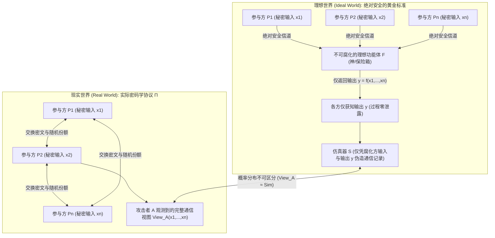
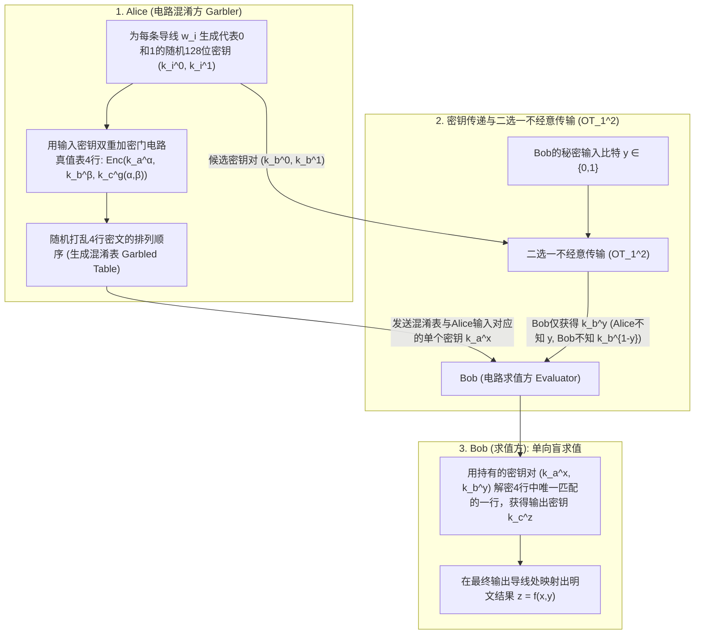

“多家医院希望联合分析患者基因组，但需要根据适用的法律、合同、伦理审查和机构政策谨慎设计个人数据的共享方式。”
“多家存在竞争关系的商业银行希望联合追踪跨行洗钱网络，但绝不能向同行暴露各自的客户名单与交易图谱。”

直觉上，这似乎是一个不可能完成的任务：要计算函数 $f(x_1, x_2, \dots, x_n)$，难道不是必须先由某个“可信第三方（Trusted Third Party, TTP）”收集所有明文输入 $x_i$ 才能执行运算吗？然而，现代密码学在20世纪80年代给出了颠覆性的答案：<strong>在明确的攻击者模型与密码学假设下，参与方可以共同计算函数；安全定义限制的是超出允许输入和输出本身已可推断信息的额外泄露。</strong>

这项技术被称为<strong>安全多方计算（Secure Multi-Party Computation, MPC）</strong>。本文将从两个经典的思维实验出发，严格推导MPC的两大核心数学引擎——基于<strong>沙米尔（Shamir）门限秘密共享与拉格朗日插值</strong>的算术电路引擎，以及基于<strong>不经意传输（Oblivious Transfer, OT）与姚氏混淆电路（Garbled Circuits）</strong>的布尔电路引擎，并提供完整的Python实现与隐私增强技术（PETs）全景对比。

---


**如何理解安全保证：**“秘密不会泄露”等表述仅在指定的攻击者模型、安全定义和密码学假设范围内成立。通常评估的是超出允许输入与输出本身可推断信息的额外泄露；从结果进行推断，以及实现、运维、可用性和侧信道风险都需另行分析。

## 1. 两个直觉思维实验：“无老板的平均薪资计算”与“姚氏百万富翁问题”

### 1.1 思维实验①：不向任何人透露工资，如何算出三人的平均年薪？

三位工程师 $A, B, C$ 坐在咖啡馆里，想知道三人的<strong>平均年薪 $\bar{x} = \frac{x_A + x_B + x_C}{3}$</strong>，但谁都不愿让另外两人知道自己的真实年薪 $x_A, x_B, x_C$。在没有第三方协助的情况下，他们只需利用<strong>加法秘密共享（Additive Secret Sharing）与一次性密码本（One-Time Pad）</strong>即可完成计算：

1. <strong>随机数掩码与第一次耳语（$A \to B$）</strong>：三人约定一个远大于薪资总和的模数 $M$（如 $M = 10^9$）。工程师 $A$ 在有限环 $\mathbb{Z}_M$ 中秘密抽取一个均匀随机数 $r \xleftarrow{\$} \mathbb{Z}_M$，将自己的年薪加上该掩码得到 $s_1 = (x_A + r) \bmod M$，并悄悄告诉 $B$。由于 $r$ 是完全均匀的随机数，$s_1$ 在 $\mathbb{Z}_M$ 上同样服从均匀分布，因此 $B$ 获得的关于 $x_A$ 的互信息严格为零（$I(X_A; S_1) = 0$）。
2. <strong>累加传递（$B \to C \to A$）</strong>：$B$ 将自己的年薪加到 $s_1$ 上，把 $s_2 = (x_A + x_B + r) \bmod M$ 悄悄告诉 $C$；$C$ 再加上自己的年薪 $x_C$，把 $s_3 = (x_A + x_B + x_C + r) \bmod M$ 传回给 $A$。
3. <strong>去除掩码与公布均值</strong>：$A$ 从 $s_3$ 中减去最初生成的随机数 $r$，得到总和 $S = (s_3 - r) \bmod M = x_A + x_B + x_C$，除以 $3$ 后公布平均年薪 $\bar{x}$。在这个简化示例的诚实且不串通假设下，参与者不会直接收到彼此的单独工资；但公布的输出、外部知识或串通仍可能泄露输入信息，因此这并非经证明安全的协议。

> **耳语示例的局限：**这只是教学演示，并非安全的MPC协议。它假设相邻通信保密、参与方诚实且不会串通。例如，Bob与Carol若交换各自看到的信息，就能结合公布的总和还原Alice的输入。实际部署必须使用针对目标威胁模型经过安全证明的协议。此外，为避免模运算回绕，$M$必须大于所有输入之和。

> [!NOTE]
> <strong>为什么至少需要3人（$n \ge 3$）？</strong>
> 如果只有Alice和Bob两人计算平均值 $\bar{x} = \frac{x_A + x_B}{2}$，即便由上帝替他们算出 $\bar{x}$，Alice也能立刻通过 $x_B = 2\bar{x} - x_A$ 反推出Bob的工资。这不是协议的漏洞，而是<strong>函数输出本身蕴含的信息</strong>。MPC保证的是：<strong>除了从自身输入和最终输出 $f(x_1, \dots, x_n)$ 逻辑上必然能推导出的信息外，计算过程本身绝不泄露哪怕1比特的额外信息。</strong>

### 1.2 思维实验②：姚期智（Andrew Yao）的“百万富翁问题”

加法是线性运算，用随机掩码即可轻松隐藏。但如果是非线性的<strong>大小比较</strong>呢？
1982年，图灵奖得主<strong>姚期智（Andrew Chi-Chih Yao）</strong>在奠基性论文 *"Protocols for Secure Computations"* 中提出了著名的<strong>百万富翁问题（Millionaires' Problem）</strong>：两位百万富翁Alice（资产 $x$ 百万美元）和Bob（资产 $y$ 百万美元）希望在不借助第三方的情况下，仅仅算出布尔谓词 $f(x, y) = [x > y] \in \{0, 1\}$（即谁更富有），同时绝不暴露 $x$ 和 $y$ 的具体数值，甚至不能暴露两人财富的差额 $x - y$！这一问题直接催生了现代安全多方计算。

---

## 2. MPC安全性的数学定义：理想世界与现实世界仿真范式

为了严格证明协议不会泄露任何微妙的统计特征，Goldreich、Micali 和 Wigderson（GMW 1987）确立了<strong>理想/现实世界仿真范式（Ideal/Real Simulation Paradigm）</strong>：



如果存在一个多项式时间的<strong>仿真器（Simulator）$\mathcal{S}$</strong>，在仅仅给定被腐化方集合 $I$ 的输入 $\{x_i\}_{i \in I}$ 和最终输出 $\{y_i\}_{i \in I}$ 的条件下，能够独立伪造出一份与现实协议中攻击者观测到的视图 $\text{View}_I^\Pi(x_1, \dots, x_n)$ 在概率分布上不可区分的通信记录：
$$\left\{ \mathcal{S}\left(I, \{x_i\}_{i \in I}, \{y_i\}_{i \in I}\right) \right\} \stackrel{c}{\approx} \left\{ \text{View}_I^\Pi(x_1, \dots, x_n) \right\}$$
那么接收网络上的真实协议消息，就等价于攻击者在自己房间里掷骰子生成随机数，从而在数学上严格证明了协议过程<strong>零信息泄露</strong>。在攻击者模型上，MPC进一步区分为忠实执行协议但试图窥探日志的<strong>半诚实敌手（Semi-Honest / Passive）</strong>，以及任意篡改消息、恶意中止的<strong>恶意敌手（Malicious / Active）</strong>。

---

## 3. 第一大数学引擎：沙米尔 $(t, n)$ 门限秘密共享、拉格朗日插值与 BGW / SPDZ 协议

### 3.1 有限域 $\mathbb{F}_p$ 上的多项式分享与拉格朗日重构
1979年，<strong>阿迪·沙米尔（Adi Shamir）</strong>提出了基于有限域 $\mathbb{F}_p$（$p > n$ 为大素数）上多项式插值的<strong>$(t, n)$ 门限秘密共享方案</strong>：将秘密 $s \in \mathbb{F}_p$ 设为 $t-1$ 次多项式的常数项，并随机均匀抽取 $t-1$ 个系数 $a_1, \dots, a_{t-1} \xleftarrow{\$} \mathbb{F}_p$：
$$P(x) = s + a_1 x + a_2 x^2 + \dots + a_{t-1} x^{t-1} \pmod p$$
每个参与方 $P_i$ ($i=1, \dots, n$) 获得公开坐标 $x_i = i$ 处的求值点 $(x_i, y_i = P(x_i))$ 作为份额 $[s]_i$。

当任意 $t$ 个参与方集合 $T$ ($|T| = t$) 汇集份额时，利用<strong>拉格朗日多项式插值公式（Lagrange Interpolation）</strong>在 $x = 0$ 处求值，即可唯一重构出秘密 $s = P(0)$：
$$s = P(0) = \sum_{i \in T} y_i \prod_{j \in T,\, j \ne i} \frac{-x_j}{x_i - x_j} \pmod p$$
而任意 $t - 1$ 个份额与每一个候选秘密 $s' \in \mathbb{F}_p$（即点 $(0, s')$）都唯一对应一条合法的 $t-1$ 次多项式，因此 $t-1$ 个共谋方对 $s$ 的条件熵满足 $H(S \mid \text{Shares}_{t-1}) = H(S)$，具备<strong>无条件信息论安全</strong>。

### 3.2 BGW 协议与比弗乘法三元组（Beaver's Multiplication Triples）
在<strong>BGW协议（Ben-Or, Goldwasser, Wigderson 1988）</strong>中：
* <strong>加法 $[a] + [b] = [a + b]$ 完全免费</strong>：各方只需在本地将份额相加 $P(x_i) + Q(x_i) \bmod p$，零通信即可获得 $a + b$ 的 $t-1$ 次多项式份额。
* <strong>乘法 $[a] \cdot [b] = [a \cdot b]$ 与降阶</strong>：本地份额相乘会使多项式次数翻倍至 $2(t-1)$，需要至少 $2t - 1 \le n$（即 $t \le \lfloor\frac{n+1}{2}\rfloor$，<strong>诚实大多数 Honest Majority</strong>）个点才能插值，并通过一轮重分享将次数降回 $t-1$。

为了提高支持相应安全模型的协议之在线效率，<strong>唐纳德·比弗（Donald Beaver, 1991）</strong>提出了<strong>比弗乘法三元组 $([u], [v], [w = u \cdot v])$</strong>（现代 <strong>SPDZ 协议</strong>的核心）：在离线阶段预生成随机秘密对 $u, v \xleftarrow{\$} \mathbb{F}_p$ 及其乘积 $w = u \cdot v \pmod p$ 的份额；在线计算 $[x \cdot y]$ 时，各方本地计算并公开掩码差值 $d = (x - u) \bmod p$ 和 $e = (y - v) \bmod p$（在指定的安全模型与随机数不重复使用的前提下，差值只泄露安全定义允许的信息），随后仅靠本地线性组合即可算出乘积份额：
$$[x \cdot y] = [w] + d \cdot [v] + e \cdot [u] + d \cdot e \pmod p$$

---

**可容忍的腐化数量取决于攻击者模型：**经典BGW在被动（诚实但好奇）模型中可容忍 $c<n/2$；在适当通信假设下，对恶意参与方的信息论安全通常要求 $c<n/3$。Beaver三元组本身既不决定腐化阈值，也不提供主动安全性。

## 4. 第二种方法：不经意传输（OT）与姚氏混淆电路

对于百万富翁问题（$x > y$）等位运算与比较逻辑，布尔电路引擎更为高效。



1. <strong>二选一不经意传输（$\text{OT}_1^2$）</strong>：发送方Alice持有两条消息 $(m_0, m_1)$，接收方Bob持有选择比特 $b \in \{0, 1\}$。在满足协议要求的群参数和挑战值生成条件下，Bob构造两个公钥 $PK_b = g^k$ 与 $PK_{1-b} = C / g^k$。Alice看到的所选位应在该构造中不可区分；Bob只能在相应计算困难假设下有效恢复所选消息。这里是协议概述，安全性取决于具体构造、参数和哈希/密钥导出方式。
2. <strong>姚氏混淆电路（Yao's Garbled Circuits）与三大现代优化</strong>：Alice为每根导线 $w_i$ 分配代表 `0` 和 `1` 的随机AES密钥 $(k_i^0, k_i^1)$，将每个逻辑门真值表的4个输出密钥用输入密钥对双重加密并随机打乱行序。Bob通过 $\text{OT}_1^2$ 获取自己输入对应的密钥 $k_b^y$，在本地逐门解密完成整条电路求值（门级求值在本地完成；整体轮数取决于OT实现和协议配置。）。结合现代三大优化——<strong>Point-and-Permute</strong>（用颜色比特直接定位唯一解密行）、<strong>Free-XOR</strong>（令 $k_i^1 = k_i^0 \oplus \Delta$，使所有 `XOR` 门实现零密文传输与零加密运算）以及 <strong>Half-Gates</strong>（将每个 `AND` 门压缩至理论下界2条密文），这些优化可减少部分门的密文数量或计算量；实际收益取决于电路、实现、硬件与网络，不能用统一倍数概括。

---

## 5. Python 完整实战：有限域 $\mathbb{F}_p$ 上的沙米尔秘密共享与比弗乘法三元组

示例还使用新的Beaver乘法三元组计算每份薪资的平方，随后公开总和与平方和，以求平均值和总体方差。这些统计结果会向执行重构的一方公开；整个示例是在单一进程中的教学模拟。

```python
import secrets
from typing import List, Tuple

# 61-bit Mersenne prime p = 2^61 - 1 for our prime finite field F_p
PRIME = (1 << 61) - 1

def mod_inv(a: int, p: int = PRIME) -> int:
    # Modular inverse in F_p via Extended Euclidean Algorithm (Python 3.8+ pow(a, -1, p))
    return pow(a % p, -1, p)

def shamir_share(secret: int, t: int, n: int, p: int = PRIME) -> List[Tuple[int, int]]:
    # Shamir's (t, n) Threshold Secret Sharing:
    # Samples a random degree-(t-1) polynomial P(x) with P(0) = secret and evaluates it at x = 1..n.
    assert 1 <= t <= n < p, "Threshold t and party count n must satisfy 1 <= t <= n < p"
    # P(x) = s + a_1 * x + a_2 * x^2 + ... + a_{t-1} * x^{t-1} (mod p)
    coeffs = [secret % p] + [secrets.randbelow(p) for _ in range(t - 1)]

    shares = []
    for i in range(1, n + 1):
        # Evaluate P(i) using Horner's method
        y = 0
        for c in reversed(coeffs):
            y = (y * i + c) % p
        shares.append((i, y))
    return shares

def lagrange_reconstruct(shares: List[Tuple[int, int]], p: int = PRIME) -> int:
    # Reconstructs P(0) = s from any subset of >= t shares using Lagrange Polynomial Interpolation:
    # s = sum_{i in T} y_i * prod_{j in T, j != i} (-x_j) / (x_i - x_j) (mod p)
    secret = 0
    k = len(shares)
    for i in range(k):
        xi, yi = shares[i]
        num = 1
        den = 1
        for j in range(k):
            if i == j:
                continue
            xj, _ = shares[j]
            num = (num * (-xj)) % p
            den = (den * (xi - xj)) % p
        lambda_i = (num * mod_inv(den, p)) % p
        secret = (secret + yi * lambda_i) % p
    return secret

def mpc_add(shares_a: List[Tuple[int, int]], shares_b: List[Tuple[int, int]], p: int = PRIME) -> List[Tuple[int, int]]:
    # Local homomorphic addition [a] + [b] = [a + b] (Zero communication)
    return [(xa, (ya + yb) % p) for (xa, ya), (xb, yb) in zip(shares_a, shares_b)]

def mpc_sub(shares_a: List[Tuple[int, int]], shares_b: List[Tuple[int, int]], p: int = PRIME) -> List[Tuple[int, int]]:
    # Local homomorphic subtraction [a] - [b] = [a - b] (Zero communication)
    return [(xa, (ya - yb) % p) for (xa, ya), (xb, yb) in zip(shares_a, shares_b)]

def mpc_scalar_mul(scalar: int, shares_a: List[Tuple[int, int]], p: int = PRIME) -> List[Tuple[int, int]]:
    # Local multiplication by a public scalar c * [a] = [c * a] (Zero communication)
    return [(xa, (scalar * ya) % p) for xa, ya in shares_a]

def mpc_add_constant(const: int, shares_a: List[Tuple[int, int]], p: int = PRIME) -> List[Tuple[int, int]]:
    # Adding a public constant [a] + c = [a + c] shifts P(x) by +c at every evaluation point
    return [(xa, (ya + const) % p) for xa, ya in shares_a]

def generate_beaver_triple(t: int, n: int, p: int = PRIME):
    # Offline Preprocessing Phase: Generates a shared random multiplication triple ([u], [v], [w = u * v])
    u = secrets.randbelow(p)
    v = secrets.randbelow(p)
    w = (u * v) % p
    return shamir_share(u, t, n, p), shamir_share(v, t, n, p), shamir_share(w, t, n, p)

def mpc_beaver_mul(
    shares_x: List[Tuple[int, int]],
    shares_y: List[Tuple[int, int]],
    triple: Tuple[List[Tuple[int, int]], List[Tuple[int, int]], List[Tuple[int, int]]],
    t: int,
    p: int = PRIME
) -> List[Tuple[int, int]]:
    # Online Phase: Evaluates [x * y] using a Beaver Multiplication Triple ([u], [v], [w]):
    # 1. Locally compute [d] = [x] - [u] and [e] = [y] - [v]
    # 2. Open masked differences; security depends on fresh, valid, single-use triples and the threat model
    # 3. Locally compute the linear combination [x * y] = [w] + d * [v] + e * [u] + d * e
    shares_u, shares_v, shares_w = triple
    shares_d = mpc_sub(shares_x, shares_u, p)
    shares_e = mpc_sub(shares_y, shares_v, p)

    # Open the masked differences d = x - u and e = y - v using t shares
    d = lagrange_reconstruct(shares_d[:t], p)
    e = lagrange_reconstruct(shares_e[:t], p)

    # Linear combination to obtain degree-(t-1) shares of [x * y]
    term1 = shares_w
    term2 = mpc_scalar_mul(d, shares_v, p)
    term3 = mpc_scalar_mul(e, shares_u, p)
    res = mpc_add(mpc_add(term1, term2, p), term3, p)
    res = mpc_add_constant((d * e) % p, res, p)
    return res

if __name__ == "__main__":
    # 5 MPC servers (n = 5) with reconstruction threshold t = 3 (any 2 servers learn 0 bits)
    t, n = 3, 5
    salaries = [850, 920, 780]  # Example salary units

    # Each engineer splits their secret salary across the 5 servers
    shared_salaries = [shamir_share(s, t, n) for s in salaries]

    # 1. Compute the sum of salaries locally with zero inter-server communication
    sum_shares = shared_salaries[0]
    for s_share in shared_salaries[1:]:
        sum_shares = mpc_add(sum_shares, s_share)

    # Reconstruct the total from any 3 servers (e.g., servers 1, 3, and 5)
    subset_3 = [sum_shares[0], sum_shares[2], sum_shares[4]]
    total_salary = lagrange_reconstruct(subset_3)
    mean_salary = total_salary / len(salaries)
    print(f"Reconstructed total (units): {total_salary:,} (mean: {mean_salary:,.2f})")

    # 2. Compute the sum of squares S_2 = x_A^2 + x_B^2 + x_C^2 using Beaver Multiplication Triples
    sq_sum_shares = shamir_share(0, t, n)
    for s_share in shared_salaries:
        triple = generate_beaver_triple(t, n)
        sq_share = mpc_beaver_mul(s_share, s_share, triple, t)
        sq_sum_shares = mpc_add(sq_sum_shares, sq_share)

    total_sq = lagrange_reconstruct(sq_sum_shares[:t])
    variance = (total_sq / len(salaries)) - (mean_salary ** 2)
    print(f"Reconstructed sum of squares: {total_sq:,} (population variance: {variance:,.2f})")
```

---

## 6. 隐私增强技术（PETs）四大路线对比与工业级应用

| 维度 | 安全多方计算 (MPC) | 全同态加密 (FHE) | 零知识证明 (ZKP) | 可信执行环境 (TEE) |
| :--- | :--- | :--- | :--- | :--- |
| <strong>核心解决场景</strong> | <strong>多方私有输入联合计算</strong> $f(x_1, \dots, x_n)$ | <strong>单方外包盲计算</strong> $\text{Enc}(x) \mapsto \text{Enc}(f(x))$ | <strong>单方已知秘密 $w$ 的可验证计算证明</strong> | <strong>CPU硬件隔离飞地（Enclave）内明文计算</strong> |
| <strong>计算与通信瓶颈</strong> | 通信成本取决于协议、线路深度和网络条件 | 计算与通信成本取决于方案、电路和硬件，不存在通用的固定减速倍数 | 证明与验证成本取决于证明系统和命题 | 性能与受保护内存取决于平台和工作负载 |
| <strong>信任假设与风险</strong> | MPC的安全性取决于协议的阈值与攻击者模型；输出泄露、可用性和公平性需要另行评估。 | <strong>格密码学困难假设（RLWE）</strong>，单服务器无需信任 | <strong>数学可靠性</strong>（不用于合并多方未知输入） | <strong>依赖硬件厂商（Intel/AMD）及抗物理侧信道攻击</strong> |

研究或部署案例包括丹麦甜菜拍卖、波士顿薪酬差距测量、泄露密码检查、基因组研究和分布式签名。各案例的部署成熟度、安全模型与剩余风险并不相同；MPC并不会把制度信任变成绝对确定性。

## 7. 其他PET及其局限

历史说明：Rabin于1981年提出的OT（接收者以1/2概率收到消息）与Even、Goldreich和Lempel在1985年形式化的二选一OT功能不同。
MPC将输入分散处理，安全保证取决于协议和攻击者模型。FHE允许对密文计算，但不会自动验证计算，也无法阻止结果泄露信息。零知识证明能在不公开见证的情况下证明陈述，却不能替代多方联合计算。TEE在受保护硬件中处理明文，需要信任硬件和远程证明。这些技术可组合使用；成本与保证取决于场景。

## 8. 案例
2008年丹麦甜菜拍卖使用三方MPC；论文报告约1,200条输入、约30分钟计算和约25,000吨生产权转让。BWWC与波士顿大学每两年发布薪酬差距报告；BWWC称2023年报告涵盖103家雇主和165,000名全职员工。Google Chrome和Apple分别记录了不同的PSI密码检查。2023年USENIX研究报告了受测Chrome实现的侧信道问题。MPC版GWAS已用于研究，但结果仍可能泄露信息。Secure Aggregation隐藏个人更新，不能消除所有推断风险。阈值签名和份额刷新也有协议与运维前提。

## 9. 结语
MPC可减少明文数据集中存放，但不能消除结果泄露、运维、法律或可用性风险。其保证取决于攻击者模型、密码学假设、实现和运维。

**代码示例的范围：**这段 Python 代码是在单一进程中模拟有限域秘密共享与运算的教学示例。它不是由各方各自只持有本方份额的联网 MPC 系统，也未实现针对恶意参与者的验证、身份认证与安全传输、可信预处理、输入范围及溢出控制。`lagrange_reconstruct`重构出的值会向执行重构的一方公开。请勿用此示例保护真实数据或资产。


## Sources

- [Rabin, “How to Exchange Secrets with Oblivious Transfer” (1981)](https://eprint.iacr.org/2005/187.pdf)
- [Even, Goldreich, and Lempel, “A Randomized Protocol for Signing Contracts” (1985)](https://luca-giuzzi.unibs.it/corsi/Support/papers-cryptography/SigningContracts.pdf)

- [Bogetoft et al., “Secure Multiparty Computation Goes Live” (2009)](https://www.acsu.buffalo.edu/~mblanton/cse715/sugar-beet-auction.pdf)
- [Boston Women’s Workforce Council: Wage Gap Studies](https://thebwwc.org/wage-gap-studies)
- [Google: Better password protections in Chrome](https://security.googleblog.com/2019/12/better-password-protections-in-chrome.html)
- [Apple Platform Security: Password Monitoring](https://support.apple.com/guide/security/password-monitoring-sec78e79fc3b/web)
- [Kwong et al., USENIX Security 2023: Chrome password-check side channels](https://www.usenix.org/conference/usenixsecurity23/presentation/kwong)
- [Cho et al., “Secure genome-wide association analysis using multiparty computation” (2018)](https://pmc.ncbi.nlm.nih.gov/articles/PMC5990440/)
- [Bonawitz et al., Google Research: Practical Secure Aggregation](https://research.google/pubs/practical-secure-aggregation-for-federated-learning-on-user-held-data/)
- [Canetti et al., “UC Non-Interactive, Proactive, Threshold ECDSA” (2020)](https://eprint.iacr.org/2020/492)
- [Kumar et al., “Understanding Information Disclosure from Secure Computation Output” (2025)](https://doi.org/10.1145/3705004)
- [Kolesnikov and Schneider, “Improved Garbled Circuit: Free XOR Gates and Applications” (2008)](https://encrypto.de/papers/KS08XOR.pdf)
- [Zahur, Rosulek, and Evans, “Two Halves Make a Whole: Reducing Data Transfer in Garbled Circuits using Half Gates” (2015)](https://www.cs.virginia.edu/~evans/pubs/ec2015/halfgates.pdf)

- [Stanford University cryptography notes: Oblivious Transfer](https://crypto.stanford.edu/pbc/notes/crypto/ot.html)

- [A Full Proof of the BGW Protocol for Perfectly Secure MPC](https://doi.org/10.1007/S00145-015-9214-4)

- [Yao, “Protocols for Secure Computations” (FOCS 1982)](https://doi.org/10.1109/SFCS.1982.38)
