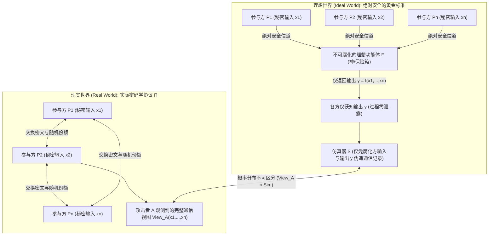

“多家医院希望联合各自肿瘤患者的基因组数据进行新药统计学关联分析（GWAS），但隐私法规严禁任何医院将哪怕1比特的患者原始数据传出院外。”
“多家存在竞争关系的商业银行希望联合追踪跨行洗钱网络，但绝不能向同行暴露各自的客户名单与交易图谱。”

直觉上，这似乎是一个不可能完成的任务：要计算函数 $f(x_1, x_2, \dots, x_n)$，难道不是必须先由某个“可信第三方（Trusted Third Party, TTP）”收集所有明文输入 $x_i$ 才能执行运算吗？然而，现代密码学在20世纪80年代给出了颠覆性的答案：<strong>即便世界上不存在任何可信第三方，多个互不信任的参与方依然可以在不泄露各自秘密输入 $x_i$ 任何1比特额外信息的前提下，共同计算出任意可计算函数 $f(x_1, \dots, x_n)$ 的精确结果。</strong>

这项技术被称为<strong>安全多方计算（Secure Multi-Party Computation, MPC）</strong>。本文将从两个经典的思维实验出发，严格推导MPC的两大核心数学引擎——基于<strong>沙米尔（Shamir）门限秘密共享与拉格朗日插值</strong>的算术电路引擎，以及基于<strong>不经意传输（Oblivious Transfer, OT）与姚氏混淆电路（Garbled Circuits）</strong>的布尔电路引擎，并提供完整的Python实现与隐私增强技术（PETs）全景对比。

---

## 1. 两个直觉思维实验：“无老板的平均薪资计算”与“姚氏百万富翁问题”

### 1.1 思维实验①：不向任何人透露工资，如何算出三人的平均年薪？

三位工程师 $A, B, C$ 坐在咖啡馆里，想知道三人的<strong>平均年薪 $\bar{x} = \frac{x_A + x_B + x_C}{3}$</strong>，但谁都不愿让另外两人知道自己的真实年薪 $x_A, x_B, x_C$。在没有第三方协助的情况下，他们只需利用<strong>加法秘密共享（Additive Secret Sharing）与一次性密码本（One-Time Pad）</strong>即可完成计算：

1. <strong>随机数掩码与第一次耳语（$A \to B$）</strong>：三人约定一个远大于薪资总和的模数 $M$（如 $M = 10^9$）。工程师 $A$ 在有限环 $\mathbb{Z}_M$ 中秘密抽取一个均匀随机数 $r \xleftarrow{\$} \mathbb{Z}_M$，将自己的年薪加上该掩码得到 $s_1 = (x_A + r) \bmod M$，并悄悄告诉 $B$。由于 $r$ 是完全均匀的随机数，$s_1$ 在 $\mathbb{Z}_M$ 上同样服从均匀分布，因此 $B$ 获得的关于 $x_A$ 的互信息严格为零（$I(X_A; S_1) = 0$）。
2. <strong>累加传递（$B \to C \to A$）</strong>：$B$ 将自己的年薪加到 $s_1$ 上，把 $s_2 = (x_A + x_B + r) \bmod M$ 悄悄告诉 $C$；$C$ 再加上自己的年薪 $x_C$，把 $s_3 = (x_A + x_B + x_C + r) \bmod M$ 传回给 $A$。
3. <strong>去除掩码与公布均值</strong>：$A$ 从 $s_3$ 中减去最初生成的随机数 $r$，立刻得到真实总和 $S = (s_3 - r) \bmod M = x_A + x_B + x_C$，除以 $3$ 后公布平均年薪 $\bar{x}$。整个过程中，没有任何人知道其他任何人的单独年薪！

> [!NOTE]
> <strong>为什么至少需要3人（$n \ge 3$）？</strong>
> 如果只有Alice和Bob两人计算平均值 $\bar{x} = \frac{x_A + x_B}{2}$，即便由上帝替他们算出 $\bar{x}$，Alice也能立刻通过 $x_B = 2\bar{x} - x_A$ 反推出Bob的工资。这不是协议的漏洞，而是<strong>函数输出本身蕴含的信息</strong>。MPC保证的是：<strong>除了从自身输入和最终输出 $f(x_1, \dots, x_n)$ 逻辑上必然能推导出的信息外，计算过程本身绝不泄露哪怕1比特的额外信息。</strong>

### 1.2 思维实验②：姚期智（Andrew Yao）的“百万富翁问题”

加法是线性运算，用随机掩码即可轻松隐藏。但如果是非线性的<strong>大小比较</strong>呢？
1982年，图灵奖得主<strong>姚期智（Andrew Chi-Chih Yao）</strong>在奠基性论文 *"Protocols for Secure Computations"* 中提出了著名的<strong>百万富翁问题（Millionaires' Problem）</strong>：两位百万富翁Alice（资产 $x$ 百万美元）和Bob（资产 $y$ 百万美元）希望在不借助第三方的情况下，仅仅算出布尔谓词 $f(x, y) = [x > y] \in \{0, 1\}$（即谁更富有），同时绝不暴露 $x$ 和 $y$ 的具体数值，甚至不能暴露两人财富的差额 $x - y$！这一问题直接催生了现代安全多方计算。

---

## 2. MPC安全性的数学定义：理想世界与现实世界仿真范式

为了严格证明协议不会泄露任何微妙的统计特征，Goldreich、Micali 和 Wigderson（GMW 1987）确立了<strong>理想/现实世界仿真范式（Ideal/Real Simulation Paradigm）</strong>：



如果存在一个多项式时间的<strong>仿真器（Simulator）$\mathcal{S}$</strong>，在仅仅给定被腐化方集合 $I$ 的输入 $\{x_i\}_{i \in I}$ 和最终输出 $\{y_i\}_{i \in I}$ 的条件下，能够独立伪造出一份与现实协议中攻击者观测到的视图 $\text{View}_I^\Pi(x_1, \dots, x_n)$ 在概率分布上不可区分的通信记录：
$$\left\{ \mathcal{S}\left(I, \{x_i\}_{i \in I}, \{y_i\}_{i \in I}\right) \right\} \stackrel{c}{\approx} \left\{ \text{View}_I^\Pi(x_1, \dots, x_n) \right\}$$
那么接收网络上的真实协议消息，就等价于攻击者在自己房间里掷骰子生成随机数，从而在数学上严格证明了协议过程<strong>零信息泄露</strong>。在攻击者模型上，MPC进一步区分为忠实执行协议但试图窥探日志的<strong>半诚实敌手（Semi-Honest / Passive）</strong>，以及任意篡改消息、恶意中止的<strong>恶意敌手（Malicious / Active）</strong>。

---

## 3. 第一大数学引擎：沙米尔 $(t, n)$ 门限秘密共享、拉格朗日插值与 BGW / SPDZ 协议

### 3.1 有限域 $\mathbb{F}_p$ 上的多项式分享与拉格朗日重构
1979年，<strong>阿迪·沙米尔（Adi Shamir）</strong>提出了基于有限域 $\mathbb{F}_p$（$p > n$ 为大素数）上多项式插值的<strong>$(t, n)$ 门限秘密共享方案</strong>：将秘密 $s \in \mathbb{F}_p$ 设为 $t-1$ 次多项式的常数项，并随机均匀抽取 $t-1$ 个系数 $a_1, \dots, a_{t-1} \xleftarrow{\$} \mathbb{F}_p$：
$$P(x) = s + a_1 x + a_2 x^2 + \dots + a_{t-1} x^{t-1} \pmod p$$
每个参与方 $P_i$ ($i=1, \dots, n$) 获得公开坐标 $x_i = i$ 处的求值点 $(x_i, y_i = P(x_i))$ 作为份额 $[s]_i$。

当任意 $t$ 个参与方集合 $T$ ($|T| = t$) 汇集份额时，利用<strong>拉格朗日多项式插值公式（Lagrange Interpolation）</strong>在 $x = 0$ 处求值，即可唯一重构出秘密 $s = P(0)$：
$$s = P(0) = \sum_{i \in T} y_i \prod_{j \in T,\, j \ne i} \frac{-x_j}{x_i - x_j} \pmod p$$
而任意 $t - 1$ 个份额与每一个候选秘密 $s' \in \mathbb{F}_p$（即点 $(0, s')$）都唯一对应一条合法的 $t-1$ 次多项式，因此 $t-1$ 个共谋方对 $s$ 的条件熵满足 $H(S \mid \text{Shares}_{t-1}) = H(S)$，具备<strong>无条件信息论安全</strong>。

### 3.2 BGW 协议与比弗乘法三元组（Beaver's Multiplication Triples）
在<strong>BGW协议（Ben-Or, Goldwasser, Wigderson 1988）</strong>中：
* <strong>加法 $[a] + [b] = [a + b]$ 完全免费</strong>：各方只需在本地将份额相加 $P(x_i) + Q(x_i) \bmod p$，零通信即可获得 $a + b$ 的 $t-1$ 次多项式份额。
* <strong>乘法 $[a] \cdot [b] = [a \cdot b]$ 与降阶</strong>：本地份额相乘会使多项式次数翻倍至 $2(t-1)$，需要至少 $2t - 1 \le n$（即 $t \le \lfloor\frac{n+1}{2}\rfloor$，<strong>诚实大多数 Honest Majority</strong>）个点才能插值，并通过一轮重分享将次数降回 $t-1$。

为了突破诚实大多数限制并加速在线计算，<strong>唐纳德·比弗（Donald Beaver, 1991）</strong>提出了<strong>比弗乘法三元组 $([u], [v], [w = u \cdot v])$</strong>（现代 <strong>SPDZ 协议</strong>的核心）：在离线阶段预生成随机秘密对 $u, v \xleftarrow{\$} \mathbb{F}_p$ 及其乘积 $w = u \cdot v \pmod p$ 的份额；在线计算 $[x \cdot y]$ 时，各方本地计算并公开掩码差值 $d = (x - u) \bmod p$ 和 $e = (y - v) \bmod p$（因 $u, v$ 为一次性随机掩码，$d, e$ 不泄露任何关于 $x, y$ 的信息），随后仅靠本地线性组合即可算出乘积份额：
$$[x \cdot y] = [w] + d \cdot [v] + e \cdot [u] + d \cdot e \pmod p$$

---

## 4. 第二大数学引擎：不经意传输（$\text{OT}_1^2$）与姚氏混淆电路（Garbled Circuits）

对于百万富翁问题（$x > y$）等位运算与比较逻辑，布尔电路引擎更为高效。

```mermaid
flowchart TD
    subgraph Step1["1. Alice (电路混淆方 Garbler)"]
        W["为每条导线 w_i 生成代表0和1的随机128位密钥 (k_i^0, k_i^1)"] --> G["用输入密钥双重加密门电路真值表4行: Enc(k_a^α, k_b^β, k_c^g(α,β))"]
        G --> P["随机打乱4行密文的排列顺序 (生成混淆表 Garbled Table)"]
    end

    subgraph Step2["2. 密钥传递与二选一不经意传输 (OT_1^2)"]
        P -->|"发送混淆表与Alice输入对应的单个密钥 k_a^x"| Eval["Bob (电路求值方 Evaluator)"]
        BobIn["Bob的秘密输入比特 y ∈ {0,1}"] --> OT["二选一不经意传输 (OT_1^2)"]
        W -->|"候选密钥对 (k_b^0, k_b^1)"| OT
        OT -->|"Bob仅获得 k_b^y (Alice不知 y, Bob不知 k_b^{1-y})"| Eval
    end

    subgraph Step3["3. Bob (求值方): 单向盲求值"]
        Eval --> Dec["用持有的密钥对 (k_a^x, k_b^y) 解密4行中唯一匹配的一行，获得输出密钥 k_c^z"]
        Dec --> Out["在最终输出导线处映射出明文结果 z = f(x,y)"]
    end
```



1. <strong>迈克尔·拉宾（Michael Rabin）的二选一不经意传输（$\text{OT}_1^2$）</strong>：发送方Alice持有两条消息 $(m_0, m_1)$，接收方Bob持有选择比特 $b \in \{0, 1\}$。基于离散对数困难性，Bob构造两个公钥 $PK_b = g^k$ 与 $PK_{1-b} = C / g^k$，使自己仅知道其中一个公钥的私钥 $k$，而Alice无法区分哪个公钥含有陷门。最终Bob仅能解密 $m_b$ 而对 $m_{1-b}$ 一无所知，Alice也对Bob的选择 $b$ 一无所知。
2. <strong>姚氏混淆电路（Yao's Garbled Circuits）与三大现代优化</strong>：Alice为每根导线 $w_i$ 分配代表 `0` 和 `1` 的随机AES密钥 $(k_i^0, k_i^1)$，将每个逻辑门真值表的4个输出密钥用输入密钥对双重加密并随机打乱行序。Bob通过 $\text{OT}_1^2$ 获取自己输入对应的密钥 $k_b^y$，在本地逐门解密完成整条电路求值（通信轮数恒为常数 $O(1)$！）。结合现代三大优化——<strong>Point-and-Permute</strong>（用颜色比特直接定位唯一解密行）、<strong>Free-XOR</strong>（令 $k_i^1 = k_i^0 \oplus \Delta$，使所有 `XOR` 门实现零密文传输与零加密运算）以及 <strong>Half-Gates</strong>（将每个 `AND` 门压缩至理论下界2条密文），混淆电路的速度提升了上千倍。

---

## 5. Python 完整实战：有限域 $\mathbb{F}_p$ 上的沙米尔秘密共享与比弗乘法三元组

```python
import secrets
from typing import List, Tuple

PRIME = (1 << 61) - 1  # 61位梅森素数 p = 2^61 - 1

def mod_inv(a: int, p: int = PRIME) -> int:
    return pow(a % p, -1, p)

def shamir_share(secret: int, t: int, n: int, p: int = PRIME) -> List[Tuple[int, int]]:
    coeffs = [secret % p] + [secrets.randbelow(p) for _ in range(t - 1)]
    shares = []
    for i in range(1, n + 1):
        y = 0
        for c in reversed(coeffs):
            y = (y * i + c) % p
        shares.append((i, y))
    return shares

def lagrange_reconstruct(shares: List[Tuple[int, int]], p: int = PRIME) -> int:
    secret = 0
    k = len(shares)
    for i in range(k):
        xi, yi = shares[i]
        num, den = 1, 1
        for j in range(k):
            if i != j:
                xj, _ = shares[j]
                num = (num * (-xj)) % p
                den = (den * (xi - xj)) % p
        secret = (secret + yi * num * mod_inv(den, p)) % p
    return secret

def mpc_add(sa, sb, p=PRIME):
    return [(xa, (ya + yb) % p) for (xa, ya), (_, yb) in zip(sa, sb)]

def mpc_sub(sa, sb, p=PRIME):
    return [(xa, (ya - yb) % p) for (xa, ya), (_, yb) in zip(sa, sb)]

def mpc_scalar_mul(c, sa, p=PRIME):
    return [(xa, (c * ya) % p) for xa, ya in sa]

def mpc_add_const(c, sa, p=PRIME):
    return [(xa, (ya + c) % p) for xa, ya in sa]

def generate_beaver_triple(t: int, n: int, p: int = PRIME):
    u, v = secrets.randbelow(p), secrets.randbelow(p)
    return shamir_share(u, t, n, p), shamir_share(v, t, n, p), shamir_share((u * v) % p, t, n, p)

def mpc_beaver_mul(sx, sy, triple, t: int, p: int = PRIME):
    su, sv, sw = triple
    d = lagrange_reconstruct(mpc_sub(sx, su, p)[:t], p)
    e = lagrange_reconstruct(mpc_sub(sy, sv, p)[:t], p)
    res = mpc_add(mpc_add(sw, mpc_scalar_mul(d, sv, p), p), mpc_scalar_mul(e, su, p), p)
    return mpc_add_const((d * e) % p, res, p)

if __name__ == "__main__":
    t, n = 3, 5
    salaries = [850, 920, 780]
    shared = [shamir_share(s, t, n) for s in salaries]
    total_shares = shared[0]
    for s in shared[1:]:
        total_shares = mpc_add(total_shares, s)
    print("重构总薪资:", lagrange_reconstruct(total_shares[:t]))
```

---

## 6. 隐私增强技术（PETs）四大路线对比与工业级应用

| 维度 | 安全多方计算 (MPC) | 全同态加密 (FHE) | 零知识证明 (ZKP) | 可信执行环境 (TEE) |
| :--- | :--- | :--- | :--- | :--- |
| <strong>核心解决场景</strong> | <strong>多方私有输入联合计算</strong> $f(x_1, \dots, x_n)$ | <strong>单方外包盲计算</strong> $\text{Enc}(x) \mapsto \text{Enc}(f(x))$ | <strong>单方已知秘密 $w$ 的可验证计算证明</strong> | <strong>CPU硬件隔离飞地（Enclave）内明文计算</strong> |
| <strong>计算与通信瓶颈</strong> | CPU极快，<strong>瓶颈在于多轮网络通信带宽/延迟</strong> | 零多轮交互，<strong>瓶颈在于CPU计算慢 $10^3 \sim 10^5$ 倍</strong> | 验证极快，证明生成需大规模椭圆曲线/FFT运算 | 接近原生CPU速度，但受制于Enclave内存容量 |
| <strong>信任假设与风险</strong> | <strong>非共谋假设</strong>（少于门限 $t$ 的节点不联手做恶） | <strong>格密码学困难假设（RLWE）</strong>，单服务器无需信任 | <strong>数学可靠性</strong>（不用于合并多方未知输入） | <strong>依赖硬件厂商（Intel/AMD）及抗物理侧信道攻击</strong> |

今天，从<strong>2008年丹麦甜菜配额双边拍卖</strong>（全球首次商用MPC）、<strong>波士顿女性劳动力委员会（BWWC）跨企业薪酬差距统计</strong>、<strong>Google Chrome / Apple iCloud 的密码泄露检查（基于私有集合交集 PSI）</strong>、<strong>跨医院联合基因组学关联分析（Secure GWAS）</strong>，到守护数千亿美元加密资产的<strong>MPC门限签名钱包（Fireblocks / Coinbase）</strong>，安全多方计算正在用纯粹的数学定理取代脆弱的制度信任。
