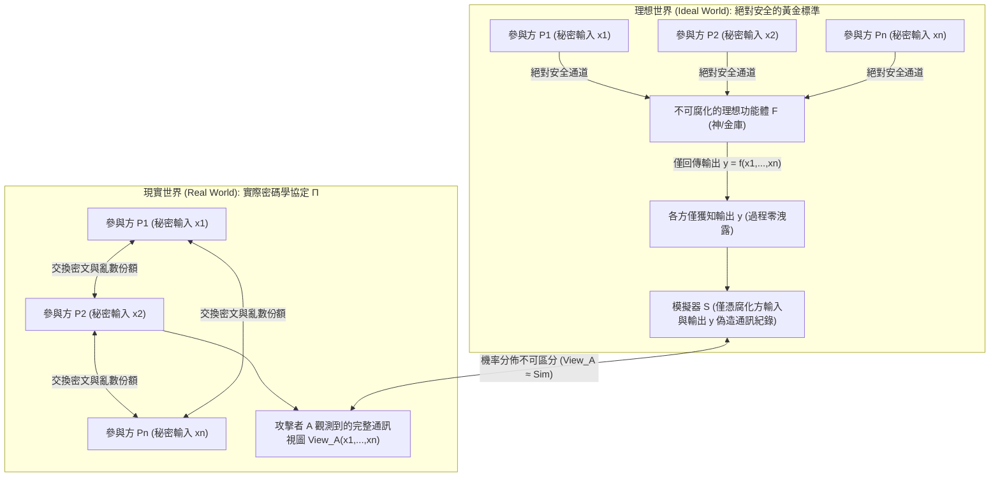
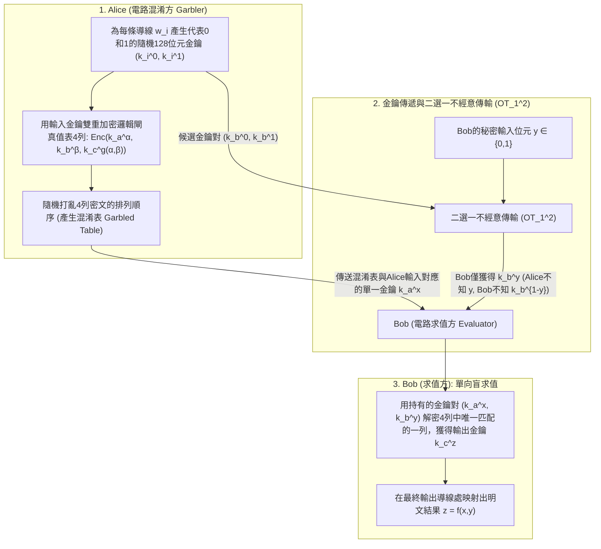

「多家醫學中心希望共同分析病患基因組，但需要依照適用的法律、契約、倫理審查與機構政策，謹慎設計個人資料的共享方式。」
「多家存在競爭關係的商業銀行希望聯合追蹤跨行洗錢網路，但絕不能向同業暴露各自的客戶名單與交易圖譜。」

直覺上，這似乎違反了邏輯常識：要計算函數 $f(x_1, x_2, \dots, x_n)$，難道不是必須先由某個「可信第三方（Trusted Third Party, TTP）」收集所有明文輸入 $x_i$ 才能執行運算嗎？然而，現代密碼學在1980年代給出了顛覆性的定理：<strong>在明確的攻擊者模型與密碼學假設下，參與方可以共同計算函數；安全定義限制的是超出允許輸入和輸出本身已可推論資訊的額外洩漏。</strong>

這項技術被稱為<strong>安全多方計算（Secure Multi-Party Computation, MPC）</strong>。本文將從兩個經典的思維實驗出發，嚴格推導MPC的兩大核心數學引擎——基於<strong>沙米爾（Shamir）門檻秘密共享與拉格朗日插值</strong>的算術電路引擎，以及基於<strong>不經意傳輸（Oblivious Transfer, OT）與姚氏混淆電路（Garbled Circuits）</strong>的布林電路引擎，並提供完整的Python實作與隱私增強技術（PETs）全景對比。

---


**如何理解安全保證：**「秘密不會洩露」等說法僅在指定的攻擊者模型、安全定義與密碼學假設範圍內成立。通常評估的是超出允許輸入與輸出本身可推論資訊的額外洩漏；從結果進行推論，以及實作、營運、可用性與側通道風險都需另行分析。

## 1. 兩個直覺思維實驗：「無主管的平均薪資計算」與「姚氏百萬富翁問題」

### 1.1 思維實驗①：不向任何人透露薪水，如何算出三人的平均年薪？

三位工程師 $A, B, C$ 坐在咖啡廳裡，想知道三人的<strong>平均年薪 $\bar{x} = \frac{x_A + x_B + x_C}{3}$</strong>，但誰都不願讓另外兩人知道自己的真實年薪 $x_A, x_B, x_C$。在沒有第三方協助的情況下，他們只需利用<strong>加法秘密共享（Additive Secret Sharing）與一次性密碼本（One-Time Pad）</strong>即可完成計算：

1. <strong>亂數遮罩與第一次耳語（$A \to B$）</strong>：三人約定一個遠大於薪資總和的模數 $M$（如 $M = 10^9$）。工程師 $A$ 在有限環 $\mathbb{Z}_M$ 中秘密抽取一個均勻亂數 $r \xleftarrow{\$} \mathbb{Z}_M$，將自己的年薪加上該遮罩得到 $s_1 = (x_A + r) \bmod M$，並悄悄告訴 $B$。由於 $r$ 是完全均勻的亂數，$s_1$ 在 $\mathbb{Z}_M$ 上同樣服從均勻分佈，因此 $B$ 獲得的關於 $x_A$ 的互資訊嚴格為零（$I(X_A; S_1) = 0$）。
2. <strong>累加傳遞（$B \to C \to A$）</strong>：$B$ 將自己的年薪加到 $s_1$ 上，把 $s_2 = (x_A + x_B + r) \bmod M$ 悄悄告訴 $C$；$C$ 再加上自己的年薪 $x_C$，把 $s_3 = (x_A + x_B + x_C + r) \bmod M$ 傳回給 $A$。
3. <strong>去除遮罩與公佈均值</strong>：$A$ 從 $s_3$ 中減去最初產生的亂數 $r$，得到總和 $S = (s_3 - r) \bmod M = x_A + x_B + x_C$，除以 $3$ 後公佈平均年薪 $\bar{x}$。在這個簡化示例的誠實且不串通假設下，參與者不會直接收到彼此的個別薪資；但公開輸出、外部知識或串通仍可能洩露輸入資訊，因此這並非經過安全證明的協定。

> **耳語範例的限制：**這只是教學示範，並非安全的MPC協定。它假設相鄰通訊保密、參與者誠實且不會串通。例如，Bob與Carol若交換各自看到的資訊，就能結合公布的總和還原Alice的輸入。實際部署必須使用針對目標威脅模型經過安全證明的協定。此外，為避免模運算回繞，$M$必須大於所有輸入的總和。

> [!NOTE]
> <strong>為什麼至少需要3人（$n \ge 3$）？</strong>
> 如果只有Alice和Bob兩人計算平均值 $\bar{x} = \frac{x_A + x_B}{2}$，即便由神明替他們算出 $\bar{x}$，Alice也能立刻透過 $x_B = 2\bar{x} - x_A$ 反推出Bob的薪水。這不是協定的漏洞，而是<strong>函數輸出本身蘊含的資訊</strong>。MPC保證的是：<strong>除了從自身輸入和最終輸出 $f(x_1, \dots, x_n)$ 邏輯上必然能推導出的資訊外，計算過程本身絕不洩露哪怕1位元的額外資訊。</strong>

### 1.2 思維實驗②：姚期智（Andrew Yao）的「百萬富翁問題」

加法是線性運算，用亂數遮罩即可輕鬆隱藏。但如果是非線性的<strong>大小比較</strong>呢？
1982年，圖靈獎得主<strong>姚期智（Andrew Chi-Chih Yao）</strong>在奠基性論文 *"Protocols for Secure Computations"* 中提出了著名的<strong>百萬富翁問題（Millionaires' Problem）</strong>：兩位百萬富翁Alice（資產 $x$ 百萬美元）和Bob（資產 $y$ 百萬美元）希望在不借助第三方的情況下，僅僅算出布林謂詞 $f(x, y) = [x > y] \in \{0, 1\}$（即誰更富有），同時絕不暴露 $x$ 和 $y$ 的具體數值，甚至不能暴露兩人財富的差額 $x - y$！這一問題直接催生了現代安全多方計算。

---

## 2. MPC安全性的數學定義：理想世界與現實世界模擬範式

為了嚴格證明協定不會洩露任何微妙的統計特徵，Goldreich、Micali 和 Wigderson（GMW 1987）確立了<strong>理想/現實世界模擬範式（Ideal/Real Simulation Paradigm）</strong>：



如果存在一個多項式時間的<strong>模擬器（Simulator）$\mathcal{S}$</strong>，在僅僅給定被腐化方集合 $I$ 的輸入 $\{x_i\}_{i \in I}$ 和最終輸出 $\{y_i\}_{i \in I}$ 的條件下，能夠獨立偽造出一份與現實協定中攻擊者觀測到的視圖 $\text{View}_I^\Pi(x_1, \dots, x_n)$ 在機率分佈上不可區分的通訊紀錄：
$$\left\{ \mathcal{S}\left(I, \{x_i\}_{i \in I}, \{y_i\}_{i \in I}\right) \right\} \stackrel{c}{\approx} \left\{ \text{View}_I^\Pi(x_1, \dots, x_n) \right\}$$
那麼接收網路上的真實協定訊息，就等價於攻擊者在自己房間裡擲骰子產生亂數，從而在數學上嚴格證明了協定過程<strong>零資訊洩露</strong>。在攻擊者模型上，MPC進一步區分為忠實執行協定但試圖窺探日誌的<strong>半誠實敵手（Semi-Honest / Passive）</strong>，以及任意竄改訊息、惡意中止的<strong>惡意敵手（Malicious / Active）</strong>。

---

## 3. 第一大數學引擎：沙米爾 $(t, n)$ 門檻秘密共享、拉格朗日插值與 BGW / SPDZ 協定

### 3.1 有限體 $\mathbb{F}_p$ 上的多項式分享與拉格朗日重構
1979年，<strong>阿迪·沙米爾（Adi Shamir）</strong>提出了基於有限體 $\mathbb{F}_p$（$p > n$ 為大質數）上多項式插值的<strong>$(t, n)$ 門檻秘密共享方案</strong>：將秘密 $s \in \mathbb{F}_p$ 設為 $t-1$ 次多項式的常數項，並隨機均勻抽取 $t-1$ 個係數 $a_1, \dots, a_{t-1} \xleftarrow{\$} \mathbb{F}_p$：
$$P(x) = s + a_1 x + a_2 x^2 + \dots + a_{t-1} x^{t-1} \pmod p$$
每個參與方 $P_i$ ($i=1, \dots, n$) 獲得公開座標 $x_i = i$ 處的求值點 $(x_i, y_i = P(x_i))$ 作為份額 $[s]_i$。

當任意 $t$ 個參與方集合 $T$ ($|T| = t$) 匯集份額時，利用<strong>拉格朗日多項式插值公式（Lagrange Interpolation）</strong>在 $x = 0$ 處求值，即可唯一重構出秘密 $s = P(0)$：
$$s = P(0) = \sum_{i \in T} y_i \prod_{j \in T,\, j \ne i} \frac{-x_j}{x_i - x_j} \pmod p$$
而任意 $t - 1$ 個份額與每一個候選秘密 $s' \in \mathbb{F}_p$（即點 $(0, s')$）都唯一對應一條合法的 $t-1$ 次多項式，因此 $t-1$ 個共謀方對 $s$ 的條件熵滿足 $H(S \mid \text{Shares}_{t-1}) = H(S)$，具備<strong>無條件資訊理論安全</strong>。

### 3.2 BGW 協定與比弗乘法三元組（Beaver's Multiplication Triples）
在<strong>BGW協定（Ben-Or, Goldwasser, Wigderson 1988）</strong>中：
* <strong>加法 $[a] + [b] = [a + b]$ 完全免費</strong>：各方只需在本地將份額相加 $P(x_i) + Q(x_i) \bmod p$，零通訊即可獲得 $a + b$ 的 $t-1$ 次多項式份額。
* <strong>乘法 $[a] \cdot [b] = [a \cdot b]$ 與降階</strong>：本地份額相乘會使多項式次數翻倍至 $2(t-1)$，需要至少 $2t - 1 \le n$（即 $t \le \lfloor\frac{n+1}{2}\rfloor$，<strong>誠實大多數 Honest Majority</strong>）個點才能插值，並透過一輪重分享將次數降回 $t-1$。

為了提升支援相應安全模型之協定的線上效率，<strong>唐納德·比弗（Donald Beaver, 1991）</strong>提出了<strong>比弗乘法三元組 $([u], [v], [w = u \cdot v])$</strong>（現代 <strong>SPDZ 協定</strong>的核心）：在離線階段預先產生隨機秘密對 $u, v \xleftarrow{\$} \mathbb{F}_p$ 及其乘積 $w = u \cdot v \pmod p$ 的份額；線上計算 $[x \cdot y]$ 時，各方本地計算並公開遮罩差值 $d = (x - u) \bmod p$ 和 $e = (y - v) \bmod p$（在指定安全模型且隨機數不重複使用的前提下，差值只洩露安全定義允許的資訊），隨後僅靠本地線性組合即可算出乘積份額：
$$[x \cdot y] = [w] + d \cdot [v] + e \cdot [u] + d \cdot e \pmod p$$

---

**可容忍的腐化數量取決於攻擊者模型：**經典BGW在被動（誠實但好奇）模型中可容忍 $c<n/2$；在適當通訊假設下，對惡意參與者達到資訊理論安全通常要求 $c<n/3$。Beaver三元組本身既不決定腐化門檻，也不提供主動安全性。

## 4. 第二種方法：不經意傳輸（OT）與姚氏混淆電路

對於百萬富翁問題（$x > y$）等位元運算與比較邏輯，布林電路引擎更為高效。



1. <strong>二選一不經意傳輸（$\text{OT}_1^2$）</strong>：傳送方Alice持有兩條訊息 $(m_0, m_1)$，接收方Bob持有選擇位元 $b \in \{0, 1\}$。在符合協定要求的群參數與挑戰值產生條件下，Bob構造兩個公鑰 $PK_b = g^k$ 與 $PK_{1-b} = C / g^k$。Alice看到的選擇位應在此構造中不可區分；Bob能否有效還原所選訊息則依賴相應的計算困難假設。這是協定概述，安全性取決於具體構造、參數及雜湊／金鑰導出方式。
2. <strong>姚氏混淆電路（Yao's Garbled Circuits）與三大現代最佳化</strong>：Alice為每根導線 $w_i$ 分配代表 `0` 和 `1` 的隨機AES金鑰 $(k_i^0, k_i^1)$，將每個邏輯閘真值表的4個輸出金鑰用輸入金鑰對雙重加密並隨機打亂列序。Bob透過 $\text{OT}_1^2$ 取得自己輸入對應的金鑰 $k_b^y$，在本地逐閘解密完成整條電路求值（閘級求值在本地完成；整體輪數取決於OT實作與協定設定。）。結合現代三大最佳化——<strong>Point-and-Permute</strong>（用顏色位元直接定位唯一解密列）、<strong>Free-XOR</strong>（令 $k_i^1 = k_i^0 \oplus \Delta$，使所有 `XOR` 閘實現零密文傳輸與零加密運算）以及 <strong>Half-Gates</strong>（將每個 `AND` 閘壓縮至理論下界2條密文），這些最佳化可減少部分閘的密文數量或計算量；實際效益取決於電路、實作、硬體與網路，不能以單一倍數概括。

---

## 5. Python 完整實戰：有限體 $\mathbb{F}_p$ 上的沙米爾秘密共享與比弗乘法三元組

範例也會使用新的Beaver乘法三元組計算每份薪資的平方，接著公開總和與平方和，以求平均值和母體變異數。這些統計結果會對執行重構的一方公開；整個範例是在單一程序中的教學模擬。

```python
import secrets
from typing import List, Tuple

# 61-bit Mersenne prime p = 2^61 - 1 for our prime finite field F_p
PRIME = (1 << 61) - 1

def mod_inv(a: int, p: int = PRIME) -> int:
    # Modular inverse in F_p via Extended Euclidean Algorithm (Python 3.8+ pow(a, -1, p))
    return pow(a % p, -1, p)

def shamir_share(secret: int, t: int, n: int, p: int = PRIME) -> List[Tuple[int, int]]:
    # Shamir's (t, n) Threshold Secret Sharing:
    # Samples a random degree-(t-1) polynomial P(x) with P(0) = secret and evaluates it at x = 1..n.
    assert 1 <= t <= n < p, "Threshold t and party count n must satisfy 1 <= t <= n < p"
    # P(x) = s + a_1 * x + a_2 * x^2 + ... + a_{t-1} * x^{t-1} (mod p)
    coeffs = [secret % p] + [secrets.randbelow(p) for _ in range(t - 1)]

    shares = []
    for i in range(1, n + 1):
        # Evaluate P(i) using Horner's method
        y = 0
        for c in reversed(coeffs):
            y = (y * i + c) % p
        shares.append((i, y))
    return shares

def lagrange_reconstruct(shares: List[Tuple[int, int]], p: int = PRIME) -> int:
    # Reconstructs P(0) = s from any subset of >= t shares using Lagrange Polynomial Interpolation:
    # s = sum_{i in T} y_i * prod_{j in T, j != i} (-x_j) / (x_i - x_j) (mod p)
    secret = 0
    k = len(shares)
    for i in range(k):
        xi, yi = shares[i]
        num = 1
        den = 1
        for j in range(k):
            if i == j:
                continue
            xj, _ = shares[j]
            num = (num * (-xj)) % p
            den = (den * (xi - xj)) % p
        lambda_i = (num * mod_inv(den, p)) % p
        secret = (secret + yi * lambda_i) % p
    return secret

def mpc_add(shares_a: List[Tuple[int, int]], shares_b: List[Tuple[int, int]], p: int = PRIME) -> List[Tuple[int, int]]:
    # Local homomorphic addition [a] + [b] = [a + b] (Zero communication)
    return [(xa, (ya + yb) % p) for (xa, ya), (xb, yb) in zip(shares_a, shares_b)]

def mpc_sub(shares_a: List[Tuple[int, int]], shares_b: List[Tuple[int, int]], p: int = PRIME) -> List[Tuple[int, int]]:
    # Local homomorphic subtraction [a] - [b] = [a - b] (Zero communication)
    return [(xa, (ya - yb) % p) for (xa, ya), (xb, yb) in zip(shares_a, shares_b)]

def mpc_scalar_mul(scalar: int, shares_a: List[Tuple[int, int]], p: int = PRIME) -> List[Tuple[int, int]]:
    # Local multiplication by a public scalar c * [a] = [c * a] (Zero communication)
    return [(xa, (scalar * ya) % p) for xa, ya in shares_a]

def mpc_add_constant(const: int, shares_a: List[Tuple[int, int]], p: int = PRIME) -> List[Tuple[int, int]]:
    # Adding a public constant [a] + c = [a + c] shifts P(x) by +c at every evaluation point
    return [(xa, (ya + const) % p) for xa, ya in shares_a]

def generate_beaver_triple(t: int, n: int, p: int = PRIME):
    # Offline Preprocessing Phase: Generates a shared random multiplication triple ([u], [v], [w = u * v])
    u = secrets.randbelow(p)
    v = secrets.randbelow(p)
    w = (u * v) % p
    return shamir_share(u, t, n, p), shamir_share(v, t, n, p), shamir_share(w, t, n, p)

def mpc_beaver_mul(
    shares_x: List[Tuple[int, int]],
    shares_y: List[Tuple[int, int]],
    triple: Tuple[List[Tuple[int, int]], List[Tuple[int, int]], List[Tuple[int, int]]],
    t: int,
    p: int = PRIME
) -> List[Tuple[int, int]]:
    # Online Phase: Evaluates [x * y] using a Beaver Multiplication Triple ([u], [v], [w]):
    # 1. Locally compute [d] = [x] - [u] and [e] = [y] - [v]
    # 2. Open masked differences; security depends on fresh, valid, single-use triples and the threat model
    # 3. Locally compute the linear combination [x * y] = [w] + d * [v] + e * [u] + d * e
    shares_u, shares_v, shares_w = triple
    shares_d = mpc_sub(shares_x, shares_u, p)
    shares_e = mpc_sub(shares_y, shares_v, p)

    # Open the masked differences d = x - u and e = y - v using t shares
    d = lagrange_reconstruct(shares_d[:t], p)
    e = lagrange_reconstruct(shares_e[:t], p)

    # Linear combination to obtain degree-(t-1) shares of [x * y]
    term1 = shares_w
    term2 = mpc_scalar_mul(d, shares_v, p)
    term3 = mpc_scalar_mul(e, shares_u, p)
    res = mpc_add(mpc_add(term1, term2, p), term3, p)
    res = mpc_add_constant((d * e) % p, res, p)
    return res

if __name__ == "__main__":
    # 5 MPC servers (n = 5) with reconstruction threshold t = 3 (any 2 servers learn 0 bits)
    t, n = 3, 5
    salaries = [850, 920, 780]  # Example salary units

    # Each engineer splits their secret salary across the 5 servers
    shared_salaries = [shamir_share(s, t, n) for s in salaries]

    # 1. Compute the sum of salaries locally with zero inter-server communication
    sum_shares = shared_salaries[0]
    for s_share in shared_salaries[1:]:
        sum_shares = mpc_add(sum_shares, s_share)

    # Reconstruct the total from any 3 servers (e.g., servers 1, 3, and 5)
    subset_3 = [sum_shares[0], sum_shares[2], sum_shares[4]]
    total_salary = lagrange_reconstruct(subset_3)
    mean_salary = total_salary / len(salaries)
    print(f"Reconstructed total (units): {total_salary:,} (mean: {mean_salary:,.2f})")

    # 2. Compute the sum of squares S_2 = x_A^2 + x_B^2 + x_C^2 using Beaver Multiplication Triples
    sq_sum_shares = shamir_share(0, t, n)
    for s_share in shared_salaries:
        triple = generate_beaver_triple(t, n)
        sq_share = mpc_beaver_mul(s_share, s_share, triple, t)
        sq_sum_shares = mpc_add(sq_sum_shares, sq_share)

    total_sq = lagrange_reconstruct(sq_sum_shares[:t])
    variance = (total_sq / len(salaries)) - (mean_salary ** 2)
    print(f"Reconstructed sum of squares: {total_sq:,} (population variance: {variance:,.2f})")
```

---

## 6. 隱私增強技術（PETs）四大路線對比與工業級應用

| 維度 | 安全多方計算 (MPC) | 全同態加密 (FHE) | 零知識證明 (ZKP) | 可信執行環境 (TEE) |
| :--- | :--- | :--- | :--- | :--- |
| <strong>核心解決場景</strong> | <strong>多方私有輸入聯合計算</strong> $f(x_1, \dots, x_n)$ | <strong>單方外包盲計算</strong> $\text{Enc}(x) \mapsto \text{Enc}(f(x))$ | <strong>單方已知秘密 $w$ 的可驗證計算證明</strong> | <strong>CPU硬體隔離飛地（Enclave）內明文計算</strong> |
| <strong>計算與通訊瓶頸</strong> | 通訊成本取決於協定、電路深度與網路條件 | 計算與通訊成本取決於方案、電路和硬體，沒有通用的固定減速倍數 | 證明與驗證成本取決於證明系統和命題 | 效能與受保護記憶體取決於平台和工作負載 |
| <strong>信任假設與風險</strong> | MPC的安全性取決於協定的門檻與攻擊者模型；輸出洩漏、可用性及公平性須另行評估。 | <strong>格密碼學困難假設（RLWE）</strong>，單伺服器無需信任 | <strong>數學可靠性</strong>（不用於合併多方未知輸入） | <strong>依賴硬體廠商（Intel/AMD）及抗物理側通道攻擊</strong> |

研究或部署案例包括丹麥甜菜拍賣、波士頓薪酬差距測量、外洩密碼檢查、基因組研究與分散式簽章。各案例的部署成熟度、安全模型及剩餘風險並不相同；MPC不會將制度信任轉化為絕對確定性。

## 7. 其他PET與其限制

歷史說明：Rabin於1981年提出的OT（接收者以1/2機率收到訊息）與Even、Goldreich、Lempel在1985年形式化的二選一OT功能不同。
MPC分散處理輸入，安全保證取決於協定與攻擊者模型。FHE允許對密文計算，但不會自動驗證計算，也無法阻止結果洩露資訊。零知識證明可在不公開見證的情況下證明陳述，卻不能取代多方聯合計算。TEE在受保護硬體中處理明文，需要信任硬體與遠端證明。這些技術可以組合；成本與保證依情境而異。

## 8. 案例
2008年丹麥甜菜拍賣採用三方MPC；論文記載約1,200筆輸入、約30分鐘計算及約25,000噸生產權轉移。BWWC與波士頓大學每兩年發布薪資差距報告；BWWC表示2023年報告涵蓋103家雇主及165,000名全職員工。Google Chrome與Apple分別記載了不同的PSI密碼檢查。2023年USENIX研究報告受測Chrome實作的側通道問題。MPC版GWAS已用於研究，但結果仍可能洩露資訊。Secure Aggregation隱藏個別更新，無法消除所有推論風險。門檻簽章與份額更新也有協定及營運前提。

## 9. 結語
MPC可減少明文資料集中存放，但無法消除結果洩露、營運、法律或可用性風險。其保證取決於攻擊者模型、密碼學假設、實作與營運。

**程式碼範例的範圍：**這段 Python 程式是在單一程序中模擬有限體秘密分享與運算的教學範例。它不是各方各自只持有本方份額的網路 MPC 系統，也未實作對惡意參與者的驗證、身分驗證與安全傳輸、可信任的預處理、輸入範圍及溢位控制。`lagrange_reconstruct`重構出的值會對執行重構的一方公開。請勿使用此範例保護真實資料或資產。


## Sources

- [Rabin, “How to Exchange Secrets with Oblivious Transfer” (1981)](https://eprint.iacr.org/2005/187.pdf)
- [Even, Goldreich, and Lempel, “A Randomized Protocol for Signing Contracts” (1985)](https://luca-giuzzi.unibs.it/corsi/Support/papers-cryptography/SigningContracts.pdf)

- [Bogetoft et al., “Secure Multiparty Computation Goes Live” (2009)](https://www.acsu.buffalo.edu/~mblanton/cse715/sugar-beet-auction.pdf)
- [Boston Women’s Workforce Council: Wage Gap Studies](https://thebwwc.org/wage-gap-studies)
- [Google: Better password protections in Chrome](https://security.googleblog.com/2019/12/better-password-protections-in-chrome.html)
- [Apple Platform Security: Password Monitoring](https://support.apple.com/guide/security/password-monitoring-sec78e79fc3b/web)
- [Kwong et al., USENIX Security 2023: Chrome password-check side channels](https://www.usenix.org/conference/usenixsecurity23/presentation/kwong)
- [Cho et al., “Secure genome-wide association analysis using multiparty computation” (2018)](https://pmc.ncbi.nlm.nih.gov/articles/PMC5990440/)
- [Bonawitz et al., Google Research: Practical Secure Aggregation](https://research.google/pubs/practical-secure-aggregation-for-federated-learning-on-user-held-data/)
- [Canetti et al., “UC Non-Interactive, Proactive, Threshold ECDSA” (2020)](https://eprint.iacr.org/2020/492)
- [Kumar et al., “Understanding Information Disclosure from Secure Computation Output” (2025)](https://doi.org/10.1145/3705004)
- [Kolesnikov and Schneider, “Improved Garbled Circuit: Free XOR Gates and Applications” (2008)](https://encrypto.de/papers/KS08XOR.pdf)
- [Zahur, Rosulek, and Evans, “Two Halves Make a Whole: Reducing Data Transfer in Garbled Circuits using Half Gates” (2015)](https://www.cs.virginia.edu/~evans/pubs/ec2015/halfgates.pdf)

- [Stanford University cryptography notes: Oblivious Transfer](https://crypto.stanford.edu/pbc/notes/crypto/ot.html)

- [A Full Proof of the BGW Protocol for Perfectly Secure MPC](https://doi.org/10.1007/S00145-015-9214-4)

- [Yao, “Protocols for Secure Computations” (FOCS 1982)](https://doi.org/10.1109/SFCS.1982.38)
