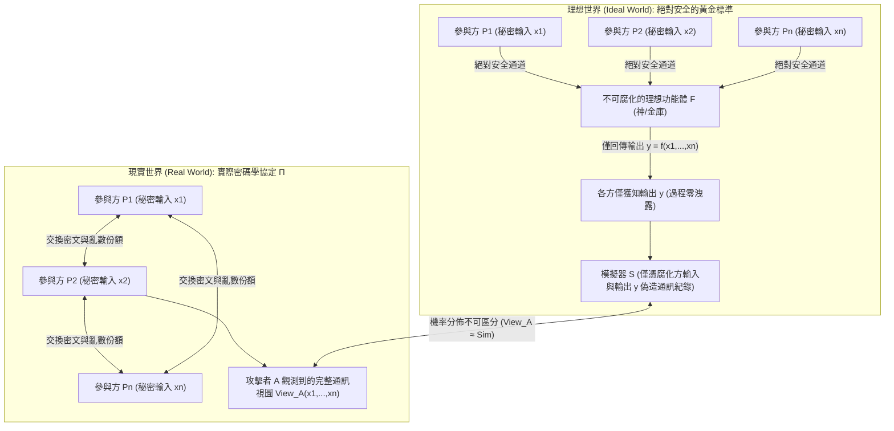
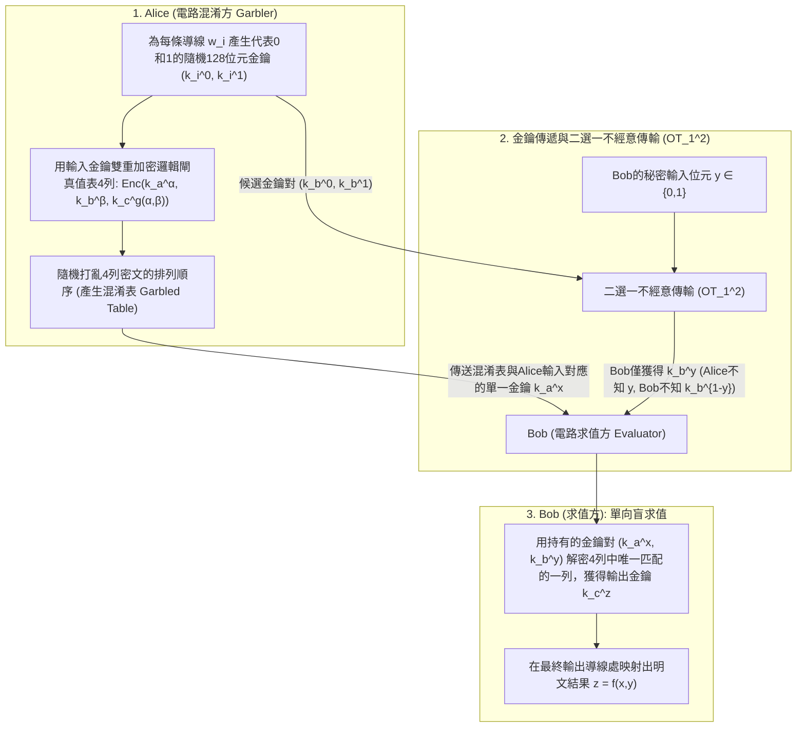

「多家醫學中心希望整合各自癌症病患的基因組序列以進行新藥統計關聯分析（GWAS），但個資法規嚴禁任何醫院將哪怕1位元的病患原始資料傳出院外。」
「多家存在競爭關係的商業銀行希望聯合追蹤跨行洗錢網路，但絕不能向同業暴露各自的客戶名單與交易圖譜。」

直覺上，這似乎違反了邏輯常識：要計算函數 $f(x_1, x_2, \dots, x_n)$，難道不是必須先由某個「可信第三方（Trusted Third Party, TTP）」收集所有明文輸入 $x_i$ 才能執行運算嗎？然而，現代密碼學在1980年代給出了顛覆性的定理：<strong>即便世界上不存在任何可信第三方，多個互不信任的參與方依然可以在不洩露各自秘密輸入 $x_i$ 任何1位元額外資訊的前提下，共同計算出任意可計算函數 $f(x_1, \dots, x_n)$ 的精確結果。</strong>

這項技術被稱為<strong>安全多方計算（Secure Multi-Party Computation, MPC）</strong>。本文將從兩個經典的思維實驗出發，嚴格推導MPC的兩大核心數學引擎——基於<strong>沙米爾（Shamir）門檻秘密共享與拉格朗日插值</strong>的算術電路引擎，以及基於<strong>不經意傳輸（Oblivious Transfer, OT）與姚氏混淆電路（Garbled Circuits）</strong>的布林電路引擎，並提供完整的Python實作與隱私增強技術（PETs）全景對比。

---

## 1. 兩個直覺思維實驗：「無主管的平均薪資計算」與「姚氏百萬富翁問題」

### 1.1 思維實驗①：不向任何人透露薪水，如何算出三人的平均年薪？

三位工程師 $A, B, C$ 坐在咖啡廳裡，想知道三人的<strong>平均年薪 $\bar{x} = \frac{x_A + x_B + x_C}{3}$</strong>，但誰都不願讓另外兩人知道自己的真實年薪 $x_A, x_B, x_C$。在沒有第三方協助的情況下，他們只需利用<strong>加法秘密共享（Additive Secret Sharing）與一次性密碼本（One-Time Pad）</strong>即可完成計算：

1. <strong>亂數遮罩與第一次耳語（$A \to B$）</strong>：三人約定一個遠大於薪資總和的模數 $M$（如 $M = 10^9$）。工程師 $A$ 在有限環 $\mathbb{Z}_M$ 中秘密抽取一個均勻亂數 $r \xleftarrow{\$} \mathbb{Z}_M$，將自己的年薪加上該遮罩得到 $s_1 = (x_A + r) \bmod M$，並悄悄告訴 $B$。由於 $r$ 是完全均勻的亂數，$s_1$ 在 $\mathbb{Z}_M$ 上同樣服從均勻分佈，因此 $B$ 獲得的關於 $x_A$ 的互資訊嚴格為零（$I(X_A; S_1) = 0$）。
2. <strong>累加傳遞（$B \to C \to A$）</strong>：$B$ 將自己的年薪加到 $s_1$ 上，把 $s_2 = (x_A + x_B + r) \bmod M$ 悄悄告訴 $C$；$C$ 再加上自己的年薪 $x_C$，把 $s_3 = (x_A + x_B + x_C + r) \bmod M$ 傳回給 $A$。
3. <strong>去除遮罩與公佈均值</strong>：$A$ 從 $s_3$ 中減去最初產生的亂數 $r$，立刻得到真實總和 $S = (s_3 - r) \bmod M = x_A + x_B + x_C$，除以 $3$ 後公佈平均年薪 $\bar{x}$。整個過程中，沒有任何人知道其他任何人的單獨年薪！

> [!NOTE]
> <strong>為什麼至少需要3人（$n \ge 3$）？</strong>
> 如果只有Alice和Bob兩人計算平均值 $\bar{x} = \frac{x_A + x_B}{2}$，即便由神明替他們算出 $\bar{x}$，Alice也能立刻透過 $x_B = 2\bar{x} - x_A$ 反推出Bob的薪水。這不是協定的漏洞，而是<strong>函數輸出本身蘊含的資訊</strong>。MPC保證的是：<strong>除了從自身輸入和最終輸出 $f(x_1, \dots, x_n)$ 邏輯上必然能推導出的資訊外，計算過程本身絕不洩露哪怕1位元的額外資訊。</strong>

### 1.2 思維實驗②：姚期智（Andrew Yao）的「百萬富翁問題」

加法是線性運算，用亂數遮罩即可輕鬆隱藏。但如果是非線性的<strong>大小比較</strong>呢？
1982年，圖靈獎得主<strong>姚期智（Andrew Chi-Chih Yao）</strong>在奠基性論文 *"Protocols for Secure Computations"* 中提出了著名的<strong>百萬富翁問題（Millionaires' Problem）</strong>：兩位百萬富翁Alice（資產 $x$ 百萬美元）和Bob（資產 $y$ 百萬美元）希望在不借助第三方的情況下，僅僅算出布林謂詞 $f(x, y) = [x > y] \in \{0, 1\}$（即誰更富有），同時絕不暴露 $x$ 和 $y$ 的具體數值，甚至不能暴露兩人財富的差額 $x - y$！這一問題直接催生了現代安全多方計算。

---

## 2. MPC安全性的數學定義：理想世界與現實世界模擬範式

為了嚴格證明協定不會洩露任何微妙的統計特徵，Goldreich、Micali 和 Wigderson（GMW 1987）確立了<strong>理想/現實世界模擬範式（Ideal/Real Simulation Paradigm）</strong>：



如果存在一個多項式時間的<strong>模擬器（Simulator）$\mathcal{S}$</strong>，在僅僅給定被腐化方集合 $I$ 的輸入 $\{x_i\}_{i \in I}$ 和最終輸出 $\{y_i\}_{i \in I}$ 的條件下，能夠獨立偽造出一份與現實協定中攻擊者觀測到的視圖 $\text{View}_I^\Pi(x_1, \dots, x_n)$ 在機率分佈上不可區分的通訊紀錄：
$$\left\{ \mathcal{S}\left(I, \{x_i\}_{i \in I}, \{y_i\}_{i \in I}\right) \right\} \stackrel{c}{\approx} \left\{ \text{View}_I^\Pi(x_1, \dots, x_n) \right\}$$
那麼接收網路上的真實協定訊息，就等價於攻擊者在自己房間裡擲骰子產生亂數，從而在數學上嚴格證明了協定過程<strong>零資訊洩露</strong>。在攻擊者模型上，MPC進一步區分為忠實執行協定但試圖窺探日誌的<strong>半誠實敵手（Semi-Honest / Passive）</strong>，以及任意竄改訊息、惡意中止的<strong>惡意敵手（Malicious / Active）</strong>。

---

## 3. 第一大數學引擎：沙米爾 $(t, n)$ 門檻秘密共享、拉格朗日插值與 BGW / SPDZ 協定

### 3.1 有限體 $\mathbb{F}_p$ 上的多項式分享與拉格朗日重構
1979年，<strong>阿迪·沙米爾（Adi Shamir）</strong>提出了基於有限體 $\mathbb{F}_p$（$p > n$ 為大質數）上多項式插值的<strong>$(t, n)$ 門檻秘密共享方案</strong>：將秘密 $s \in \mathbb{F}_p$ 設為 $t-1$ 次多項式的常數項，並隨機均勻抽取 $t-1$ 個係數 $a_1, \dots, a_{t-1} \xleftarrow{\$} \mathbb{F}_p$：
$$P(x) = s + a_1 x + a_2 x^2 + \dots + a_{t-1} x^{t-1} \pmod p$$
每個參與方 $P_i$ ($i=1, \dots, n$) 獲得公開座標 $x_i = i$ 處的求值點 $(x_i, y_i = P(x_i))$ 作為份額 $[s]_i$。

當任意 $t$ 個參與方集合 $T$ ($|T| = t$) 匯集份額時，利用<strong>拉格朗日多項式插值公式（Lagrange Interpolation）</strong>在 $x = 0$ 處求值，即可唯一重構出秘密 $s = P(0)$：
$$s = P(0) = \sum_{i \in T} y_i \prod_{j \in T,\, j \ne i} \frac{-x_j}{x_i - x_j} \pmod p$$
而任意 $t - 1$ 個份額與每一個候選秘密 $s' \in \mathbb{F}_p$（即點 $(0, s')$）都唯一對應一條合法的 $t-1$ 次多項式，因此 $t-1$ 個共謀方對 $s$ 的條件熵滿足 $H(S \mid \text{Shares}_{t-1}) = H(S)$，具備<strong>無條件資訊理論安全</strong>。

### 3.2 BGW 協定與比弗乘法三元組（Beaver's Multiplication Triples）
在<strong>BGW協定（Ben-Or, Goldwasser, Wigderson 1988）</strong>中：
* <strong>加法 $[a] + [b] = [a + b]$ 完全免費</strong>：各方只需在本地將份額相加 $P(x_i) + Q(x_i) \bmod p$，零通訊即可獲得 $a + b$ 的 $t-1$ 次多項式份額。
* <strong>乘法 $[a] \cdot [b] = [a \cdot b]$ 與降階</strong>：本地份額相乘會使多項式次數翻倍至 $2(t-1)$，需要至少 $2t - 1 \le n$（即 $t \le \lfloor\frac{n+1}{2}\rfloor$，<strong>誠實大多數 Honest Majority</strong>）個點才能插值，並透過一輪重分享將次數降回 $t-1$。

為了突破誠實大多數限制並加速線上計算，<strong>唐納德·比弗（Donald Beaver, 1991）</strong>提出了<strong>比弗乘法三元組 $([u], [v], [w = u \cdot v])$</strong>（現代 <strong>SPDZ 協定</strong>的核心）：在離線階段預先產生隨機秘密對 $u, v \xleftarrow{\$} \mathbb{F}_p$ 及其乘積 $w = u \cdot v \pmod p$ 的份額；線上計算 $[x \cdot y]$ 時，各方本地計算並公開遮罩差值 $d = (x - u) \bmod p$ 和 $e = (y - v) \bmod p$（因 $u, v$ 為一次性隨機遮罩，$d, e$ 不洩露任何關於 $x, y$ 的資訊），隨後僅靠本地線性組合即可算出乘積份額：
$$[x \cdot y] = [w] + d \cdot [v] + e \cdot [u] + d \cdot e \pmod p$$

---

## 4. 第二大數學引擎：不經意傳輸（$\text{OT}_1^2$）與姚氏混淆電路（Garbled Circuits）

對於百萬富翁問題（$x > y$）等位元運算與比較邏輯，布林電路引擎更為高效。



1. <strong>麥可·拉賓（Michael Rabin）的二選一不經意傳輸（$\text{OT}_1^2$）</strong>：傳送方Alice持有兩條訊息 $(m_0, m_1)$，接收方Bob持有選擇位元 $b \in \{0, 1\}$。基於離散對數困難性，Bob構造兩個公鑰 $PK_b = g^k$ 與 $PK_{1-b} = C / g^k$，使自己僅知道其中一個公鑰的私鑰 $k$，而Alice無法區分哪個公鑰含有陷門。最終Bob僅能解密 $m_b$ 而對 $m_{1-b}$ 一無所知，Alice也對Bob的選擇 $b$ 一無所知。
2. <strong>姚氏混淆電路（Yao's Garbled Circuits）與三大現代最佳化</strong>：Alice為每根導線 $w_i$ 分配代表 `0` 和 `1` 的隨機AES金鑰 $(k_i^0, k_i^1)$，將每個邏輯閘真值表的4個輸出金鑰用輸入金鑰對雙重加密並隨機打亂列序。Bob透過 $\text{OT}_1^2$ 取得自己輸入對應的金鑰 $k_b^y$，在本地逐閘解密完成整條電路求值（通訊輪數恆為常數 $O(1)$！）。結合現代三大最佳化——<strong>Point-and-Permute</strong>（用顏色位元直接定位唯一解密列）、<strong>Free-XOR</strong>（令 $k_i^1 = k_i^0 \oplus \Delta$，使所有 `XOR` 閘實現零密文傳輸與零加密運算）以及 <strong>Half-Gates</strong>（將每個 `AND` 閘壓縮至理論下界2條密文），混淆電路的速度提升了上千倍。

---

## 5. Python 完整實戰：有限體 $\mathbb{F}_p$ 上的沙米爾秘密共享與比弗乘法三元組

```python
import secrets
from typing import List, Tuple

PRIME = (1 << 61) - 1  # 61位元梅森質數 p = 2^61 - 1

def mod_inv(a: int, p: int = PRIME) -> int:
    return pow(a % p, -1, p)

def shamir_share(secret: int, t: int, n: int, p: int = PRIME) -> List[Tuple[int, int]]:
    coeffs = [secret % p] + [secrets.randbelow(p) for _ in range(t - 1)]
    shares = []
    for i in range(1, n + 1):
        y = 0
        for c in reversed(coeffs):
            y = (y * i + c) % p
        shares.append((i, y))
    return shares

def lagrange_reconstruct(shares: List[Tuple[int, int]], p: int = PRIME) -> int:
    secret = 0
    k = len(shares)
    for i in range(k):
        xi, yi = shares[i]
        num, den = 1, 1
        for j in range(k):
            if i != j:
                xj, _ = shares[j]
                num = (num * (-xj)) % p
                den = (den * (xi - xj)) % p
        secret = (secret + yi * num * mod_inv(den, p)) % p
    return secret

def mpc_add(sa, sb, p=PRIME):
    return [(xa, (ya + yb) % p) for (xa, ya), (_, yb) in zip(sa, sb)]

def mpc_sub(sa, sb, p=PRIME):
    return [(xa, (ya - yb) % p) for (xa, ya), (_, yb) in zip(sa, sb)]

def mpc_scalar_mul(c, sa, p=PRIME):
    return [(xa, (c * ya) % p) for xa, ya in sa]

def mpc_add_const(c, sa, p=PRIME):
    return [(xa, (ya + c) % p) for xa, ya in sa]

def generate_beaver_triple(t: int, n: int, p: int = PRIME):
    u, v = secrets.randbelow(p), secrets.randbelow(p)
    return shamir_share(u, t, n, p), shamir_share(v, t, n, p), shamir_share((u * v) % p, t, n, p)

def mpc_beaver_mul(sx, sy, triple, t: int, p: int = PRIME):
    su, sv, sw = triple
    d = lagrange_reconstruct(mpc_sub(sx, su, p)[:t], p)
    e = lagrange_reconstruct(mpc_sub(sy, sv, p)[:t], p)
    res = mpc_add(mpc_add(sw, mpc_scalar_mul(d, sv, p), p), mpc_scalar_mul(e, su, p), p)
    return mpc_add_const((d * e) % p, res, p)

if __name__ == "__main__":
    t, n = 3, 5
    salaries = [850, 920, 780]
    shared = [shamir_share(s, t, n) for s in salaries]
    total_shares = shared[0]
    for s in shared[1:]:
        total_shares = mpc_add(total_shares, s)
    print("重構總薪資:", lagrange_reconstruct(total_shares[:t]))
```

---

## 6. 隱私增強技術（PETs）四大路線對比與工業級應用

| 維度 | 安全多方計算 (MPC) | 全同態加密 (FHE) | 零知識證明 (ZKP) | 可信執行環境 (TEE) |
| :--- | :--- | :--- | :--- | :--- |
| <strong>核心解決場景</strong> | <strong>多方私有輸入聯合計算</strong> $f(x_1, \dots, x_n)$ | <strong>單方外包盲計算</strong> $\text{Enc}(x) \mapsto \text{Enc}(f(x))$ | <strong>單方已知秘密 $w$ 的可驗證計算證明</strong> | <strong>CPU硬體隔離飛地（Enclave）內明文計算</strong> |
| <strong>計算與通訊瓶頸</strong> | CPU極快，<strong>瓶頸在於多輪網路通訊頻寬/延遲</strong> | 零多輪互動，<strong>瓶頸在於CPU計算慢 $10^3 \sim 10^5$ 倍</strong> | 驗證極快，證明產生需大規模橢圓曲線/FFT運算 | 接近原生CPU速度，但受制於Enclave記憶體容量 |
| <strong>信任假設與風險</strong> | <strong>非共謀假設</strong>（少於門檻 $t$ 的節點不聯手做惡） | <strong>格密碼學困難假設（RLWE）</strong>，單伺服器無需信任 | <strong>數學可靠性</strong>（不用於合併多方未知輸入） | <strong>依賴硬體廠商（Intel/AMD）及抗物理側通道攻擊</strong> |

今天，從<strong>2008年丹麥甜菜配額雙邊拍賣</strong>（全球首次商用MPC）、<strong>波士頓女性勞動力委員會（BWWC）跨企業薪酬差距統計</strong>、<strong>Google Chrome / Apple iCloud 的密碼外洩檢查（基於私有集合交集 PSI）</strong>、<strong>跨醫院聯合基因組學關聯分析（Secure GWAS）</strong>，到守護數千億美元加密資產的<strong>MPC門檻簽章錢包（Fireblocks / Coinbase）</strong>，安全多方計算正在用純粹的數學定理取代脆弱的制度信任。
