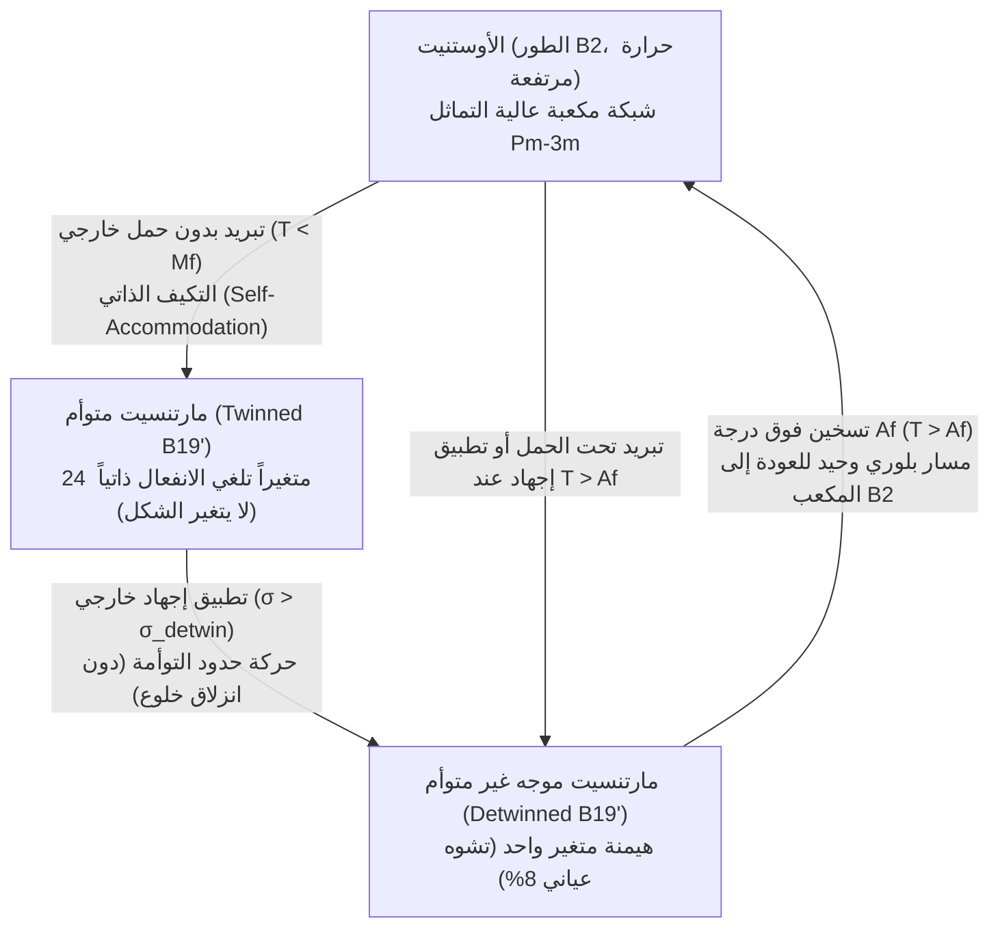
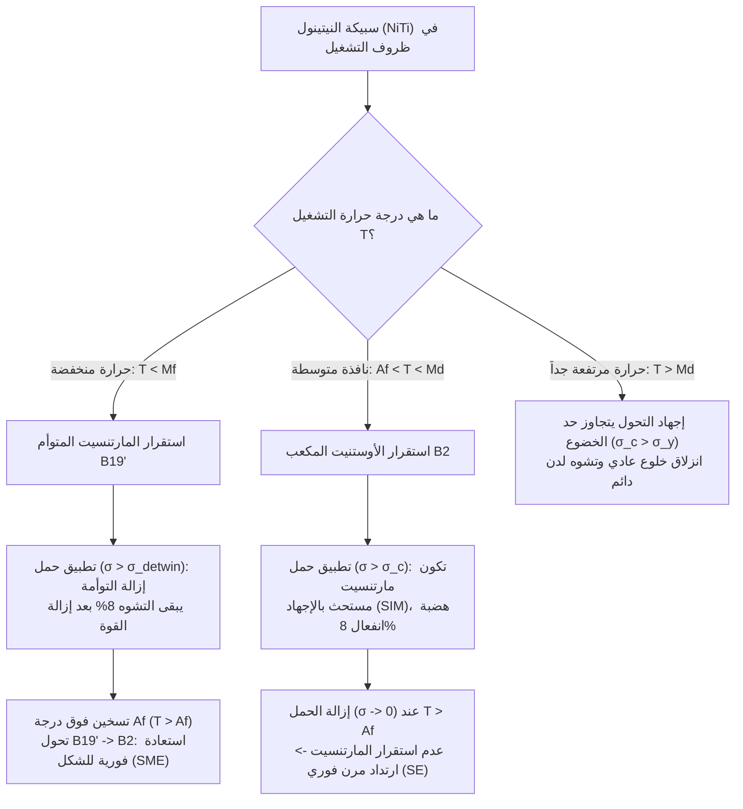

## 1. لماذا «تنسى» المعادن العادية شكلها بينما يتذكره النيتينول؟

خذ مشبك ورق فولاذياً عادياً أو سلكاً نحاسياً واثنِه بزاوية قائمة. عندما ترفع أصابعك عنه، سيرتد المعدن مرنياً بمقدار ضئيل لا يتجاوز كسراً من الدرجة، لكنه سيبقى مثنياً إلى الأبد. حتى لو ألقيت هذا المشبك في ماء يغلي، فلن يعود مستقيماً من تلقاء نفسه أبداً. من منظور فيزياء الحالة الصلبة، تعاني المعادن التقليدية من <strong>فقدان الذاكرة الطوبولوجي (Topological Amnesia)</strong>.

يكمن السبب الفيزيائي لهذا «النسيان» في آلية التشوه اللدن (Plastic Deformation). إن حد المرونة لمعظم المعادن الهندسية (مثل الفولاذ، الألومنيوم، التيتانيوم، والنحاس) ضئيل للغاية، إذ يتراوح بين $\varepsilon_{\text{el}} \approx 0.1\%\text{–}0.5\%$. ضمن هذا النطاق الضيق، تُزاح الذرات قليلاً عن مواضع اتزانها داخل البئر الكمومي للتفاعل الذري دون كسر الروابط الكيميائية. ولكن بمجرد أن يتجاوز الانفعال حوالي $0.2\%$، تؤدي إجهادات القص إلى تنشيط حركة وانزلاق <strong>الخلوع البلورية (Dislocation Glide)</strong>—وهي عيوب خطية داخل الشبكة البلورية.

عندما تنزلق الخلوع عبر البلورة، تنزاح مستويات ذرية كاملة فوق بعضها البعض، مما يؤدي إلى تكسير الروابط المعدنية القديمة وتكوين روابط جديدة تماماً مع ذرات مجاورة مختلفة. ونظراً لأن الشبكة البلورية دورية ومتماثلة، فإن الموضع الجديد للذرات لا يختلف طاقياً عن الموضع القديم ($\Delta G = 0$). وبالتالي، لا تتبقى داخل البلورة أي قوة استرجاع ثرموديناميكية «تتذكر» أي الذرات كانت متجاورة قبل عملية الثني.

غير أنه في عام 1962، اكتشف ويليام بيلر (William J. Buehler) وفريدريك وانغ (Frederick E. Wang) في مختبر الذخائر البحرية الأمريكية (Naval Ordnance Laboratory, NOL) ظاهرة مذهلة في سبيكة متساوية النسب الذرية من النيكل والتيتانيوم ($\text{Ni}_{50}\text{Ti}_{50}$)، أُطلق عليها اسم <strong>النيتينول (Nitinol — Nickel Titanium Naval Ordnance Laboratory)</strong>. فعند تبريد سلك من النيتينول دون درجة حرارة الغرفة، يمكن لفه أو مطه أو تجعيده بانفعال هائل يصل إلى $8\%\text{–}10\%$ (أي أكثر من $40$ ضعف حد مرونة الفولاذ!). ولكن بمجرد غمر هذا السلك المشوه في ماء دافئ، فإنه ينتفض في جزء من الثانية بقوة ميكانيكية كبيرة ليعود إلى شكله الأصلي بدقة متناهية.

كيف يمكن لشبكة بلورية أن تخزن «ذاكرة طوبولوجية» لهندستها العيانية دون حدوث انزلاق للخلوع؟ تكمن الإجابة في ظاهرة كمومية جماعية في الحالة الصلبة تُعرف باسم <strong>التحول الطوري المارتنسيتي الحراري المرن (Thermoelastic Martensitic Transformation)</strong>.

---

## 2. الآلية المجهرية: التحول البلوري بين الأوستنيت ($B2$) والمارتنسيت ($B19'$)

على عكس الانصهار أو إعادة التبلور حيث تهاجر الذرات عشوائياً عبر مسافات طويلة (عمليات انتشارية)، فإن التحول الطوري في <strong>السبائك ذات ذاكرة الشكل (Shape Memory Alloys, SMA)</strong> هو <strong>تحول لا انتشاري أو إزاحي عسكري (Diffusionless / Displacive / Military Transformation)</strong>. لا تتبادل الذرات مواقعها مع جيرانها؛ بل تتحرك مليارات الخلايا الأولية في تناغم تام—كالجنود في طابور عسكري—لتنفذ إزاحة قصية متناسقة بسرعة تقارب سرعة الموجات الصوتية في البلورة.

في سبيكة النيتينول ($\text{NiTi}$)، يتحكم في هذه الظاهرة طوران بلوريان رئيسيان:

1. <strong>الأوستنيت (Austenite، الطور الأب في درجات الحرارة المرتفعة، بنية $B2$)</strong>:
   شبكة مكعبة متمركزة الجسم مرتبة من نمط $\text{CsCl}$ (الزمرة الفراغية $Pm\bar{3}m$). تحتل ذرات التيتانيوم رؤوس المكعب بينما تقع ذرة النيكل في مركزه تماماً (أو بالعكس). ونظراً لأن الزمرة المكعبة $Pm\bar{3}m$ تمتلك تماثلاً عالياً جداً (48 عملية تماثل نقطي)، فإن بنية $B2$ صلبة ومتناحية وتوجد في اتجاه بلوري فريد واحد فقط.
2. <strong>المارتنسيت (Martensite، الطور الوليد في درجات الحرارة المنخفضة، بنية $B19'$)</strong>:
   عند التبريد دون درجة حرارة حرجة، تفقد الشبكة المكعبة استقرارها تجاه أنماط الفونونات الصوتية المستعرضة (تليين ثابت المرونة $c' = (c_{11}-c_{12})/2$) وتخضع لتشويه شبكة متجانس (تشويه باين Bain Distortion) مقترن بإزاحة مستويات ذرية (Shuffle)، لتتحول إلى شبكة أحادية الميل منخفضة التماثل $B19'$ (الزمرة الفراغية $P2_1/m$، التي تملك 4 عمليات تماثل فقط). وفي بعض المعالجات الحرارية، يمر التحول عبر <strong>طور $R$ (R-phase)</strong> معيني الأوجه وسيط ($B2 \leftrightarrow R \leftrightarrow B19'$) يتميز بانفعال صغير ($\sim 1\%$) وتخلف حراري ضيق للغاية ($1\text{–}2\,\text{K}$).

وبما أن التماثل البلوري ينخفض من 48 عملية في الطور $B2$ إلى 4 عمليات في الطور $B19'$، فإن بلورة مفردة واحدة من الأوستنيت الأب يمكن أن تتحول باحتمالية متساوية إلى ما يصل إلى <strong>$24$ متغيراً مارتنسيتياً (Martensitic Variants)</strong> متطابقة بنيوياً ولكنها مائلة في اتجاهات فراغية مختلفة.

### 2.1 التكيف الذاتي (Self-Accommodation) وإزالة التوأمة (Detwinning)

ماذا يحدث عندما نبرد النيتينول من طور الأوستنيت ($T > A_f$) إلى طور المارتنسيت ($T < M_f$) دون تطبيق أي حمل خارجي ($\sigma = 0$)؟

لو تحولت البلورة بأكملها إلى متغير مارتنسيتي واحد فقط، لتغير شكل العينة العيانية بنسبة $\sim 10\%$، مما يولد طاقة انفعال مرنة داخلية هائلة عند حدود الحبيبات. ولتقليل هذه الطاقة المرنة إلى الحد الأدنى، تقوم البلورة تلقائياً بتشكيل نطاقات متناوبة متناظرة مرآتياً تُسمى <strong>المارتنسيت المتوأم (Twinned Martensite)</strong>. تترتب المتغيرات المختلفة في نمط متعرج (عظم السمكة) بحيث تلغي انفعالات التحول الموضعية $\boldsymbol{\varepsilon}_i$ بعضها البعض في المتوسط الحجمي:

$$\langle \boldsymbol{\varepsilon}_{\text{trans}} \rangle = \sum_{i=1}^{24} f_i \boldsymbol{\varepsilon}_i = \mathbf{0}$$

حيث $f_i$ هو الكسر الحجمي للمتغير رقم $i$ ($\sum f_i = 1$). تُعرف هذه العملية الجوهرية باسم <strong>التكيف الذاتي (Self-Accommodation)</strong>. وبفضلها، يتحول النيتينول عند التبريد من الأوستنيت إلى المارتنسيت دون أي تغيير في أبعاده أو شكله الخارجي.

لكن حدود التوأمة (Twin Boundaries) داخل المارتنسيت تتمتع بحركية عالية جداً. فعندما نطبق إجهاداً ميكانيكياً خارجياً $\sigma > \sigma_{\text{detwin}}$ على السبيكة المبردة، فإننا لا نحرك الخلوع ولا نكسر الروابط الذرية! بدلاً من ذلك، تتحرك حدود التوأمة بسلاسة: تنمو المتغيرات المارتنسيتية المتوافقة مع اتجاه القوة الخارجية على حساب المتغيرات المعاكسة لها. تُسمى هذه العملية <strong>إزالة التوأمة (Detwinning)</strong>. على المستوى العياني، ينثني السلك أو يستطيل بنسبة $8\%$ متحولاً إلى <strong>مارتنسيت موجه (Detwinned Martensite)</strong>، بينما تظل طوبولوجيا الجوار الذري لكل ذرة سليمة تماماً دون تغيير!

ولماذا يستعيد المعدن شكله الأصلي حتماً عند التسخين اللاحق ($T > A_f$)؟ هنا يتجلى عدم التناظر العميق في نظرية الزمر البلورية: عند التبريد، يمتلك المكعب $B2$ <strong>24 مساراً متكافئاً</strong> للتحول إلى المارتنسيت $B19'$؛ ولكن عند التسخين، يمتلك كل متغير من المتغيرات الـ 24 <strong>مساراً وحيداً فقط</strong> للعودة إلى الشبكة المكعبة الأم $B2$! ولذلك، مهما كانت درجة إزالة التوأمة أو اتجاه التشوه في المارتنسيت، فإن التسخين فوق $A_f$ يجبر جميع النطاقات البلورية على الارتداد إلى الاتجاه المكعب الأصلي الوحيد، مستعيداً الهندسة العيانية فوراً.

---

## 3. الديناميكا الحرارية للتحول الطوري ونظرية لانداو–فالك

يُعد التحول المارتنسيتي <strong>تحولاً طورياً من الرتبة الأولى (First-Order Phase Transition)</strong> يصاحبه حرارة كامنة $\Delta H$ وتخلف حراري (Hysteresis). القوة الدافعة الثرموديناميكية لهذا التحول هي فرق طاقة غيبس الحرة بين الأوستنيت ($A$) والمارتنسيت ($M$):

$$\Delta G^{A \to M}(T, \sigma) = G_M(T, \sigma) - G_A(T, \sigma) = \Delta H^{A \to M} - T \Delta S^{A \to M} - \frac{1}{\rho}\boldsymbol{\sigma} : \boldsymbol{\varepsilon}_{\text{trans}}$$

يمتلك طور الأوستنيت ($B2$) بنية بلورية أكثر انفتاحاً وأنماط اهتزاز فونونية أكثر ليونة، مما يمنحه إنتروبيا اهتزازية أعلى ($S_A > S_M$). في درجات الحرارة المرتفعة، يهيمن الحد $-T S_A$ ويجعل الأوستنيت مستقراً. أما في درجات الحرارة المنخفضة، فإن طور المارتنسيت ($B19'$) الأكثر تراصاً يمتلك إنثالبيا ترابط أقل ($H_M < H_A$)، فيصبح هو الطور المستقر ثرموديناميكياً.

### 3.1 دالة الطاقة الحرة للانداو–فالك (نموذج $\varepsilon^6$)

في عام 1980، صاغ فالك (F. Falk) نظرية ظاهراتية للسبائك ذات ذاكرة الشكل بتعميم نظرية لانداو للتحولات الطورية، متخذاً من انفعال القص الشبكي $\varepsilon$ معامل انتظام (Order Parameter). يُكتب مفكوك كثافة طاقة هلمهولتز الحرة $F(\varepsilon, T)$ بدلالة القوى الزوجية لـ $\varepsilon$ (نظراً لتماثل الانعكاس $\varepsilon \leftrightarrow -\varepsilon$) حتى الرتبة السادسة على النحو التالي:

$$F(\varepsilon, T) = F_0(T) + \alpha (T - T_c)\varepsilon^2 - \beta \varepsilon^4 + \gamma \varepsilon^6$$

حيث $\alpha, \beta, \gamma > 0$ ثوابت مادية موجبة، و$T_c$ درجة حرارة عدم استقرار الشبكة. إن الحد الرباعي السالب ($-\beta \varepsilon^4$) ضروري لتمثيل التحول الطوري من الرتبة الأولى (إذ ينشئ حاجز طاقة بين الطورين)، بينما يضمن الحد السداسي الموجب ($+\gamma \varepsilon^6$) استقرار البلورة عند الانفعالات الكبيرة.

يفسر تغير تضاريس دالة الطاقة الحرة $F(\varepsilon, T)$ بتغير درجة الحرارة كافة سلوكيات النيتينول:

* <strong>عند درجات الحرارة المرتفعة ($T > A_f$)</strong>: يكون الحد التربيعي $\alpha(T - T_c)\varepsilon^2$ موجباً وكبيراً. يمتلك المنحنى $F(\varepsilon)$ <strong>نهاية صغرى شاملة وحيدة عند $\varepsilon = 0$</strong> (الأوستنيت). أي تشوه بعيداً عن الصفر يولد قوة استرجاع $\sigma = \partial F / \partial \varepsilon$ تعيد البلورة إلى نقطة الصفر.
* <strong>في منطقة الانتقال ($M_s < T < A_f$)</strong>: بالإضافة إلى القاع المركزي عند $\varepsilon = 0$، يظهر قاعان محليان (شبه مستقرين) على الجانبين عند $\varepsilon = \pm \varepsilon_0$ يمثلان متغيري المارتنسيت ($M^+$ و$M^-$).
* <strong>عند درجات الحرارة المنخفضة ($T < M_f < T_c$)</strong>: يصبح المعامل $\alpha(T - T_c)$ سالباً! تتحول النقطة المركزية $\varepsilon = 0$ إلى <strong>نهاية عظمى محلية</strong> (يصبح الأوستنيت غير مستقر إطلاقاً)، بينما يصبح البئران الجانبيان المتماثلان عند $\varepsilon = \pm \varepsilon_0$ هما حالتا الاتزان الشامل للمارتنسيت. يؤدي تطبيق إجهاد خارجي $\sigma$ إلى إمالة منحنى الطاقة، فتنزلق البلورة من البئر $-\varepsilon_0$ إلى البئر $+\varepsilon_0$ (وهو ما يمثل عملية إزالة التوأمة).

### 3.2 درجات الحرارة الأربع المميزة ومعادلة كلاوزيوس–كلابيرون

بسبب الطاقة المرنة للسطوح البينية واحتكاكل حركة حدود التوأمة، ينفصل التحول الأمامي عن العكسي بحلقة تخلف حراري ($\Delta T_{\text{hyst}} \approx 15\text{–}40\,\text{K}$) تحددها أربع درجات حرارة مميزة:
1. $M_s$ (Martensite Start): درجة حرارة بدء تكون المارتنسيت أثناء التبريد؛
2. $M_f$ (Martensite Finish): درجة حرارة اكتمال التحول إلى مارتنسيت بنسبة 100% ($M_f < M_s$)؛
3. $A_s$ (Austenite Start): درجة حرارة بدء تكون الأوستنيت أثناء التسخين؛
4. $A_f$ (Austenite Finish): درجة حرارة اكتمال استعادة الأوستنيت بنسبة 100% ($A_s < A_f$، مع كون $M_s < A_f$).

كيف يؤثر الإجهاد الميكانيكي الخارجي $\sigma$ على درجات الحرارة هذه؟ بما أن القوة الخارجية تبذل شغلاً ميكانيكياً $\sigma \varepsilon_{\text{trans}}$ يساعد على تثبيت المارتنسيت الموجه، فإن تطبيق الحمل يرفع درجات حرارة التحول خطياً وفق <strong>معادلة كلاوزيوس–كلابيرون للأطوار الصلبة</strong>:

$$\frac{d\sigma_c}{dT} = -\frac{\Delta S^{A \to M}}{V_m \varepsilon_{\text{max}}} = -\frac{\rho \Delta H^{A \to M}}{T_0 \varepsilon_{\text{max}}}$$

حيث $\sigma_c$ هو الإجهاد الحرج لتحفيز المارتنسيت، $V_m$ الحجم المولي، $\rho \approx 6.45\,\text{g/cm}^3$ كثافة النيتينول، $\Delta H^{A \to M} \approx -20\text{–}25\,\text{J/g}$ الحرارة الكامنة للتحول، $T_0 \approx \frac{1}{2}(M_s + A_f)$ درجة حرارة الاتزان الثرموديناميكي، و$\varepsilon_{\text{max}} \approx 0.08$ أقصى انفعال للتحول.

بتعويض القيم القياسية للنيتينول، نحصل على الميل العالمي لخط التوازن الطوري:

$$\frac{d\sigma_c}{dT} \approx 5\text{–}8\,\text{MPa/K}$$

وهذا يعني أن رفع درجة الحرارة بمقدار $10\,\text{K}$ فقط يزيد من الإجهاد الحرج (أو ضغط الاسترجاع الذي يولده السلك عند تسخينه) بمقدار هائل يتراوح بين $50$ و$80\,\text{MPa}$!

---

## 4. وجهان لعملة واحدة: تأثير ذاكرة الشكل (SME) مقابل المرونة الفائقة (SE)

اعتماداً على درجة حرارة التشغيل $T$ مقارنة بدرجات الحرارة الحرجة $M_f$ و$A_f$، تُظهر سبيكة النيتينول نفسها سلوكين ميكانيكيين مختلفين تماماً:

### 4.1 تأثير ذاكرة الشكل (Shape Memory Effect, SME، عند $T < M_f$)

عند درجة حرارة أقل من $M_f$، تكون السبيكة في طور المارتنسيت المتوأم اللين. بعد ثنيها بانفعال $\sim 8\%$ وإزالة الحمل، يظل التشوه باقياً (حيث يستقر المارتنسيت الموجه في أحد البئرين الجانبيين لدالة لانداو). ولاستعادة الشكل الأصلي، <strong>لا بد من التسخين الحراري فوق $A_f$</strong>.
* <strong>ذاكرة الشكل أحادية الاتجاه (OWSME)</strong>: تتذكر السبيكة فقط شكل الأوستنيت في الحرارة العالية. وعند تبريدها مجدداً دون $M_f$، تظل مستقيمة بفضل التكيف الذاتي.
* <strong>ذاكرة الشكل ثنائية الاتجاه (TWSME)</strong>: من خلال «تدريب» حراري ميكانيكي خاص (دورات متكررة تحت الحمل)، تُزرع حقول إجهاد داخلية موجهة وشبكات خلوع داخل البلورة. توجه هذه الحقول نمو متغير مارتنسيتي محدد عند التبريد دون قوة خارجية، فينثني المعدن تلقائياً في البرودة ويستقيم تلقائياً في السخونة!

### 4.2 المرونة الفائقة / المرونة الزائفة (Superelasticity, SE، عند $A_f < T < M_d$)

ماذا يحدث إذا أمسكنا بسلك نيتينول عند درجة حرارة $T > A_f$ (حيث يكون الأوستنيت المكعب $B2$ مستقراً) وقمنا بشدّه بقوة؟
وفق معادلة كلاوزيوس–كلابيرون، عندما يصل الإجهاد إلى القيمة الحرجة $\sigma_{M_s}(T)$، يصبح الأوستنيت غير مستقر ميكانيكياً ويتحول تحت الحمل مباشرة إلى <strong>مارتنسيت مستحث بالإجهاد (Stress-Induced Martensite, SIM)</strong>. يظهر على منحنى الإجهاد والانفعال ($\sigma\text{–}\varepsilon$) <strong>سطح مستوٍ طويل (Plateau)</strong> يستطيل فيه المعدن حتى $8\%$ عند إجهاد ثابت تقريباً.

وبمجرد تحرير القوة الخارجية ($\sigma \to 0$)، ونظراً لأن درجة حرارة الوسط $T > A_f$، يفقد المارتنسيت استقراره الثرموديناميكي فوراً! ودون أي تسخين إضافي، يرتد تلقائياً إلى طور الأوستنيت ($B19' \to B2$)، فيعود المعدن كزنبرك مثالي إلى الانفعال الصفري ($\varepsilon = 0$) راسماً حلقة تخلف ميكانيكي مغلقة.

*(ملاحظة: إذا ارتفعت درجة الحرارة فوق الحد الأقصى $M_d > A_f$، فإن الإجهاد الحرج لتكوين المارتنسيت $\sigma_c(T)$ يتجاوز إجهاد خضوع الخلوع $\sigma_y$. وفي النطاق $T > M_d$ تختفي المرونة الفائقة ويتشوه النيتينول لدنياً بشكل دائم كالفولاذ العادي).*

| الخاصية | ذاكرة الشكل أحادية الاتجاه (OWSME) | ذاكرة الشكل ثنائية الاتجاه (TWSME) | المرونة الفائقة / الزائفة (SE) |
| :--- | :--- | :--- | :--- |
| <strong>درجة حرارة التشغيل $T$</strong> | تشويه عند $T < M_f$، وتسخين إلى $T > A_f$ | تدوير حراري $T < M_f \leftrightarrow T > A_f$ | ثبات حراري ضمن النافذة $A_f < T < M_d$ |
| <strong>الطور المستقر الابتدائي</strong> | مارتنسيت متوأم ($B19'$) | أوستنيت ($B2$) $\leftrightarrow$ مارتنسيت موجه | أوستنيت مكعب ($B2$) |
| <strong>الآلية الفيزيائية</strong> | إزالة التوأمة $\to$ عودة حرارية إلى $B2$ | نمو متغيرات موجهة بإجهادات داخلية | مارتنسيت مستحث بالإجهاد (SIM) |
| <strong>محفز استعادة الشكل</strong> | التسخين الحراري ($\Delta T$) | التسخين والتبريد ($\pm \Delta T$) | مجرد إزالة الحمل الميكانيكي ($\sigma \to 0$) |
| <strong>أقصى انفعال قابل للاسترجاع</strong> | $6\% \text{–} 8\%$ | $2\% \text{–} 4\%$ | $6\% \text{–} 10\%$ |

---

## 5. آفاق البحث المتقدم: الكلال الوظيفي، شرط التوافق $\lambda_2 = 1$، وتطبيقات المستقبل

رغم أن التحول المارتنسيتي عكوس بلورياً، تعاني السبائك التقليدية من مشكلة <strong>الكلال الوظيفي (Functional Fatigue)</strong>: فبعد عدة آلاف من الدورات، تنزاح درجات حرارة التحول وتتدهور دقة استرجاع الشكل. لماذا؟

يكمن السر عند السطح البيني (مستوي الموطن Habit Plane) الفاصل بين الأوستنيت المكعب $B2$ والمارتنسيت أحادي الميل $B19'$. لكي تتلاقى شبكتان بلوريتان مختلفتان بتوافق تام دون تشققات، يجب أن تحقق مصفوفة انفعال التحول $\mathbf{U}$—التي تمتلك ثلاث قيم ذاتية موجبة (التمددات الرئيسية للشبكة) $\lambda_1 \le \lambda_2 \le \lambda_3$—شرط التوافق الهندسي في <strong>النظرية البلورية للمارتنسيت لبول وجيمس (Ball–James Theory)</strong>.

لا يمكن أن يتشكل سطح بيني مترابط خالٍ تماماً من الإجهادات المرنة بين الأوستنيت ومتغير مارتنسيتي منفرد إلا إذا وفقط إذا كانت القيمة الذاتية الوسطى لمصفوفة التحول تساوي الواحد الصحيح تماماً:

$$\lambda_2 = 1$$

في النيتينول الثنائي القياسي ($\text{Ni}_{50}\text{Ti}_{50}$)، تبلغ القيمة $\lambda_2 \approx 0.968 \neq 1$. هذا عدم التطابق ($\sim 3.2\%$) يجبر السطح البيني على التشوه مرنياً أثناء حركته، مولداً خلوعاً بلورية تعيق حركة الحدود وتنتج تخلفاً حرارياً واسعاً ($\sim 30\,\text{K}$).

وفي العقدين الأخيرين، أحدث علماء المواد ثورة عبر <strong>هندسة العوامل المساعدة (Cofactor Engineering)</strong>: فمن خلال تطعيم النيتينول بالنحاس والبلاديوم ($\text{Ti}_{50}\text{Ni}_{50-x-y}\text{Cu}_x\text{Pd}_y$) أو ابتكار سبيكة $\text{Zn}_{45}\text{Au}_{30}\text{Cu}_{25}$، تم ضبط ثوابت الشبكة بدقة لتحقيق الشرط السحري $\lambda_2 = 1.0000$! في هذه البلورات فائقة التوافق، يتحرك السطح البيني الطوري بلا احتكاك تقريباً، وينكمش التخلف الحراري إلى ما يقارب الصفر ($\Delta T < 1\text{–}2\,\text{K}$)، وتصمد السبيكة لأكثر من <strong>$10^7$ (عشرة ملايين!) دورة</strong> تحول طوري دون أي تدهور.

### أبرز التطبيقات الهندسية والطبية والفضائية

1. <strong>الدعامات القلبية الوعائية وتقويم الأسنان</strong>: تعتمد الدعامات ذاتية التمدد (Stents) على المرونة الفائقة للنيتينول ($A_f \approx 25\text{–}30\,^\circ\text{C}$ أقل من حرارة جسم الإنسان $37\,^\circ\text{C}$). تُبرد الدعامة وتُضغط داخل قسطرة رفيعة لتُزرع في الشريان المتضيق؛ وبمجرد تحريرها عند حرارة الدم، تتمدد تلقائياً لتسند جدار الشريان بقوة لطيفة وثابتة على طول هضبة المرونة الفائقة. كما توفر أسلاك تقويم الأسنان المصنوعة من النيتينول قوة تصحيح فسيولوجية مستمرة لأشهر طويلة.
2. <strong>آليات الفضاء وإطارات مركبات المريخ التابعة لناسا (NASA)</strong>: تستخدم أقفال فصل الأقمار الصناعية غير المتفجرة (Frangibolt) أسطوانة نيتينول تتمدد عند تسخينها كهربائياً لتكسر مسمار التثبيت التيتانيومي بأمان ودون صدمات انفجارية. كما طورت وكالة ناسا إطارات شبكية غير هوائية من النيتينول فائق المرونة لمركبات المريخ والقمر، قادرة على اجتياز الصخور الحادة بانفعال يصل إلى $10\%$ دون خطر الانثقاب أو التشوه الدائم.
3. <strong>السبائك المغناطيسية الحديدية ذات ذاكرة الشكل ($\text{Ni}_2\text{MnGa}$)</strong>: في سبائك هويسلر، تمتلك متغيرات المارتنسيت ترتيباً مغناطيسياً حديدياً، مما يسمح بتحريك حدود التوأمة بواسطة حقل مغناطيسي خارجي (Magnetic Shape Memory Effect) وتحقيق انفعالات تصل إلى $6\%\text{–}10\%$ بترددات تبلغ آلاف الهرتز.
4. <strong>التبريد الإلاستوكالوري في الحالة الصلبة (Elastocaloric Cooling)</strong>: عند شد سلك نيتينول فائق المرونة بسرعة وبشكل كظوم (أدياباتي)، يطلق التحول $B2 \to B19'$ حرارة كامنة ترفع حرارة السلك بمقدار $+15\text{–}20\,\text{K}$؛ وعند تفريغ هذه الحرارة وإزالة الحمل فجأة، يمتص التحول العكسي $B19' \to B2$ الحرارة من الوسط المحيط فيبرد السلك بمقدار $15\text{–}20\,\text{K}$. تعد هذه التقنية النظيفة عالية الكفاءة بديلاً واعداً لأجهزة التكييف والتبريد التقليدية المعتمدة على غازات الفريون الدفيئة.

إن ما يبدو لعين المشاهد وكأنه «ذاكرة سحرية» في قطعة من المعدن ليس في جوهره سوى تجلٍّ بديع لتماثل الزمر البلورية، والديناميكا الحرارية الإحصائية للانداو، والتناغم الكمومي الجماعي داخل الشبكة البلورية.
