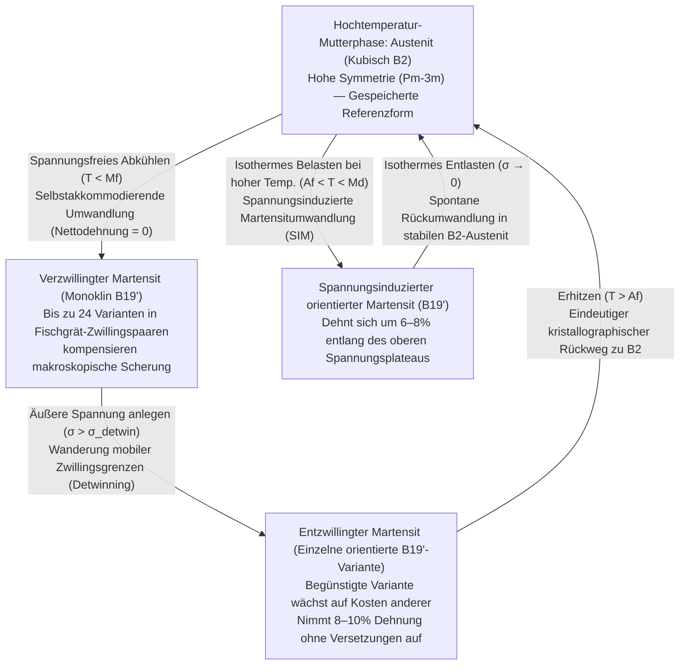

```mermaid
flowchart TD
    subgraph OWSME ["1. Einweg-Formgedächtniseffekt (Verformung bei T < Mf)"]
        O1["Tiefe Temp. (T < Mf): Selbstakkommodierter B19'-Martensit"] -->|"Spannung (σ > σ_detwin)"| O2["Entzwillingung: Zwillingsgrenzen wandern zu Einzelvariante"]
        O2 -->|"Entlasten (σ = 0)"| O3["Scheinbare plastische Dehnung (6–8%) bleibt gespeichert"]
        O3 -->|"Heizen über Af (T > Af)"| O4["Rückumwandlung (B19' → B2) stellt Ausgangsform wieder her"]
    end
    subgraph SE ["3. Superelastizität / Pseudoelastizität (Isotherm bei Af < T < Md)"]
        S1["Hohe Temp. (Af < T < Md): Stabiler B2-Austenit"] -->|"Belasten über σ_c"| S2["Spannungsinduzierter Martensit (SIM)<br/>Dehnt sich 6–8% entlang des oberen Spannungsplateaus"]
        S2 -->|"Entlasten (σ → 0)"| S3["Martensit instabil bei T > Af: Spontane Rückkehr B19' → B2<br/>Federt entlang des unteren Plateaus auf Dehnung 0 zurück"]
    end
```

Wenn man eine gewöhnliche Büroklammer aus Stahl oder einen Aluminiumlöffel über einen winzigen Bruchteil eines Prozents Dehnung hinaus scharf verbiegt, bleibt das Metall nach dem Loslassen dauerhaft krumm. In der klassischen Metallkunde bedeutet große Verformung unweigerlich eine irreversible Schädigung des Kristallgitters.

Doch ein Draht aus einer äquiatomaren Legierung aus Nickel und Titan namens <strong>Nitinol ($\text{NiTi}$)</strong> stellt unsere Intuition über metallische Festkörper auf den Kopf. Man kann einen Nitinoldraht bei Raumtemperatur zu einem Knoten verdrehen oder um fast $8\%$ seiner Länge dehnen – das Vierzigfache der Elastizitätsgrenze von hochfestem Stahl – und sobald man ihn in warmes Wasser (etwa $60\,^\circ\text{C}$) taucht, entfaltet er sich blitzartig und kehrt mit atomarer Präzision in seine ursprüngliche Geometrie zurück. Dieses Phänomen heißt <strong>Formgedächtniseffekt (Shape Memory Effect, SME)</strong>. Mehr noch: Oberhalb seiner Umwandlungstemperatur lässt sich dieselbe Legierung um $8\%$ dehnen und federt beim Entlasten sofort ohne Erhitzen auf null Dehnung zurück – ein gummiartiges metallisches Verhalten, das als <strong>Superelastizität (oder Pseudoelastizität)</strong> bezeichnet wird.

Wie kann sich ein anorganisches Kristallgitter ohne Sensoren oder Nervensystem nach massiver Verformung an eine komplexe dreidimensionale Gestalt „erinnern“? In diesem Artikel untersuchen wir die Festkörperphysik und Kristallographie hinter Formgedächtnislegierungen.

---

## 1. Warum gewöhnliche Metalle vergessen: Die $0,2\%$-Elastizitätsgrenze und irreversibles Versetzungsgleiten

In kristallinen Metallen wie Eisen, Kupfer oder Aluminium sitzen die Atome auf einem periodischen Gitter. Unter einer kleinen Zugspannung $\sigma$ dehnen sich die Atomabstände leicht aus ihrer Gleichgewichtslage $r_0$, und das Metall folgt dem Hookeschen Gesetz ($\sigma = E\varepsilon$). Die maximale rein elastische Dehnung ist jedoch winzig und beträgt typischerweise nur <strong>$\varepsilon_{\text{el}} \approx 0,1\% \text{ bis } 0,2\%$</strong>.

Überschreitet die Verformung $0,2\%$, setzt <strong>plastische Verformung</strong> ein: Lineare Gitterbaufehler – <strong>Versetzungen (Dislocations)</strong> – gleiten entlang kristallographischer Gleitebenen. Bei jedem Schritt um einen Burgers-Vektor $\mathbf{b}$ werden metallische Bindungen über der Gleitebene <strong>aufgebrochen und mit neuen Nachbaratomen neu geknüpft</strong>.

Entscheidend ist: <strong>Das Versetzungsgleiten zerstört die topologischen Nachbarschaftsbeziehungen des Kristallgitters.</strong> Da die neue lokale Kristallumgebung energetisch ununterscheidbar von der alten ist, leidet der Kristall unter <strong>topologischer Amnesie</strong>. Es gibt keine rückstellende Kraft zum alten Nachbarn.

1962 entdeckten <strong>William J. Buehler</strong> und <strong>Frederick E. Wang</strong> am U.S. Naval Ordnance Laboratory (NOL) die äquiatomare Legierung $\text{NiTi}$ ($\approx 50\,\text{at.}\%\,\text{Ni}$ – $50\,\text{at.}\%\,\text{Ti}$), die sie <strong>Nitinol</strong> (<strong>Ni</strong>ckel <strong>Ti</strong>tanium <strong>N</strong>aval <strong>O</strong>rdnance <strong>L</strong>aboratory) nannten. Selbst bei Dehnungen von <strong>$8\text{–}10\%$</strong> verformt sich Nitinol nicht durch Versetzungsgleiten, sondern durch eine reversible Phasenumwandlung im festen Zustand.

---

## 2. Kristallographische Grundlagen: Diffusionslose Umwandlung zwischen $B2$-Austenit und $B19'$-Martensit

Festkörper-Phasenumwandlungen teilen sich in zwei Klassen: <strong>Diffusionsgesteuerte Umwandlungen</strong>, bei denen Atome über weite Strecken wandern und jede Forminformation löschen, und <strong>martensitische (diffusionslose / displazive) Umwandlungen</strong>.

Bei der thermoelastischen martensitischen Umwandlung findet keinerlei weitreichende Atomdiffusion statt. Stattdessen klappt ein ganzes Kristallvolumen durch eine <strong>koordinierte, militärisch präzise Scherbewegung der Atome</strong> mit nahezu Schallgeschwindigkeit ($\sim 10^3\,\text{m/s}$) von einer Hochtemperatur-Mutterphase in eine Tieftemperatur-Produktphase um. <strong>Jedes einzelne Atom behält dabei exakt seine ursprünglichen topologischen Bindungsnachbarn!</strong>

### Hochtemperatur-Mutterphase: Kubischer $B2$-Austenit
Oberhalb der Umwandlungstemperatur liegt $\text{NiTi}$ als hochsymmetrischer <strong>Austenit</strong> in der <strong>geordneten kubischen $B2$-Struktur ($\text{CsCl}$-Typ, Raumgruppe $Pm\bar{3}m$)</strong> mit $a_0 \approx 0,3015\,\text{nm}$ vor. Die kubische Punktgruppe $m\bar{3}m$ ($O_h$) besitzt <strong>48 Symmetrieoperationen</strong>.

### Tieftemperatur-Produktphase: Monokliner $B19'$-Martensit und die $R$-Phase
Beim Abkühlen führt eine Phononenerweichung ($\text{TA}_2$-Zweig) zum spontanen Scheren des kubischen Gitters in den niedrigsymmetrischen <strong>Martensit</strong> mit <strong>monokliner $B19'$-Struktur (Raumgruppe $P2_1/m$)</strong>:

$$a \approx 0,2898\,\text{nm}, \quad b \approx 0,4108\,\text{nm}, \quad c \approx 0,4646\,\text{nm}, \quad \beta \approx 97,78^\circ \quad (\alpha = \gamma = 90^\circ)$$

Hierbei bricht die Symmetrie von 48 Operationen im Kubischen auf nur noch <strong>4 Symmetrieoperationen</strong> (Punktgruppe $2/m$) im Monoklinen herunter. In kaltverformtem oder $\text{Fe}$-dotiertem $\text{NiTi}$ tritt zudem eine rhomboedrische Zwischenphase auf, die <strong>$R$-Phase</strong> ($B2 \to R \to B19'$), die sich durch eine winzige thermische Hysterese von nur $1,5\text{–}3\,\text{K}$ auszeichnet.

---

## 3. Selbstakkommodation (verzwillingter Martensit) und Entzwillingung (Detwinning)

Warum verbiegt sich ein gerader Nitinoldraht nicht von selbst, wenn man ihn einfach spannungsfrei im Kühlschrank abkühlt, obwohl jede Elementarzelle beim Übergang $B2 \to B19'$ um $\sim 8\text{–}10\%$ schert? Die Antwort liefert das Zusammenspiel aus <strong>24 kristallographischen Varianten</strong>, <strong>Selbstakkommodation</strong> und spannungsinduzierter <strong>Entzwillingung (Detwinning)</strong>.

### 24 Varianten und Selbstakkommodation
Nach dem Satz von Lagrange ergibt das Verhältnis der Punktgruppenordnungen $48 / 4 = 12$ Gitterkorrespondenz-Varianten, die zusammen mit konjugierten Habitusebenen bis zu <strong>24 kristallographische Varianten des Martensits</strong> bilden. Beim spannungsfreien Abkühlen ($T < M_f$) unterteilt sich der Kristall in feine, abwechselnde Lamellen spiegelbildlicher Varianten ($M^+$ und $M^-$), getrennt durch kohärente <strong>Zwillingsgrenzen (Twin Boundaries)</strong>. In dieser Fischgrät-Struktur heben sich die lokalen Scherdehnungen im Mittel exakt auf:

$$\langle \boldsymbol{\varepsilon}_{\text{trans}} \rangle = \sum_{i=1}^{24} f_i \boldsymbol{\varepsilon}_i = \mathbf{0}$$

Dieses Phänomen heißt <strong>Selbstakkommodation</strong>: Das Gitter ist vollständig monoklin umgewandelt, aber die äußere Drahtform bleibt unverändert.

### Entzwillingung (Detwinning) und der eindeutige Rückweg beim Erhitzen
Legt man bei $T < M_f$ eine moderate äußere Spannung $\sigma > \sigma_{\text{detwin}}$ ($50\text{–}150\,\text{MPa}$, weit unterhalb der Versetzungsfließgrenze) an, wandern die hochmobilen Zwillingsgrenzen durch den Kristall. Ungünstig orientierte Varianten klappen in diejenige <strong>einzelne Variante (entzwillingter Martensit)</strong> um, deren Scherung optimal zur äußeren Last passt (<strong>Detwinning</strong>). Dadurch werden $8\text{–}10\%$ makroskopische Dehnung freigesetzt, die nach dem Entlasten erhalten bleiben.

Beim anschließenden Erhitzen über die <strong>Austenit-Endtemperatur ($A_f$)</strong> greift die fundamentale Asymmetrie der Gruppentheorie:
- <strong>Beim Abkühlen ($B2 \to B19'$, Symmetriebrechung)</strong> kann ein kubischer Kristall in <strong>24 gleichwertige monokline Varianten</strong> zerfallen.
- <strong>Beim Erhitzen ($B19' \to B2$, Symmetriewiederherstellung)</strong> besitzen alle 24 monoklinen Varianten aufgrund der erhaltenen atomaren Nachbarschaftstopologie <strong>nur EINEN einzigen kristallographischen Rückweg in die ursprüngliche kubische $B2$-Orientierung!</strong> Der Draht schnellt mit $100\%$ Präzision in seine gespeicherte Form zurück.

---

## 4. Thermodynamik: Gibbs-Energie, Landau-Falk-Theorie und die Clausius-Clapeyron-Gleichung

### Die vier Umwandlungstemperaturen ($M_f, M_s, A_s, A_f$)
Die Umwandlung erster Ordnung zeigt eine thermische Hysterese $\Delta T_{\text{hys}} = A_f - M_s \approx 15\text{–}40\,\text{K}$ mit der strikten Ordnung:

$$M_f < M_s < T_0 < A_s < A_f$$

Unter Temperatur $T$ und einachsiger Spannung $\sigma$ lautet die spezifische freie Enthalpiedifferenz (Gibbs-Energie) $\Delta G^{A \to M}(T, \sigma)$:

$$\Delta G^{A \to M}(T, \sigma) = \Delta H^{A \to M} - T \Delta S^{A \to M} - \frac{1}{\rho}\sigma \varepsilon_{\text{trans}} = -\Delta S^{A \to M}(T - T_0) - \frac{1}{\rho}\sigma \varepsilon_{\text{trans}}$$

wobei die Hinumwandlung $A \to M$ exotherm ist ($\Delta H^{A \to M} < 0$, $|\Delta H| \approx 15\text{–}25\,\text{J/g}$) und $\Delta S^{A \to M} < 0$.

### Landau-Falk-Theorie (Dreimuldenpotential)
Mit der Scherdehnung $\varepsilon$ als Ordnungsparameter formulierte Peter Falk (1980) das freie Energiefunktional sechster Ordnung:

$$F(\varepsilon, T) = F_0(T) + \alpha (T - T_c)\varepsilon^2 - \beta \varepsilon^4 + \gamma \varepsilon^6 \quad (\alpha, \beta, \gamma > 0)$$

- Für <strong>$T > A_f$</strong> existiert nur ein globales Minimum bei $\varepsilon = 0$ (kubischer Austenit, <strong>Einmuldenpotential</strong>).
- Nahe <strong>$T \approx T_0$</strong> koexistieren drei Minima bei $\varepsilon = 0$ und $\varepsilon = \pm\varepsilon_0$ (<strong>Dreimuldenpotential</strong>).
- Für <strong>$T < M_f < T_c$</strong> wird $\varepsilon = 0$ zu einem instabilen Maximum, und es verbleibt ein <strong>Doppelmuldenpotential</strong> bei $\varepsilon = \pm\varepsilon_0$ (Zwillingsvarianten $M^+, M^-$). Äußere Spannung $\sigma$ kippt das Potential $G = F - \sigma\varepsilon$ in die Mulde $+\varepsilon_0$ (Detwinning); Erhitzen über $A_f$ lässt die Seitenmulden verschwinden und erzwingt die Rückkehr nach $\varepsilon = 0$.

### Die Clausius-Clapeyron-Gleichung
Aus der Phasengleichgewichtsbedingung $d(\Delta G^{A \to M}) = 0$ folgt die <strong>Clausius-Clapeyron-Gleichung im Festkörper</strong> für die kritische Umwandlungsspannung $\sigma_c(T)$:

$$\frac{d\sigma_c}{dT} = -\frac{\Delta S^{A \to M}}{V_m \varepsilon_{\text{max}}} = -\frac{\rho \Delta H^{A \to M}}{T_0 \varepsilon_{\text{max}}}$$

Für $\text{NiTi}$ ($\rho \approx 6450\,\text{kg/m}^3$, $|\Delta H| \approx 20\,\text{kJ/kg}$, $T_0 \approx 300\,\text{K}$, $\varepsilon_{\text{max}} \approx 0,07$) ergibt sich ein strikt positiver Anstieg von <strong>$\frac{d\sigma_c}{dT} \approx 5\text{–}8\,\text{MPa/K}$</strong> ($\approx 6,14\,\text{MPa/K}$).

---

## 5. Vergleich der drei Funktionsmodi: Einweg-SME, Zweiweg-SME und Superelastizität

| Merkmal / Parameter | 1. Einweg-Formgedächtnis (OWSME) | 2. Zweiweg-Formgedächtnis (TWSME) | 3. Superelastizität / Pseudoelastizität (SE) |
| :--- | :--- | :--- | :--- |
| <strong>Temperaturbereich</strong> | Verformen bei $T < M_f$ $\to$ Heizen auf $T > A_f$ | Thermisches Zyklieren $T < M_f \leftrightarrow T > A_f$ | Isotherm bei <strong>$A_f < T < M_d$</strong> |
| <strong>Rolle äußerer Spannung</strong> | Nötig zur Entzwillingung bei tiefem $T$ | <strong>Keine äußere Last im Betrieb nötig</strong> | Induziert $B2 \to B19'$ beim Laden; reversibel beim Entladen |
| <strong>Mikromechanismus</strong> | Entzwillingung von $B19'$ $\to$ thermische Rückumwandlung in $B2$ | Anisotrope Eigenspannungsfelder (Versetzungen / $\text{Ti}_3\text{Ni}_4$-Ausscheidungen) | Isotherme spannungsinduzierte Martensitumwandlung (SIM) |
| <strong>Maximale reversible Dehnung</strong> | <strong>$6\text{–}8\%$</strong> (bis $10\%$ im Einkristall) | <strong>$2\text{–}3\%$</strong> | <strong>$6\text{–}8\%$</strong> ($\sim 40\times$ Stahl-Elastizitätsgrenze) |
| <strong>Hauptanwendungen</strong> | Rohrverschraubungen, Frangibolt-Raumfahrtaktoren | Federfreie Mikroaktoren, Thermoschalter | Kardiovaskuläre Stents, Zahnspangenbögen, Mars-Rover-Reifen |

---

## 6. Funktionelle Ermüdung, die $\lambda_2 = 1$ Kompatibilitätsrevolution und Ingenieuranwendungen

### Die mathematische Bedingung $\lambda_2 = 1$ für 10 Millionen Zyklen
In binärem $\text{NiTi}$ passen kubischer $B2$-Austenit und monokliner $B19'$-Martensit an der Phasengrenze (Habitusebene) geometrisch nicht exakt zusammen. Die resultierende elastische Übergangsschicht erzeugt bei jedem Zyklus Versetzungen (<strong>funktionelle Ermüdung</strong>).

Nach der nichtlinearen Elastizitätstheorie von <strong>John M. Ball</strong> und <strong>Richard D. James</strong> kann ein unverzerrter Austenit ($\mathbf{I}$) genau dann eine spannungsfreie, unverzwillingte Grenzfläche mit einer einzelnen Martensitvariante (Transformationsstrecktensor $\mathbf{U}$ mit Eigenwerten $\lambda_1 \le \lambda_2 \le \lambda_3$) bilden, wenn der <strong>mittlere Eigenwert exakt eins beträgt</strong>:

$$\lambda_2 = 1$$

Während binäres $\text{NiTi}$ bei $\lambda_2 \approx 0,968$ liegt, erreichten Forscher in quaternären <strong>$\text{Ti}_{50,2}\text{Ni}_{34,4}\text{Cu}_{12,3}\text{Pd}_{3,1}$</strong>-Filmen (*Science* 2015) und <strong>$\text{Zn}_{45}\text{Au}_{30}\text{Cu}_{25}$</strong> (*Nature* 2013) exakt $\lambda_2 = 1,0000 \pm 0,0002$: Die Hysterese schrumpfte auf $< 1\text{–}2\,\text{K}$ und die Legierungen überstanden <strong>über $10^7$ (10 Millionen) Umwandlungszyklen</strong> ohne Ermüdung! Zudem ermöglichen ferromagnetische Formgedächtnislegierungen ($\text{Ni}_2\text{MnGa}$) Schaltfrequenzen $> 1\,\text{kHz}$ im Magnetfeld, und die <strong>elastokalorische Kühlung</strong> nutzt die latente Umwandlungswärme für treibhausgasfreie Festkörper-Klimaanlagen.

### Revolutionäre Anwendungen in Medizin und Raumfahrt
1. <strong>Selbstexpandierende kardiovaskuläre Nitinol-Stents</strong>: Mit $A_f \approx 25\text{–}30\,^\circ\text{C}$ (unterhalb der Körpertemperatur von $37\,^\circ\text{C}$) und einer biokompatiblen $\text{TiO}_2$-Passivschicht entfaltet sich der gekühlt im Katheter eingeführte Stent im Blutstrom von selbst und stützt das Gefäß entlang des flachen superelastischen Entladeplateaus.
2. <strong>Superelastische kieferorthopädische Bögen</strong>: Liefern über Millimeter Zahnbewegung hinweg eine konstante, physiologisch sanfte Kraft.
3. <strong>NASA-Frangibolt-Aktoren und superelastische Mars-Rover-Gewebereifen</strong>: Nitinol-Heizmanschetten sprengen Titanbolzen mit $>500\,\text{MPa}$ Rückstellspannung ohne Explosivstoffe zur Entfaltung von Solarpanels; superelastische Nitinol-Drahtgeflechtreifen für Mars-Rover verformen sich über scharfem Fels bis zur Achse, ohne jemals platt zu werden.
