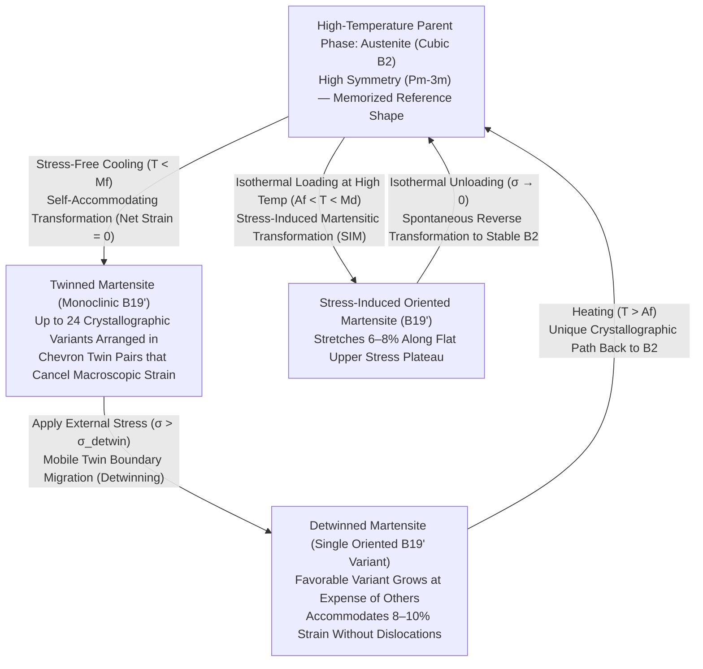

```mermaid
flowchart TD
    subgraph OWSME ["1. One-Way Shape Memory Effect (Deformation at T < Mf)"]
        O1["Low Temp (T < Mf): Self-Accommodated Twinned B19'"] -->|"Apply Stress (σ > σ_detwin)"| O2["Detwinning: Twin Boundaries Migrate to Single Variant"]
        O2 -->|"Unload (σ = 0)"| O3["Apparent Plastic Strain (6–8%) Remains Locked"]
        O3 -->|"Heat Above Af (T > Af)"| O4["Reverse Transformation (B19' → B2) Restores Original Shape"]
    end
    subgraph SE ["3. Superelasticity / Pseudoelasticity (Isothermal at Af < T < Md)"]
        S1["High Temp (Af < T < Md): Stable B2 Austenite"] -->|"Load Above Critical Stress (σ ≥ σ_c)"| S2["Stress-Induced Martensite (SIM)<br/>Stretches 6–8% Along Flat Upper Stress Plateau"]
        S2 -->|"Unload (σ → 0)"| S3["Martensite Unstable at T > Af: Spontaneous B19' → B2<br/>Recovers Along Lower Plateau to Zero Strain"]
    end
```

If you take an ordinary metal object—such as a steel paperclip or an aluminum spoon—and bend it sharply past a tiny fraction of a percent of strain, it remains permanently bent when you let go. Bend it back and forth a few times in the same spot, and work-hardening followed by fatigue crack propagation will snap it in two. In classical metallurgy, large deformation is synonymous with irreversible structural damage.

Yet a wire forged from an equiatomic alloy of nickel and titanium known as <strong>Nitinol ($\text{NiTi}$)</strong> defies every intuition we hold about metallic solids. You can twist a Nitinol wire into a chaotic knot at room temperature or stretch it by nearly $8\%$ of its length—forty times the elastic limit of high-strength steel—and the moment you immerse it in warm water (say, $60\,^\circ\text{C}$), it violently and instantaneously untwists itself, snapping back to its original memorized geometry with atomic precision. This phenomenon is the <strong>Shape Memory Effect (SME)</strong>. Even more remarkably, at temperatures just above its transformation threshold, the same alloy can be stretched by $8\%$ and will spring back to zero strain the instant the load is released, without any heating required—a rubber-like metallic behavior known as <strong>Superelasticity (or Pseudoelasticity)</strong>.

How can an inorganic crystalline lattice, devoid of nervous systems, sensors, or external computers, "remember" a complex three-dimensional shape after enduring massive deformation?

In this article, we dissect the solid-state physics and crystallography behind shape memory alloys. Starting from the fundamental contrast between irreversible dislocation glide in ordinary metals and <strong>diffusionless thermoelastic martensitic transformation</strong>, we examine the symmetry breaking from cubic <strong>$B2$ Austenite</strong> to monoclinic <strong>$B19'$ Martensite</strong>, the geometry of <strong>24 crystallographic variants</strong>, <strong>self-accommodation</strong>, and <strong>detwinning</strong>, the thermodynamics of <strong>Landau-Falk triple-well potentials</strong> and the <strong>Clausius-Clapeyron relation</strong>, the mathematical breakthrough of the <strong>$\lambda_2 = 1$ crystallographic compatibility condition</strong> that unlocked 10-million-cycle fatigue life, and the engineering marvels of cardiovascular stents, orthodontic archwires, and NASA's Mars rover actuators and superelastic tires.

---

## 1. Why Ordinary Metals Cannot Remember: The $0.2\%$ Elastic Limit and Irreversible Dislocation Glide

To appreciate why Nitinol is so extraordinary, we must first understand why conventional metals permanently forget their original shape once bent.

### Hookean Elasticity and Atomic Bond Stretching

In a crystalline metal such as iron, copper, or aluminum, atoms occupy a periodic three-dimensional lattice held together by metallic bonding. When a small external tensile stress $\sigma$ is applied, interatomic bonds stretch slightly away from their equilibrium spacing $r_0$. Because the interatomic potential energy curve $U(r)$ is approximately parabolic near its minimum, the restoring force is linear, obeying Hooke's law ($\sigma = E\varepsilon$, where $E$ is Young's modulus). When the stress is removed, every atom returns to its original equilibrium position, and the macroscopic strain $\varepsilon$ vanishes completely.

However, the maximum elastic strain $\varepsilon_{\text{el}}$ that a metal can accommodate purely by stretching interatomic bonds without breaking them is minuscule—typically <strong>$\varepsilon_{\text{el}} \approx 0.1\% \text{ to } 0.2\%$</strong> (a $1\,\text{m}$ steel rod can stretch elastically by at most $1\text{–}2\,\text{mm}$).

### Dislocation Glide and Topological Amnesia

What happens when you bend a steel wire to a strain of $2\%$ or $5\%$? Once the local shear stress exceeds the critical resolved shear stress, the crystal yields and enters the regime of <strong>plastic deformation</strong>. Rather than all atoms across a crystal plane shearing simultaneously (which would require overcoming the enormous theoretical shear strength of $\sim G/2\pi$), deformation proceeds via the motion of linear crystal defects known as <strong>dislocations</strong> along specific crystallographic <strong>slip planes</strong>.

As an edge or screw dislocation glides across a slip plane by one Burgers vector $\mathbf{b}$, metallic bonds across the slip plane are sequentially <strong>broken and reformed</strong> with new neighboring atoms. Like moving a heavy rug across a floor by propagating a wrinkle from one end to the other, an entire half-plane of atoms shifts permanently by one lattice spacing relative to the adjacent half-plane.

Crucially, <strong>dislocation glide destroys the topological neighbor relationships of the crystal lattice</strong>. Once an atom breaks its bond with partner $A$ and forms an identical metallic bond with new partner $B$, the new local crystal configuration is energetically indistinguishable from the old one. There is no restoring force pulling the atom back to partner $A$. The crystal has suffered <strong>topological amnesia</strong>: its macroscopic shape has changed permanently, and heating the metal only anneals out defects or coarsens grains—it can never reverse the slip path.

### The 1962 Naval Ordnance Laboratory Discovery: Nitinol

This paradigm was shattered in 1962 by metallurgist <strong>William J. Buehler</strong> and crystallographer <strong>Frederick E. Wang</strong> at the U.S. Naval Ordnance Laboratory (NOL) in White Oak, Maryland. While investigating intermetallic compounds for missile nose-cone thermal shields, they discovered that an equiatomic alloy of roughly $50\,\text{at.}\%\,\text{Ni}$ and $50\,\text{at.}\%\,\text{Ti}$ ($\approx 55\,\text{wt.}\%\,\text{Ni}$ – $45\,\text{wt.}\%\,\text{Ti}$)—which they named <strong>Nitinol</strong> (<strong>Ni</strong>ckel <strong>Ti</strong>tanium <strong>N</strong>aval <strong>O</strong>rdnance <strong>L</strong>aboratory)—exhibited an astonishing property.

Even after being deformed to strains of <strong>$\varepsilon \approx 8\text{–}10\%$</strong> (forty to fifty times the elastic limit of ordinary metals), Nitinol did not deform by irreversible dislocation slip. Instead, upon mild heating, it recovered $100\%$ of its strain and snapped back to its pre-deformed geometry while generating recovery stresses exceeding $500\,\text{MPa}$.

---

## 2. Crystallographic Foundations: Diffusionless Transformation Between $B2$ Austenite and $B19'$ Martensite

How can a metallic crystal endure an $8\%$ strain without breaking atomic bonds or activating dislocation slip? The answer lies in a remarkable solid-state phase transition: the <strong>diffusionless thermoelastic martensitic transformation</strong>.

### Diffusional vs. Diffusionless (Displacive) Transformations

Solid-state phase transformations in metallurgy fall into two distinct categories:
1. <strong>Diffusional Transformations</strong>: In processes such as the pearlite transformation in carbon steel or precipitation hardening in aluminum alloys, atoms migrate over long distances (hundreds or thousands of lattice spacings) via thermally activated random walks (vacancy or interstitial diffusion). Because atoms scramble across the lattice over seconds or hours, all memory of the initial atomic arrangement is erased.
2. <strong>Martensitic (Diffusionless / Displacive) Transformations</strong>: Originally named after the German metallurgist Adolf Martens to describe the hard microstructure formed in quenched carbon steels, a martensitic transformation is a <strong>diffusionless, displacive solid-state phase transition</strong> in which atoms do not diffuse over long distances. Instead, an entire crystal volume transforms from a high-temperature parent crystal structure into a low-temperature product crystal structure via a <strong>coordinated, military-like shear shuffle of atoms</strong> over distances smaller than a single interatomic spacing!

Because no atomic diffusion occurs, <strong>every single atom retains its exact original topological neighbors throughout the transformation</strong>. Chemical bonds are distorted in angle and length, but never severed and swapped with strangers. The transformation front propagates through the crystal at speeds approaching the speed of sound in the metal ($\sim 10^3\,\text{m/s}$).

### High-Temperature Parent Phase: Cubic $B2$ Austenite

At temperatures above its transformation range, equiatomic $\text{NiTi}$ exists in its high-symmetry parent phase, known as <strong>Austenite</strong>. Crystallographically, $\text{NiTi}$ austenite adopts the <strong>ordered cubic $B2$ (cesium chloride, $\text{CsCl}$-type) crystal structure</strong> belonging to the crystallographic space group <strong>$Pm\bar{3}m$</strong> with a lattice constant of $a_0 \approx 0.3015\,\text{nm}$.

In the $B2$ unit cell, titanium ($\text{Ti}$) atoms sit at the eight corners of a cube while a nickel ($\text{Ni}$) atom sits at the body-centered position $(1/2, 1/2, 1/2)$ (or vice versa). Because it is cubic ($a = b = c = a_0$ and $\alpha = \beta = \gamma = 90^\circ$), the $B2$ austenite lattice possesses the full octahedral point group symmetry $m\bar{3}m$ ($O_h$), comprising <strong>48 symmetry operations</strong> (rotations, reflections, and inversions).

### Low-Temperature Product Phase: Monoclinic $B19'$ Martensite and the Intermediate $R$-Phase

When $\text{NiTi}$ austenite is cooled below its transformation temperature, the high-symmetry cubic $B2$ lattice becomes dynamically and thermodynamically unstable due to phonon softening (specifically of the $\text{TA}_2$ transverse acoustic phonon branch), and spontaneously shears and shuffles into the low-temperature <strong>Martensite</strong> phase.

In binary $\text{NiTi}$, the equilibrium martensite phase has the <strong>monoclinic $B19'$ crystal structure</strong> belonging to the low-symmetry space group <strong>$P2_1/m$</strong>. Geometrically, the cubic unit cell is sheared into a tilted parallelepiped (monoclinic cell) coupled with a subtle antiparallel atomic shuffle of adjacent basal planes, yielding lattice parameters:

$$a \approx 0.2898\,\text{nm}, \quad b \approx 0.4108\,\text{nm}, \quad c \approx 0.4646\,\text{nm}, \quad \beta \approx 97.78^\circ \quad (\alpha = \gamma = 90^\circ)$$

Notice the dramatic <strong>symmetry breaking</strong>: while the cubic $B2$ parent phase had 48 point-group symmetry operations, the monoclinic $B19'$ product phase has only <strong>4 symmetry operations</strong> (point group $2/m$).

In cold-worked and heat-treated $\text{NiTi}$, or in ternary alloys doped with a few percent of $\text{Fe}$, $\text{Co}$, or $\text{Al}$, cooling can first trigger a precursor transformation from cubic $B2$ into a rhombohedrally (trigonally) distorted intermediate phase known as the <strong>$R$-phase</strong> (space group $P3$ or $P\bar{3}$) prior to transforming into $B19'$ martensite ($B2 \to R \to B19'$). Although the $B2 \to R$ transition yields a smaller recoverable transformation strain of $\approx 0.5\text{–}1.0\%$, it exhibits a minuscule thermal hysteresis of only $1.5\text{–}3\,\text{K}$ and virtually zero cyclic fatigue degradation, making it prized for high-precision thermal actuators.

---

## 3. Self-Accommodation (Twinned Martensite) and Detwinning: Why Cooling Alone Does Not Change the Macroscopic Shape

At this point, an astute reader will spot an apparent paradox:
*If cooling $\text{NiTi}$ causes every cubic $B2$ unit cell to shear into a tilted monoclinic $B19'$ unit cell with an intrinsic lattice distortion of $\sim 8\text{–}10\%$, why doesn't a straight Nitinol wire spontaneously bend or change its shape simply when cooled in a refrigerator?*

Indeed, when you cool an unstressed Nitinol wire from $100\,^\circ\text{C}$ (austenite) to $-20\,^\circ\text{C}$ (martensite), its macroscopic dimensions do not change at all! Why does a massive microscopic crystal distortion produce zero macroscopic shape change upon cooling, and how does this enable $8\%$ strain accommodation when you subsequently bend it?

The answer lies in the interplay between <strong>24 crystallographic variants</strong>, <strong>self-accommodating twin formation</strong>, and stress-induced <strong>detwinning</strong>.

### The 24 Crystallographic Variants and Self-Accommodation

Because the parent $B2$ phase has high symmetry (48 operations in $m\bar{3}m$) while the product $B19'$ phase has low symmetry (4 operations in $2/m$), there is not just one way for the cube to shear into a monoclinic cell. A cube has six equivalent faces, twelve equivalent face diagonals, and four body diagonals. Consequently, the cubic lattice can shear in multiple crystallographically equivalent directions that have the exact same Gibbs free energy.

By Lagrange's theorem applied to point groups, the number of distinct lattice correspondence variants is given by the ratio of the orders of the parent and product point groups: $48 / 4 = 12$ lattice correspondence variants. When thesevariants form invariant-plane interfaces (<strong>habit planes</strong>) with the parent austenite, each lattice variant can form two conjugate habit-plane solutions, resulting in up to <strong>24 crystallographic variants of martensite</strong> in $\text{NiTi}$.

If an entire grain of austenite transformed into a *single* martensite variant upon cooling, that grain would shear by $\sim 8\text{–}10\%$ in one direction, colliding with neighboring grains and generating catastrophic elastic strain energy inside the polycrystalline metal.

To minimize this elastic strain energy during stress-free cooling ($T < M_f$), the transforming crystal automatically subdivides into fine, alternating lamellae of symmetry-related variants separated by atomically coherent mirror planes called <strong>twin boundaries</strong>. For example, Variant $M^+$ (sheared by $+\gamma$ to the right) pairs up with Variant $M^-$ (sheared by $-\gamma$ to the left) in a chevron or herringbone microstructure. Across a cluster of self-accommodating twin groups (typically comprising 2 to 4 variants clustered around a $\langle 011 \rangle_{B2}$ axis), the local shear strains completely cancel out in three dimensions:

$$\langle \boldsymbol{\varepsilon}_{\text{trans}} \rangle = \sum_{i=1}^{24} f_i \boldsymbol{\varepsilon}_i = \mathbf{0}$$

where $f_i$ is the volume fraction of the $i$-th variant. This phenomenon is called <strong>Self-Accommodation</strong>. Every unit cell has transformed into monoclinic $B19'$ martensite, yet the macroscopic wire retains its exact austenite shape!

### Detwinning Under External Stress: How to Deform $8\%$ Without Breaking a Single Bond

Now suppose we take this cooled, self-accommodated twinned martensite ($T < M_f$) and apply an external tensile or bending stress $\sigma$.

Unlike grain boundaries or dislocation cores, the <strong>twin boundaries</strong> separating adjacent martensite variants ($M^+$ and $M^-$) are coherent mirror interfaces with an extremely low energy barrier to motion (a Peierls-like twin boundary mobility barrier on the order of only a few megapascals). When the applied stress exceeds a modest critical detwinning threshold $\sigma_{\text{detwin}}$ (typically <strong>$50\text{–}150\,\text{MPa}$</strong>, far below the $\sim 700\text{–}1000\,\text{MPa}$ yield stress required to nucleate dislocation slip), the twin boundaries glide effortlessly through the crystal.

As a twin boundary sweeps across a lamella, atoms undergo a tiny coordinated shuffle of a fraction of an angstrom, flipping unfavorable variants ($M^-$) into the <strong>single variant ($M^+$) whose crystallographic shear direction best aligns with the external applied stress</strong>. This process is known as <strong>Detwinning</strong> (or variant reorientation).

Once all twin boundaries have swept out of the grain and the microstructure consists of nearly $100\%$ single-variant <strong>detwinned martensite</strong>, the intrinsic $\sim 8\text{–}10\%$ lattice distortion of the $B19'$ unit cell is fully unlocked at the macroscopic scale! When you release the external load ($\sigma \to 0$) at $T < M_f$, the detwinned variant remains in a deep local energy minimum—there is no thermodynamic driving force to re-twin it—so the wire stays bent, exhibiting an *apparent* plastic strain of up to $8\text{–}10\%$. Yet not a single dislocation has glided, and every atom still holds hands with its original topological neighbors.

### Reverse Transformation Upon Heating: Symmetry Dictates a Unique Return Path

Now comes the magic moment: we immerse the bent, detwinned Nitinol wire into hot water, raising its temperature above the <strong>Austenite finish temperature ($A_f$)</strong>.

At $T > A_f$, the monoclinic $B19'$ phase becomes thermodynamically unstable relative to the cubic $B2$ parent phase, triggering the <strong>reverse martensitic transformation ($B19' \to B2$)</strong>. Here, the fundamental asymmetry of crystallographic group-subgroup relations takes center stage:
- <strong>On cooling ($B2 \to B19'$, symmetry breaking)</strong>: A single high-symmetry cubic parent crystal can descend into <strong>24 equivalent low-symmetry monoclinic variants</strong>, allowing the crystal to freely switch between variants via detwinning to accommodate arbitrary macroscopic deformations.
- <strong>On heating ($B19' \to B2$, symmetry restoration)</strong>: Because atomic neighbors are topologically preserved (no diffusion, no bond breaking), <strong>all 24 low-symmetry martensite variants have only ONE unique crystallographic pathway back to the original high-symmetry cubic $B2$ parent lattice orientation!</strong>

No matter which combination of the 24 variants was selected during bending or twisting at low temperature, when heated above $A_f$, every single variant must collapse back into the *exact same* cubic $B2$ crystal orientation it came from. Consequently, the macroscopic shape of the entire polycrystalline object snaps back to its memorized reference configuration with $100\%$ fidelity.

---

## 4. Thermodynamics and Phase Diagrams: Gibbs Free Energy, Landau-Falk Theory, and the Clausius-Clapeyron Relation

To engineer shape memory alloys for medical implants or aerospace actuators, we must formulate the quantitative thermodynamics governing how temperature $T$ and stress $\sigma$ drive the phase transformation.

### The Four Transformation Temperatures ($M_f, M_s, A_s, A_f$) and Thermal Hysteresis

Because the martensitic transformation is a <strong>first-order solid-state phase transition</strong> accompanied by latent heat and elastic strain accommodation, it exhibits a characteristic <strong>thermal hysteresis loop</strong> under stress-free cooling and heating, defined by four critical temperatures:

1. <strong>$M_s$ (Martensite Start)</strong>: The temperature upon cooling at which austenite begins to nucleate twinned martensite.
2. <strong>$M_f$ (Martensite Finish)</strong>: The temperature upon cooling at which the transformation to $100\%$ martensite is complete ($M_f < M_s$).
3. <strong>$A_s$ (Austenite Start)</strong>: The temperature upon heating at which martensite begins to revert to austenite.
4. <strong>$A_f$ (Austenite Finish)</strong>: The temperature upon heating at which the alloy returns to $100\%$ austenite and full shape recovery is achieved ($A_s < A_f$).

These four temperatures obey the strict ordering:

$$M_f < M_s < T_0 < A_s < A_f$$

where $T_0 \approx \frac{1}{2}(M_s + A_f)$ is the thermodynamic equilibrium temperature at which the chemical Gibbs free energies of unstressed austenite and martensite are equal ($G_A(T_0) = G_M(T_0)$).

Why doesn't the alloy transform reversibly right at $T_0$? Two non-chemical energy barriers must be overcome:
1. <strong>Reversible Elastic Strain Energy ($G_{\text{el}}$)</strong>: Nucleating a martensite plate inside an austenite matrix generates local elastic distortion around the habit plane, requiring undercooling ($T < T_0$) to store elastic energy during forward transformation, which is then recovered during reverse transformation.
2. <strong>Irreversible Frictional Dissipation ($E_{\text{fric}}$)</strong>: Moving phase interfaces (habit planes) and twin boundaries through the crystal lattice dissipates mechanical energy as heat due to lattice pinning and defect interactions. This frictional resistance creates the <strong>thermal hysteresis width</strong> $\Delta T_{\text{hys}} = A_f - M_s$, which in binary $\text{NiTi}$ is typically <strong>$15\text{–}40\,\text{K}$</strong>.

### Gibbs Free Energy and Thermomechanical Driving Force

Consider a shape memory alloy subjected to absolute temperature $T$ and uniaxial tensile stress $\sigma$. The specific Gibbs free energy change $\Delta G^{A \to M}(T, \sigma)$ (per unit mass) for transforming from Austenite ($A$) to an oriented Martensite variant ($M$) is the sum of the chemical free energy difference and the mechanical potential energy work performed by the external stress:

$$\Delta G^{A \to M}(T, \sigma) = G_M(T) - G_A(T) - \frac{1}{\rho}\sigma \varepsilon_{\text{trans}} = \Delta H^{A \to M} - T \Delta S^{A \to M} - \frac{1}{\rho}\sigma \varepsilon_{\text{trans}}$$

Here:
- $\Delta H^{A \to M} = H_M - H_A < 0$ is the specific enthalpy of transformation. Because cooling from $A \to M$ lowers the internal energy, the forward transformation is <strong>exothermic</strong> (releases latent heat $|\Delta H| \approx 15\text{–}25\,\text{J/g}$), while the reverse transformation $M \to A$ upon heating is <strong>endothermic</strong> (absorbs heat).
- $\Delta S^{A \to M} = S_M - S_A < 0$ is the specific entropy of transformation. The high-temperature cubic $B2$ phase has softer transverse acoustic phonon modes and thus higher vibrational entropy than the stiffer low-temperature monoclinic $B19'$ phase ($S_A > S_M$).
- $\rho \approx 6.45\,\text{g/cm}^3$ is the mass density of $\text{NiTi}$, and $\varepsilon_{\text{trans}}$ is the transformation strain resolved along the loading axis.

At the stress-free equilibrium temperature $T_0$, $\Delta G^{A \to M}(T_0, 0) = \Delta H^{A \to M} - T_0 \Delta S^{A \to M} = 0$, which yields $\Delta H^{A \to M} = T_0 \Delta S^{A \to M}$. Substituting this back into the Gibbs free energy expression gives:

$$\Delta G^{A \to M}(T, \sigma) = -\Delta S^{A \to M}(T - T_0) - \frac{1}{\rho}\sigma \varepsilon_{\text{trans}}$$

Since $-\Delta S^{A \to M} = |\Delta S^{A \to M}| > 0$, this equation reveals a profound equivalence between <strong>temperature</strong> and <strong>mechanical stress</strong>:
- <strong>Cooling below $T_0$ ($T < T_0$)</strong> makes the first term negative, driving the forward transformation chemically.
- <strong>Applying external stress ($\sigma > 0$)</strong> makes the second term negative, driving the forward transformation mechanically—even at temperatures above $T_0$!

### Landau-Falk Theory: The Triple-Well Free Energy Landscape

To capture the continuous evolution of crystal stability, twin variants, and hysteresis in a unified mathematical framework, Peter Falk (1980) formulated a <strong>Landau theory of martensitic phase transitions</strong>, choosing the one-dimensional shear strain $\varepsilon$ as the <strong>order parameter</strong>.

By crystal inversion symmetry ($\varepsilon \leftrightarrow -\varepsilon$), the Helmholtz free energy density $F(\varepsilon, T)$ is expanded as an even-order polynomial up to sixth degree in strain:

$$F(\varepsilon, T) = F_0(T) + \alpha (T - T_c)\varepsilon^2 - \beta \varepsilon^4 + \gamma \varepsilon^6$$

where $\alpha, \beta, \gamma > 0$ are positive material constants, and $T_c$ is the spinodal instability temperature below which the cubic austenite lattice becomes mechanically unstable against infinitesimal shear. The negative quartic coefficient ($-\beta < 0$) combined with the stabilizing positive sextic coefficient ($+\gamma > 0$) is the hallmark of a <strong>first-order phase transformation</strong>, creating competing energy wells:

1. <strong>High-Temperature Regime ($T > A_f > T_0$)</strong>: The quadratic stiffness coefficient $\alpha(T - T_c)$ is strongly positive. The free energy landscape $F(\varepsilon, T)$ has a <strong>single global minimum (single well)</strong> at $\varepsilon = 0$ (cubic austenite $A$). Any deformed state immediately rolls back to $\varepsilon = 0$ when unloaded.
2. <strong>Intermediate Coexistence Regime ($T_c < T \approx T_0$)</strong>: Alongside the central austenite well at $\varepsilon = 0$, two symmetric side wells emerge at non-zero strains $\varepsilon = +\varepsilon_0$ (Martensite variant $M^+$) and $\varepsilon = -\varepsilon_0$ (Twin variant $M^-$), forming a <strong>triple-well potential</strong>. At the exact thermodynamic equilibrium temperature $T_0 = T_c + \frac{\beta^2}{4\alpha\gamma}$, all three wells ($\varepsilon = 0, +\varepsilon_0, -\varepsilon_0$) have identical depth ($F(0, T_0) = F(\pm\varepsilon_0, T_0)$).
3. <strong>Low-Temperature Regime ($T < M_f < T_c$)</strong>: Below $T_c$, the quadratic curvature at the origin $\frac{\partial^2 F}{\partial \varepsilon^2}\big|_{\varepsilon=0} = 2\alpha(T - T_c) < 0$ turns negative! The central austenite state $\varepsilon = 0$ becomes an unstable local maximum (a hill), leaving a symmetric <strong>double-well potential</strong> with two deep minima at $\varepsilon = +\varepsilon_0$ and $\varepsilon = -\varepsilon_0$.

When the alloy is cooled below $M_f$ at zero stress, domains fall equally into the $-\varepsilon_0$ and $+\varepsilon_0$ wells (self-accommodated twinned martensite). When an external stress $\sigma$ is applied, the Gibbs free energy density $G(\varepsilon, T, \sigma) = F(\varepsilon, T) - \sigma\varepsilon$ tilts the entire potential landscape downward toward $+\varepsilon_0$. Above the critical detwinning stress $\sigma_{\text{detwin}}$, the energy barrier separating $-\varepsilon_0$ from $+\varepsilon_0$ vanishes, and all domains in the $-\varepsilon_0$ well cascade into the $+\varepsilon_0$ well (<strong>detwinning</strong>). When the unloaded crystal is subsequently heated above $A_f$, the two side wells at $\pm\varepsilon_0$ disappear completely, transforming the landscape back into a single parabolic well centered at $\varepsilon = 0$—forcing the strain to snap back to zero!

### The Clausius-Clapeyron Equation for Stress-Induced Martensite

Along the phase equilibrium boundary in the stress-temperature ($\sigma$-$T$) phase diagram, the differential change in Gibbs free energy difference between austenite and oriented martensite must vanish:

$$d(\Delta G^{A \to M}) = -\Delta S^{A \to M}\,dT - V_m \varepsilon_{\text{max}}\,d\sigma_c = 0$$

where $V_m$ is the molar volume and $\varepsilon_{\text{max}}$ is the maximum transformation strain along the loading direction. Rearranging this differential equilibrium condition yields the <strong>solid-state Clausius-Clapeyron equation</strong> for the critical transformation stress $\sigma_c(T)$:

$$\frac{d\sigma_c}{dT} = -\frac{\Delta S^{A \to M}}{V_m \varepsilon_{\text{max}}} = -\frac{\rho \Delta H^{A \to M}}{T_0 \varepsilon_{\text{max}}}$$

Because both $\Delta S^{A \to M}$ and $\Delta H^{A \to M}$ are negative for the forward $A \to M$ transformation, the Clausius-Clapeyron slope $\frac{d\sigma_c}{dT}$ is strictly <strong>positive</strong>!

Let us plug in typical physical parameters for equiatomic $\text{NiTi}$:
- Density: $\rho \approx 6.45 \times 10^3\,\text{kg/m}^3$
- Latent heat of transformation: $|\Delta H^{A \to M}| \approx 2.0 \times 10^4\,\text{J/kg}$ ($20\,\text{J/g}$)
- Equilibrium temperature: $T_0 \approx 300\,\text{K}$
- Maximum uniaxial transformation strain: $\varepsilon_{\text{max}} \approx 0.07$ ($7\%$)

$$\frac{d\sigma_c}{dT} = \frac{(6.45 \times 10^3\,\text{kg/m}^3)(2.0 \times 10^4\,\text{J/kg})}{(300\,\text{K})(0.07)} \approx 6.14 \times 10^6\,\text{Pa/K} = 6.14\,\text{MPa/K}$$

Across commercial $\text{NiTi}$ alloys, experimental measurements confirm a linear Clausius-Clapeyron slope of <strong>$\frac{d\sigma_c}{dT} \approx 5\text{–}8\,\text{MPa/K}$</strong>. Every $10\,\text{K}$ increase in ambient temperature raises the stress plateau required to induce martensite by $50\text{–}80\,\text{MPa}$. Conversely, if a deformed Nitinol actuator is constrained from returning to its memorized shape and heated by $80\,\text{K}$ above $A_s$, it exerts a colossal blocking stress of $\Delta \sigma \approx (6.5\,\text{MPa/K}) \times 80\,\text{K} \approx 520\,\text{MPa}$—enough to lift hundreds of kilograms or shear a solid titanium bolt in half!

---

## 5. Comparing the Three Functional Modes: One-Way SME, Two-Way SME, and Superelasticity

Depending on the operating temperature $T$ relative to the transformation temperatures ($M_f < M_s < A_s < A_f < M_d$) and the thermomechanical history of the alloy, shape memory alloys operate in three distinct functional regimes.

| Feature / Parameter | 1. One-Way Shape Memory Effect (OWSME) | 2. Two-Way Shape Memory Effect (TWSME) | 3. Superelasticity / Pseudoelasticity (SE) |
| :--- | :--- | :--- | :--- |
| <strong>Operating Temperature Window</strong> | Deform at $T < M_f$ $\to$ Recover by heating to $T > A_f$ | Thermal cycling between $T < M_f \leftrightarrow T > A_f$ | Isothermal operation at <strong>$A_f < T < M_d$</strong> |
| <strong>Role of External Stress</strong> | Required to detwin martensite at low $T$ | <strong>None required during operation</strong> (spontaneous two-way shape change) | Induces $B2 \to B19'$ on loading; reverses upon unloading |
| <strong>Microstructural Mechanism</strong> | Detwinning of self-accommodated $B19'$ $\to$ thermal reverse transformation to $B2$ | Anisotropic internal stress fields (dislocation arrays / $\text{Ti}_3\text{Ni}_4$ precipitates) bias variant nucleation | Isothermal Stress-Induced Martensitic Transformation (SIM) and hysteretic unloading recovery |
| <strong>Maximum Recoverable Strain ($\text{NiTi}$)</strong> | <strong>$6\text{–}8\%$</strong> (up to $10\%$ in single crystals) | <strong>$2\text{–}3\%$</strong> (limited by internal bias stress) | <strong>$6\text{–}8\%$</strong> ($\sim 40\times$ ordinary metallic elastic limit) |
| <strong>Primary Engineering Applications</strong> | Hydraulic pipe couplings, Frangibolt spacecraft release actuators, thermal valves | Bias-spring-free micro-actuators, thermostatic switches | Cardiovascular stents, orthodontic archwires, eyeglass frames, Mars rover mesh tires |

### 1. One-Way Shape Memory Effect (OWSME)

In the classic <strong>One-Way Shape Memory Effect</strong>, the alloy is first "shape-set" in the high-temperature $B2$ austenite phase by constraining it in a mandrel or die at $400\text{–}500\,^\circ\text{C}$ for several minutes followed by quenching.
- When cooled below $M_f$ without stress, it forms self-accommodated twinned martensite with zero macroscopic shape change.
- When deformed at $T < M_f$ beyond $\sigma_{\text{detwin}}$, twin boundaries migrate to form detwinned martensite, retaining $6\text{–}8\%$ strain after unloading.
- When heated above $A_f$, it transforms back to $B2$ austenite and snaps back to its memorized shape.
- Why is it called *one-way*? Because if you subsequently cool the wire back down below $M_f$ without applying external stress, it forms self-accommodated twinned martensite again and <strong>stays in the high-temperature shape</strong>. It remembers only its high-temperature austenite geometry, not its low-temperature deformed shape. For cyclic actuation, engineers pair a one-way Nitinol wire with a conventional steel bias spring that pulls it back when cooled.

### 2. Two-Way Shape Memory Effect (TWSME)

Can a Nitinol wire be taught to remember *both* a high-temperature shape and a low-temperature shape, oscillating autonomously between two geometries simply as the room warms and cools, with zero external load?

Yes—this is the <strong>Two-Way Shape Memory Effect (TWSME)</strong>. Because stress-free cooling normally nucleates all 24 variants with equal probability, achieving a spontaneous shape change on cooling requires breaking the degeneracy of the 24 variants from the *inside*. This is accomplished through <strong>Thermomechanical Training</strong>:
1. <strong>Cyclic Over-Deformation or Transformation Cycling under Stress</strong>: Repeatedly cycling the alloy through the $B2 \leftrightarrow B19'$ transformation under a constant external bias stress introduces directional tangles of permanent dislocations into the $B2$ parent matrix.
2. <strong>Stress-Assisted Aging of $\text{Ni}$-Rich $\text{NiTi}$</strong>: Aging a slightly nickel-rich alloy (e.g., $\text{Ti-50.8 at.}\%\,\text{Ni}$) at $\sim 400\,^\circ\text{C}$ under an applied tensile or compressive load nucleates aligned, lenticular coherent precipitates of <strong>$\text{Ti}_3\text{Ni}_4$</strong> on specific $\{111\}_{B2}$ habit planes.

These oriented dislocation arrays or coherent $\text{Ti}_3\text{Ni}_4$ precipitates embed a permanent, <strong>anisotropic internal residual stress field</strong> inside the parent austenite crystal. When the trained alloy is cooled below $M_s$ under zero external load, this internal stress field acts as a built-in microscopic bias spring, selectively nucleating only those specific martensite variants whose shear strain relieves the internal stress! Consequently, the alloy spontaneously bends into its trained low-temperature shape upon cooling ($T < M_f$) and straightens back to its austenite shape upon heating ($T > A_f$), achieving $2\text{–}3\%$ reversible two-way strain.

### 3. Superelasticity / Pseudoelasticity (SE)

When a shape memory alloy is held isothermally at a temperature <strong>above its Austenite finish temperature ($T > A_f$)</strong>, it is $100\%$ cubic $B2$ austenite at zero stress. What happens when we pull on it at this elevated temperature?

1. <strong>Elastic Loading of Austenite</strong>: Initially, the $B2$ lattice stretches elastically with a Young's modulus $E_A \approx 70\text{–}80\,\text{GPa}$ up to a strain of $\sim 1\%$.
2. <strong>Stress-Induced Martensitic Transformation (SIM) Along the Upper Plateau</strong>: Once the applied stress reaches the critical threshold $\sigma^{A \to M}_c(T)$ dictated by the Clausius-Clapeyron relation, the mechanical work term $-\frac{1}{\rho}\sigma\varepsilon_{\text{trans}}$ overpowers the thermal stability of austenite. <strong>Detwinned $B19'$ martensite nucleates directly from $B2$ austenite at constant temperature!</strong> On the stress-strain curve, the stress remains nearly flat (<strong>upper stress plateau</strong>) while the strain advances from $\sim 1\%$ all the way to <strong>$7\text{–}8\%$</strong> via the propagation of Lüders-like martensitic transformation bands.
3. <strong>Spontaneous Recovery Along the Lower Plateau Upon Unloading</strong>: Once the transformation is complete, further loading elastically stretches the oriented martensite ($E_M \approx 30\text{–}40\,\text{GPa}$). When the external stress is gradually reduced, the stress-induced martensite finds itself at a temperature $T > A_f$ where it is thermodynamically unstable without mechanical support. At a lower critical plateau stress $\sigma^{M \to A}_c(T)$, the martensite <strong>spontaneously undergoes reverse transformation ($B19' \to B2$)</strong>, recovering the entire $8\%$ strain and returning to $\varepsilon = 0$ with zero permanent set!

Note that superelasticity only operates within a bounded temperature window <strong>$A_f < T < M_d$</strong>. Because the critical stress $\sigma_c(T)$ rises linearly with temperature at $5\text{–}8\,\text{MPa/K}$, whereas the conventional yield stress for dislocation slip $\sigma_{\text{slip}}(T)$ slowly *decreases* with temperature, there exists a ceiling temperature called the <strong>Martensite Deformation Temperature ($M_d$)</strong> above which $\sigma_c(T) > \sigma_{\text{slip}}(T)$. Above $M_d$, the austenite yields by irreversible dislocation glide before stress-induced martensite can ever nucleate, destroying superelasticity.

---

## 6. Functional Fatigue and the $\lambda_2 = 1$ Crystallographic Compatibility Revolution

For decades, the Achilles' heel of shape memory alloys in cyclic actuator and energy-conversion applications was <strong>Functional Fatigue</strong>—the progressive drift of transformation temperatures ($M_s, A_f$), degradation of recoverable strain, and accumulation of unrecoverable plastic strain over thousands of transformation cycles, eventually culminating in structural fatigue fracture.

### Why Does a Diffusionless Transformation Suffer Fatigue?

If the martensitic transformation is diffusionless and preserves atomic neighbor topology, why does cycling between austenite and martensite degrade the crystal?

The culprit is <strong>geometric incompatibility at the austenite–martensite phase interface (the habit plane)</strong>. During transformation, untransformed cubic $B2$ austenite and transformed monoclinic $B19'$ martensite must meet along a coherent interface. In standard binary $\text{NiTi}$, a single variant of $B19'$ martensite cannot form a strain-free interface with $B2$ austenite because its lattice dimensions do not match any plane of the cubic parent phase.

To bridge this geometric mismatch, the growing martensite plate must internally subdivide into fine, alternating twin lamellae (a <strong>twinned wedge</strong>). Even then, where the alternating twin tips meet the flat austenite interface, an <strong>elastic transition layer</strong> of intense local strain and stress concentration is generated. Every time the phase boundary sweeps back and forth across the crystal, these interfacial stress concentrations exceed the local threshold for dislocation nucleation, leaving behind debris of <strong>transformation-induced dislocations</strong> that pin interfaces, widen thermal hysteresis, and degrade shape memory performance after $10^3\text{–}10^4$ cycles.

### Non-Linear Elasticity Theory of James & Ball: The Middle Eigenvalue $\lambda_2 = 1$

In the late 1980s and 2000s, applied mathematicians <strong>John M. Ball</strong> (Oxford) and <strong>Richard D. James</strong> (University of Minnesota) developed the rigorous mathematical theory of martensitic microstructure based on non-linear finite elasticity.

Let $\mathbf{U}$ be the $3 \times 3$ symmetric positive-definite <strong>transformation stretch tensor (Bain matrix)</strong> that maps the undistorted cubic austenite lattice ($\mathbf{I}$) into a single variant of the martensite lattice. Diagonalizing $\mathbf{U}$ yields three positive principal stretches (eigenvalues), ordered as:

$$\lambda_1 \le \lambda_2 \le \lambda_3$$

Typically, one crystal axis contracts ($\lambda_1 < 1$) and another expands ($\lambda_3 > 1$) during transformation. Ball and James solved the <strong>Hadamard jump condition</strong> ($\mathbf{R}\mathbf{U} - \mathbf{I} = \mathbf{a} \otimes \mathbf{n}$) to ask a profound question: *Under what mathematical condition can an undistorted austenite crystal ($\mathbf{I}$) meet a SINGLE, untwinned variant of martensite ($\mathbf{U}$) along a perfectly flat, zero-strain, zero-energy interface without requiring twin lamellae or an elastic transition layer?*

The exact necessary and sufficient condition is breathtakingly simple: <strong>the middle eigenvalue of the transformation stretch tensor must equal exactly unity!</strong>

$$\lambda_2 = 1$$

Why does $\lambda_2 = 1$ work miracles? In the plane spanned by the contracting axis ($\lambda_1 < 1$) and the expanding axis ($\lambda_3 > 1$), continuity guarantees a direction along which contraction and expansion cancel out, forming an unstretched *invariant line*. If the stretch along the perpendicular middle axis is simultaneously $\lambda_2 = 1$, then the invariant line and the $\lambda_2$ axis span a two-dimensional <strong>exact invariant plane (an untwinned, zero-stress habit plane)</strong>!

In binary $\text{NiTi}$, the middle eigenvalue is $\lambda_2 \approx 0.968$, deviating from unity by $3.2\%$ ($|\lambda_2 - 1| = 0.032$). That seemingly small $3.2\%$ geometric mismatch is the root cause of $\text{NiTi}$'s $30\,\text{K}$ thermal hysteresis and its rapid functional fatigue!

### Ultra-Low-Fatigue Alloys ($\text{TiNiCuPd}$ and $\text{Zn}_{45}\text{Au}_{30}\text{Cu}_{25}$) Surviving $10^7$ Cycles

Armed with the $\lambda_2 = 1$ criterion (and the broader <strong>Cofactor Conditions</strong> for twin compatibility), materials scientists used combinatorial alloying to tune the lattice parameters of austenite and martensite so that $\lambda_2$ approaches $1.0000$.

When titanium-nickel alloys are alloyed with copper ($\text{Cu}$, which changes the crystal structure from monoclinic $B19'$ to orthorhombic $B19$) and palladium or gold ($\text{Pd}$, $\text{Au}$), $\lambda_2$ can be tuned continuously across unity. In landmark studies published in *Nature* (Song et al., 2013) on <strong>$\text{Zn}_{45}\text{Au}_{30}\text{Cu}_{25}$</strong> and in *Science* (Chluba et al., 2015) on quaternary <strong>$\text{Ti}_{50.2}\text{Ni}_{34.4}\text{Cu}_{12.3}\text{Pd}_{3.1}$</strong> films where $\lambda_2 = 1.0000 \pm 0.0002$:
- The thermal hysteresis plummeted from $\sim 30\,\text{K}$ down to <strong>$\Delta T_{\text{hys}} < 0.5\text{–}2\,\text{K}$</strong>.
- Dislocation generation at the phase boundary virtually vanished.
- The alloys endured <strong>over $10^7$ (10 million) full transformation cycles</strong> under stress without any measurable shift in transformation temperature or loss of recoverable strain!

---

## 7. Beyond Binary Nitinol: Ferromagnetic SMAs, Iron-Based Superelastic Alloys, and Elastocaloric Cooling

While $\text{NiTi}$ remains the flagship shape memory alloy, modern solid-state physics has expanded the family into new physical domains:

1. <strong>Ferromagnetic Shape Memory Alloys (FSMAs / MSMAs, e.g., $\text{Ni}_2\text{MnGa}$)</strong>:
   Thermally driven SMAs suffer from a slow actuation bandwidth ($0.1\text{–}5\,\text{Hz}$) limited by conductive and convective heat transfer during cooling. In ferromagnetic Heusler alloys such as <strong>$\text{Ni}_2\text{MnGa}$</strong>, the low-temperature tetragonal/modulated martensite phase possesses strong <strong>magnetocrystalline anisotropy</strong>, meaning the magnetic easy axis is tightly locked to a specific crystallographic axis ($c$-axis) of each twin variant. Applying an external <strong>magnetic field $\mathbf{B}$</strong> exerts a magnetic Zeeman torque that drives twin boundary migration at acoustic speeds without changing the temperature, achieving <strong>magnetic-field-induced strains of $6\text{–}10\%$ at frequencies exceeding $1\text{–}2\,\text{kHz}$</strong>!
2. <strong>Low-Cost Copper-Based and Iron-Based SMAs ($\text{Cu-Al-Mn}$, $\text{Fe-Mn-Si}$, $\text{Fe-Ni-Co-Al-Ta-B}$)</strong>:
   In civil engineering and seismic damping, the high cost of vacuum-melted titanium makes large-scale $\text{NiTi}$ structures prohibitive. Coarse-grained $\text{Cu-Al-Mn}$ bars provide $7\text{–}8\%$ superelasticity for earthquake-resilient bridge dampers, while $\text{Fe-Mn-Si}$ alloys (relying on the $\text{FCC }\gamma \to \text{HCP }\varepsilon$ martensitic transition) serve as heavy-duty prestressing couplers for concrete tunnels and rail joints. Even more remarkably, in 2010, Tanaka, Omori, Kainuma, and coworkers at Tohoku University reported in *Science* a nanocrystalline/precipitate-engineered ferrous alloy <strong>$\text{Fe-Ni-Co-Al-Ta-B}$ (NCATB)</strong> that achieves a massive <strong>$13.5\%$ superelastic strain</strong> at room temperature alongside a tensile strength exceeding $1\,\text{GPa}$.
3. <strong>Elastocaloric Cooling (Solid-State Refrigerators)</strong>:
   Because stress-induced martensitic transformation in superelastic $\text{NiTi}$ releases a large latent heat ($|\Delta H| \approx 20\text{–}25\,\text{J/g}$), stretching a $\text{NiTi}$ wire adiabatically causes its temperature to jump by $+15\text{ to }+25\,^\circ\text{C}$. After dumping that heat to a sink at constant strain, rapidly unloading the wire triggers adiabatic endothermic reverse transformation ($B19' \to B2$), causing the wire's temperature to plunge by $-15\text{ to }-20\,^\circ\text{C}$ below ambient! This <strong>elastocaloric effect</strong> is currently leading the race for high-COP, zero-greenhouse-gas solid-state air conditioning and refrigeration.

---

## 8. Real-World Engineering Marvels: Medicine, Space Exploration, and Aviation

Let us conclude by examining four iconic engineering systems where the crystallography of Nitinol has transformed human technology.

### 1. Self-Expanding Cardiovascular Nitinol Stents

No technology showcases Nitinol's life-saving power better than <strong>self-expanding endovascular stents</strong> used to treat atherosclerotic blockages in coronary, carotid, and peripheral arteries. Furthermore, because titanium spontaneously forms a dense, chemically inert native <strong>$\text{TiO}_2$ (titania) passivation layer</strong> on the alloy surface, nickel ion leaching is blocked, endowing Nitinol with exceptional biocompatibility and corrosion resistance.

A self-expanding stent is laser-cut from a thin-walled Nitinol tube and compositionally tuned so that its <strong>Austenite finish temperature is $A_f \approx 25\text{–}30\,^\circ\text{C}$</strong>—above room temperature (or chilled saline temperature), but safely below <strong>human body temperature ($37\,^\circ\text{C}$)</strong>.
- <strong>Deployment</strong>: Chilled below $A_f$, the stent is crimped into a tiny diameter and loaded inside a narrow delivery catheter. When the interventional cardiologist threads the catheter to the blocked artery and retracts the outer sheath, blood at $37\,^\circ\text{C}$ warms the stent past $A_f$. It immediately undergoes reverse transformation ($B19' \to B2$) and expands to its memorized cylindrical geometry.
- <strong>Biased Stiffness and Crush Recoverability</strong>: Once deployed at $37\,^\circ\text{C} > A_f$, the stent operates in the <strong>superelastic regime</strong>. Unlike balloon-expanded stainless steel or cobalt-chromium stents—which deform plastically and can be permanently crushed if an external force compresses a superficial artery like the carotid (neck) or superficial femoral (leg) artery—a Nitinol stent can be flattened by an external impact and will spring right back to its round cross-section. Moreover, because it unloads along the flat <strong>lower superelastic plateau</strong>, it exerts a gentle, constant outward <strong>chronic outward force (COF)</strong> against the vessel wall while resisting external constriction along the much stiffer <strong>upper loading plateau (radial resistive force, RRF)</strong>.

### 2. Superelastic Orthodontic Archwires

Before the introduction of Nitinol orthodontics by George Andreasen in the 1970s, braces relied on stainless steel archwires. Because stainless steel has a high Young's modulus ($\sim 200\,\text{GPa}$) and a $0.2\%$ elastic limit, deflecting a steel wire over misaligned teeth generates excessive initial forces that cause severe patient pain and root resorption, followed by a rapid drop-off in force as soon as the teeth move by a fraction of a millimeter—requiring frequent painful tightening visits.

A superelastic $\text{NiTi}$ archwire calibrated for oral temperature ($37\,^\circ\text{C} > A_f$) transforms into stress-induced martensite where it bends over crooked teeth. As the teeth gradually migrate over several millimeters across months of treatment, the wire unloads along its horizontal <strong>lower superelastic stress plateau ($\sigma^{M \to A}_c \approx \text{constant}$)</strong>, delivering a continuous, physiologically optimal force that moves teeth faster with minimal discomfort.

### 3. NASA Spacecraft Actuators (Frangibolt) and Superelastic Mars Rover Tires

In aerospace engineering, reliability in extreme thermal and vacuum environments is paramount:
- <strong>Non-Explosive Release Actuators (Frangibolt)</strong>: Historically, spacecraft deployed folded solar arrays and antennas using pyrotechnic (explosive) bolts. However, pyrotechnic detonation sends violent shockwaves (<strong>pyroshock</strong>) through the spacecraft structure that can damage delicate optical sensors, and releases contaminating gas plumes. The <strong>Frangibolt</strong> replaces explosives with a pre-compressed cylinder of Nitinol placed around a notched titanium fastener. When an electrical heater warms the Nitinol collar above $A_f \approx 95\,^\circ\text{C}$, the cylinder elongates back to its memorized length, generating a recovery stress of <strong>$500\text{–}700\,\text{MPa}$</strong> (tens of kilonewtons of axial force) that cleanly fractures the notched titanium bolt with virtually zero shock and zero gas contamination—and the Nitinol actuator can even be re-compressed and reused during ground testing!
- <strong>NASA Glenn Superelastic Mesh Tires</strong>: After sharp Martian rocks punctured and tore the thin aluminum wheels of the *Curiosity* Mars rover, engineers at NASA Glenn Research Center developed airless <strong>Superelastic Spring Tires</strong> woven from hundreds of interlocking coiled Nitinol wires. Whereas conventional spring-steel wire mesh tires plastically deform at $0.2\%$ strain when rolling over sharp boulders, Nitinol mesh tires accommodate up to <strong>$8\%$ reversible strain</strong> via stress-induced martensitic transformation, allowing the tire to deform all the way to the axle over jagged bedrock and spring back into a perfect circle without ever puncturing or fatiguing.

### 4. Boeing Variable-Geometry Jet Engine Chevrons

Commercial jet engines equipped with serrated triangular nozzles (<strong>chevrons</strong>) along the trailing edge of the nacelle significantly reduce takeoff and landing jet noise by enhancing turbulent mixing between hot core exhaust, bypass air, and ambient air. However, during high-altitude cruise at Mach $0.85$, those same inward-bent chevrons create parasitic aerodynamic drag that burns extra fuel.

Boeing solved this trade-off by embedding <strong>Nitinol flexure actuators</strong> inside composite chevrons. During low-altitude takeoff and landing (warm ambient air or active electrical heating), the Nitinol strips transform into austenite ($T > A_f$) and bend the chevrons inward into the exhaust plume to quiet the aircraft. Once the airliner climbs to cruise altitude ($10,000\,\text{m}$), where ambient temperatures plunge to $-55\,^\circ\text{C}$ ($T < M_f$), the Nitinol transforms into compliant martensite, allowing the surrounding elastic composite skin to pull the chevrons completely straight for maximum fuel efficiency—achieving autonomous aerodynamic morphing with zero hydraulic lines or motors.

---

## 9. Conclusion: Crystalline Symmetry as Physical Memory

A shape memory alloy does not remember its shape through magic. Its memory is written directly into the <strong>topology of chemical bonds and the group theory of crystal symmetry</strong>:

1. <strong>Topological Preservation via Diffusionless Shear</strong>: Because the thermoelastic martensitic transformation ($B2 \leftrightarrow B19'$) is displacive rather than diffusional, every atom keeps its original neighbors even under $8\text{–}10\%$ macroscopic strain.
2. <strong>Symmetry Breaking and the 24 Variants</strong>: Cooling breaks the 48-fold cubic symmetry of $B2$ austenite into 24 equivalent monoclinic $B19'$ variants that self-accommodate via mobile twin boundaries (zero net shape change) and detwin under modest stress to absorb large deformations without creating dislocations.
3. <strong>Uniqueness of the Reverse Path</strong>: While there are 24 ways down from high-symmetry cubic austenite to low-symmetry monoclinic martensite, there is only <strong>one unique crystallographic pathway back up</strong> from any martensite variant to the parent cubic lattice orientation upon heating ($T > A_f$) or unloading ($A_f < T < M_d$).

Guided by the non-linear elasticity criterion $\lambda_2 = 1$, modern materials physics has now eliminated even the microscopic interfacial mismatch between phases, turning shape memory alloys into fatigue-free solid-state muscles, medical implants, and zero-emission cooling engines for the twenty-first century.
