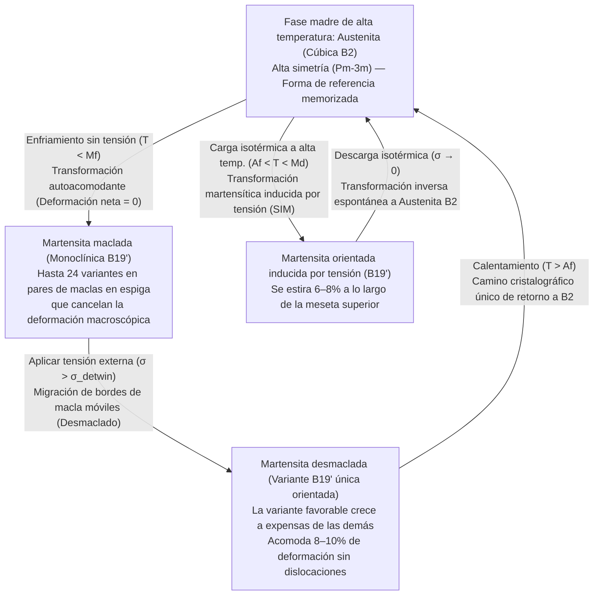

```mermaid
flowchart TD
    subgraph OWSME ["1. Efecto de memoria de forma unidireccional (Deformación a T < Mf)"]
        O1["Baja temp. (T < Mf): Martensita B19' maclada autoacomodada"] -->|"Tensión (σ > σ_detwin)"| O2["Desmaclado: Los bordes de macla migran hacia una variante única"]
        O2 -->|"Descargar (σ = 0)"| O3["La deformación plástica aparente (6–8%) queda bloqueada"]
        O3 -->|"Calentar sobre Af (T > Af)"| O4["Transformación inversa (B19' → B2) restaura la forma original"]
    end
    subgraph SE ["3. Superelasticidad / Pseudoelasticidad (Isotérmica en Af < T < Md)"]
        S1["Alta temp. (Af < T < Md): Austenita B2 estable"] -->|"Cargar sobre σ_c"| S2["Martensita inducida por tensión (SIM)<br/>Se estira 6–8% a lo largo de la meseta superior"]
        S2 -->|"Descargar (σ → 0)"| S3["Martensita inestable a T > Af: Retorno espontáneo B19' → B2<br/>Recuperación total por la meseta inferior hacia ε = 0"]
    end
```

Si tomas un clip de acero o una cuchara de aluminio y lo doblas más allá de una pequeña fracción de porcentaje de deformación, permanece doblado permanentemente al soltarlo. En la metalurgia clásica, una gran deformación es sinónimo de daño estructural irreversible.

Sin embargo, un alambre forjado con una aleación equiatómica de níquel y titanio conocida como <strong>Nitinol ($\text{NiTi}$)</strong> desafía toda intuición sobre los sólidos metálicos. Puedes retorcer un alambre de Nitinol a temperatura ambiente o estirarlo casi un $8\%$ de su longitud —cuarenta veces el límite elástico del acero de alta resistencia— y en el instante en que lo sumerges en agua tibia (por ejemplo, a $60\,^\circ\text{C}$), se desenreda violentamente y recupera su geometría memorizada con precisión atómica. Este fenómeno es el <strong>Efecto de Memoria de Forma (Shape Memory Effect, SME)</strong>. Más aún, a temperaturas justo por encima de su umbral de transformación, la misma aleación puede estirarse un $8\%$ y recuperar instantáneamente la deformación cero al retirar la carga sin necesidad de calentamiento, un comportamiento conocido como <strong>Superelasticidad (o Pseudoelasticidad)</strong>.

¿Cómo puede una red cristalina inorgánica, carente de sensores o sistema nervioso, «recordar» una compleja forma tridimensional tras sufrir una deformación masiva? En este artículo diseccionamos la física del estado sólido y la cristalografía detrás de las aleaciones con memoria de forma.

---

## 1. Por qué los metales ordinarios olvidan: El límite elástico del $0,2\%$ y el deslizamiento irreversible de dislocaciones

En un metal cristalino como el hierro, el cobre o el aluminio, una pequeña tensión $\sigma$ estira ligeramente los enlaces interatómicos siguiendo la ley de Hooke ($\sigma = E\varepsilon$). Sin embargo, la deformación elástica máxima es minúscula: típicamente <strong>$\varepsilon_{\text{el}} \approx 0,1\% \text{ a } 0,2\%$</strong>.

Al superar el $0,2\%$, el cristal entra en <strong>deformación plástica</strong> mediante el movimiento de defectos lineales llamados <strong>dislocaciones</strong> a lo largo de planos de deslizamiento. Con cada paso de un vector de Burgers $\mathbf{b}$, los enlaces metálicos se <strong>rompen y se vuelven a formar</strong> con nuevos átomos vecinos.

El punto clave es que <strong>el deslizamiento de dislocaciones destruye las relaciones topológicas de vecindad de la red cristalina</strong>. Como la nueva configuración local es energéticamente indistinguible de la anterior, el cristal sufre de <strong>amnesia topológica</strong> y ninguna fuerza restauradora devuelve los átomos a sus antiguos compañeros.

En 1962, <strong>William J. Buehler</strong> y <strong>Frederick E. Wang</strong> en el Naval Ordnance Laboratory (NOL) de EE. UU. descubrieron la aleación equiatómica $\text{NiTi}$ ($\approx 50\,\text{at.}\%\,\text{Ni}$ – $50\,\text{at.}\%\,\text{Ti}$), bautizada como <strong>Nitinol</strong> (<strong>Ni</strong>ckel <strong>Ti</strong>tanium <strong>N</strong>aval <strong>O</strong>rdnance <strong>L</strong>aboratory). Incluso deformado hasta un <strong>$8\text{–}10\%$</strong>, el Nitinol no activa el deslizamiento de dislocaciones, sino una transición de fase sólida reversible.

---

## 2. Fundamentos cristalográficos: Transformación sin difusión entre Austenita $B2$ y Martensita $B19'$

Las transformaciones de fase en estado sólido se dividen en <strong>difusivas</strong> (donde los átomos migran a larga distancia borrando toda memoria geométrica) y <strong>martensíticas (sin difusión / desplazativas)</strong>.

En una transformación martensítica termoelástica no hay difusión atómica: todo un volumen cristalino se transforma mediante una <strong>cizalladura coordinada de átomos</strong> sobre distancias menores a un espaciado interatómico, propagándose cerca de la velocidad del sonido ($\sim 10^3\,\text{m/s}$). <strong>¡Cada átomo conserva exactamente sus vecinos topológicos originales!</strong>

### Fase madre de alta temperatura: Austenita cúbica $B2$
A altas temperaturas, el $\text{NiTi}$ existe como <strong>Austenita</strong> de alta simetría con <strong>estructura cúbica ordenada $B2$ (tipo $\text{CsCl}$, grupo espacial $Pm\bar{3}m$)</strong> y $a_0 \approx 0,3015\,\text{nm}$. El grupo puntual cúbico $m\bar{3}m$ ($O_h$) posee <strong>48 operaciones de simetría</strong>.

### Fase producto de baja temperatura: Martensita monoclínica $B19'$ y la fase $R$
Al enfriarse, el ablandamiento de fonones acústicos ($\text{TA}_2$) desestabiliza la red cúbica $B2$, que se cizalla espontáneamente hacia la fase <strong>Martensita</strong> con <strong>estructura monoclínica $B19'$ (grupo espacial $P2_1/m$)</strong>:

$$a \approx 0,2898\,\text{nm}, \quad b \approx 0,4108\,\text{nm}, \quad c \approx 0,4646\,\text{nm}, \quad \beta \approx 97,78^\circ \quad (\alpha = \gamma = 90^\circ)$$

Aquí ocurre una drástica ruptura de simetría: de 48 operaciones en la fase cúbica a solo <strong>4 operaciones de simetría</strong> (grupo puntual $2/m$) en la monoclínica. En aleaciones $\text{NiTi}$ trabajadas en frío o dopadas con $\text{Fe}$, puede aparecer una fase intermedia romboédrica llamada <strong>fase $R$</strong> ($B2 \to R \to B19'$) con una histéresis térmica minúscula de $1,5\text{–}3\,\text{K}$.

---

## 3. Autoacomodación (Martensita maclada) y Desmaclado (Detwinning)

¿Por qué un alambre recto de Nitinol no se dobla por sí solo al enfriarlo sin carga en un refrigerador, si cada celda unitaria se distorsiona un $\sim 8\text{–}10\%$ al pasar de $B2$ a $B19'$? La respuesta reside en las <strong>24 variantes cristalográficas</strong>, la <strong>autoacomodación</strong> y el <strong>desmaclado (detwinning)</strong> inducido por tensión.

### 24 variantes y Autoacomodación
Por el teorema de Lagrange, la razón de los órdenes de los grupos puntuales da $48 / 4 = 12$ variantes de red, que junto con los planos de hábito conjugados producen hasta <strong>24 variantes cristalográficas de martensita</strong>. Durante el enfriamiento libre de tensión ($T < M_f$), el cristal se subdivide en finas láminas alternadas de variantes simétricas ($M^+$ y $M^-$) separadas por espejos coherentes llamados <strong>bordes de macla (twin boundaries)</strong>. Las deformaciones locales de cizalladura se cancelan exactamente en tres dimensiones:

$$\langle \boldsymbol{\varepsilon}_{\text{trans}} \rangle = \sum_{i=1}^{24} f_i \boldsymbol{\varepsilon}_i = \mathbf{0}$$

Esto se denomina <strong>Autoacomodación</strong>: cada celda unitaria es ahora monoclínica, pero el alambre conserva su forma macroscópica exacta.

### Desmaclado (Detwinning) y la ruta única de retorno al calentar
Al aplicar a $T < M_f$ una tensión moderada $\sigma > \sigma_{\text{detwin}}$ ($50\text{–}150\,\text{MPa}$, muy por debajo del límite de fluencia por dislocaciones), los bordes de macla migran fácilmente por el cristal. Las variantes desfavorables se reorientan hacia la <strong>variante única (martensita desmaclada)</strong> alineada con la carga externa (<strong>desmaclado / detwinning</strong>), acomodando un $8\text{–}10\%$ de deformación macroscópica que se mantiene tras descargar.

Al calentar el alambre doblado por encima de la <strong>temperatura final de austenita ($A_f$)</strong>, actúa la asimetría fundamental de la teoría de grupos:
- <strong>Al enfriar ($B2 \to B19'$, ruptura de simetría)</strong>, un cristal cúbico puede descender a <strong>24 variantes monoclínicas equivalentes</strong>.
- <strong>Al calentar ($B19' \to B2$, restauración de simetría)</strong>, como se preservan los vecinos atómicos, <strong>¡las 24 variantes de martensita tienen UN SOLO camino cristalográfico único de regreso a la orientación cúbica $B2$ original!</strong> El objeto recupera su forma memorizada con un $100\%$ de fidelidad.

---

## 4. Termodinámica: Energía libre de Gibbs, teoría de Landau-Falk y la ecuación de Clausius-Clapeyron

### Las cuatro temperaturas de transformación ($M_f, M_s, A_s, A_f$)
La transición de primer orden exhibe una histéresis térmica $\Delta T_{\text{hys}} = A_f - M_s \approx 15\text{–}40\,\text{K}$ con el orden:

$$M_f < M_s < T_0 < A_s < A_f$$

Bajo temperatura $T$ y tensión uniaxial $\sigma$, el cambio de energía libre de Gibbs específica $\Delta G^{A \to M}(T, \sigma)$ es:

$$\Delta G^{A \to M}(T, \sigma) = \Delta H^{A \to M} - T \Delta S^{A \to M} - \frac{1}{\rho}\sigma \varepsilon_{\text{trans}} = -\Delta S^{A \to M}(T - T_0) - \frac{1}{\rho}\sigma \varepsilon_{\text{trans}}$$

donde la transformación directa $A \to M$ es exotérmica ($\Delta H^{A \to M} < 0$, $|\Delta H| \approx 15\text{–}25\,\text{J/g}$) y $\Delta S^{A \to M} < 0$.

### Teoría de Landau-Falk (Potencial de triple pozo)
Tomando la deformación de cizalladura $\varepsilon$ como parámetro de orden, Peter Falk (1980) formuló la densidad de energía libre de sexto grado:

$$F(\varepsilon, T) = F_0(T) + \alpha (T - T_c)\varepsilon^2 - \beta \varepsilon^4 + \gamma \varepsilon^6 \quad (\alpha, \beta, \gamma > 0)$$

- Para <strong>$T > A_f$</strong>, $F(\varepsilon, T)$ tiene un único mínimo global en $\varepsilon = 0$ (austenita cúbica, <strong>pozo único</strong>).
- Cerca de <strong>$T \approx T_0$</strong>, coexisten tres pozos en $\varepsilon = 0$ y $\varepsilon = \pm\varepsilon_0$ (<strong>triple pozo</strong>).
- Para <strong>$T < M_f < T_c$</strong>, $\varepsilon = 0$ se vuelve un máximo inestable, dejando un <strong>doble pozo simétrico</strong> en $\varepsilon = \pm\varepsilon_0$ (variantes macladas $M^+, M^-$). Una tensión externa $\sigma$ inclina $G = F - \sigma\varepsilon$ hacia $+\varepsilon_0$ (desmaclado); calentar sobre $A_f$ elimina los pozos laterales y fuerza el retorno a $\varepsilon = 0$.

### La ecuación de Clausius-Clapeyron en estado sólido
Del equilibrio de fases $d(\Delta G^{A \to M}) = 0$ se deduce la <strong>ecuación de Clausius-Clapeyron</strong> para la tensión crítica $\sigma_c(T)$:

$$\frac{d\sigma_c}{dT} = -\frac{\Delta S^{A \to M}}{V_m \varepsilon_{\text{max}}} = -\frac{\rho \Delta H^{A \to M}}{T_0 \varepsilon_{\text{max}}}$$

Para $\text{NiTi}$ ($\rho \approx 6450\,\text{kg/m}^3$, $|\Delta H| \approx 20\,\text{kJ/kg}$, $T_0 \approx 300\,\text{K}$, $\varepsilon_{\text{max}} \approx 0,07$), la pendiente es estrictamente positiva: <strong>$\frac{d\sigma_c}{dT} \approx 5\text{–}8\,\text{MPa/K}$</strong> ($\approx 6,14\,\text{MPa/K}$).

---

## 5. Comparación de los tres modos funcionales: OWSME, TWSME y Superelasticidad

| Parámetro | 1. Memoria unidireccional (OWSME) | 2. Memoria bidireccional (TWSME) | 3. Superelasticidad / Pseudoelasticidad (SE) |
| :--- | :--- | :--- | :--- |
| <strong>Ventana de temperatura</strong> | Deformar a $T < M_f$ $\to$ Calentar a $T > A_f$ | Ciclado térmico $T < M_f \leftrightarrow T > A_f$ | Operación isotérmica en <strong>$A_f < T < M_d$</strong> |
| <strong>Papel de la tensión externa</strong> | Necesaria para desmaclar a baja $T$ | <strong>Sin carga externa durante la operación</strong> | Induce $B2 \to B19'$ al cargar; revierte al descargar |
| <strong>Mecanismo microestructural</strong> | Desmaclado de $B19'$ $\to$ retorno térmico a $B2$ | Campos de tensión interna anisotrópicos (dislocaciones / precipitados $\text{Ti}_3\text{Ni}_4$) | Transformación martensítica inducida por tensión (SIM) |
| <strong>Deformación recuperable máx.</strong> | <strong>$6\text{–}8\%$</strong> (hasta $10\%$ en monocristales) | <strong>$2\text{–}3\%$</strong> | <strong>$6\text{–}8\%$</strong> ($\sim 40\times$ el límite elástico del acero) |
| <strong>Aplicaciones principales</strong> | Acoplamientos hidráulicos, actuadores espaciales Frangibolt | Microactuadores sin resorte de retorno | Stents cardiovasculares, arcos de ortodoncia, neumáticos de rovers marcianos |

---

## 6. Fatiga funcional, la revolución de compatibilidad $\lambda_2 = 1$ y aplicaciones de ingeniería

### La condición matemática $\lambda_2 = 1$ para 10 millones de ciclos
En el $\text{NiTi}$ binario, la incompatibilidad geométrica en la interfaz austenita–martensita genera dislocaciones al ciclar (<strong>fatiga funcional</strong>). Según la teoría de elasticidad no lineal de <strong>John M. Ball</strong> y <strong>Richard D. James</strong>, la austenita ($\mathbf{I}$) puede formar una interfaz plana exacta libre de tensiones con una sola variante de martensita (tensor de estiramiento de Bain $\mathbf{U}$ con autovalores $\lambda_1 \le \lambda_2 \le \lambda_3$) si y solo si <strong>el autovalor medio es exactamente igual a la unidad</strong>:

$$\lambda_2 = 1$$

Mientras que el $\text{NiTi}$ binario tiene $\lambda_2 \approx 0,968$, las aleaciones cuaternarias <strong>$\text{Ti}_{50,2}\text{Ni}_{34,4}\text{Cu}_{12,3}\text{Pd}_{3,1}$</strong> (*Science* 2015) y <strong>$\text{Zn}_{45}\text{Au}_{30}\text{Cu}_{25}$</strong> (*Nature* 2013) ajustadas a $\lambda_2 = 1,0000 \pm 0,0002$ reducen la histéresis a $< 1\text{–}2\,\text{K}$ y soportan <strong>más de $10^7$ (10 millones) de ciclos</strong> sin degradación! Asimismo, las aleaciones ferromagnéticas ($\text{Ni}_2\text{MnGa}$) operan a $>1\,\text{kHz}$ bajo campos magnéticos, y la <strong>refrigeración elastocalórica</strong> impulsa el aire acondicionado de estado sólido sin gases de efecto invernadero.

### Maravillas de la ingeniería médica y aeroespacial
1. <strong>Stents cardiovasculares autoexpandibles de Nitinol</strong>: Con $A_f \approx 25\text{–}30\,^\circ\text{C}$ (por debajo de los $37\,^\circ\text{C}$ del cuerpo humano) y una capa pasiva biocompatible de $\text{TiO}_2$, el stent comprimido dentro de un catéter se despliega al contacto con la sangre y mantiene abierta la arteria gracias a la fuerza suave y constante de la meseta superelástica inferior.
2. <strong>Arcos de ortodoncia superelásticos</strong>: Ejercen una fuerza correctiva constante durante milímetros de movimiento dental.
3. <strong>Actuadores espaciales Frangibolt de la NASA y neumáticos superelásticos para rovers marcianos</strong>: El Nitinol calentado genera $>500\,\text{MPa}$ para partir pernos de titanio sin explosivos pirotécnicos; los neumáticos de malla de Nitinol de los rovers marcianos soportan un $8\%$ de deformación reversible sobre rocas afiladas sin pincharse jamás.
