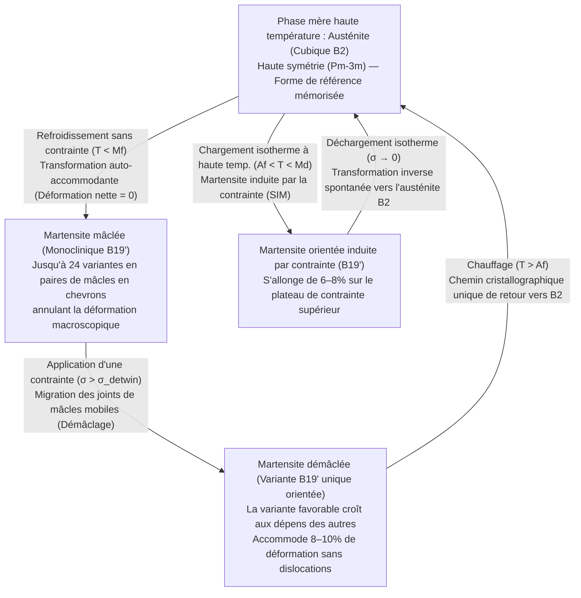

```mermaid
flowchart TD
    subgraph OWSME ["1. Effet mémoire de forme simple sens (Déformation à T < Mf)"]
        O1["Basse temp. (T < Mf) : Martensite B19' mâclée auto-accommodée"] -->|"Contrainte (σ > σ_detwin)"| O2["Démâclage : Migration des joints de mâcles vers une variante unique"]
        O2 -->|"Décharge (σ = 0)"| O3["Déformation plastique apparente (6–8%) verrouillée"]
        O3 -->|"Chauffage (T > Af)"| O4["Transformation inverse (B19' → B2) restaurant la forme initiale"]
    end
    subgraph SE ["3. Superélasticité / Pseudoélasticité (Isotherme à Af < T < Md)"]
        S1["Haute temp. (Af < T < Md) : Austénite B2 stable"] -->|"Charge au-dessus de σ_c"| S2["Martensite induite par la contrainte (SIM)<br/>S'allonge de 6–8% sur le plateau supérieur"]
        S2 -->|"Décharge (σ → 0)"| S3["Martensite instable à T > Af : Retour spontané B19' → B2<br/>Récupération totale sur le plateau inférieur vers ε = 0"]
    end
```

Si vous pliez fortement un trombone en acier ou une cuillère en aluminium au-delà d'une infime fraction de pour cent de déformation, le métal reste définitivement tordu lorsque vous le relâchez. En métallurgie classique, une grande déformation est synonyme de dommage irréversible du réseau cristallin.

Pourtant, un fil forgé à partir d'un alliage équiatomique de nickel et de titane connu sous le nom de <strong>Nitinol ($\text{NiTi}$)</strong> défie toute notre intuition sur les solides métalliques. Vous pouvez tordre un fil de Nitinol en un nœud chaotique à température ambiante ou l'étirer de près de $8\%$ de sa longueur — quarante fois la limite élastique de l'acier haute résistance — et dès que vous le plongez dans de l'eau chaude (par exemple à $60\,^\circ\text{C}$), il se détord instantanément et reprend sa géométrie mémorisée avec une précision atomique. C'est l'<strong>effet mémoire de forme (Shape Memory Effect, SME)</strong>. Plus remarquable encore : juste au-dessus de sa température de transformation, ce même alliage peut être étiré de $8\%$ et revenir spontanément à une déformation nulle dès que la charge est relâchée, sans aucun chauffage — un comportement métallique caoutchouteux appelé <strong>superélasticité (ou pseudoélasticité)</strong>.

Comment un réseau cristallin inorganique, dépourvu de capteurs ou de système nerveux, peut-il « se souvenir » d'une forme tridimensionnelle complexe après avoir subi une déformation massive ? Dans cet article, nous analysons la physique de l'état solide et la cristallographie des alliages à mémoire de forme.

---

## 1. Pourquoi les métaux ordinaires oublient : La limite élastique de $0,2\%$ et le glissement irréversible des dislocations

Dans un métal cristallin comme le fer, le cuivre ou l'aluminium, une faible contrainte de traction $\sigma$ étire légèrement les liaisons interatomiques selon la loi de Hooke ($\sigma = E\varepsilon$). Toutefois, la déformation élastique maximale est minuscule : typiquement <strong>$\varepsilon_{\text{el}} \approx 0,1\% \text{ à } 0,2\%$</strong>.

Au-delà de $0,2\%$, le cristal entre en <strong>déformation plastique</strong> via le mouvement de défauts linéaires appelés <strong>dislocations</strong> le long de plans de glissement. À chaque pas d'un vecteur de Burgers $\mathbf{b}$, les liaisons métalliques sont <strong>rompues puis reformées</strong> avec de nouveaux atomes voisins.

Point crucial : <strong>le glissement des dislocations détruit les relations topologiques de voisinage du réseau cristallin.</strong> Comme la nouvelle configuration locale est énergétiquement indiscernable de l'ancienne, le cristal souffre d'<strong>amnésie topologique</strong> : aucune force de rappel ne ramène les atomes vers leurs anciens partenaires.

En 1962, <strong>William J. Buehler</strong> et <strong>Frederick E. Wang</strong> au Naval Ordnance Laboratory (NOL) américain découvrirent l'alliage équiatomique $\text{NiTi}$ ($\approx 50\,\text{at.}\%\,\text{Ni}$ – $50\,\text{at.}\%\,\text{Ti}$), baptisé <strong>Nitinol</strong> (<strong>Ni</strong>ckel <strong>Ti</strong>tanium <strong>N</strong>aval <strong>O</strong>rdnance <strong>L</strong>aboratory). Même déformé jusqu'à <strong>$8\text{–}10\%$</strong>, le Nitinol ne se déforme pas par glissement de dislocations, mais via une transition de phase solide réversible.

---

## 2. Fondements cristallographiques : Transformation sans diffusion entre l'austénite $B2$ et la martensite $B19'$

Les transformations de phase à l'état solide se divisent en transformations <strong>diffusives</strong> (où les atomes migrent sur de longues distances en effaçant toute mémoire géométrique) et transformations <strong>martensitiques (sans diffusion / displacives)</strong>.

Dans une transformation martensitique thermoélastique, les atomes ne diffusent pas : tout un volume cristallin bascule d'une phase mère haute température vers une phase produit basse température par un <strong>cisaillement coordonné et collectif des atomes</strong> sur une fraction de distance interatomique, à une vitesse proche de celle du son ($\sim 10^3\,\text{m/s}$). <strong>Chaque atome conserve exactement ses voisins topologiques d'origine !</strong>

### Phase mère haute température : Austénite cubique $B2$
À haute température, le $\text{NiTi}$ existe sous forme d'<strong>austénite</strong> de haute symétrie, adoptant la <strong>structure cubique ordonnée $B2$ (type $\text{CsCl}$, groupe d'espace $Pm\bar{3}m$)</strong> avec $a_0 \approx 0,3015\,\text{nm}$. Le groupe ponctuel cubique $m\bar{3}m$ ($O_h$) possède <strong>48 opérations de symétrie</strong>.

### Phase produit basse température : Martensite monoclinique $B19'$ et phase $R$
Au refroidissement, l'amolissement de modes de phonons acoustiques ($\text{TA}_2$) déstabilise la maille cubique $B2$, qui se cisaille en <strong>martensite</strong> de basse symétrie de <strong>structure monoclinique $B19'$ (groupe d'espace $P2_1/m$)</strong> :

$$a \approx 0,2898\,\text{nm}, \quad b \approx 0,4108\,\text{nm}, \quad c \approx 0,4646\,\text{nm}, \quad \beta \approx 97,78^\circ \quad (\alpha = \gamma = 90^\circ)$$

La symétrie chute de 48 opérations dans le cubique à seulement <strong>4 opérations de symétrie</strong> (groupe ponctuel $2/m$) dans le monoclinique. Dans certains alliages $\text{NiTi}$ écrouis ou dopés au $\text{Fe}$, une phase intermédiaire trigonale appelée <strong>phase $R$</strong> ($B2 \to R \to B19'$) apparaît avec une hystérésis thermique minuscule de $1,5\text{–}3\,\text{K}$.

---

## 3. Auto-accommodation (martensite mâclée) et démâclage (Detwinning)

Pourquoi un fil droit de Nitinol ne change-t-il pas de forme lorsqu'on le refroidit simplement sans contrainte dans un réfrigérateur, alors que chaque maille subit un cisaillement de $\sim 8\text{–}10\%$ lors de la transition $B2 \to B19'$ ? La réponse réside dans les <strong>24 variantes cristallographiques</strong>, l'<strong>auto-accommodation</strong> et le <strong>démâclage (detwinning)</strong> sous contrainte.

### 24 variantes et auto-accommodation
D'après le théorème de Lagrange, le rapport des ordres des groupes ponctuels donne $48 / 4 = 12$ variantes de correspondance de réseau, qui forment jusqu'à <strong>24 variantes cristallographiques de martensite</strong> le long des plans d'habitat. Lors d'un refroidissement sans contrainte ($T < M_f$), le cristal se subdivise en fines lamelles alternées de variantes symétriques ($M^+$ et $M^-$) séparées par des miroirs atomiquement cohérents appelés <strong>joints de mâcles (twin boundaries)</strong>. Les cisaillements locaux s'annulent exactement en trois dimensions :

$$\langle \boldsymbol{\varepsilon}_{\text{trans}} \rangle = \sum_{i=1}^{24} f_i \boldsymbol{\varepsilon}_i = \mathbf{0}$$

C'est l'<strong>auto-accommodation</strong> : le cristal est entièrement devenu monoclinique, mais la forme macroscopique reste inchangée.

### Démâclage (Detwinning) et chemin unique de retour au chauffage
Lorsqu'on applique à $T < M_f$ une contrainte modérée $\sigma > \sigma_{\text{detwin}}$ ($50\text{–}150\,\text{MPa}$, bien inférieure à la limite d'élasticité par glissement de dislocations), les joints de mâcles très mobiles migrent à travers le cristal. Les variantes défavorables basculent vers la <strong>variante unique (martensite démâclée)</strong> alignée avec la contrainte externe (<strong>démâclage / detwinning</strong>), débloquant $8\text{–}10\%$ de déformation macroscopique conservée après déchargement.

Lorsqu'on chauffe ensuite le fil au-dessus de la <strong>température de fin d'austénite ($A_f$)</strong>, l'asymétrie fondamentale des relations groupe-sous-groupe opère :
- <strong>Au refroidissement ($B2 \to B19'$, brisure de symétrie)</strong>, un cristal cubique peut descendre vers <strong>24 variantes monocliniques équivalentes</strong>.
- <strong>Au chauffage ($B19' \to B2$, restauration de symétrie)</strong>, comme les voisins atomiques sont topologiquement préservés, <strong>les 24 variantes de martensite n'ont qu'UN SEUL chemin cristallographique unique pour revenir à l'orientation cubique $B2$ d'origine !</strong> L'objet reprend sa forme mémorisée avec une fidélité de $100\%$.

---

## 4. Thermodynamique : Énergie libre de Gibbs, théorie de Landau-Falk et relation de Clausius-Clapeyron

### Les quatre températures de transformation ($M_f, M_s, A_s, A_f$)
La transition du premier ordre présente une hystérésis thermique $\Delta T_{\text{hys}} = A_f - M_s \approx 15\text{–}40\,\text{K}$ ordonnée selon :

$$M_f < M_s < T_0 < A_s < A_f$$

Sous une température $T$ et une contrainte uniaxiale $\sigma$, la variation d'énergie libre de Gibbs spécifique $\Delta G^{A \to M}(T, \sigma)$ s'écrit :

$$\Delta G^{A \to M}(T, \sigma) = \Delta H^{A \to M} - T \Delta S^{A \to M} - \frac{1}{\rho}\sigma \varepsilon_{\text{trans}} = -\Delta S^{A \to M}(T - T_0) - \frac{1}{\rho}\sigma \varepsilon_{\text{trans}}$$

où la transformation directe $A \to M$ est exothermique ($\Delta H^{A \to M} < 0$, $|\Delta H| \approx 15\text{–}25\,\text{J/g}$) et $\Delta S^{A \to M} < 0$.

### Théorie de Landau-Falk (Potentiel à triple puits)
En prenant la déformation de cisaillement $\varepsilon$ comme paramètre d'ordre, Peter Falk (1980) a développé la densité d'énergie libre au sixième degré :

$$F(\varepsilon, T) = F_0(T) + \alpha (T - T_c)\varepsilon^2 - \beta \varepsilon^4 + \gamma \varepsilon^6 \quad (\alpha, \beta, \gamma > 0)$$

- Pour <strong>$T > A_f$</strong>, $F(\varepsilon, T)$ possède un seul minimum global en $\varepsilon = 0$ (austénite cubique, <strong>puits unique</strong>).
- Vers <strong>$T \approx T_0$</strong>, trois puits coexistent en $\varepsilon = 0$ et $\varepsilon = \pm\varepsilon_0$ (<strong>triple puits</strong>).
- Pour <strong>$T < M_f < T_c$</strong>, l'origine $\varepsilon = 0$ devient un maximum instable, laissant un <strong>double puits symétrique</strong> en $\varepsilon = \pm\varepsilon_0$ (variantes mâclées $M^+, M^-$). Une contrainte $\sigma$ incline $G = F - \sigma\varepsilon$ vers $+\varepsilon_0$ (démâclage) ; chauffer au-dessus de $A_f$ fait disparaître les puits latéraux et ramène la déformation à $\varepsilon = 0$.

### L'équation de Clausius-Clapeyron à l'état solide
La condition d'équilibre $d(\Delta G^{A \to M}) = 0$ conduit à l'<strong>équation de Clausius-Clapeyron</strong> pour la contrainte critique de transformation $\sigma_c(T)$ :

$$\frac{d\sigma_c}{dT} = -\frac{\Delta S^{A \to M}}{V_m \varepsilon_{\text{max}}} = -\frac{\rho \Delta H^{A \to M}}{T_0 \varepsilon_{\text{max}}}$$

Pour le $\text{NiTi}$ ($\rho \approx 6450\,\text{kg/m}^3$, $|\Delta H| \approx 20\,\text{kJ/kg}$, $T_0 \approx 300\,\text{K}$, $\varepsilon_{\text{max}} \approx 0,07$), la pente est strictement positive : <strong>$\frac{d\sigma_c}{dT} \approx 5\text{–}8\,\text{MPa/K}$</strong> ($\approx 6,14\,\text{MPa/K}$).

---

## 5. Comparaison des trois modes fonctionnels : SME simple sens, SME double sens et Superélasticité

| Paramètre | 1. Mémoire simple sens (OWSME) | 2. Mémoire double sens (TWSME) | 3. Superélasticité / Pseudoélasticité (SE) |
| :--- | :--- | :--- | :--- |
| <strong>Fenêtre de température</strong> | Déformer à $T < M_f$ $\to$ Chauffer à $T > A_f$ | Cyclage thermique $T < M_f \leftrightarrow T > A_f$ | Fonctionnement isotherme à <strong>$A_f < T < M_d$</strong> |
| <strong>Rôle de la contrainte externe</strong> | Requise pour démâcler à basse $T$ | <strong>Aucune charge externe en service</strong> | Induit $B2 \to B19'$ à la charge ; s'inverse à la décharge |
| <strong>Mécanisme microstructural</strong> | Démâclage de $B19'$ $\to$ retour thermique vers $B2$ | Champs de contraintes internes anisotropes (dislocations / précipités $\text{Ti}_3\text{Ni}_4$) | Transformation martensitique induite par la contrainte (SIM) |
| <strong>Déformation réversible max.</strong> | <strong>$6\text{–}8\%$</strong> (jusqu'à $10\%$ en monocristal) | <strong>$2\text{–}3\%$</strong> | <strong>$6\text{–}8\%$</strong> ($\sim 40\times$ la limite élastique de l'acier) |
| <strong>Applications clés</strong> | Manchons hydrauliques, boulons spatiaux Frangibolt | Micro-actionneurs sans ressort de rappel | Stents cardiovasculaires, arcs orthodontiques, pneus de rovers martiens |

---

## 6. Fatigue fonctionnelle, la révolution de compatibilité $\lambda_2 = 1$ et applications d'ingénierie

### La condition mathématique $\lambda_2 = 1$ pour 10 millions de cycles
Dans le $\text{NiTi}$ binaire, l'incompatibilité géométrique à l'interface austénite–martensite engendre des dislocations lors du cyclage (<strong>fatigue fonctionnelle</strong>). D'après la théorie d'élasticité non linéaire de <strong>John M. Ball</strong> et <strong>Richard D. James</strong>, l'austénite ($\mathbf{I}$) peut former une interface plane exacte sans contrainte avec une variante unique de martensite (tenseur d'étirement de Bain $\mathbf{U}$ de valeurs propres $\lambda_1 \le \lambda_2 \le \lambda_3$) si et seulement si <strong>la valeur propre médiane vaut exactement l'unité</strong> :

$$\lambda_2 = 1$$

Alors que le $\text{NiTi}$ binaire a $\lambda_2 \approx 0,968$, les alliages quaternaires <strong>$\text{Ti}_{50,2}\text{Ni}_{34,4}\text{Cu}_{12,3}\text{Pd}_{3,1}$</strong> (*Science* 2015) et <strong>$\text{Zn}_{45}\text{Au}_{30}\text{Cu}_{25}$</strong> (*Nature* 2013) ajustés à $\lambda_2 = 1,0000 \pm 0,0002$ présentent une hystérésis $< 1\text{–}2\,\text{K}$ et endurent <strong>plus de $10^7$ (10 millions) cycles</strong> sans dégradation ! En parallèle, les alliages ferromagnétiques ($\text{Ni}_2\text{MnGa}$) répondent à $>1\,\text{kHz}$ sous champ magnétique, et le <strong>refroidissement élastocalorique</strong> ouvre la voie à la climatisation solide sans gaz à effet de serre.

### Prouesses d'ingénierie médicales et aérospatiales
1. <strong>Stents cardiovasculaires auto-expansibles en Nitinol</strong> : Avec $A_f \approx 25\text{–}30\,^\circ\text{C}$ (sous les $37\,^\circ\text{C}$ du corps humain) et une couche passive biocompatible de $\text{TiO}_2$, le stent comprimé dans un cathéter se déploie au contact du sang et maintient l'artère ouverte grâce à la force constante du plateau superélastique inférieur.
2. <strong>Arcs orthodontiques superélastiques</strong> : Exercent une force physiologique constante et douce sur plusieurs millimètres de déplacement dentaire.
3. <strong>Actionneurs spatiaux Frangibolt de la NASA et pneus superélastiques pour rovers martiens</strong> : Le Nitinol chauffé génère $>500\,\text{MPa}$ pour rompre des boulons en titane sans explosifs pyrotechniques ; les pneus en treillis de Nitinol des rovers martiens supportent $8\%$ de déformation réversible sur les rochers tranchants sans jamais crever.
