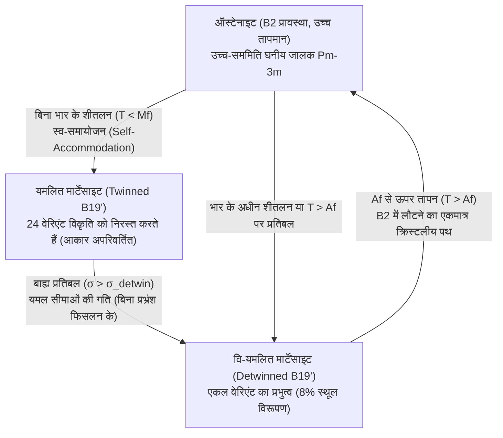
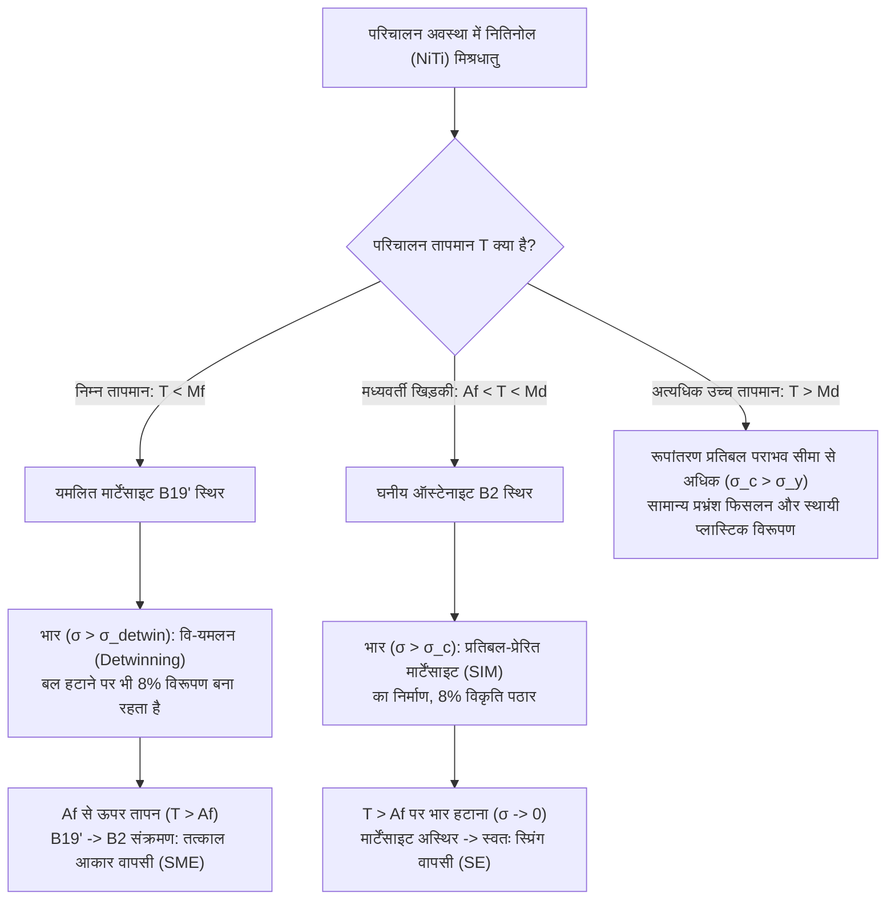

## 1. साधारण धातुएँ अपना आकार क्यों "भूल" जाती हैं, जबकि नितिनोल याद रखता है?

एक साधारण स्टील की पेपरक्लिप या तांबे का तार लें और उसे $90^\circ$ के कोण पर मोड़ दें। जब आप अपनी उंगलियाँ हटाते हैं, तो धातु एक डिग्री के छोटे से अंश तक थोड़ा वापस मुड़ती है, लेकिन स्थायी रूप से मुड़ी ही रहती है। यदि आप इस मुड़ी हुई क्लिप को उबलते पानी में भी डाल दें, तो भी यह कभी अपने आप सीधी नहीं होगी। ठोस अवस्था भौतिकी (Solid-State Physics) की दृष्टि से, सामान्य धातुएँ <strong>टोपोलॉजिकल स्मृतिलोप (Topological Amnesia)</strong> से पीड़ित होती हैं।

इस "स्मृति हानि" का मूल कारण प्लास्टिक विरूपण (Plastic Deformation) की सूक्ष्म क्रियाविधि में छिपा है। अधिकांश संरचनात्मक धातुओं (स्टील, एल्यूमीनियम, तांबा, टाइटेनियम) की प्रत्यास्थ सीमा (Elastic Limit) अत्यंत छोटी होती है, केवल $\varepsilon_{\text{el}} \approx 0.1\%\text{–}0.5\%$। इस संकीर्ण सीमा के भीतर, परमाणु बिना किसी रासायनिक बंधन को तोड़े अपनी संतुलन स्थिति से केवल थोड़ा सा विस्थापित होते हैं। परंतु जैसे ही विकृति (Strain) $\sim 0.2\%$ से अधिक होती है, अपरूपण प्रतिबल (Shear Stress) क्रिस्टल जालक में रेखीय दोषों अर्थात् <strong>प्रभ्रंशों के फिसलन (Dislocation Glide)</strong> को सक्रिय कर देता है।

जब प्रभ्रंश (Dislocations) क्रिस्टल के भीतर गति करते हैं, तो परमाणुओं के पूरे के पूरे तल एक-दूसरे के ऊपर फिसल जाते हैं, जिससे पुराने धात्विक बंधन टूट जाते हैं और बिल्कुल नए पड़ोसी परमाणुओं के साथ नए बंधन बन जाते हैं। चूँकि क्रिस्टल जालक आवधिक (Periodic) होता है, इसलिए परमाणुओं की नई स्थिति ऊर्जा की दृष्टि से पुरानी स्थिति के बिल्कुल समान ($\Delta G = 0$) होती है। क्रिस्टल के भीतर कोई भी ऐसा ऊष्मागतिकीय प्रत्यानयन बल (Restoring Force) शेष नहीं रहता जो यह "याद" रख सके कि मोड़ने से पहले कौन से परमाणु एक-दूसरे के पड़ोसी थे।

किंतु 1962 में, अमेरिकी नौसेना आयुध प्रयोगशाला (Naval Ordnance Laboratory, NOL) में विलियम जे. ब्यूहलर (William J. Buehler) और फ्रेडरिक ई. वांग (Frederick E. Wang) ने निकल और टाइटेनियम की सम-परमाण्विक मिश्रधातु ($\text{Ni}_{50}\text{Ti}_{50}$) में एक अद्भुत परिघटना की खोज की, जिसे <strong>नितिनोल (Nitinol — Nickel Titanium Naval Ordnance Laboratory)</strong> नाम दिया गया। कमरे के तापमान से नीचे ठंडा किए गए नितिनोल के तार को $8\%\text{–}10\%$ की विशाल विकृति तक आसानी से मोड़ा, खींचा या मरोड़ा जा सकता है (जो स्टील की प्रत्यास्थ सीमा से $40$ गुना अधिक है!)। लेकिन जैसे ही इस मुड़े-तुड़े तार को गर्म पानी में डाला जाता है, यह पलक झपकते ही प्रचंड बल के साथ अपनी मूल आकृति को पूर्ण सटीकता के साथ पुनः प्राप्त कर लेता है।

आखिर एक क्रिस्टल जालक बिना प्रभ्रंश फिसलन के अपने स्थूल ज्यामितीय आकार की "टोपोलॉजिकल स्मृति" को कैसे संचित रख सकता है? इसका उत्तर ठोस अवस्था की एक सामूहिक क्वांटम-यांत्रिक परिघटना में निहित है: <strong>ताप-प्रत्यास्थ मार्टेंसाइटिक प्रावस्था रूपांतरण (Thermoelastic Martensitic Transformation)</strong>।

---

## 2. सूक्ष्मदर्शीय क्रियाविधि: ऑस्टेनाइट ($B2$) और मार्टेंसाइट ($B19'$) के बीच प्रावस्था संक्रमण

पिघलने या पुनर्क्रिस्टलीकरण के विपरीत—जहाँ परमाणु लंबी दूरी तक यादृच्छिक रूप से प्रवास करते हैं (विसरणशील प्रक्रियाएँ)—<strong>शेप मेमोरी एलॉय (Shape Memory Alloys, SMA)</strong> में होने वाला प्रावस्था संक्रमण <strong>विसरण-रहित या सैन्य रूपांतरण (Diffusionless / Displacive / Military Transformation)</strong> होता है। इसमें परमाणु अपने पड़ोसियों के साथ स्थान नहीं बदलते; इसके बजाय, अरबों एकक कोष्ठिकाएँ (Unit Cells) परेड करते सैनिकों की भाँति एक साथ समन्वित अपरूपण विस्थापन (Coordinated Shear Displacement) करती हैं, जिसकी गति क्रिस्टल में ध्वनि तरंग के वेग के बराबर होती है।

नितिनोल ($\text{NiTi}$) में यह परिघटना दो मुख्य क्रिस्टल संरचनाओं द्वारा नियंत्रित होती है:

1. <strong>ऑस्टेनाइट (Austenite, उच्च-तापमान जनक प्रावस्था, $B2$ संरचना)</strong>:
   यह $\text{CsCl}$-प्रकार का सुव्यवस्थित अंतःकेंद्रित घनीय (Body-Centered Cubic) जालक है (स्पेस ग्रुप $Pm\bar{3}m$)। टाइटेनियम परमाणु घन के कोनों पर और निकल परमाणु ठीक केंद्र में स्थित होता है। घनीय ग्रुप $Pm\bar{3}m$ में अत्यंत उच्च सममिति (48 बिंदु सममिति संक्रियाएँ) होती है, जिसके कारण $B2$ संरचना कठोर, समदैशिक (Isotropic) होती है और केवल एक ही अद्वितीय क्रिस्टलीय अभिविन्यास में पाई जाती है।
2. <strong>मार्टेंसाइट (Martensite, निम्न-तापमान संतति प्रावस्था, $B19'$ संरचना)</strong>:
   क्रांतिक तापमान से नीचे ठंडा करने पर, घनीय जालक अनुप्रस्थ ध्वनिक फोनॉन विधाओं के प्रति अस्थिर हो जाता है (प्रत्यास्थ नियतांक $c' = (c_{11}-c_{12})/2$ का मृदुकरण) और बेन विरूपण (Bain Distortion) तथा परमाणु तलों के शफल (Shuffle) के माध्यम से निम्न-सममिति वाले एकनताक्ष (Monoclinic) $B19'$ जालक (स्पेस ग्रुप $P2_1/m$, केवल 4 सममिति संक्रियाएँ) में रूपांतरित हो जाता है। कुछ विशिष्ट ताप-उपचारों में यह संक्रमण एक मध्यवर्ती त्रिसमनताक्ष (Rhombohedral) <strong>$R$-प्रावस्था (R-phase)</strong> ($B2 \leftrightarrow R \leftrightarrow B19'$) से होकर गुजरता है, जिसमें विकृति कम ($\sim 1\%$) होती है किंतु तापीय शैथिल्य (Thermal Hysteresis) अत्यंत संकीर्ण ($1\text{–}2\,\text{K}$) होता है।

चूँकि $B2 \to B19'$ संक्रमण में क्रिस्टल सममिति 48 से घटकर मात्र 4 रह जाती है, इसलिए एक एकल जनक ऑस्टेनाइट क्रिस्टल से समान प्रायिकता के साथ <strong>$24$ मार्टेंसाइटिक वेरिएंट (Martensitic Variants)</strong> बन सकते हैं, जिनकी आंतरिक संरचना समान होती है किंतु अंतरिक्ष में झुकाव की दिशाएँ भिन्न होती हैं।

### 2.1 स्व-समायोजन (Self-Accommodation) और वि-यमलन (Detwinning)

जब हम बिना किसी बाह्य बल ($\sigma = 0$) के नितिनोल को ऑस्टेनाइट प्रावस्था ($T > A_f$) से मार्टेंसाइट प्रावस्था ($T < M_f$) में ठंडा करते हैं, तो क्या होता है?

यदि पूरा क्रिस्टल केवल एक ही मार्टेंसाइट वेरिएंट में बदल जाए, तो नमूने का बाहरी आकार $\sim 10\%$ बदल जाएगा, जिससे ग्रेन सीमाओं पर प्रचंड आंतरिक प्रत्यास्थ विकृति ऊर्जा उत्पन्न होगी। इस प्रत्यास्थ ऊर्जा को न्यूनतम करने के लिए, क्रिस्टल स्वतः ही एकांतर दर्पण-सममित डोमेन बनाता है जिन्हें <strong>यमलित मार्टेंसाइट (Twinned Martensite)</strong> कहते हैं। विभिन्न वेरिएंट 'हेरिंगबोन' (मछली की हड्डी जैसी) संरचना में इस प्रकार जुड़ते हैं कि उनकी स्थानीय रूपांतरण विकृतियाँ $\boldsymbol{\varepsilon}_i$ आयतन औसत में एक-दूसरे को निरस्त कर देती हैं:

$$\langle \boldsymbol{\varepsilon}_{\text{trans}} \rangle = \sum_{i=1}^{24} f_i \boldsymbol{\varepsilon}_i = \mathbf{0}$$

जहाँ $f_i$ वेरिएंट $i$ का आयतन अंश है ($\sum f_i = 1$)। इस मौलिक प्रक्रिया को <strong>स्व-समायोजन (Self-Accommodation)</strong> कहा जाता है। इसी के कारण केवल ठंडा करने पर नितिनोल का बाहरी आकार बिल्कुल नहीं बदलता।

परंतु मार्टेंसाइट की यमल सीमाएँ (Twin Boundaries) अत्यधिक गतिशील होती हैं। जब हम ठंडे नितिनोल पर बाह्य यांत्रिक प्रतिबल $\sigma > \sigma_{\text{detwin}}$ लगाते हैं, तो प्रभ्रंश गति नहीं करते और न ही परमाण्विक बंधन टूटते हैं! इसके बजाय, यमल सीमाएँ सुगमता से खिसकती हैं: बाह्य बल की दिशा में अनुकूलित वेरिएंट अन्य प्रतिकूल वेरिएंट की कीमत पर बड़े हो जाते हैं। इस प्रक्रिया को <strong>वि-यमलन (Detwinning)</strong> कहते हैं। स्थूल रूप से तार $8\%$ तक मुड़ या खिंच जाता है और <strong>अभिविन्यासित मार्टेंसाइट (Detwinned Martensite)</strong> बन जाता है, जबकि प्रत्येक परमाणु के पड़ोसी संबंधों की टोपोलॉजी 100% अक्षुण्ण रहती है!

फिर बाद में गर्म करने पर ($T > A_f$) आकार अचूक रूप से वापस क्यों आ जाता है? यहाँ सममिति ग्रुप की असममिति काम करती है: ठंडा करने पर घनीय $B2$ जालक के पास मार्टेंसाइट $B19'$ में जाने के लिए <strong>24 रास्ते</strong> होते हैं, किंतु गर्म करने पर उन सभी 24 मार्टेंसाइट वेरिएंट के पास उच्च-सममिति वाले जनक घनीय $B2$ जालक में लौटने का <strong>केवल एक ही अद्वितीय रास्ता</strong> होता है! इसलिए, विरूपित मार्टेंसाइट चाहे किसी भी वेरिएंट में हो, $A_f$ से ऊपर गर्म करते ही सभी डोमेन अपने एकमात्र मूल ऑस्टेनाइट अभिविन्यास में लौटने को बाध्य होते हैं, जिससे धातु तुरंत अपना मूल आकार प्राप्त कर लेती है।

---

## 3. ऊष्मागतिकी और लैंडौ–फाल्क (Landau–Falk) मुक्त ऊर्जा सिद्धांत

मार्टेंसाइटिक रूपांतरण एक <strong>प्रथम-कोटि प्रावस्था संक्रमण (First-Order Phase Transition)</strong> है जिसमें गुप्त ऊष्मा (Latent Heat) $\Delta H$ और तापीय शैथिल्य शामिल हैं। इस संक्रमण का चालक बल ऑस्टेनाइट ($A$) और मार्टेंसाइट ($M$) की गिब्स मुक्त ऊर्जाओं का अंतर है:

$$\Delta G^{A \to M}(T, \sigma) = G_M(T, \sigma) - G_A(T, \sigma) = \Delta H^{A \to M} - T \Delta S^{A \to M} - \frac{1}{\rho}\boldsymbol{\sigma} : \boldsymbol{\varepsilon}_{\text{trans}}$$

उच्च-तापमान ऑस्टेनाइट ($B2$) का जालक अधिक खुला होता है और इसके फोनॉन कंपन मोड मृदु होते हैं, इसलिए इसकी कंपन एन्ट्रॉपी अधिक होती है ($S_A > S_M$)। उच्च तापमान पर $-T S_A$ पद ऑस्टेनाइट को स्थिर बनाता है। निम्न तापमान पर अधिक सघनता से पैक मार्टेंसाइट ($B19'$) की आंतरिक एन्थैल्पी कम ($H_M < H_A$) होने के कारण वह ऊष्मागतिकीय रूप से स्थिर हो जाता है।

### 3.1 लैंडौ–फाल्क मुक्त ऊर्जा बहुपद ($\varepsilon^6$ मॉडल)

1980 में, एफ. फाल्क (F. Falk) ने जालक अपरूपण विकृति $\varepsilon$ को कोटि प्राचल (Order Parameter) मानकर शेप मेमोरी एलॉय के लिए लैंडौ के प्रावस्था संक्रमण सिद्धांत का विस्तार किया। सममिति ($\varepsilon \leftrightarrow -\varepsilon$) के कारण हेल्महोल्ट्ज़ मुक्त ऊर्जा घनत्व $F(\varepsilon, T)$ का छठी घात तक विस्तार इस प्रकार लिखा जाता है:

$$F(\varepsilon, T) = F_0(T) + \alpha (T - T_c)\varepsilon^2 - \beta \varepsilon^4 + \gamma \varepsilon^6$$

जहाँ $\alpha, \beta, \gamma > 0$ धनात्मक पदार्थ नियतांक हैं और $T_c$ जालक अस्थिरता तापमान है। ऋणात्मक चतुर्थ-घात पद ($-\beta \varepsilon^4$) प्रथम-कोटि संक्रमण (दोनों प्रावस्थाओं के बीच ऊर्जा अवरोध) को दर्शाने के लिए आवश्यक है, जबकि धनात्मक षष्ठ-घात पद ($+\gamma \varepsilon^6$) बड़ी विकृतियों पर क्रिस्टल की स्थिरता सुनिश्चित करता है।

तापमान के साथ मुक्त ऊर्जा परिदृश्य $F(\varepsilon, T)$ में होने वाला परिवर्तन नितिनोल के संपूर्ण व्यवहार को स्पष्ट करता है:

* <strong>उच्च तापमान पर ($T > A_f$)</strong>: द्विघात पद $\alpha(T - T_c)\varepsilon^2$ बड़ा और धनात्मक होता है। वक्र $F(\varepsilon)$ में <strong>$\varepsilon = 0$ पर केवल एक वैश्विक न्यूनतम (Global Minimum)</strong> होता है (ऑस्टेनाइट)। शून्य से कोई भी विचलन एक तीव्र प्रत्यानयन बल $\sigma = \partial F / \partial \varepsilon$ उत्पन्न करता है।
* <strong>मध्यवर्ती संक्रमण क्षेत्र में ($M_s < T < A_f$)</strong>: $\varepsilon = 0$ पर केंद्रीय न्यूनतम के अलावा, $\varepsilon = \pm \varepsilon_0$ पर दो स्थानीय (मितस्थायी) न्यूनतम उभरते हैं जो मार्टेंसाइट वेरिएंट ($M^+$ और $M^-$) को दर्शाते हैं।
* <strong>निम्न तापमान पर ($T < M_f < T_c$)</strong>: गुणांक $\alpha(T - T_c)$ ऋणात्मक हो जाता है! केंद्र बिंदु $\varepsilon = 0$ एक <strong>स्थानीय उच्चतम (Local Maximum)</strong> में बदल जाता है (ऑस्टेनाइट पूर्णतः अस्थिर), और $\varepsilon = \pm \varepsilon_0$ पर दो गहरे सममित विभव कूप मार्टेंसाइट की स्थिर अवस्थाएँ बन जाते हैं। बाह्य प्रतिबल $\sigma$ लगाने पर क्रिस्टल बाएँ कूप ($-\varepsilon_0$) से दाएँ कूप ($+\varepsilon_0$) में कूद जाता है, जो वि-यमलन (Detwinning) की प्रक्रिया है।

### 3.2 चार अभिलाक्षणिक तापमान और क्लॉसियस–क्लैपेरॉन समीकरण

अंतरापृष्ठीय प्रत्यास्थ ऊर्जा और यमल सीमाओं के घर्षण के कारण, अग्र और पश्च रूपांतरण एक तापीय शैथिल्य पाश ($\Delta T_{\text{hyst}} \approx 15\text{–}40\,\text{K}$) द्वारा अलग होते हैं और चार तापमानों द्वारा परिभाषित होते हैं:
1. $M_s$ (Martensite Start): ठंडा करने पर मार्टेंसाइट बनने का प्रारंभिक तापमान;
2. $M_f$ (Martensite Finish): 100% मार्टेंसाइट में रूपांतरण पूर्ण होने का तापमान ($M_f < M_s$);
3. $A_s$ (Austenite Start): गर्म करने पर ऑस्टेनाइट बनने का प्रारंभिक तापमान;
4. $A_f$ (Austenite Finish): 100% ऑस्टेनाइट में पूर्ण वापसी का तापमान ($A_s < A_f$, तथा $M_s < A_f$)।

बाह्य प्रतिबल $\sigma$ इन तापमानों को कैसे प्रभावित करता है? चूँकि बाह्य बल अभिविन्यासित मार्टेंसाइट को स्थिर करने के लिए यांत्रिक कार्य $\sigma \varepsilon_{\text{trans}}$ करता है, इसलिए भार लगाने पर चारों संक्रमण तापमान रैखिक रूप से बढ़ जाते हैं। यह संबंध <strong>ठोस प्रावस्थाओं के लिए क्लॉसियस–क्लैपेरॉन समीकरण (Clausius–Clapeyron Equation)</strong> द्वारा दिया जाता है:

$$\frac{d\sigma_c}{dT} = -\frac{\Delta S^{A \to M}}{V_m \varepsilon_{\text{max}}} = -\frac{\rho \Delta H^{A \to M}}{T_0 \varepsilon_{\text{max}}}$$

जहाँ $\sigma_c$ मार्टेंसाइट प्रेरित करने वाला क्रांतिक प्रतिबल है, $V_m$ मोलर आयतन है, $\rho \approx 6.45\,\text{g/cm}^3$ $\text{NiTi}$ का घनत्व है, $\Delta H^{A \to M} \approx -20\text{–}25\,\text{J/g}$ रूपांतरण की गुप्त ऊष्मा है, $T_0 \approx \frac{1}{2}(M_s + A_f)$ संतुलन तापमान है, और $\varepsilon_{\text{max}} \approx 0.08$ अधिकतम रूपांतरण विकृति है।

नितिनोल के मानक मान रखने पर हमें प्रावस्था संतुलन रेखा की सार्वत्रिक प्रवणता प्राप्त होती है:

$$\frac{d\sigma_c}{dT} \approx 5\text{–}8\,\text{MPa/K}$$

अर्थात् तापमान में मात्र $10\,\text{K}$ की वृद्धि करने पर क्रांतिक प्रतिबल (या नितिनोल तार द्वारा सीधा होते समय लगाया जाने वाला बल) $50\text{–}80\,\text{MPa}$ तक बढ़ जाता है!

---

## 4. एक ही परिघटना के दो रूप: शेप मेमोरी प्रभाव (SME) बनाम सुपरइलास्टिसिटी (SE)

मिश्रधातु का परिचालन तापमान $T$ उसके क्रांतिक बिंदुओं $M_f$ और $A_f$ के सापेक्ष कहाँ स्थित है, इसके आधार पर एक ही नितिनोल क्रिस्टल दो बिल्कुल भिन्न यांत्रिक व्यवहार प्रदर्शित करता है:

### 4.1 शेप मेमोरी प्रभाव (Shape Memory Effect, SME, जब $T < M_f$)

$M_f$ से कम तापमान पर मिश्रधातु यमलित मार्टेंसाइट अवस्था में होती है। भार लगाकर $\sim 8\%$ विरूपित करने और बल हटाने के बाद भी विरूपण बना रहता है (क्योंकि अभिविन्यासित मार्टेंसाइट लैंडौ विभव के गहरे कूप में स्थिर रहता है)। मूल आकार वापस पाने के लिए <strong>$A_f$ से ऊपर तापीय तापन (Heating) आवश्यक है</strong>।
* <strong>एक-दिशीय शेप मेमोरी प्रभाव (OWSME)</strong>: धातु केवल उच्च-तापमान ऑस्टेनाइट का आकार याद रखती है। पुनः $M_f$ से नीचे ठंडा करने पर स्व-समायोजन के कारण वह सीधी ही रहती है।
* <strong>द्वि-दिशीय शेप मेमोरी प्रभाव (TWSME)</strong>: विशेष ताप-यांत्रिक "प्रशिक्षण" (भार के अंतर्गत चक्रण) द्वारा क्रिस्टल के भीतर दिशात्मक आंतरिक प्रतिबल क्षेत्र उत्पन्न किए जाते हैं। ये आंतरिक क्षेत्र ठंडा करने पर बिना किसी बाह्य बल के एक विशिष्ट मार्टेंसाइट वेरिएंट को जन्म देते हैं, जिससे धातु ठंड में स्वयं मुड़ जाती है और गर्मी में स्वयं सीधी हो जाती है!

### 4.2 सुपरइलास्टिसिटी / छद्म-प्रत्यास्थता (Superelasticity, SE, जब $A_f < T < M_d$)

यदि नितिनोल को $T > A_f$ तापमान पर (जहाँ घनीय ऑस्टेनाइट $B2$ स्थिर है) रखकर जोर से खींचा जाए तो क्या होगा?
क्लॉसियस–क्लैपेरॉन समीकरण के अनुसार, जैसे ही प्रतिबल क्रांतिक मान $\sigma_{M_s}(T)$ तक पहुँचता है, ऑस्टेनाइट भार के अधीन ही अस्थिर होकर <strong>प्रतिबल-प्रेरित मार्टेंसाइट (Stress-Induced Martensite, SIM)</strong> में रूपांतरित हो जाता है। प्रतिबल-विकृति ($\sigma\text{–}\varepsilon$) वक्र पर एक लंबा समतल पठार (Plateau) दिखाई देता है जहाँ धातु लगभग स्थिर बल पर $8\%$ तक खिंचती चली जाती है।

किंतु जैसे ही हम बाह्य बल हटाते हैं ($\sigma \to 0$), चूँकि परिवेश का तापमान $T > A_f$ है, मार्टेंसाइट तुरंत अपनी ऊष्मागतिकीय स्थिरता खो देता है! बिना किसी अतिरिक्त तापन के वह स्वतः ही वापस ऑस्टेनाइट ($B19' \to B2$) में बदल जाता है, और धातु एक आदर्श स्प्रिंग की भाँति शून्य विकृति ($\varepsilon = 0$) पर लौट आती है।

*(नोट: यदि तापमान अधिकतम सीमा $M_d > A_f$ से अधिक हो जाए, तो मार्टेंसाइट बनने का क्रांतिक प्रतिबल $\sigma_c(T)$ प्रभ्रंश पराभव सामर्थ्य $\sigma_y$ से अधिक हो जाता है। $T > M_d$ क्षेत्र में सुपरइलास्टिसिटी समाप्त हो जाती है और नितिनोल सामान्य स्टील की तरह स्थायी रूप से विरूपित हो जाता है).*

| विशेषता | एक-दिशीय शेप मेमोरी (OWSME) | द्वि-दिशीय शेप मेमोरी (TWSME) | सुपरइलास्टिसिटी / छद्म-प्रत्यास्थता (SE) |
| :--- | :--- | :--- | :--- |
| <strong>परिचालन तापमान $T$</strong> | $T < M_f$ पर विरूपण, $T > A_f$ तक तापन | तापीय चक्रण $T < M_f \leftrightarrow T > A_f$ | समतापीय खिड़की $A_f < T < M_d$ |
| <strong>प्रारंभिक स्थिर प्रावस्था</strong> | यमलित मार्टेंसाइट ($B19'$) | ऑस्टेनाइट ($B2$) $\leftrightarrow$ अभिविन्यासित मार्टेंसाइट | घनीय ऑस्टेनाइट ($B2$) |
| <strong>भौतिक क्रियाविधि</strong> | वि-यमलन $\to$ तापन द्वारा $B2$ में वापसी | आंतरिक प्रतिबल क्षेत्र में वेरिएंट वृद्धि | प्रतिबल-प्रेरित मार्टेंसाइट (SIM) |
| <strong>आकार वापसी का प्रेरक</strong> | तापीय तापन ($\Delta T$) | तापन और शीतलन ($\pm \Delta T$) | केवल बाह्य भार हटाना ($\sigma \to 0$) |
| <strong>अधिकतम प्रतिवर्ती विकृति</strong> | $6\% \text{–} 8\%$ | $2\% \text{–} 4\%$ | $6\% \text{–} 10\%$ |

---

## 5. अत्याधुनिक अनुसंधान: कार्यात्मक थकान, $\lambda_2 = 1$ संगतता शर्त और भविष्य की इंजीनियरिंग

यद्यपि मार्टेंसाइटिक रूपांतरण क्रिस्टलीय रूप से प्रतिवर्ती है, फिर भी वास्तविक शेप मेमोरी एलॉय <strong>कार्यात्मक थकान (Functional Fatigue)</strong> की समस्या का सामना करते हैं: कुछ हजार चक्रों के बाद संक्रमण तापमान खिसक जाता है और आकार वापसी अधूरी रहने लगती है। क्यों?

इसका रहस्य घनीय ऑस्टेनाइट $B2$ और एकनताक्ष मार्टेंसाइट $B19'$ के बीच की अंतरापृष्ठ सीमा (हैबिट प्लेन, Habit Plane) पर छिपा है। दो भिन्न क्रिस्टल जालकों को बिना दरार या प्रत्यास्थ विकृति के जुड़ने के लिए, रूपांतरण विकृति आव्यूह $\mathbf{U}$—जिसके तीन धनात्मक आइगेनमान (मुख्य जालक खिंचाव) $\lambda_1 \le \lambda_2 \le \lambda_3$ होते हैं—को <strong>बॉल–जेम्स (Ball–James) मार्टेंसाइट के क्रिस्टलीय सिद्धांत</strong> की ज्यामितीय संगतता शर्त को पूरा करना होता है।

ऑस्टेनाइट और एकल मार्टेंसाइट वेरिएंट के बीच बिना किसी प्रत्यास्थ संक्रमण परत के एक पूर्णतः सुसंगत अंतरापृष्ठ तभी बन सकता है जब रूपांतरण आव्यूह का मध्य आइगेनमान ठीक एक के बराबर हो:

$$\lambda_2 = 1$$

सामान्य द्वि-अंगी नितिनोल ($\text{Ni}_{50}\text{Ti}_{50}$) में $\lambda_2 \approx 0.968 \neq 1$ होता है। इस $\sim 3.2\%$ के असंतुलन के कारण अंतरापृष्ठ सीमा को चलते समय भारी प्रत्यास्थ विरूपण झेलना पड़ता है, जिससे प्रभ्रंश उत्पन्न होते हैं और एक चौड़ा तापीय शैथिल्य ($\sim 30\,\text{K}$) बनता है।

पिछले दो दशकों में पदार्थ वैज्ञानिकों ने <strong>कोफैक्टर इंजीनियरिंग (Cofactor Engineering)</strong> के माध्यम से क्रांति ला दी है: नितिनोल में तांबा और पैलेडियम मिलाकर ($\text{Ti}_{50}\text{Ni}_{50-x-y}\text{Cu}_x\text{Pd}_y$) या $\text{Zn}_{45}\text{Au}_{30}\text{Cu}_{25}$ मिश्रधातु बनाकर जालक प्राचलों को इस प्रकार समंजित किया गया कि $\lambda_2 = 1.0000$ प्राप्त हो गया! ऐसे अति-सुसंगत क्रिस्टलों में प्रावस्था सीमा लगभग शून्य घर्षण के साथ चलती है, तापीय शैथिल्य सिमटकर $\Delta T < 1\text{–}2\,\text{K}$ रह जाता है, और मिश्रधातु बिना किसी क्षरण के <strong>$10^7$ (एक करोड़!) से अधिक चक्रों</strong> तक कार्य करती है।

### चिकित्सा, अंतरिक्ष और हरित ऊर्जा में क्रांतिकारी अनुप्रयोग

1. <strong>हृदयवाहिका स्टेंट (Cardiovascular Stents) और ऑर्थोडॉन्टिक आर्चवायर</strong>: नितिनोल के स्व-विस्तारित स्टेंट सुपरइलास्टिसिटी ($A_f \approx 25\text{–}30\,^\circ\text{C}$, मानव शरीर के तापमान $37\,^\circ\text{C}$ से नीचे) का उपयोग करते हैं। स्टेंट को ठंडा करके पतले कैथेटर में दबाया जाता है और धमनी में डाला जाता है; रक्त की गर्मी और कैथेटर से मुक्त होते ही यह स्वतः खुल जाता है और धमनी को स्थिर कोमल बल से सहारा देता है। दांतों के ब्रेसेज़ में लगे नितिनोल तार महीनों तक निरंतर और एकसमान बल प्रदान करते हैं।
2. <strong>नासा (NASA) के अंतरिक्ष यान और मार्स रोवर के वायु-रहित टायर</strong>: उपग्रहों को अलग करने वाले गैर-विस्फोटक लॉक (Frangibolt) में नितिनोल सिलेंडर का उपयोग होता है जो विद्युत तापन पर फैलकर बिना किसी विस्फोटक झटके के टाइटेनियम बोल्ट को तोड़ देता है। मंगल और चंद्रमा के भविष्य के मिशनों के लिए नासा ने सुपरइलास्टिक नितिनोल के बुने हुए जाल वाले टायर विकसित किए हैं, जो बिना पंचर हुए या स्थायी रूप से दबे नुकीली चट्टानों पर $10\%$ विरूपण तक आसानी से चल सकते हैं।
3. <strong>लौहचुंबकीय शेप मेमोरी एलॉय ($\text{Ni}_2\text{MnGa}$)</strong>: ह्यूसलर मिश्रधातु $\text{Ni}_2\text{MnGa}$ में मार्टेंसाइट वेरिएंट लौहचुंबकीय होते हैं। यहाँ बाह्य चुंबकीय क्षेत्र द्वारा यमल सीमाओं को घुमाया जा सकता है (Magnetic Shape Memory Effect), जिससे हजारों हर्ट्ज़ की आवृत्ति पर $6\%\text{–}10\%$ तक विशाल विरूपण प्राप्त होता है।
4. <strong>ठोस-अवस्था इलास्टोकैलोरिक शीतलन (Elastocaloric Cooling)</strong>: जब सुपरइलास्टिक नितिनोल तार को तेजी से रुद्धोष्म (Adiabatic) रूप से खींचा जाता है, तो $B2 \to B19'$ रूपांतरण से गुप्त ऊष्मा निकलती है ($\Delta T \approx +15\text{–}20\,\text{K}$); और जब भार अचानक हटाया जाता है, तो $B19' \to B2$ संक्रमण परिवेश से ऊष्मा सोखकर तार को $15\text{–}20\,\text{K}$ ठंडा कर देता है। यह पर्यावरण-अनुकूल तकनीक भविष्य में ग्रीनहाउस गैस (फ्रेऑन) वाले कंप्रेसर फ्रिज और एसी का स्थान ले सकती है।

धातु के एक टुकड़े में जो हमें "जादुई स्मृति" जैसा प्रतीत होता है, वह वास्तव में क्रिस्टलीय सममिति ग्रुप, लैंडौ की सांख्यिकीय ऊष्मागतिकी और ठोस जालक की सामूहिक क्वांटम यांत्रिकी की एक अद्भुत विजय है।
