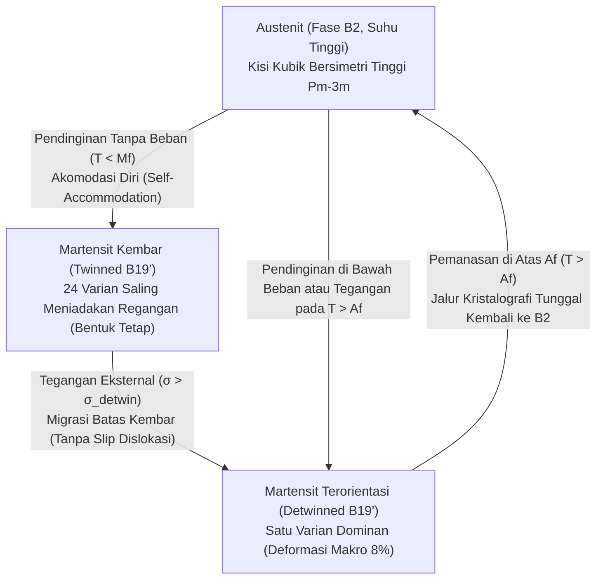
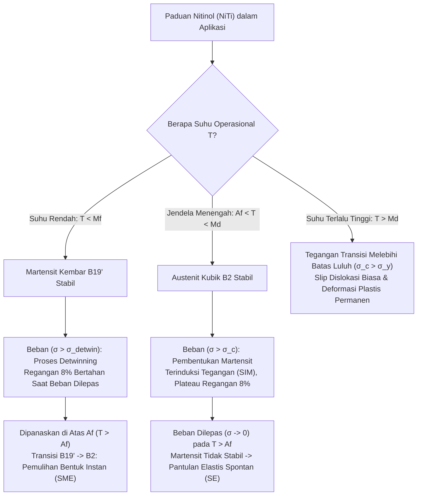

## 1. Mengapa Logam Biasa "Melupakan" Bentuknya, Sedangkan Nitinol Mengingatnya?

Ambil penjepit kertas baja biasa atau sepotong kawat tembaga, lalu tekuk hingga membentuk sudut siku-siku. Saat Anda melepaskan jari Anda, kawat tersebut hanya akan memantul sedikit (kurang dari satu derajat), tetapi tetap bengkok secara permanen. Bahkan jika Anda mencelupkannya ke dalam air mendidih, kawat itu tidak akan pernah kembali lurus dengan sendirinya. Dalam sudut pandang fisika zat padat, logam konvensional mengalami <strong>amnesia topologi</strong>.

Penyebab "hilangnya ingatan" ini terletak pada mekanisme mikroskopis deformasi plastis. Batas elastisitas sebagian besar logam struktural (baja, aluminium, tembaga, titanium) sangatlah kecil, hanya sekitar $\varepsilon_{\text{el}} \approx 0.1\%\text{–}0.5\%$. Dalam rentang sempit ini, atom-atom hanya bergeser sedikit dari posisi kesetimbangannya di dalam sumur potensial interatomik tanpa memutuskan ikatan kimia. Namun, begitu regangan melampaui $\sim 0.2\%$, tegangan geser mengaktifkan pergerakan <strong>dislokasi (dislocation glide)</strong>—cacat garis di dalam kisi kristal.

Ketika dislokasi bergerak melintasi kristal, seluruh bidang atom bergeser satu sama lain, memutuskan ikatan logam lama dan membentuk ikatan baru dengan tetangga atom yang sama sekali berbeda. Karena kisi kristal bersifat periodik, posisi atom yang baru secara energetik identik dengan posisi lama ($\Delta G = 0$). Tidak ada gaya pemulih termodinamika di dalam kristal yang "mengingat" atom mana yang dulunya bertetangga sebelum pembengkokan terjadi.

Namun, pada tahun 1962, William J. Buehler dan Frederick E. Wang di Naval Ordnance Laboratory (NOL) Amerika Serikat menemukan fenomena luar biasa pada paduan ekuatomik nikel dan titanium ($\text{Ni}_{50}\text{Ti}_{50}$), yang kemudian diberi nama <strong>Nitinol (Nickel Titanium Naval Ordnance Laboratory)</strong>. Kawat Nitinol yang didinginkan di bawah suhu ruang dapat dipelintir, diregangkan, atau diremas dengan regangan ekstrem hingga $8\%\text{–}10\%$ (lebih dari $40$ kali lipat batas elastis baja!). Namun, begitu kawat yang kusut itu dicelupkan ke dalam air hangat, dalam sekejap mata ia melompat kembali dengan kekuatan besar untuk memulihkan bentuk aslinya dengan presisi sempurna.

Bagaimana kisi kristal mampu menyimpan "memori topologi" dari geometri makroskopisnya tanpa mengalami slip dislokasi? Jawabannya terletak pada fenomena mekanika kuantum kooperatif di dalam zat padat: <strong>transformasi fase martensit termoelastis (Thermoelastic Martensitic Transformation)</strong>.

---

## 2. Mekanisme Mikroskopis: Transisi Fase Austenit ($B2$) dan Martensit ($B19'$)

Berbeda dengan peleburan atau rekristalisasi di mana atom-atom bermigrasi secara acak melintasi jarak jauh (proses difusif), transisi fase pada <strong>Paduan Memori Bentuk (Shape Memory Alloys, SMA)</strong> bersifat <strong>nir-difusi (diffusionless / displacive / military transformation)</strong>. Atom-atom tidak bertukar tempat dengan tetangganya; sebaliknya, miliaran sel satuan bergerak secara serempak—seperti barisan prajurit—melakukan pergeseran geser terkoordinasi dengan kecepatan gelombang suara di dalam kristal.

Pada Nitinol ($\text{NiTi}$), fenomena ini dikendalikan oleh dua struktur kristal utama:

1. <strong>Austenit (Austenite, fase induk suhu tinggi, struktur $B2$)</strong>:
   Kisi kubik berpusat badan teratur tipe $\text{CsCl}$ (grup ruang $Pm\bar{3}m$). Atom titanium menempati sudut-sudut kubus sementara atom nikel berada tepat di pusat kubus (atau sebaliknya). Karena grup kubik $Pm\bar{3}m$ memiliki simetri yang sangat tinggi (48 operasi simetri titik), struktur $B2$ bersifat kaku, isotropik, dan hanya memiliki satu orientasi kristalografi yang unik.
2. <strong>Martensit (Martensite, fase produk suhu rendah, struktur $B19'$)</strong>:
   Saat didinginkan di bawah suhu kritis, kisi kubik mengalami pelunakan fonon akustik transversal (konstanta elastis $c' = (c_{11}-c_{12})/2$ menurun tajam) dan mengalami distorsi kisi homogen (distorsi Bain) yang dikombinasikan dengan pergeseran bidang atom (shuffle). Kisi ini bertransformasi menjadi kisi monoklinik bersimetri rendah $B19'$ (grup ruang $P2_1/m$, hanya memiliki 4 operasi simetri). Pada kondisi perlakuan panas tertentu, transisi ini juga dapat melewati <strong>fase-$R$ (R-phase)</strong> rombohedral perantara ($B2 \leftrightarrow R \leftrightarrow B19'$) yang menghasilkan regangan kecil ($\sim 1\%$) namun histeresis termal yang sangat sempit ($1\text{–}2\,\text{K}$).

Karena simetri kristal turun drastis dari 48 operasi pada fase $B2$ menjadi 4 operasi pada fase $B19'$, satu kristal tunggal austenit induk dapat bertransformasi menjadi hingga <strong>$24$ Varian Martensit (Martensitic Variants)</strong> yang identik secara struktur namun memiliki arah kemiringan spasial yang berbeda-beda.

### 2.1 Akomodasi Diri (Self-Accommodation) dan Detwinning

Apa yang terjadi ketika kita mendinginkan Nitinol dari fase austenit ($T > A_f$) ke fase martensit ($T < M_f$) tanpa memberikan gaya luar ($\sigma = 0$)?

Jika seluruh kristal berubah menjadi satu varian martensit saja, benda kerja makroskopis akan berubah bentuk sebesar $\sim 10\%$, yang akan membangkitkan energi regangan elastis internal yang sangat besar di batas butir. Untuk meminimalkan energi elastis ini, kristal secara otomatis membentuk domain-domain kembar berselang-seling yang saling mencerminkan—disebut <strong>Martensit Kembar (Twinned Martensite)</strong>. Berbagai varian tersusun membentuk pola tulang ikan (herringbone) sehingga regangan transformasi lokal $\boldsymbol{\varepsilon}_i$ saling meniadakan secara rata-rata volume:

$$\langle \boldsymbol{\varepsilon}_{\text{trans}} \rangle = \sum_{i=1}^{24} f_i \boldsymbol{\varepsilon}_i = \mathbf{0}$$

di mana $f_i$ adalah fraksi volume varian ke-$i$ ($\sum f_i = 1$). Proses fundamental ini disebut <strong>akomodasi diri (Self-Accommodation)</strong>. Berkat mekanisme ini, pendinginan Nitinol dari austenit menjadi martensit tidak mengubah ukuran maupun bentuk makroskopis benda sama sekali.

Namun, batas-batas kembar (twin boundaries) di dalam martensit sangat mudah bergerak. Ketika kita memberikan tegangan mekanis eksternal $\sigma > \sigma_{\text{detwin}}$ pada Nitinol yang dingin, kita tidak menggerakkan dislokasi dan tidak memutuskan ikatan kimia! Sebaliknya, batas kembar bergeser dengan mulus: varian martensit yang searah dengan gaya luar tumbuh membesar dengan mengorbankan varian lain yang arahnya berlawanan. Proses ini disebut <strong>penghilangan kembar (Detwinning)</strong>. Secara makroskopis, kawat membengkok atau memanjang hingga $8\%$ menjadi <strong>Martensit Terorientasi (Detwinned Martensite)</strong>, sementara topologi ikatan setiap atom dengan tetangganya tetap utuh 100%!

Lalu mengapa saat dipanaskan kembali ($T > A_f$) bentuknya pulih tanpa kesalahan? Di sinilah ketidakseimbangan grup simetri berperan: saat didinginkan, kisi kubik $B2$ memiliki <strong>24 jalur</strong> menuju martensit $B19'$; tetapi saat dipanaskan, setiap varian dari ke-24 varian martensit tersebut <strong>hanya memiliki satu jalur tunggal</strong> untuk kembali ke kisi kubik $B2$ induknya! Oleh karena itu, bagaimana pun cara Anda membengkokkan martensit, pemanasan di atas $A_f$ memaksa seluruh domain kristal kembali ke orientasi austenit tunggal yang asli, memulihkan geometri makroskopis secara instan.

---

## 3. Termodinamika Transisi Fase dan Teori Energi Bebas Landau–Falk

Transformasi martensit adalah <strong>transisi fase orde pertama (First-Order Phase Transition)</strong> yang melibatkan kalor laten $\Delta H$ dan histeresis termal. Gaya penggerak termodinamika transisi ini adalah selisih energi bebas Gibbs antara austenit ($A$) dan martensit ($M$):

$$\Delta G^{A \to M}(T, \sigma) = G_M(T, \sigma) - G_A(T, \sigma) = \Delta H^{A \to M} - T \Delta S^{A \to M} - \frac{1}{\rho}\boldsymbol{\sigma} : \boldsymbol{\varepsilon}_{\text{trans}}$$

Fase austenit suhu tinggi ($B2$) memiliki struktur kisi yang lebih terbuka dan mode getaran fonon yang lebih lunak, sehingga entropi vibrasinya lebih tinggi ($S_A > S_M$). Pada suhu tinggi, suku $-T S_A$ mendominasi dan menstabilkan austenit. Pada suhu rendah, fase martensit ($B19'$) yang terkemas lebih rapat memiliki entalpi ikatan yang lebih rendah ($H_M < H_A$), sehingga menjadi fase yang stabil secara termodinamika.

### 3.1 Polinomial Energi Bebas Landau–Falk (Model $\varepsilon^6$)

Pada tahun 1980, F. Falk merumuskan teori fenomenologis untuk paduan memori bentuk dengan memperluas teori transisi fase Landau menggunakan regangan geser kisi $\varepsilon$ sebagai parameter keteraturan (order parameter). Ekspansi rapat energi bebas Helmholtz $F(\varepsilon, T)$ dalam pangkat genap $\varepsilon$ (karena simetri inversi $\varepsilon \leftrightarrow -\varepsilon$) hingga orde keenam ditulis sebagai:

$$F(\varepsilon, T) = F_0(T) + \alpha (T - T_c)\varepsilon^2 - \beta \varepsilon^4 + \gamma \varepsilon^6$$

di mana $\alpha, \beta, \gamma > 0$ adalah konstanta material positif dan $T_c$ adalah suhu ketidakstabilan kisi. Suku orde keempat yang negatif ($-\beta \varepsilon^4$) sangat penting untuk menangkap sifat transisi fase orde pertama (menciptakan penghalang energi antara fase induk dan produk), sedangkan suku orde keenam yang positif ($+\gamma \varepsilon^6$) menjamin kestabilan energi pada regangan besar.

Perubahan profil lanskap energi bebas $F(\varepsilon, T)$ terhadap suhu menjelaskan seluruh perilaku Nitinol:

* <strong>Pada Suhu Tinggi ($T > A_f$)</strong>: Suku kuadratik $\alpha(T - T_c)\varepsilon^2$ bernilai positif besar. Kurva $F(\varepsilon)$ hanya memiliki <strong>satu minimum global tunggal pada $\varepsilon = 0$</strong> (austenit). Setiap deformasi menjauhi $\varepsilon = 0$ menghasilkan gaya pemulih $\sigma = \partial F / \partial \varepsilon$ yang mengembalikan kristal ke titik nol.
* <strong>Pada Suhu Transisi ($M_s < T < A_f$)</strong>: Selain minimum pusat di $\varepsilon = 0$, muncul dua minimum lokal (metastabil) di sisi kiri dan kanan pada $\varepsilon = \pm \varepsilon_0$ yang mewakili varian martensit kembar ($M^+$ dan $M^-$).
* <strong>Pada Suhu Rendah ($T < M_f < T_c$)</strong>: Koefisien $\alpha(T - T_c)$ menjadi negatif! Titik pusat $\varepsilon = 0$ berubah menjadi <strong>maksimum lokal</strong> (austenit menjadi tidak stabil), sementara dua sumur potensial simetris pada $\varepsilon = \pm \varepsilon_0$ menjadi minimum global yang stabil. Pemberian tegangan mekanis $\sigma$ memiringkan kurva potensial ini, menyebabkan kristal melompat dari sumur $-\varepsilon_0$ ke sumur $+\varepsilon_0$ (proses detwinning).

### 3.2 Empat Suhu Karakteristik dan Persamaan Clausius–Clapeyron

Karena adanya hambatan energi elastis antarmuka dan gesekan pergerakan batas kembar, transisi maju dan balik dipisahkan oleh loop histeresis suhu ($\Delta T_{\text{hyst}} \approx 15\text{–}40\,\text{K}$) yang ditandai oleh empat suhu karakteristik:
1. $M_s$ (Martensite Start): suhu mulai terbentuknya martensit saat pendinginan;
2. $M_f$ (Martensite Finish): suhu selesainya transformasi menjadi 100% martensit ($M_f < M_s$);
3. $A_s$ (Austenite Start): suhu mulai terbentuknya kembali austenit saat pemanasan;
4. $A_f$ (Austenite Finish): suhu selesainya pemulihan menjadi 100% austenit ($A_s < A_f$, dengan $M_s < A_f$).

Bagaimana tegangan mekanis eksternal $\sigma$ menggeser keempat suhu ini? Karena tegangan luar melakukan kerja mekanis $\sigma \varepsilon_{\text{trans}}$ yang membantu menstabilkan fase martensit terorientasi, pemberian beban akan menaikkan suhu transisi secara linier. Hubungan ini diatur secara eksak oleh <strong>persamaan Clausius–Clapeyron untuk zat padat</strong>:

$$\frac{d\sigma_c}{dT} = -\frac{\Delta S^{A \to M}}{V_m \varepsilon_{\text{max}}} = -\frac{\rho \Delta H^{A \to M}}{T_0 \varepsilon_{\text{max}}}$$

di mana $\sigma_c$ adalah tegangan kritis pemicu martensit, $V_m$ adalah volume molar, $\rho \approx 6.45\,\text{g/cm}^3$ adalah massa jenis $\text{NiTi}$, $\Delta H^{A \to M} \approx -20\text{–}25\,\text{J/g}$ adalah kalor laten transformasi, $T_0 \approx \frac{1}{2}(M_s + A_f)$ adalah suhu kesetimbangan termodinamika, dan $\varepsilon_{\text{max}} \approx 0.08$ adalah regangan transformasi maksimum.

Dengan memasukkan nilai khas Nitinol, kita memperoleh kemiringan universal garis batas fase:

$$\frac{d\sigma_c}{dT} \approx 5\text{–}8\,\text{MPa/K}$$

Artinya, kenaikan suhu hanya sebesar $10\,\text{K}$ akan meningkatkan tegangan kritis (atau gaya aktuasi pemulihan yang dihasilkan kawat Nitinol) sebesar $50\text{–}80\,\text{MPa}$!

---

## 4. Dua Wajah dari Fenomena yang Sama: Memori Bentuk (SME) vs Superelastisitas (SE)

Tergantung pada suhu operasi $T$ relatif terhadap suhu transisi $M_f$ dan $A_f$, paduan Nitinol yang sama menampilkan dua perilaku mekanis yang tampak sangat berbeda:

### 4.1 Efek Memori Bentuk (Shape Memory Effect, SME, pada $T < M_f$)

Pada suhu di bawah $M_f$, Nitinol berada dalam fase martensit kembar yang lunak. Setelah dibengkokkan hingga regangan $\sim 8\%$ dan beban dilepaskan, deformasi tersebut bertahan (martensit terorientasi terjebak di salah satu sumur minimum potensial Landau). Untuk mengembalikan bentuk aslinya, <strong>diperlukan pemanasan termal hingga $T > A_f$</strong>.
* <strong>Efek Memori Bentuk Satu Arah (OWSME)</strong>: Material hanya "mengingat" bentuk fase austenit suhu tinggi. Saat didinginkan kembali di bawah $M_f$, ia tidak membengkok kembali secara spontan karena mekanisme akomodasi diri.
* <strong>Efek Memori Bentuk Dua Arah (TWSME)</strong>: Melalui "pelatihan" termomekanis khusus (siklus beban-panas berulang), medan tegangan internal terarah atau jaringan dislokasi ditanamkan ke dalam kristal. Medan internal ini memandu pembentukan varian martensit tertentu saat pendinginan, sehingga logam dapat membengkok sendiri saat dingin dan meluruskan diri saat panas tanpa gaya luar!

### 4.2 Superelastisitas / Pseudoelastisitas (Superelasticity, SE, pada $A_f < T < M_d$)

Apa yang terjadi jika Nitinol berada pada suhu ruang di atas $A_f$ (ketika fase austenit kubik $B2$ stabil), lalu kita menariknya dengan kuat?
Sesuai persamaan Clausius–Clapeyron, ketika tegangan mencapai nilai kritis $\sigma_{M_s}(T)$, austenit dipaksa bertransformasi secara mekanis menjadi <strong>Martensit Terinduksi Tegangan (Stress-Induced Martensite, SIM)</strong>. Pada kurva tegangan-regangan ($\sigma\text{–}\varepsilon$), muncul daerah <strong>plateau datar</strong> yang panjang di mana logam meregang hingga $8\%$ pada tegangan yang hampir konstan.

Begitu gaya tarik dilepaskan ($\sigma \to 0$), karena suhu lingkungan berada pada $T > A_f$, fase martensit tidak lagi stabil secara termodinamika! Tanpa perlu dipanaskan sama sekali, martensit secara spontan bertransformasi kembali menjadi austenit ($B19' \to B2$), dan logam memantul kembali ke regangan nol ($\varepsilon = 0$) layaknya karet super, membentuk loop histeresis mekanis tertutup.

*(Catatan: Jika suhu melebihi batas atas $M_d > A_f$, tegangan kritis untuk memicu martensit $\sigma_c(T)$ menjadi lebih besar daripada batas luluh dislokasi $\sigma_y$. Pada $T > M_d$, superelastisitas hilang dan Nitinol mengalami deformasi plastis permanen seperti logam biasa).*

| Karakteristik | Memori Bentuk Satu Arah (OWSME) | Memori Bentuk Dua Arah (TWSME) | Superelastisitas / Pseudoelastisitas (SE) |
| :--- | :--- | :--- | :--- |
| <strong>Suhu Operasi $T$</strong> | Deformasi pada $T < M_f$, pemanasan ke $T > A_f$ | Siklus termal $T < M_f \leftrightarrow T > A_f$ | Isotermal pada jendela $A_f < T < M_d$ |
| <strong>Fase Stabil Awal</strong> | Martensit kembar ($B19'$) | Austenit ($B2$) $\leftrightarrow$ Martensit terarah | Austenit kubik ($B2$) |
| <strong>Mekanisme Fisik</strong> | Detwinning $\to$ transisi balik termal ke $B2$ | Pertumbuhan varian terpandu tegangan internal | Martensit Terinduksi Tegangan (SIM) |
| <strong>Pemicu Pemulihan Bentuk</strong> | Pemanasan termal ($\Delta T$) | Pemanasan dan pendinginan ($\pm \Delta T$) | Pelepasan beban mekanis ($\sigma \to 0$) |
| <strong>Regangan Pulih Maksimum</strong> | $6\% \text{–} 8\%$ | $2\% \text{–} 4\%$ | $6\% \text{–} 10\%$ |

---

## 5. Riset Mutakhir: Kelelahan Fungsional, Syarat Kompatibilitas $\lambda_2 = 1$, dan Rekayasa Masa Depan

Meskipun transformasi martensit bersifat reversibel secara kristalografi, paduan memori bentuk konvensional menghadapi tantangan besar berupa <strong>kelelahan fungsional (Functional Fatigue)</strong>: setelah ribuan siklus, suhu transisi bergeser dan kemampuan pemulihan bentuknya menurun. Mengapa demikian?

Jawabannya terletak pada bidang antarmuka (bidang habit, Habit Plane) tempat kisi kubik austenit $B2$ bertemu langsung dengan kisi monoklinik martensit $B19'$. Agar kedua kisi yang berbeda ini dapat bertemu secara koheren tanpa celah atau retakan, matriks regangan transformasi $\mathbf{U}$—yang memiliki tiga nilai eigen positif (regangan utama kisi) $\lambda_1 \le \lambda_2 \le \lambda_3$—harus memenuhi syarat kompatibilitas geometris dari <strong>teori kristalografi martensit Ball–James</strong>.

Antarmuka yang sempurna dan bebas tegangan elastis antara austenit dan varian tunggal martensit hanya dapat terbentuk jika dan hanya jika nilai eigen tengah dari matriks transformasi tepat sama dengan satu:

$$\lambda_2 = 1$$

Pada Nitinol biner standar ($\text{Ni}_{50}\text{Ti}_{50}$), nilai $\lambda_2 \approx 0.968 \neq 1$. Ketidakcocokan sebesar $\sim 3.2\%$ ini memaksa antarmuka kristal mengalami distorsi elastis yang parah setiap kali bergerak, membangkitkan dislokasi baru yang menghambat pergerakan batas fase dan menciptakan histeresis termal yang lebar ($\sim 30\,\text{K}$).

Dalam dua dekade terakhir, para ilmuwan material berhasil melakukan terobosan melalui <strong>rekayasa kofaktor (Cofactor Engineering)</strong>: dengan mendoping Nitinol menggunakan tembaga dan paladium ($\text{Ti}_{50}\text{Ni}_{50-x-y}\text{Cu}_x\text{Pd}_y$) atau merancang paduan $\text{Zn}_{45}\text{Au}_{30}\text{Cu}_{25}$, parameter kisi dapat disetel secara presisi hingga mencapai $\lambda_2 = 1.0000$! Pada paduan ultra-kompatibel ini, antarmuka fase bergerak hampir tanpa gesekan, histeresis termal menyusut hingga mendekati nol ($\Delta T < 1\text{–}2\,\text{K}$), dan material mampu bertahan lebih dari <strong>$10^7$ (sepuluh juta!) siklus</strong> transformasi tanpa degradasi sedikit pun.

### Aplikasi Teknologi Tinggi dari Medis hingga Eksplorasi Antariksa

1. <strong>Stent Kardiovaskular & Kawat Ortodontik</strong>: Stent pembuluh darah Nitinol memanfaatkan superelastisitas ($A_f \approx 25\text{–}30\,^\circ\text{C}$, di bawah suhu tubuh manusia $37\,^\circ\text{C}$). Stent didinginkan, dikompresi ke dalam kateter sempit, dan dimasukkan ke arteri yang menyempit; saat dilepaskan pada suhu tubuh, stent mengembang secara otomatis dan menjaga pembuluh darah tetap terbuka dengan gaya plateau yang lembut dan konstan. Kawat gigi (archwire) Nitinol juga memanfaatkan plateau superelastis untuk memberikan gaya koreksi gigi yang stabil selama berbulan-bulan.
2. <strong>Aktuator Antariksa & Ban Tanpa Udara Rover Mars NASA</strong>: Baut pelepas satelit nir-ledakan (Frangibolt) menggunakan silinder Nitinol yang ketika dipanaskan dengan pemanas listrik memanjang dan mematahkan baut pengikat titanium tanpa guncangan piroteknik. Untuk misi penjelajah Mars dan Bulan di masa depan, NASA mengembangkan ban jaring anyaman kawat Nitinol superelastis yang mampu melindas batu tajam dengan deformasi hingga $10\%$ tanpa risiko bocor atau penyok permanen.
3. <strong>Paduan Memori Bentuk Feromagnetik ($\text{Ni}_2\text{MnGa}$)</strong>: Pada paduan Heusler $\text{Ni}_2\text{MnGa}$, varian martensit bersifat feromagnetik. Pergeseran batas kembar dapat dipicu langsung oleh medan magnet eksternal (Magnetic Shape Memory Effect), menghasilkan regangan besar hingga $6\%\text{–}10\%$ dengan frekuensi respons ribuan Hertz—jauh lebih cepat daripada pemanasan termal.
4. <strong>Pendinginan Elastokalorik Zat Padat (Elastocaloric Cooling)</strong>: Ketika kawat Nitinol superelastis ditarik secara adiabatik dengan cepat, transisi $B2 \to B19'$ melepaskan kalor laten $\Delta H$ yang menaikkan suhu kawat sebesar $+15\text{–}20\,\text{K}$; setelah kalor dibuang ke lingkungan dan beban dilepaskan, transisi balik $B19' \to B2$ menyerap panas dan mendinginkan kawat sebesar $15\text{–}20\,\text{K}$. Teknologi pendinginan zat padat yang ramah lingkungan ini berpotensi menggantikan kompresor gas freon pada AC dan lemari es di masa depan.

Apa yang tampak seperti "ingatan ajaib" pada sepotong logam sesungguhnya adalah mahakarya simetri grup kristalografi, termodinamika statistik Landau, dan harmoni mekanika kuantum di dalam kisi zat padat.
