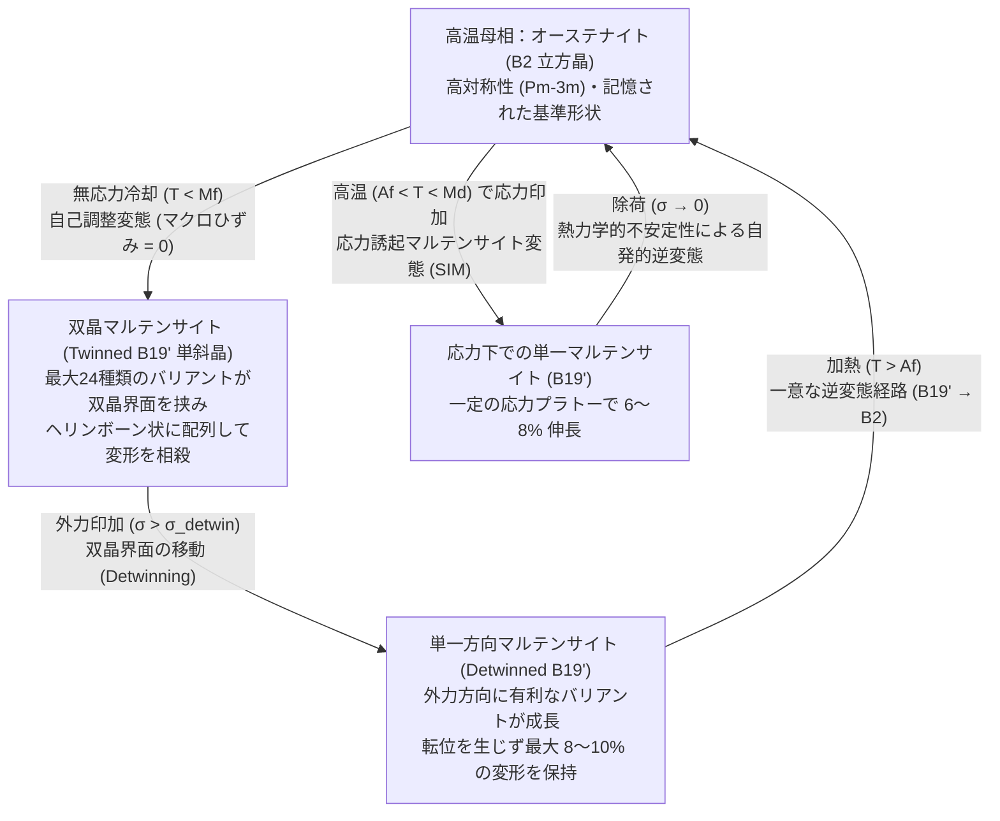
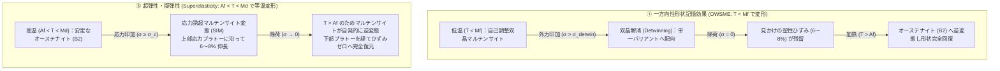

針金ハンガーやスプーンのような日常の金属製品を、力いっぱいグニャリと折り曲げたとする。手を離しても、金属は曲がったまま元には戻らない。それどころか、同じ場所を何度も曲げ伸ばしすれば、やがて金属疲労を起こしてポキリと折れてしまう。これが私たちの知る「金属の常識」である。

ところが、<strong>ニチノール（Nitinol：ニッケル・チタン合金、$\text{NiTi}$）</strong>と呼ばれる特殊な合金で作られたワイヤーは、この常識を根底から覆す。室温でどれほど複雑にねじ曲げても、あるいは元の長さから $8\%$ 近く引き伸ばしても、熱いお湯（たとえば $60\,^\circ\text{C}$）に浸した瞬間、まるで時間を巻き戻すかのように一瞬でビシッと元の形へと跳ね返るのである。これが<strong>形状記憶効果（Shape Memory Effect: SME）</strong>だ。さらに、少し高い温度領域でこの合金を引っ張ると、金属であるにもかかわらずゴムのようにしなやかに伸び、力を抜くだけで加熱すら必要とせず元の形へ完全に復元する<strong>超弾性（Superelasticity / Pseudoelasticity：擬弾性）</strong>という現象まで示す。

なぜ、脳も神経も持たない無機質な金属の結晶が、自分がかつてどのような形をしていたのかを「記憶」し、巨大な変形を受けた後でも原子レベルの正確さで元の姿を再現できるのだろうか？

本稿では、通常の金属における塑性変形（転位のすべり）との決定的な違いから出発し、<strong>無拡散熱弾性マルテンサイト変態（Thermoelastic Martensitic Transformation）</strong>の結晶学、24種類のバリアントが織りなす自己調整（Self-accommodation）と双晶解消（Detwinning）の幾何学、ギブズ自由エネルギーおよびフォーク＝ランダウ理論による熱力学、クラウジウス＝クラペイロン関係式、そして結晶学的適合性条件（$\lambda_2 = 1$）が切り拓いた1000万回寿命の次世代合金や医療用ステント・火星探査機への応用まで、形状記憶合金の物理学を体系的に解き明かす。

---

## 1. 通常の金属はなぜ元に戻らないのか？：弾性限界 $0.2\%$ と転位の不可逆すべり

形状記憶合金の異常な振る舞いを理解するには、まず鉄や銅、アルミニウムといった普通の金属が外力を受けて変形するとき、結晶の内部で何が起きているのかを整理する必要がある。

### フックの法則と原子間ボンドの伸縮

金属の結晶は、原子が規則正しい3次元周期配列（結晶格子）を組んで並んだ構造をしている。外から小さな引っ張り応力 $\sigma$ を加えると、隣り合う原子同士をつなぐ化学結合（金属結合）がわずかに引き伸ばされ、原子間距離が平衡位置から少しだけ広がる。この段階では、力を抜けば原子間ポテンシャルの復元力によって原子は元の位置へと戻り、変形は完全に消える。これが<strong>弾性変形（Elastic deformation）</strong>であり、応力 $\sigma$ とひずみ $\varepsilon$ はヤング率 $E$ を比例定数とするフックの法則（$\sigma = E\varepsilon$）に従う。

しかし、通常の金属においてこの純粋な原子間ボンドの伸縮だけで賄える弾性ひずみの限界（<strong>弾性限界：Elastic limit</strong> $\varepsilon_{\text{el}}$）は、驚くほど小さい。高張力鋼やチタン合金であってもせいぜい <strong>$\varepsilon_{\text{el}} \approx 0.1\text{–}0.2\%$</strong>（1メートルの棒がわずか $1\text{–}2\,\text{mm}$ 伸びる程度）に過ぎない。

### 転位（Dislocation）の移動とトポロジーの破壊

ひずみが $0.2\%$ を超えると、金属は<strong>降伏（Yielding）</strong>を起こし、<strong>塑性変形（Plastic deformation）</strong>の領域へと突入する。このとき結晶内部で起きているのは、結晶格子の中に存在する線状の格子欠陥——<strong>転位（Dislocation）</strong>——が、特定の結晶面（<strong>すべり面：Slip plane</strong>）に沿って次々と移動する<strong>すべり変形（Slip by dislocation glide）</strong>である。

転位がすべり面を通り抜けるとき、すべり面を挟んで上下に並んでいた原子間の結合が一旦<strong>切断（Bond breaking）</strong>され、すぐ隣の新しいパートナー原子との間で結合が<strong>再形成（Bond reforming）</strong>される。まるで絨毯のしわを端から端へ送ることで絨毯全体をずらすように、原子面が1原子間隔（バーガース・ベクトル $\mathbf{b}$ の大きさ）ずつズルズルとずれ動いていく。

ここで決定的に重要なのは、<strong>一度すべり変形が起きると、どの原子がどの原子の隣にいるかという局所的な隣接関係（トポロジー）が永久に書き換わってしまう</strong>という点である。新しいパートナーと結合し直した原子たちにとって、移動後の配置は移動前とまったく同じくらい安定な結晶格子であるため、「かつて自分がどの原子の隣にいたか」という情報は完全に失われる。だからこそ、普通の金属は $1\%$ も曲げれば永久ひずみが残り、加熱して焼鈍（アニーリング）しても結晶粒が再結晶化するだけで、元のマクロな形状に戻ることは決してない。

### 1962年の衝撃：ニチノール（Nitinol）の発見

この「金属は $0.2\%$ 以上変形させれば原子の隣接関係が壊れて元に戻らない」という固定観念を打ち破ったのが、1962年、アメリカ海軍兵器研究所（Naval Ordnance Laboratory: NOL）の冶金学者ウィリアム・ビューラー（William J. Buehler）と結晶学者フレデリック・ワン（Frederick E. Wang）による<strong>ニチノール（Nitinol）</strong>の発見だった。ニチノールという名称は、ニッケル（<strong>Ni</strong>ckel）・チタン（<strong>Ti</strong>tanium）と研究所の名（<strong>N</strong>aval <strong>O</strong>rdnance <strong>L</strong>aboratory）の頭文字をつなぎ合わせたものである。

ニッケルとチタンをほぼ 1 対 1 の原子数比（約 $50\,\text{at.}\%\,\text{Ni}$ – $50\,\text{at.}\%\,\text{Ti}$、重量比では約 $55\,\text{wt.}\%\,\text{Ni}$ – $45\,\text{wt.}\%\,\text{Ti}$）で配合した金属間化合物 $\text{NiTi}$ は、通常の金属の弾性限界の <strong>40倍〜50倍</strong> にあたる <strong>$\varepsilon \approx 8\text{–}10\%$</strong> もの巨大な変形を受けても、転位によるすべり変形をほとんど起こさず、加熱によって完全に元の形状へと復元した。

研究会議の席上、ビューラーらがアコーディオン状に折り畳んだニチノールのリボンを配布し、出席者のひとりがパイプタバコのライターの火を近づけた瞬間、リボンが目の前でピーンと真っ直ぐな帯に伸びたという逸話は、材料科学史における伝説として語り継がれている。

---

## 2. 結晶学の核心：オーステナイト相（$B2$）とマルテンサイト相（$B19'$）の無拡散変態

なぜニチノールは $8\%$ もの変形を受けても「元のパートナー原子」を見失わないのか？その秘密は、この合金が温度や応力に応じて結晶格子の形そのものを組み替える<strong>固体相変態（Solid-state phase transformation）</strong>、とりわけ<strong>熱弾性マルテンサイト変態（Thermoelastic Martensitic Transformation）</strong>を起こすことにある。

### 拡散変態 vs. 無拡散（マルテンサイト）変態

固体金属の相変態には、大きく分けて2つの様式がある。
1つ目は<strong>拡散型変態（Diffusional transformation）</strong>である。炭素鋼をゆっくり冷やしたときに起こるパーライト変態のように、熱エネルギーによって原子が結晶格子の中を長距離にわたってジャンプ（拡散）し、組成や結晶構造の異なる新しい相を時間をかけて作り出す。この過程では原子がバラバラに移動するため、元の原子配列の記憶は完全に消去される。

2つ目が、形状記憶合金の主役である<strong>マルテンサイト変態（Martensitic transformation）</strong>だ。もともと「マルテンサイト」という用語は、19世紀末のドイツの冶金学者アドルフ・マルテンス（Adolf Martens）にちなんで、鋼（スチール）を高温から急冷（焼き入れ）したときに現れる非常に硬い組織に対して名付けられた。しかし今日では、鋼に限らず<strong>「原子の長距離拡散を一切伴わず、隣接する原子同士が協調的なせん断変位（Coordinated shear-like atomic shuffle）を起こすことで、結晶格子全体が瞬時に別の結晶構造へと変身する無拡散変態（Diffusionless / Displacive transformation）」</strong>の総称として定義されている。

無拡散変態では、変態の前後で<strong>すべての原子が自分の隣にいるパートナー原子との化学結合を切ることなく、トポロジカルな隣接関係を $100\%$ 維持したまま</strong>、格子の角度と辺の長さだけを一斉に変化させる。変態界面は結晶中を音速（数千 $\text{m/s}$）に近い猛スピードで伝播する。

### 高温母相：オーステナイト相（$B2$ 規則体心立方構造）

ニチノール（$\text{NiTi}$）を高温状態に置くと、結晶は<strong>オーステナイト相（Austenite phase、または母相：Parent phase）</strong>と呼ばれる高い対称性を持った結晶構造をとる。

結晶学的には、これは塩化セシウム（$\text{CsCl}$）と同じ<strong>$B2$ 型規則構造（空間群 $Pm\bar{3}m$）</strong>である。単位胞は一辺の長さ $a_0 \approx 0.3015\,\text{nm}$ の美しい立方体（Cubic）であり、立方体の8つの頂点に $\text{Ni}$ 原子が配置され、立方体のど真ん中（体心位置）に $\text{Ti}$ 原子が配置された構造（あるいはその逆）をしている。すべての辺が等しく（$a = b = c = a_0$）、すべての角が直角（$\alpha = \beta = \gamma = 90^\circ$）であるため、立方晶特有の極めて高い結晶対称性（点群 $m\bar{3}m$、回転・反転を含む対称操作の数が 48 個）を備えている。

### 低温生成相：マルテンサイト相（$B19'$ 単斜晶構造）と中間 $R$ 相

この高温のオーステナイト相を冷却していくと、ある温度を境に高対称な立方晶 $B2$ 構造は熱力学的に不安定となり、結晶格子が自発的にせん断変形を起こして<strong>マルテンサイト相（Martensite phase）</strong>へと変態する。

$\text{NiTi}$ の低温マルテンサイト相は、対称性の著しく低い<strong>$B19'$ 型単斜晶構造（Monoclinic、空間群 $P2_1/m$）</strong>をとる。元の立方体が斜めに押し潰されて歪んだような形状であり、典型的な格子定数は以下のようになる。

$$a \approx 0.2898\,\text{nm}, \quad b \approx 0.4108\,\text{nm}, \quad c \approx 0.4646\,\text{nm}, \quad \beta \approx 97.78^\circ \quad (\alpha = \gamma = 90^\circ)$$

元の立方晶が持っていた 48 個の対称操作の大部分が失われ、対称操作がわずか 4 個しかない低対称な単斜晶へと「格下げ（Symmetry breaking：対称性の破れ）」されるのである。

なお、$\text{NiTi}$ 合金に冷間加工と熱処理を施した場合や、微量の鉄（$\text{Fe}$）やコバルト（$\text{Co}$）を第3元素として添加した場合には、立方晶 $B2$ から単斜晶 $B19'$ へ直接変態する前に、菱面体晶（三方晶：Trigonal / Rhombohedral、空間群 $P3$ または $P\bar{3}$）の構造を持つ中間相——<strong>$R$ 相（R-phase）</strong>——を経由する2段階変態（$B2 \to R \to B19'$）が起こることがある。$R$ 相変態で得られる回復ひずみは約 $0.5\text{–}1.0\%$ と小さいものの、変態に伴う体積変化や格子不整合が極小であるため、温度ヒステリシスがわずか $1.5\text{–}3\,\text{K}$ と極めて小さく、数十万回繰り返しても疲労劣化しないという優れた特性を持つ。

---

## 3. 自己調整（双晶マルテンサイト）と双晶解消（Detwinning）の幾何学

ここで、固体物理学的に極めて重要かつ鋭い疑問が浮かび上がる。
「高温の立方晶（$B2$）から低温の歪んだ単斜晶（$B19'$）へと結晶格子の形が変化するのであれば、ニチノールをただ冷やしただけでも、結晶全体の形が勝手にグニャリと歪んでしまうのではないのか？」

しかし実際には、記憶させたニチノールのワイヤーを冷蔵庫に入れて冷やしても、見た目の形はピクリとも変わらない。なぜミクロな結晶格子が約 $8\text{–}10\%$ も斜めに歪んでいるのに、マクロな外形は一切変化しないのか？そして、そこに力を加えたとき結晶の内部で何が起きているのか？

この謎を解く鍵が、<strong>結晶学的バリアント（Crystallographic Variants）</strong>による<strong>自己調整機構（Self-Accommodation）</strong>と、外力による<strong>双晶解消（Detwinning）</strong>である。

### 24種類のマルテンサイト・バリアントと自己調整（Self-Accommodation）

立方体のように対称性の高い $B2$ オーステナイト相から、斜めに歪んだ対称性の低い $B19'$ マルテンサイト相へと変態するとき、「どの方向に結晶格子を傾けて歪ませるか」という選択肢は1つではない。立方体には上下・左右・前後の等価な面や対角線がいくつも存在するため、エネルギー的にまったく等価でありながら、歪む方向（結晶方位）だけが異なる複数のマルテンサイト結晶が生まれ得る。この「結晶学的に等価だが向きの異なるマルテンサイトの兄弟たち」を<strong>バリアント（Variants）</strong>と呼ぶ。

$\text{NiTi}$ の $B2 \to B19'$ 変態では、格子対応（Lattice correspondence）として 12 通り、さらに母相との界面（晶癖面：Habit plane）の組み合わせを含めると、実に <strong>最大24種類のマルテンサイト・バリアント</strong>が存在する。

もし無応力状態で冷却したとき、結晶粒全体がたった1つのバリアント（単一方向へのせん断）だけで変態しようとすれば、その結晶粒は一方向に約 $8\text{–}10\%$ も大きく変形しようとする。しかし周囲を他の結晶粒や母相に取り囲まれた多結晶体の中でそんな勝手な変形を起こせば、粒界に途方もない弾性ひずみエネルギーが蓄積してしまう。

そこで自然界は、この弾性ひずみエネルギーを最小化するために巧妙な戦略をとる。右斜めに歪むバリアント（たとえば $M^+$）と、それと鏡面対称に左斜めに歪むバリアント（$M^-$）を、原子レベルでピタリと整合した鏡面境界——<strong>双晶界面（Twin boundary）</strong>——を挟んで交互に細かく積層させるのである。2種類から4種類のバリアントがジグザグの杉綾模様（ヘリンボーン構造 / Chevron pattern）を組んで集合体を作ると、あるバリアントが引き起こすプラス方向のせん断ひずみと、隣のバリアントが引き起こすマイナス方向のせん断ひずみがミクロな空間で完全に打ち消し合う。

これが<strong>自己調整双晶マルテンサイト（Self-accommodated twinned martensite）</strong>である。各単位胞は確かに $B19'$ 単斜晶へと変身しているにもかかわらず、全バリアントの体積分率平均をとったマクロな変態ひずみテンソルは厳密にゼロ（$\langle \boldsymbol{\varepsilon}_{\text{trans}} \rangle = \sum_i f_i \boldsymbol{\varepsilon}_i = \mathbf{0}$）となるため、ただ冷やしただけでは合金の外形は1ミリも変わらないのである。

### 外力による双晶解消（Detwinning）：結合を切らずに $8\%$ 伸びる仕組み

では、この低温の双晶マルテンサイト状態にあるニチノールに、外から引っ張り応力や曲げ応力 $\sigma$ を加えると何が起きるのか？

双晶界面を挟んで隣り合うバリアント同士は、原子の結合を共有したまま鏡像関係で並んでいるだけなので、双晶界面を動かすのに必要なエネルギー障壁（パイエルス障壁に相当するもの）は、通常の金属で転位を動かして原子結合を引きちぎるのに必要なエネルギーよりもはるかに低い。

そのため、外力 $\sigma$ がわずかな臨界応力 $\sigma_{\text{detwin}}$（通常 $50\text{–}150\,\text{MPa}$、通常の高強度チタン合金の降伏応力約 $800\text{–}1000\,\text{MPa}$ の数分の1以下）を超えると、転位が動くよりもずっと先に、<strong>双晶界面が結晶の中をスルスルと移動（Twin boundary migration）</strong>し始める。具体的には、かけられた外力の方向に最も効率よく伸びることができる「有利な向きのバリアント（Favorable variant）」が領域を広げ、逆向きに縮もうとする「不利な向きのバリアント」を次々と飲み込んで自分の向きへとパタパタと反転（Reorientation）させていく。

このプロセスを<strong>双晶解消（Detwinning：デトウィニング）</strong>と呼ぶ。最初はプラス方向とマイナス方向のバリアントが $50\% : 50\%$ で混ざり合って外形の変化がゼロだったものが、外力によってほぼ $100\%$ 単一方向のバリアント（<strong>Detwinned martensite</strong>）へと揃うため、もともと個々のマルテンサイト格子が持っていた約 $8\text{–}10\%$ の格子変形がそのままマクロな伸びとして外に現れる！

しかも、双晶解消によって単一バリアントに揃った状態は、低温（$T < M_f$）においてはエネルギー的に安定な極小状態（エネルギーの谷底）にあるため、外力を取り除いても元の双晶状態には戻らず、曲げられた形のままピタリと止まる。見た目には普通の金属を塑性変形させたのとそっくりだが、決定的に違うのは<strong>「転位によるすべりが一切起きておらず、すべての原子が最初のパートナー原子との隣接関係を完璧に保っている」</strong>という事実である。

### 加熱による逆変態と「結晶対称性の一意性」による記憶再生

いよいよ、曲げられたニチノールをお湯に入れて、オーステナイト変態完了温度 $A_f$ 以上に加熱する。
温度が上がると、低温相である $B19'$ マルテンサイトは熱力学的に不安定になり、高温で安定な $B2$ オーステナイト相へと<strong>逆変態（Reverse transformation）</strong>を起こす。

ここで、結晶対称性に関する極めて美しい数学的・物理学的法則が発動する。
- <strong>冷却時（高対称 $B2 \to$ 低対称 $B19'$）</strong>：対称性の高い立方晶から対称性の低い単斜晶へ降りる道筋（バリアント）は <strong>24通り</strong> も存在した。だからこそ、双晶解消によってそのうちの1つの道筋から別の道筋へと自由に乗り換える（最大 $8\%$ 変形する）ことができた。
- <strong>加熱時（低対称 $B19' \to$ 高対称 $B2$）</strong>：逆に、24種類のどのマルテンサイト・バリアントから出発したとしても、原子のトポロジカルな隣接関係を壊さずに元の高対称な $B2$ 立方晶へと戻る結晶学的経路は、<strong>ただ1通り（一意：Unique）に決まっている</strong>のである！

たとえるなら、山頂（高対称な $B2$ 母相）から麓へ降りる登山道（マルテンサイト・バリアント）は東西南北に 24 本あり、麓の道同士を横切る連絡通路（双晶解消）を通って北側の麓から南側の麓へ移動することは自由にできる。しかし、どの麓からであっても「山頂へ登り返す」と決めた瞬間、たどり着く先はただ1つの同じ山頂（元の結晶方位を持つ $B2$ 格子）しかあり得ない。

その結果、外力によってどれほど複雑にバリアントの比率や向きが偏らされていようとも、$A_f$ 以上に加熱された瞬間、すべての結晶粒が一斉に寸分違わぬ元の $B2$ 立方晶の結晶方位へと復帰し、マクロな形状も記憶された元の形へと $100\%$ の精度で跳ね返るのである。これこそが「金属が形を覚えている」ことの正体——すなわち<strong>結晶格子のトポロジー保存と対称性の非対称性</strong>である。

---

## 4. 熱力学と状態図：自由エネルギー・ランダウ理論・クラウジウス＝クラペイロン関係式

この結晶の変身を、熱力学および統計力学の数式を用いて定量的に記述しよう。

### 4つの変態温度（$M_f, M_s, A_s, A_f$）と熱ヒステリシス

無応力下（$\sigma = 0$）で形状記憶合金を冷却・加熱すると、オーステナイト相とマルテンサイト相の間の変態は単一の温度で不連続に終わるのではなく、ある温度幅を持って進行し、かつ冷却時と加熱時で変態温度が異なる<strong>温度ヒステリシス（Thermal hysteresis）</strong>を描く。ここで以下の4つの特性変態温度が定義される。

1. <strong>$M_s$（Martensite start temperature）</strong>：高温のオーステナイト相を冷却したとき、マルテンサイト相の核生成が始まる温度。
2. <strong>$M_f$（Martensite finish temperature）</strong>：さらに冷却し、結晶全体がほぼ $100\%$ マルテンサイト相へと変態し終える温度（$M_f < M_s$）。
3. <strong>$A_s$（Austenite start temperature）</strong>：低温のマルテンサイト相を加熱したとき、オーステナイト相への逆変態が始まる温度。
4. <strong>$A_f$（Austenite finish temperature）</strong>：さらに加熱し、結晶全体が $100\%$ オーステナイト相へと完全に復帰し、形状回復が完了する温度（$A_s < A_f$）。

一般的な熱弾性マルテンサイト変態では、これら4つの温度は必ず以下の大小関係を満たす。

$$M_f < M_s < T_0 < A_s < A_f$$

ここで $T_0 \approx \frac{M_s + A_f}{2}$ は、オーステナイト相とマルテンサイト相の化学的ギブズ自由エネルギーが厳密に等しくなる熱力学的平衡温度である。なぜちょうど $T_0$ で変態が起きず、冷却時には過冷却（$M_s < T_0$）、加熱時には過加熱（$A_s > T_0$）が必要になるのか？

理由は2つある。第1に、母相の中に新しい相が生成する際、格子のわずかな不整合を吸収するための<strong>弾性ひずみエネルギー（Elastic strain energy）</strong> $G_{\text{el}}$ と界面エネルギーを蓄える必要があり、これが変態への抵抗（逆変態時には推進力）として働くこと。第2に、相界面や双晶界面が結晶中を移動する際に格子欠陥との相互作用によって熱として散逸する<strong>不可逆な界面摩擦エネルギー（Frictional dissipation）</strong> $E_{\text{fric}}$ が存在することである。この摩擦損失によって、$\text{NiTi}$ の $B2 \leftrightarrow B19'$ 変態では典型的に <strong>$\Delta T_{\text{hys}} = A_f - M_s \approx 15\text{–}40\,\text{K}$</strong> の温度ヒステリシスループが生じる。

### ギブズ自由エネルギー差と化学的・機械的駆動力

温度 $T$、一軸引張応力 $\sigma$ のもとにある形状記憶合金において、オーステナイト相（$A$）からマルテンサイト相（$M$）への単位質量（または単位モル）あたりのギブズ自由エネルギー変化 $\Delta G^{A \to M}(T, \sigma)$ は、化学的自由エネルギー項と外部応力がなす機械的仕事項の和として次のように定式化される。

$$\Delta G^{A \to M}(T, \sigma) = G_M(T) - G_A(T) - \frac{1}{\rho}\sigma \varepsilon_{\text{trans}} = \Delta H^{A \to M} - T \Delta S^{A \to M} - \frac{1}{\rho}\sigma \varepsilon_{\text{trans}}$$

ここで、
- $\Delta H^{A \to M} = H_M - H_A < 0$ は変態エンタルピー変化（冷却時の $A \to M$ 変態は熱を放出する発熱反応であり、逆に加熱時の $M \to A$ 逆変態は潜熱を吸収する吸熱反応である）。
- $\Delta S^{A \to M} = S_M - S_A < 0$ は変態エントロピー変化（高温で安定な $B2$ オーステナイト相の方が格子振動のフォノン・モードが柔らかく振動エントロピーが大きいため、低温の $B19'$ マルテンサイト相の方がエントロピーが低い）。
- $\rho$ は合金の密度（$\text{NiTi}$ では $\rho \approx 6.45\,\text{g/cm}^3$）、$\varepsilon_{\text{trans}}$ は応力方向への変態ひずみである。

無応力（$\sigma = 0$）における熱力学的平衡温度 $T_0$ では $\Delta G^{A \to M}(T_0, 0) = 0$ であるから、

$$T_0 = \frac{\Delta H^{A \to M}}{\Delta S^{A \to M}}$$

が成り立つ。これを用いて化学的駆動力を書き直すと、

$$\Delta G^{A \to M}(T, \sigma) = -\Delta S^{A \to M} (T - T_0) - \frac{1}{\rho}\sigma \varepsilon_{\text{trans}} = \frac{\Delta H^{A \to M}}{T_0}(T_0 - T) - \frac{1}{\rho}\sigma \varepsilon_{\text{trans}}$$

となる。$\Delta S^{A \to M} < 0$ であるから、温度 $T$ が $T_0$ より低くなるほど第1項（化学的駆動力）が負に大きくなってマルテンサイト相を安定化させ、また外部応力 $\sigma > 0$ が大きくなるほど第2項（機械的駆動力）が負に大きくなって、やはりマルテンサイト相を安定化させることが一目でわかる。

### フォーク（Falk）のランダウ自由エネルギー理論と3重井戸ポテンシャル

この1次相変態と双晶解消のメカニズムを、連続体熱力学の観点から最もエレガントに記述したのが、1980年にペーター・フォーク（Falk）が提唱した<strong>マルテンサイト変態のランダウ理論（Landau-Falk theory）</strong>である。

結晶のせん断ひずみ $\varepsilon$ を相変態の<strong>秩序変数（Order parameter）</strong>にとり、対称性の要請（$\varepsilon \to -\varepsilon$ の反転対称性）からヘルムホルツ自由エネルギー密度 $F(\varepsilon, T)$ を $\varepsilon$ の偶数次べき級数として 6 次まで展開する。

$$F(\varepsilon, T) = F_0(T) + \alpha (T - T_c)\varepsilon^2 - \beta \varepsilon^4 + \gamma \varepsilon^6$$

ここで $\alpha, \beta, \gamma > 0$ は正の材料定数であり、$T_c$ はオーステナイト格子が微小せん断に対して完全に剛性を失う不安定化温度である。4次項の係数 $-\beta$ が負であることが、不連続なジャンプを伴う<strong>1次相変態（First-order phase transformation）</strong>を生み出す決定的な鍵となっている。

この自由エネルギー関数 $F(\varepsilon, T)$ の形状（エネルギー地形）は、温度 $T$ によって劇的に変化する。

1. <strong>高温域（$T > A_f$）</strong>：2次項の係数 $\alpha(T - T_c)$ が十分に大きな正の値をとるため、自由エネルギー曲線 $F(\varepsilon, T)$ は $\varepsilon = 0$（歪みのないオーステナイト相 $A$）にただ1つの極小（大域的最小値）を持つ<strong>単一井戸ポテンシャル（Single-well potential）</strong>となる。外力を抜けば、結晶は必ず $\varepsilon = 0$ の底へと滑り落ちる。
2. <strong>変態遷移温度域（$M_s < T < A_f$ 付近、特に $T \approx T_0$）</strong>：$\varepsilon = 0$ の中央の井戸に加えて、左右対称な非ゼロひずみ位置 $\varepsilon = +\varepsilon_0$（マルテンサイト・バリアント $M^+$）と $\varepsilon = -\varepsilon_0$（鏡像バリアント $M^-$）にも極小が現れ、<strong>3重井戸ポテンシャル（Triple-well potential）</strong>となる。熱力学的平衡温度 $T_0 = T_c + \frac{\beta^2}{4\alpha\gamma}$ において、中央の井戸（$\varepsilon = 0$）と左右2つの井戸（$\varepsilon = \pm\varepsilon_0 = \pm\sqrt{\frac{\beta}{2\gamma}}$）の深さがちょうど等しくなる。
3. <strong>低温域（$T < M_f < T_c$）</strong>：$T < T_c$ になると2次項の係数が負に転じるため、中央の $\varepsilon = 0$（オーステナイト相）は山の頂上（極大・不安定点）へと変わり、左右の $\varepsilon = +\varepsilon_0$ と $\varepsilon = -\varepsilon_0$ の2つの谷底だけを持つ<strong>2重井戸ポテンシャル（Double-well potential）</strong>となる。

無応力で冷却したときは、結晶の各領域が $+\varepsilon_0$ の谷と $-\varepsilon_0$ の谷に半分ずつ落ちて双晶を作る。そこへ外部応力 $\sigma$ を印加すると、ギブズ自由エネルギー密度 $G(\varepsilon, T, \sigma) = F(\varepsilon, T) - \sigma\varepsilon$ のポテンシャル地形全体が右下がりに傾き、$-\varepsilon_0$ の谷が浅くなって消滅するため、$-\varepsilon_0$ にいたバリアントがエネルギー障壁を飛び越えて一斉に $+\varepsilon_0$ の深い谷へと雪崩れ込む。これがランダウ理論における<strong>双晶解消（Detwinning）</strong>の物理像である。そしてこれを $T > A_f$ へと加熱すれば、左右の2つの谷そのものが消滅して中央の $\varepsilon = 0$ の単一井戸に戻るため、系は嫌応なしに $\varepsilon = 0$（元の記憶形状）へと押し戻されるのである！

### クラウジウス＝クラペイロン関係式（Clausius-Clapeyron Equation）

さらに、オーステナイト相とマルテンサイト相が応力 $\sigma$ と温度 $T$ のもとで共存・平衡する相境界曲線の傾きを求めよう。相境界上では両相のギブズ自由エネルギー変化がゼロ（$d(\Delta G^{A \to M}) = 0$）であるから、モル体積を $V_m$、最大変態ひずみを $\varepsilon_{\text{max}}$ とすると、

$$d(\Delta G^{A \to M}) = -\Delta S^{A \to M}\,dT - V_m \varepsilon_{\text{max}}\,d\sigma_c = 0$$

これを変態臨界応力 $\sigma_c$ の温度微分について解くことで、形状記憶合金の力学設計において最も重要な基本方程式である<strong>固体相変態のクラウジウス＝クラペイロン関係式（Clausius-Clapeyron equation for stress-induced martensite）</strong>が得られる。

$$\frac{d\sigma_c}{dT} = -\frac{\Delta S^{A \to M}}{V_m \varepsilon_{\text{max}}} = -\frac{\rho \Delta H^{A \to M}}{T_0 \varepsilon_{\text{max}}}$$

具体的な数値を代入して、この式の威力を確かめてみよう。代表的な $\text{NiTi}$ 合金では、密度 $\rho \approx 6.45 \times 10^3\,\text{kg/m}^3$、変態潜熱 $|\Delta H^{A \to M}| \approx 2.0 \times 10^4\,\text{J/kg}$（$= 20\,\text{J/g}$）、平衡温度 $T_0 \approx 300\,\text{K}$、最大変態ひずみ $\varepsilon_{\text{max}} \approx 0.07$（$7\%$）である。これらを上式に代入すると、

$$\frac{d\sigma_c}{dT} \approx \frac{(6.45 \times 10^3\,\text{kg/m}^3) \times (2.0 \times 10^4\,\text{J/kg})}{300\,\text{K} \times 0.07} \approx 6.14 \times 10^6\,\text{Pa/K} = 6.14\,\text{MPa/K}$$

実際の $\text{NiTi}$ 合金の実験値も、組成や加工履歴に応じて厳密に <strong>$\frac{d\sigma_c}{dT} \approx 5\text{–}8\,\text{MPa/K}$</strong> の範囲に収まる。
この式が意味する物理的事実は極めて明快だ。<strong>「温度が $1\,\text{K}$（$1\,^\circ\text{C}$）上昇するごとに、オーステナイト相を応力でマルテンサイト変態させるのに必要な臨界応力 $\sigma_c$ は $5\text{–}8\,\text{MPa}$ ずつ直線的に上昇する」</strong>ということである。逆に言えば、変形したマルテンサイトが元の形に戻ろうとするのを外から押さえつけた場合、合金を $50\,^\circ\text{C}$ 加熱するだけで、実に <strong>$300\text{–}400\,\text{MPa}$ もの巨大な回復応力（Recovery stress）</strong>を発生させて重りを持ち上げたりボルトを引きちぎったりする熱機関（固体熱アクチュエータ）として機能するのである。

---

## 5. 3つの機能モードの徹底比較：一方向性・二方向性・超弾性（擬弾性）

温度 $T$ と応力 $\sigma$ の組み合わせ、および結晶内部の組織制御によって、形状記憶合金は大きく分けて3つの異なる機能モードを示す。

| 特性項目 | ① 一方向性形状記憶効果 (OWSME) | ② 二方向性形状記憶効果 (TWSME) | ③ 超弾性 / 擬弾性 (Superelasticity) |
| :--- | :--- | :--- | :--- |
| <strong>動作温度域</strong> | 変形：$T < M_f$ $\to$ 加熱回復：$T > A_f$ | 冷却：$T < M_f \leftrightarrow$ 加熱：$T > A_f$ | 等温動作：<strong>$A_f < T < M_d$</strong> |
| <strong>外力の役割</strong> | 低温での変形に外力が必要 | <strong>外力不要</strong>（温度変化のみで往復変形） | 負荷時に応力誘起変態、除荷時に自発回復 |
| <strong>結晶学的メカニズム</strong> | 双晶マルテンサイトの双晶解消 $\to$ 加熱による $B19' \to B2$ 逆変態 | 内部残留応力場（転位網・析出物）による特定バリアントの選択的核生成 | 等温での応力誘起マルテンサイト変態（SIM：$B2 \leftrightarrow B19'$） |
| <strong>最大回復ひずみ（$\text{NiTi}$）</strong> | <strong>$6\text{–}8\%$</strong>（単結晶では最大 $10\%$） | <strong>$2\text{–}3\%$</strong>（比較的小さい） | <strong>$6\text{–}8\%$</strong>（通常の金属の約40倍） |
| <strong>主な応用分野</strong> | 配管継手（カップリング）、宇宙用フランジボルト、感温バルブ | ばね不要の小型温度センサー兼アクチュエータ、マイクロロボット | 血管ステント、歯科矯正ワイヤー、メガネフレーム、月面ローバータイヤ |

### ① 一方向性形状記憶効果（One-Way Shape Memory Effect: OWSME）

もっとも基本的かつ大きな回復ひずみ（$6\text{–}8\%$）と回復力を発揮するモードである。
1. まず高温の母相状態（たとえば $400\text{–}500\,^\circ\text{C}$ での拘束熱処理：形状記憶処理）で目的の形状を記憶させた後、無応力で $T < M_f$ まで冷却して自己調整双晶マルテンサイトにする。
2. 低温（$T < M_f$）で外力を加えて双晶解消（Detwinning）を起こさせ、任意の形状に変形させる。除荷しても変形はそのまま残る。
3. これを $T > A_f$ に加熱すると、逆変態によって記憶された元の高温形状へと一挙に回復する。
4. しかし、その後再び無応力で $T < M_f$ に冷却しても、結晶は再び24種類のバリアントが均等に混ざった自己調整双晶マルテンサイトに戻るため、ステップ2で曲げた形には戻らず、高温形状のまま保たれる。つまり「高温の形」という<strong>片道（One-way）の記憶</strong>しか持たないため、繰り返し動作させるには低温で押し戻すためのバイアスばね（Bias spring）を組み合わせる必要がある。

### ② 二方向性形状記憶効果（Two-Way Shape Memory Effect: TWSME）

「それなら、高温の形だけでなく低温で曲がった形も覚えさせて、お湯と冷水に交互に浸けるだけで外力を一切かけずに勝手に曲がったり伸びたりさせることはできないのか？」
それを実現するのが<strong>二方向性形状記憶効果（TWSME）</strong>である。

先述の通り、通常の無応力冷却では24種類のバリアントが等確率で生成するため外形は変わらない。そこで、合金にあらかじめ<strong>熱機械的トレーニング（Thermomechanical training）</strong>と呼ばれる特殊な処理を施す。具体的には、(a) マルテンサイト状態での過度の変形と加熱回復を数十回繰り返す、(b) 応力をかけながら $M_f \leftrightarrow A_f$ の温度サイクルを繰り返す、あるいは (c) $\text{Ni}$ リッチな組成（たとえば $\text{Ti-50.8 at.}\%\,\text{Ni}$）の合金に応力をかけながら $400\,^\circ\text{C}$ 付近で時効処理（Aging）を行い、特定の結晶方位に揃ったレンズ状の整合析出物（<strong>$\text{Ti}_3\text{Ni}_4$ 析出相</strong>）を形成させる。

すると、母相（$B2$）の結晶格子の中に、特定の方向へ強く偏った<strong>異方的な残留内部応力場（Oriented internal stress field）</strong>や方向性を持つ転位網が恒久的に刻み込まれる。
このトレーニング済みの合金を無応力で冷却すると、結晶内部に焼き付けられた内部応力場が「ミクロな内蔵バイアスばね」として働き、24種類のバリアントの中から<strong>その内部応力を緩和する特定の優先バリアントだけを選択的に核生成・成長させる</strong>のである！その結果、外力を一切かけなくても、冷やすだけで自発的に特定方向へ曲がり、温めれば元の形に戻るという二方向の自律変形が実現する（ただし利用可能なひずみは $2\text{–}3\%$ 程度であり、過熱すると内部応力場が緩和して記憶が消える点に注意が必要である）。

### ③ 超弾性／擬弾性（Superelasticity / Pseudoelasticity: SE）

今日、医療機器や日用品で形状記憶効果以上に広く使われているのが、温度を一切変えずに巨大な変形と回復を行う<strong>超弾性（Superelasticity）</strong>である。

動作温度をオーステナイト完了温度 $A_f$ よりも高い温度領域（<strong>$A_f < T < M_d$</strong>）に設定する。この温度では、無応力状態では $100\%$ 安定な $B2$ オーステナイト相が存在している。
ここに引っ張り応力 $\sigma$ を加えていくと、最初は通常の弾性変形をした後、応力がクラウジウス＝クラペイロン関係式で決まる臨界応力 $\sigma^{A \to M}_c(T)$ に達した瞬間、<strong>温度は高いままなのに、応力の機械的駆動力によって無理やりオーステナイト相から単一方向のマルテンサイト相へと変態する「応力誘起マルテンサイト変態（Stress-Induced Martensitic Transformation: SIM）」</strong>が始まる！

応力-ひずみ曲線（$\sigma$-$\varepsilon$ 線図）の上では、変態が進行している間、ほとんど応力が増加しないままひずみだけが $1\% \to 8\%$ へと水平に伸びていく特徴的な<strong>上部応力プラトー（Upper stress plateau：平坦領域）</strong>が現れる。

そして外力を緩めて除荷していくと、どうなるか？そもそも環境温度は $T > A_f$ であるから、外力という「つっかえ棒」が外れた瞬間、応力誘起されたマルテンサイト相は熱力学的に全く存在できない不安定状態となる。そのため、少し低い下部応力プラトー（$\sigma^{M \to A}_c(T)$）に沿って<strong>自発的に $B19' \to B2$ 逆変態が起こり、加熱することなく元の形状（$\varepsilon = 0$）へと完全にバネのように戻る</strong>のである。

なお、温度を高くしすぎてある上限温度 <strong>$M_d$（Martensite deformation temperature）</strong>を超えてしまうと、クラウジウス＝クラペイロンの式に従って上昇した変態臨界応力 $\sigma_c(T)$ が、母相の通常の転位すべり降伏応力 $\sigma_{\text{slip}}$ を追い抜いてしまう（$\sigma_c(T) > \sigma_{\text{slip}}$）。するとマルテンサイト変態が起きる前に通常の不可逆な塑性変形（転位のすべり）が起きてしまい、超弾性は失われる。したがって超弾性が発現する温度窓は厳密に <strong>$A_f < T < M_d$</strong> となる。

---

## 6. 機能的疲労と「結晶学的適合性条件（$\lambda_2 = 1$）」による1000万回寿命の突破

形状記憶合金は夢のような材料に見えるが、長年にわたり実用化の範囲を制限してきた最大の壁があった。それが<strong>機能的疲労（Functional Fatigue）</strong>と構造疲労である。

一般的な $\text{NiTi}$ 合金を使って、加熱・冷却の熱サイクルや超弾性の負荷・除荷サイクルを数千回〜数万回繰り返すと、次第に変態温度（$M_s, A_f$）がずれていき、応力プラトーが低下し、完全には元に戻らない残留永久ひずみ（Irreversible strain）が蓄積して、ついには破断してしまうのである。

### なぜ変態を繰り返すと劣化するのか？：相界面の幾何学的不整合

無拡散変態で原子の隣接関係が保たれているはずなのに、なぜ繰り返すと転位が生まれて劣化するのか？
その原因は、<strong>オーステナイト相（立方晶 $B2$）とマルテンサイト相（単斜晶 $B19'$）が接する相界面（晶癖面：Habit plane）における格子の幾何学的不整合（Geometric incompatibility）</strong>にある。

変態が進行している最中、結晶の内部には「まだ変態していない $B2$ 母相」と「すでに変態した $B19'$ マルテンサイト相」が隣り合って共存する境界領域が存在する。ところが、$\text{NiTi}$ の $B2$ 格子と単一の $B19'$ バリアントの格子は、そのままではサイズが合わずピタリと接合できない。そのため、マルテンサイト側は2つのバリアントを細かい双晶（微視的双晶）として交互に並べることで、平均的なひずみを母相に無理やり合わせるという妥協を行っている。

それでも界面のごく近傍（遷移層：Transition layer）には、格子のミスマッチによる非常に大きな局所的弾性ひずみと応力集中が発生する。変態界面がこの結晶中を何千回も往復するたびに、この界面の巨大な応力集中が結晶格子を傷つけ、少しずつ<strong>転位（Dislocation）を発生させて蓄積（Transformation-induced plasticity: TRIP）</strong>させてしまうのである。

### ジェームズとボールの非線形弾性理論と中間の固有値 $\lambda_2 = 1$

「もし、母相の結晶格子と単一のマルテンサイト・バリアントの結晶格子が、双晶を作るまでもなく、最初からジグソーパズルのピースのようにひずみゼロで完璧にピタリと噛み合う（無ひずみ界面を作る）ことができたら、疲労劣化は完全に消滅するのではないか？」

この壮大な問いに対して、数学的結晶学（Mathematical theory of martensitic microstructure）の観点から厳密な解答を与えたのが、ミネソタ大学のリチャード・ジェームズ（Richard D. James）やオックスフォード大学のジョン・ボール（John M. Ball）らの研究グループである。

母相（立方晶）の単位胞をマルテンサイト相の単位胞へと変形させる $3 \times 3$ の正定値対称テンソル——<strong>変態伸縮テンソル（Transformation stretch tensor / Bain matrix）$\mathbf{U}$</strong>——を考える。このテンソル $\mathbf{U}$ を対角化したときの3つの正の固有値（主伸縮率：Principal stretches）を、小さい順に $\lambda_1 \le \lambda_2 \le \lambda_3$ と並べよう。
（一般的に、1つの軸は縮むため $\lambda_1 < 1$、もう1つの軸は伸びるため $\lambda_3 > 1$ となる）。

非線形弾性論の<strong>アダマールの適合条件（Hadamard jump condition）</strong>を解くと、変形していない母相（単位テンソル $\mathbf{I}$）と、単一のマルテンサイト・バリアント（伸縮テンソル $\mathbf{U}$）が、双晶を介さずに<strong>弾性遷移層ゼロで完全に平坦な無ひずみ界面（Exact phase interface）を形成するための必要十分条件</strong>は、3つの固有値のうち真ん中の固有値 $\lambda_2$ が厳密に <strong>$1$</strong> に等しいことであることが証明された！

$$\lambda_2 = 1$$

なぜ $\lambda_2 = 1$ なのか？$\lambda_1 < 1$（縮む方向）と $\lambda_3 > 1$（伸びる方向）が作る平面内では、縮む量と伸びる量がちょうど相殺する特定の角度（不変線：Invariant line）が必ず存在する。もしそれに直交する第2の主軸方向の伸縮率 $\lambda_2$ がちょうど $1$（伸びも縮みもしない）であれば、不変線と第2主軸が張る<strong>2次元平面全体が、変態の前後で1ミリも伸び縮みしない完全な「不変面（Invariant plane）」</strong>となるからである！

通常の $\text{NiTi}$ 二元合金では、この中間の固有値は $\lambda_2 \approx 0.968$ であり、$1$ から約 $3.2\%$ ずれている。このわずか $0.032$ のずれ（$|\lambda_2 - 1| \approx 0.032$）こそが、界面に弾性エネルギーを蓄えさせ、$30\,\text{K}$ もの大きな温度ヒステリシスを生み出し、数千サイクルで合金を疲労劣化させていた真犯人だったのである。

### $\text{TiNiCuPd}$ と $\text{Zn}_{45}\text{Au}_{30}\text{Cu}_{25}$：1000万回劣化しない超合金の誕生

この理論的指針（$\lambda_2 \to 1$、さらに双晶適合条件まで含めた<strong>コファクター条件：Cofactor conditions</strong>）に基づき、2000年代後半から2010年代にかけて、合金の原子半径と電子濃度を精密に調整して格子定数をチューニングする材料設計が世界中で進められた。

その結果、$\text{NiTi}$ の $\text{Ni}$ の一部を銅（$\text{Cu}$）とパラジウム（$\text{Pd}$）で置換した四元合金 <strong>$\text{Ti}_{50}\text{Ni}_{50-x-y}\text{Cu}_x\text{Pd}_y$</strong>（たとえば $\text{Ti}_{50.2}\text{Ni}_{34.4}\text{Cu}_{12.3}\text{Pd}_{3.1}$ 薄膜など、クリストフ・クワントやジェームズらが2015年に『Science』誌で発表）や、ホイスラー型合金 <strong>$\text{Zn}_{45}\text{Au}_{30}\text{Cu}_{25}$</strong>（2013年『Nature』誌で発表）において、<strong>$\lambda_2 = 1.0000 \pm 0.0002$</strong> という極限の結晶学的適合性が達成された。

その結果起きた現象は劇的だった。$\lambda_2$ が $1$ に収束した瞬間、温度ヒステリシス $\Delta T_{\text{hys}}$ はわずか <strong>$0.5\text{–}2\,\text{K}$</strong> へと急落し、透過型電子顕微鏡（TEM）のその場観察でも母相とマルテンサイト相が鋭利な一本の面でストレスなく滑らかに切り替わる様子が確認された。そして何より、従来の合金なら数千回で劣化していたのに対し、<strong>$10^7$（1000万）回以上の熱・応力変態サイクルを繰り返しても、変態温度のドリフトも亀裂も一切生じない「超低疲労・超寿命形状記憶合金」</strong>が誕生したのである。

---

## 7. 多彩な形状記憶合金ファミリーと次世代スマート材料

$\text{NiTi}$ 系以外にも、用途やコスト、動作原理に応じて多様な形状記憶合金や関連現象が研究・実用化されている。

- <strong>銅系形状記憶合金（$\text{Cu-Zn-Al}$、$\text{Cu-Al-Ni}$、$\text{Cu-Al-Mn}$）</strong>：
  原料となる銅・亜鉛・アルミニウムが安価であり、溶解・鋳造も真空誘導溶解を必須とする $\text{NiTi}$ に比べて容易である。単結晶や粗大結晶粒組織（竹状組織）に制御した $\text{Cu-Al-Mn}$ 合金などは、$\text{NiTi}$ に匹敵する $7\text{–}8\%$ の優れた超弾性を示し、建築物の制震ダンパーや大型構造材として利用が進んでいる。
- <strong>鉄系形状記憶合金（$\text{Fe-Mn-Si}$、$\text{Fe-Ni-Co-Al-Ta-B}$）</strong>：
  面心立方格子（$\gamma$ オーステナイト）から稠密六方格子（$\varepsilon$ マルテンサイト）への変態を利用する $\text{Fe-Mn-Si}$ 合金は、超高価なニチノールの数十分の1のコストで製造できるため、トンネル工事や橋梁における大型鋼管の継手（形状記憶ジョイント）やコンクリート補強用のプレストレス導入材として実用化されている。さらに2010年に東北大学の田中優樹・大森俊洋・貝沼亮介らのグループが『Science』誌に発表した <strong>$\text{Fe-Ni-Co-Al-Ta-B}$（NCATB）合金</strong>は、鉄系でありながら室温で <strong>$13.5\%$ もの世界最大級の超弾性ひずみ</strong>と $1\,\text{GPa}$ を超える高強度を達成し、世界に大きな衝撃を与えた。
- <strong>強磁性形状記憶合金（Ferromagnetic SMA：$\text{Ni}_2\text{MnGa}$ など）</strong>：
  熱による形状記憶効果は、合金を加熱し、さらに放熱して冷やすのに時間がかかるため、応答周波数（動作速度）がせいぜい $0.1\text{–}5\,\text{Hz}$ に制限されるという弱点がある。これに対し、ホイスラー合金 <strong>$\text{Ni}_2\text{MnGa}$</strong> などの強磁性形状記憶合金（MSMA）は、マルテンサイト相が強い結晶磁気異方性（特定の結晶軸方向に磁化しやすい性質）を持っている。そのため、温度を変えずに外から<strong>磁場（Magnetic field）</strong>を印加するだけで、磁場方向に磁化容易軸を向けようとする磁気的トルクによって双晶界面が高速駆動され、最大 $6\text{–}10\%$ の巨大ひずみを <strong>$1\,\text{kHz}$（毎秒1000回）以上の超高速応答</strong>で発生させることができる。
- <strong>弾性熱量効果（Elastocaloric Cooling）による次世代フロンフリー冷凍機</strong>：
  マルテンサイト変態が大きな潜熱（$\Delta H \approx 15\text{–}30\,\text{J/g}$）を伴う1次相変態であることを逆手に取った技術である。超弾性領域にある $\text{NiTi}$ ワイヤーやチューブに断熱状態で素早く応力をかけて応力誘起マルテンサイト変態を起こさせると、変態潜熱の放出によって合金の温度が一気に $15\text{–}25\,^\circ\text{C}$ 上昇する。その熱を外部へ放熱させた後、素早く除荷して断熱逆変態（吸熱反応）を起こさせると、今度は合金の温度が周囲より $15\text{–}20\,^\circ\text{C}$ も急降下して周囲から熱を奪う！温室効果ガスである代替フロンを一切使わず、コンプレッサーよりも高効率な固体ヒートポンプ（エラカロリック冷却）として、現在もっとも熱い研究開発が繰り広げられている。

---

## 8. 社会を変えた工学的応用：医療・宇宙・航空の最前線

最後に、この結晶相変態の物理学が私たちの命を救い、宇宙開発を支えている具体的なエンジニアリング事例を見ていこう。

### ① 自己拡張型血管ステント（Self-Expanding Cardiovascular Nitinol Stent）

ニチノールが人類に最大の恩恵をもたらした分野は、間違いなく低侵襲カテーテル医療である。また、ニチノールは表面に極めて緻密で安定な酸化チタン（$\text{TiO}_2$）の不動態被膜を自発的に形成するため、ニッケルイオンの溶出が抑えられ、抜群の生体適合性（Biocompatibility）と耐食性を誇る。

動脈硬化によって冠動脈や頸動脈、大腿動脈が狭くなった患者を治療する<strong>自己拡張型ステント（Self-expanding stent）</strong>では、合金のオーステナイト完了温度を人間の体温（$37\,^\circ\text{C}$）よりも少し低い <strong>$A_f \approx 25\text{–}30\,^\circ\text{C}$</strong> に精密設計する。
1. 手術前、レーザー加工で網目状の円筒に作られたニチノール・ステントを冷却しながら細く圧縮し、直径わずか数ミリメートルのカテーテル（シース）の中に折りたたんで収納する。
2. 足の付け根や手首の血管からカテーテルを挿入し、狭窄した患部まで到達させたところでシースを引き抜く。
3. ステントが $37\,^\circ\text{C}$ の血液に触れた瞬間、温度はすでに $A_f$ を超えているため、マルテンサイトからオーステナイトへの逆変態と超弾性回復が同時に発動し、ステントは自発的に本来の太い円筒形状へとパッと広がる！
4. さらに重要なのは展開後の力学特性（<strong>Biased stiffness</strong>）である。通常のステンレス製バルーン拡張型ステントは塑性変形で広がるため、もし外から強い圧迫（たとえば頸動脈や浅大腿動脈が首や脚の動きで押し潰される力）を受けると、そのまま永久に潰れて血管を塞いでしまう危険がある。しかし超弾性領域（$T = 37\,^\circ\text{C} > A_f$）で働くニチノール・ステントは、外から潰されても最大 $8\%$ の超弾性変形によってしなやかに受け流し、圧迫が消えれば即座に元の円筒へ復元する。しかも超弾性のヒステリシスループにおける「ゆるやかな下部応力プラトー」を利用して血管壁を内側から支えるため、血管径が多少変動しても常に一定の穏やかな拡張力（Radial resistive force）を保ち続け、血管壁を傷つけないのである。

### ② 歯科矯正アーチワイヤー（Orthodontic Archwires）

歯列矯正において歯に装着するアーチワイヤーにも、ニチノールの超弾性が革命をもたらした。
かつて主流だったステンレス鋼ワイヤーは、弾性限界が $0.2\%$ しかなくヤング率が高すぎるため、矯正歯科医がワイヤーを締め付けた直後には歯に過大な力がかかって激しい痛みや歯根吸収（歯の根が溶ける障害）を引き起こす一方、歯がわずか $0.5\,\text{mm}$ 動いただけで応力がゼロ近くまで急落してしまい、数週間ごとにワイヤーを締め直さなければならなかった。

これに対し、口腔内温度（$37\,^\circ\text{C}$）で超弾性を示すニチノール製ワイヤーは、ガタガタの歯並びに沿って大きく曲げられて装着されると、応力誘起マルテンサイト変態を起こす。そして歯が少しずつ正しい位置へ移動してワイヤーのたわみが何ミリメートルも戻っていく数ヶ月間のあいだ、<strong>超弾性の水平な下部応力プラトー（$\sigma^{M \to A}_c \approx \text{一定}$）に沿って、歯の移動に最も理想的な一定の弱い持続的矯正力（Light continuous force）を与え続ける</strong>ことができるのである。

### ③ NASA の宇宙開発：非火薬分離機構「フランジボルト」と火星ローバーの超弾性タイヤ

宇宙空間という極限環境でも、形状記憶合金は不可欠な存在となっている。

人工衛星や惑星探査機をロケットで打ち上げる際、太陽電池パネルや通信アンテナは折りたたんでボルトで固定されており、軌道に乗った後にそのボルトを切断して展開する必要がある。従来は火薬を爆発させてボルトを切る「火薬式分離ナット（Pyrotechnic device）」が使われていたが、爆発時の強烈な衝撃波（パイロショック）が精密な観測機器を壊すリスクや、火薬ガスの汚染、誤爆の危険が常に付きまとっていた。

そこで開発されたのが、ニチノールを使った非火薬式アクチュエータ<strong>「フランジボルト（Frangibolt）」</strong>である。あらかじめ高強度チタン合金製のボルト（中央に切り欠きノッチが入っている）に、圧縮変形させた分厚いニチノール製の円筒カラーを通しておく。軌道上で展開指令が出ると、円筒の周囲に巻かれた小型電気ヒーターに通電し、ニチノールを $A_f$（約 $90\text{–}100\,^\circ\text{C}$）以上に加熱する。するとニチノール円筒は元の長い形状へ戻ろうとして猛烈な勢いで膨張し、クラウジウス＝クラペイロンの式に従う <strong>$500\text{–}700\,\text{MPa}$ もの凄まじい回復応力（数トンもの引っ張り力）</strong>を発生させて、チタン製ボルトを無火薬・低衝撃で引きちぎり、パネルを安全確実に展開させる。1994年の月探査機クレメンタインでの成功以来、数多くの宇宙機で標準採用されている。

さらに NASA グレン研究センター（Glenn Research Center）は、火星探査ローバー（キュリオシティなど）のアルミニウム製車輪が火星の鋭利な岩で穴だらけに破損したことを受け、数百本の超弾性ニチノールワイヤーを鎖帷子（チェーンメイル）のように編み上げた中空の<strong>超弾性スプリングタイヤ（Superelastic Tire / Spring Tire）</strong>を開発した。従来のバネ鋼で作ったメッシュタイヤは弾性限界が $0.2\%$ しかないため、大きな岩を乗り越えるとすぐに塑性変形して潰れてしまう。しかし超弾性ニチノールタイヤは、鋭い岩の上で車軸に届くほど大きく凹んでも、応力誘起マルテンサイト変態によって最大 $8\%$ のひずみを結晶格子の変身として吸収し、岩を通り過ぎれば何事もなかったかのように完全に元の円形へと復元する。ゴムのように極低温で脆化することも、パンクすることもない究極の惑星探査用タイヤである。

### ④ 航空機の可変形状シェブロン（Boeing Variable-Geometry Chevron）

ボーイング社がジェット旅客機（Boeing 777-300ER 実験機や 787 ドリームライナーの開発過程）で実証した<strong>スマート・シェブロン（Variable-Geometry Chevron）</strong>も、形状記憶合金の特性を巧みに利用している。
ジェットエンジンの排気ノズル後縁にある三角形のギザギザ突起（シェブロン）は、排気流の境界層に渦を作って混合を促進し、離着陸時の騒音を劇的に低減する効果がある。しかし、高度1万メートルをマッハ $0.85$ で飛行する巡航中にもシェブロンが排気流の中に突き出していると、空気抵抗となって燃費を悪化させてしまう。

そこで、シェブロンの内部にニチノールの板バネアクチュエータを組み込む。離着陸時の低高度・高温環境（あるいは電気加熱時）には、ニチノールがオーステナイト相に逆変態してシェブロン先端を排気流の内側へとグッと曲げ込み、騒音を抑える。そして上空1万メートルの極低温環境（$-50\,^\circ\text{C}$ 以下）に達すると、ニチノールがマルテンサイト相へと変態して柔らかくなり、周囲の弾性複合材の復元力によってシェブロンが真っ直ぐ平らな形状へと戻って空気抵抗を最小化する。油圧配管もモーターも一切使わず、金属自身の相変態だけで飛行モードに応じた最適形状へと自律変形（モーフィング）するのである。

---

## 9. まとめ：結晶の対称性とトポロジーが紡ぐ「物質の記憶」

金属が元の形を「覚える」という現象は、決して魔法でもオカルトでもない。その本質は、以下の3つの美しい固体物理学の原理に集約される。

1. <strong>無拡散変態によるトポロジーの完全保存</strong>：通常の金属が転位のすべりによって原子の隣接関係を不可逆的に破壊してしまうのに対し、形状記憶合金のマルテンサイト変態は、すべての原子が隣のパートナー原子との結合を保ったまま協調的に格子を組み替えるため、元の結晶配列の情報が一切失われない。
2. <strong>対称性の低下と24種類のバリアントによる自由度</strong>：高対称な立方晶（$B2$ オーステナイト）から低対称な単斜晶（$B19'$ マルテンサイト）へ変態する際、等価な24種類のバリアントが生まれる。無応力冷却ではこれらが双晶を組んで変形を相殺（自己調整）し、外力をかけると双晶界面が移動して単一バリアントへ揃う（双晶解消）ことで、結合を切らずに最大 $8\text{–}10\%$ もの変形を受け入れる。
3. <strong>逆変態経路の一意性</strong>：どれほど低温で特定のバリアントへ偏ろうとも、加熱して高対称な $B2$ 立方晶へ戻る結晶学的経路はただ1通りに定まっているため、すべての結晶粒が寸分違わぬ元の基準形状へと一斉に跳ね返る。

そして現代の材料科学は、非線形弾性論が導いた結晶学的適合性条件 <strong>$\lambda_2 = 1$</strong> を武器に、相界面のわずかな格子の不整合すらも原子レベルで消し去り、1000万回変身しても疲れない永遠の形状記憶合金をも生み出しつつある。私たちが目にする1本のニチノールワイヤーの跳躍の背後には、結晶の対称性と熱力学が織りなす精緻な幾何学のドラマが息づいているのである。
