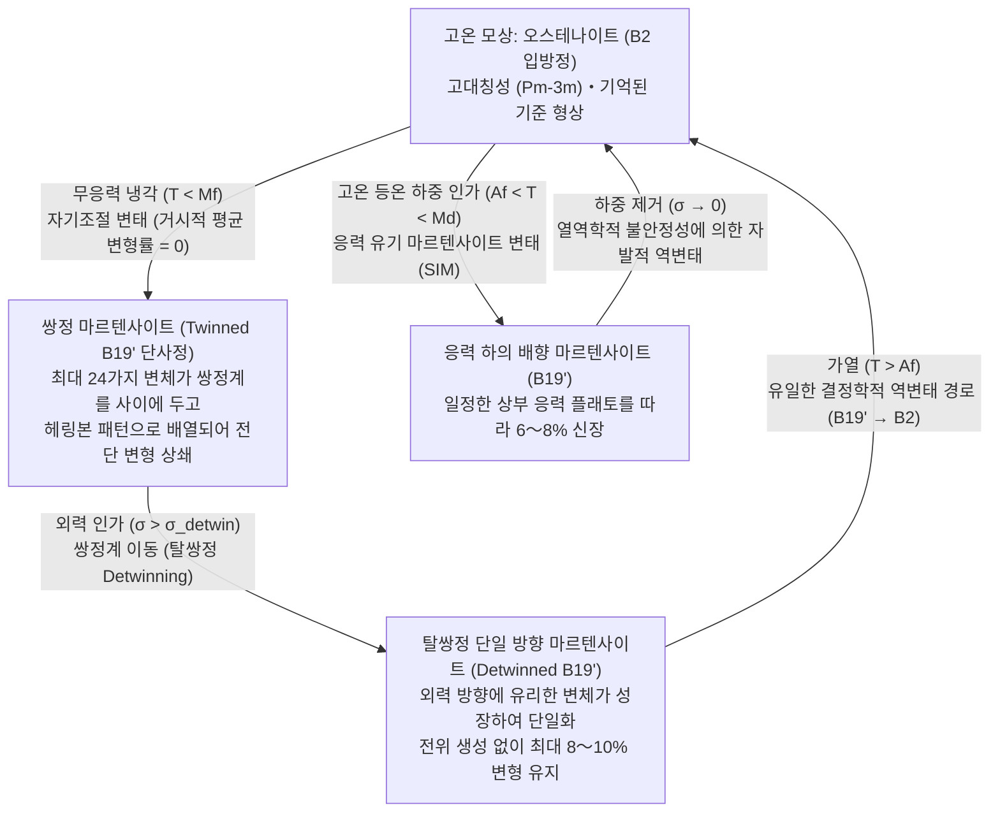
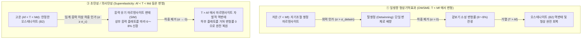

일상에서 흔히 볼 수 있는 철사 옷걸이나 알루미늄 숟가락을 힘껏 구부리면 손을 떼어도 구부러진 채로 남아 원래대로 돌아오지 않는다. 같은 자리를 반복해서 구부렸다 펴면 가공 경화와 피로 균열이 누적되어 결국 부러지고 만다. 고전 금속학에서 약 $0.2\%$를 초과하는 큰 변형은 곧 되돌릴 수 없는 영구적인 격자 손상을 의미한다.

그러나 니켈과 티타늄을 거의 $1:1$ 원자비로 배합한 특수 합금인 <strong>니티놀(Nitinol, $\text{NiTi}$)</strong> 와이어는 이러한 상식을 완전히 뒤집는다. 상온에서 아무리 복잡하게 비틀거나 원래 길이의 $8\%$ 가까이(고장력강 탄성 한계의 40배 이상) 늘려 놓아도, 뜨거운 물(예: $60\,^\circ\text{C}$)에 담그는 순간 마치 시간을 되감는 것처럼 순식간에 원래 기억된 기하학적 형태로 튀어 오른다. 이것이 바로 <strong>형상기억효과(Shape Memory Effect, SME)</strong>이다. 나아가 변태 완료 온도보다 조금 높은 온도 영역에서 이 합금을 잡아당기면, 금속임에도 고무처럼 부드럽게 $8\%$나 늘어났다가 힘을 빼는 것만으로도 가열 없이 원래 형태로 완벽히 복원되는 <strong>초탄성(Superelasticity / Pseudoelasticity, 의사탄성)</strong> 현상까지 보여준다.

뇌도 신경계도 없는 무기물 금속 결정이 어떻게 자신이 과거에 어떤 모양이었는지를 '기억'하고, 거대한 변형을 겪은 뒤에도 원자 수준의 정밀도로 원래 모습을 재현할 수 있는 것일까? 이 글에서는 일반 금속의 소성 변형(전위의 슬립)과의 근본적인 차이에서 출발하여, <strong>무확산 열탄성 마르텐사이트 변태(Thermoelastic Martensitic Transformation)</strong>의 결정학, 24가지 변체(Variant)가 만들어내는 자기조절(Self-accommodation)과 탈쌍정(Detwinning)의 기하학, 란다우-팔크(Landau-Falk) 자유 에너지와 클라우지우스-클라페이롱(Clausius-Clapeyron) 방정식, 그리고 천만 회 수명을 실현한 결정학적 적합성 조건($\lambda_2 = 1$)과 첨단 의료·우주공학 응용까지 체계적으로 파헤친다.

---

## 1. 일반 금속은 왜 원래대로 돌아오지 않는가: 탄성 한계 $0.2\%$와 전위의 비가역적 슬립

형상기억합금의 경이로운 거동을 이해하려면, 먼저 철·구리·알루미늄 같은 일반 금속이 외력을 받아 변형될 때 결정 내부에서 무슨 일이 일어나는지 살펴보아야 한다.

일반 금속 결정에 작은 인장 응력 $\sigma$를 가하면 이웃한 원자들을 묶어주는 금속 결합이 스프링처럼 살짝 늘어나며, 응력과 변형률은 훅의 법칙($\sigma = E\varepsilon$)을 따른다. 이때 힘을 제거하면 원자간 퍼텐셜의 복원력에 의해 원자들이 원래 위치로 돌아가며 변형이 완전히 사라진다. 그러나 원자간 결합의 순수한 신축만으로 감당할 수 있는 <strong>탄성 한계 변형률($\varepsilon_{\text{el}}$)</strong>은 고작 <strong>$\varepsilon_{\text{el}} \approx 0.1\% \text{–} 0.2\%$</strong>에 불과하다.

변형률이 $0.2\%$를 넘어서면 금속은 항복(Yielding)을 일으키며 <strong>소성 변형(Plastic deformation)</strong> 영역으로 진입한다. 이때 결정 내부에서는 선형 격자 결함인 <strong>전위(Dislocation)</strong>가 특정 결정면(<strong>슬립면, Slip plane</strong>)을 따라 이동하는 <strong>슬립 변형(Dislocation glide)</strong>이 일어난다. 전위가 슬립면을 스쳐 지나갈 때마다 슬립면 위아래 원자들의 기존 화학 결합이 <strong>절단(Bond breaking)</strong>되고, 옆에 있는 새로운 파트너 원자와 결합이 <strong>재형성(Bond reforming)</strong>되면서 버거스 벡터($\mathbf{b}$)만큼 영구적으로 어긋난다.

여기서 가장 핵심적인 물리적 사실은 <strong>슬립 변형이 일어나는 순간 어떤 원자가 어떤 원자의 이웃인지에 대한 국소적 위상(Topology) 관계가 영구적으로 덮어씌워진다</strong>는 점이다. 새로운 이웃과 다시 결합한 원자들에게 이동 후의 격자는 이동 전과 에너지적으로 완전히 동일하므로, 과거의 위치로 돌아가려는 복원력이 전혀 존재하지 않는다.

1962년 미국 해군병기연구소(Naval Ordnance Laboratory, NOL)의 윌리엄 뷸러(William J. Buehler)와 프레더릭 왕(Frederick E. Wang)은 약 $50\,\text{at.}\%\,\text{Ni}$ – $50\,\text{at.}\%\,\text{Ti}$ 조성의 합금 <strong>니티놀(Nitinol: Nickel Titanium Naval Ordnance Laboratory)</strong>을 발견했다. 이 합금은 <strong>$8\text{–}10\%$</strong>에 달하는 거대한 변형을 받아도 전위의 슬립을 일으키지 않고, 원자의 이웃 관계를 $100\%$ 보존하는 무확산 고체 상변태를 통해 변형을 수용하고 복원했다.

---

## 2. 결정학의 핵심: 오스테나이트($B2$)와 마르텐사이트($B19'$)의 무확산 상변태

금속의 고체 상변태는 원자가 열에너지에 의해 장거리 이동하는 <strong>확산 변태(Diffusional transformation)</strong>와, 원자의 장거리 확산 없이 인접한 원자들이 협동적인 전단 변위(Coordinated shear-like atomic shuffle)를 일으켜 순식간에 결정 구조를 바꾸는 <strong>무확산 마르텐사이트 변태(Diffusionless Martensitic Transformation)</strong>로 나뉜다.

무확산 변태에서는 변태 전후에 <strong>모든 원자가 기존 이웃 원자와의 화학 결합을 끊지 않고 위상적 인접 관계를 $100\%$ 유지한 채</strong> 격자의 각도와 변의 길이만 일제히 바꾼다.

### 고온 모상: 입방정 $B2$ 오스테나이트(Austenite)
고온에서 안정한 니티놀의 모상(Parent phase)은 염화세슘($\text{CsCl}$)형 규칙 체심입방 구조인 <strong>$B2$ 구조(공간군 $Pm\bar{3}m$, 격자 상수 $a_0 \approx 0.3015\,\text{nm}$)</strong>를 갖는 <strong>오스테나이트(Austenite)</strong>이다. 입방정계 특유의 높은 대칭성(점군 $m\bar{3}m$, 회전·반전을 포함한 대칭 조작 48개)을 지닌다.

### 저온 생성상: 단사정 $B19'$ 마르텐사이트(Martensite)와 중간 $R$ 상
오스테나이트를 변태점 이하로 냉각하면 고대칭 $B2$ 입방 격자가 음향 포논 연화(Phonon softening)로 인해 불안정해지며, 대칭성이 낮은 <strong>단사정계(Monoclinic) $B19'$ 구조(공간군 $P2_1/m$)</strong>의 <strong>마르텐사이트(Martensite)</strong>로 전단 변태한다. 격자 상수는 다음과 같다.

$$a \approx 0.2898\,\text{nm}, \quad b \approx 0.4108\,\text{nm}, \quad c \approx 0.4646\,\text{nm}, \quad \beta \approx 97.78^\circ \quad (\alpha = \gamma = 90^\circ)$$

이 과정에서 대칭 조작의 수는 48개에서 단 4개(점군 $2/m$)로 급감하며 대칭성 깨짐(Symmetry breaking)이 일어난다. 또한 가공 열처리나 미량의 $\text{Fe}$, $\text{Co}$ 첨가 시에는 삼방정계(능면체정) 중간상인 <strong>$R$ 상(R-phase)</strong>을 거치는 2단계 변태($B2 \to R \to B19'$)가 일어나며, $R$ 상 변태는 열 이력(Hysteresis)이 $1.5\text{–}3\,\text{K}$로 극히 작아 정밀 액추에이터에 널리 쓰인다.

---

## 3. 자기조절(쌍정 마르텐사이트)과 탈쌍정(Detwinning)의 기하학

여기서 근본적인 의문이 생긴다. <strong>고온의 입방정($B2$)에서 저온의 찌그러진 단사정($B19'$)으로 단위포가 변한다면, 왜 응력 없이 니티놀을 냉각했을 때는 거시적인 외형이 전혀 변하지 않는 것일까?</strong>

그 해답은 <strong>24가지 결정학적 변체(Crystallographic Variants)</strong>가 이루는 <strong>자기조절(Self-Accommodation)</strong>과 외력에 의한 <strong>탈쌍정(Detwinning)</strong>에 있다.

### 24가지 변체와 자기조절 쌍정
대칭 조작이 48개인 입방정 $B2$ 모상에서 대칭 조작이 4개인 단사정 $B19'$ 마르텐사이트로 변태할 때, 에너지적으로 완전히 동등하지만 기울어지는 방향만 다른 격자 대응 변체가 $48 / 4 = 12$가지 존재하며, 정벽면(Habit plane) 조합을 포함하면 최대 <strong>24가지 마르텐사이트 변체</strong>가 존재한다.

무응력 상태에서 냉각하면($T < M_f$), 주변 결정립과의 탄성 변형 에너지를 최소화하기 위해 오른쪽으로 기울어진 변체($M^+$)와 왼쪽으로 기울어진 거울 대칭 변체($M^-$)가 원자 수준에서 정합을 이루는 거울면——<strong>쌍정계(Twin boundary)</strong>——를 사이에 두고 교대로 미세하게 적층된 헤링본(Chevron) 조직, 즉 <strong>자기조절 쌍정 마르텐사이트(Self-accommodated twinned martensite)</strong>를 형성한다. 미시적 전단 변형이 서로 완벽히 상쇄되어 거시적 평균 변형률은 정확히 0($\langle \boldsymbol{\varepsilon}_{\text{trans}} \rangle = \sum f_i \boldsymbol{\varepsilon}_i = \mathbf{0}$)이 된다.

### 외력에 의한 탈쌍정(Detwinning)과 역변태 경로의 유일성
이 쌍정 마르텐사이트에 임계 응력 $\sigma_{\text{detwin}}$(약 $50\text{–}150\,\text{MPa}$) 이상의 외력을 가하면, 전위가 움직여 결합을 끊는 대신 에너지 장벽이 매우 낮은 <strong>쌍정계가 결정 내부를 부드럽게 이동</strong>한다. 외력 방향으로 늘어나기에 유리한 변체가 불리한 변체를 잠식하며 하나의 방향으로 정렬되는 <strong>탈쌍정(Detwinning)</strong>이 일어나고, 원자 결합을 하나도 끊지 않은 채 최대 $8\text{–}10\%$의 거시적 변형이 수용된다.

이후 오스테나이트 완료 온도($T > A_f$) 이상으로 가열하면 결정 대칭성의 비대칭 법칙이 작동한다. <strong>고대칭 $B2$에서 저대칭 $B19'$로 내려오는 길은 24갈래였지만, 저대칭 $B19'$ 변체들에서 위상적 이웃 관계를 보존하며 원래의 고대칭 $B2$ 입방 격자로 되돌아가는 결정학적 경로는 오직 단 1가지(유일, Unique)</strong>뿐이다! 따라서 어떤 변체로 변형되었든 $T > A_f$로 가열하는 순간 모든 결정립이 원래의 $B2$ 격자 방위로 일제히 복귀하며 기억된 형상을 $100\%$ 되찾는다.

---

## 4. 열역학과 상태도: 깁스 자유 에너지, 란다우-팔크 이론, 클라우지우스-클라페이롱 방정식

### 4가지 변태 온도($M_f, M_s, A_s, A_f$)와 열 이력
열탄성 마르텐사이트 변태의 네 가지 특성 온도는 다음 순서를 만족한다.

$$M_f < M_s < T_0 < A_s < A_f$$

여기서 $T_0 \approx \frac{1}{2}(M_s + A_f)$는 화학적 자유 에너지가 같아지는 평형 온도이며, 계면 이동 시의 마찰 에너지 소실로 인해 $\Delta T_{\text{hys}} = A_f - M_s \approx 15\text{–}40\,\text{K}$의 열 이력(Thermal hysteresis)이 발생한다.

### 깁스 자유 에너지와 란다우-팔크(Landau-Falk) 삼중 우물 퍼텐셜
온도 $T$와 일축 응력 $\sigma$ 하에서 오스테나이트($A$)에서 마르텐사이트($M$)로의 단위 질량당 깁스 자유 에너지 변화 $\Delta G^{A \to M}(T, \sigma)$는 다음과 같다.

$$\Delta G^{A \to M}(T, \sigma) = \Delta H^{A \to M} - T \Delta S^{A \to M} - \frac{1}{\rho}\sigma \varepsilon_{\text{trans}} = -\Delta S^{A \to M}(T - T_0) - \frac{1}{\rho}\sigma \varepsilon_{\text{trans}}$$

또한 전단 변형률 $\varepsilon$을 질서 매개변수(Order parameter)로 놓은 팔크(Falk, 1980)의 6차 란다우 자유 에너지 밀도 함수는 다음과 같이 기술된다.

$$F(\varepsilon, T) = F_0(T) + \alpha (T - T_c)\varepsilon^2 - \beta \varepsilon^4 + \gamma \varepsilon^6 \quad (\alpha, \beta, \gamma > 0)$$

- <strong>$T > A_f$ (고온)</strong>: $\varepsilon = 0$(오스테나이트)에서만 유일한 극솟값을 갖는 <strong>단일 우물 퍼텐셜(Single-well potential)</strong>이 되어 변형 후 하중을 제거하면 즉시 $\varepsilon = 0$으로 복귀한다.
- <strong>$T \approx T_0$ (전이 영역)</strong>: 중앙의 $\varepsilon = 0$과 좌우 대칭인 마르텐사이트 변체 $\varepsilon = \pm\varepsilon_0$에 모두 극솟값이 존재하는 <strong>삼중 우물 퍼텐셜(Triple-well potential)</strong>을 형성한다.
- <strong>$T < M_f < T_c$ (저온)</strong>: 중앙의 $\varepsilon = 0$이 불안정한 극댓값으로 바뀌고, 좌우 $\varepsilon = \pm\varepsilon_0$ 두 개의 깊은 계곡만 남는 <strong>이중 우물 퍼텐셜(Double-well potential)</strong>이 된다. 외력 $\sigma$를 가하면 퍼텐셜 지형 $G = F - \sigma\varepsilon$이 기울어져 모든 변체가 $+\varepsilon_0$ 우물로 넘어가는 탈쌍정이 일어나고, 다시 $T > A_f$로 가열하면 양쪽 우물이 사라지며 $\varepsilon = 0$으로 복원된다.

### 클라우지우스-클라페이롱(Clausius-Clapeyron) 방정식
두 상의 평형 조건 $d(\Delta G^{A \to M}) = -\Delta S^{A \to M}\,dT - V_m \varepsilon_{\text{max}}\,d\sigma_c = 0$으로부터 응력 유기 마르텐사이트 변태의 임계 응력 $\sigma_c$와 온도 $T$의 관계식이 유도된다.

$$\frac{d\sigma_c}{dT} = -\frac{\Delta S^{A \to M}}{V_m \varepsilon_{\text{max}}} = -\frac{\rho \Delta H^{A \to M}}{T_0 \varepsilon_{\text{max}}}$$

니티놀($\rho \approx 6.45\,\text{g/cm}^3$, $|\Delta H| \approx 20\,\text{J/g}$, $\varepsilon_{\text{max}} \approx 7\%$, $T_0 \approx 300\,\text{K}$)에서 기울기 $\frac{d\sigma_c}{dT}$는 약 <strong>$5\text{–}8\,\text{MPa/K}$</strong>의 일정한 양(+)의 값을 갖는다. 즉 온도가 $10\,\text{K}$ 오를 때마다 변태 응력 플래토가 $50\text{–}80\,\text{MPa}$씩 선형적으로 상승한다.

---

## 5. 3가지 기능 모드의 비교: 일방향·이방향 형상기억효과 및 초탄성

| 비교 항목 | ① 일방향 형상기억효과 (OWSME) | ② 이방향 형상기억효과 (TWSME) | ③ 초탄성 / 의사탄성 (Superelasticity) |
| :--- | :--- | :--- | :--- |
| <strong>작동 온도 영역</strong> | $T < M_f$ 변형 $\to$ $T > A_f$ 가열 회복 | $T < M_f \leftrightarrow T > A_f$ 열 사이클 | 등온 작동: <strong>$A_f < T < M_d$</strong> |
| <strong>외력의 역할</strong> | 저온 탈쌍정 변형 시 외력 필요 | <strong>외력 불필요</strong> (온도 변화만으로 왕복 변형) | 하중 인가 시 응력 유기 변태, 제하 시 자발적 회복 |
| <strong>미시적 메커니즘</strong> | 쌍정 마르텐사이트의 탈쌍정 $\to$ 가열에 의한 $B19' \to B2$ 역변태 | 열기계적 훈련으로 도입된 전위망·$\text{Ti}_3\text{Ni}_4$ 석출물 내부 응력장이 특정 변체만 선택적 핵생성 | 등온 응력 유기 마르텐사이트 변태(SIM: $B2 \leftrightarrow B19'$)와 응력 플래토 이력 루프 |
| <strong>최대 회복 변형률</strong> | <strong>$6\text{–}8\%$</strong> (단결정 최대 $10\%$) | <strong>$2\text{–}3\%$</strong> | <strong>$6\text{–}8\%$</strong> |
| <strong>주요 응용 분야</strong> | 배관 커플링, 우주용 프란지볼트(Frangibolt) | 바이어스 스프링 없는 온도 센서·마이크로 액추에이터 | 자가팽창 혈관 스텐트, 치아교정 와이어, 화성 로버 타이어 |

---

## 6. 기능적 피로와 결정학적 적합성 조건($\lambda_2 = 1$) 및 첨단 공학 응용

### 기능적 피로와 $\lambda_2 = 1$의 천만 회 수명 혁명
일반 이원계 $\text{NiTi}$ 합금은 수천~수만 회의 변태 사이클을 반복하면 입방정 $B2$ 모상과 단사정 $B19'$ 마르텐사이트가 만나는 상계면(Habit plane)의 기하학적 격자 부정합으로 인해 국소 응력 집중과 전위가 누적되어 변태 온도가 어긋나고 회복 변형률이 저하되는 <strong>기능적 피로(Functional Fatigue)</strong>를 겪는다.

수학자 John Ball과 Richard D. James의 비선형 탄성 결정학 이론에 따르면, 변태 신축 텐서(Transformation stretch tensor) $\mathbf{U}$의 세 주신축률(고유값) $\lambda_1 \le \lambda_2 \le \lambda_3$ 중 중간 고유값이 정확히 <strong>$\lambda_2 = 1$</strong>을 만족할 때, 모상과 단일 마르텐사이트 변체는 쌍정이나 탄성 전이층 없이 변형 에너지가 0인 <strong>완벽한 무변형 불변면(Exact invariant plane)</strong>을 형성한다.

일반 $\text{NiTi}$는 $\lambda_2 \approx 0.968$로 1에서 약 $3.2\%$ 벗어나 있지만, 구리와 팔라듐을 치환한 4원계 합금 <strong>$\text{Ti}_{50.2}\text{Ni}_{34.4}\text{Cu}_{12.3}\text{Pd}_{3.1}$</strong> 및 호이슬러 합금 <strong>$\text{Zn}_{45}\text{Au}_{30}\text{Cu}_{25}$</strong>는 격자 상수를 정밀 튜닝하여 <strong>$\lambda_2 = 1.0000 \pm 0.0002$</strong>를 달성함으로써 열 이력을 $1\text{–}2\,\text{K}$ 이하로 줄이고 <strong>$10^7$(1000만) 회 이상</strong> 변태를 반복해도 전혀 열화되지 않는 초장수명 특성을 입증했다. 또한 강자성 형상기억합금(<strong>$\text{Ni}_2\text{MnGa}$</strong>)은 자기장으로 쌍정계를 $1\,\text{kHz}$ 이상의 초고속으로 구동하며, 변태 잠열을 이용한 <strong>탄성열량 냉각(Elastocaloric cooling)</strong>은 차세대 친환경 고체 냉각 기술로 각광받고 있다.

### 세상을 바꾼 공학적 응용
1. <strong>자가팽창형 심혈관 니티놀 스텐트(Self-Expanding Cardiovascular Stents)</strong>: 합금의 $A_f$를 체온($37\,^\circ\text{C}$)보다 약간 낮은 <strong>$25\text{–}30\,^\circ\text{C}$</strong>로 설계하고 표면의 치밀한 $\text{TiO}_2$ 부동태 피막으로 뛰어난 생체적합성을 확보한다. 냉각 압축된 스텐트가 카테터를 통해 협착 혈관에 도달하면 $37\,^\circ\text{C}$ 혈액에 의해 즉시 팽창하며, 초탄성 하부 응력 플래토를 따라 혈관벽에 일정하고 부드러운 확장력을 반영구적으로 제공한다.
2. <strong>치아교정용 초탄성 아치와이어(Orthodontic Archwires)</strong>: 구강 내 온도($37\,^\circ\text{C}$)에서 초탄성 플래토를 발현하여, 치아가 수 밀리미터 이동하는 수개월 동안 치근 흡수 없이 가장 이상적인 일정한 교정력을 지속적으로 가한다.
3. <strong>NASA 우주용 비화약식 액추에이터(Frangibolt)와 화성 로버의 초탄성 타이어</strong>: 니티놀 실린더를 가열할 때 발생하는 $500\text{–}700\,\text{MPa}$의 거대한 회복 응력으로 노치가 가공된 티타늄 볼트를 폭발 충격과 가스 오염 없이 파단시켜 위성 태양전지판을 전개한다. 또한 NASA 글렌 연구센터가 개발한 <strong>초탄성 니티놀 스프링 타이어(Spring Tire)</strong>는 화성의 날카로운 암석 위에서 차축까지 찌그러져도 $8\%$의 가역적 마르텐사이트 변태로 변형을 흡수하여 펑크나 영구 변형 없이 완벽히 복원된다.
4. <strong>보잉의 가변 형상 제트엔진 셰브론(Variable-Geometry Chevron)</strong>: 이착륙 시에는 고온 배기열 또는 전기 가열로 니티놀이 오스테나이트로 역변태하여 노즐 끝 셰브론을 안쪽으로 구부려 소음을 줄이고, 고공 순항 시($-55\,^\circ\text{C}$)에는 마르텐사이트로 변태하여 평평하게 펴짐으로써 공기 저항과 연료 소모를 최소화한다.
