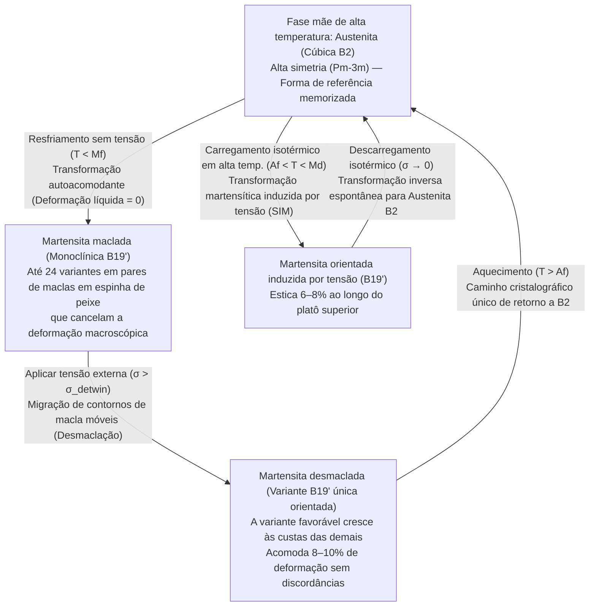

```mermaid
flowchart TD
    subgraph OWSME ["1. Efeito memória de forma unidirecional (Deformação em T < Mf)"]
        O1["Baixa temp. (T < Mf): Martensita B19' maclada autoacomodada"] -->|"Tensão (σ > σ_detwin)"| O2["Desmaclação: Contornos de macla migram para variante única"]
        O2 -->|"Descarregar (σ = 0)"| O3["Deformação plástica aparente (6–8%) permanece travada"]
        O3 -->|"Aquecer acima de Af (T > Af)"| O4["Transformação inversa (B19' → B2) restaura a forma original"]
    end
    subgraph SE ["3. Superelasticidade / Pseudoelasticidade (Isotérmica em Af < T < Md)"]
        S1["Alta temp. (Af < T < Md): Austenita B2 estável"] -->|"Carregar acima de σ_c"| S2["Martensita induzida por tensão (SIM)<br/>Estica 6–8% ao longo do platô superior"]
        S2 -->|"Descarregar (σ → 0)"| S3["Martensita instável em T > Af: Retorno espontâneo B19' → B2<br/>Recuperação total pelo platô inferior até ε = 0"]
    end
```

Se você pegar um clipe de aço ou uma colher de alumínio e dobrá-lo além de uma pequena fração de por cento de deformação, ele permanecerá permanentemente torto quando você soltar. Na metalurgia clássica, grande deformação é sinônimo de dano estrutural irreversível.

Contudo, um fio forjado a partir de uma liga equiatômica de níquel e titânio conhecida como <strong>Nitinol ($\text{NiTi}$)</strong> desafia toda a nossa intuição sobre sólidos metálicos. Você pode torcer um fio de Nitinol em um nó caótico à temperatura ambiente ou esticá-lo em quase $8\%$ de seu comprimento — quarenta vezes o limite elástico do aço de alta resistência — e no instante em que o mergulha em água morna (digamos, $60\,^\circ\text{C}$), ele se desenrola instantaneamente, voltando à sua geometria memorizada com precisão atômica. Esse fenômeno é o <strong>Efeito Memória de Forma (Shape Memory Effect, SME)</strong>. Mais notável ainda: em temperaturas logo acima do seu limiar de transformação, a mesma liga pode ser esticada em $8\%$ e saltar de volta para deformação zero assim que a carga é removida, sem necessidade de aquecimento — um comportamento metálico semelhante à borracha chamado <strong>Superelasticidade (ou Pseudoelasticidade)</strong>.

Como uma rede cristalina inorgânica, desprovida de sensores ou sistema nervoso, pode «lembrar» uma forma tridimensional complexa após sofrer deformação massiva? Neste artigo, dissecamos a física do estado sólido e a cristalografia por trás das ligas com memória de forma.

---

## 1. Por que os metais comuns esquecem: O limite elástico de $0,2\%$ e o escorregamento irreversível de discordâncias

Em um metal cristalino como ferro, cobre ou alumínio, uma pequena tensão $\sigma$ estica levemente as ligações interatômicas seguindo a lei de Hooke ($\sigma = E\varepsilon$). Porém, a deformação elástica máxima é minúscula: tipicamente <strong>$\varepsilon_{\text{el}} \approx 0,1\% \text{ a } 0,2\%$</strong>.

Acima de $0,2\%$, o cristal entra em <strong>deformação plástica</strong> através do movimento de defeitos lineares chamados <strong>discordâncias (dislocations)</strong> ao longo de planos de escorregamento. A cada passo de um vetor de Burgers $\mathbf{b}$, as ligações metálicas são <strong>quebradas e refeitas</strong> com novos átomos vizinhos.

Ponto crucial: <strong>o escorregamento de discordâncias destrói as relações topológicas de vizinhança da rede cristalina.</strong> Como a nova configuração local é energeticamente indistinguível da antiga, o cristal sofre de <strong>amnésia topológica</strong> e nenhuma força restauradora puxa os átomos de volta aos seus antigos parceiros.

Em 1962, <strong>William J. Buehler</strong> e <strong>Frederick E. Wang</strong> no Naval Ordnance Laboratory (NOL) dos EUA descobriram a liga equiatômica $\text{NiTi}$ ($\approx 50\,\text{at.}\%\,\text{Ni}$ – $50\,\text{at.}\%\,\text{Ti}$), batizada de <strong>Nitinol</strong> (<strong>Ni</strong>ckel <strong>Ti</strong>tanium <strong>N</strong>aval <strong>O</strong>rdnance <strong>L</strong>aboratory). Mesmo deformado em <strong>$8\text{–}10\%$</strong>, o Nitinol não ativa o escorregamento de discordâncias, mas sim uma transição de fase sólida reversível.

---

## 2. Fundamentos cristalográficos: Transformação sem difusão entre Austenita $B2$ e Martensita $B19'$

As transformações de fase no estado sólido dividem-se em <strong>difusivas</strong> (onde os átomos migram a longas distâncias apagando qualquer memória geométrica) e <strong>martensíticas (sem difusão / displacivas)</strong>.

Em uma transformação martensítica termoelástica não ocorre difusão atômica: todo um volume cristalino transforma-se através de um <strong>cisalhamento coordenado de átomos</strong> por frações de espaçamento interatômico, propagando-se próximo à velocidade do som ($\sim 10^3\,\text{m/s}$). <strong>Cada átomo preserva exatamente seus vizinhos topológicos originais!</strong>

### Fase mãe de alta temperatura: Austenita cúbica $B2$
Em altas temperaturas, o $\text{NiTi}$ existe como <strong>Austenita</strong> de alta simetria com <strong>estrutura cúbica ordenada $B2$ (tipo $\text{CsCl}$, grupo espacial $Pm\bar{3}m$)</strong> e $a_0 \approx 0,3015\,\text{nm}$. O grupo pontual cúbico $m\bar{3}m$ ($O_h$) possui <strong>48 operações de simetria</strong>.

### Fase produto de baixa temperatura: Martensita monoclínica $B19'$ e a fase $R$
Ao resfriar, o amolecimento de fônons acústicos ($\text{TA}_2$) desestabiliza a rede cúbica $B2$, que cisalha espontaneamente para a fase <strong>Martensita</strong> com <strong>estrutura monoclínica $B19'$ (grupo espacial $P2_1/m$)</strong>:

$$a \approx 0,2898\,\text{nm}, \quad b \approx 0,4108\,\text{nm}, \quad c \approx 0,4646\,\text{nm}, \quad \beta \approx 97,78^\circ \quad (\alpha = \gamma = 90^\circ)$$

Ocorre uma drástica quebra de simetria: de 48 operações na fase cúbica para apenas <strong>4 operações de simetria</strong> (grupo pontual $2/m$) na monoclínica. Em ligas $\text{NiTi}$ encruadas ou dopadas com $\text{Fe}$, pode surgir uma fase intermediária romboédrica chamada <strong>fase $R$</strong> ($B2 \to R \to B19'$) com uma histerese térmica minúscula de $1,5\text{–}3\,\text{K}$.

---

## 3. Autoacomodação (Martensita maclada) e Desmaclação (Detwinning)

Por que um fio reto de Nitinol não entorta sozinho quando resfriado sem carga em um refrigerador, se cada célula unitária sofre um cisalhamento de $\sim 8\text{–}10\%$ na transição $B2 \to B19'$? A resposta está nas <strong>24 variantes cristalográficas</strong>, na <strong>autoacomodação</strong> e na <strong>desmaclação (detwinning)</strong> induzida por tensão.

### 24 variantes e Autoacomodação
Pelo teorema de Lagrange, a razão das ordens dos grupos pontuais fornece $48 / 4 = 12$ variantes de rede, que junto aos planos de hábito conjugados geram até <strong>24 variantes cristalográficas de martensita</strong>. Durante o resfriamento sem tensão ($T < M_f$), o cristal subdivide-se em finas lamelas alternadas de variantes simétricas ($M^+$ e $M^-$) separadas por espelhos coerentes chamados <strong>contornos de macla (twin boundaries)</strong>. As deformações locais de cisalhamento cancelam-se exatamente em três dimensões:

$$\langle \boldsymbol{\varepsilon}_{\text{trans}} \rangle = \sum_{i=1}^{24} f_i \boldsymbol{\varepsilon}_i = \mathbf{0}$$

Isso é chamado de <strong>Autoacomodação</strong>: toda célula unitária tornou-se monoclínica, mas o fio mantém sua forma macroscópica exata.

### Desmaclação (Detwinning) e a rota única de retorno no aquecimento
Ao aplicar em $T < M_f$ uma tensão moderada $\sigma > \sigma_{\text{detwin}}$ ($50\text{–}150\,\text{MPa}$, muito abaixo do escoamento por discordâncias), os contornos de macla migram facilmente pelo cristal. As variantes desfavoráveis convertem-se na <strong>variante única (martensita desmaclada)</strong> alinhada com a carga externa (<strong>desmaclação / detwinning</strong>), acomodando $8\text{–}10\%$ de deformação macroscópica que permanece após o descarregamento.

Ao aquecer o fio dobrado acima da <strong>temperatura final de austenita ($A_f$)</strong>, entra em ação a assimetria fundamental da teoria de grupos:
- <strong>No resfriamento ($B2 \to B19'$, quebra de simetria)</strong>, um cristal cúbico pode descer para <strong>24 variantes monoclínicas equivalentes</strong>.
- <strong>No aquecimento ($B19' \to B2$, restauração de simetria)</strong>, como os vizinhos atômicos são preservados, <strong>as 24 variantes de martensita possuem APENAS UM caminho cristalográfico único de volta à orientação cúbica $B2$ original!</strong> O objeto recupera sua forma memorizada com $100\%$ de fidelidade.

---

## 4. Termodinâmica: Energia livre de Gibbs, teoria de Landau-Falk e a equação de Clausius-Clapeyron

### As quatro temperaturas de transformação ($M_f, M_s, A_s, A_f$)
A transição de primeira ordem exibe uma histerese térmica $\Delta T_{\text{hys}} = A_f - M_s \approx 15\text{–}40\,\text{K}$ obedecendo:

$$M_f < M_s < T_0 < A_s < A_f$$

Sob temperatura $T$ e tensão uniaxial $\sigma$, a variação da energia livre de Gibbs específica $\Delta G^{A \to M}(T, \sigma)$ é:

$$\Delta G^{A \to M}(T, \sigma) = \Delta H^{A \to M} - T \Delta S^{A \to M} - \frac{1}{\rho}\sigma \varepsilon_{\text{trans}} = -\Delta S^{A \to M}(T - T_0) - \frac{1}{\rho}\sigma \varepsilon_{\text{trans}}$$

onde a transformação direta $A \to M$ é exotérmica ($\Delta H^{A \to M} < 0$, $|\Delta H| \approx 15\text{–}25\,\text{J/g}$) e $\Delta S^{A \to M} < 0$.

### Teoria de Landau-Falk (Potencial de poço triplo)
Tomando a deformação de cisalhamento $\varepsilon$ como parâmetro de ordem, Peter Falk (1980) formulou a densidade de energia livre de sexto grau:

$$F(\varepsilon, T) = F_0(T) + \alpha (T - T_c)\varepsilon^2 - \beta \varepsilon^4 + \gamma \varepsilon^6 \quad (\alpha, \beta, \gamma > 0)$$

- Para <strong>$T > A_f$</strong>, $F(\varepsilon, T)$ tem um único mínimo global em $\varepsilon = 0$ (austenita cúbica, <strong>poço único</strong>).
- Perto de <strong>$T \approx T_0$</strong>, coexistem três poços em $\varepsilon = 0$ e $\varepsilon = \pm\varepsilon_0$ (<strong>poço triplo</strong>).
- Para <strong>$T < M_f < T_c$</strong>, $\varepsilon = 0$ torna-se um máximo instável, restando um <strong>poço duplo simétrico</strong> em $\varepsilon = \pm\varepsilon_0$ (variantes macladas $M^+, M^-$). Uma tensão externa $\sigma$ inclina $G = F - \sigma\varepsilon$ em direção a $+\varepsilon_0$ (desmaclação); aquecer acima de $A_f$ elimina os poços laterais e força o retorno a $\varepsilon = 0$.

### A equação de Clausius-Clapeyron no estado sólido
Do equilíbrio de fases $d(\Delta G^{A \to M}) = 0$ deduz-se a <strong>equação de Clausius-Clapeyron</strong> para a tensão crítica $\sigma_c(T)$:

$$\frac{d\sigma_c}{dT} = -\frac{\Delta S^{A \to M}}{V_m \varepsilon_{\text{max}}} = -\frac{\rho \Delta H^{A \to M}}{T_0 \varepsilon_{\text{max}}}$$

Para o $\text{NiTi}$ ($\rho \approx 6450\,\text{kg/m}^3$, $|\Delta H| \approx 20\,\text{kJ/kg}$, $T_0 \approx 300\,\text{K}$, $\varepsilon_{\text{max}} \approx 0,07$), a inclinação é estritamente positiva: <strong>$\frac{d\sigma_c}{dT} \approx 5\text{–}8\,\text{MPa/K}$</strong> ($\approx 6,14\,\text{MPa/K}$).

---

## 5. Comparação dos três modos funcionais: OWSME, TWSME e Superelasticidade

| Parâmetro | 1. Memória unidirecional (OWSME) | 2. Memória bidirecional (TWSME) | 3. Superelasticidade / Pseudoelasticidade (SE) |
| :--- | :--- | :--- | :--- |
| <strong>Janela de temperatura</strong> | Deformar em $T < M_f$ $\to$ Aquecer a $T > A_f$ | Ciclagem térmica $T < M_f \leftrightarrow T > A_f$ | Operação isotérmica em <strong>$A_f < T < M_d$</strong> |
| <strong>Papel da tensão externa</strong> | Necessária para desmaclar em baixa $T$ | <strong>Sem carga externa durante a operação</strong> | Induz $B2 \to B19'$ ao carregar; reverte ao descarregar |
| <strong>Mecanismo microestrutural</strong> | Desmaclação de $B19'$ $\to$ retorno térmico a $B2$ | Campos de tensão interna anisotrópicos (discordâncias / precipitados $\text{Ti}_3\text{Ni}_4$) | Transformação martensítica induzida por tensão (SIM) |
| <strong>Deformação recuperável máx.</strong> | <strong>$6\text{–}8\%$</strong> (até $10\%$ em monocristais) | <strong>$2\text{–}3\%$</strong> | <strong>$6\text{–}8\%$</strong> ($\sim 40\times$ o limite elástico do aço) |
| <strong>Aplicações principais</strong> | Acoplamentos hidráulicos, atuadores espaciais Frangibolt | Microatuadores sem mola de retorno | Stents cardiovasculares, arcos ortodônticos, pneus de rovers marcianos |

---

## 6. Fadiga funcional, a revolução de compatibilidade $\lambda_2 = 1$ e aplicações de engenharia

### A condição matemática $\lambda_2 = 1$ para 10 milhões de ciclos
No $\text{NiTi}$ binário, a incompatibilidade geométrica na interface austenita–martensita gera discordâncias durante a ciclagem (<strong>fadiga funcional</strong>). Segundo a teoria da elasticidade não linear de <strong>John M. Ball</strong> e <strong>Richard D. James</strong>, a austenita ($\mathbf{I}$) pode formar uma interface plana exata livre de tensões com uma única variante de martensita (tensor de estiramento de Bain $\mathbf{U}$ com autovalores $\lambda_1 \le \lambda_2 \le \lambda_3$) se e somente se <strong>o autovalor médio for exatamente igual à unidade</strong>:

$$\lambda_2 = 1$$

Enquanto o $\text{NiTi}$ binário tem $\lambda_2 \approx 0,968$, as ligas quaternárias <strong>$\text{Ti}_{50,2}\text{Ni}_{34,4}\text{Cu}_{12,3}\text{Pd}_{3,1}$</strong> (*Science* 2015) e <strong>$\text{Zn}_{45}\text{Au}_{30}\text{Cu}_{25}$</strong> (*Nature* 2013) ajustadas para $\lambda_2 = 1,0000 \pm 0,0002$ reduzem a histerese para $< 1\text{–}2\,\text{K}$ e suportam <strong>mais de $10^7$ (10 milhões) de ciclos</strong> sem degradação! Além disso, ligas ferromagnéticas ($\text{Ni}_2\text{MnGa}$) operam a $>1\,\text{kHz}$ sob campos magnéticos, e a <strong>refrigeração elastocalórica</strong> impulsiona o ar-condicionado de estado sólido sem gases de efeito estufa.

### Maravilhas da engenharia médica e aeroespacial
1. <strong>Stents cardiovasculares autoexpansíveis de Nitinol</strong>: Com $A_f \approx 25\text{–}30\,^\circ\text{C}$ (abaixo dos $37\,^\circ\text{C}$ do corpo humano) e uma camada passiva biocompatível de $\text{TiO}_2$, o stent comprimido dentro de um cateter expande-se ao contato com o sangue e mantém a artéria aberta graças à força suave e constante do platô superelástico inferior.
2. <strong>Arcos ortodônticos superelásticos</strong>: Exercem força corretiva constante ao longo de milímetros de movimentação dentária.
3. <strong>Atuadores espaciais Frangibolt da NASA e pneus superelásticos para rovers marcianos</strong>: O Nitinol aquecido gera $>500\,\text{MPa}$ para romper parafusos de titânio sem explosivos pirotécnicos; os pneus de malha de Nitinol dos rovers marcianos suportam $8\%$ de deformação reversível sobre rochas afiadas sem nunca furar.
