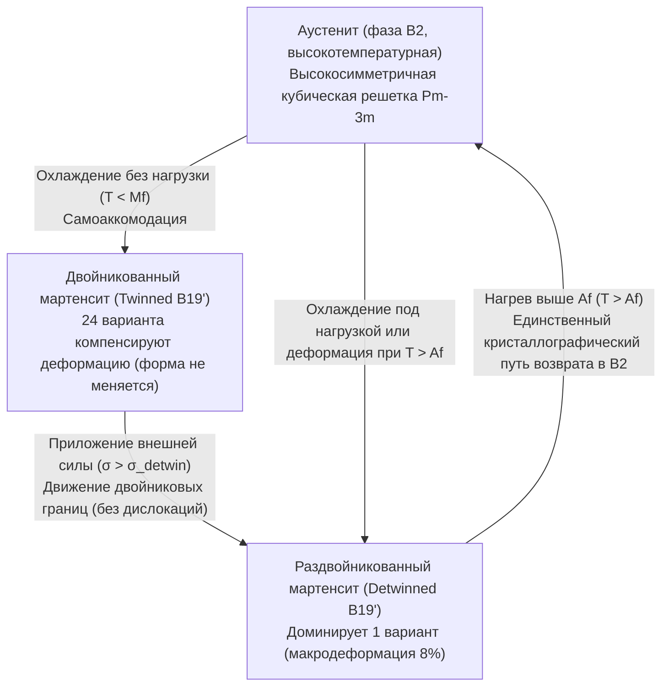
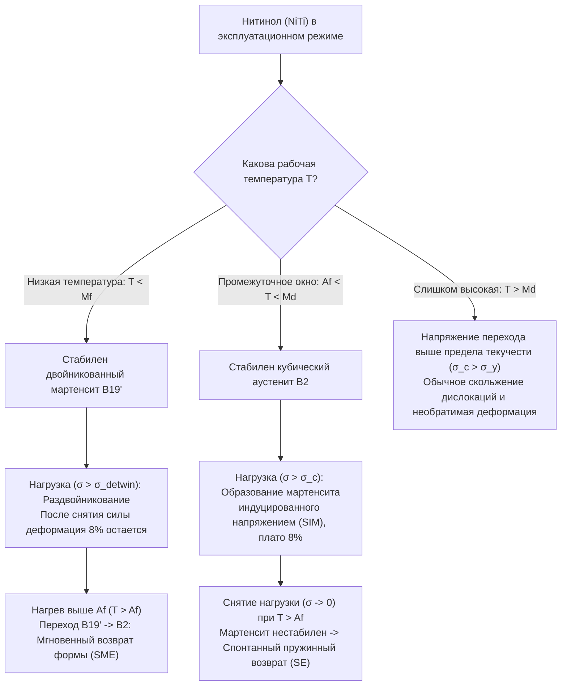

## 1. Почему обычные металлы «забывают» свою форму, а нитинол — помнит?

Возьмите обычную стальную скрепку или медную проволоку и согните ее под прямым углом. Когда вы отпустите пальцы, металл слегка спружинит назад на доли градуса, но останется согнутым навсегда. Даже если вы бросите эту скрепку в кипящую воду или нагреете феном, она никогда самостоятельно не распрямится. С точки зрения физики твердого тела обычные металлы страдают <strong>топологической амнезией</strong>.

Причина этой «потери памяти» кроется в механизме пластической деформации. Упругий предел большинства конструкционных металлов (стали, алюминия, титана, меди) составляет всего около $\varepsilon_{\text{el}} \approx 0.1\%\text{–}0.5\%$. В этом узком диапазоне атомы лишь слегка смещаются относительно положений равновесия в потенциальной яме межатомного взаимодействия, не разрывая химических связей. Однако как только деформация превышает $\sim 0.2\%$, сдвиговые напряжения активируют скольжение <strong>дислокаций</strong> (линейных дефектов кристаллической решетки).

При скольжении дислокаций целые атомные плоскости сдвигаются друг относительно друга, разрывая старые металлические связи и образуя новые с совершенно другими соседями. Поскольку кристаллическая решетка периодична, новое положение атомов энергетически неотличимо от старого ($\Delta G = 0$). Внутри кристалла не остается никакой возвращающей термодинамической силы, которая «помнила» бы, какие именно атомы были соседями до изгиба.

Однако в 1962 году Уильям Бюлер (William J. Buehler) и Фредерик Ванг (Frederick E. Wang) в Лаборатории морской артиллерии США (Naval Ordnance Laboratory, NOL) обнаружили поразительный феномен в эквиатомном сплаве никеля и титана ($\text{Ni}_{50}\text{Ti}_{50}$), названном <strong>Нитинолом (Nitinol — Nickel Titanium Naval Ordnance Laboratory)</strong>. Проволока из нитинола, охлажденная ниже комнатной температуры, может быть легко скручена, растянута или смята в клубок с огромной деформацией до $8\%\text{–}10\%$ (в $40$ раз выше упругого предела стали!). Но стоит опустить ее в горячую воду, как она за долю секунды с огромной силой распрямляется, идеально восстанавливая свою первоначальную форму.

Как кристаллическая решетка способна хранить «топологическую память» о макроскопической геометрии без участия дислокаций? Ответ кроется в кооперативном квантово-механическом явлении — <strong>термоупругом мартенситном фазовом превращении (Thermoelastic Martensitic Transformation)</strong>.

---

## 2. Микроскопический механизм: переход между аустенитом ($B2$) и мартенситом ($B19'$)

В отличие от плавления или рекристаллизации, где атомы хаотично мигрируют на большие расстояния (диффузионные процессы), фазовый переход в сплавах с памятью формы (Shape Memory Alloys, SMA) является <strong>бездиффузионным (diffusionless / displacive / military transformation)</strong>. Атомы не меняются местами со своими соседями; вместо этого миллиарды элементарных ячеек синхронно, подобно солдатам в строю, совершают координированный сдвиг со скоростью звуковой волны в кристалле.

В нитиноле ($\text{NiTi}$) существуют две ключевые кристаллические модификации:

1. <strong>Аустенит (Austenite, высокотемпературная родительская фаза, структура $B2$)</strong>:
   Упорядоченная объемно-центрированная кубическая решетка типа $\text{CsCl}$ (пространственная группа симметрии $Pm\bar{3}m$). Атомы титана расположены в вершинах куба, а атом никеля — точно в его центре (или наоборот). Кубическая группа $Pm\bar{3}m$ обладает высокой симметрией (48 операций точечной симметрии), поэтому структура $B2$ жесткая, изотропная и существует лишь в единственной кристаллографической ориентации.
2. <strong>Мартенсит (Martensite, низкотемпературная дочерняя фаза, структура $B19'$)</strong>:
   При охлаждении ниже критической температуры кубическая решетка теряет устойчивость относительно поперечных акустических фононных мод (смягчение упругой константы $c' = (c_{11}-c_{12})/2$) и испытывает однородную деформацию Бейна (Bain distortion) в сочетании со сдвигом (shuffle). Она превращается в низкосимметричную моноклинную решетку $B19'$ (пространственная группа $P2_1/m$, всего 4 операции симметрии). В некоторых режимах термообработки переход идет через промежуточную ромбоэдрическую <strong>$R$-фазу</strong> ($B2 \leftrightarrow R \leftrightarrow B19'$), дающую малую деформацию ($\sim 1\%$), но рекордно узкий температурный гистерезис ($1\text{–}2\,\text{K}$).

Поскольку симметрия при переходе $B2 \to B19'$ падает с 48 до 4 операций, из одного родительского монокристалла аустенита $B2$ могут равновероятно образоваться до $24$ кристаллографически эквивалентных, но по-разному ориентированных в пространстве доменов — так называемых <strong>мартенситных вариантов (Martensitic Variants)</strong>.

### 2.1 Самоаккомодация (Self-Accommodation) и раздвойникование (Detwinning)

Что происходит, когда мы охлаждаем нитинол из фазы аустенита ($T > A_f$) в фазу мартенсита ($T < M_f$) без приложенной внешней нагрузки ($\sigma = 0$)?

Если бы весь кристалл перешел в один-единственный вариант мартенсита, макроскопический образец изменил бы свою форму на $\sim 10\%$, что вызвало бы колоссальные внутренние упругие напряжения на границах зерен. Чтобы минимизировать упругую энергию деформации, кристалл автоматически формирует чередующиеся зеркально-симметричные домены — <strong>двойники (Twinned Martensite)</strong>. Различные варианты складываются «елочкой» (когерентные двойниковые границы), так что их локальные деформации решетки $\boldsymbol{\varepsilon}_i$ взаимно компенсируют друг друга в объеме:

$$\langle \boldsymbol{\varepsilon}_{\text{trans}} \rangle = \sum_{i=1}^{24} f_i \boldsymbol{\varepsilon}_i = \mathbf{0}$$

где $f_i$ — объемная доля $i$-го варианта ($\sum f_i = 1$). Этот фундаментальный процесс называется <strong>самоаккомодацией (Self-Accommodation)</strong>. Благодаря ему при простом охлаждении нитиноловая деталь переходит в мартенсит, совершенно не меняя своих внешних размеров.

Однако двойниковые границы в мартенсите обладают чрезвычайно высокой подвижностью. Когда мы прикладываем к охлажденному сплаву механическое напряжение $\sigma > \sigma_{\text{detwin}}$, мы не вызываем скольжения дислокаций и не рвем межатомные связи! Вместо этого двойниковые границы плавно перемещаются: варианты мартенсита, ориентированные вдоль направления внешней силы, растут за счет невыгодно ориентированных вариантов. Этот процесс называется <strong>раздвойникованием (Detwinning)</strong>. Макроскопически деталь изгибается или удлиняется на $8\%$, переходя в <strong>раздвойникованный (ориентированный) мартенсит</strong>, но топология соседства всех атомов остается строго неизменной!

Почему же при последующем нагреве ($T > A_f$) форма восстанавливается однозначно? Здесь вступает в силу фундаментальная асимметрия групп симметрии: при охлаждении кубическая решетка $B2$ имеет <strong>24 пути</strong> перехода в мартенсит $B19'$, но при нагревании любой из этих 24 вариантов мартенсита имеет <strong>только один-единственный путь</strong> возврата в исходную высокосимметричную кубическую решетку $B2$! Поэтому, в каком бы соотношении вариантов ни находился деформированный мартенсит, при нагреве все домены обязаны вернуться к единственной родительской ориентации аустенита, мгновенно возвращая детали ее исходную макроскопическую форму.

---

## 3. Термодинамика и феноменологическая теория Ландау–Фалька

Мартенситное превращение является фазовым переходом <strong>первого рода</strong> со скрытой теплотой перехода $\Delta H$ и температурным гистерезисом. Движущей силой перехода служит разность свободных энергий Гиббса между аустенитом ($A$) и мартенситом ($M$):

$$\Delta G^{A \to M}(T, \sigma) = G_M(T, \sigma) - G_A(T, \sigma) = \Delta H^{A \to M} - T \Delta S^{A \to M} - \frac{1}{\rho}\boldsymbol{\sigma} : \boldsymbol{\varepsilon}_{\text{trans}}$$

Высокотемпературный аустенит $B2$ имеет более открытую решетку и более мягкие колебательные моды, поэтому его колебательная энтропия выше ($S_A > S_M$). При высоких температурах член $-T S_A$ делает аустенит термодинамически выгодным. При низких температурах побеждает более плотноупакованный мартенсит $B19'$, обладающий меньшей внутренней энергией (энтальпией $H_M < H_A$).

### 3.1 Свободная энергия Ландау–Фалька (модель $\varepsilon^6$)

В 1980 году Фальк (F. Falk) адаптировал теорию фазовых переходов Ландау для описания сплавов с памятью формы, выбрав сдвиговую деформацию решетки $\varepsilon$ в качестве параметра порядка. Разложение плотности свободной энергии Гельмгольца $F(\varepsilon, T)$ по четным степеням $\varepsilon$ (в силу симметрии относительно знака сдвига $\varepsilon \leftrightarrow -\varepsilon$) до шестого порядка имеет вид:

$$F(\varepsilon, T) = F_0(T) + \alpha (T - T_c)\varepsilon^2 - \beta \varepsilon^4 + \gamma \varepsilon^6$$

где $\alpha, \beta, \gamma > 0$ — положительные материальные константы, а $T_c$ — температура потери устойчивости решетки. Член $-\beta \varepsilon^4$ с отрицательным знаком необходим для описания фазового перехода первого рода (он создает энергетический барьер между фазами), а положительный член $+\gamma \varepsilon^6$ обеспечивает устойчивость кристалла при больших деформациях.

Эволюция ландшафта свободной энергии $F(\varepsilon, T)$ при изменении температуры наглядно объясняет все свойства нитинола:

* <strong>При высокой температуре ($T > A_f$)</strong>: Член $\alpha(T - T_c)\varepsilon^2$ велик и положителен. Кривая $F(\varepsilon)$ имеет <strong>единственный глобальный минимум в точке $\varepsilon = 0$</strong> (аустенит). Любое отклонение от $\varepsilon = 0$ вызывает мощную возвращающую силу $\sigma = \partial F / \partial \varepsilon$, возвращающую кристалл в недеформированное состояние.
* <strong>В промежуточной области ($M_s < T < A_f$)</strong>: Помимо центрального минимума при $\varepsilon = 0$, по бокам при $\varepsilon = \pm \varepsilon_0$ зарождаются два локальных (метастабильных) минимума, соответствующих вариантам мартенсита $M^+$ и $M^-$.
* <strong>При низкой температуре ($T < M_f < T_c$)</strong>: Коэффициент при $\varepsilon^2$ становится отрицательным! Центральная точка $\varepsilon = 0$ превращается в <strong>локальный максимум</strong> (аустенит абсолютно неустойчив), а два глубоких симметричных минимума при $\varepsilon = \pm \varepsilon_0$ становятся глобально стабильными состояниями мартенсита. Переход из левой ямы ($-\varepsilon_0$) в правую ($+\varepsilon_0$) под действием внешнего напряжения $\sigma$ соответствует процессу раздвойникования.

### 3.2 Четыре характеристические температуры и уравнение Клаузиуса–Клапейрона

Из-за упругих напряжений на межфазных границах и трения при движении двойников прямой и обратный переходы разделены петлей гистерезиса (обычно $\Delta T_{\text{hyst}} \approx 15\text{–}40\,\text{K}$) и характеризуются четырьмя температурами:
1. $M_s$ (Martensite Start): температура начала образования мартенсита при охлаждении;
2. $M_f$ (Martensite Finish): температура полного перехода в мартенсит ($M_f < M_s$);
3. $A_s$ (Austenite Start): температура начала обратного перехода в аустенит при нагреве;
4. $A_f$ (Austenite Finish): температура полного восстановления аустенита ($A_s < A_f$, причем $M_s < A_f$).

Как внешнее механическое напряжение $\sigma$ влияет на эти температуры? Поскольку внешняя сила совершает положительную работу $\sigma \varepsilon_{\text{trans}}$ по стабилизации ориентированного мартенсита, приложение нагрузки повышает все четыре температуры перехода. Эта зависимость строго подчиняется термодинамическому <strong>уравнению Клаузиуса–Клапейрона для твердых фаз</strong>:

$$\frac{d\sigma_c}{dT} = -\frac{\Delta S^{A \to M}}{V_m \varepsilon_{\text{max}}} = -\frac{\rho \Delta H^{A \to M}}{T_0 \varepsilon_{\text{max}}}$$

где $\sigma_c$ — критическое напряжение индуцирования мартенсита, $V_m$ — молярный объем, $\rho \approx 6.45\,\text{г/см}^3$ — плотность $\text{NiTi}$, $\Delta H^{A \to M} \approx -20\text{–}25\,\text{Дж/г}$ — скрытая теплота перехода, $T_0 \approx \frac{1}{2}(M_s + A_f)$ — температура термодинамического равновесия фаз, а $\varepsilon_{\text{max}} \approx 0.08$ — максимальная деформация превращения.

Подставляя типичные параметры для нитинола, получаем универсальный наклон линии фазового равновесия:

$$\frac{d\sigma_c}{dT} \approx 5\text{–}8\,\text{МПа/К}$$

Это означает, что повышение температуры окружающей среды всего на $10\,\text{K}$ увеличивает напряжение, необходимое для деформации сплава (или давление, которое сплав развивает при попытке распрямиться), на $50\text{–}80\,\text{МПа}$!

---

## 4. Два лица одного феномена: Память формы (SME) vs Сверхупругость (SE)

В зависимости от того, при какой рабочей температуре $T$ эксплуатируется сплав относительно его критических точек $M_f$ и $A_f$, один и тот же кристалл демонстрирует два совершенно разных макроскопических режима:

### 4.1 Эффект памяти формы (Shape Memory Effect, SME, при $T < M_f$)

При температуре ниже $M_f$ сплав находится в состоянии двойникованного мартенсита. После приложения нагрузки и ее снятия деформация $\sim 8\%$ сохраняется (раздвойникованный мартенсит стабилен в глубоких боковых ямах потенциала Ландау). Чтобы вернуть исходную форму, необходим <strong>термический нагрев выше $A_f$</strong>.
* <strong>Односторонний эффект памяти формы (OWSME)</strong>: Сплав «помнит» только высокотемпературную форму аустенита. При повторном охлаждении ниже $M_f$ он остается прямым (за счет самоаккомодации).
* <strong>Двусторонний эффект памяти формы (TWSME)</strong>: Если подвергнуть сплав специальной термомеханической «тренировке» (циклированию под нагрузкой), в решетке создаются направленные поля внутренних микронапряжений и дислокационные сетки. При охлаждении они заставляют мартенсит расти преимущественно в одном выбранном варианте без внешней силы. Такой металл сам сгибается на холоде и сам разгибается в тепле!

### 4.2 Сверхупругость / Псевдоупругость (Superelasticity, SE, при $A_f < T < M_d$)

Что произойдет, если взять нитинол при температуре $T > A_f$ (когда стабилен кубический аустенит) и начать сильно его растягивать?
Согласно уравнению Клаузиуса–Клапейрона, при достижении критического напряжения $\sigma_{M_s}(T)$ высокотемпературный аустенит становится нестабильным прямо под нагрузкой, и возникает <strong>мартенсит, индуцированный напряжением (Stress-Induced Martensite, SIM)</strong>. На диаграмме растяжения $\sigma\text{–}\varepsilon$ появляется длинное горизонтальное плато, вдоль которого металл растягивается до $8\%$ при почти постоянном усилии.

Но как только мы отпускаем внешнюю силу ($\sigma \to 0$), поскольку температура среды $T > A_f$, мартенсит мгновенно теряет термодинамическую устойчивость! Без всякого дополнительного нагрева он спонтанно превращается обратно в аустенит ($B19' \to B2$), и деталь как идеальная пружина возвращается к нулевой деформации ($\varepsilon = 0$), описывая замкнутую петлю механического гистерезиса.

*(Примечание: если нагреть сплав выше предельной температуры $M_d > A_f$, критическое напряжение образования мартенсита $\sigma_c(T)$ превысит предел текучести дислокационного скольжения $\sigma_y$. В области $T > M_d$ сверхупругость исчезает, и нитинол деформируется необратимо, как обычная сталь).*

| Характеристика | Односторонняя память формы (OWSME) | Двусторонняя память формы (TWSME) | Сверхупругость / Псевдоупругость (SE) |
| :--- | :--- | :--- | :--- |
| <strong>Рабочая температура $T$</strong> | Деформация при $T < M_f$, нагрев до $T > A_f$ | Термоциклирование $T < M_f \leftrightarrow T > A_f$ | Изотермический режим $A_f < T < M_d$ |
| <strong>Исходная стабильная фаза</strong> | Двойникованный мартенсит ($B19'$) | Аустенит ($B2$) $\leftrightarrow$ Ориент. мартенсит | Кубический аустенит ($B2$) |
| <strong>Физический механизм</strong> | Раздвойникование $\to$ термический возврат в $B2$ | Рост вариантов в поле внутренних напряжений | Мартенсит, индуцированный напряжением (SIM) |
| <strong>Стимул для возврата формы</strong> | Нагрев ($\Delta T$) | Нагрев и охлаждение ($\pm \Delta T$) | Простое снятие внешней нагрузки ($\sigma \to 0$) |
| <strong>Максимальная обратимая деформация</strong> | $6\% \text{–} 8\%$ | $2\% \text{–} 4\%$ | $6\% \text{–} 10\%$ |

---

## 5. Передовые рубежи: функциональная усталость, условие $\lambda_2 = 1$ и инженерия будущего

Хотя мартенситное превращение обратимо, реальные сплавы с памятью формы сталкиваются с проблемой <strong>функциональной усталости (Functional Fatigue)</strong>: после нескольких тысяч циклов температура перехода дрейфует, а полнота возврата формы падает. Почему?

Причина кроется на границе раздела (габитусной плоскости, Habit Plane) между кубическим аустенитом $B2$ и моноклинным мартенситом $B19'$. Чтобы две разные кристаллические решетки состыковались без разрывов, матрица деформации превращения $\mathbf{U}$, имеющая три положительных собственных значения (главных растяжения решетки) $\lambda_1 \le \lambda_2 \le \lambda_3$, должна удовлетворять геометрическому условию совместимости Болла–Джеймса (Ball–James crystallographic theory of martensite).

Идеальная когерентная граница между аустенитом и одиночным вариантом мартенсита без переходного упругого слоя возможна тогда и только тогда, когда среднее собственное значение матрицы превращения в точности равно единице:

$$\lambda_2 = 1$$

В бинарном нитиноле $\text{Ni}_{50}\text{Ti}_{50}$ значение $\lambda_2 \approx 0.968 \neq 1$. Из-за этого несоответствия ($\sim 3.2\%$) межфазная граница при каждом движении вынуждена упруго деформироваться, генерируя колоссальные локальные напряжения, которые рождают дислокации и «засоряют» кристалл, создавая широкий температурный гистерезис ($\sim 30\,\text{K}$).

В 2000-х и 2010-х годах материаловеды совершили революцию в <strong>инженерии кофакторов (Cofactor Engineering)</strong>: легируя нитинол медью и палладием ($\text{Ti}_{50}\text{Ni}_{50-x-y}\text{Cu}_x\text{Pd}_y$) или создавая сплавы $\text{Zn}_{45}\text{Au}_{30}\text{Cu}_{25}$, ученые подобрали параметры решеток так, чтобы добиться точного равенства $\lambda_2 = 1.0000$! В таких кристаллах межфазная граница движется практически без трения, температурный гистерезис падает почти до нуля ($\Delta T < 1\text{–}2\,\text{K}$), а сплав выдерживает более <strong>$10^7$ (десяти миллионов!) циклов</strong> фазового перехода без малейшей деградации.

### Ключевые области применения и новые горизонты

1. <strong>Сердечно-сосудистые стенты и биомедицина</strong>: Саморасширяющиеся стенты из нитинола используют сверхупругость ($A_f \approx 25\text{–}30\,^\circ\text{C}$ ниже температуры тела $37\,^\circ\text{C}$). Стент охлаждают, сжимают в тонкий катетер и вводят в артерию; нагреваясь от крови и освобождаясь от оболочки, он раскрывается и поддерживает сосуд с постоянным мягким усилием плато сверхупругости. Ортодонтические дуги из нитинола создают непрерывное физиологическое давление на зубы в течение многих месяцев без подтяжки.
2. <strong>Космическая техника и марсоходы NASA</strong>: Беспиротехнические замки разделения спутников (Frangibolt) используют цилиндр из $\text{NiTi}$, который при подаче тока нагревается, удлиняется и разрывает титановый крепежный болт без ударных нагрузок и взрывчатки. Для будущих миссий на Марс и Луну NASA разработало плетеные безвоздушные шины из сверхупругого нитинола, способные огибать острые камни с деформацией до $10\%$ без проколов и остаточных вмятин.
3. <strong>Ферромагнитные сплавы с памятью формы ($\text{Ni}_2\text{MnGa}$)</strong>: В сплавах Гейслера мартенситные варианты обладают ферромагнитным упорядочением. Переориентация двойников здесь вызывается внешним магнитным полем (Magnetic Shape Memory Effect), что дает огромные деформации до $6\%\text{–}10\%$ на частотах в тысячи герц (быстрее, чем тепловой нагрев).
4. <strong>Твердотельное эластокалорическое охлаждение (Elastocaloric Cooling)</strong>: При быстром адиабатическом растяжении сверхупругого нитинола выделяется скрытая теплота перехода $\Delta H$ ($\Delta T \approx +15\text{–}20\,\text{K}$), а при резком снятии нагрузки обратный переход $B19' \to B2$ поглощает тепло из окружающей среды, охлаждая проволоку на $15\text{–}20\,\text{K}$. Эта экологически чистая технология с высоким КПД способна полностью вытеснить компрессорные холодильники и кондиционеры на парниковых фреонах.

То, что кажется нам «магической памятью» куска металла, на фундаментальном уровне представляет собой триумф кристаллографической симметрии, статистической термодинамики Ландау и кооперативной квантовой механики кристаллической решетки.
