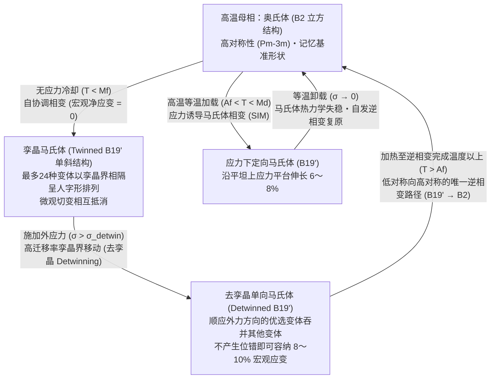
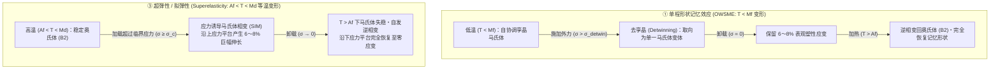

如果我们把一根普通的铁丝或铝勺用力弯折，松手后它会保持弯曲状态而无法复原；如果反复在同一个位置弯折，金属很快就会因加工硬化与疲劳裂纹扩展而折断。在经典金属学中，超过约 $0.2\%$ 的大变形意味着不可逆的晶格损伤。

然而，由近等原子比镍钛合金制成的<strong>镍钛诺（Nitinol，$\text{NiTi}$）</strong>却彻底颠覆了这一常识。在室温下，即便你将镍钛诺金属丝扭成麻花，或者将其拉伸近 $8\%$（相当于高强度钢弹性极限的40倍以上），只要将它浸入热水中（例如 $60\,^\circ\text{C}$），它就会像时间倒流一样瞬间恢复到原本预设的几何形状。这就是著名的<strong>形状记忆效应（Shape Memory Effect, SME）</strong>。更令人惊奇的是，在高于相变完成温度的区间内对它施加拉力，它可以像橡胶一样发生高达 $8\%$ 的巨大变形，一旦卸载便无需加热即可瞬间完全复原——这种现象被称为<strong>超弹性（Superelasticity / Pseudoelasticity，拟弹性）</strong>。

没有大脑与神经系统的无机金属晶体，究竟是如何“记住”自己原本的几何形状，并在经历高达 $8\text{–}10\%$ 的剧烈变形后依然保持原子级精度的复原能力的？本文将从固体物理学、晶体对称性群论与连续介质热力学出发，全面揭开形状记忆合金背后的物理机制。

---

## 1. 普通金属为何无法复原：弹性极限 $0.2\%$ 与位错的不可逆滑移

要理解形状记忆合金的奇特性，首先需要明确普通金属（如铁、铜、铝）在外力作用下的变形机制。

当普通金属受到微小拉应力 $\sigma$ 时，相邻原子间的金属键像弹簧一样被轻微拉长，应力与应变成正比（胡克定律 $\sigma = E\varepsilon$）。卸载后，原子间势能的恢复力使原子回到平衡位置，变形完全消失。然而，仅靠化学键伸缩所能承受的<strong>弹性极限应变（$\varepsilon_{\text{el}}$）</strong>极其微小，通常仅为 <strong>$\varepsilon_{\text{el}} \approx 0.1\% \text{–} 0.2\%$</strong>。

一旦应变超过 $0.2\%$，普通金属就会发生屈服并进入<strong>塑性变形（Plastic deformation）</strong>阶段。此时，晶格内部的线缺陷——<strong>位错（Dislocation）</strong>——开始沿着特定的<strong>滑移面（Slip plane）</strong>发生滑移。位错每扫过滑移面一次，滑移面两侧原有的原子化学键就会被<strong>切断（Bond breaking）</strong>，并与相邻的新原子重新建立化学键（Bond reforming），从而产生一个柏氏矢量 $\mathbf{b}$ 的永久位移。

最关键的物理本质在于：<strong>位错滑移永久性地改写了晶格中原子的拓扑近邻关系（Topological neighbor relationship）</strong>。由于新形成的晶格与滑移前在能量上完全等价，原子已经彻底“忘记”了自己原来的邻居是谁，因此卸载或加热都无法使金属退回原来的宏观形状。

1962年，美国海军军械实验室（Naval Ordnance Laboratory, NOL）的威廉·比勒（William J. Buehler）与王福生（Frederick E. Wang）发现了等原子比镍钛合金（$\approx 50\,\text{at.}\%\,\text{Ni}$ – $50\,\text{at.}\%\,\text{Ti}$），并将其命名为 <strong>Nitinol</strong>（<strong>Ni</strong>ckel <strong>Ti</strong>tanium <strong>N</strong>aval <strong>O</strong>rdnance <strong>L</strong>aboratory）。他们发现，这种合金在承受高达 <strong>$8\text{–}10\%$</strong> 的变形时，根本不启动位错滑移，而是通过一种完全保持原子近邻拓扑关系的固态相变来吸收应变。

---

## 2. 晶体学核心：奥氏体（$B2$）与马氏体（$B19'$）的无扩散相变

金属中的固态相变分为两类：第一类是<strong>扩散型相变（Diffusional transformation）</strong>，原子通过热激活在晶格中进行长程迁移，原有原子排列记忆被彻底抹去；第二类则是形状记忆合金的核心——<strong>无扩散热弹性马氏体相变（Thermoelastic Martensitic Transformation）</strong>。

在马氏体相变中，原子不发生任何长程扩散，而是通过晶格整体的<strong>协同切变与原子微位移（Coordinated shear-like atomic shuffle）</strong>，以接近声速的速度瞬间从一种晶体结构转变为另一种晶体结构。在整个相变过程中，<strong>每一个原子都百分之百保留了它原有的拓扑近邻伙伴</strong>，没有任何一个化学键被彻底切断并移情别恋。

### 高温母相：立方 $B2$ 奥氏体（Austenite）
在高温下，$\text{NiTi}$ 处于高对称性的母相——<strong>奥氏体（Austenite）</strong>。其晶体结构为氯化铯（$\text{CsCl}$）型的<strong>有序体心立方结构（$B2$ 结构，空间群 $Pm\bar{3}m$）</strong>，晶格常数 $a_0 \approx 0.3015\,\text{nm}$。$\text{Ti}$ 原子占据立方体顶点，$\text{Ni}$ 原子位于立方体中心。立方晶系的点群 $m\bar{3}m$ 拥有高达 <strong>48个对称操作</strong>（旋转、反演与镜面反射）。

### 低温生成相：单斜 $B19'$ 马氏体（Martensite）与中间 $R$ 相
当冷却至相变温度以下时，声子软化导致高对称的 $B2$ 立方晶格失稳，自发切变为低对称性的<strong>马氏体（Martensite）</strong>。在二元 $\text{NiTi}$ 中，低温马氏体采用<strong>单斜晶系 $B19'$ 结构（空间群 $P2_1/m$）</strong>，其典型晶格常数为：

$$a \approx 0.2898\,\text{nm}, \quad b \approx 0.4108\,\text{nm}, \quad c \approx 0.4646\,\text{nm}, \quad \beta \approx 97.78^\circ \quad (\alpha = \gamma = 90^\circ)$$

此时对称操作数量从立方相的 48 个骤降至单斜相的 <strong>4 个</strong>（对称性破缺）。此外，在经过冷加工热处理或掺杂少量 $\text{Fe}$、$\text{Co}$ 的 $\text{NiTi}$ 合金中，还会出现三方（菱面体）晶系的中间相——<strong>$R$ 相（R-phase）</strong>（$B2 \to R \to B19'$）。$R$ 相变虽然可恢复应变较小（约 $0.5\text{–}1.0\%$），但热滞后极小（仅 $1.5\text{–}3\,\text{K}$），抗疲劳寿命极长。

---

## 3. 自协调（孪晶马氏体）与去孪晶（Detwinning）的几何学

这里有一个至关重要的物理问题：<strong>既然从立方 $B2$ 相冷却到单斜 $B19'$ 相会导致每个晶胞产生约 $8\text{–}10\%$ 的倾角切变，为什么单纯把镍钛诺放在冰箱里冷却时，它的宏观外形却丝毫不会发生改变？</strong>

答案在于<strong>24种马氏体晶体学变体（Crystallographic Variants）</strong>构成的<strong>自协调机制（Self-Accommodation）</strong>与外力驱动的<strong>去孪晶（Detwinning）</strong>。

### 24种变体与自协调孪晶
从拥有 48 个对称操作的立方 $B2$ 母相转变为仅有 4 个对称操作的单斜 $B19'$ 马氏体时，立方体可以向多个能量完全等价但空间取向不同的方向发生切变。根据群论，晶格对应变体有 $48 / 4 = 12$ 种；结合惯习面（Habit plane）配对，共存在多达 <strong>24种马氏体变体</strong>。

在无应力冷却（$T < M_f$）时，为了避免在多晶内部产生巨大的弹性畸变能，向右侧切变的变体 $M^+$ 与呈镜像对称向左侧切变的变体 $M^-$ 会以原子级共格的镜面边界——<strong>孪晶界（Twin boundary）</strong>——交替堆垛，形成人字形（Chevron / Herringbone）的自协调孪晶组织。各变体的切变应变在三维空间精确抵消（$\langle \boldsymbol{\varepsilon}_{\text{trans}} \rangle = \sum f_i \boldsymbol{\varepsilon}_i = \mathbf{0}$），因此单纯冷却不会改变合金的宏观形状。

### 外力下的去孪晶（Detwinning）与加热唯一逆路径
当对低温下的孪晶马氏体施加外力 $\sigma > \sigma_{\text{detwin}}$（仅需 $50\text{–}150\,\text{MPa}$，远低于位错滑移屈服强度）时，迁移势垒极低的<strong>孪晶界在晶体中平滑移动</strong>。顺应外力拉伸方向的优选变体不断生长并吞并其他变体，最终形成单一取向的<strong>去孪晶马氏体（Detwinned martensite）</strong>，从而在不切断任何化学键的前提下释放出高达 $8\text{–}10\%$ 的宏观变形，并在卸载后稳定保持。

而当我们将其加热到奥氏体完成温度 $A_f$ 以上时，不对称的对称性法则发挥了魔力：<strong>从高对称立方相（$B2$）降级到低对称单斜相（$B19'$）有 24 条分岔路径，但从任何一个低对称马氏体变体在不破坏原子拓扑近邻关系的前提下返回高对称立方母相（$B2$），在晶体学上只有唯一的一条路径！</strong> 因此，无论低温下变体如何重新取向，一旦加热到 $T > A_f$，所有晶粒都会毫无悬念地坍缩回最初唯一的 $B2$ 晶格取向，宏观形状以 $100\%$ 的精度瞬间复原。

---

## 4. 热力学与相图：吉布斯自由能、朗道-福克理论与克劳修斯-克拉佩龙方程

### 四个特征相变温度与热滞后
热弹性马氏体相变具有以下四个特征温度：马氏体开始温度 $M_s$、马氏体完成温度 $M_f$、奥氏体开始温度 $A_s$、奥氏体完成温度 $A_f$，满足：

$$M_f < M_s < T_0 < A_s < A_f$$

其中 $T_0 \approx \frac{1}{2}(M_s + A_f)$ 是两相化学自由能相等的热力学平衡温度。由于相界面与孪晶界移动时存在点阵摩擦耗散，冷却与加热过程之间存在宽度约为 $\Delta T_{\text{hys}} = A_f - M_s \approx 15\text{–}40\,\text{K}$ 的热滞后回线。

### 吉布斯自由能与朗道-福克（Landau-Falk）三重势阱模型
在温度 $T$ 和单轴应力 $\sigma$ 下，奥氏体向马氏体相变的比吉布斯自由能差 $\Delta G^{A \to M}(T, \sigma)$ 为：

$$\Delta G^{A \to M}(T, \sigma) = \Delta H^{A \to M} - T \Delta S^{A \to M} - \frac{1}{\rho}\sigma \varepsilon_{\text{trans}} = -\Delta S^{A \to M}(T - T_0) - \frac{1}{\rho}\sigma \varepsilon_{\text{trans}}$$

其中相变潜热 $\Delta H^{A \to M} < 0$（正向冷却相变为放热反应，逆向加热相变为吸热反应），振动熵差 $\Delta S^{A \to M} < 0$。

以切变应变 $\varepsilon$ 为序参量，福克（Falk, 1980）提出的六次朗道自由能密度展开式为：

$$F(\varepsilon, T) = F_0(T) + \alpha (T - T_c)\varepsilon^2 - \beta \varepsilon^4 + \gamma \varepsilon^6 \quad (\alpha, \beta, \gamma > 0)$$

- 当 $T > A_f$ 时，$F(\varepsilon, T)$ 仅在 $\varepsilon = 0$（奥氏体）处有唯一极小值（<strong>单势阱</strong>）。
- 当 $T \approx T_0$ 时，在 $\varepsilon = 0$ 以及对称的马氏体孪晶态 $\varepsilon = \pm\varepsilon_0$ 处同时出现极小值（<strong>三重势阱</strong>）。
- 当 $T < M_f < T_c$ 时，中心 $\varepsilon = 0$ 变为局部极大值（失稳），仅剩 $\varepsilon = \pm\varepsilon_0$ 两个深势阱（<strong>双势阱</strong>）。外加应力 $\sigma$ 会使势能面 $G = F - \sigma\varepsilon$ 倾斜，驱使变体全部落入 $+\varepsilon_0$ 势阱（去孪晶）；加热至 $T > A_f$ 则使双势阱消失并合并回 $\varepsilon = 0$ 的单势阱，实现形状记忆恢复。

### 应力诱导马氏体相变的克劳修斯-克拉佩龙（Clausius-Clapeyron）方程
由两相平衡条件 $d(\Delta G^{A \to M}) = -\Delta S^{A \to M}\,dT - V_m \varepsilon_{\text{max}}\,d\sigma_c = 0$，可推导出临界相变应力 $\sigma_c$ 随温度 $T$ 变化的<strong>克劳修斯-克拉佩龙方程</strong>：

$$\frac{d\sigma_c}{dT} = -\frac{\Delta S^{A \to M}}{V_m \varepsilon_{\text{max}}} = -\frac{\rho \Delta H^{A \to M}}{T_0 \varepsilon_{\text{max}}}$$

对于 $\text{NiTi}$ 合金（$\rho \approx 6.45\,\text{g/cm}^3$，$|\Delta H| \approx 20\,\text{J/g}$，$\varepsilon_{\text{max}} \approx 7\%$，$T_0 \approx 300\,\text{K}$），斜率 $\frac{d\sigma_c}{dT}$ 恒为正值，典型数值为 <strong>$5\text{–}8\,\text{MPa/K}$</strong>。这意味着环境温度每升高 $10\,\text{K}$，诱发马氏体相变所需的平台应力就线性增加 $50\text{–}80\,\text{MPa}$。

---

## 5. 三大功能模式对比：单程形状记忆、双程形状记忆与超弹性

| 特性指标 | ① 单程形状记忆效应 (OWSME) | ② 双程形状记忆效应 (TWSME) | ③ 超弹性 / 拟弹性 (Superelasticity) |
| :--- | :--- | :--- | :--- |
| <strong>工作温度区间</strong> | $T < M_f$ 变形 $\to$ 加热至 $T > A_f$ 恢复 | $T < M_f \leftrightarrow T > A_f$ 温度循环 | 等温工作：<strong>$A_f < T < M_d$</strong> |
| <strong>外力作用</strong> | 低温去孪晶变形需外力 | <strong>无需外力</strong>（仅靠变温即可双向往复变形） | 加载诱发相变，卸载自发逆相变复原 |
| <strong>微观物理机制</strong> | 孪晶马氏体去孪晶 $\to$ 加热逆相变回 $B2$ | 热机械训练引入位错网或 $\text{Ti}_3\text{Ni}_4$ 析出物内应力场，定向诱导特定变体 | 等温应力诱导马氏体相变（SIM：$B2 \leftrightarrow B19'$）与应力平台滞后回线 |
| <strong>最大可恢复应变</strong> | <strong>$6\text{–}8\%$</strong>（单晶可达 $10\%$） | <strong>$2\text{–}3\%$</strong> | <strong>$6\text{–}8\%$</strong> |
| <strong>典型工程应用</strong> | 液压管路接头、航天器非火工分离螺母 | 无偏置弹簧的温控微执行器 | 自膨胀心血管支架、正畸弓丝、火星车轮胎 |

---

## 6. 功能性疲劳与晶体学相容性条件（$\lambda_2 = 1$）以及尖端工程应用

### 功能性疲劳与 $\lambda_2 = 1$ 的千万次寿命革命
普通二元 $\text{NiTi}$ 合金在经历数千至数万次相变循环后，由于立方 $B2$ 母相与单斜 $B19'$ 马氏体在相界面（惯习面）处存在晶格几何不匹配，界面弹性过渡层的高应力集中会不断诱发位错累积，导致相变温度漂移与可恢复应变衰减——即<strong>功能性疲劳（Functional Fatigue）</strong>。

数学家 John Ball 与 Richard D. James 基于非线性有限弹性理论证明：设相变伸长张量（Bain 矩阵）$\mathbf{U}$ 的三个主伸长率（特征值）按大小排列为 $\lambda_1 \le \lambda_2 \le \lambda_3$。当中间特征值严格满足 <strong>$\lambda_2 = 1$</strong> 时，母相与单一马氏体变体之间无需借助孪晶过渡层，即可形成零弹性畸变能的<strong>精确无应变相界面（Exact invariant plane）</strong>！

在二元 $\text{NiTi}$ 中 $\lambda_2 \approx 0.968$（偏离 1 达 $3.2\%$）；而科学家通过合金化设计出的四元合金 <strong>$\text{Ti}_{50.2}\text{Ni}_{34.4}\text{Cu}_{12.3}\text{Pd}_{3.1}$</strong> 以及 <strong>$\text{Zn}_{45}\text{Au}_{30}\text{Cu}_{25}$</strong> 将中间特征值精确调谐至 <strong>$\lambda_2 = 1.0000 \pm 0.0002$</strong>，使热滞后骤降至 $1\text{–}2\,\text{K}$ 以下，并创下了循环相变超过 <strong>$10^7$（1000万）次</strong>仍不发生功能退化的奇迹！此外，铁磁形状记忆合金（如 <strong>$\text{Ni}_2\text{MnGa}$</strong>）可通过外磁场以 $>1\,\text{kHz}$ 的高频驱动孪晶界，而基于相变潜热的<strong>弹热制冷（Elastocaloric cooling）</strong>正在开启无氟固态空调的新纪元。

### 改变世界的工程应用
1. <strong>自膨胀心血管镍钛诺支架（Self-Expanding Cardiovascular Stents）</strong>：将合金的 $A_f$ 精确设定在 <strong>$25\text{–}30\,^\circ\text{C}$</strong>（低于人体体温 $37\,^\circ\text{C}$），表面自发形成的致密 $\text{TiO}_2$ 钝化膜赋予其极佳的生物相容性。支架在体外冷却压缩后装入微导管，送达狭窄血管释放的瞬间，受 $37\,^\circ\text{C}$ 血液加热跨越 $A_f$ 自动撑开，并在超弹性下应力平台区持续提供温和恒定的径向支撑力，即便受外力挤压也能瞬间回弹。
2. <strong>口腔正畸超弹性弓丝（Orthodontic Archwires）</strong>：在口腔温度（$37\,^\circ\text{C}$）下处于超弹性平台区，可在数毫米的牙齿矫正位移内提供恒定、轻柔的生理最佳矫治力，避免了传统不锈钢丝初期力过大导致牙根吸收、后期力迅速衰减的弊端。
3. <strong>NASA 航天非火工执行器（Frangibolt）与火星车超弹性轮胎</strong>：利用镍钛诺套筒加热产生的 $500\text{–}700\,\text{MPa}$ 巨大恢复应力拉断带缺口的钛合金螺栓，实现零火工冲击、无污染的卫星太阳翼展开；NASA 格伦研究中心更用超弹性镍钛诺编织网制造出<strong>火星车无气弹簧轮胎（Spring Tire）</strong>，即便在锋利岩石上变形至轮轴也能依靠 $8\%$ 的可逆马氏体相变完美复原，永不爆胎。
4. <strong>波音可变几何发动机锯齿尾喷管（Variable-Geometry Chevron）</strong>：起飞降落时利用高温或电加热使镍钛诺弯曲喷管锯齿以混合气流、大幅降低噪声；高空低温巡航时自动恢复平直以消除气动阻力、节省燃油。
