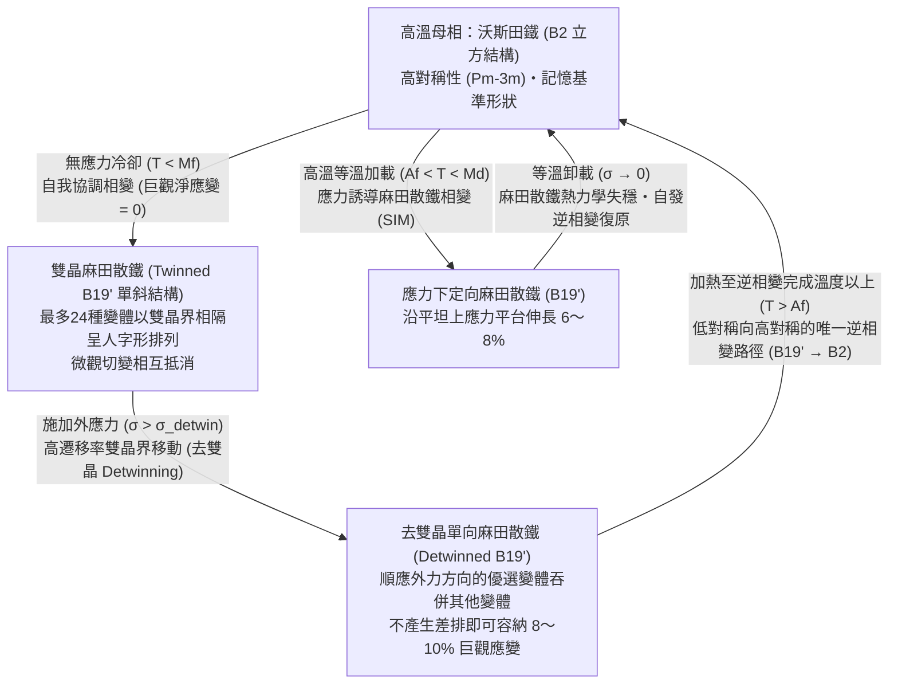
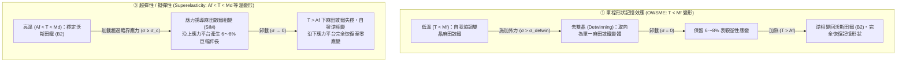

如果我們把一根普通的鐵絲或鋁湯匙用力彎折，鬆手後它會保持彎曲狀態而無法復原；如果反覆在同一個位置彎折，金屬很快就會因加工硬化與疲勞裂紋擴展而折斷。在古典金屬學中，超過約 $0.2\%$ 的大變形意味著不可逆的晶格損傷。

然而，由近等原子比鎳鈦合金製成的<strong>鎳鈦諾（Nitinol，$\text{NiTi}$）</strong>卻徹底顛覆了這項常識。在室溫下，即便你將鎳鈦諾金屬絲扭成麻花，或者將其拉伸近 $8\%$（相當於高強度鋼彈性極限的40倍以上），只要將它浸入熱水中（例如 $60\,^\circ\text{C}$），它就會像時間倒流一樣瞬間恢復到原本預設的幾何形狀。這就是著名的<strong>形狀記憶效應（Shape Memory Effect, SME）</strong>。更令人驚奇的是，在高於相變完成溫度的區間內對它施加拉力，它可以像橡膠一樣發生高達 $8\%$ 的巨大變形，一旦卸載便無需加熱即可瞬間完全復原——這種現象被稱為<strong>超彈性（Superelasticity / Pseudoelasticity，擬彈性）</strong>。

沒有大腦與神經系統的無機金屬晶體，究竟是如何「記住」自己原本的幾何形狀，並在經歷高達 $8\text{–}10\%$ 的劇烈變形後依然保持原子級精度的復原能力的？本文將從固態物理學、晶體對稱性群論與連續介質熱力學出發，全面揭開形狀記憶合金背後的物理機制。

---

## 1. 普通金屬為何無法復原：彈性極限 $0.2\%$ 與差排的不可逆滑移

要理解形狀記憶合金的奇特性，首先需要明確普通金屬（如鐵、銅、鋁）在外力作用下的變形機制。

當普通金屬受到微小拉應力 $\sigma$ 時，相鄰原子間的金屬鍵像彈簧一樣被輕微拉長，應力與應變成正比（虎克定律 $\sigma = E\varepsilon$）。卸載後，原子間位能的恢復力使原子回到平衡位置，變形完全消失。然而，僅靠化學鍵伸縮所能承受的<strong>彈性極限應變（$\varepsilon_{\text{el}}$）</strong>極其微小，通常僅為 <strong>$\varepsilon_{\text{el}} \approx 0.1\% \text{–} 0.2\%$</strong>。

一旦應變超過 $0.2\%$，普通金屬就會發生降伏並進入<strong>塑性變形（Plastic deformation）</strong>階段。此時，晶格內部的線缺陷——<strong>差排（Dislocation，又稱位錯）</strong>——開始沿著特定的<strong>滑移面（Slip plane）</strong>發生滑移。差排每掃過滑移面一次，滑移面兩側原有的原子化學鍵就會被<strong>切斷（Bond breaking）</strong>，並與相鄰的新原子重新建立化學鍵（Bond reforming），從而產生一個柏氏向量 $\mathbf{b}$ 的永久位移。

最關鍵的物理本質在於：<strong>差排滑移永久性地改寫了晶格中原子的拓撲近鄰關係（Topological neighbor relationship）</strong>。由於新形成的晶格與滑移前在能量上完全等價，原子已經徹底「忘記」了自己原來的鄰居是誰，因此卸載或加熱都無法使金屬退回原來的巨觀形狀。

1962年，美國海軍軍械實驗室（Naval Ordnance Laboratory, NOL）的威廉·比勒（William J. Buehler）與王福生（Frederick E. Wang）發現了等原子比鎳鈦合金（$\approx 50\,\text{at.}\%\,\text{Ni}$ – $50\,\text{at.}\%\,\text{Ti}$），並將其命名為 <strong>Nitinol</strong>（<strong>Ni</strong>ckel <strong>Ti</strong>tanium <strong>N</strong>aval <strong>O</strong>rdnance <strong>L</strong>aboratory）。他們發現，這種合金在承受高達 <strong>$8\text{–}10\%$</strong> 的變形時，根本不啟動差排滑移，而是透過一種完全保持原子近鄰拓撲關係的固態相變來吸收應變。

---

## 2. 晶體學核心：沃斯田鐵（$B2$）與麻田散鐵（$B19'$）的無擴散相變

金屬中的固態相變分為兩類：第一類是<strong>擴散型相變（Diffusional transformation）</strong>，原子透過熱激活在晶格中進行長程遷移，原有原子排列記憶被徹底抹去；第二類則是形狀記憶合金的核心——<strong>無擴散熱彈性麻田散鐵相變（Thermoelastic Martensitic Transformation）</strong>。

在麻田散鐵相變中，原子不發生任何長程擴散，而是透過晶格整體的<strong>協同切變與原子微位移（Coordinated shear-like atomic shuffle）</strong>，以接近聲速的速度瞬間從一種晶體結構轉變為另一種晶體結構。在整個相變過程中，<strong>每一個原子都百分之百保留了它原有的拓撲近鄰夥伴</strong>，沒有任何一個化學鍵被徹底切斷並重新配對。

### 高溫母相：立方 $B2$ 沃斯田鐵（Austenite）
在高溫下，$\text{NiTi}$ 處於高對稱性的母相——<strong>沃斯田鐵（Austenite，又稱奧氏體）</strong>。其晶體結構為氯化銫（$\text{CsCl}$）型的<strong>有序體心立方結構（$B2$ 結構，空間群 $Pm\bar{3}m$）</strong>，晶格常數 $a_0 \approx 0.3015\,\text{nm}$。$\text{Ti}$ 原子佔據立方體頂點，$\text{Ni}$ 原子位於立方體中心。立方晶系的點群 $m\bar{3}m$ 擁有高達 <strong>48個對稱操作</strong>（旋轉、反演與鏡面反射）。

### 低溫生成相：單斜 $B19'$ 麻田散鐵（Martensite）與中間 $R$ 相
當冷卻至相變溫度以下時，聲子軟化導致高對稱的 $B2$ 立方晶格失穩，自發切變為低對稱性的<strong>麻田散鐵（Martensite，又稱馬氏體）</strong>。在二元 $\text{NiTi}$ 中，低溫麻田散鐵採用<strong>單斜晶系 $B19'$ 結構（空間群 $P2_1/m$）</strong>，其典型晶格常數為：

$$a \approx 0.2898\,\text{nm}, \quad b \approx 0.4108\,\text{nm}, \quad c \approx 0.4646\,\text{nm}, \quad \beta \approx 97.78^\circ \quad (\alpha = \gamma = 90^\circ)$$

此時對稱操作數量從立方相的 48 個驟降至單斜相的 <strong>4 個</strong>（對稱性破缺）。此外，在經過冷加工熱處理或摻雜少量 $\text{Fe}$、$\text{Co}$ 的 $\text{NiTi}$ 合金中，還會出現三方（菱面體）晶系的中間相——<strong>$R$ 相（R-phase）</strong>（$B2 \to R \to B19'$）。$R$ 相變雖然可恢復應變較小（約 $0.5\text{–}1.0\%$），但熱遲滯極小（僅 $1.5\text{–}3\,\text{K}$），抗疲勞壽命極長。

---

## 3. 自我協調（雙晶麻田散鐵）與去雙晶（Detwinning）的幾何學

這裡有一個至關重要的物理問題：<strong>既然從立方 $B2$ 相冷卻到單斜 $B19'$ 相會導致每個晶胞產生約 $8\text{–}10\%$ 的傾角切變，為什麼單純把鎳鈦諾放在冰箱裡冷卻時，它的巨觀外形卻絲毫不會發生改變？</strong>

答案在於<strong>24種麻田散鐵晶體學變體（Crystallographic Variants）</strong>構成的<strong>自我協調機制（Self-Accommodation）</strong>與外力驅動的<strong>去雙晶（Detwinning）</strong>。

### 24種變體與自我協調雙晶
從擁有 48 個對稱操作的立方 $B2$ 母相轉變為僅有 4 個對稱操作的單斜 $B19'$ 麻田散鐵時，立方體可以向多個能量完全等價但空間取向不同的方向發生切變。根據群論，晶格對應變體有 $48 / 4 = 12$ 種；結合慣習面（Habit plane）配對，共存在多達 <strong>24種麻田散鐵變體</strong>。

在無應力冷卻（$T < M_f$）時，為了避免在多晶內部產生巨大的彈性畸變能，向右側切變的變體 $M^+$ 與呈鏡像對稱向左側切變的變體 $M^-$ 會以原子級共格的鏡面邊界——<strong>雙晶界（Twin boundary）</strong>——交替堆垛，形成人字形（Chevron / Herringbone）的自我協調雙晶組織。各變體的切變應變在三維空間精確抵消（$\langle \boldsymbol{\varepsilon}_{\text{trans}} \rangle = \sum f_i \boldsymbol{\varepsilon}_i = \mathbf{0}$），因此單純冷卻不會改變合金的巨觀形狀。

### 外力下的去雙晶（Detwinning）與加熱唯一逆路徑
當對低溫下的雙晶麻田散鐵施加外力 $\sigma > \sigma_{\text{detwin}}$（僅需 $50\text{–}150\,\text{MPa}$，遠低於差排滑移降伏強度）時，遷移勢壘極低的<strong>雙晶界在晶體中平滑移動</strong>。順應外力拉伸方向的優選變體不斷生長並吞併其他變體，最終形成單一取向的<strong>去雙晶麻田散鐵（Detwinned martensite）</strong>，從而在不切斷任何化學鍵的前提下釋放出高達 $8\text{–}10\%$ 的巨觀變形，並在卸載後穩定保持。

而當我們將其加熱到沃斯田鐵完成溫度 $A_f$ 以上時，不對稱的對稱性法則發揮了魔力：<strong>從高對稱立方相（$B2$）降級到低對稱單斜相（$B19'$）有 24 條分岔路徑，但從任何一個低對稱麻田散鐵變體在不破壞原子拓撲近鄰關係的前提下返回高對稱立方母相（$B2$），在晶體學上只有唯一的一條路徑！</strong> 因此，無論低溫下變體如何重新取向，一旦加熱到 $T > A_f$，所有晶粒都會毫無懸念地坍縮回最初唯一的 $B2$ 晶格取向，巨觀形狀以 $100\%$ 的精度瞬間復原。

---

## 4. 熱力學與相圖：吉布斯自由能、朗道-福克理論與克勞修斯-克拉佩龍方程式

### 四個特徵相變溫度與熱遲滯
熱彈性麻田散鐵相變具有以下四個特徵溫度：麻田散鐵開始溫度 $M_s$、麻田散鐵完成溫度 $M_f$、沃斯田鐵開始溫度 $A_s$、沃斯田鐵完成溫度 $A_f$，滿足：

$$M_f < M_s < T_0 < A_s < A_f$$

其中 $T_0 \approx \frac{1}{2}(M_s + A_f)$ 是兩相化學自由能相等的熱力學平衡溫度。由於相界面與雙晶界移動時存在點陣摩擦耗散，冷卻與加熱過程之間存在寬度約為 $\Delta T_{\text{hys}} = A_f - M_s \approx 15\text{–}40\,\text{K}$ 的熱遲滯迴線。

### 吉布斯自由能與朗道-福克（Landau-Falk）三重位能井模型
在溫度 $T$ 和單軸應力 $\sigma$ 下，沃斯田鐵向麻田散鐵相變的比吉布斯自由能差 $\Delta G^{A \to M}(T, \sigma)$ 為：

$$\Delta G^{A \to M}(T, \sigma) = \Delta H^{A \to M} - T \Delta S^{A \to M} - \frac{1}{\rho}\sigma \varepsilon_{\text{trans}} = -\Delta S^{A \to M}(T - T_0) - \frac{1}{\rho}\sigma \varepsilon_{\text{trans}}$$

其中相變潛熱 $\Delta H^{A \to M} < 0$（正向冷卻相變為放熱反應，逆向加熱相變為吸熱反應），振動熵差 $\Delta S^{A \to M} < 0$。

以切變應變 $\varepsilon$ 為序參量，福克（Falk, 1980）提出的六次朗道自由能密度展開式為：

$$F(\varepsilon, T) = F_0(T) + \alpha (T - T_c)\varepsilon^2 - \beta \varepsilon^4 + \gamma \varepsilon^6 \quad (\alpha, \beta, \gamma > 0)$$

- 當 $T > A_f$ 時，$F(\varepsilon, T)$ 僅在 $\varepsilon = 0$（沃斯田鐵）處有唯一極小值（<strong>單一位能井</strong>）。
- 當 $T \approx T_0$ 時，在 $\varepsilon = 0$ 以及對稱的麻田散鐵雙晶態 $\varepsilon = \pm\varepsilon_0$ 處同時出現極小值（<strong>三重位能井</strong>）。
- 當 $T < M_f < T_c$ 時，中心 $\varepsilon = 0$ 變為局部極大值（失穩），僅剩 $\varepsilon = \pm\varepsilon_0$ 兩個深位能井（<strong>雙位能井</strong>）。外加應力 $\sigma$ 會使位能面 $G = F - \sigma\varepsilon$ 傾斜，驅使變體全部落入 $+\varepsilon_0$ 位能井（去雙晶）；加熱至 $T > A_f$ 則使雙位能井消失並合併回 $\varepsilon = 0$ 的單一位能井，實現形狀記憶恢復。

### 應力誘導麻田散鐵相變的克勞修斯-克拉佩龍（Clausius-Clapeyron）方程式
由兩相平衡條件 $d(\Delta G^{A \to M}) = -\Delta S^{A \to M}\,dT - V_m \varepsilon_{\text{max}}\,d\sigma_c = 0$，可推導出臨界相變應力 $\sigma_c$ 隨溫度 $T$ 變化的<strong>克勞修斯-克拉佩龍方程式</strong>：

$$\frac{d\sigma_c}{dT} = -\frac{\Delta S^{A \to M}}{V_m \varepsilon_{\text{max}}} = -\frac{\rho \Delta H^{A \to M}}{T_0 \varepsilon_{\text{max}}}$$

對於 $\text{NiTi}$ 合金（$\rho \approx 6.45\,\text{g/cm}^3$，$|\Delta H| \approx 20\,\text{J/g}$，$\varepsilon_{\text{max}} \approx 7\%$，$T_0 \approx 300\,\text{K}$），斜率 $\frac{d\sigma_c}{dT}$ 恆為正值，典型數值為 <strong>$5\text{–}8\,\text{MPa/K}$</strong>。這意味著環境溫度每升高 $10\,\text{K}$，誘發麻田散鐵相變所需的平台應力就線性增加 $50\text{–}80\,\text{MPa}$。

---

## 5. 三大功能模式對比：單程形狀記憶、雙程形狀記憶與超彈性

| 特性指標 | ① 單程形狀記憶效應 (OWSME) | ② 雙程形狀記憶效應 (TWSME) | ③ 超彈性 / 擬彈性 (Superelasticity) |
| :--- | :--- | :--- | :--- |
| <strong>工作溫度區間</strong> | $T < M_f$ 變形 $\to$ 加熱至 $T > A_f$ 恢復 | $T < M_f \leftrightarrow T > A_f$ 溫度循環 | 等溫工作：<strong>$A_f < T < M_d$</strong> |
| <strong>外力作用</strong> | 低溫去雙晶變形需外力 | <strong>無需外力</strong>（僅靠變溫即可雙向往復變形） | 加載誘發相變，卸載自發逆相變復原 |
| <strong>微觀物理機制</strong> | 雙晶麻田散鐵去雙晶 $\to$ 加熱逆相變回 $B2$ | 熱機械訓練引入差排網或 $\text{Ti}_3\text{Ni}_4$ 析出物內應力場，定向誘導特定變體 | 等溫應力誘導麻田散鐵相變（SIM：$B2 \leftrightarrow B19'$）與應力平台遲滯迴線 |
| <strong>最大可恢復應變</strong> | <strong>$6\text{–}8\%$</strong>（單晶可達 $10\%$） | <strong>$2\text{–}3\%$</strong> | <strong>$6\text{–}8\%$</strong> |
| <strong>典型工程應用</strong> | 液壓管路接頭、太空船非火工分離螺母 | 無偏置彈簧的溫控微致動器 | 自膨脹心血管支架、齒顎矯正弓絲、火星車輪胎 |

---

## 6. 功能性疲勞與晶體學相容性條件（$\lambda_2 = 1$）以及尖端工程應用

### 功能性疲勞與 $\lambda_2 = 1$ 的千萬次壽命革命
普通二元 $\text{NiTi}$ 合金在經歷數千至數萬次相變循環後，由於立方 $B2$ 母相與單斜 $B19'$ 麻田散鐵在相界面（慣習面）處存在晶格幾何不匹配，界面彈性過渡層的高應力集中會不斷誘發差排累積，導致相變溫度漂移與可恢復應變衰減——即<strong>功能性疲勞（Functional Fatigue）</strong>。

數學家 John Ball 與 Richard D. James 基於非線性有限彈性理論證明：設相變伸長張量（Bain 矩陣）$\mathbf{U}$ 的三個主伸長率（特徵值）按大小排列為 $\lambda_1 \le \lambda_2 \le \lambda_3$。當中間特徵值嚴格滿足 <strong>$\lambda_2 = 1$</strong> 時，母相與單一麻田散鐵變體之間無需借助雙晶過渡層，即可形成零彈性畸變能的<strong>精確無應變相界面（Exact invariant plane）</strong>！

在二元 $\text{NiTi}$ 中 $\lambda_2 \approx 0.968$（偏離 1 達 $3.2\%$）；而科學家透過合金化設計出的四元合金 <strong>$\text{Ti}_{50.2}\text{Ni}_{34.4}\text{Cu}_{12.3}\text{Pd}_{3.1}$</strong> 以及 <strong>$\text{Zn}_{45}\text{Au}_{30}\text{Cu}_{25}$</strong> 將中間特徵值精確調諧至 <strong>$\lambda_2 = 1.0000 \pm 0.0002$</strong>，使熱遲滯驟降至 $1\text{–}2\,\text{K}$ 以下，並創下了循環相變超過 <strong>$10^7$（1000萬）次</strong>仍不發生功能退化的奇蹟！此外，鐵磁形狀記憶合金（如 <strong>$\text{Ni}_2\text{MnGa}$</strong>）可透過外磁場以 $>1\,\text{kHz}$ 的高頻驅動雙晶界，而基於相變潛熱的<strong>彈熱製冷（Elastocaloric cooling）</strong>正在開啟無氟固態空調的新紀元。

### 改變世界的工程應用
1. <strong>自膨脹心血管鎳鈦諾支架（Self-Expanding Cardiovascular Stents）</strong>：將合金的 $A_f$ 精確設定在 <strong>$25\text{–}30\,^\circ\text{C}$</strong>（低於人體體溫 $37\,^\circ\text{C}$），表面自發形成的緻密 $\text{TiO}_2$ 鈍化膜賦予其極佳的生物相容性。支架在體外冷卻壓縮後裝入微導管，送達狹窄血管釋放的瞬間，受 $37\,^\circ\text{C}$ 血液加熱跨越 $A_f$ 自動撐開，並在超彈性下應力平台區持續提供溫和恆定的徑向支撐力，即便受外力擠壓也能瞬間回彈。
2. <strong>齒顎矯正超彈性弓絲（Orthodontic Archwires）</strong>：在口腔溫度（$37\,^\circ\text{C}$）下處於超彈性平台區，可在數毫米的牙齒矯正位移內提供恆定、輕柔的生理最佳矯治力，避免了傳統不鏽鋼絲初期力過大導致牙根吸收、後期力迅速衰減的弊端。
3. <strong>NASA 太空非火工致動器（Frangibolt）與火星車超彈性輪胎</strong>：利用鎳鈦諾套筒加熱產生的 $500\text{–}700\,\text{MPa}$ 巨大恢復應力拉斷帶缺口的鈦合金螺栓，實現零火工衝擊、無污染的衛星太陽能板展開；NASA 格倫研究中心更用超彈性鎳鈦諾編織網製造出<strong>火星車無氣彈簧輪胎（Spring Tire）</strong>，即便在鋒利岩石上變形至輪軸也能依靠 $8\%$ 的可逆麻田散鐵相變完美復原，永不爆胎。
4. <strong>波音可變幾何發動機鋸齒尾噴管（Variable-Geometry Chevron）</strong>：起飛降落時利用高溫或電加熱使鎳鈦諾彎曲噴管鋸齒以混合氣流、大幅降低噪音；高空低溫巡航時自動恢復平直以消除氣動阻力、節省燃油。
