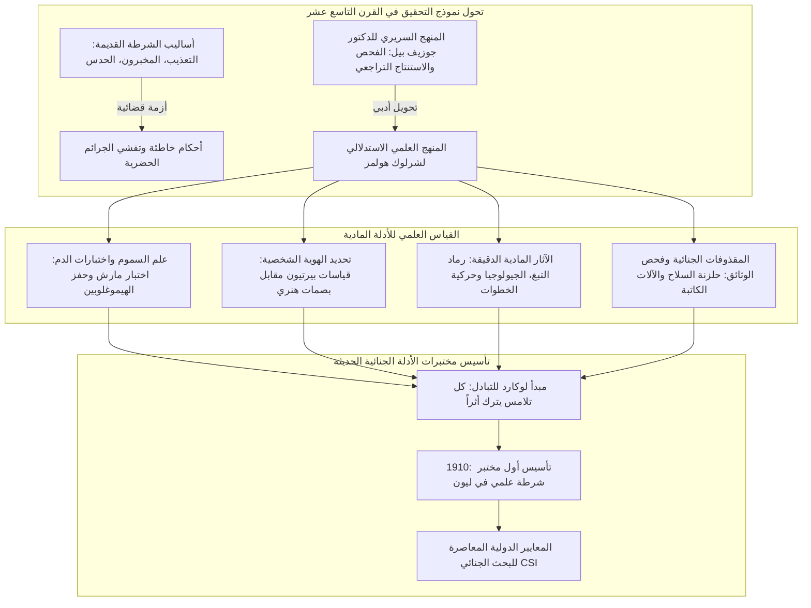
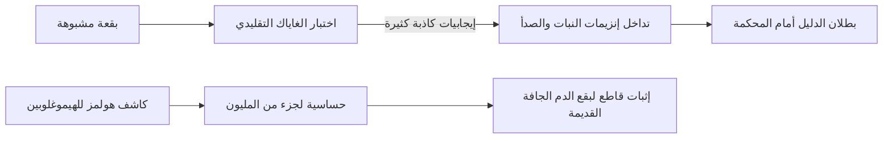
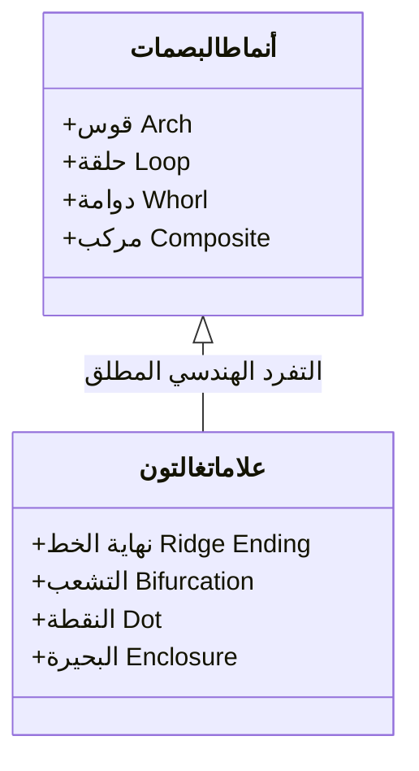
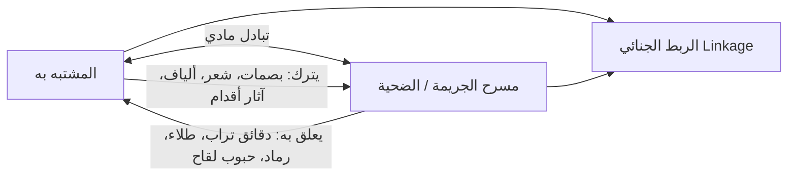

في لندن الفيكتورية أواخر القرن التاسع عشر، المحاطة بدخان الفحم والضباب الكثيف والمضاءة بوهج مصابيح الغاز الخافتة، كان رجل ينحني أمام المجهر المركب في 221B شارع بيكر. وبواسطة عدسة مكبرة، كان يزحف على السجاد لفحص رماد التبغ وجزيئات التربة والألياف الدقيقة: إنه **شرلوك هولمز (Sherlock Holmes)**، الذي ابتكره الطبيب والروائي **آرثر كونان دويل** عام 1887.

في يومنا هذا، تمثل إجراءات عزل مسرح الجريمة، جمع الآثار الدقيقة، فحص بصمات الأصابع، تفاعلات اللومينول للدم الكامن، المقذوفات الجنائية المقارنة، وفحص الوثائق المشكوك فيها بروتوكولات قياسية لدى أجهزة الشرطة حول العالم. ومع ذلك، عندما ظهر هولمز لأول مرة، كانت الشرطة في سكوتلاند يارد وأوروبا تعتمد بشكل شبه مطلق على المخبرين والاعترافات القسرية والحدس الذاتي، مما أدى في كثير من الأحيان إلى دهس الأدلة المادية في مسرح الجريمة وتدميرها.

قام كونان دويل بتحويل منهج التشخيص السريري لأستاذه في جامعة إدنبرة، **الدكتور جوزيف بيل (Dr. Joseph Bell)**، إلى مجال التحقيق الجنائي. وقد أقر علماء بارزون مثل **إدموند لوكارد (Edmond Locard)**، رائد علم الجريمة الحديث وصاحب المبدأ الشهير (*"كل تلامس يترك أثراً"*)- بأن تأسيس أول مختبر جنائي للشرطة في العالم استلهم مباشرة من مغامرات شرلوك هولمز.

---

## 1. فجر التحقيق العلمي: الدكتور جوزيف بيل والاستنتاج السريري

### 1.1 من أروقة الطب إلى ساحة الجريمة

درس كونان دويل الطب في جامعة إدنبرة في عهد ازدهار الجراحة المعقمة مع جوزيف ليستر. وكان أستاذه الجراح **الدكتور جوزيف بيل (1837–1911)** يدهش الطلاب بقدرته الفائقة على استنتاج مهنة المريض، خدمته العسكرية، موطنه الأصلي، ونوع مرضه بمجرد ملاحظة مشيته، لطخات ثيابه، ومظهره الجسدي قبل أن ينطق المريض بكلمة واحدة. كتب دويل لاحقاً إلى بيل: *"إليك يعود الفضل في وجود شرلوك هولمز... لقد حاولت بناء شخصية تأخذ منهج الملاحظة والاستنتاج الذي علمتمونا إياه إلى أقصى مداه."*

### 1.2 المنطق التراجعي (Abduction) والاحتمال البايزي

من منظور فلسفة العلوم، فإن ما يسميه هولمز "استنتاجاً" يمثل في حقيقته **الاستدلال بأفضل تفسير (Abduction)** وفق صياغة تشارلز بيرس. في مسرح الجريمة، تظهر النتيجة (الدليل $E$)، ويتعين إعادة بناء السبب الكامن (الفرضية $H$) بأثر رجعي. ووفقاً لمبرهنة بايز:

$$P(H|E) = \frac{P(E|H) \cdot P(H)}{\sum_{i} P(E|H_i) \cdot P(H_i)}$$

وتعبر مقولة هولمز الذهبية الشهيرة عن هذا الأساس الرياضي:
> **"عندما تستبعد المستحيل، فإن ما يتبقى، مهما بدا غير قابل للتصديق، يجب أن يكون هو الحقيقة."**

فمن خلال دحض وتفنيد الفرضيات المتناقضة ($P(E|H_k) \to 0$)، يتقلص فضاء الشك الرياضي، مما يجعل الاحتمال البعدي للفرضية الصحيحة يقترب حتماً من 1.

---

## 2. علم السموم الجنائي وكواشف الدم الحيوية

### 2.1 كاشف الهيموغلوبين في *دراسة في اللون القرمزي* (1887)

في مختبر مستشفى سانت بارثولوميو، يهلل هولمز لاكتشافه كاشفاً كيميائياً يرسب الهيموغلوبين وحده دون سواه. وانتقد بحدة **اختبار صمغ الغاياك** الذي كان يعطي نتائج إيجابية كاذبة متكررة مع إنزيمات النباتات والصدأ:

لقد استبق خيال هولمز محطات علمية تاريخية:
1. **اختبار تايخمان (1853)**: بلورات الهيمين؛
2. **اختبار تاكاياما (1912)**: بلورات هيموكروموجين البيريدين؛
3. **اختبار أولنهوث للترسيب (1901)**: التمييز بين دم الإنسان والحيوان؛
4. **اختبار كاستل-ماير (1904)**: أكسدة الفينولفثالين؛
5. **تفاعل اللومينول (1937)**: الضيائية الكيميائية بحفز حديد الهيم.

### 2.2 سموم العصر الفيكتوري واختبار مارش للزرنيخ

كان أكسيد الزرنيخ ($\text{As}_2\text{O}_3$) سم الاغتيال المفضل في القرن التاسع عشر. أحدث **اختبار مارش (1836)** ثورة علمية باختزاله الزرنيخ إلى غاز الأرسين ($\text{AsH}_3$):

$$\text{As}_2\text{O}_3 + 6\,\text{Zn} + 6\,\text{H}_2\text{SO}_4 \longrightarrow 2\,\text{AsH}_3\uparrow + 6\,\text{ZnSO}_4 + 3\,\text{H}_2\text{O}$$

وبتسخين الغاز في أنبوب زجاجي، تترسب **مرآة الزرنيخ** المعدنية اللامعة:

$$2\,\text{AsH}_3 \xrightarrow{\quad\Delta\quad} 2\,\text{As}\downarrow (\text{مرآة الزرنيخ}) + 3\,\text{H}_2\uparrow$$

---

## 3. ثورة تحديد الهوية: قياسات بيرتيون مقابل بصمات الأصابع

### 3.1 ألفونس بيرتيون ونظام الأنثروبومتري

في عام 1879، ابتكر ألفونس بيرتيون في باريس نظام **الأنثروبومتري**، مستنداً إلى ثبات عظام البالغين، حيث سجل 11 قياساً هيكلياً (طول الرأس، القدم اليسرى، الإصبع الأوسط) موزعة على $3^{11} = 177,147$ درجا في الأرشيف.

| النظام | المبدأ التشغيلي | الخلل الجوهري |
| :--- | :--- | :--- |
| **بيرتيوناج (1879)** | قياسات عظام البالغين وصور قياسية (أمامية/جانبية) | أخطاء القياس تؤدي لضياع السجلات؛ استحالة مطابقتها مع آثار الجريمة. انهار في **قضية ويل ويست (1903)**. |
| **بصمات الأصابع (1892)** | الخطوط الحليمية لجلد الأصابع | الثبات طوال الحياة والفرادة المطلقة ($P < 10^{-11}$). |

### 3.2 نظام هنري وقضية *بناء نوروود*

أثبت فرانسيس غالتون فرادة البصمات رياضياً في عام 1892، وصمم إدوارد هنري نظام التصنيف العشري (الأقواس، الحلقات، الدوامات).

وفي رواية *مغامرة بناء نوروود* (1903)، كشف هولمز تزييف بصمة إبهام دموية طبعتها الضحية المزعومة بقالب شمعي لتوريط بريء، موجهاً تحذيراً مبكراً من الانسياق الأعمى خلف الأدلة الفنية دون فهم سياقها المادي.

---

## 4. الآثار الدقيقة ومبدأ لوكارد للتبادل

### 4.1 إدموند لوكارد: "كل تلامس يترك أثراً"

أسس إدموند لوكارد أول مختبر جنائي في ليون عام 1910 وصاغ القانون الأسمى للأدلة الجنائية:

$$\text{الجاني} \underset{\text{تبادل مادي ثنائي الاتجاه}}{\rightleftharpoons} \text{مسرح الجريمة / الضحية}$$

كتب لوكارد: *"إن مناهج شرلوك هولمز هي الأساس الراسخ الذي يجب أن تقوم عليه مختبرات الشرطة العلمية المعاصرة."*

### 4.2 رماد التبغ، الجيولوجيا وحركية المشي

- **دراسة 140 نوعاً من رماد التبغ**: تحديد الصنف والطبقة الاجتماعية للجاني بدقة من البلورات ولون الاحتراق.
- **الجيولوجيا الجنائية**: التمييز بين طين نهر التيمز وغبار الفحم لإعادة تتبع خط سير الهاربين.
- **ميكانيكا آثار الأقدام**: معادلة الضغط $P(x,y) = F_z(t)/A(x,y)$ لتحليل سرعة الركض والأحمال المنقولة.

---

## 5. المقذوفات الجنائية وفحص الآلات الكاتبة

### 5.1 علامات الحلزنة وتشوه الرصاص

في *مغامرة المنزل الفارغ* (1903)، استخرج هولمز رصاصة رصاصية مشوهة، وحدد من عيارها وعلامات الحلزنة بندقية هوائية صامتة ومخصصة للاغتيال، سابقاً مجهر المقارنة لكالفين غودارد.

### 5.2 الإنتروبيا الميكانيكية للآلات الكاتبة في *قضية هوية*

في عام 1891، أثبت هولمز أن رسائل الحب المطبوعة صادرة من آلة كاتبة بعينها عبر تآكل الحروف المعدنية (حلقة حرف 'e'، كسر طرف 'r'، وميلان 's'). لقد وضع أصول تمييز الآلات قبل مكتب التحقيقات الفيدرالي (FBI) بأربعة عقود.

---

## 6. مصفوفة المقارنة التاريخية

| التخصص الجنائي | أعمال هولمز (السنة) | الإنجاز العلمي الواقعي | الأساس الفيزيائي والكيميائي |
| :--- | :--- | :--- | :--- |
| **كشف الدماء** | *دراسة في اللون القرمزي* (1887) كاشف الهيموغلوبين | 1901 اختبار أولنهوث 1904 كاستل-ماير 1937 اللومينول | النشاط الحفزي لحديد الهيم وتفاعلات الترسيب المناعي |
| **البصمات** | *علامة الأربعة* (1890) *بناء نوروود* (1903) | 1892 كتاب غالتون 1901 فرع البصمات في لندن | ثبات وتفرد الخطوط الحليمية للجلد |
| **الآثار الدقيقة** | *دراسة في اللون القرمزي* (1887) 140 نوع رماد والتربة | 1910 مختبر لوكارد في ليون مبدأ التبادل المادي | الفحص المجهري المورفولوجي والتبادل المزدوج |
| **المقذوفات الجنائية** | *المنزل الفارغ* (1903) حلزنة السلاح وتشوه الرصاص | 1925 مجهر المقارنة لغودارد | انتقال خدوش ماسورة السلاح إلى المقذوف |
| **فحص الآلات الكاتبة** | *قضية هوية* (1891) تآكل الحروف وميلان السطور | 1910 كتاب أوسبورن 1932 قسم الوثائق في FBI | الإجهاد الميكانيكي والإنتروبيا الفيزيائية للآلات |

---

## 7. الخاتمة: الإرث المعرفي لمدرسة شارع بيكر

إن أعظم إسهام قدمه آرثر كونان دويل للعدالة الإنسانية هو إعلاء شأن الأدلة المادية الصامتة على حساب التحيزات الذاتية:

> **"إنه لخطأ فادح أن تبني النظريات قبل أن تملك البيانات. فدون أن يشعر المرء، يبدأ في ليّ الحقائق لتناسب النظريات، بدلاً من ملاءمة النظريات للحقائق."**
> —— *فضيحة في بوهيميا (1891)*

يبقى هذا التحذير من **الانحياز التأكيدي (Confirmation Bias)** الميثاق الأخلاقي الأول لكل عالم ومحقق جنائي حتى يومنا هذا.
