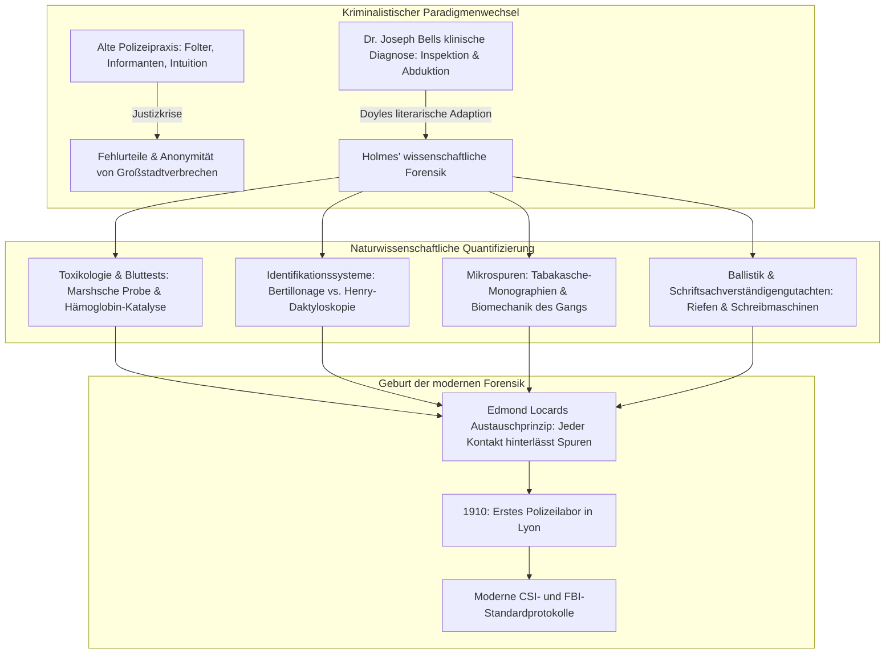
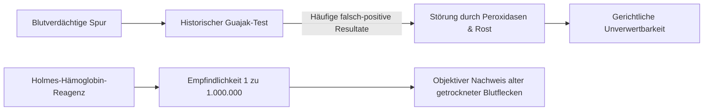
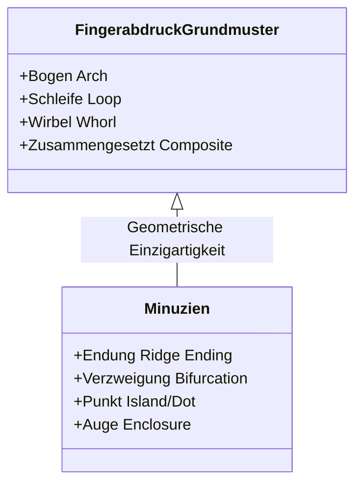
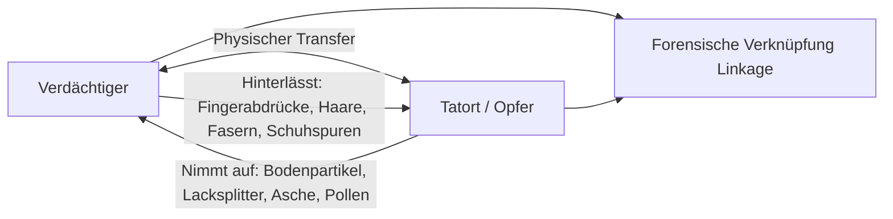

Im nebligen London des ausgehenden 19. Jahrhunderts, eingehüllt in dichten Kohlendunst und das diffuse Licht der Gaslaternen, beugte sich in der Baker Street 221B ein Mann über das Messingtubus eines Mikroskops. Mit einer Lupe kroch er über Teppiche, um Tabakasche, Bodenpartikel und Faserspuren zu untersuchen: **Sherlock Holmes**, geschaffen 1887 von dem Mediziner **Arthur Conan Doyle**.

Was heute weltweiter Standard polizeilicher Ermittlungen ist – Spurensicherung, Daktyloskopie (Fingerabdrücke), chemische Bluttests, forensische Ballistik und Schriftvergleich – existierte vor Holmes kaum oder wurde von den Behörden ignoriert. Scotland Yard stützte sich damals primär auf Informanten, erpresste Geständnisse und subjektive Intuition; Tatorte wurden durch Ermittler achtlos zertrampelt.

Conan Doyle übertrug die klinische Diagnosemethode seines Lehrers **Dr. Joseph Bell** an der Universität Edinburgh in die Kriminalistik. Pioniere wie **Dr. Edmond Locard**, der das fundamentale Prinzip formulierte (*„Jeder Kontakt hinterlässt eine Spur“*), nannten Holmes explizit als geistiges Vorbild für die Gründung des ersten kriminaltechnischen Labors der Welt.

---

## 1. Die wissenschaftliche Wende: Dr. Joseph Bell und die klinische Diagnose

### 1.1 Von der Medizin zur Kriminalistik

Conan Doyle studierte an der Medical School der Universität Edinburgh – dem damaligen Zentrum empirischer Medizin unter Joseph Lister. Sein Lehrmeister **Dr. Joseph Bell (1837–1911)** verblüffte Studenten regelmäßig, indem er bei eintreffenden Patienten anhand von Haltung, Kleidung, Gang und Hautveränderungen Beruf, Herkunft und Diagnose benannte, bevor diese ein Wort sprachen. Doyle schrieb später an Bell: *„Ihnen verdanke ich Sherlock Holmes... um den Kern aus Beobachtung und Deduktion habe ich einen Charakter gebaut.“*

### 1.2 Abduktive Logik und Bayessche Wahrscheinlichkeit

Wissenschaftstheoretisch nutzt Holmes die von Charles S. Peirce definierte **Abduktion** (Schluss auf die beste Erklärung). Am Tatort ist die Folge (Beweis $E$) sichtbar; die Ursache (Hypothese $H$) muss rekonstruiert werden. Nach dem Satz von Bayes:

$$P(H|E) = \frac{P(E|H) \cdot P(H)}{\sum_{i} P(E|H_i) \cdot P(H_i)}$$

Holmes' Diktum:
> **„Wenn man das Unmögliche ausgeschlossen hat, muss das, was übrig bleibt, die Wahrheit sein, so unwahrscheinlich es auch klingen mag.“**

Durch das Falsifizieren unvereinbarer Hypothesen ($P(E|H_k) \to 0$) schrumpft der Nenner; selbst eine Hypothese mit minimaler A-priori-Wahrscheinlichkeit $P(H_{\text{true}})$ konvergiert unausweichlich gegen 1.

---

## 2. Forensische Toxikologie und biochemische Blutreagenzien

### 2.1 Der Holmes-Bluttest in *A Study in Scarlet* (1887)

Im Labor des St. Bartholomew's Hospital präsentiert Holmes sein Reagenz, das ausschließlich Hämoglobin nachweist. Er kritisiert den damaligen **Guajak-Harz-Test**, der durch pflanzliche Peroxidasen (Meerrettich) und Rost leicht falsch-positive Reaktionen zeigte:

Holmes nahm reale Meilensteine vorweg:
1. **Teichmann-Test (1853)**: Hämin-Kristallbildung;
2. **Takayama-Test (1912)**: Pyridinhämochromogen-Kristalle;
3. **Uhlenhuth-Test (1901)**: Antikörper-Präzipitin-Test zur Differenzierung von Menschen- und Tierblut;
4. **Kastle-Meyer-Test (1904)**: Phenolphthalin-Oxidation;
5. **Luminol-Reaktion (1937)**: Chemilumineszenz durch Häm-Katalyse.

### 2.2 Toxikologie und die Marshsche Arsenprobe

Im 19. Jahrhundert war Arsentrioxid ($\text{As}_2\text{O}_3$) das Gift der Wahl. Die **Marshsche Probe (1836)** revolutionierte die Toxikologie, indem sie Arsen zu gasförmigem Arsin ($\text{AsH}_3$) reduzierte:

$$\text{As}_2\text{O}_3 + 6\,\text{Zn} + 6\,\text{H}_2\text{SO}_4 \longrightarrow 2\,\text{AsH}_3\uparrow + 6\,\text{ZnSO}_4 + 3\,\text{H}_2\text{O}$$

Durch thermische Zersetzung entsteht an der kalten Glaswand der charakteristische **Arsenspiegel**:

$$2\,\text{AsH}_3 \xrightarrow{\quad\Delta\quad} 2\,\text{As}\downarrow (\text{metallischer Arsenspiegel}) + 3\,\text{H}_2\uparrow$$

---

## 3. Identifikationsrevolution: Bertillonage vs. Daktyloskopie

### 3.1 Alphonse Bertillon und die Anthropometrie

1879 schuf Alphonse Bertillon in Paris ein System aus elf Knochenmaßen (Kopfmaße, Fußlänge, Mittelfinger etc.) mit Einteilung in $3^{11} = 177.147$ Schubfächer. 

| System | Prinzip | Schwachstelle |
| :--- | :--- | :--- |
| **Bertillonage (1879)** | 11 Skelettmessungen & standardisierte Porträts (Mugshots) | Messfehler führten zum Aktenverlust; keine Verknüpfung mit Tatortspuren. Zusammenbruch beim **Will-West-Fall (1903)**. |
| **Daktyloskopie (1892)** | Papillarleisten der Fingerbeere | Lebenslange Konstanz & Einzigartigkeit (Wahrscheinlichkeit $P < 10^{-11}$). |

### 3.2 Das Henry-Klassifizierungssystem

Sir Francis Galton bewies 1892 die Einzigartigkeit der Papillarlinien und Minuzien (Endungen, Gabelungen). Sir Edward Henry etablierte 1897 das System aus Bögen, Schleifen und Wirbeln. 

In *The Norwood Builder* (1903) entlarvte Holmes einen gefälschten Blut-Fingerabdruck, den der Täter mittels Wachsstempel an die Wand gesetzt hatte – eine Warnung vor blindem Technikglauben.

---

## 4. Mikrospuren und das Locardsche Austauschprinzip

### 4.1 Dr. Edmond Locard: „Jeder Kontakt hinterlässt Spuren“

Edmond Locard begründete 1910 in Lyon das erste Kriminallabor und formulierte das **Austauschprinzip**:

$$\text{Täter} \underset{\text{Gegenseitiger Materialtransfer}}{\rightleftharpoons} \text{Tatort / Opfer}$$

Locard würdigte öffentlich: *„Die Methoden von Sherlock Holmes sind das Fundament, auf dem moderne Polizeilabore ruhen müssen.“*

### 4.2 Tabakasche, Geologie und Gangbiomechanik

- **140 Tabakaschen**: Holmes katalogisierte Asche anhand von Kristallstruktur und Verbrennungsfarbe.
- **Forensische Geologie**: Unterscheidung von Schlammschichten und Kohlenstaub zur Rekonstruktion von Fluchtrouten.
- **Druckverteilung der Fußspuren**: $P(x,y) = F_z(t)/A(x,y)$ zur Analyse von Schrittlänge, Traglast und Hinken.

---

## 5. Forensische Ballistik und Schriftuntersuchung

### 5.1 Riefen und Geschossverformung

In *The Empty House* (1903) analysiert Holmes ein deformiertes Weichbleiprojektil und erkennt an Masse, Kaliber und Drallriefen die Sonderanfertigung eines lautlosen Luftgewehrs – lange vor Calvin Goddards Vergleichsmikroskop.

### 5.2 Mechanische Entropie von Schreibmaschinen

In *A Case of Identity* (1891) beweist Holmes die Identität eines Schreibmaschinentextes anhand abgenutzter Typenhebel (abgeschliffene 'r'-Schleifen, dezentrierte 's'-Buchstaben). Er begründete damit die Individualisierung industrieller Maschinen vier Jahrzehnte vor dem FBI.

---

## 6. Historische Vergleichsmatrix

| Disziplin | Holmes-Kanon (Erscheinungsjahr) | Historischer Meilenstein der Forensik | Wissenschaftliches Prinzip |
| :--- | :--- | :--- | :--- |
| **Blutspuren** | *A Study in Scarlet* (1887) Hämoglobin-Reagenz | 1901 Uhlenhuth-Test 1904 Kastle-Meyer 1937 Luminol | Häm-Peroxidase-Aktivität & Antigen-Antikörper-Reaktion |
| **Daktyloskopie** | *The Sign of Four* (1890) *Norwood Builder* (1903) | 1892 Galtons *Finger Prints* 1901 Scotland Yard Fingerprint Branch | Unveränderlichkeit der Papillarleisten |
| **Spurenkunde** | *A Study in Scarlet* (1887) 140 Aschearten & Stadtböden | 1910 Gründung des Kriminallabors Lyon (Locard) | Mikroskopische Morphologie & bidirektionaler Stoffaustausch |
| **Ballistik** | *The Empty House* (1903) Drallspuren auf Bleigeschoss | 1925 Goddards ballistisches Vergleichsmikroskop | Übertragung von Laufunregelmäßigkeiten auf Geschosse |
| **Schreibmaschinen** | *A Case of Identity* (1891) Typenabnutzung & Fehlausrichtung | 1910 Osborns *Questioned Documents* 1932 FBI-Dokumentenlabor | Mechanischer Verschleiß & individuelle Artefakte |

---

## 7. Fazit: Das erkenntnistheoretische Vermächtnis

Das wahre Vermächtnis von Arthur Conan Doyle liegt im wissenschaftlichen Denkansatz:

> **„Es ist ein kapitaler Fehler, eine Theorie aufzustellen, bevor man Daten hat. Unmerklich beginnt man sonst, Fakten passend zur Theorie zu verdrehen, statt Theorien passend zu den Fakten.“**
> —— *A Scandal in Bohemia (1891)*

Diese Warnung vor dem **Bestätigungsfehler (Confirmation Bias)** leitet die moderne Kriminalistik bis heute.
