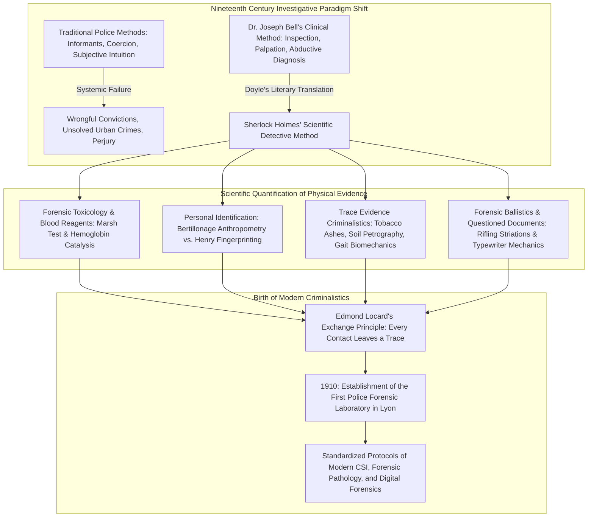
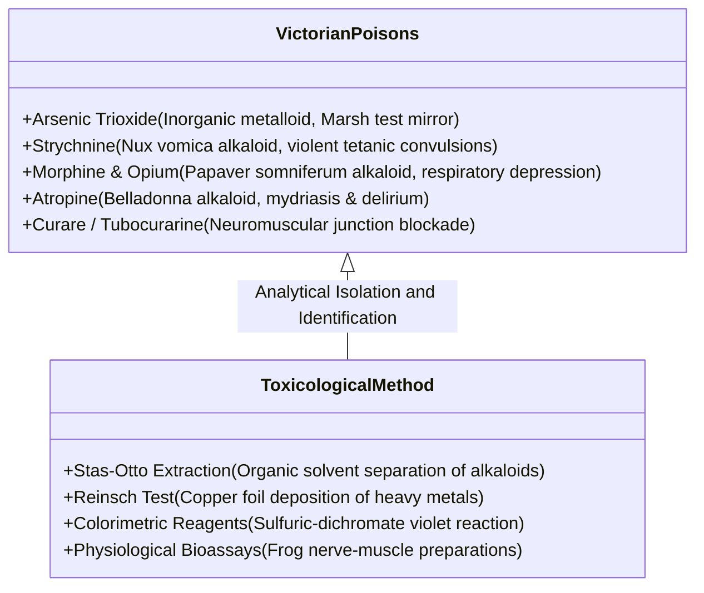
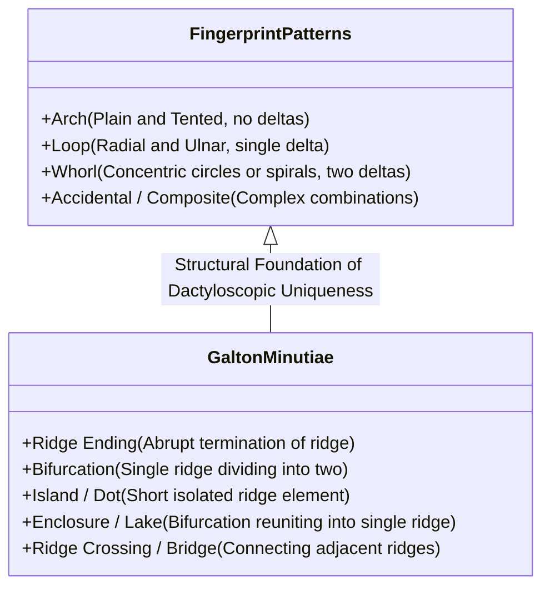
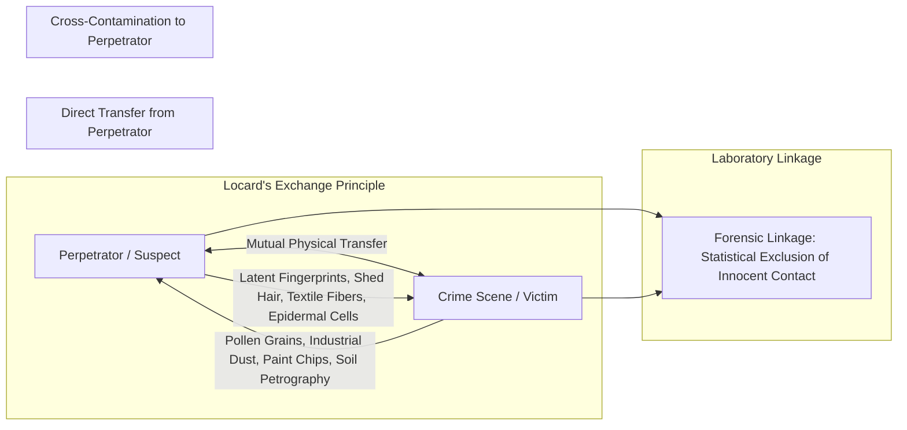
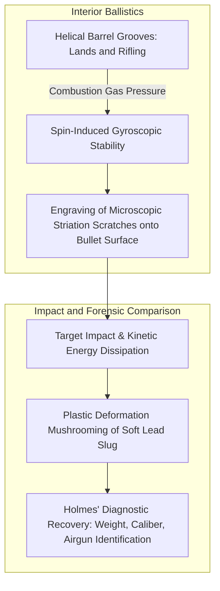
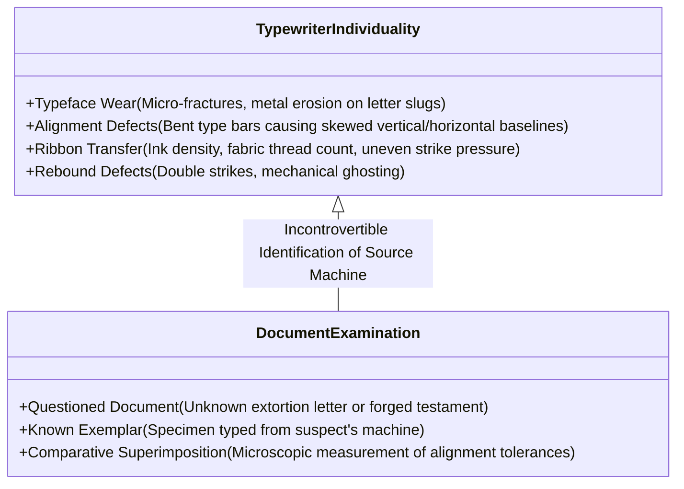

In the late Victorian London of the late nineteenth century, shrouded in thick sulfurous coal smog and illuminated by the flickering yellow glow of street gas lamps, an eccentric polymath spent his days and nights at 221B Baker Street. Surrounded by retorts, glass test tubes, chemical reagent bottles, and piles of criminal monographs, he peered through the brass monocular tube of a compound microscope, examined the carpet fibers on his hands and knees with a magnifying lens, or analyzed the crystalline ashes left upon a hearthstone. This was **Sherlock Holmes**, the world's first and only consulting detective, brought into existence in 1887 by physician and author **Arthur Conan Doyle**.

Today, police forces and forensic institutions across the globe—from the FBI Laboratory at Quantico and London's Scotland Yard to INTERPOL—operate under standardized scientific protocols: the rigid preservation of the crime scene, microscopic recovery of trace evidence, latent fingerprint development, biochemical blood presumptive tests, forensic ballistics striation matching, and document authentication. 

Yet when Holmes first appeared in *A Study in Scarlet* (1887), criminal investigation across Victorian Britain and continental Europe was overwhelmingly primitive. Official police methods relied almost entirely upon coerced confessions, jailhouse informants, eyewitness testimony notoriously distorted by memory decay, and the subjective, biased intuition of detectives who routinely trampled across crime scenes, destroying the very physical clues that held the key to the truth.

Arthur Conan Doyle, drawing directly upon the diagnostic rigor of his medical mentor **Dr. Joseph Bell** at the University of Edinburgh, engineered a revolutionary epistemological shift. By deploying chemistry, anatomy, geology, botany, and physics to interrogate silent physical clues, Holmes anticipated virtually every major development in modern criminalistics. Real-world forensic pioneers—most notably **Dr. Edmond Locard**, who formulated the foundational axiom of forensic science: *"Every contact leaves a trace"*—explicitly credited the Sherlock Holmes canon as the inspiration for the world's first police laboratories.

This monograph examines the scientific foundations of the Sherlock Holmes canon, dissecting the biochemical mechanisms of Victorian toxicology, the mathematical and dermatoglyphic battle between Bertillon's anthropometry and Henry's fingerprinting system, the biomechanics of gait and footprint analysis, the physics of forensic ballistics and typewriter examination, and the enduring philosophy of objective, evidence-driven deduction.



---

## 1. The Epistemological Revolution: Dr. Joseph Bell and the Diagnostic Method

### 1.1 From Clinical Medicine to Criminal Investigation

To understand the intellectual genesis of Sherlock Holmes, one must examine the Edinburgh of the late 1870s. The University of Edinburgh Medical School was then the intellectual epicenter of empirical, evidence-based medicine, pioneered by figures like Joseph Lister, who introduced antiseptic surgical techniques.

Arthur Conan Doyle enrolled as a medical student in 1876, serving as an outpatient clerk to **Dr. Joseph Bell (1837–1911)**, surgeon at the Royal Infirmary of Edinburgh. Bell possessed an astonishing capacity for rapid observation and diagnosis. Before a patient had uttered a single sentence, Bell would observe their posture, gait, accent, calluses, clothing stains, and skin discolorations, deducing their occupation, military background, travel history, and underlying pathology with surgical precision.

A famous, well-documented demonstration illustrates Bell's observational prowess. When a patient walked into his clinic, Bell addressed his students:
> "Gentlemen, I am sure this man is a discharged soldier from the Highland Regiment, a non-commissioned officer, and that he has recently returned from service in Barbados."

When the bewildered patient confirmed every detail, Bell calmly broke down the deductive chain:
1. **Behavioral Demeanor:** The man did not take his hat off upon entering, retaining a military habit; his upright spine and authoritative bearing indicated non-commissioned rank.
2. **Pathological Signs:** The patient presented facial symptoms characteristic of elephantiasis, a lymphatic filariasis endemic to tropical colonies such as the West Indies, completely alien to the Scottish climate.
3. **Historical Corroboration:** The only Scottish regiment stationed in Barbados during that operational window was the Highland regiment.

In a letter written to Bell in May 1892, Doyle explicitly acknowledged this intellectual lineage:
> *"It is most certainly to you that I owe Sherlock Holmes... Round the centre of deduction and inference and observation which I have heard you inculcate I have tried to build up a man who pushed the thing as far as it would go."*

### 1.2 Abductive Reasoning and Bayesian Probability in Crime Reconstruction

In the philosophy of science, what Holmes popularly calls his "deductions" are technically instances of **abduction**—a term coined by American logician Charles Sanders Peirce to describe *inference to the best explanation*. 

Pure deduction proceeds from a universal rule ($A \implies B$) and a known premise ($A$) to a guaranteed conclusion ($B$). However, at a crime scene, the investigator faces the inverse problem: the consequence (Evidence $E$) is observed, while the hidden causes and hypotheses ($H$) that generated that evidence must be reconstructed retrospectively.

Within the mathematical framework of Bayesian probability, given an observed piece of physical evidence $E$, the posterior probability $P(H|E)$ of a specific hypothesis $H$ is expressed as:

$$P(H|E) = \frac{P(E|H) \cdot P(H)}{P(E)} = \frac{P(E|H) \cdot P(H)}{\sum_{i=1}^{n} P(E|H_i) \cdot P(H_i)}$$

Where:
- $P(H)$ is the prior probability of the criminal hypothesis;
- $P(E|H)$ is the likelihood of observing evidence $E$ if hypothesis $H$ were true;
- $\sum_{i} P(E|H_i) P(H_i)$ is the marginal probability of the evidence across all possible mutually exclusive hypotheses.

Holmes’ celebrated methodological canon, articulated in *The Sign of Four* (1890), encapsulates this mathematical principle:

> **"Eliminate all other factors, and the one which remains must be the truth."**
> *(Or, as phrased in *The Beryl Coronet*: "It is an old maxim of mine that when you have excluded the impossible, whatever remains, however improbable, must be the truth.")*

In formal Bayesian terms, Holmes systematically examines competing hypotheses $H_1, H_2, \dots, H_n$. When empirical physical evidence contradicts a hypothesis, its conditional likelihood drops to zero ($P(E|H_k) = 0$), thereby pruning it from the hypothesis space. As the denominator collapses through the elimination of impossible alternatives, the posterior probability of the surviving hypothesis—even one possessing an exceedingly low prior probability $P(H_{\text{true}})$—inevitably converges toward 1 ($P(H_{\text{true}}|E) \to 1$). Holmes reduced investigative uncertainty by maximizing evidence resolution and minimizing cognitive entropy.

---

## 2. Forensic Toxicology & Biochemical Blood Presumptive Reagents

### 2.1 The Invention of the Holmes Blood Test in *A Study in Scarlet*

When Dr. John H. Watson first encounters Sherlock Holmes in the chemical laboratory of St. Bartholomew's Hospital in *A Study in Scarlet* (1887), Holmes is discovered shouting in triumph:

> *"I have found it! I have found it! I have found a re-agent which is precipitated by hemoglobin, and by nothing else!"*

Holmes immediately identifies the fatal flaw in the contemporary forensic practice of his day: the reliance on the **Guaiacum tincture test**. Developed in 1861 by Dutch physician Izaak van Deen, the guaiacum test relied on the peroxidase-like catalytic activity of hemoglobin's iron protoporphyrin core to decompose hydrogen peroxide ($\text{H}_2\text{O}_2$), oxidizing guaiaconic acid into a vibrant blue guaiacum blue compound.

However, the guaiacum test was notorious for yielding rampant **false positives**. Plant peroxidases found in horseradish, potatoes, and parsnips, as well as inorganic oxidants like rust ($\text{Fe}_2\text{O}_3$), sodium hypochlorite, and saliva, triggered the same blue reaction. In a courtroom, a defense barrister could easily invalidate guaiacum test results by arguing that a suspicious brown stain on a suspect’s coat was merely gravy, rust, or fruit juice.

```mermaid
flowchart LR
    subgraph Nineteenth Century Blood Testing Crisis
        A[Unknown Stained Cloth / Sample] --> B[Guaiacum Tincture + Hydrogen Peroxide]
        B -->|Severe Lack of Specificity| C[False Positives: Plant Peroxidases, Rust, Saliva]
        C --> D[Evidence Inadmissible in Victorian Assizes]
    end

    subgraph Holmes' Fictional Breakthrough (1887)
        E[Specific Hemoglobin Reagent] --> F[Precipitation & Color Change at 1:1,000,000 Dilution]
        F --> G[Objective Distinction of Ancient Dried Blood Stains]
    end

    subgraph Subsequent Real-World Milestones
        H[1901: Uhlenhuth Precipitin Test Species Identification] --> I[1904: Kastle-Meyer Phenolphthalein Test]
        I --> J[1937: Walter Specht's Luminol Chemiluminescence]
    end
```

Holmes’ fictional reagent claimed sensitivity down to one part in a million, functioning equally well on fresh blood or decade-old oxidized stains. 

In the actual history of biochemistry and forensic medicine, Holmes anticipated a sequence of vital breakthroughs:
1. **The Teichmann Test (1853):** Heating dried blood with glacial acetic acid and a halide salt to crystallize characteristic brown rhombic crystals of hemin (ferriprotoporphyrin chloride).
2. **The Takayama Reagent (1912):** Utilizing pyridine, glucose, and sodium hydroxide to produce pink, needle-shaped crystals of pyridine ferroprotoporphyrin (hemochromogen).
3. **The Uhlenhuth Precipitin Test (1901):** German biologist Paul Uhlenhuth developed an antibody-antigen precipitin test that could definitively distinguish human blood from non-human animal blood, solving the species-origin problem that plagued Victorian courtrooms.
4. **The Kastle-Meyer Test (1904):** Employing reduced phenolphthalin in an alkaline medium, which oxidizes in the presence of hemoglobin and hydrogen peroxide to bright pink phenolphthalein.
5. **The Luminol Chemiluminescent Reaction (1937):** Walter Specht demonstrated that 5-amino-2,3-dihydro-1,4-phthalazinedione (luminol) emits an intense blue chemiluminescence when catalyzed by the iron in hemoglobin in the presence of an alkaline peroxide solution, revealing latent bloodstains invisible to the naked human eye.

### 2.2 Victorian Toxicology: Arsenic, Alkaloids, and the Marsh Test

The Victorian era was widely dubbed the "Golden Age of Poisoning." The rapid proliferation of industrial chemistry made lethal compounds ubiquitous: arsenic trioxide was sold openly as rat poison and sheep dip, strychnine was used for pest eradication, and opium and chloral hydrate were dispensed unregulated over pharmacy counters.

#### The Marsh Test for Arsenic Detection
In 1836, Scottish chemist **James Marsh** introduced the first chemical test capable of detecting trace amounts of arsenic in biological tissues, rescuing toxicology from subjective autopsy speculation.

The test operates by reacting biological tissue extracts containing suspected arsenic trioxide ($\text{As}_2\text{O}_3$) with metallic zinc ($\text{Zn}$) and dilute sulfuric acid ($\text{H}_2\text{SO}_4$). The nascent hydrogen generated reduces the arsenic ions into gaseous arsine ($\text{AsH}_3$):

$$\text{As}_2\text{O}_3 + 6\,\text{Zn} + 6\,\text{H}_2\text{SO}_4 \longrightarrow 2\,\text{AsH}_3\uparrow + 6\,\text{ZnSO}_4 + 3\,\text{H}_2\text{O}$$

The evolved arsine gas, mixed with excess hydrogen, is passed through a narrow glass reduction tube and heated intensely with a flame. The heat decomposes the arsine gas, depositing a silvery-black, metallic mirror of pure elemental arsenic onto the cooler inner walls of the tube:

$$2\,\text{AsH}_3 \xrightarrow{\quad\Delta\quad} 2\,\text{As}\downarrow (\text{Arsenic Metallic Mirror}) + 3\,\text{H}_2\uparrow$$

This test possessed such exquisite sensitivity that fractions of a milligram of arsenic could be extracted from a murdered victim's exhumed organs and weighed upon analytical balances, providing incontrovertible physical proof before juries.



#### Organic Alkaloids in the Holmes Canon
In *The Sign of Four* (1890), Bartholomew Sholto is murdered with a tiny poisoned thorn launched from a blowpipe by the Andaman Islander Tonga. Holmes examines the body, noting extreme facial distortion (risus sardonicus) and muscular rigidity, deducing the use of a potent neurotoxin:

> *"The puncture is tiny, but the venom acts with terrifying rapidity. Some powerful plant alkaloid, probably resembling curare or strychnine, which induces catastrophic neuromuscular collapse."*

In *The Adventure of the Devil's Foot* (1910), Holmes confronts the fictional "Radix pedis diaboli" (Devil's Foot Root), a psychoactive combustion poison that induces lethal terror and delirium. Demonstrating the dangerous Victorian tradition of self-experimentation practiced by pharmacologists, Holmes and Watson burn a sample of the powder in a closed room, nearly dying before Watson manages to break through the window. Doyle accurately captured the pharmacological principles of central nervous system overstimulation, anticholinergic toxidromes, and the challenges of detecting novel botanical toxins before chromatography.

---

## 3. The Personal Identification Revolution: Bertillonage vs. Fingerprinting

### 3.1 Alphonse Bertillon's Anthropometric System (Bertillonage)

During the rapid urban explosion of the nineteenth century, European metropolises saw an unprecedented influx of transient populations. Professional criminals routinely adopted aliases upon every arrest. The paramount administrative crisis for police was **criminal identification**: determining whether an arrested suspect was a first-time offender or a recidivist with a violent record.

In 1879, **Alphonse Bertillon (1853–1914)**, a clerk at the Paris Prefecture of Police, formulated the world's first biometric identification system, known as **Bertillonage** (Anthropometry). Bertillon postulated that after a human skeleton reaches full maturity (around age 20), bone dimensions remain virtually static throughout adulthood.

```mermaid
flowchart TD
    subgraph Bertillon's Anthropometric Protocol (1879)
        A[11 Skeletal Measurements: Height, Reach, Bust, Head Length, Head Width, Left Foot, Left Middle Finger, etc.]
        A --> B[Statistical Tripartite Division: Small, Medium, Large for each parameter]
        B --> C[Card Filing System: 3 to the 11th power = 177,147 discrete filing compartments]
        C --> D[Standardized Photography: Frontal and Profile Mugshots under fixed focal conditions]
    end

    subgraph The Downfall of Anthropometry
        E[Operator Measurement Error & Caliper Drift] --> F[Systemic Failure: 1903 Leavenworth Will West Case]
        G[Inability to link crime scene traces to suspects] --> F
        F --> H[Global Adoption of Henry Fingerprint Classification System]
    end
```

Bertillon standardized eleven anatomical measurements taken with precision calipers, sliding gauges, and measuring tapes:
1. Standing Height;
2. Arm Span (Reach);
3. Sitting Height (Trunk length);
4. Head Length (Craniometric distance from glabella to inion);
5. Head Breadth (Maximum width across parietal bones);
6. Length of the Right Ear;
7. Length of the Left Foot;
8. Length of the Left Middle Finger;
9. Length of the Left Little Finger;
10. Length of the Left Forearm (Cubitus, from elbow to tip of middle finger);
11. Iris Color (classified across a standardized seven-hue scale).

By categorizing each measurement as Small, Medium, or Large, Bertillon subdivided criminal records into $3^{11} = 177,147$ discrete physical file drawers. A suspect's file could be retrieved in less than five minutes from among tens of thousands of cards. Bertillon also invented the standardized criminal **mugshot**—rigorously controlling lighting, focal distance, and capturing both direct frontal and ninety-degree profile views.

In *The Adventure of the Naval Treaty* (1893), client Percy Phelps praises Holmes by remarking:
> *"I have heard of your methods, Mr. Holmes... You are the highest authority in Europe, next to Monsieur Bertillon."*

Holmes replies dryly:
> *"To the enthusiastic admirers of Monsieur Bertillon, my position must seem very questionable. While I admire his mechanical precision and filing systems, I have always placed greater reliance on the direct observation of traces."*

Holmes' skepticism was profoundly prescient. Bertillonage suffered from three fatal weaknesses:
- **Inter-operator Variability:** A discrepancy of just three millimeters in measuring a struggling suspect's head breadth placed the card in the wrong compartment, rendering the record permanently lost.
- **Aging and Skeletal Degeneration:** Bone density decreases and spinal curvature alters measurements in older adults.
- **The Ultimate Crime-Scene Incompatibility:** A burglar never leaves the length of his left forearm or the width of his skull at the scene of a crime. He leaves fingerprints, bootmarks, and hairs.

The death blow to Bertillonage came in 1903 at the United States Penitentiary in Leavenworth, Kansas, in the celebrated **Will West Case**. A newly admitted prisoner named Will West was measured using the Bertillon system. The records clerk pulled an existing card that matched the measurements, name, and facial features identically—only to discover that the card belonged to *William West*, another man who was already serving a life sentence inside the same prison. The two men were unrelated doppelgängers. Forensic science immediately abandoned Bertillonage in favor of dactyloscopy.

### 3.2 Dermatoglyphics: Faulds, Galton, and the Henry Classification System

The scientific journey toward fingerprint identification was driven by a sequence of empirical discoveries:

1. **Dr. Henry Faulds (1843–1930):**
   A Scottish medical missionary in Tsukiji, Tokyo, Faulds noticed ancient ridge impressions on prehistoric pottery fragments from the Omori shell mounds. In an 1880 paper in *Nature*, Faulds demonstrated that friction ridges could be transferred via soot or blood, suggesting that latent prints found at crime scenes could identify burglars and exonerate the innocent.
2. **Sir Francis Galton (1822–1911):**
   Charles Darwin’s cousin published the landmark treatise *Finger Prints* in 1892. Galton proved mathematically and biologically the two pillars of dactyloscopy:
   - **Permanence (Immutability):** Dermal papillae patterns form during the tenth to sixteenth week of gestation and remain unchanged until post-mortem decomposition.
   - **Uniqueness (Individuality):** No two fingers on different individuals—nor even on the same individual or identical twins—possess identical ridge configurations.

Galton categorized ridge patterns into Arches, Loops, and Whorls, and analyzed discrete ridge deviations termed **minutiae** (Galton details: ridge endings, bifurcations, islands, enclosures). Assuming an average of 36 minutiae per print, Galton calculated that the probability of a random match between two independent prints is:

$$P(\text{Match}) \approx \left(\frac{1}{2}\right)^{36} \approx 1.45 \times 10^{-11} \approx \frac{1}{68,000,000,000}$$

With a world population of approximately 1.5 billion in 1892, Galton demonstrated that the mathematical probability of two individuals sharing a fingerprint pattern was essentially zero.

3. **Sir Edward Henry (1850–1931):**
   Inspector-General of Police in Bengal, Henry developed the **Henry Classification System** in 1897, assigning numerical values to whorl patterns across all ten fingers to generate a simple fractional filing index. In 1901, Henry established the Metropolitan Police Fingerprint Branch at New Scotland Yard, which soon secured its first historic conviction in 1902 (Harry Jackson, a burglar who left a thumbprint in fresh paint).



### 3.3 Forensic Skepticism: Unmasking Fabricated Prints in *The Norwood Builder*

In *The Adventure of the Norwood Builder* (1903), published shortly after Scotland Yard established its fingerprint division, Conan Doyle demonstrated remarkable insight into forensic methodology.

Inspector Lestrade triumphantly discovers a bloody thumbprint on the whitewashed wall of Jonas Oldacre’s house, which matches the suspect John Hector McFarlane with absolute precision. Lestrade considers the case closed, citing the new scientific infallible doctrine of fingerprint evidence.

Holmes, however, is not seduced by the superficial presence of the physical artifact. He applies rigorous contextual analysis:
1. **Temporal Discontinuity:** Holmes had examined that identical hallway wall on the previous day, and the bloody print was definitely not present. The mark had appeared overnight, while the suspect was already locked in police custody.
2. **Artificial Mechanics of Deposition:** Holmes deduced that Oldacre, faking his own murder to frame McFarlane, had taken a wax impression of McFarlane’s thumb from a sealed legal paper, fabricated a rubber stamp or wax mold, coated it in fresh blood, and stamped it onto the wall.

Doyle warned the world that **scientific evidence can be fabricated, planted, or misinterpreted**. A fingerprint proves physical presence at some point in time, but it does not intrinsically prove criminal action or malicious intent. The contextual integrity—the chain of custody and chronological plausibility—must always govern forensic deduction.

---

## 4. Trace Evidence & The Prefiguration of Locard's Exchange Principle

### 4.1 Dr. Edmond Locard and the Baker Street Influence

The core axiom of modern trace evidence analysis was articulated by French forensic scientist **Dr. Edmond Locard (1877–1966)**, founder of the Institute of Criminalistics at the University of Lyon. Formally known as **Locard's Exchange Principle**, it asserts:

> **"Every contact leaves a trace." (*Tout contact laisse une trace.*)**
> *"Wherever he steps, whatever he touches, whatever he leaves, even unconsciously, will serve as a silent witness against him. Not only his fingerprints or his footprints, but his hair, the fibers from his clothes, the glass he breaks, the tool mark he leaves, the paint he scratches, the blood or semen he deposits or collects."*

In his seminal treatise *Traité de Criminalistique* (1931), Locard explicitly credited Conan Doyle:
> *"The methods of Sherlock Holmes, based upon the microscopic examination of dust, mud, footprints, and clothing fibers, are the exact foundation upon which modern scientific police laboratories must operate."*



### 4.2 The Criminalistics of Trace Evidence in the Canon

#### ① The Microscopic Identification of 140 Tobacco Ashes
In *A Study in Scarlet* and *The Sign of Four*, Holmes references his published monograph: *Upon the Distinction Between the Ashes of the Various Tobaccos*.
- Holmes cataloged 140 varieties of cigar, cigarette, and pipe tobacco, documenting how combustion residues differ in color (from charcoal black to pure silver flake), grain size, and crystalline structure.
- In *The Boscombe Valley Mystery*, a small pile of ash recovered from the crime scene enables Holmes to identify an expensive Indian cigar (Trichinopoly), establishing the smoker's affluent colonial background and unmasking the true killer.
- Modern criminalistics accomplishes this through polarized light microscopy (PLM), gas chromatography-mass spectrometry (GC-MS), and scanning electron microscopy with energy-dispersive X-ray spectroscopy (SEM-EDX). Holmes anticipated the morphology of combustion residues decades before industrial microscopy was adopted by police.

#### ② Forensic Geology: Petrography and Urban Soil Zonation
Holmes famously boasted in *A Study in Scarlet* that he could:
> *"Tell at a glance from which parts of London each of the splashes of mud upon his trousers had been collected."*

Victorian London was a complex geological and industrial mosaic. The alluvial soils of the Thames Basin, the blue-gray London Clay, gravel river terraces, and streets laden with coal ash, horse manure, and asphalt bitumen possessed distinct chemical and microscopic profiles. By analyzing the color, quartz grain morphology, organic content, and mineral ratios of soil particles adhering to footwear or trouser cuffs, Holmes reconstructed suspects' spatial trajectories. 

Today, this discipline is recognized as **Forensic Geology and Forensic Palynology** (the study of pollen and spore distribution).

#### ③ Biomechanics of Footprint Impressions
Rather than merely matching the overall dimensions of a boot, Holmes analyzed the dynamic biomechanics of human locomotion:

$$P(x, y) = \frac{F_z(t)}{A(x, y)}$$

- **Stride Length and Velocity:** In *A Study in Scarlet*, Holmes determines whether a man was walking or running by measuring the distance between footprints and observing that running causes deeper toe penetrations and shallower heel strikes due to plantarflexion.
- **Load Distribution and Pathological Asymmetries:** In *The Resident Patient*, Holmes examines footprint depth to deduce that a man was carrying a heavy burden. Lateral edge wear reveals supination or pronation; limps, uneven stride tempos, and weight transfers were treated by Holmes as physical signatures encoded into mud and snow.
- **Preservation of Perishable Traces:** In an era when police officers routinely trampled over footprints, Holmes brought measuring tapes, plaster, and magnifying glasses, anticipating the casting methods standardized by modern CSI teams.

---

## 5. Forensic Ballistics & Questioned Document Examination

### 5.1 Rifling Marks and Projectile Plastic Deformation

Forensic ballistics—identifying whether a specific bullet was discharged from a specific firearm barrel—did not mature into an established science until the 1920s, through the work of **Colonel Calvin Goddard**, who developed the comparison microscope to examine ballistic striations.

However, in *The Adventure of the Empty House* (1903), Holmes was already conducting sophisticated projectile analysis.



When Colonel Sebastian Moran assassinates Ronald Adair and attempts to shoot Holmes’ wax decoy with a custom-engineered, silent air rifle built by the German mechanic Von Herder, Holmes recovers the spent projectile embedded in the masonry:

> *"A soft-nosed bullet of lead... expanded upon impact. Look at the caliber, the mass, and the distinctive groove engravings. No ordinary service revolver fired this; it came from an airgun designed for assassination."*

Holmes recognized that:
- **Lead Plasticity:** Soft unjacketed lead bullets undergo plastic mushrooming upon impact, but retain microscopic land and groove marks near the base.
- **Striation Physics:** The unique microscopic imperfections left by machining tools inside a gun barrel score corresponding parallel lines onto the bullet's surface, establishing an individual ballistic fingerprint.

### 5.2 The Mechanical Fingerprint of Typewriters in *A Case of Identity*

In 1891, Conan Doyle published *A Case of Identity*, featuring an extraordinary demonstration of **Questioned Document Examination** decades ahead of its time.

A young woman's fiancé, Hosmer Angel, mysteriously vanishes on their wedding day. All of his passionate love letters to her were typed on a machine, including the signature. Holmes instructs the woman's stepfather, James Windibank, to type a short note on his office machine, and instantly proves that Windibank and Hosmer Angel are the same man.

Holmes explains his forensic methodology to Dr. Watson:

> *"A typewriter has really quite as much individuality as a man's handwriting. Unless they are quite new, no two of them write exactly alike. Some letters get more worn than others, and some wear only on one side. Look at this letter, Watson. In every instance there is a slight defect in the tail of the 'r', and a blurring of the loop of the 'e'. There are fourteen cases of the former, and thirty-six of the latter. Furthermore, the crossbar of the 't' is out of alignment, and the 's' sits distinctly above the baseline. The machine which typed this letter is as distinct as a face."*



In 1891, the commercial typewriter (such as the Remington No. 2) was regarded by the public, lawyers, and police as an impersonal industrial printing machine that produced uniform, anonymous text. 

Holmes was the first to recognize the fundamental principle of machine identification: **entropy and mechanical wear**. The manufacturing tolerances of Victorian metal-stamping, combined with uneven key strikes by the operator, introduce unique physical flaws over time. The FBI did not establish its questioned document unit until 1932, forty-one years after Holmes solved the case of Hosmer Angel using typewriter individuality.

---

## 6. Comprehensive Historical Matrix: The Holmesian Precursor vs. Reality

The following matrix juxtaposes the forensic investigative methods portrayed in the Sherlock Holmes canon with their real-world scientific codification.

| Forensic Discipline | Canonical Portrayal (Publication Date) | Real-World Scientific Milestone & Institution | Scientific Principle & Physical Mechanism |
| :--- | :--- | :--- | :--- |
| **Presumptive Blood Test** | *A Study in Scarlet* (1887)<br>Hemoglobin-specific precipitation reagent | 1901: Uhlenhuth precipitin test<br>1904: Kastle-Meyer phenolphthalein<br>1937: Specht's luminol | Catalytic peroxidase activity of heme iron; antigen-antibody precipitation |
| **Dactyloscopy (Fingerprinting)** | *The Sign of Four* (1890)<br>*The Norwood Builder* (1903)<br>Latent print recovery & forgery detection | 1892: Galton's *Finger Prints*<br>1901: Scotland Yard Fingerprint Branch<br>1903: Leavenworth Will West Case | Permanence and uniqueness of dermal friction ridges; Galton minutiae |
| **Anthropometry (Bertillonage)** | *The Naval Treaty* (1893)<br>Critical evaluation of Bertillon's measurements | 1879: Bertillon system adopted in Paris<br>1890s: Worldwide police adoption<br>1903: Collapse due to human error | Static adult skeletal dimensions; $3^{11}$ combinatorial filing |
| **Trace Evidence & Dust Analysis** | *A Study in Scarlet* (1887)<br>Monograph on 140 tobacco ashes; soil zonation | 1910: Edmond Locard founds Lyon Police Laboratory; Exchange Principle | Microscopic morphology; petrographic mineralogy; mutual cross-transfer |
| **Forensic Gait & Footprint Biomechanics** | *The Boscombe Valley Mystery* (1891)<br>Stride velocity, depth, load distribution | 1920s: Standardization of plaster casting and biomechanical gait analysis | Ground reaction forces ($F_z/A$); shoe sole wear patterns; kinematic speed |
| **Forensic Ballistics** | *The Empty House* (1903)<br>Rifling grooves, soft lead plastic deformation | 1925: Calvin Goddard introduces the ballistic comparison microscope | Machining imperfections inside barrel transferred as striations to bullet |
| **Typewriter Document Authentication** | *A Case of Identity* (1891)<br>Typeface wear, loop blurring, alignment defects | 1910: Albert S. Osborn's *Questioned Documents*<br>1932: FBI Document Section | Progressive mechanical entropy; individualizing metal slug wear patterns |
| **Forensic Toxicology** | *The Devil's Foot* (1910)<br>Combustion gas of neurotoxic plant alkaloids | 1836: Marsh test for arsenic<br>1850: Stas-Otto extraction for alkaloids | Organic solvent separation; cellular receptor antagonism; colorimetric assays |

---

## 7. Conclusion: The Intellectual Legacy of the Baker Street Method

The enduring achievement of Arthur Conan Doyle through Sherlock Holmes was not merely the invention of a brilliant literary hero, but the creation of an **epistemological framework for justice**.

Before Holmes, criminal investigation was an art of intimidation, bias, and hearsay. Holmes replaced this subjective chaos with the dispassionate objectivity of physical science. He articulated the primary psychological hazard of all investigation:

> **"It is a capital mistake to theorize before one has data. Insensibly one begins to twist facts to suit theories, instead of theories to suit facts."**
> —— *A Scandal in Bohemia (1891)*

This warning against **confirmation bias** and **tunnel vision** remains the foundational tenet taught in modern forensic academies. When investigators become emotionally committed to a favored suspect, they subconsciously highlight incriminating details while ignoring exculpatory evidence. Holmes' methodology demands that the investigator submit with intellectual humility to the physical facts:

1. **Sacrosanct Crime Scene Preservation:** Treat the physical scene as an unrepeatable historical archive of microscopic information.
2. **Interdisciplinary Scientific Literacy:** Master the basics of chemistry, biology, mineralogy, physics, and mechanics to interpret physical traces.
3. **Falsification and Abductive Rigor:** Treat every theory as a working hypothesis subject to aggressive testing, discarding any premise contradicted by physical reality.

From the fog-enshrouded flagstones of Victorian London to the sterile white benches of twenty-first-century DNA laboratories, the spirit of Sherlock Holmes endures. Whenever a forensic scientist extracts a latent fingerprint, analyzes a microscopic fiber, or traces a chemical residue, they walk the trail blazed by the eccentric detective who knelt with a magnifying glass on the floor of 221B Baker Street and taught the world that **silent physical evidence never lies**.
