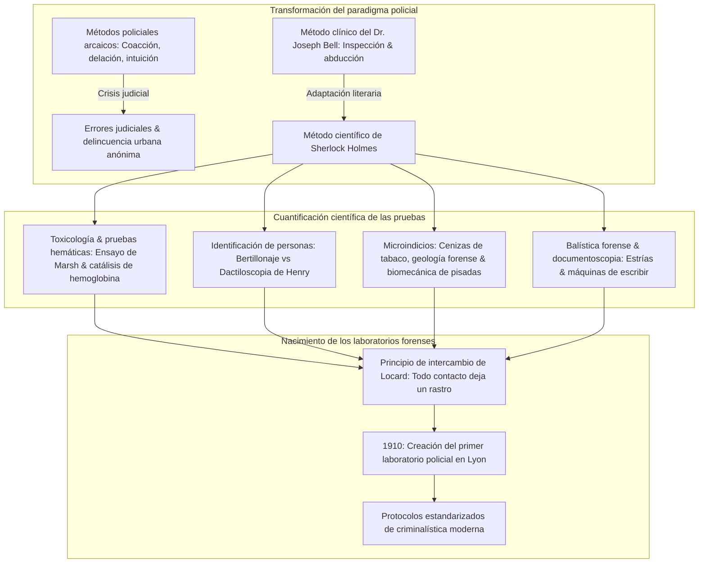
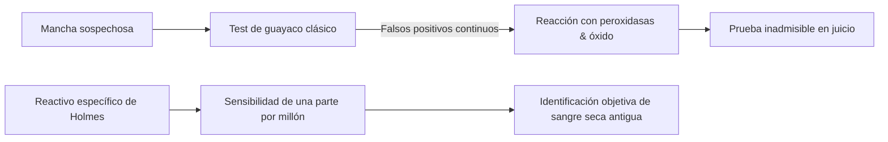
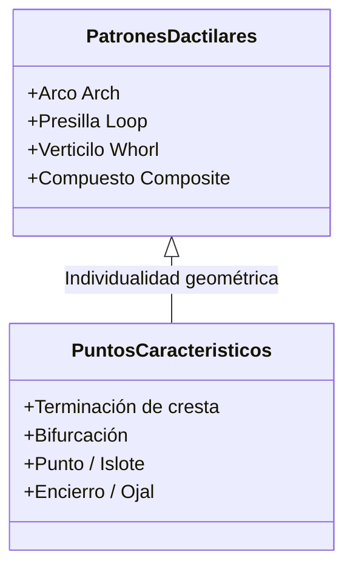
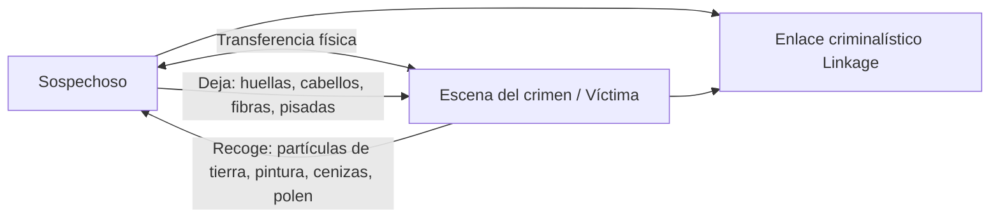

En el Londres victoriano de finales del siglo XIX, cubierto de densas nieblas de carbón y alumbrado por la vacilante luz de gas, un hombre se inclinaba sobre el tubo de latón de un microscopio en el 221B de Baker Street. Con una lupa en mano, examinaba sobre la alfombra cenizas de tabaco, barro urbano y fibras textiles: era **Sherlock Holmes**, creado en 1887 por el médico **Arthur Conan Doyle**.

Hoy en día, la preservación de la escena del crimen, la recolección de indicios biológicos, la dactiloscopia, las pruebas con luminol, la balística comparativa y el examen pericial de documentos son protocolos universales. Sin embargo, en la época en que nació Holmes, la policía de Scotland Yard y de toda Europa dependía de delatores, confesiones bajo coacción e intuición subjetiva, destruyendo con frecuencia las pruebas físicas en el propio lugar de los hechos.

Conan Doyle adaptó el método de diagnóstico clínico de su maestro en la Universidad de Edimburgo, el **Dr. Joseph Bell**. Científicos de la talla de **Edmond Locard**, padre de la criminalística moderna y autor del célebre principio (*«Todo contacto deja un rastro»*), afirmaron abiertamente que sus laboratorios policiales se inspiraron directamente en las aventuras de Sherlock Holmes.

---

## 1. La revolución diagnóstica: El Dr. Joseph Bell y la deducción clínica

### 1.1 De la medicina clínica a la investigación penal

Arthur Conan Doyle estudió en la Facultad de Medicina de la Universidad de Edimburgo. Su profesor, el cirujano **Dr. Joseph Bell (1837–1911)**, asombraba a los alumnos al deducir el oficio, procedencia y enfermedad de los pacientes con solo observar su porte, manchas de ropa, callosidades y lesiones cutáneas antes de que hablaran. Doyle escribió más tarde a Bell: *«A usted le debo Sherlock Holmes... intenté construir un personaje que llevara al límite la observación y la deducción que aprendí de usted.»*

### 1.2 Lógica abductiva y probabilidad bayesiana

En filosofía de la ciencia, el método de Holmes se clasifica como **abducción** (inferencia a la mejor explicación, teorizada por Charles S. Peirce). Frente a la evidencia física observada ($E$), la probabilidad a posteriori de la hipótesis criminal ($H$) responde al teorema de Bayes:

$$P(H|E) = \frac{P(E|H) \cdot P(H)}{\sum_{i} P(E|H_i) \cdot P(H_i)}$$

El célebre aforismo de Holmes resume este principio:
> **«Cuando se ha eliminado lo imposible, lo que queda, por improbable que parezca, debe ser la verdad.»**

Al falsear y descartar hipótesis incompatibles ($P(E|H_k) \to 0$), el espacio de incertidumbre se reduce hasta que la hipótesis verdadera converge hacia 1.

---

## 2. Toxicología forense y reactivos hemáticos bioquímicos

### 2.1 El reactivo de hemoglobina en *Estudio en escarlata* (1887)

En el laboratorio de química de St. Bartholomew, Holmes anuncia un reactivo que precipita exclusivamente ante la hemoglobina. Critica con agudeza el **test de guayaco**, que arrojaba frecuentes falsos positivos ante peroxidasas vegetales y óxido de hierro:

La ficción predijo hitos científicos reales:
1. **Ensayo de Teichmann (1853)**: cristales de hemina;
2. **Ensayo de Takayama (1912)**: cristales de hemocromógeno de piridina;
3. **Ensayo de precipitinas de Uhlenhuth (1901)**: diferenciación de sangre humana y animal;
4. **Ensayo de Kastle-Meyer (1904)**: oxidación de la fenolftaleína;
5. **Reacción con luminol (1937)**: quimioluminiscencia por catálisis de hierro hémico.

### 2.2 Toxicología victoriana y el ensayo de Marsh

El trióxido de arsénico ($\text{As}_2\text{O}_3$) fue el veneno predilecto del siglo XIX. El **ensayo de Marsh (1836)** revolucionó la química forense al reducir el arsénico a gas arsina ($\text{AsH}_3$):

$$\text{As}_2\text{O}_3 + 6\,\text{Zn} + 6\,\text{H}_2\text{SO}_4 \longrightarrow 2\,\text{AsH}_3\uparrow + 6\,\text{ZnSO}_4 + 3\,\text{H}_2\text{O}$$

Al calentar el gas en un tubo de vidrio, precipita el característico **espejo de arsénico** metálico:

$$2\,\text{AsH}_3 \xrightarrow{\quad\Delta\quad} 2\,\text{As}\downarrow (\text{Espejo de arsénico}) + 3\,\text{H}_2\uparrow$$

---

## 3. Identificación personal: Bertillonaje frente a Dactiloscopia

### 3.1 Alphonse Bertillon y la antropometría

En 1879, Alphonse Bertillon ideó en París el **bertillonaje**, midiendo 11 dimensiones esqueléticas (longitud craneal, pie izquierdo, dedo medio, etc.) organizadas en $3^{11} = 177.147$ casilleros.

| Sistema | Principio operativo | Defecto fatal |
| :--- | :--- | :--- |
| **Bertillonaje (1879)** | Dimensiones óseas en adultos y fotografías de filiación | Errores de medición entre agentes; imposible de cotejar con restos en el lugar del delito. Colapso en el **caso Will West (1903)**. |
| **Dactiloscopia (1892)** | Crestas papilares dérmicas | Inmutabilidad de por vida y unicidad absoluta ($P < 10^{-11}$). |

### 3.2 El sistema Henry y *El constructor de Norwood*

Sir Francis Galton demostró la unicidad de las crestas papilares en 1892, y Sir Edward Henry diseñó la clasificación decimal. 

En *El constructor de Norwood* (1903), Holmes desarticula una huella dactilar de sangre falsificada con un molde de cera por la supuesta víctima para incriminar a un inocente, alertando tempranamente contra el dogmatismo tecnológico.

---

## 4. Microindicios y el principio de intercambio de Locard

### 4.1 Edmond Locard: «Todo contacto deja un rastro»

Edmond Locard fundó en 1910 el laboratorio de Lyon y enunció el principio rector de la criminalística:

$$\text{Autor del delito} \underset{\text{Transferencia física mutua}}{\rightleftharpoons} \text{Lugar de los hechos / Víctima}$$

Locard escribió: *«Los métodos de Sherlock Holmes son el cimiento exacto sobre el que deben erigirse los laboratorios científicos policiales.»*

### 4.2 Cenizas de tabaco, geología y pisadas

- **Monografía de 140 cenizas de tabaco**: clasificación por morfología cristalina y tonalidad de combustión.
- **Geología forense**: identificación de sedimentos del Támesis y alquitrán para trazar itinerarios de sospechosos.
- **Biomecánica de la marcha**: presión $P(x,y) = F_z(t)/A(x,y)$ para analizar la velocidad de carrera y cargas transportadas.

---

## 5. Balística forense y peritaje de máquinas de escribir

### 5.1 Estrías del cañón y deformación del plomo

En *La casa deshabitada* (1903), Holmes recupera una bala de plomo deformada (*dum-dum*) e identifica las estrías de un fusil de aire silencioso, precediendo al microscopio comparativo de Calvin Goddard.

### 5.2 Entropía mecánica en *Un caso de identidad*

En 1891, Holmes demuestra que una carta anónima proviene de una máquina específica analizando el desgaste de tipos (lazo de la 'e', rotura de la 'r', alineación de la 's'). Formuló el principio de **individualización mecánica** cuatro décadas antes que el FBI.

---

## 6. Cuadro comparativo histórico

| Especialidad | Obra de Holmes (Año) | Hito científico real | Fundamento físico / químico |
| :--- | :--- | :--- | :--- |
| **Manchas de sangre** | *Estudio en escarlata* (1887) Reactivo de hemoglobina | 1901 Test de Uhlenhuth 1904 Kastle-Meyer 1937 Luminol | Actividad peroxidásica del grupo hemo |
| **Dactiloscopia** | *El signo de los cuatro* (1890) *El constructor de Norwood* (1903) | 1892 Galton (*Finger Prints*) 1901 Fingerprint Branch | Inmutabilidad de crestas papilares dérmicas |
| **Microindicios** | *Estudio en escarlata* (1887) 140 cenizas y suelos urbanos | 1910 Laboratorio de Lyon (Locard) Principio de intercambio | Morfología microscópica y transferencia bidireccional |
| **Balística forense** | *La casa deshabitada* (1903) Estrías y deformación de plomo | 1925 Microscopio comparativo de Goddard | Transferencia de microestrías del ánima del cañón |
| **Máquinas de escribir** | *Un caso de identidad* (1891) Desgaste de fuentes metálicas | 1910 Osborn (*Questioned Documents*) 1932 Sección documental del FBI | Entropía mecánica y microdefectos de uso |

---

## 7. Conclusión: El legado de Baker Street

La mayor aportación de Arthur Conan Doyle fue el rigor metodológico frente al sesgo subjetivo:

> **«Es un error capital teorizar antes de poseer datos. Uno comienza insensiblemente a retorcer los hechos para adaptarlos a las teorías, en vez de adaptar las teorías a los hechos.»**
> —— *Escándalo en Bohemia (1891)*

Esa advertencia contra el **sesgo de confirmación** sigue siendo el faro deontológico de la ciencia forense actual.
