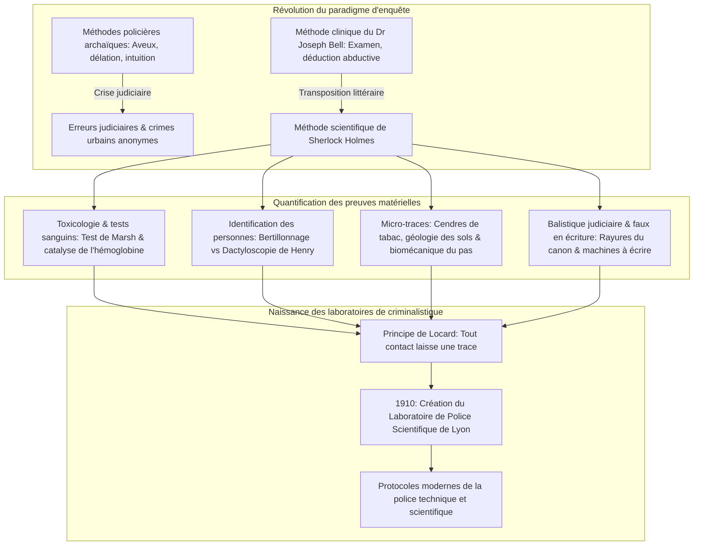
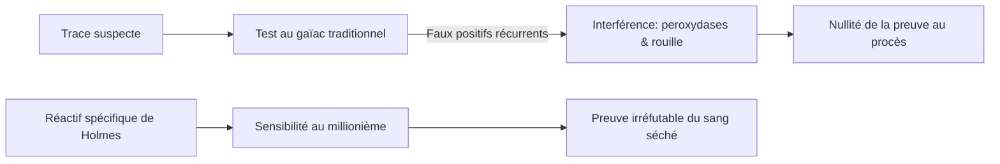
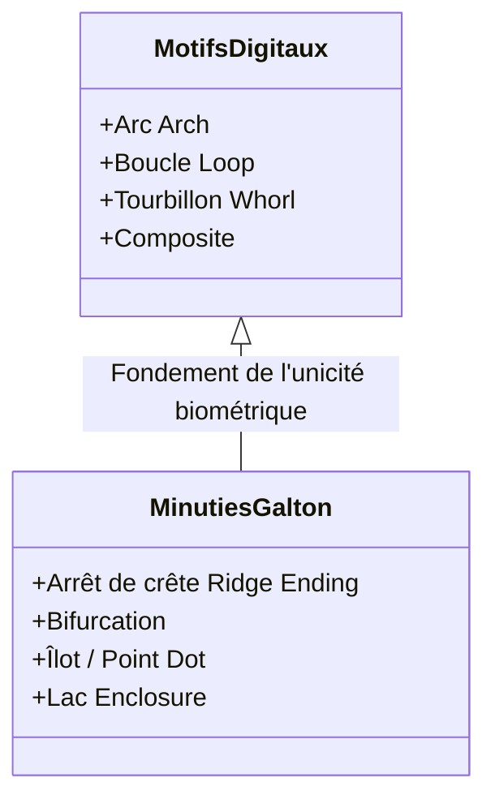
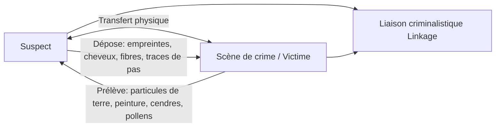

Dans le Londres victorien de la fin du XIXe siècle, enveloppé de brouillards épais et éclairé par le gaz d'éclairage, un homme penché sur son microscope au 221B Baker Street scrute les cristaux, les cendres de tabac et les boues urbaines. Ce visionnaire est **Sherlock Holmes**, conçu en 1887 par le médecin **Arthur Conan Doyle**.

Aujourd'hui, la préservation de la scène de crime, le relevé des micro-traces, la dactyloscopie, les réactions au luminol, la balistique et l'expertise documentaire constituent le quotidien des services de criminalistique. Pourtant, à l'époque de Scotland Yard et des polices européennes du XIXe siècle, l'enquête reposait sur la délation, les aveux forcés et l'intuition subjective, tandis que les enquêteurs saccageaient les scènes de crime.

Conan Doyle s'est inspiré de la méthode clinique de son professeur à Édimbourg, le **Dr Joseph Bell**. Le père de la police scientifique moderne, **Edmond Locard**, affirmera lui-même que ses travaux et la création de son laboratoire en 1910 sont directement issus des récits de Sherlock Holmes.

---

## 1. La révolution diagnostique : Le Dr Joseph Bell et la déduction clinique

### 1.1 Du lit du malade à la scène de crime

Conan Doyle a étudié à l'école de médecine d'Édimbourg. Le chirurgien **Dr Joseph Bell (1837–1911)** démontrait à ses étudiants qu'en observant la démarche, les vêtements tachés, les callosités et le teint d'un patient arrivant en consultation, il était possible de déduire son régiment, sa profession et sa maladie avant même qu'il ne parle.

Doyle écrira à Bell : *« C'est à vous que je dois Sherlock Holmes... Autour de ce noyau de déduction et d'observation, j'ai voulu construire un homme qui pousse la logique à son paroxysme. »*

### 1.2 Abduction logique et probabilités bayésiennes

Ce que Holmes qualifie de « déduction » relève formellement de l'**abduction** (inférence à la meilleure explication, théorisée par C. S. Peirce). Face aux indices matériels observés ($E$), l'enquêteur évalue la probabilité a posteriori de l'hypothèse criminelle ($H$) via le théorème de Bayes :

$$P(H|E) = \frac{P(E|H) \cdot P(H)}{\sum_{i} P(E|H_i) \cdot P(H_i)}$$

La maxime emblématique de Holmes :
> **« Lorsque vous avez éliminé l'impossible, ce qui reste, si improbable soit-il, est nécessairement la vérité. »**

L'élimination rigoureuse des hypothèses incompatibles ($P(E|H_k) \to 0$) réduit l'espace des possibles, conduisant la probabilité de l'hypothèse exacte vers 1.

---

## 2. Toxicologie médicolégale et réactions sanguines

### 2.1 Le réactif à l'hémoglobine dans *Une étude en rouge* (1887)

Dans le laboratoire de Saint-Bartholomew, Holmes découvre un réactif spécifique précipitant l'hémoglobine, dénonçant les faux positifs du **test au gaïac**, perturbé par les peroxydases végétales et la rouille.

Cette fiction annonçait les progrès réels :
1. **Test de Teichmann (1853)** : cristaux d'hémine ;
2. **Test d'Uhlenhuth (1901)** : réaction des précipitines distinguant le sang humain du sang animal ;
3. **Test de Kastle-Meyer (1904)** : oxydation de la phénolphtaline ;
4. **Réaction au luminol (1937)** : chimiluminescence catalysée par le fer héminique.

### 2.2 La toxicologie victorienne et l'appareil de Marsh

L'arsenic ($\text{As}_2\text{O}_3$) était le poison par excellence au XIXe siècle. Le **test de Marsh (1836)** a permis de le doser avec précision en le réduisant en arsine gazeuse ($\text{AsH}_3$) :

$$\text{As}_2\text{O}_3 + 6\,\text{Zn} + 6\,\text{H}_2\text{SO}_4 \longrightarrow 2\,\text{AsH}_3\uparrow + 6\,\text{ZnSO}_4 + 3\,\text{H}_2\text{O}$$

Décomposée par la chaleur, l'arsine dépose un « miroir d'arsenic » métallique caractéristique :

$$2\,\text{AsH}_3 \xrightarrow{\quad\Delta\quad} 2\,\text{As}\downarrow (\text{Miroir d'arsenic}) + 3\,\text{H}_2\uparrow$$

---

## 3. La révolution de l'identification : Bertillonnage vs Dactyloscopie

### 3.1 Alphonse Bertillon et l'anthropométrie judiciaire

En 1879, Alphonse Bertillon institue à Paris le **bertillonnage** fondé sur 11 mesures osseuses (taille, envergure, longueur de la tête, du médius gauche, etc.) classées dans $3^{11} = 177\,147$ tiroirs.

| Méthode | Principe | Faiblesse rédhibitoire |
| :--- | :--- | :--- |
| **Bertillonnage (1879)** | Mensurations squelettiques & photographies d'identité judiciaires (face/profil) | Erreurs de mesure des agents ; aucune correspondance possible avec les traces laissées sur un lieu de crime. Faillite lors de l'**affaire Will West (1903)**. |
| **Dactyloscopie (1892)** | Crêtes papillaires digitales | Immutabilité à vie et unicité absolue ($P < 10^{-11}$). |

### 3.2 Galton, Henry et l'affaire du *Bâtisseur de Norwood*

Francis Galton prouve mathématiquement l'unicité des empreintes digitales en 1892. Edward Henry crée le système de classement décadactylaire.

Dans *Le Bâtisseur de Norwood* (1903), Holmes démontre qu'une empreinte digitale sanglante a été apposée sur un mur à l'aide d'un moule en cire par la victime elle-même pour piéger un innocent : une leçon magistrale contre l'aveuglement technologique.

---

## 4. Les micro-traces et le principe d'échange de Locard

### 4.1 Edmond Locard : « Tout contact laisse une trace »

En 1910, Edmond Locard fonde le premier laboratoire de police technique à Lyon et formalise son célèbre principe :

$$\text{Auteur} \underset{\text{Transfert matériel bidirectionnel}}{\rightleftharpoons} \text{Scène de crime / Victime}$$

Locard a expressément écrit : *« Les méthodes de Sherlock Holmes constituent la base même sur laquelle les laboratoires de criminalistique modernes doivent s'édifier. »*

### 4.2 Cendres de tabac, géologie et biomécanique

- **Monographie sur 140 cendres de tabac** : détermination de la marque et du statut social du fumeur d'après la texture cristalline.
- **Géologie forensique** : localisation des déplacements d'après les boues et poussières industrielles de Londres.
- **Biomécanique de la marche** : formule de pression $P(x,y) = F_z(t)/A(x,y)$ pour analyser la cadence de course et la charge transportée.

---

## 5. Balistique judiciaire et expertise de machines à écrire

### 5.1 Stries de rayures et déformation du plomb

Dans *La Maison vide* (1903), Holmes extrait un projectile de plomb déformé et identifie, par son calibre et ses rayures, un fusil à vent silencieux, devançant le microscope comparateur de Calvin Goddard.

### 5.2 L'entropie mécanique dans *Une affaire d'identité*

En 1891, Holmes prouve l'identité d'un dactylographe par l'usure asymétrique des caractères en métal (boucle du 'e', empattement du 'r', alignement du 's'), établissant l'individualisation des machines quarante ans avant le FBI.

---

## 6. Tableau comparatif historique

| Discipline | Œuvre de Holmes (Date) | Étape scientifique réelle | Principe physique / biologique |
| :--- | :--- | :--- | :--- |
| **Traces de sang** | *Une étude en rouge* (1887) Réactif à l'hémoglobine | 1901 Test d'Uhlenhuth 1904 Kastle-Meyer 1937 Luminol | Activité peroxydasique du fer héminique |
| **Dactyloscopie** | *Le Signe des quatre* (1890) *Le Bâtisseur de Norwood* (1903) | 1892 Galton (*Finger Prints*) 1901 Service dactyloscopique | Pérennité et variabilité infinie des crêtes |
| **Micro-traces** | *Une étude en rouge* (1887) 140 cendres & géologie | 1910 Laboratoire de Lyon (Locard) Principe d'échange | Morphologie microscopique & transfert mutuel |
| **Balistique** | *La Maison vide* (1903) Stries et déformation du plomb | 1925 Microscope comparateur de Goddard | Transfert des micro-aspérités du canon |
| **Machines à écrire** | *Une affaire d'identité* (1891) Usure mécanique des fontes | 1910 Osborn (*Questioned Documents*) 1932 Laboratoire du FBI | Entropie mécanique & micro-défaillances |

---

## 7. Conclusion : L'héritage épistémologique de Baker Street

La contribution suprême d'Arthur Conan Doyle réside dans la primauté accordée aux faits matériels sur l'intuition subjective :

> **« C'est une erreur capitale de bâtir une théorie avant d'avoir des données. Inconsciemment, on se met à déformer les faits pour les adapter à la théorie, au lieu d'adapter les théories aux faits. »**
> —— *Un scandale en Bohême (1891)*

Cette mise en garde contre le **biais de confirmation** demeure le socle éthique de toute police scientifique contemporaine.
