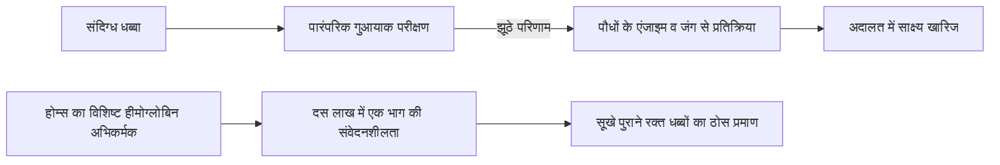
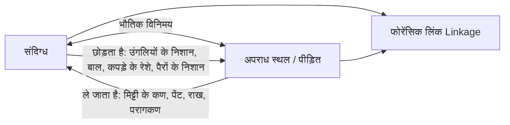

19वीं सदी के उत्तरार्ध के विक्टोरियन लंदन में, जहां घना कोयले का धुआं छाया रहता था और गैस की बत्तियां टिमटिमाती थीं, 221B बेकर स्ट्रीट के एक कमरे में एक व्यक्ति पीतल के माइक्रोस्कोप पर झुका हुआ था। हाथ में आवर्धक लेंस (magnifying glass) लिए वह कालीन पर रेंगते हुए तंबाकू की राख, मिट्टी के कणों और कपड़ों के रेशों का अध्ययन कर रहा था। वह थे **शर्लक होम्स (Sherlock Holmes)**, जिनकी रचना 1887 में चिकित्सक और लेखक **आर्थर कॉनन डॉयल** ने की थी।

आज दुनिया भर की पुलिस और फोरेंसिक प्रयोगशालाएं अपराध स्थल को सील करने, सूक्ष्म साक्ष्य एकत्र करने, उंगलियों के निशान (फिंगरप्रिंट) का मिलान करने, ल्यूमिनोल से खून के छिपे धब्बे खोजने, बैलिस्टिक बुलेट तुलना और टाइपराइटर पहचान जैसे वैज्ञानिक प्रोटोकॉल पर निर्भर करती हैं। लेकिन 1887 में जब होम्स का आगमन हुआ, तब स्कॉटलैंड यार्ड और यूरोपीय पुलिस मुखबिरों की सूचनाओं, जबरन इकबालिया बयानों और व्यक्तिपरक पूर्वाग्रहों पर काम करती थी, जिससे अक्सर घटना स्थल के महत्वपूर्ण भौतिक सबूत नष्ट हो जाते थे।

कॉनन डॉयल ने एडिनबर्ग विश्वविद्यालय के अपने चिकित्सा गुरु **डॉ. जोसेफ बेल (Dr. Joseph Bell)** की अवलोकन और नैदानिक ​​निगमन पद्धति को साहित्य में ढालकर भौतिक साक्ष्यों पर आधारित आधुनिक अपराध विज्ञान की नींव रखी। आधुनिक फोरेंसिक विज्ञान के जनक **एडमंड लोकार्ड (Edmond Locard)**, जिन्होंने फोरेंसिक का मूल सिद्धांत दिया (*"प्रत्येक संपर्क एक निशान छोड़ता है"*), ने खुले तौर पर स्वीकार किया कि विश्व की पहली पुलिस वैज्ञानिक प्रयोगशाला की स्थापना शर्लक होम्स की कहानियों से प्रेरित थी।

```mermaid
flowchart TD
    subgraph 19वीं सदी की जांच पद्धति में ऐतिहासिक बदलाव
        A[पुरातन पुलिस विधियां: जबरन स्वीकारोक्ति, मुखबिर, पूर्वाग्रह] -->|न्यायिक संकट| B[निर्दोषों को सजा व शहरी अपराधों की गुमनामी]
        C[डॉ. जोसेफ बेल की नैदानिक पद्धति: सूक्ष्म अवलोकन व तार्किक निगमन] -->|डॉयल का साहित्यिक रूपांतरण| D[शर्लक होम्स की वैज्ञानिक अपराध जांच पद्धति]
    end

    subgraph भौतिक व रासायनिक साक्ष्यों का विश्लेषण
        D --> E[फोरेंसिक विष विज्ञान व रक्त परीक्षण: मार्श आर्सेनिक टेस्ट व हीमोग्लोबिन उत्प्रेरण]
        D --> F[व्यक्तिगत पहचान: बर्टिलोनेज शारीरिक माप बनाम हेनरी फिंगरप्रिंट]
        D --> G[सूक्ष्म साक्ष्य विश्लेषण: 140 सिगार राख, भू-विज्ञान व चाल बायोमैकेनिक्स]
        D --> H[बैलिस्टिक्स व दस्तावेज जांच: बंदूक की नाल के खांचे व टाइपराइटर विकृति]
    end

    subgraph आधुनिक फोरेंसिक विज्ञान की स्थापना
        E & F & G & H --> I[लोकार्ड का विनिमय सिद्धांत: हर संपर्क एक निशान छोड़ता है]
        I --> J[1910: ल्योन में पहली पुलिस फोरेंसिक प्रयोगशाला की स्थापना]
        J --> K[आधुनिक CSI और फोरेंसिक विज्ञान के अंतरराष्ट्रीय मानक]
    end
```

---

## 1. वैज्ञानिक जांच का सवेरा: डॉ. जोसेफ बेल और नैदानिक ​​निगमन

### 1.1 चिकित्सा वार्ड से अपराध स्थल तक

कॉनन डॉयल ने एडिनबर्ग विश्वविद्यालय में चिकित्सा की पढ़ाई की, जो उस समय जोसेफ लिस्टर की एंटीसेप्टिक सर्जरी के कारण चिकित्सा विज्ञान का शीर्ष केंद्र था। डॉयल के शिक्षक **डॉ. जोसेफ बेल (1837–1911)** मरीजों के कमरे में प्रवेश करते ही उनकी चाल, कपड़ों के दाग, हथेलियों के घट्टे और त्वचा के रंग को देखकर बिना उनसे बात किए उनका पेशा, सैन्य पृष्ठभूमि और बीमारी बता देते थे। डॉयल ने बाद में बेल को लिखा: *"शर्लक होम्स के लिए मैं पूरी तरह आपका आभारी हूं... आपके द्वारा सिखाए गए अवलोकन और निगमन के आधार पर ही मैंने इस पात्र का निर्माण किया।"*

### 1.2 तार्किक अपहरण (Abduction) और बायेसियन प्रायिकता

विज्ञान के दर्शन में होम्स की पद्धति को चार्ल्स सैंडर्स पियर्स द्वारा परिभाषित **एब्डक्शन (Abduction: सर्वोत्तम व्याख्या का निष्कर्ष)** कहा जाता है। अपराध स्थल पर परिणाम (सबूत $E$) पहले से मौजूद होता है, और जांचकर्ता को कारण (परिकल्पना $H$) को पीछे जाकर खोजना होता है। बायेस प्रमेय के अनुसार:

$$P(H|E) = \frac{P(E|H) \cdot P(H)}{\sum_{i} P(E|H_i) \cdot P(H_i)}$$

होम्स का प्रसिद्ध सूत्र इस गणितीय सिद्धांत को दर्शाता है:
> **"जब आप असंभव को समाप्त कर देते हैं, तो जो कुछ भी बचता है, चाहे वह कितना भी अविश्वसनीय क्यों न लगे, वही सत्य होना चाहिए।"**

असंगत परिकल्पनाओं को खारिज करके ($P(E|H_k) \to 0$), अनिश्चितता समाप्त हो जाती है और सही परिकल्पना की प्रायिकता 1 की ओर अभिसरित हो जाती है।

---

## 2. फोरेंसिक विष विज्ञान और जैव रासायनिक रक्त परीक्षण

### 2.1 *ए स्टडी इन स्कारलेट* (1887) में होम्स का हीमोग्लोबिन अभिकर्मक

सेंट बार्थोलोम्यू अस्पताल की प्रयोगशाला में होम्स चिल्लाते हुए कहता है कि उसने एक ऐसा अभिकर्मक खोजा है जो केवल हीमोग्लोबिन के साथ अवक्षेपित होता है। उसने तत्कालीन **गुआयाक परीक्षण (Guaiacum test)** की आलोचना की, जो पौधों के एंजाइम और लोहे के जंग के कारण झूठी सकारात्मक (False Positive) प्रतिक्रिया देता था:



होम्स ने वास्तविक वैज्ञानिक उपलब्धियों की पहले ही भविष्यवाणी कर दी थी:
1. **टाइकमैन टेस्ट (1853)**: हेमिन क्रिस्टल;
2. **ताकायामा टेस्ट (1912)**: पाइरीडीन हीमोक्रोमोजेन क्रिस्टल;
3. **उहलेनहुथ टेस्ट (1901)**: मानव और पशु रक्त में अंतर करने वाली एंटीजन-एंटीबॉडी प्रतिक्रिया;
4. **कास्टल-मेयर टेस्ट (1904)**: फेनोल्फथैलिन का गुलाबी रंग परीक्षण;
5. **ल्यूमिनोल परीक्षण (1937)**: रक्त के लोहे द्वारा उत्प्रेरित नीली रासायनिक चमक।

### 2.2 विक्टोरियन विष विज्ञान और मार्श आर्सेनिक टेस्ट

19वीं सदी में आर्सेनिक ट्राइऑक्साइड ($\text{As}_2\text{O}_3$) जहर देने वालों का पसंदीदा हथियार था। **मार्श टेस्ट (1836)** ने इसे आर्सीन गैस ($\text{AsH}_3$) में बदलकर जहर की जांच में क्रांति ला दी:

$$\text{As}_2\text{O}_3 + 6\,\text{Zn} + 6\,\text{H}_2\text{SO}_4 \longrightarrow 2\,\text{AsH}_3\uparrow + 6\,\text{ZnSO}_4 + 3\,\text{H}_2\text{O}$$

कांच की नली में गर्म करने पर धातु की चमकदार **आर्सेनिक दर्पण (Arsenic Mirror)** परत जम जाती है:

$$2\,\text{AsH}_3 \xrightarrow{\quad\Delta\quad} 2\,\text{As}\downarrow (\text{धात्विक आर्सेनिक दर्पण}) + 3\,\text{H}_2\uparrow$$

---

## 3. व्यक्तिगत पहचान में क्रांति: बर्टिलोनेज बनाम फिंगरप्रिंट

### 3.1 अल्फोंस बर्टिलोन और एंथ्रोपोमेट्री

1879 में पेरिस पुलिस के अल्फोंस बर्टिलोन ने हड्डियों के आकार के स्थायित्व पर आधारित **बर्टिलोनेज** प्रणाली बनाई, जिसमें शरीर के 11 माप लेकर $3^{11} = 177,147$ श्रेणियों में अपराधियों का रिकॉर्ड रखा जाता था।

| प्रणाली | कार्यप्रणाली | घातक कमी |
| :--- | :--- | :--- |
| **बर्टिलोनेज (1879)** | 11 कंकाल माप व मानकीकृत मगशॉट फोटो | अधिकारियों द्वारा मापने में अंतर से रिकॉर्ड खो जाते थे; अपराध स्थल के निशानों से मिलान असंभव। **विल वेस्ट मामले (1903)** में विफल। |
| **फिंगरप्रिंट (1892)** | उंगलियों की त्वचा की रेखाएं | जीवन भर अपरिवर्तनीय व पूर्णतः अद्वितीय ($P < 10^{-11}$)। |

### 3.2 हेनरी प्रणाली और *द नॉरवुड बिल्डर* में जाली फिंगरप्रिंट

सर फ्रांसिस गाल्टन ने फिंगरप्रिंट की गणितीय विशिष्टता सिद्ध की, और सर एडवर्ड हेनरी ने लूप, व्हर्ल और आर्च का वर्गीकरण किया।

*द एडवेंचर ऑफ द नॉरवुड बिल्डर* (1903) में होम्स ने दीवार पर लगे खून के फिंगरप्रिंट को मोम के सांचे से बनाया गया जाली निशान साबित किया, जिससे उन्होंने स्पष्ट चेतावनी दी कि बिना संदर्भ के तकनीकी साक्ष्यों पर अंधविश्वास नहीं करना चाहिए।

```mermaid
classDiagram
    class फिंगरप्रिंटपैटर्न {
        +आर्च Arch
        +लूप Loop
        +व्हर्ल Whorl
        +संयुक्त Composite
    }
    class गाल्टनमिन्यूशिया {
        +रेखा का अंत Ridge Ending
        +द्विशाखन Bifurcation
        +बिंदु Dot
        +घेरा Enclosure
    }
    फिंगरप्रिंटपैटर्न <|-- गाल्टनमिन्यूशिया : अद्वितीय ज्यामितीय संरचना
```

---

## 4. सूक्ष्म साक्ष्य और लोकार्ड का विनिमय सिद्धांत

### 4.1 एडमंड लोकार्ड: "प्रत्येक संपर्क एक निशान छोड़ता है"

1910 में फ्रांस के ल्योन में पहली पुलिस वैज्ञानिक प्रयोगशाला स्थापित करने वाले एडमंड लोकार्ड ने फोरेंसिक का सर्वोच्च नियम प्रतिपादित किया:

$$\text{अपराधी} \underset{\text{दोतरफा भौतिक विनिमय}}{\rightleftharpoons} \text{अपराध स्थल / पीड़ित}$$

लोकार्ड ने लिखा: *"शर्लक होम्स की पद्धतियां ही वह सटीक आधार हैं जिस पर आधुनिक वैज्ञानिक पुलिस प्रयोगशालाओं का निर्माण होना चाहिए।"*



### 4.2 तंबाकू की राख, भू-विज्ञान और चाल बायोमैकेनिक्स

- **140 प्रकार की तंबाकू राख**: क्रिस्टल संरचना और रंग के आधार पर धूम्रपान करने वाले की सामाजिक स्थिति और सिगार का ब्रांड पहचानना।
- **फोरेंसिक भू-विज्ञान**: लंदन की विभिन्न मिट्टी और कोयले की कालिख के आधार पर संदिग्ध के आने-जाने के मार्ग का नक्शा बनाना।
- **कदमों के निशान का बायोमैकेनिक्स**: दबाव सूत्र $P(x,y) = F_z(t)/A(x,y)$ से भागने की गति और वजन का सटीक आकलन।

---

## 5. फोरेंसिक बैलिस्टिक्स और टाइपराइटर दस्तावेज परीक्षण

### 5.1 बंदूक की नाल के खांचे और बुलेट विकृति

*द एम्प्टी हाउस* (1903) में होम्स ने दीवार से एक विकृत सीसे की गोली निकाली और उसके खांचों व वजन से एक विशेष गुप्त एयरगन की पहचान की, जो केल्विन गोडार्ड के तुलनात्मक माइक्रोस्कोप से दशकों पहले की उपलब्धि थी।

### 5.2 *ए केस ऑफ आइडेंटिटी* में टाइपराइटर की पहचान

1891 में होम्स ने अक्षरों के घिसाव ('e' का घेरा, 'r' की टूटी पूंछ, 's' का झुकाव) के आधार पर सिद्ध किया कि प्रेम पत्र एक विशिष्ट टाइपराइटर से लिखे गए थे। उन्होंने एफबीआई द्वारा दस्तावेज विभाग स्थापित करने से 40 वर्ष पूर्व मशीनी साक्ष्यों के **व्यक्तिगतकरण (Individualization)** का सिद्धांत स्थापित किया।

---

## 6. ऐतिहासिक तुलनात्मक मैट्रिक्स

| फोरेंसिक शाखा | होम्स की रचना (वर्ष) | वास्तविक ऐतिहासिक मील का पत्थर | वैज्ञानिक सिद्धांत |
| :--- | :--- | :--- | :--- |
| **रक्त परीक्षण** | *ए स्टडी इन स्कारलेट* (1887)<br>हीमोग्लोबिन विशिष्ट अभिकर्मक | 1901 उहलेनहुथ परीक्षण<br>1904 कास्टल-मेयर<br>1937 ल्यूमिनोल | हीम आयरन की उत्प्रेरक गतिविधि व एंटीबॉडी प्रतिक्रिया |
| **फिंगरप्रिंट** | *द साइन ऑफ फोर* (1890)<br>*द नॉरवुड बिल्डर* (1903) | 1892 गाल्टन की पुस्तक<br>1901 स्कॉटलैंड यार्ड फिंगरप्रिंट ब्यूरो | त्वचा की रेखाओं का जीवनपर्यंत अपरिवर्तन व विशिष्टता |
| **सूक्ष्म साक्ष्य** | *ए स्टडी इन स्कारलेट* (1887)<br>140 राख व मिट्टी विश्लेषण | 1910 ल्योन प्रयोगशाला (लोकार्ड)<br>विनिमय सिद्धांत | सूक्ष्म आकारिकी और दोनों तरफ कणों का हस्तांतरण |
| **बैलिस्टिक्स** | *द एम्प्टी हाउस* (1903)<br>नाल के खांचे व सीसे की गोली | 1925 गोडार्ड तुलनात्मक माइक्रोस्कोप | बंदूक की नाल के सूक्ष्म निशानों का गोली पर स्थानांतरण |
| **टाइपराइटर जांच** | *ए केस ऑफ आइडेंटिटी* (1891)<br>अक्षरों की धातु का घिसाव | 1910 ओसबोर्न की पुस्तक<br>1932 एफबीआई दस्तावेज अनुभाग | यांत्रिक घिसाव व भौतिक एंट्रॉपी द्वारा विशिष्ट पहचान |

---

## 7. निष्कर्ष: बेकर स्ट्रीट पद्धति की विरासत

आर्थर कॉनन डॉयल और शर्लक होम्स की सबसे महान देन यह सिद्धांत है कि जांच में पूर्वाग्रह के स्थान पर मौन भौतिक साक्ष्यों को सर्वोच्च प्राथमिकता मिलनी चाहिए:

> **"आंकड़े मिलने से पहले सिद्धांत बनाना सबसे बड़ी भूल है। अनजाने में ही सही, व्यक्ति सिद्धांतों के अनुसार तथ्यों को मोड़ना शुरू कर देता है, बजाय इसके कि तथ्यों के अनुसार सिद्धांत बनाए जाएं।"**
> —— *ए स्कैंडल इन बोहेमिया (1891)*

**कन्फर्मेशन बायस (Confirmation Bias)** के विरुद्ध यह चेतावनी आज भी विश्व के हर फोरेंसिक वैज्ञानिक के लिए सबसे बड़ा नैतिक मार्गदर्शक है।
