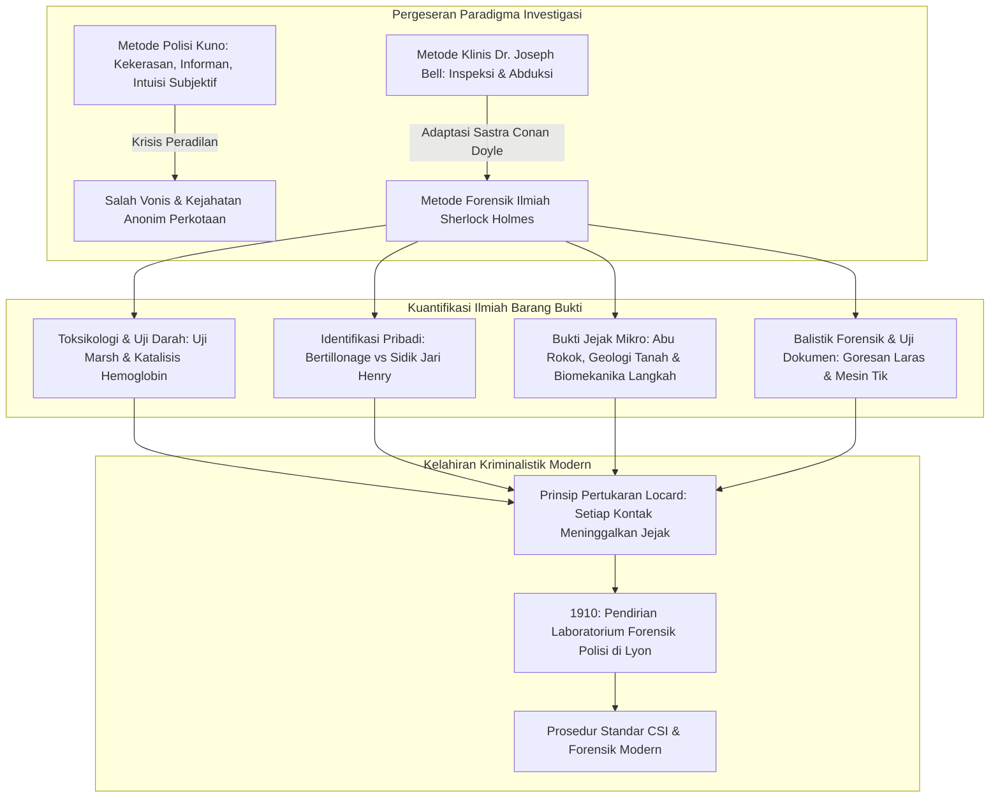
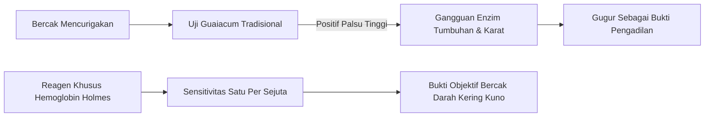
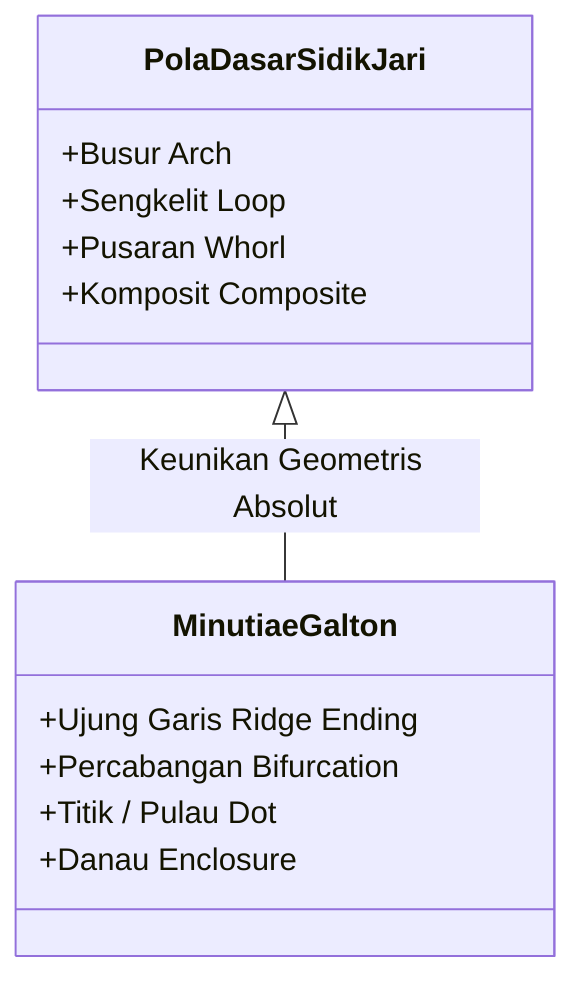
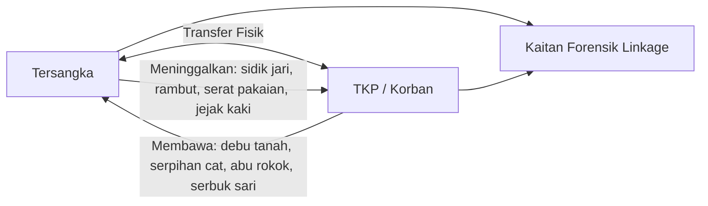

Di London era Victoria akhir abad ke-19 yang berselimutkan kabut asap batu bara tebal dan diterangi temaram lampu gas, seorang pria membungkuk di depan mikroskop kuningan di 221B Baker Street. Menggunakan kaca pembesar, ia merayap di atas karpet meneliti abu tembakau, lumpur, dan serat pakaian: dialah **Sherlock Holmes**, yang diciptakan pada tahun 1887 oleh dokter dan sastrawan **Arthur Conan Doyle**.

Saat ini, isolasi tempat kejadian perkara (TKP), pengumpulan bukti jejak mikro, analisis sidik jari, uji bercak darah luminol, balistik komparatif, dan pemeriksaan dokumen adalah prosedur baku di seluruh dunia. Namun ketika Holmes pertama kali diperkenalkan, kepolisian Scotland Yard dan Eropa masih bergantung pada informan, pengakuan lewat paksaan, dan firasat subjektif yang kerap merusak barang bukti fisik di lokasi kejadian.

Conan Doyle mengangkat metode diagnosis klinis dari gurunya di Universitas Edinburgh, **Dr. Joseph Bell**, ke dalam ranah penyelidikan kejahatan. Tokoh perintis seperti **Dr. Edmond Locard**, perumus prinsip emas forensik (*"Setiap kontak meninggalkan jejak"*), secara terbuka mengakui bahwa pendirian laboratorium kepolisian pertama di dunia terinspirasi langsung dari metode Sherlock Holmes.

---

## 1. Fajar Investigasi Ilmiah: Dr. Joseph Bell dan Deduksi Klinis

### 1.1 Dari Bangsal Medis ke TKP

Arthur Conan Doyle menempuh pendidikan kedokteran di Edinburgh pada era keemasan bedah antiseptik Joseph Lister. Dosennya, dokter bedah **Dr. Joseph Bell (1837–1911)**, memukau para mahasiswa karena mampu menebak profesi, latar belakang militer, asal wilayah, dan penyakit pasien hanya dari cara berjalan, noda pakaian, kapalan di tangan, dan tanda kulit sebelum pasien berbicara sepatah kata pun. Doyle menulis kepada Bell: *"Saya berutang Sherlock Holmes kepada Anda... di sekeliling observasi dan deduksi yang Anda ajarkan, saya membangun sosok yang mendorong logika hingga batas tertingginya."*

### 1.2 Logika Abduktif dan Probabilitas Bayesian

Dalam filsafat ilmu, penalaran Holmes merupakan **abduksi** (penarikan kesimpulan menuju penjelasan terbaik menurut Charles S. Peirce). Di TKP, yang tampak adalah akibat (bukti fisik $E$), sedangkan penyebab tersembunyi (hipotesis $H$) harus direkonstruksi secara mundur. Menurut Teorema Bayes:

$$P(H|E) = \frac{P(E|H) \cdot P(H)}{\sum_{i} P(E|H_i) \cdot P(H_i)}$$

Aforisme terkenal Holmes:
> **"Jika Anda telah menyingkirkan semua hal yang mustahil, apa pun yang tersisa, betapa pun mustahilnya kedengarannya, pastilah kebenaran."**

Dengan memfalsifikasi hipotesis yang tidak konsisten ($P(E|H_k) \to 0$), penyebut probabilitas menyusut drastis, sehingga hipotesis yang benar akan mendekati angka 1.

---

## 2. Toksikologi Forensik dan Reagen Darah Biokimia

### 2.1 Reagen Hemoglobin dalam *A Study in Scarlet* (1887)

Di laboratorium Rumah Sakit St. Bartholomew, Holmes bersorak menemukan reagen yang hanya mengendap oleh hemoglobin. Ia mengkritik **uji resin guaiacum** yang kerap memberikan hasil positif palsu akibat peroksidase tumbuhan dan karat besi:

Holmes mendahului tonggak sejarah nyata:
1. **Uji Teichmann (1853)**: kristal hemin;
2. **Uji Takayama (1912)**: kristal hemokromogen piridin;
3. **Uji Presipitin Uhlenhuth (1901)**: membedakan darah manusia dan hewan;
4. **Uji Kastle-Meyer (1904)**: oksidasi fenolftalin;
5. **Uji Luminol (1937)**: kemiluminesensi dengan katalis besi hem.

### 2.2 Toksikologi Victoria dan Uji Arsenik Marsh

Arsenik trioksida ($\text{As}_2\text{O}_3$) adalah racun paling mematikan pada abad ke-19. **Uji Marsh (1836)** mengubah toksikologi dengan mereduksinya menjadi gas arsin ($\text{AsH}_3$):

$$\text{As}_2\text{O}_3 + 6\,\text{Zn} + 6\,\text{H}_2\text{SO}_4 \longrightarrow 2\,\text{AsH}_3\uparrow + 6\,\text{ZnSO}_4 + 3\,\text{H}_2\text{O}$$

Pemanasan gas arsin menghasilkan **cermin arsenik** logam mengkilap pada dinding tabung kaca:

$$2\,\text{AsH}_3 \xrightarrow{\quad\Delta\quad} 2\,\text{As}\downarrow (\text{Cermin Arsenik}) + 3\,\text{H}_2\uparrow$$

---

## 3. Revolusi Identifikasi Manusia: Bertillonage vs Sidik Jari

### 3.1 Alphonse Bertillon dan Antropometri

Tahun 1879, Alphonse Bertillon di Paris memperkenalkan **bertillonage**, mencatat 11 ukuran tulang dewasa (panjang kepala, kaki kiri, jari tengah) dalam $3^{11} = 177.147$ laci arsip.

| Sistem | Prinsip Kerja | Kelemahan Fatal |
| :--- | :--- | :--- |
| **Bertillonage (1879)** | Pengukuran kerangka & foto identitas standar (*mugshot*) | Kesalahan ukur petugas membuat kartu tersesat; tidak bisa dicocokkan dengan jejak di TKP. Runtuh dalam **Kasus Will West (1903)**. |
| **Daktiloskopi (1892)** | Garis papiler ujung jari | Permanen seumur hidup dan unik mutlak ($P < 10^{-11}$). |

### 3.2 Sistem Henry dan Kasus *The Norwood Builder*

Sir Francis Galton membuktikan keunikan sidik jari secara matematis pada 1892, dan Sir Edward Henry merancang klasifikasi busur, sengkelit, dan pusaran.

Dalam *The Norwood Builder* (1903), Holmes membongkar sidik jari darah palsu yang dicetak menggunakan cetakan lilin oleh korban sendiri untuk memfitnah orang lain, memberikan peringatan keras terhadap pemujaan teknologi tanpa memahami konteks fisik.

---

## 4. Bukti Jejak Mikro dan Prinsip Pertukaran Locard

### 4.1 Edmond Locard: "Setiap Kontak Meninggalkan Jejak"

Tahun 1910, Edmond Locard mendirikan laboratorium di Lyon dan mencetuskan prinsip dasar forensik:

$$\text{Pelaku Kejahatan} \underset{\text{Transfer Fisik Dua Arah}}{\rightleftharpoons} \text{TKP / Korban}$$

Locard menulis: *"Metode Sherlock Holmes adalah fondasi mutlak tempat laboratorium kepolisian ilmiah modern harus didirikan."*

### 4.2 Abu Rokok, Geologi Tanah, dan Jejak Kaki

- **Monografi 140 Abu Rokok**: identifikasi merek dan kelas sosial pelaku dari struktur kristal abu.
- **Geologi Forensik**: membedakan endapan lumpur Sungai Thames dan jelaga batu bara untuk memetakan rute perjalanan buronan.
- **Biomekanika Jejak Kaki**: formula tekanan $P(x,y) = F_z(t)/A(x,y)$ untuk mengungkap kecepatan lari atau beban barang bawaan.

---

## 5. Balistik Forensik dan Uji Mesin Tik

### 5.1 Goresan Laras dan Deformasi Proyektil

Dalam *The Empty House* (1903), Holmes mengambil peluru timah lunak yang pipih (*mushrooming bullet*) dan mengidentifikasi senapan angin rahasia berdasarkan kaliber dan goresan galur laras, mendahului mikroskop komparasi Calvin Goddard.

### 5.2 Entropi Mekanis Mesin Tik dalam *A Case of Identity*

Tahun 1891, Holmes membuktikan surat anonim berasal dari mesin tik tertentu melalui keausan batang huruf (lengkungan 'e' yang buram, ekor 'r' yang patah, letak 's' yang miring). Ia memprakarsai pemeriksaan dokumen mekanis 40 tahun sebelum FBI.

---

## 6. Tabel Matriks Perbandingan Historis

| Cabang Forensik | Kanon Holmes (Tahun) | Tonggak Sejarah Nyata | Prinsip Ilmiah |
| :--- | :--- | :--- | :--- |
| **Bercak Darah** | *A Study in Scarlet* (1887) Reagen spesifik hemoglobin | 1901 Reaksi Uhlenhuth 1904 Kastle-Meyer 1937 Luminol | Aktivitas peroksidase besi hem & antibodi presipitin |
| **Daktiloskopi** | *The Sign of Four* (1890) *Norwood Builder* (1903) | 1892 Buku Galton 1901 Biro Sidik Jari London | Keabadian dan keunikan garis papiler kulit |
| **Jejak Mikro** | *A Study in Scarlet* (1887) 140 abu rokok & tanah | 1910 Lab Lyon (Locard) Prinsip Pertukaran | Morfologi mikroskopis & pertukaran timbal balik |
| **Balistik Forensik** | *The Empty House* (1903) Goresan laras peluru timah | 1925 Mikroskop komparasi Goddard | Transfer cacat mikro bilah laras ke proyektil |
| **Uji Mesin Tik** | *A Case of Identity* (1891) Keausan jenis huruf | 1910 Buku Osborn 1932 Divisi Dokumen FBI | Kelelahan mekanis & entropi fisik mesin pabrik |

---

## 7. Kesimpulan: Warisan Epistemologis Baker Street

Pelajaran paling berharga yang diwariskan Arthur Conan Doyle adalah menundukkan praduga pada fakta fisik yang hening:

> **"Adalah kesalahan besar berteori sebelum seseorang memiliki data. Secara tidak sadar, orang akan mulai memelintir fakta agar sesuai dengan teori, bukannya menyesuaikan teori dengan fakta."**
> —— *A Scandal in Bohemia (1891)*

Peringatan terhadap **bias konfirmasi** ini tetap menjadi pedoman utama penyelidikan kejahatan modern di seluruh dunia.
