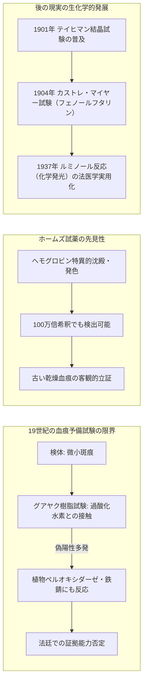
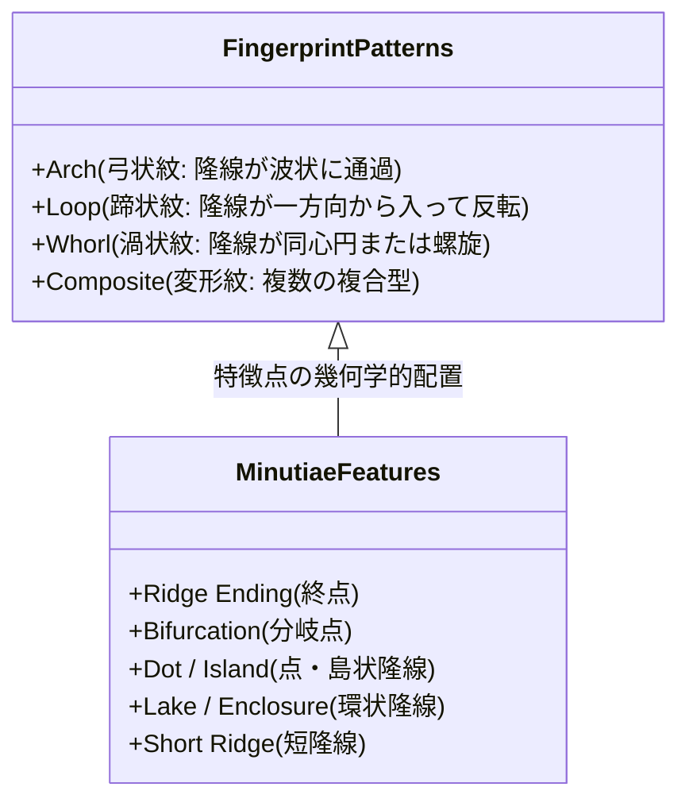
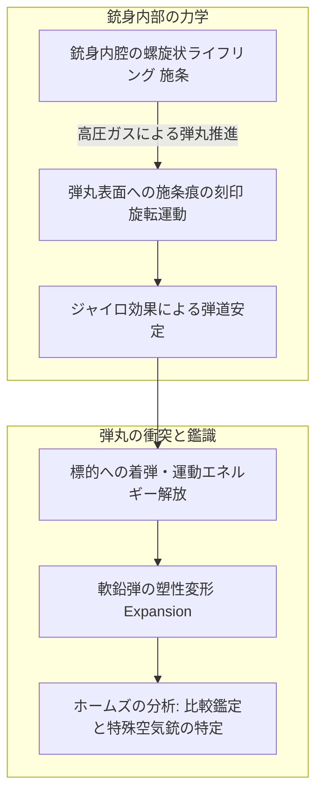
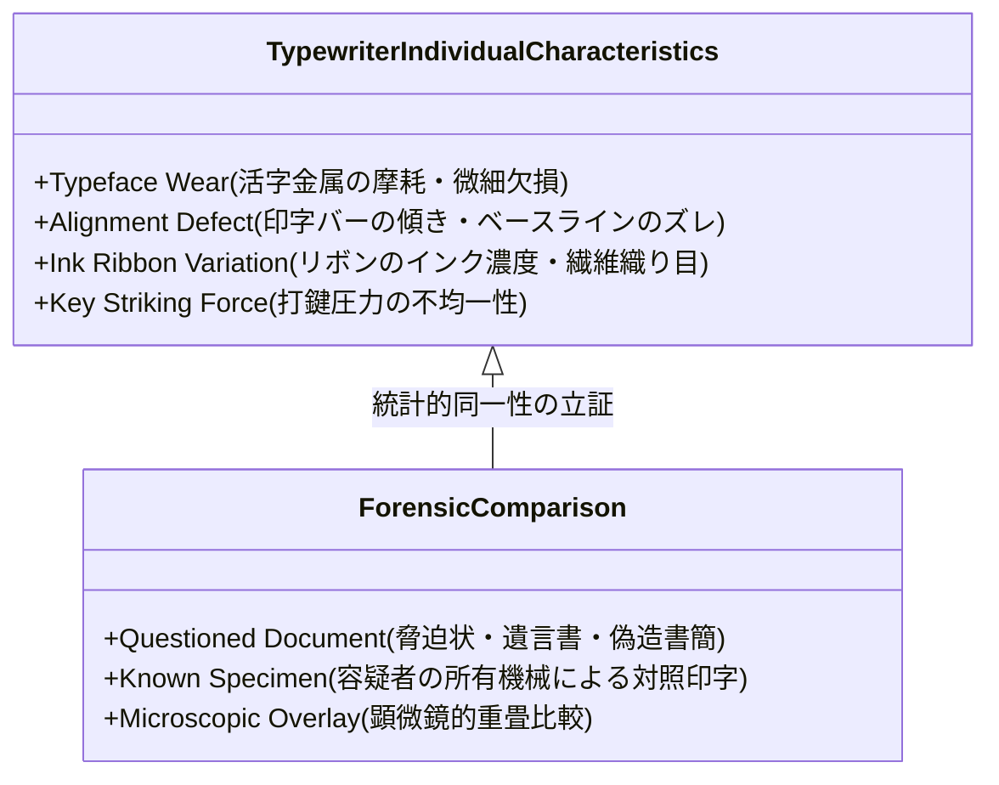

19世紀末のヴィクトリア朝ロンドン。霧深きベイカー街221Bの薄暗い一室で、一人の男が試験管の液体を陽光に透かし、顕微鏡のピントを合わせ、あるいは床に這いつくばって虫眼鏡で絨毯の繊維や絨毯に残された微細な灰を凝視していました。アーサー・コナン・ドイルが生み出した不世出の顧問探偵、**シャーロック・ホームズ（Sherlock Holmes）**です。

今日、世界中の警察や鑑識機関が当たり前のように駆使している「現場保存」「微細証拠物の採取」「指紋採取」「血痕予備試験」「弾道学分析」「筆跡・タイピング鑑定」といった**科学捜査（Forensic Science / Criminalistics）**の体系は、ホームズが登場した1887年当時、公的捜査機関においては未だ萌芽期にあるか、あるいは完全に軽視されていました。当時のスコットランドヤード（ロンドン警視庁）やヨーロッパ各国の警察組織における捜査手法の根幹は、依然として「情報屋からの密告」「容疑者への過酷な尋問・自白の強要」「前科者に対する直感的なプロファイリング」に大きく依存していたのです。

コナン・ドイルは、自身がエディンバラ大学医学部で師事した伝説的臨床外科医**ジョセフ・ベル博士（Dr. Joseph Bell）**の驚異的な観察・推論メソッドを小説の骨格へと昇華させ、客観的・物理的証拠に基づく演繹的犯罪捜査のパラダイムを世界に提示しました。後に「現代法科学の父」と称されるエドモン・ロカール（Edmond Locard）をはじめとする現実の科学者・法医学者たちは、ホームズの物語から直接のインスピレーションを受け、近代鑑識研究所の礎を築き上げました。

本稿では、ヴィクトリア朝における法医学・化学・物理学の発展を背景に、ホームズ作品に登場する具体的捜査技術の科学的妥当性、ベルティヨン式人体測定学から指紋鑑定への歴史的転換、微細証拠物分析と「ロカールの交換原理」、毒物学・弾道学の生化学的・力学的基礎、そして現代の科学捜査へと直結する知的思考法を徹底的に解剖します。

```mermaid
flowchart TD
    subgraph 19世紀末の捜査パラダイム転換
        A[旧来の警察捜査: 密告・自白強要・主観的直感] -->|危機と限界| B[冤罪の頻発・都市犯罪の匿名化]
        C[ジョセフ・ベル博士の医学的診断法: 視診・触診・問診・演繹] -->|ドイルによる翻案| D[シャーロック・ホームズの科学的探偵法]
    end

    subgraph 物理的・化学的証拠の体系化
        D --> E[法医毒物学 & 血痕試験: 化学試薬・分光分析]
        D --> F[個人識別技術: 人体測定法 vs 指紋認証]
        D --> G[微細証拠物（トレース）: 灰・土壌・繊維・歩行痕跡]
        D --> H[法医弾道学 & 文書鑑定: 施条痕・タイプライター個性]
    end

    subgraph 近代科学捜査研究所の誕生
        E & F & G & H --> I[エドモン・ロカール: すべての接触は痕跡を残す]
        I --> J[1910年 リヨン警察科学捜査研究所の創設]
        J --> K[現代のCSI・FBI・鑑識科学の標準プロトコル]
    end
```

---

## 1. 科学的捜査の夜明け：ジョセフ・ベル博士と「観察と演繹の医学」

### 1.1 臨床医学から犯罪捜査へのパラダイム転換

シャーロック・ホームズの驚異的な洞察力の起源を理解するためには、作者アーサー・コナン・ドイル（Arthur Conan Doyle, 1859–1930）が青年期を過ごしたスコットランドのエディンバラ大学医学部へ遡らなければなりません。1870年代後半のエディンバラは、ジョセフ・リスターによる無菌手術法の確立など、実験医学と科学的外科手術の世界的中心地でした。

ドイルに最も決定的な影響を与えたのが、王立エディンバラ病院の外科医であり同大学教授であった**ジョセフ・ベル博士（Dr. Joseph Bell, 1837–1911）**でした。ベル博士は講義の際、外来患者が診察室のドアを開けて歩いてくる数秒間の挙動、衣服の汚れ、歩き方の偏り、手のタコ、靴の泥、肌の色艶などを観察するだけで、患者が一言も発しないうちにその職業、出身地、最近立ち寄った場所、さらには罹患している病気を正確に言い当てて学生たちを驚嘆させました。

ベル博士の観察眼を象徴する有名なエピソードがあります。ある日、診察室に入ってきた患者を見るなり、博士はこう告げました。
「君は陸軍の下士官で、スコットランド高地連隊（ハイランダーズ）に所属していたね。そして最近バルバドス（西インド諸島）から復員したばかりだ。」
驚愕する患者と学生に対し、ベル博士は淡々とその推論の連鎖を解説しました。
1. **態度と姿勢**: 入室時に帽子を取らなかったのは軍隊の習慣が抜け切っていない証拠である。また背筋の伸び方と規律正しい立ち振る舞いは下士官特有のものである。
2. **身体的特徴と疾患**: 男の顔色と皮膚の症状は象皮病（熱帯性フィラリア感染症）の初期徴候を示しており、これは英国本土の風土病ではなく西インド諸島などの熱帯植民地特有のものである。
3. **連隊の特定**: 当時バルバドスに駐屯していたスコットランド連隊はハイランダーズのみである。

この「微細な感覚的データの収集（Observation）」から「医学的・環境的因果関係の網の目（Knowledge base）」を照合し、「必然的な論理的結論を導き出す（Deduction / Abduction）」というプロセスこそ、コナン・ドイルがシャーロック・ホームズという人物に宿らせた思考エンジンの正体でした。ドイル自身、後にベル博士へ宛てた手紙の中で「あなたから学んだ観察と演繹の臨床講義を、犯罪捜査という別のアリーナに応用したものがホームズです」と明言しています。

### 1.2 アブダクション（仮説形成）とベイズ的推論

哲学および論理学の観点から見ると、ホームズが「演繹（Deduction）」と呼んでいる思考プロセスの大半は、現代の記号論・論理学者チャールズ・サンダース・パースが定義した**アブダクション（Abduction: 最善の説明への推論 / 仮説形成）**に該当します。

通常の演繹法とは「規則：すべての人間は死ぬ」「事例：ソクラテスは人間である」「結論：ゆえにソクラテスは死ぬ」という前提から必然を導く論理です。しかし犯罪捜査における現実は、結果（証拠 $E$）のみが眼前に転がっており、その結果を引き起こした原因や仮説（$H$）を遡及的に推測しなければなりません。

確率論およびベイズ統計学の枠組みを用いれば、証拠 $E$（例えば特定の靴底の泥や煙草の灰）が観察された下で、特定の容疑者や犯行経路の仮説 $H$ が成り立つ事後確率 $P(H|E)$ は次のように定式化されます：

$$P(H|E) = \frac{P(E|H) \cdot P(H)}{P(E)} = \frac{P(E|H) \cdot P(H)}{\sum_{i} P(E|H_i) \cdot P(H_i)}$$

ここで重要なのは、分母の周辺尤度 $P(E)$ において、あらゆる対立仮説 $H_i$ を網羅的に検討し、不整合な仮説を次々と排除（$P(E|H_k) \to 0$）していく作業です。これこそが、ホームズの余りにも有名な金言の数学的本質です：

> **「すべての不可能を消去して、最後に残ったものが如何に信じ難いものであろうとも、それが真実に違いない。」**
> —— *『四つの署名』（1890年）*

不可能な仮説 $H_k$ の尤度 $P(E|H_k) = 0$ と判定して状態空間から剪定（プルーニング）していけば、たとえ事前確率 $P(H_{\text{true}})$ が極めて低かった特異な仮説であっても、最終的な事後確率は 1 へと収束します。ホームズは、感覚的観察によって証拠空間の解像度を極限まで高め、仮説空間のエントロピー（不確実性）を最小化する極めて厳密な情報処理を実行していたのです。

---

## 2. 法医学・毒物学と血痕予備試験の生化学

### 2.1 『緋色の研究』における血痕試験試薬の発明

1887年に発表された記念すべきシリーズ第1作『緋色の研究（A Study in Scarlet）』において、読者が初めてシャーロック・ホームズに出会う場面は、ロンドンの聖バーソロミュー病院の化学実験室です。ホームズはテストチューブを片手に歓喜の声を上げて駆け寄ってきます。

> 「見つけたぞ！ 見つけた！ ヘモグロビンにしか沈殿を起こさない試薬を発見したんだ！」

物語の中でホームズは、従来の「グアヤク樹脂試験（Guaiacum test）」の不完全性を激しく批判します。当時実用化されていたグアヤク試験は、血液中のヘモグロビンが持つペルオキシダーゼ様活性を利用して過酸化水素水を分解し、酸化生成物によってグアヤクチンキを青色に発色させるものでした。しかし、この反応は西洋ワサビやジャガイモなどの植物性ペルオキシダーゼや無機酸化剤（鉄錆など）に対しても容易に偽陽性（False Positive）を示し、裁判所での証拠能力に重大な疑義が生じていました。



ホームズが作中で考案した試薬は、微小かつ長期間経過して乾燥した茶褐色の斑痕が、泥や赤錆や果汁のシミではなく「正真正銘の血液であること」を100万倍希釈でも瞬時に判別できるという設定でした。

現実の科学史において、このブレイクスルーが達成されたのはドイルの小説の後でした。
1. **テイヒマン試験（Teichmann Test）**: 氷酢酸と塩化ナトリウムを加えて加熱し、ヘミン結晶（塩化ヘマチン）の特有の菱形結晶を顕微鏡観察する結晶試験。
2. **タカヤマ試験（Takayama Test）**: ピリジン、ブドウ糖、水酸化ナトリウムを用いてヘモクロモーゲン（ピリジンヘモクローム）のピンク色の針状結晶を析出させる確認試験。
3. **カストレ・マイヤー試験（Kastle-Meyer Test, 1904年）**: 還元型フェノールフタリン試薬を用い、ヘモグロビン触媒下で過酸化水素により鮮やかなピンク色を呈する高感度予備試験。
4. **ルミノール反応（Luminol Chemiluminescence, 1937年）**: ヴァルター・シュペヒト（Walter Specht）らによって開発された、微量血痕の鉄ポルフィリン錯体を触媒とする青色化学発光試験。

ドイルは、医師としての最先端の生化学的知識を背景に、「血液という微小証拠が有罪・無罪を分かつ決定打になる」という法科学の未来を、現実の法医学界に先駆けて予告していたのです。

### 2.2 ヴィクトリア朝の毒物学とアルカロイド・ヒ素の化学

ヴィクトリア朝イングランドは、科学技術の勃興期であると同時に「毒殺の黄金時代（Golden Age of Poisoning）」でもありました。産業革命に伴い、ネズミ駆除剤としての無機ヒ素（三酸化二ヒ素 $\text{As}_2\text{O}_3$）、鎮痛薬や睡眠薬としての阿片（モルヒネ）、害獣駆除用のストリキニーネ、さらには農薬や化粧品に含まれる重金属化合物が、薬局や雑貨店で誰でも身分証なしに容易に入手可能だったためです。

当時の法医学を震撼させた毒物の検出法と、ホームズの関わりを化学反応式とともに整理します。

#### ① マーシュ試験（Marsh Test）によるヒ素検出
1836年、英国の化学者ジェームズ・マーシュ（James Marsh）が開発したマーシュ法は、法医中毒学（Forensic Toxicology）の歴史における金字塔です。それまで無味無臭で「完全犯罪の毒」と恐れられたヒ素が、微量であっても確実に検出・定量可能となったのです。

反応原理は、検体（胃内容物や生体組織）に亜鉛と希硫酸を加えることで発生期の水素を生成させ、ヒ素化合物を気体のアルシン（ヒ化水素 $\text{AsH}_3$）へと還元します：

$$\text{As}_2\text{O}_3 + 6\,\text{Zn} + 6\,\text{H}_2\text{SO}_4 \longrightarrow 2\,\text{AsH}_3\uparrow + 6\,\text{ZnSO}_4 + 3\,\text{H}_2\text{O}$$

発生したアルシンガスを細いガラス管に通しながら外側からバーナーで強熱すると、熱分解を起こして管の内壁に特有の黒褐色・銀灰色の金属光沢を持つ「ヒ素鏡（Arsenic Mirror）」が析出します：

$$2\,\text{AsH}_3 \xrightarrow{\quad\Delta\quad} 2\,\text{As}\downarrow (\text{金属ヒ素の鏡面}) + 3\,\text{H}_2\uparrow$$

このヒ素鏡の有無および重量を測定することで、数ミリグラムの致死量に至らない微小ヒ素すら客観的に立証できるようになりました。

#### ② 植物性アルカロイド毒と動物毒
ホームズ作品には、当時の先端薬理学・毒物学の知見が散りばめられています。

| 毒物名 / アルカロイド | 登場作品の例 | 生化学的作用機序・毒性 | 当時の科学的検出難易度 |
| :--- | :--- | :--- | :--- |
| **ストリキニーネ** (Strychnine) | 『四つの署名』等 | 脊髄シナプスのグリシン受容体を拮抗阻害。激しい強直性痙攣と後弓反張（Opisthotonos）を引き起こし窒息死。 | 中程度（硫酸＋重クロム酸カリウムによる特有の紫色呈色反応） |
| **アトロピン / ベラドンナ** (Atropine) | 『悪魔の足』等 | 副交感神経のムスカリン受容体を遮断。散瞳、頻脈、幻覚、高体温。 | 困難（Vitali-Morin反応などの比色分析が開発途上） |
| **ウポス / クラーレ** (Curare / Tubocurarine) | 『サセックスの吸血鬼』 | ニコチン性アセチルコリン受容体を遮断し、骨格筋を麻痺させて呼吸停止。 | 極めて困難（生体試験・動物痙攣試験に依存） |
| **未特定の熱帯性毒物** | 『まだらの紐』 | 沼ヘビ（スワンプ・アダー）の神経毒・血液毒。急速な心不全と溶血。 | 当時は化学的痕跡ゼロ（死後硬直と刺傷痕のみで推論） |

『悪魔の足（The Adventure of the Devil's Foot）』においてホームズは、火鉢で焚かれた未知名の毒物粉末の燃焼ガスが、密室内の人間を突発的な狂乱と恐怖による心停止へ追い込んだことを突き止めます。ホームズ自身が実験室でその粉末を燃やし、ワトスンとともに自らの身体で幻覚と窒息の症状を体験して死の淵をさまよう場面は、当時の実験薬理学者たちの自己実験（Self-experimentation）の精神を色濃く反映しています。

---

## 3. 個人識別（Identification）の革命：ベルティヨン式人体測定学 vs ヘンリー式指紋鑑定

### 3.1 アルフォンス・ベルティヨンと「アントロポメトリー（人体測定法）」

19世紀後半、ヨーロッパの大都市化と鉄道網の発展に伴い、犯罪者の流動性が急激に高まりました。警察にとって最大の課題は、「目の前にいる容疑者が、過去に別名で逮捕された累犯者（Recidivist）かどうか」を客観的に識別することでした。

1879年、パリ警視庁の書記であった**アルフォンス・ベルティヨン（Alphonse Bertillon, 1853–1914）**は、人体の骨格寸法は成人期に達するとほぼ変化しないという統計的事実に基づき、世界初の組織的個人識別システム**「ベルティヨナージュ（Bertillonage / 人体測定学）」**を確立しました。

```mermaid
flowchart TD
    subgraph ベルティヨナージュ（人体測定法）
        A[成人の骨格測定: 頭長・頭幅・左中指長・左足長・座高・耳の長さ等 11項目]
        A --> B[3分類法: 各項目を 小・中・大 に区分]
        B --> C[分類カードの引き出し管理: 3の11乗 ≒ 177,147通りに絞り込み]
        C --> D[顔写真の規格化: 正面 & 真横のマグショット創始]
    end

    subgraph 指紋認証への移行と崩壊
        E[測定誤差・測定者間のばらつき] --> F[1903年 米国カンザス州「ウィル・ウェスト事件」]
        G[双子や酷似した身体寸法の別人] --> F
        F --> H[ヘンリー式指紋分類法の世界的全面採用]
    end
```

ベルティヨンは被疑者の身体から以下の主要な11項目を精密なノギスやメジャーで測定しました：
1. 身長
2. 両腕を広げた幅（リーチ）
3. 座高
4. 頭の長さ（前頭部から後頭部）
5. 頭の幅（左右の側頭骨間）
6. 右耳の長さ
7. 左足の長さ
8. 左の中指の長さ
9. 左の小指の長さ
10. 左の肘から指先までの長さ（前腕長）
11. 目の虹彩の色（7段階分類）

各測定値を「小（Small）」「中（Medium）」「大（Large）」の3群に等分に分類すると、$3^{11} = 177,147$ 通りの組み合わせが生まれます。これにより、数万枚の犯罪者カードの中から、目的の個人カルテを数分以内に引き出しから特定することが可能になりました。また、正面と真横から同一照明・同一距離で撮影する「マグショット（Mugshot: 逮捕時顔写真）」の規格化もベルティヨンの大発明でした。

『海軍条約文書事件（The Adventure of the Naval Treaty, 1893年）』において、ホームズを訪ねてきた依頼人パーシー・フェルプスは、ホームズに対して「ベルティヨン氏と並ぶヨーロッパ最高峰の専門家」と称賛の言葉を投げかけます。これに対しホームズは、こう返答しています：

> 「ベルティヨン氏の熱狂的な崇拝者である人々にとって、私の立ち位置は常に刺激的なものらしい。しかし、測定器に頼る彼の几帳面な分類法に敬意を払いつつも、私はより柔軟で直接的な観察の力を信じている。」

ホームズのこの評価は、極めて予言的でした。ベルティヨナージュには致命的な欠陥が存在したからです。
- **測定誤差の累積**: 測定を行う警察官の技量や力加減によって数ミリのズレが生じ、別の分類引き出しに迷い込むと二度と発見できなくなる。
- **加齢と変形**: 人体骨格は20代から老年期にかけて徐々に変形・摩耗する。
- **犯罪現場の遺留物との不適合**: 最大の弱点は、**犯罪現場に「腕の長さ」や「頭の幅」という証拠は残らない**という点でした。現場に残るのは、指紋、足跡、血痕などの微小な痕跡だけだったのです。

この限界は、1903年にアメリカのレブンワース連邦刑務所で起きた**「ウィル・ウェスト事件（Will West Case）」**によって決定的なものとなりました。新しく収監されたウィル・ウェストという男の身体寸法を測定したところ、同刑務所にすでに服役中だったウィリアム・ウェストという全くの別人と、名前だけでなく顔立ちもベルティヨン測定値も完全に一致してしまったのです。この事件を機に、世界の警察はベルティヨナージュを完全に破棄し、指紋認証へと移行することになります。

### 3.2 指紋の不変性と万人性：フォールズ、ゴルトン、そしてヘンリー分類法

指紋が個人識別の絶対的基準となるまでの歴史は、科学的知見の集積のドラマでした。

1. **ヘンリー・フォールズ（Henry Faulds, 1843–1930）**:
   スコットランドの宣教師・医師であったフォールズは、日本滞在中に大森貝塚の土器に残された古代人の指紋に魅せられ、指紋の個人性と犯罪捜査への応用を世界で初めて学術誌『Nature』（1880年）に提唱しました。彼は築地病院で泥棒が残した油染みの指紋から犯人を特定・無罪者を釈放させるという、世界初の鑑識実用例を記録しました。
2. **フランシス・ゴルトン（Sir Francis Galton, 1822–1911）**:
   チャールズ・ダーウィンの従弟であるゴルトンは、数千人分の指紋データを統計学的に解析し、1892年の著書『Finger Prints』において、指紋の2大原則を数学的・解剖学的に証明しました：
   - **終生不変性（Permanence）**: 胎児期に形成された皮膚の真皮乳頭突起（Dermal Papillae）の隆線パターンは、死後腐敗するまで変化しない。
   - **万人不同性（Uniqueness）**: 二人として同じ指紋を持つ人間は存在しない。

ゴルトンは、指紋の隆線が途切れる「終点（Ending ridge）」や二股に分かれる「分岐点（Bifurcation）」などの特徴点（Minutiae / 現在の鑑識用語で特徴点と呼ばれるもの）の組み合わせ確率を計算しました。1つの指紋に平均して約35〜40個の特徴点が存在すると仮定し、隣接する隆線の走行パターンが偶然一致する確率を掛け合わせた結果、同一の指紋が偶然一致する確率は約 **$1 / 64,000,000,000$（640億分の1）** 以下であると算出し、全人類の人口を遥かに超える独自性を数学的に立証しました。

$$\text{Probability of Random Match} \approx \prod_{i=1}^{N} p_i \approx 10^{-11} \ll 1$$

3. **エドワード・ヘンリー（Sir Edward Henry）とヘンリー分類法（1900年）**:
   指紋を「弓状紋（Arch）」「蹄状紋（Loop: 尺骨蹄状紋・橈骨蹄状紋）」「渦状紋（Whorl）」「変形紋（Composite）」の基本4パターンに分類し、10本の指の組み合わせから簡便な分数形式のインデックス（Primary Classification）を生成するアルゴリズムを構築。1901年、スコットランドヤードに「指紋局（Fingerprint Branch）」が正式創設されました。



### 3.3 『ノーウッドの建築業者』における指紋偽造の見抜き

ホームズ物語の中で指紋が捜査の主役として登場するのが、1903年に発表された『ノーウッドの建築業者（The Adventure of the Norwood Builder）』です。スコットランドヤード指紋局が開設された直後の同時代作品です。

この事件で、レストレード警部は建築業者ノーウッドの屋敷の壁に付着した血染みの親指紋を発見し、容疑者マクファーレンの指紋と寸分違わず一致したことから彼を犯人と断定し、勝ち誇ってホームズに語りかけます。当時の警察にとって、指紋の一致は「もはやこれ以上の捜査を必要としない絶対の証明」と盲信され始めていたのです。

しかしホームズは、以下の鋭利な論理によってこれが偽造された証拠（捏造）であることを見破ります：
1. **時間軸の矛盾**: ホームズは前日に入念にその壁を調査しており、その時点で血痕指紋は存在しなかった。指紋は一夜の間に忽然と出現した。
2. **生体反応とスタンプの物理特性**: 血痕の乾燥状態や輪郭の不自然さ、インクの転写圧力を分析し、建築業者が生前に採取してあったマクファーレンの蝋の指紋型（ワックス・モールド）に自らの血液を塗り、壁に押し付けた「人工スタンプ」であることを看破した。

ドイルは、新しい科学捜査技術が登場した際、警察組織が陥りがちな「科学的盲信（Technological Fallacy）」に対して痛烈な警鐘を鳴らしました。「科学の測定値は絶対であっても、その証拠が現場に遺留されたコンテキスト（文脈）と因果関係を批判的に検証しなければ、科学そのものが冤罪製造器と化す」というホームズの思想は、21世紀のDNA鑑定時代においても警察鑑識が肝に銘ずべき普遍的教訓です。

---

## 4. 微細証拠物（Trace Evidence）と「ロカールの交換原理」の先駆

### 4.1 エドモン・ロカールとホームズへの讃辞

法科学の歴史において最も著名な基本公理といえば、フランスの法医学者・犯罪学者**エドモン・ロカール（Edmond Locard, 1877–1966）**が提唱した**「ロカールの交換原理（Locard's Exchange Principle）」**です。

> **「すべての接触は痕跡を残す（Every contact leaves a trace. / Tout contact laisse une trace.）」**

犯人が犯行現場に侵入し、そこから立ち去る際、犯人は現場に自らの微細な痕跡（皮膚片、毛髪、衣服の繊維、足跡、唾液、指紋）を残し、同時に現場の環境物質（カーペットの繊維、花粉、土壌粒子、ガラス片、塗料片）を自らの身体や衣服に付着させて持ち去る。この双方向の物質移動こそが、客観的証拠の物理的基礎であるという原理です。

ロカールは1910年、フランス・リヨン警察本部の屋根裏部屋に、世界初となる本格的な公設犯罪捜査研究所（Laboratoire de Police Scientifique）を自費で立ち上げました。ロカールは自著『L'enquête criminelle et les méthodes scientifiques（犯罪捜査と科学的方法）』の中で、自らの科学捜査理論の源泉について明確に述べています：

> 「私が法科学研究室の設立を思い立ったのは、コナン・ドイルが描いたシャーロック・ホームズの物語を熟読したからである。ホームズが実践していた泥、土、灰、微細な塵の観察こそ、近代犯罪捜査が目指すべき真実の道であった。」

```mermaid
flowchart LR
    subgraph ロカールの交換原理
        A[犯人 / 容疑者] <-->|物質の双方向移動| B[犯行現場 / 被害者]
    end

    subgraph 物質の相互転写
        A -->|遺留物: 指紋・毛髪・繊維・足跡・唾液| B
        B -->|付着物: 塗料・土壌粒子・花粉・カーペット屑| A
    end

    subgraph 顕微鏡・化学分析による結合
        A & B --> C[法科学的結合 Linkage: 犯人と現場の不可避的同一化]
    end
```

### 4.2 煙草の灰、土壌学、そして足跡力学

ホームズの捜査手法において最も特徴的であり、初期の警察官たちから「奇異で無意味な道楽」と嘲笑されたのが、微細証拠物の細密な分類学でした。

#### ① 140種類の煙草の灰のモノグラフ
『緋色の研究』や『四つの署名』において、ホームズは自ら執筆した専門小論文（モノグラフ）について言及しています。その代表格が『140種のパイプ、葉巻、紙巻煙草の灰の識別について（Upon the Distinction Between the Ashes of the Various Tobaccos）』です。
- インドのビリ煙草、ハバナ産最高級葉巻、安価なロンドン製ブロードカットなど、燃焼後の灰の色調（灰白色、漆黒、赤褐色）、結晶粒子の粗さ、フレークの剥離パターンを顕微鏡で観察・カタログ化。
- 現場の絨毯や灰皿に残されたわずか数ミリグラムの灰片から、犯人が吸っていた銘柄、その社会的階層、経済的地位を瞬時にプロファイリングしました。

現代の法科学において、これは「燃焼残渣の走査型電子顕微鏡（SEM-EDX）による元素分析」や「有機質量分析（GC-MS）」として超ハイテク化されていますが、物質の形態的・微細構造的個別性に着目した着眼点は完全に一致しています。

#### ② 土壌・泥の地質学的分析
ホームズは「ズボンの跳ね返りの泥を見ただけで、ロンドンのどの地区の泥か言い当てられる」という特技を持っていました。
ヴィクトリア朝のロンドンは、馬車の通行による馬糞混じりの有機質泥、テムズ川流域の沖積粘土、ロンドン粘土層（London Clay）、さらには工業地帯の石炭煤煙やアスファルトタールが混ざり合った特有の地層がモザイク状に分布していました。ホームズは泥の色合い、粘度、砂粒の鉱物組成を識別することで、容疑者がロンドンのどの界隈を歩いてきたかを特定したのです。
これは今日、法医地質学（Forensic Geology）や花粉媒介分析（Forensic Palynology）として確立されている手法の先駆けです。

#### ③ 足跡の深度と生体力学（Biomechanics）
ホームズは足跡を単なる「靴のサイズ測定」にとどめず、歩行の運動力学（Kinematics）の記録媒体として解析しました。

$$P(x, y) = \frac{F_z(t)}{A(x, y)}$$

- **歩幅（Stride length）と歩行速度**: 歩幅が長くなれば走行状態であり、靴底の爪先部分に強く体重が負荷され接地痕が深くなる。
- **圧力分布（Pressure distribution）**: 靴底の減り方（回内足・回外足）、左右の足にかかる荷重の非対称性から、容疑者が足を引きずっているか、重い荷物（死体や盗品）を担いでいるかを判別。
- **土壌の力学的挙動**: 雪や濡れたローム層における沈降深度から、犯人の概算体重を推測。

『ボスコム渓谷の惨劇（The Boscombe Valley Mystery）』や『バスカヴィル家の犬（The Hound of the Baskervilles）』において、ホームズが地面に顔を近づけて足跡を調査する姿は、現場保存の概念すら希薄で警察官が平気で現場を踏み荒らしていた時代において、物理的証拠の尊厳を誰よりも理解していたことの証左です。

---

## 5. 弾道学（Forensic Ballistics）と文書・タイピング鑑定

### 5.1 弾丸の変形と施条痕（ライフリングマーク）の力学

銃器を用いた犯罪において、発射された弾丸や薬莢から使用された銃を特定する「法医弾道学（Forensic Ballistics）」が裁判で体系的に認められるようになったのは、1920年代のアメリカ（カルビン・ゴダード博士による比較顕微鏡の導入と聖バレンタインデーの虐殺事件の捜査）以降のことです。

しかしホームズは、1903年の『空き家の冒険（The Adventure of the Empty House）』において、既に弾丸の形態学的分析を極めて高度に実践していました。



『空き家の冒険』で、モリアーティ教授の右腕であるセバスチャン・モラン大佐が使用したのは、名工フォン・ヘルデルが特注製作した「音のしない無煙の強力な空気銃」でした。ホームズは、自らのダミー蝋人形の頭部を撃ち抜いて壁にめり込んだ変形弾丸（ソフトノーズの鉛弾）を回収し、レストレード警部にこう告げます：

> 「リボルバー弾ではない。見ての通り、ダムダム弾のようなソフトノーズの鉛弾だ。この変形と重量、そして命中精度から見て、これは珍しい特殊な空気銃から発射されたものだ。」

弾丸が銃身を通過する際、銃身内腔に刻まれた螺旋状の溝（ライフリング）によって弾丸に回転が与えられ、同時に弾丸の側面には銃身固有の微細な傷（微細施条痕: Striation marks）が転写されます。また、鉛の硬度、被甲（ジャケット）の有無、衝突時の変形挙動（マッシュルーミング）から、使用された推進薬の圧力や銃の型式を特定する手法は、現代の鑑識弾道学の根幹をなすアプローチです。

### 5.2 タイプライターの個別性と文書偽造鑑定

ホームズの鑑識眼の中で、現代の文書鑑定（Questioned Document Examination）の専門家たちを最も驚嘆させるのが、1891年に発表された『花婿の失踪（A Case of Identity）』における**タイプライター鑑定**です。

物語の中で、失踪した花婿ホズマー・エンジェルから届いたラブレターは、署名に至るまですべてタイプライターで印字されていました。ホームズは被害者の義父であるウィンディバンクを呼び出し、彼が持ち歩いているタイプライターで印字した文書と手紙を照合して、両者が同一人物であることを暴き立てます。

ホームズはワトスンに対してその鑑識理論を理路整然と講義します：

> 「タイプライターという機械は、人間の筆跡と同じくらい個性的だ。使い古された機械では、文字の型（タイプフェイス）の摩耗、印字の傾き、一部の活字の欠損や歪みが必ず生じる。この手紙を見たまえ。すべての『e』の文字のループがわずかに潰れており、『r』の尾の部分が摩耗して欠けている。さらに『s』の文字がベースラインから左上に浮き上がっている。これほど明確な個性的特徴が揃っていれば、同一の機械から打たれたものであることは疑いようがない。」



当時、レミントン社などが製造する商業用タイプライターがオフィスに普及し始めたばかりであり、世間一般はもちろん警察組織も「タイプライターの印字は均一な工業製品であり、誰がどの機械で打っても区別がつかない匿名ツールである」と信じ込んでいました。

警察や司法機関がタイプライターの個別性識別を公式な捜査プロトコルとして導入したのは、1910年代以降、とりわけ1930年代のFBI（米連邦捜査局）犯罪研究所の活動以降です。ホームズは、工業化製品であっても「製造誤差」「経年劣化」「使用者の打鍵癖による機械的歪み」というエントロピーの増大によって**唯一無二の個別性（Individualization）**を獲得するという工業製品鑑識の真理を、世界で最初に見抜いていたのです。

---

## 6. ヴィクトリア朝科学捜査の総合比較：ホームズの先駆性と現実の科学史

シャーロック・ホームズ作品に登場する科学捜査手法と、現実の法科学史におけるマイルストーンを対比表として整理します。

| 分野 | ホームズ作品における描写・先駆例（発表年） | 現実の科学史・法医学界の公式導入 | 科学的原理・分析手法 |
| :--- | :--- | :--- | :--- |
| **血痕予備試験** | 『緋色の研究』（1887年）<br>ヘモグロビン特異的試薬の考案 | 1901年 ウーレンフートの沈降素試験（人血判別）<br>1904年 カストレ・マイヤー試験<br>1937年 ルミノール試薬 | ヘム鉄のペルオキシダーゼ触媒活性・抗原抗体反応 |
| **指紋鑑定** | 『署名四人組』（1890年）<br>『ノーウッドの建築業者』（1903年）<br>指紋の採取と偽造指紋の見抜き | 1892年 ゴルトンの『Finger Prints』<br>1901年 スコットランドヤード指紋局設立<br>1903年 レブンワース刑務所ウェスト事件 | 皮膚隆線の終生不変性・万人不同性・特徴点マッチング |
| **人体測定学** | 『海軍条約文書』（1893年）<br>ベルティヨンの測定法への言及と批判的考察 | 1879年 パリ警視庁でベルティヨンが導入<br>1890年代 欧米警察に普及後、1900年代初頭に衰退 | 骨格寸法11項目の統計的3分類・マグショット撮影 |
| **微細証拠物 (Trace)** | 『緋色の研究』（1887年）<br>140種の煙草の灰、ロンドン各地の泥 | 1910年 エドモン・ロカールによるリヨン犯罪捜査研究所創設（交換原理の確立） | 顕微鏡的形態学・地質鉱物組成・ロカールの交換原理 |
| **足跡力学** | 『ボスコム渓谷の惨劇』（1891年）<br>歩幅・沈降度・荷重分布からの人物復元 | 1920年代 鑑識生体力学・足痕跡石膏採取法の標準化 | 地盤力学・歩行運動学・靴底摩耗パターンの解析 |
| **法医弾道学** | 『空き家の冒険』（1903年）<br>特殊空気銃の鉛弾変形・施条痕の比較 | 1925年 カルビン・ゴダードによる弾道比較顕微鏡の実用化 | ライフリング施条痕・衝突塑性変形・推進薬残渣 |
| **タイプライター鑑定** | 『花婿の失踪』（1891年）<br>活字摩耗・アライメント狂いの照合 | 1910年代 文書鑑定の法廷採用<br>1932年 FBI研究所での規格データベース化 | 機械工学的経年劣化・タイプフェイス欠損の同定 |
| **法医毒物学** | 『悪魔の足』（1910年）<br>未知の植物性アルカロイド燃焼ガスの解明 | 1836年 マーシュ試験（ヒ素）<br>1850年 スタス・オットー法（アルカロイド抽出分離） | 生体組織からの有機溶媒抽出・呈色反応・吸光分析 |

---

## 7. 結論：ホームズが遺した「科学的知性」と現代への遺産

アーサー・コナン・ドイルがシャーロック・ホームズという不滅のキャラクターを通じて世界に贈った最大の遺産は、個別の鑑識テクニックそのもの以上に、**「主観的バイアスを排除し、沈黙する物証に語らせる客観的知性のプロトコル」**でした。

ホームズは、駆け出しの捜査官や感情に流されがちな警察官たちが陥る最大の認知的罠（Cognitive Bias）を、幾度となく警告しています：

> **「事実を手に入れる前に理論を組み立てるのは、最大の誤りだ。人は知らず知らずのうちに、事実に合わせて理論を構築するのではなく、理論に合わせて事実を歪曲し始める。」**
> —— *『ボヘミアの醜聞』（1891年）*

これは、現代の認知心理学が指摘する「確証バイアス（Confirmation Bias）」や「トンネル視野（Tunnel Vision）」に対する最も鋭利な警鐘です。「怪しい容疑者」という先入観が一度生まれると、警察官は無意識のうちにその人物を有罪にする証拠ばかりを集め、矛盾する決定的な証拠を見落としたり無視したりしてしまいます。

ホームズが示した科学捜査の真髄は、以下の3つのステップに集約されます：
1. **徹底的な現場保存と微細観察（Preservation & Observation）**: 現場の空気を乱さず、目に見える大柄な状況証拠ではなく、絨毯の隙間、靴底の砂粒、衣服のほつれといった「嘘をつくことのできない微小な物理的痕跡」に目を凝らすこと。
2. **多分野の科学的知見の動員（Interdisciplinary Knowledge Base）**: 化学、解剖学、地質学、植物学、弾道学、機械工学の知識を総動員し、痕跡が生成された物理的メカニズムを再構築すること。
3. **冷徹な論理的演繹と反証可能性の検証（Deduction & Falsification）**: 立てられた仮説に対してあらゆる反証を試み、すべての不整合な仮説を消去した後に残る「唯一の必然」を抽出すること。

霧の都ロンドンのガス灯の下で生まれたシャーロック・ホームズの物語は、単なる痛快な探偵小説の枠を遥かに超え、迷信と偏見と自白強要に支配されていた司法制度に「科学的客観性」という光をもたらした文明史的記念碑でした。現代の最先端科学捜査研究所（CSI）で働く鑑識官たちの手にある顕微鏡のレンズの先には、今なお、虫眼鏡を手にして真理を追究し続けたベイカー街の探偵の精神が息づいているのです。
