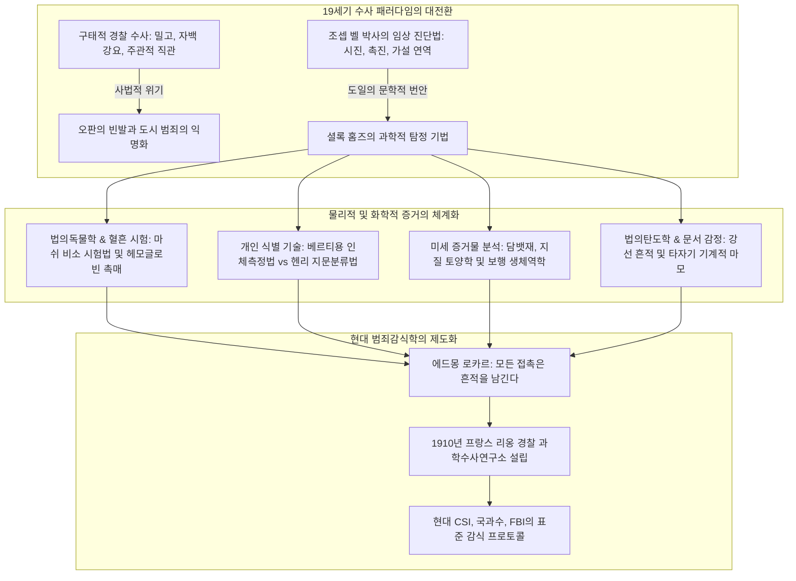
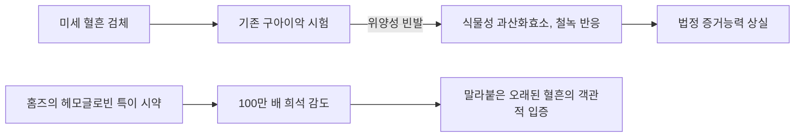
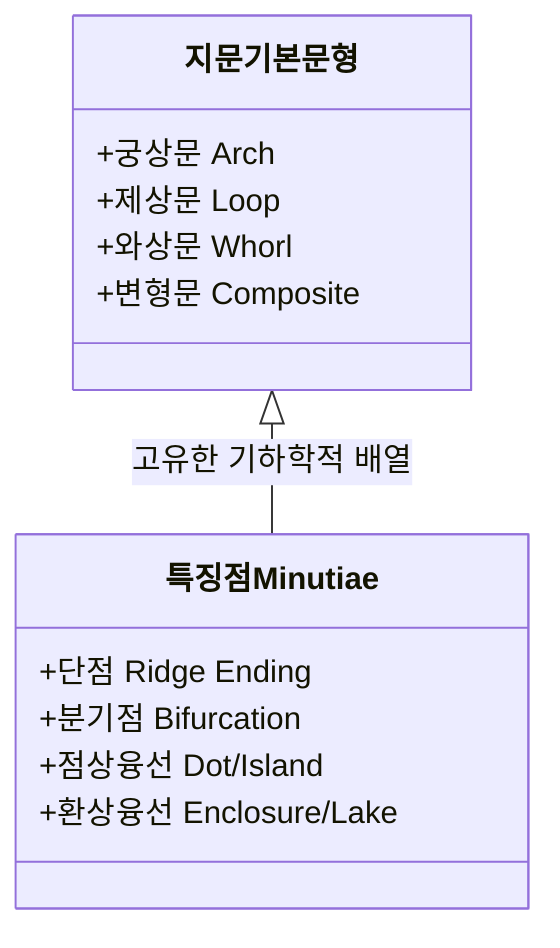
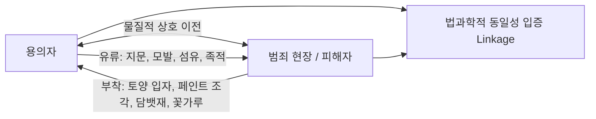

19세기 말 석탄 연기와 짙은 안개로 뒤덮인 빅토리아 시대의 런던. 베이커가 221B의 어두운 방에서 한 남자가 광학현미경의 초점을 맞추고, 바닥에 엎드려 돋보기로 양탄자 섬유와 흙 알갱이, 담뱃재 결정을 응시하고 있었습니다. 그가 바로 아서 코난 도일이 창조한 전설적인 고문 탐정, **셜록 홈즈(Sherlock Holmes)**입니다.

오늘날 전 세계 경찰과 감식 기관이 당연하게 실행하는 '현장 보존', '미세 증거물 채취', '지문 대조', '잠혈 반응 시험', '탄도학 비교', '필적 및 타자기 감정'은 홈즈가 처음 등장한 1887년 당시에는 거의 존재하지 않거나 완전히 무시되었습니다. 당시 런던 경시청(스코틀랜드 야드)을 비롯한 각국 경찰은 정보원의 밀고, 강압적 심문과 자백 강요, 직관적 편견에 의존했으며, 수사관들은 범죄 현장을 무자비하게 짓밟아 결정적 물증을 훼손하기 일쑤였습니다.

코난 도일은 에든버러 대학교 의과대학 시절 은사였던 **조셉 벨 박사(Dr. Joseph Bell)**의 정밀한 임상 관찰 및 진단 기법을 문학으로 승화시켜 객관적 물리 증거에 기반한 과학수사의 패러다임을 확립했습니다. 훗날 '현대 법과학의 아버지'로 불리는 에드몽 로카르(Edmond Locard)는 홈즈의 이론에서 영감을 받아 세계 최초의 경찰 과학수사 연구소를 설립했습니다.

---

## 1. 과학수사의 서막: 조셉 벨 박사와 '관찰과 연역의 의학'

### 1.1 임상의학에서 범죄수사로의 도약

셜록 홈즈의 놀라운 추리력의 기원은 코난 도일이 청년기를 보낸 에든버러 대학교 의과대학에 있습니다. 1870년대 후반 에든버러는 조셉 리스터의 무균 수술법 등 실험의학의 세계적 중심지였습니다.

도일에게 결정적인 영향을 미친 인물은 외과의사 **조셉 벨 박사**였습니다. 벨 박사는 환자가 진료실 문을 열고 걸어 들어오는 수 초 동안의 걸음걸이, 옷차림의 때, 손의 굳은살, 구두의 진흙, 피부 혈색을 관찰하여 환자가 입을 열기도 전에 그의 직업, 출신지, 군 복무 이력, 앓고 있는 질환을 정확히 맞혀 학생들을 경탄시켰습니다.

도일은 벨 박사에게 보낸 서한에서 "선생님께서 가르쳐 주신 관찰과 연역의 임상 진단법을 범죄 수사에 적용하여 창조한 인물이 바로 셜록 홈즈입니다"라고 고백했습니다.

### 1.2 가설적 귀추법(Abduction)과 베이즈 확률 추론

과학철학적으로 홈즈가 '연역(Deduction)'이라 부르는 사고 과정은 미국 기호학자 찰스 샌더스 퍼스가 정의한 **귀추법(Abduction: 최선의 설명에 이르는 추론)**에 해당합니다. 

현장에서는 결과(물증 $E$)만 주어져 있으며, 그 결과를 초래한 원인 가설($H$)을 거슬러 올라가야 합니다. 베이즈 정리에 따르면 증거 $E$ 하에서 가설 $H$의 사후 확률은 다음과 같습니다:

$$P(H|E) = \frac{P(E|H) \cdot P(H)}{\sum_{i} P(E|H_i) \cdot P(H_i)}$$

홈즈의 유명한 격언:
> **"모든 불가능을 배제하고 남은 것은, 아무리 믿기 어려울지라도 진실임에 틀림없다."**

이는 불가능한 경쟁 가설 $H_k$의 조건부 우도를 0으로 만들어($P(E|H_k) \to 0$) 가설 공간을 정리(pruning)해 나가는 과정입니다. 불가능한 가설들이 소거되면 분모가 극적으로 줄어들어, 사전 확률 $P(H_{\text{true}})$가 극도로 낮았던 가설이라도 사후 확률은 필연적으로 1로 수렴합니다.

---

## 2. 법의독물학과 혈흔 시험의 생화학

### 2.1 《주홍색 연구》의 혈흔 특이 시약

1887년 《주홍색 연구(A Study in Scarlet)》에서 홈즈는 성 바돌로매 병원 화학 실험실에서 "헤모글로빈에 의해서만 침전되는 시약을 발견했다!"며 환호합니다.

당시 널리 쓰이던 **구아이악 시험(Guaiacum test)**은 서양고추냉이나 감자의 식물성 과산화효소 및 철녹에 의해서도 푸른색으로 변하는 위양성(False Positive) 문제가 심각했습니다.

홈즈의 착상은 이후 현실 법의학계의 발전을 완벽하게 예견했습니다:
1. **타이히만 결정 시험(1853년)**: 염화헤민 결정 확인;
2. **다카야마 시험(1912년)**: 피리딘헤모크롬 분홍색 침상 결정 석출;
3. **울렌후트 침강반응(1901년)**: 항원항체 반응을 통한 인혈 감별;
4. **캐슬-메이어 시험(1904年)**: 페놀프탈린 환원 시약의 분홍색 정색 반응;
5. **루미놀 반응(1937년)**: 헴 철 촉매에 의한 청색 화학발광.

### 2.2 빅토리아 시대의 독물학과 마쉬 비소 시험법

19세기 중반은 '비소(As) 살인의 황금기'였습니다. 1836년 제임스 마쉬(James Marsh)가 발명한 **마쉬 시험법(Marsh Test)**은 시료에 아연과 황산을 가해 아르신($\text{AsH}_3$) 기체를 발생시킨 후 열분해하여 관 벽에 '비소 거울'을 석출시키는 획기적 기법이었습니다:

$$\text{As}_2\text{O}_3 + 6\,\text{Zn} + 6\,\text{H}_2\text{SO}_4 \longrightarrow 2\,\text{AsH}_3\uparrow + 6\,\text{ZnSO}_4 + 3\,\text{H}_2\text{O}$$

$$2\,\text{AsH}_3 \xrightarrow{\quad\Delta\quad} 2\,\text{As}\downarrow (\text{금속 비소 거울}) + 3\,\text{H}_2\uparrow$$

홈즈는 《네 개의 서명》에서 식물성 알칼로이드에 의한 파상풍성 경련을 진단하고, 《악마의 발》에서는 미지의 분말 연소 가스를 스스로 흡입해 실험하는 등 당대 첨단 독물학을 체현했습니다.

---

## 3. 개인 식별의 혁명: 베르티용 인체측정학 vs 헨리 지문분류법

### 3.1 알퐁스 베르티용과 '베르티요나주'의 명암

1879년 파리 경찰청의 알퐁스 베르티용은 성인의 골격 치수가 변하지 않는다는 점에 착안해 키, 양팔 너비, 두장, 두폭, 좌측 중지 길이 등 11개 항목을 측정하는 **베르티요나주(Bertillonage)**를 창안했습니다.

| 측정 항목 (11개) | 분류 방식 | 시스템의 한계 |
| :--- | :--- | :--- |
| 신장, 양팔 길이, 좌고 | 대 / 중 / 소 3단계 분할 | $3^{11} = 177,147$ 개의 분류 서랍 |
| 두장, 두폭, 우측 귀 길이 | 정밀 캘리퍼스 측정 | **치명적 결함 1**: 측정관의 오차로 인한 서랍 미아 발생 |
| 좌측 족장, 좌측 중지장 등 | 골격 불변성 가설 | **치명적 결함 2**: 범죄 현장에 남는 것은 '팔 길이'가 아닌 미세 흔적 |

1903년 미국 레븐워스 교도소에서 발생한 **'윌 웨스트 사건(Will West Case)'**에서 신체 측정치와 외모가 완전히 일치하는 무관한 동명이인이 확인되면서 베르티용 체계는 종말을 고했습니다.

### 3.2 헨리 폴즈, 골턴, 그리고 지문 감식

1. **헨리 폴즈(Henry Faulds, 1880년)**: 일본 오모리 패총 토기의 지문에서 착안해 지문의 범죄수사 적용을 학술지 《Nature》에 최초 기고;
2. **프랜시스 골턴(Francis Galton, 1892년)**: 《Finger Prints》 출간, 지문의 '평생 불변성'과 '만인부동성' 입증 (우연 일치 확률 $10^{-11}$ 이하);
3. **에드워드 헨리(Edward Henry, 1897년)**: 궁상문, 제상문, 와상문의 10지 분류 색인법 개발.

### 3.3 《노우드의 건축업자》: 지문 위조의 간파

1903년 《노우드의 건축업자》에서 레스트레이드 경감은 벽에 남은 피 묻은 지문을 맹신합니다. 그러나 홈즈는 전날 조사 때 지문이 없었다는 '시간적 단절'과 '밀랍 스탬프 압날 흔적'을 밝혀내 위조 공작을 파헤칩니다. **과학적 증거의 절대성을 맹신하지 않고 증거가 생성된 맥락을 비판적으로 검증해야 한다**는 위대한 교훈이었습니다.

---

## 4. 미세 증거물(Trace Evidence)과 로카르의 교환 법칙

### 4.1 에드몽 로카르: "모든 접촉은 흔적을 남긴다"

1910년 프랑스 리옹에 세계 최초의 경찰 과학수사연구소를 세운 에드몽 로카르는 **로카르의 교환 법칙(Locard's Exchange Principle)**을 주창했습니다:

$$\text{범인} \underset{\text{물질의 쌍방향 교환}}{\rightleftharpoons} \text{범죄 현장 / 피해자}$$

로카르는 자신의 학술서에서 "나의 과학수사 연구실 설립은 코난 도일이 묘사한 셜록 홈즈의 이야기를 철저히 연구한 결과"라고 밝혔습니다.

### 4.2 담뱃재, 지질학, 그리고 보행 생체역학

- **140종 담뱃재 논문**: 결정 구조와 연소 잔사 색상으로 피우는 자의 계층과 담배 브랜드를 프로파일링.
- **법의지질학**: 런던 각 구역의 흙과 타르 성분 차이를 파악해 용의자의 이동 경로 복원.
- **보행역학**: 압력 분포 $P(x,y) = F_z(t)/A(x,y)$를 이용해 보폭, 달리기 상태, 짐의 무게를 추정.

---

## 5. 법의탄도학과 타자기 문서 감정

### 5.1 강선 흔적과 납 탄환의 소성 변형

1903년 《빈집의 모험》에서 홈즈는 벽에 박힌 찌그러진 연납 탄환(Mushrooming bullet)의 구경, 중량, 미세 강선 홈(Striation marks)을 관찰해 특수 공기총을 특정했습니다. 이는 캘빈 고더드가 탄도 비교현미경을 도입하기 수십 년 전의 쾌거였습니다.

### 5.2 《신랑의 정체》: 타자기의 기계적 개별성

1891년 《신랑의 정체》에서 홈즈는 타자기 활자의 마모('e'자의 번짐, 'r'자 꼬리의 마모)와 활자 정렬 불량을 분석해 범인을 밝혀냈습니다. 공업 제품이라도 물리적 마모와 엔트로피 증가에 의해 **유일무이한 개별성(Individualization)**을 갖는다는 원리를 간파한 것입니다.

---

## 6. 역사 비교 매트릭스: 홈즈의 통찰 vs 실제 과학 발전

| 법과학 분야 | 홈즈 작품 속 묘사 (발표연도) | 실제 과학계의 공식 도입 | 핵심 과학 원리 |
| :--- | :--- | :--- | :--- |
| **혈흔 시험** | 《주홍색 연구》(1887) 헤모글로빈 특이 침전 시약 | 1901년 울렌후트 침강반응 1904년 캐슬-메이어 1937년 루미놀 | 헴 철의 과산화효소 활성 촉매 |
| **지문학** | 《네 개의 서명》(1890) 《노우드의 건축업자》(1903) | 1892년 골턴 《Finger Prints》 1901년 런던 지문국 창설 | 피부 융선의 평생 불변성과 만인부동성 |
| **미세 증거물** | 《주홍색 연구》(1887) 140종 담뱃재, 도시 토양 | 1910년 로카르 연구소 설립 (교환 법칙) | 현미경적 형태학 및 물질의 상호 전이 |
| **법의탄도학** | 《빈집의 모험》(1903) 연납 탄환 변형 및 강선 흔적 | 1925년 고더드 비교현미경 실용화 | 총열 가공 미세 흠집의 탄환 전사 |
| **타자기 감정** | 《신랑의 정체》(1891) 활자 마모 및 기준선 편차 | 1910년 오스본 《Questioned Documents》 1932년 FBI 문서감정실 | 기계적 피로 및 물리적 엔트로피에 의한 개별화 |

---

## 7. 결론: 베이커가 방법론의 인식론적 유산

셜록 홈즈가 인류 사법 문명에 남긴 궁극적 유산은 개별 감식 기술을 넘어선 **'주관적 편견을 배제하고 침묵하는 물증에 귀 기울이는 객관적 이성의 프로토콜'**이었습니다:

> **"데이터를 얻기 전에 이론을 세우는 것은 중대한 실수다. 사람은 부지불식간에 사실에 맞게 이론을 세우지 않고, 이론에 맞추어 사실을 왜곡하기 시작한다."**
> —— 《보헤미아 스캔들》(1891)

현대의 법과학 감식관들이 쥐고 있는 첨단 장비의 이면에는, 19세기 런던의 안개 속에서 돋보기를 들고 객관적 진실 앞에 겸허히 머리를 숙였던 베이커가 탐정의 불멸의 정신이 살아 숨쉬고 있습니다.
