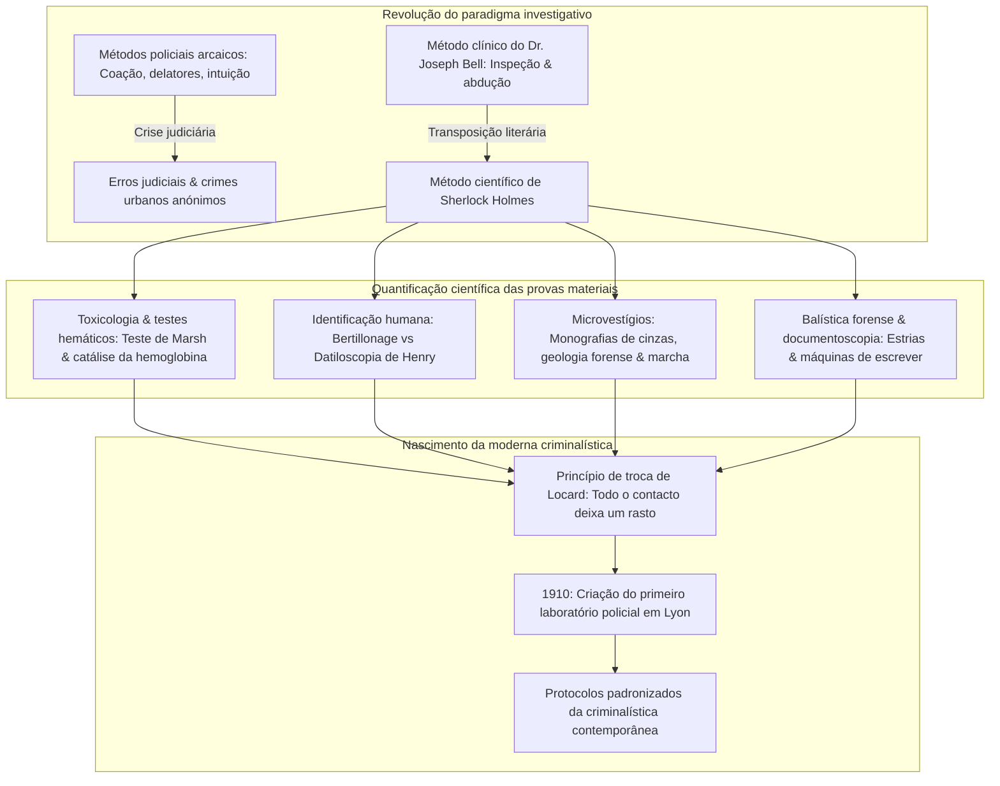
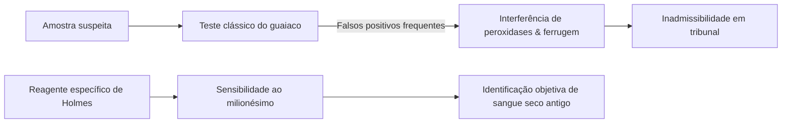
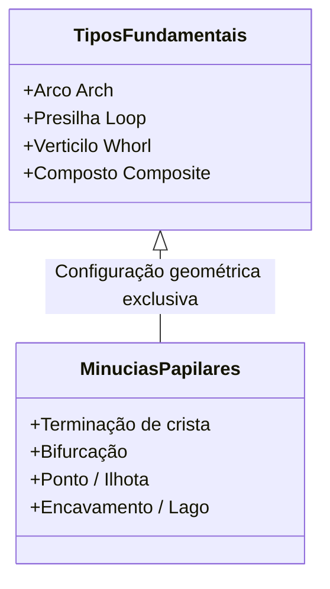
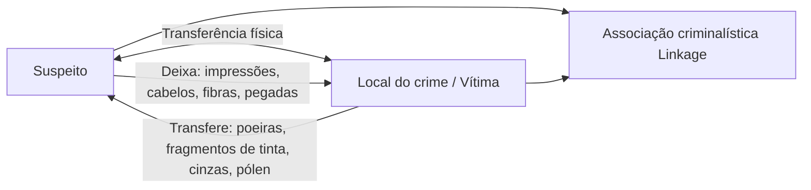

Na Londres vitoriana do final do século XIX, imersa na névoa de carvão e sob a iluminação a gás, um homem debruçava-se sobre o tubo de latão de um microscópio em 221B Baker Street. Munido de uma lupa, examinava no chão cinzas de tabaco, lama e fibras têxteis: era **Sherlock Holmes**, criado em 1887 pelo médico **Arthur Conan Doyle**.

Atualmente, o isolamento do local do crime, a recolha de vestígios biológicos, a datiloscopia, as reações com luminol, a balística forense e a perícia documental são procedimentos obrigatórios. No entanto, quando Holmes surgiu, a polícia da Scotland Yard e as forças europeias apoiavam-se em delatores, confissões forçadas e intuições subjetivas, danificando irremediavelmente as provas materiais nos locais dos crimes.

Conan Doyle adaptou a metodologia de diagnóstico clínico do seu mentor na Universidade de Edimburgo, o **Dr. Joseph Bell**. Cientistas ilustres como **Edmond Locard**, criador do axioma fundamental da criminalística (*«Todo o contacto deixa um rasto»*), declararam que os seus laboratórios periciais foram diretamente inspirados nas histórias de Sherlock Holmes.

---

## 1. A revolução diagnóstica: O Dr. Joseph Bell e o método clínico

### 1.1 Da medicina clínica à investigação penal

Arthur Conan Doyle estudou na Faculdade de Medicina de Edimburgo, um dos centros da cirurgia antisséptica de Joseph Lister. O cirurgião **Dr. Joseph Bell (1837–1911)** surpreendia os alunos ao determinar a ocupação, o serviço militar e as doenças de pacientes recém-chegados apenas observando a sua postura, calosidades e manchas de roupa antes de qualquer conversa. Doyle escreveu mais tarde a Bell: *«É a si que devo Sherlock Holmes... quis construir uma personagem que levasse ao extremo a observação e a dedução que aprendi consigo.»*

### 1.2 Lógica abdutiva e inferência bayesiana

Do ponto de vista epistemológico, o raciocínio de Holmes corresponde à **abdução** (inferência pela melhor explicação, proposta por Charles S. Peirce). Perante o indício observado ($E$), a probabilidade a posteriori da hipótese explicativa ($H$) é calculada pelo teorema de Bayes:

$$P(H|E) = \frac{P(E|H) \cdot P(H)}{\sum_{i} P(E|H_i) \cdot P(H_i)}$$

A célebre máxima de Holmes traduz este princípio matemático:
> **«Depois de ter eliminado o impossível, o que restar, por mais improvável que pareça, tem de ser a verdade.»**

A eliminação sistemática de hipóteses contraditórias ($P(E|H_k) \to 0$) contrai o espaço de incerteza, fazendo convergir a probabilidade da hipótese correta para 1.

---

## 2. Toxicologia forense e reações bioquímicas para sangue

### 2.1 O reagente de hemoglobina em *Um Estudo em Vermelho* (1887)

No laboratório do St. Bartholomew's Hospital, Holmes descobre um reagente que precipita unicamente com a hemoglobina, criticando o **teste da resina de guaiaco**, sujeito a falsos positivos devidos a peroxidases vegetais e óxidos metálicos:

A literatura antecipou os avanços reais:
1. **Teste de Teichmann (1853)**: cristais de hemina;
2. **Teste de Takayama (1912)**: cristais de hemocromogénio de piridina;
3. **Teste de precipitinas de Uhlenhuth (1901)**: distinção entre sangue humano e animal;
4. **Teste de Kastle-Meyer (1904)**: oxidação da fenolftalina;
5. **Reação do luminol (1937)**: quimioluminescência catalisada pelo ferro hemínico.

### 2.2 Toxicologia vitoriana e o ensaio de Marsh

O trióxido de arsénio ($\text{As}_2\text{O}_3$) era o veneno mais comum no século XIX. O **ensaio de Marsh (1836)** permitiu a sua deteção precisa ao reduzi-lo a arsina gasosa ($\text{AsH}_3$):

$$\text{As}_2\text{O}_3 + 6\,\text{Zn} + 6\,\text{H}_2\text{SO}_4 \longrightarrow 2\,\text{AsH}_3\uparrow + 6\,\text{ZnSO}_4 + 3\,\text{H}_2\text{O}$$

Com a decomposição térmica pelo calor, forma-se o característico **espelho de arsénio** metálico:

$$2\,\text{AsH}_3 \xrightarrow{\quad\Delta\quad} 2\,\text{As}\downarrow (\text{Espelho de arsénio}) + 3\,\text{H}_2\uparrow$$

---

## 3. Revolução da identificação: Bertillonage versus Datiloscopia

### 3.1 Alphonse Bertillon e o sistema antropométrico

Em 1879, Alphonse Bertillon desenvolveu em Paris o **bertillonage**, catalogando 11 medidas esqueléticas (comprimento da cabeça, pé esquerdo, dedo médio, etc.) divididas em $3^{11} = 177.147$ gavetas.

| Sistema | Fundamento operacional | Limitação grave |
| :--- | :--- | :--- |
| **Bertillonage (1879)** | Mensurações ósseas em adultos e fotografias judiciais padronizadas | Discrepâncias de medição entre operadores; inaplicável a vestígios no local do crime. Falência no **caso Will West (1903)**. |
| **Datiloscopia (1892)** | Cristas papilares dos dedos | Imutabilidade biológica vitalícia e unicidade ($P < 10^{-11}$). |

### 3.2 O sistema Henry e *O Construtor de Norwood*

Sir Francis Galton provou matematicamente a unicidade das cristas papilares em 1892, e Sir Edward Henry desenvolveu o sistema de classificação por arcos, presilhas e verticilos.

Em *O Construtor de Norwood* (1903), Holmes demonstra que uma impressão digital ensanguentada foi forjada com um carimbo de cera pela própria suposta vítima, alertando para os perigos da aceitação cega de dados técnicos desprovidos de contexto.

---

## 4. Microvestígios e o princípio de troca de Locard

### 4.1 Edmond Locard: «Todo o contacto deixa um rasto»

Edmond Locard inaugurou em 1910 o primeiro laboratório forense em Lyon e formulou a regra de ouro da perícia:

$$\text{Autor do crime} \underset{\text{Transferência física mútua}}{\rightleftharpoons} \text{Local do crime / Vítima}$$

Locard declarou: *«Os métodos de Sherlock Holmes constituem exatamente a base sobre a qual os laboratórios de polícia técnica devem operar.»*

### 4.2 Cinzas de tabaco, solos e marcha

- **140 tipos de cinza de tabaco**: Holmes identificava a proveniência e nível económico do fumador através dos cristais e cor das cinzas.
- **Geologia forense**: caracterização de terras e alcatrão londrinos para reconstituição de itinerários.
- **Dinâmica das pegadas**: relação de pressão $P(x,y) = F_z(t)/A(x,y)$ para analisar a velocidade de fuga e o peso de fardos transportados.

---

## 5. Balística forense e exame de máquinas de escrever

### 5.1 Estrias de cano e deformação do projétil

Em *A Casa Vazia* (1903), Holmes analisa um projétil de chumbo deformado e descobre, pelo calibre e estrias, que foi disparado por uma espingarda de ar silenciosa personalizada, antecipando o microscópio comparativo de Calvin Goddard.

### 5.2 Entropia mecânica em *Um Caso de Identidade*

Em 1891, Holmes demonstra que cartas dactilografadas pertencem a uma máquina específica através do desgaste desigual de tipos metálicos (haste do 'r', curva do 'e', desalinhamento do 's'). Estabeleceu a individualização mecânica décadas antes do FBI.

---

## 6. Quadro comparativo histórico

| Área pericial | Obra de Holmes (Ano) | Marco científico real | Princípio físico / químico |
| :--- | :--- | :--- | :--- |
| **Manchas de sangue** | *Um Estudo em Vermelho* (1887) Reagente para hemoglobina | 1901 Teste de Uhlenhuth 1904 Kastle-Meyer 1937 Luminol | Atividade peroxidásica do ferro hemínico |
| **Datiloscopia** | *O Sinal dos Quatro* (1890) *O Construtor de Norwood* (1903) | 1892 Galton (*Finger Prints*) 1901 Registo da Scotland Yard | Imutabilidade vitalícia das cristas dérmicas |
| **Microvestígios** | *Um Estudo em Vermelho* (1887) 140 cinzas e solos urbanos | 1910 Laboratório de Lyon (Locard) Princípio de troca | Morfologia microscópica e transferência mútua |
| **Balística forense** | *A Casa Vazia* (1903) Estrias e deformação de projétil | 1925 Microscópio comparador de Goddard | Transferência de microimperfeições da alma do cano |
| **Máquinas de escrever** | *Um Caso de Identidade* (1891) Desgaste dos tipos mecânicos | 1910 Osborn (*Questioned Documents*) 1932 Laboratório do FBI | Entropia mecânica e defeitos microscópicos de uso |

---

## 7. Conclusão: O legado metodológico de Baker Street

O contributo mais duradouro de Arthur Conan Doyle foi a primazia do facto empírico sobre o preconceito:

> **«É um erro crasso teorizar antes de se terem dados. Insensivelmente, começa-se a torcer os factos para que se ajustem às teorias, em vez de ajustar as teorias aos factos.»**
> —— *Um Escândalo na Boémia (1891)*

Esse alerta contra o **viés de confirmação** continua a ser o princípio basilar de toda a investigação forense moderna.
