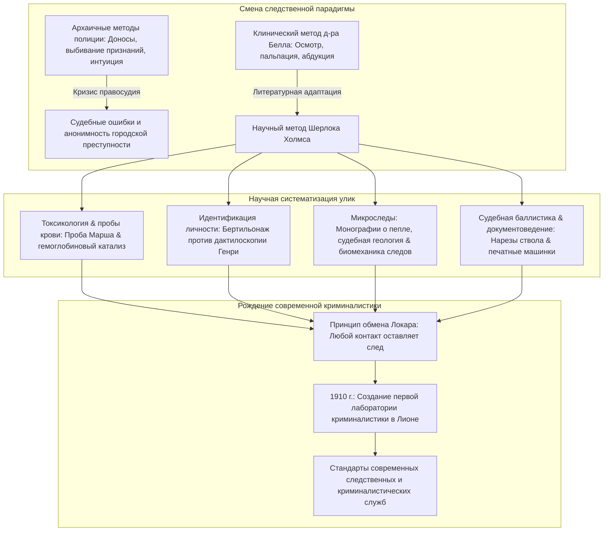
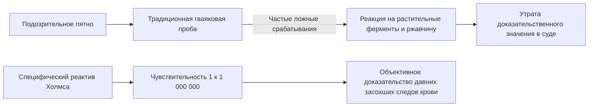
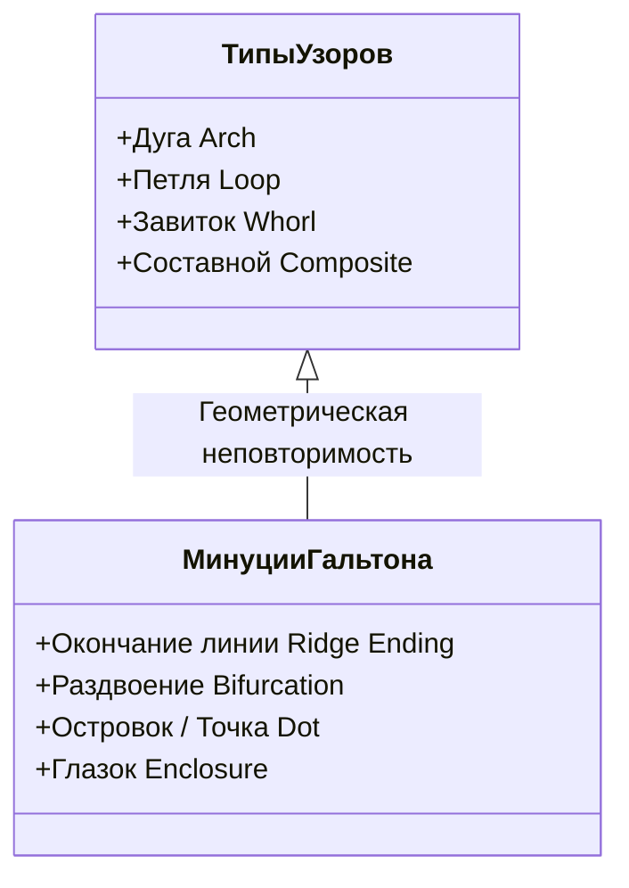
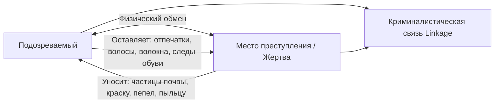

В викторианском Лондоне конца XIX века, окутанном угольным смогом и озаренном тусклыми газовыми фонарями, в комнате на Бейкер-стрит, 221B человек склонялся над латунным тубусом микроскопа. С лупой в руке он ползал по ковру, исследуя пепел сигар, грязь и микроволокна: это был **Шерлок Холмс**, созданный в 1887 году врачом **Артуром Конан Дойлом**.

Сегодня сохранение места преступления, изъятие микроследов, дактилоскопия, люминоловые пробы, баллистическая экспертиза и исследование документов являются общепринятыми стандартами. Однако в те времена полиция Скотленд-Ярда и Европы полагалась на доносчиков, признания под давлением и субъективную интуицию, безжалостно затаптывая вещественные доказательства.

Конан Дойл перенес методы клинической диагностики своего преподавателя в Эдинбургском университете, **доктора Джозефа Белла**, в область уголовного розыска. Основоположник современной криминалистики **Эдмон Локар**, сформулировавший закон (*«Каждое соприкосновение оставляет след»*), прямо признавал, что создание первой в мире полицейской лаборатории было вдохновлено трудами о Шерлоке Холмсе.

---

## 1. Зарождение научной экспертизы: Доктор Джозеф Белл и клиническая дедукция

### 1.1 От медицины к расследованию преступлений

Конан Дойл изучал медицину в Эдинбурге в эпоху триумфа антисептики Джозефа Листера. Хирург **доктор Джозеф Белл (1837–1911)** поражал студентов тем, что по походке, осанке, пятнам на одежде, мозолям и цвету кожи входящего пациента безошибочно определял его род занятий, военную службу и диагноз до того, как тот произносил хоть слово. Дойл писал Беллу: *«Именно вам я обязан созданием Шерлока Холмса... вокруг ядра наблюдений и дедукции я построил образ человека, доведшего этот метод до совершенства».*

### 1.2 Абдуктивная логика и байесовская вероятность

В философии науки метод Холмса определяется как **абдукция** (вывод к наилучшему объяснению по Чарльзу Пирсу). На месте преступления наблюдается следствие (улика $E$), а скрытая причина (гипотеза $H$) восстанавливается ретроспективно. Согласно теореме Байеса:

$$P(H|E) = \frac{P(E|H) \cdot P(H)}{\sum_{i} P(E|H_i) \cdot P(H_i)}$$

Знаменитый афоризм Холмса:
> **«Отбросьте все невозможное, и то, что останется, даже если оно кажется невероятным, и будет правдой».**

Исключение несовместимых гипотез ($P(E|H_k) \to 0$) отсекает ложные ветви, благодаря чему апостериорная вероятность истинной гипотезы неизбежно стремится к 1.

---

## 2. Судебная токсикология и биохимические пробы крови

### 2.1 Реактив на гемоглобин в «Этюде в багровых тонах» (1887)

В лаборатории больницы Святого Варфоломея Холмс открывает реактив, осаждающий исключительно гемоглобин. Он критикует ненадежную **гваяковую пробу**, дававшую ложноположительные результаты при контакте с пероксидазами растений и ржавчиной:

Холмс предвосхитил исторические открытия:
1. **Проба Тейхмана (1853)**: кристаллы гемина;
2. **Проба Такаямы (1912)**: кристаллы пиридингемохромогена;
3. **Реакция преципитации Уленгута (1901)**: разграничение крови человека и животных;
4. **Проба Кастла — Мейера (1904)**: фенолфталеиновая реакция;
5. **Проба с люминолом (1937)**: хемилюминесценция под действием железа гема.

### 2.2 Викторианская токсикология и проба Марша

В XIX веке триоксид мышьяка ($\text{As}_2\text{O}_3$) был излюбленным ядом отравителей. **Проба Марша (1836)** произвела переворот, восстанавливая мышьяк до газообразного арсина ($\text{AsH}_3$):

$$\text{As}_2\text{O}_3 + 6\,\text{Zn} + 6\,\text{H}_2\text{SO}_4 \longrightarrow 2\,\text{AsH}_3\uparrow + 6\,\text{ZnSO}_4 + 3\,\text{H}_2\text{O}$$

При нагревании арсина образуется металлический **«мышьяковистый зеркальный налет»**:

$$2\,\text{AsH}_3 \xrightarrow{\quad\Delta\quad} 2\,\text{As}\downarrow (\text{Мышьяковое зеркало}) + 3\,\text{H}_2\uparrow$$

---

## 3. Революция идентификации личности: Бертильонаж против дактилоскопии

### 3.1 Альфонс Бертильон и антропометрия

В 1879 году Альфонс Бертильон создал систему из 11 измерений костей человека (длина головы, левой стопы, среднего пальца и др.), распределявшихся по $3^{11} = 177\,147$ ящикам картотеки.

| Система | Принцип действия | Фатальный недостаток |
| :--- | :--- | :--- |
| **Бертильонаж (1879)** | Измерение скелета взрослого и стандартизированное фото (анфас/профиль) | Ошибки операторов приводили к потере карточек; невозможно сопоставить с уликами с места преступления. Крах в **деле Уилла Веста (1903)**. |
| **Дактилоскопия (1892)** | Папиллярные узоры пальцев рук | Неизменность на протяжении всей жизни и абсолютная уникальность ($P < 10^{-11}$). |

### 3.2 Система Генри и «Подрядчик из Норвуда»

Фрэнсис Гальтон доказал математическую уникальность папиллярных линий, а Эдвард Генри разработал классификацию узоров (дуги, петли, завитки).

В рассказе «Подрядчик из Норвуда» (1903) Холмс разоблачает поддельный кровавый отпечаток пальца, изготовленный жертвой с помощью воскового слепка, предостерегая от слепого поклонения новым технологиям в отрыве от контекста.

---

## 4. Микроследы и принцип обмена Локара

### 4.1 Эдмон Локар: «Любой контакт оставляет след»

В 1910 году Эдмон Локар основал лабораторию в Лионе и сформулировал фундаментальный закон:

$$\text{Преступник} \underset{\text{Двусторонний материальный обмен}}{\rightleftharpoons} \text{Место преступления / Жертва}$$

Локар писал: *«Методы Шерлока Холмса — это именно та основа, на которой должны строиться современные криминалистические лаборатории».*

### 4.2 Пепел табака, геология и походка

- **140 видов табачного пепла**: классификация по цвету и кристаллической структуре для определения статуса курильщика.
- **Судебная геология**: сопоставление грязи и угольной пыли разных районов Лондона для восстановления маршрута преступника.
- **Биомеханика следов**: формула давления $P(x,y) = F_z(t)/A(x,y)$ для анализа скорости бега и тяжести переносимого груза.

---

## 5. Судебная баллистика и экспертиза пишущих машинок

### 5.1 Следы нарезов и деформация свинца

В «Пустом доме» (1903) Холмс извлекает деформированную мягкую свинцовую пулю и по калибру и нарезам определяет редкое бесшумное духовое ружье, предвосхитив работу сравнительного микроскопа Кэлвина Годдарда.

### 5.2 Механическая энтропия в «Установлении личности»

В 1891 году Холмс доказывает принадлежность машинописного текста конкретному аппарату по микродефектам литер (стертый хвостик «r», заплывшая петля «e», смещение «s»). Он обосновал криминалистическую индивидуализацию машин за 40 лет до ФБР.

---

## 6. Историческая сравнительная таблица

| Отрасль экспертизы | Канон Холмса (Год) | Реальная научная веха | Физико-химический принцип |
| :--- | :--- | :--- | :--- |
| **Следы крови** | «Этюд в багровых тонах» (1887) Реактив на гемоглобин | 1901 Реакция Уленгута 1904 Проба Кастла — Мейера 1937 Люминол | Пероксидазная активность гемового железа |
| **Дактилоскопия** | «Знак четырех» (1890) «Подрядчик из Норвуда» (1903) | 1892 Гальтон (*Finger Prints*) 1901 Отдел Скотленд-Ярда | Неизменяемость и индивидуальность папиллярных линий |
| **Микроследы** | «Этюд в багровых тонах» (1887) 140 сортов пепла и почвы | 1910 Лаборатория в Лионе (Локар) Принцип обмена | Микроскопическая морфология и взаимный перенос частиц |
| **Баллистика** | «Пустой дом» (1903) Нарезы ствола на свинцовой пуле | 1925 Микроскоп Годдарда | Перенос микрорельефа канала ствола на снаряд |
| **Печатные машинки** | «Установление личности» (1891) Износ шрифта и дефекты рычагов | 1910 Осборн (*Questioned Documents*) 1932 Отдел экспертиз ФБР | Механический износ и нарастание физической энтропии |

---

## 7. Заключение: Эпистемологическое наследие Бейкер-стрит

Главный урок Артура Конан Дойла заключается в защите объективных фактов от субъективных предубеждений:

> **«Грубейшая ошибка — строить теории до того, как получены факты. Незаметно для себя человек начинает подгонять факты под теорию, вместо того чтобы строить теорию на фактах».**
> —— *«Скандал в Богемии» (1891)*

Предостережение от **ошибки подтверждения (Confirmation Bias)** по сей день служит фундаментом научной добросовестности каждого эксперта-криминалиста.
