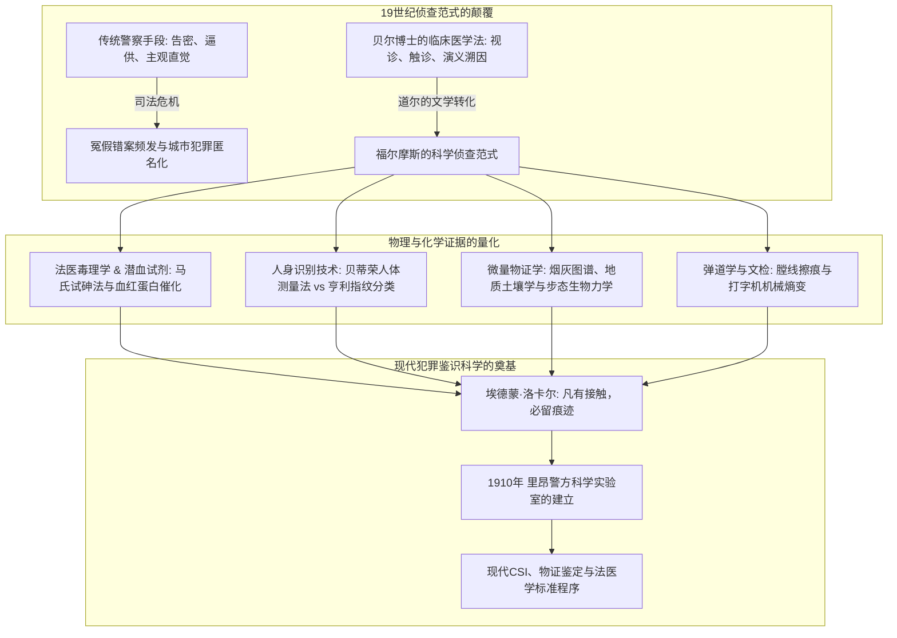
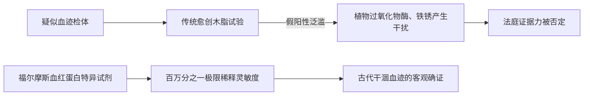
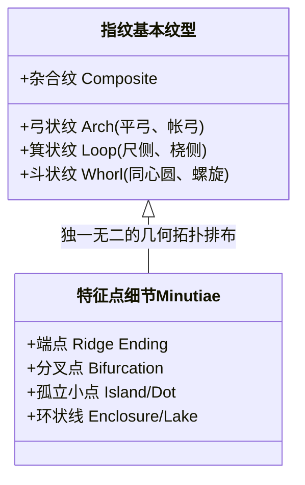
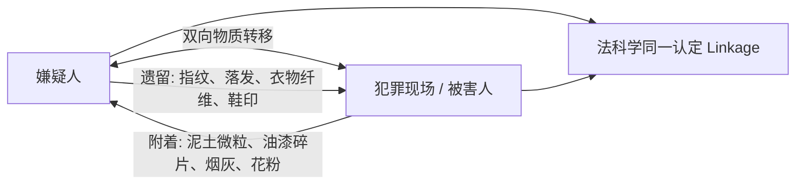

在19世纪末被煤烟与浓雾笼罩的维多利亚时代伦敦，贝克街221B号的公寓内，一位男子正凝视着光学显微镜下的微小结晶，用放大镜俯身观察地毯缝隙里的泥土微粒与烟灰。他就是阿瑟·柯南·道尔笔下不朽的顾问侦探——**夏洛克·福尔摩斯（Sherlock Holmes）**。

在当今世界各国的刑警与鉴识机构中，“现场保护”、“微量物证提取”、“指纹比对”、“潜血反应测试”、“弹道学比对”以及“笔迹打字机鉴定”已是破案的标准规程。然而，在1887年《血字的研究》发表之前，伦敦苏格兰场及欧美警方的办案方式依然极度原始，严重依赖线人告密、刑讯逼供、目击者不可靠的回忆以及侦探个人的主观经验直觉。办案人员甚至会在案发现场随意践踏走动，彻底破坏了最关键的物理证据。

柯南·道尔将其在爱丁堡大学医学院导师**约瑟夫·贝尔博士（Dr. Joseph Bell）**的严谨临床观察与诊断学方法融入文学，开创了以客观物理物证为根基的现代刑事侦查学。后来被称为“法科学之父”的法国学者埃德蒙·洛卡尔（Edmond Locard）明确指出，正是福尔摩斯的侦查理论启发了他创办世界上第一所警方科学侦查实验室。

---

## 1. 科学侦查的拂晓：约瑟夫·贝尔博士与临床演义学

### 1.1 从临床医学到刑事鉴识的跨越

福尔摩斯令人惊叹的敏锐洞察力，其现实原型是柯南·道尔在爱丁堡大学的医学教授约瑟夫·贝尔博士。1870年代的爱丁堡大学是全球实验医学与无菌外科学的中心。

贝尔教授在接诊门诊病患时，往往只需在患者推门而入的数秒内观察其步态、衣服褶皱、手上老茧、靴底污渍及面部气色，便能在病患开口前准确道出其职业、兵役背景、籍贯以及所患疾病。例如他曾仅凭一名男子的举止（未脱帽体现军旅习惯）、挺拔身姿以及特有的皮疹（西印度群岛特有的象皮病早期症状），精准推断出该男子是刚从巴巴多斯退役的高地步兵团下士。

道尔在致贝尔的信中坦承：“我正是将您所传授的观察与演绎推论方法，移植到了犯罪侦查这一领域中，塑造了福尔摩斯。”

### 1.2 溯因推理（Abduction）与贝叶斯概率逻辑

在逻辑学与科学哲学层面，福尔摩斯所自称的“演绎（Deduction）”，实质上更符合逻辑学家查尔斯·桑德斯·皮尔士提出的**溯因推理（Abduction: 对最佳解释的推论）**。

在侦查现场，结果（物证 $E$）已经客观存在，调查者必须反向推导产生该结果的隐藏假设（$H$）。根据贝叶斯定理，在观察到证据 $E$ 条件下，犯罪假设 $H$ 的后验概率表示为：

$$P(H|E) = \frac{P(E|H) \cdot P(H)}{\sum_{i} P(E|H_i) \cdot P(H_i)}$$

福尔摩斯广为人知的格言：
> **“当你排除了所有不可能的因素之后，剩下来的东西，无论多么难以置信，也必然是真相。”**

在数学上意味着对状态空间中所有不相容的竞争假设 $H_k$ 进行严格实证检验，将其条件似然削减为零（$P(E|H_k) \to 0$）。当不可能的假设被逐一剪枝剔除后，分母急剧收缩，即使先验概率 $P(H_{\text{true}})$ 极低的反直觉假设，其后验概率也将不可避免地逼近于 1。

---

## 2. 法医毒理学与潜血试验的生物化学

### 2.1 《血字的研究》中血痕沉淀试剂的首创

在1887年的处女作《血字的研究》中，福尔摩斯与华生初次相遇于圣巴塞洛缪医院的化学实验室。福尔摩斯手持试管高呼他发现了一种“只能被血红蛋白沉淀的试剂”。

福尔摩斯指出了当时维多利亚时代法医普遍使用的**愈创木脂试验（Guaiacum test）**的重大缺陷：由于辣根、马铃薯中的植物过氧化物酶以及铁锈氧化物也能引发相同的变蓝反应，产生严重的假阳性（False Positive），导致辩方律师极易在法庭上推翻控方证据。

福尔摩斯的设想预示了法医血清学的真实历史轨迹：
1. **泰希曼结晶试验（1853年）**: 生成特征性氯化血红素菱形结晶；
2. **高山试验（1912年）**: 形成吡啶血色原粉红色针状结晶；
3. **乌伦胡特沉淀素试验（1901年）**: 利用抗原抗体反应区分人类血液与动物血液；
4. **卡斯特-梅尔试验（1904年）**: 酚酞试剂在碱性条件下的高灵敏度潜血测试；
5. **鲁米诺发光反应（1937年）**: 铁卟啉催化下的化学发光显现潜在微量血痕。

### 2.2 维多利亚时代的毒理学与马氏试砷法

19世纪中叶常被称为“毒杀的黄金时代”。三氧化二砷（砒霜 $\text{As}_2\text{O}_3$）、番木鳖碱（士的宁）、阿片吗啡及颠茄生物碱极易在药房无限制获取。

1836年英国化学家詹姆斯·马歇（James Marsh）发明的**马氏试砷法（Marsh Test）**开创了现代毒理分析的先河。将疑似含砷检体与锌粒、稀硫酸反应产生砷化氢气体：

$$\text{As}_2\text{O}_3 + 6\,\text{Zn} + 6\,\text{H}_2\text{SO}_4 \longrightarrow 2\,\text{AsH}_3\uparrow + 6\,\text{ZnSO}_4 + 3\,\text{H}_2\text{O}$$

随后将气体通过玻璃导管加热分解，在管壁内析出镜面金属砷：

$$2\,\text{AsH}_3 \xrightarrow{\quad\Delta\quad} 2\,\text{As}\downarrow (\text{金属砷镜}) + 3\,\text{H}_2\uparrow$$

在《四签名》中对吹箭植物毒素引发角弓反张痉挛的诊断，以及《魔鬼之足》中对致幻毒粉自发实验的描写，生动再现了维多利亚晚期毒理学与受体药理学的探索图景。

---

## 3. 人身识别的革命：贝蒂荣测量法 vs 亨利指纹分类体系

### 3.1 阿尔丰斯·贝蒂荣与人体测量学（Bertillonage）

19世纪大都市罪犯常使用化名隐藏累犯身份。1879年巴黎警察局的阿尔丰斯·贝蒂荣（Alphonse Bertillon）基于人体骨骼在成年后尺寸恒定的假设，创立了包含11项精密人体测量的人身识别档案系统。

| 测量项目（共11项） | 分类规则 | 识别原理与缺陷 |
| :--- | :--- | :--- |
| 身高、臂展、坐高 | 每项分为 大 / 中 / 小 三档 | 理论组合数：$3^{11} = 177,147$ 类检索抽屉 |
| 头长、头宽、右耳长 | 使用精密卡尺测量骨骼极值 | **致命缺陷 1**：测量员人为误差导致错置抽屉 |
| 左手伸长、左中指长、左足长 | 左右对称性参考 | **致命缺陷 2**：现场不会遗留“前臂长度”，只有痕迹物证 |

在1893年《海军协定》中，福尔摩斯虽赞扬贝蒂荣的严谨态度，却敏锐指出这种测量法缺乏与现场痕迹的对接能力。1903年美国莱文沃思联邦监狱的**“威廉·韦斯特事件（Will West Case）”**中，两名毫无血缘关系但相貌与骨骼尺寸完全相同的男子让贝蒂荣系统彻底破产，催化了指纹认证的全面接替。

### 3.2 亨利·福尔兹、高尔顿与亨利指纹法

1. **亨利·福尔兹（Henry Faulds, 1880年）**: 在《Nature》发文首倡将陶器指纹与现场指印用于刑事破案；
2. **弗朗西斯·高尔顿（Francis Galton, 1892年）**: 出版《指纹学》，确立指纹“终生不变性”与“万人不同性”，计算出两人指纹偶然一致的概率低于 $1/64,000,000,000$；
3. **爱德华·亨利（Edward Henry, 1897年）**: 建立弓状纹（Arch）、箕状纹（Loop）、斗状纹（Whorl）分类索引法。

### 3.3 《诺伍德的建筑师》中的伪造指纹鉴别

在1903年《诺伍德的建筑师》中，雷斯垂德探长在墙壁上发现血拇指印后盲目认定嫌疑人有罪。福尔摩斯通过时间反常性（前一天检查时尚无该指印）以及蜡模压印的机械特征，识破了被害人伪造指纹栽赃陷害的阴谋。道尔借此敲响警钟：**科学数据虽客观，但物证生成的因果语境若遭忽视，技术盲信同样会导致灾难性的冤狱**。

---

## 4. 微量物证（Trace Evidence）与洛卡尔物质交换定律

### 4.1 埃德蒙·洛卡尔与“凡有接触，必留痕迹”

现代法庭科学的核心公理——**洛卡尔物质交换定律（Locard's Exchange Principle）**由法国学者埃德蒙·洛卡尔于1910年在里昂警察实验室创立时提出：

$$\text{犯罪者} \underset{\text{双向物理交换}}{\rightleftharpoons} \text{犯罪现场 / 被害人}$$

洛卡尔在学术著作中多次坦陈，他的微量物证侦查思想直接脱胎于柯南·道尔笔下的福尔摩斯。

### 4.2 烟灰、土壤与足迹生物力学

1. **140种烟草灰的专著**: 《血字的研究》中福尔摩斯通过微观晶体形态与燃烧残渣色泽，精准推断抽烟者的经济地位与烟草品种。现代通过电子显微镜能谱仪（SEM-EDX）验证了其形态分类学价值。
2. **法医地质土壤学**: 伦敦各街区的泥土成分、泰晤士河沉积物与煤焦油分布各异，裤脚的泥点成为勾勒嫌疑人移动轨迹的物理罗盘。
3. **步态生物力学**: 压强分布公式 $P(x,y) = F_z(t)/A(x,y)$ 解释了奔跑时脚尖入土深、负重时脚跟受压剧烈等动态力学，福尔摩斯将足迹研究提升为精密运动学。

---

## 5. 司法弹道学与文书打字机鉴定

### 5.1 膛线擦痕与铅弹塑性形变

在1903年《空屋》中，莫兰上校使用气枪暗杀。福尔摩斯回收射入墙壁的膨胀软铅弹（Mushrooming bullet），凭借口径、变形质量与弹头侧面的细微膛线划痕，准确锁定了罕见定制气枪。这一分析比加尔文·戈达德（Calvin Goddard）在法医学界正式确立弹道比对显微镜早了二十余年。

### 5.2 《身份案》中的打字机机械熵变鉴定

1891年《身份案》展现了现代文件检验（QDE）的先驱案例。福尔摩斯指出打字机由于金属字模磨损（如字母“e”的模糊、“r”尾部缺损）及字键对齐偏差，具有不可复制的机械指纹。他在FBI于1932年建立文检库的40年前，就阐明了工业机械在长期使用中因物理熵增产生的**独特性（Individualization）**。

---

## 6. 历史对照矩阵：福尔摩斯预见与现实科学发展

| 法庭科学分支 | 原著案例与发表年份 | 真实科学界标志性事件 | 核心物理/生化原理 |
| :--- | :--- | :--- | :--- |
| **潜血试验** | 《血字的研究》(1887) 血红蛋白特异沉淀剂 | 1901年 乌伦胡特沉淀反应 1904年 酚酞卡-梅试验 1937年 鲁米诺反应 | 血红素催化过氧化物酶活性与特异抗体结合 |
| **指纹学** | 《四签名》(1890) 《诺伍德建筑师》(1903) | 1892年 高尔顿《指纹学》 1901年 伦敦指纹局成立 1903年 韦斯特事件 | 真皮乳头突起终生不变性与特征点拓扑不重复 |
| **微量物证** | 《血字的研究》(1887) 140种烟灰、城市土壤 | 1910年 洛卡尔建立首家警方实验室，确立物质交换定律 | 光学与电子显微分析、矿物结晶形态学与双向转移 |
| **司法弹道学** | 《空屋》(1903) 软铅弹擦痕与气枪鉴定 | 1925年 戈达德研制弹道比对显微镜 | 枪膛机械切削微瑕转移与弹头塑性形变 |
| **打字机文检** | 《身份案》(1891) 字模磨损与机械基线偏移 | 1910年 奥斯本出版《争议文件》 1932年 FBI文检部成立 | 机械疲劳、字键偏差与物理熵增带来的个性化 |

---

## 7. 结语：贝克街方法论的认识论遗产

福尔摩斯留给人类司法文明的最宝贵遗产，绝非个别的化学试剂或显微技术，而是一套**排除主观偏见、让沉默物证说话的客观理性思维协议**：

> **“在拥有数据之前就形成理论是极大的错误。不知不觉中，人们会开始扭曲事实以契合理论，而不是建立理论以契合事实。”**
> —— 《波希米亚丑闻》（1891）

这句箴言正是现代认知心理学对**确认偏误（Confirmation Bias）**与**管窥效应（Tunnel Vision）**最深刻的警示。现代CSI鉴识科学家无论手持何种高端质谱仪或DNA测序仪，其精神底色始终承袭着那位在维多利亚迷雾中手持放大镜、向自然客观真理低头求索的贝克街侦探。
