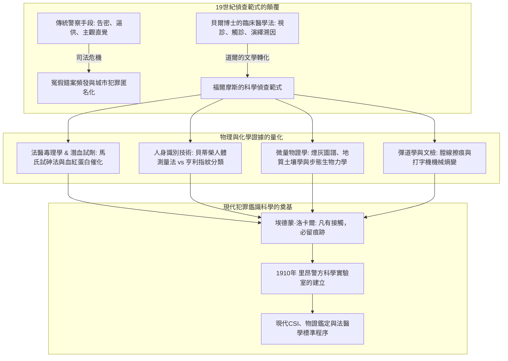
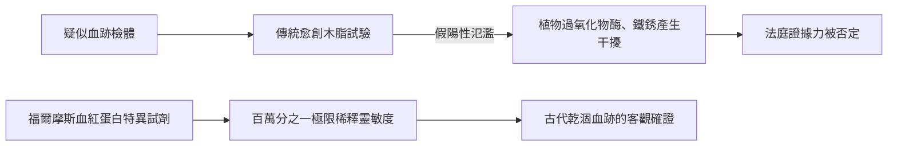
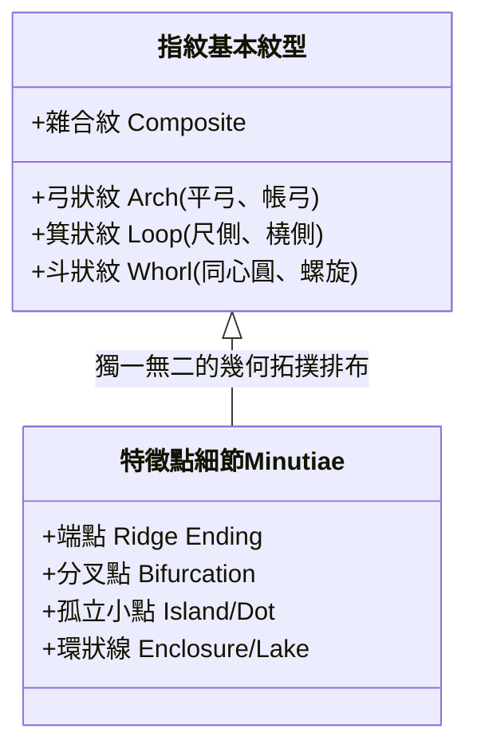
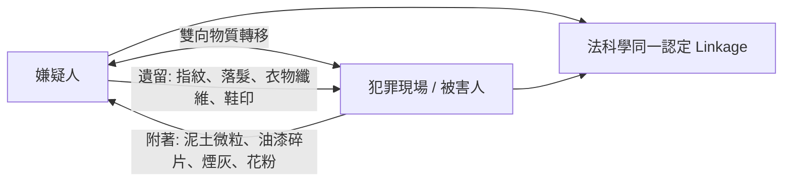

在19世紀末被煤煙與濃霧籠罩的維多利亞時代倫敦，貝克街221B號的公寓內，一位男子正凝視著光學顯微鏡下的微小結晶，用放大鏡俯身觀察地毯縫隙裡的泥土微粒與煙灰。他就是阿瑟·柯南·道爾筆下不朽的顧問偵探——**夏洛克·福爾摩斯（Sherlock Holmes）**。

在當今世界各國的刑警與鑑識機構中，「現場保存」、「微量物證提取」、「指紋比對」、「潛血反應測試」、「彈道學比對」以及「筆跡打字機鑑定」已是破案的標準規程。然而，在1887年《血字的研究》發表之前，倫敦蘇格蘭場及歐美警方的辦案方式依然極度原始，嚴重依賴線人告密、刑訊逼供、目擊者不可靠的回憶以及偵探個人的主觀經驗直覺。辦案人員甚至會在案發現場隨意踐踏走動，徹底破壞了最關鍵的物理證據。

柯南·道爾將其在愛丁堡大學醫學院導師**約瑟夫·貝爾博士（Dr. Joseph Bell）**的嚴謹臨床觀察與診斷學方法融入文學，開創了以客觀物理物證為根基的現代刑事偵查學。後來被稱為「法科學之父」的法國學者埃德蒙·洛卡爾（Edmond Locard）明確指出，正是福爾摩斯的偵查理論啟發了他創辦世界上第一所警方科學偵查實驗室。

---

## 1. 科學偵查的拂曉：約瑟夫·貝爾博士與臨床演繹學

### 1.1 從臨床醫學到刑事鑑識的跨越

福爾摩斯令人驚嘆的敏銳洞察力，其現實原型是柯南·道爾在愛丁堡大學的醫學教授約瑟夫·貝爾博士。1870年代的愛丁堡大學是全球實驗醫學與無菌外科學的中心。

貝爾教授在接診門診病患時，往往只需在患者推門而入的數秒內觀察其步態、衣服褶皺、手上老繭、靴底污漬及面部氣色，便能在病患開口前準確道出其職業、兵役背景、籍貫以及所患疾病。例如他曾僅憑一名男子的舉止（未脫帽體現軍旅習慣）、挺拔身姿以及特有的皮疹（西印度群島特有的象皮病早期症狀），精準推斷出該男子是剛從巴巴多斯退役的高地步兵團下士。

道爾在致貝爾的信中坦承：「我正是將您所傳授的觀察與演繹推論方法，移植到了犯罪偵查這一領域中，塑造了福爾摩斯。」

### 1.2 溯因推理（Abduction）與貝葉斯概率邏輯

在邏輯學與科學哲學層面，福爾摩斯所自稱的「演繹（Deduction）」，實質上更符合邏輯學家查爾斯·桑德斯·皮爾士提出的**溯因推理（Abduction: 對最佳解釋的推論）**。

在偵查現場，結果（物證 $E$）已經客觀存在，調查者必須反向推導產生該結果的隱藏假設（$H$）。根據貝葉斯定理，在觀察到證據 $E$ 條件下，犯罪假設 $H$ 的後驗概率表示為：

$$P(H|E) = \frac{P(E|H) \cdot P(H)}{\sum_{i} P(E|H_i) \cdot P(H_i)}$$

福爾摩斯廣為人知的格言：
> **「當你排除了所有不可能的因素之後，剩下來的東西，無論多麼難以置信，也必然是真相。」**

在數學上意味著對狀態空間中所有不相容的競爭假設 $H_k$ 進行嚴格實證檢驗，將其條件似然削減為零（$P(E|H_k) \to 0$）。當不可能的假設被逐一剪枝剔除後，分母急劇收縮，即使先驗概率 $P(H_{\text{true}})$ 極低的反直覺假設，其後驗概率也將不可避免地逼近於 1。

---

## 2. 法醫毒理學與潛血試驗的生物化學

### 2.1 《血字的研究》中血痕沉澱試劑的首創

在1887年的處女作《血字的研究》中，福爾摩斯與華生初次相遇於聖巴塞洛繆醫院的化學實驗室。福爾摩斯手持試管高呼他發現了一種「只能被血紅蛋白沉澱的試劑」。

福爾摩斯指出了當時維多利亞時代法醫普遍使用的**愈創木脂試驗（Guaiacum test）**的重大缺陷：由於辣根、馬鈴薯中的植物過氧化物酶以及鐵銹氧化物也能引發相同的變藍反應，產生嚴重的假陽性（False Positive），導致辯方律師極易在法庭上推翻控方證據。

福爾摩斯的設想預示了法醫血清學的真實歷史軌跡：
1. **泰希曼結晶試驗（1853年）**: 生成特徵性氯化血紅素菱形結晶；
2. **高山試驗（1912年）**: 形成吡啶血色原粉紅色針狀結晶；
3. **烏倫胡特沉澱素試驗（1901年）**: 利用抗原抗體反應區分人類血液與動物血液；
4. **卡斯特-梅爾試驗（1904年）**: 酚酞試劑在鹼性條件下的高靈敏度潛血測試；
5. **魯米諾發光反應（1937年）**: 鐵卟啉催化下的化學發光顯現潛在微量血痕。

### 2.2 維多利亞時代的毒理學與馬氏試砷法

19世紀中葉常被稱為「毒殺的黃金時代」。三氧化二砷（砒霜 $\text{As}_2\text{O}_3$）、番木鱉鹼（士的寧）、阿片嗎啡及顛茄生物鹼極易在藥房無限制獲取。

1836年英國化學家詹姆斯·馬歇（James Marsh）發明的**馬氏試砷法（Marsh Test）**開創了現代毒理分析的先河。將疑似含砷檢體與鋅粒、稀硫酸反應產生砷化氫氣體：

$$\text{As}_2\text{O}_3 + 6\,\text{Zn} + 6\,\text{H}_2\text{SO}_4 \longrightarrow 2\,\text{AsH}_3\uparrow + 6\,\text{ZnSO}_4 + 3\,\text{H}_2\text{O}$$

隨後將氣體通過玻璃導管加熱分解，在管壁內析出鏡面金屬砷：

$$2\,\text{AsH}_3 \xrightarrow{\quad\Delta\quad} 2\,\text{As}\downarrow (\text{金屬砷鏡}) + 3\,\text{H}_2\uparrow$$

在《四簽名》中對吹箭植物毒素引發角弓反張痙攣的診斷，以及《魔鬼之足》中對致幻毒粉自發實驗的描寫，生動再現了維多利亞晚期毒理學與受體藥理學的探索圖景。

---

## 3. 人身識別的革命：貝蒂榮測量法 vs 亨利指紋分類體系

### 3.1 阿爾豐斯·貝蒂榮與人體測量學（Bertillonage）

19世紀大都市罪犯常使用化名隱藏累犯身份。1879年巴黎警察局的阿爾豐斯·貝蒂榮（Alphonse Bertillon）基於人體骨骼在成年後尺寸恆定的假設，創立了包含11項精密人體測量的人身識別檔案系統。

| 測量項目（共11項） | 分類規則 | 識別原理與缺陷 |
| :--- | :--- | :--- |
| 身高、臂展、坐高 | 每項分為 大 / 中 / 小 三檔 | 理論組合數：$3^{11} = 177,147$ 類檢索抽屜 |
| 頭長、頭寬、右耳長 | 使用精密卡尺測量骨骼極值 | **致命缺陷 1**：測量員人為誤差導致錯置抽屜 |
| 左手伸長、左中指長、左足長 | 左右對稱性參考 | **致命缺陷 2**：現場不會遺留「前臂長度」，只有痕跡物證 |

在1893年《海軍協定》中，福爾摩斯雖讚揚貝蒂榮的嚴謹態度，卻敏銳指出這種測量法缺乏與現場痕跡的對接能力。1903年美國萊文沃思聯邦監獄的**「威廉·韋斯特事件（Will West Case）」**中，兩名毫無血緣關係但相貌與骨骼尺寸完全相同的男子讓貝蒂榮系統徹底破產，催化了指紋認證的全面接替。

### 3.2 亨利·福爾茲、高爾頓與亨利指紋法

1. **亨利·福爾茲（Henry Faulds, 1880年）**: 在《Nature》發文首倡將陶器指紋與現場指印用於刑事破案；
2. **弗朗西斯·高爾頓（Francis Galton, 1892年）**: 出版《指紋學》，確立指紋「終生不變性」與「萬人不同性」，計算出兩人指紋偶然一致的概率低於 $1/64,000,000,000$；
3. **愛德華·亨利（Edward Henry, 1897年）**: 建立弓狀紋（Arch）、箕狀紋（Loop）、斗狀紋（Whorl）分類索引法。

### 3.3 《諾伍德的建築師》中的偽造指紋鑑別

在1903年《諾伍德的建築師》中，雷斯垂德探長在牆壁上發現血拇指印後盲目認定嫌疑人有罪。福爾摩斯通過時間反常性（前一天檢查時尚無該指印）以及蠟模壓印的機械特徵，識破了被害人偽造指紋栽贓陷害的陰謀。道爾藉此敲響警鐘：**科學數據雖客觀，但物證生成的因果語境若遭忽視，技術盲信同樣會導致災難性的冤獄**。

---

## 4. 微量物證（Trace Evidence）與洛卡爾物質交換定律

### 4.1 埃德蒙·洛卡爾與「凡有接觸，必留痕跡」

現代法庭科學的核心公理——**洛卡爾物質交換定律（Locard's Exchange Principle）**由法國學者埃德蒙·洛卡爾於1910年在里昂警察實驗室創立時提出：

$$\text{犯罪者} \underset{\text{雙向物理交換}}{\rightleftharpoons} \text{犯罪現場 / 被害人}$$

洛卡爾在學術著作中多次坦陳，他的微量物證偵查思想直接脫胎於柯南·道爾筆下的福爾摩斯。

### 4.2 煙灰、土壤與足跡生物力學

1. **140種煙草灰的專著**: 《血字的研究》中福爾摩斯通過微觀晶體形態與燃燒殘渣色澤，精準推斷抽煙者的經濟地位與煙草品種。現代通過電子顯微鏡能譜儀（SEM-EDX）驗證了其形態分類學價值。
2. **法醫地質土壤學**: 倫敦各街區的泥土成分、泰晤士河沉積物與煤焦油分布各異，褲腳的泥點成為勾勒嫌疑人移動軌跡的物理羅盤。
3. **步態生物力學**: 壓強分布公式 $P(x,y) = F_z(t)/A(x,y)$ 解釋了奔跑時腳尖入土深、負重時腳跟受壓劇烈等動態力學，福爾摩斯將足跡研究提升為精密運動學。

---

## 5. 司法彈道學與文書打字機鑑定

### 5.1 膛線擦痕與鉛彈塑性形變

在1903年《空屋》中，莫蘭上校使用氣槍暗殺。福爾摩斯回收射入牆壁的膨脹軟鉛彈（Mushrooming bullet），憑藉口徑、變形質量與彈頭側面的細微膛線劃痕，準確鎖定了罕見定制氣槍。這一分析比加爾文·戈達德（Calvin Goddard）在法醫學界正式確立彈道比對顯微鏡早了二十餘年。

### 5.2 《身份案》中的打字機機械熵變鑑定

1891年《身份案》展現了現代文件檢驗（QDE）的先驅案例。福爾摩斯指出打字機由於金屬字模磨損（如字母「e」的模糊、「r」尾部缺損）及字鍵對齊偏差，具有不可複製的機械指紋。他在FBI於1932年建立文檢庫的40年前，就闡明了工業機械在長期使用中因物理熵增產生的**獨特性（Individualization）**。

---

## 6. 歷史對照矩陣：福爾摩斯預見與現實科學發展

| 法庭科學分支 | 原著案例與發表年份 | 真實科學界標誌性事件 | 核心物理/生化原理 |
| :--- | :--- | :--- | :--- |
| **潛血試驗** | 《血字的研究》(1887) 血紅蛋白特異沉澱劑 | 1901年 烏倫胡特沉澱反應 1904年 酚酞卡-梅試驗 1937年 魯米諾反應 | 血紅素催化過氧化物酶活性與特異抗體結合 |
| **指紋學** | 《四簽名》(1890) 《諾伍德建築師》(1903) | 1892年 高爾頓《指紋學》 1901年 倫敦指紋局成立 1903年 韋斯特事件 | 真皮乳頭突起終生不變性與特徵點拓撲不重複 |
| **微量物證** | 《血字的研究》(1887) 140種煙灰、城市土壤 | 1910年 洛卡爾建立首家警方實驗室，確立物質交換定律 | 光學與電子顯微分析、礦物結晶形態學與雙向轉移 |
| **司法彈道學** | 《空屋》(1903) 軟鉛彈擦痕與氣槍鑑定 | 1925年 戈達德研製彈道比對顯微鏡 | 槍膛機械切削微瑕轉移與彈頭塑性形變 |
| **打字機文檢** | 《身份案》(1891) 字模磨損與機械基線偏移 | 1910年 奧斯本出版《爭議文件》 1932年 FBI文檢部成立 | 機械疲勞、字鍵偏差與物理熵增帶來的個性化 |

---

## 7. 結語：貝克街方法論的認識論遺產

福爾摩斯留給人類司法文明的最寶貴遺產，絕非個別的化學試劑或顯微技術，而是一套**排除主觀偏見、讓沉默物證說話的客觀理性思維協議**：

> **「在擁有數據之前就形成理論是極大的錯誤。不知不覺中，人們會開始扭曲事實以契合理論，而不是建立理論以契合事實。」**
> —— 《波希米亞醜聞》（1891）

這句箴言正是現代認知心理學對**確認偏誤（Confirmation Bias）**與**管窺效應（Tunnel Vision）**最深刻的警示。現代CSI鑑識科學家無論手持何種高端質譜儀或DNA測序儀，其精神底色始終承襲著那位在維多利亞迷霧中手持放大鏡、向自然客觀真理低頭求索的貝克街偵探。
