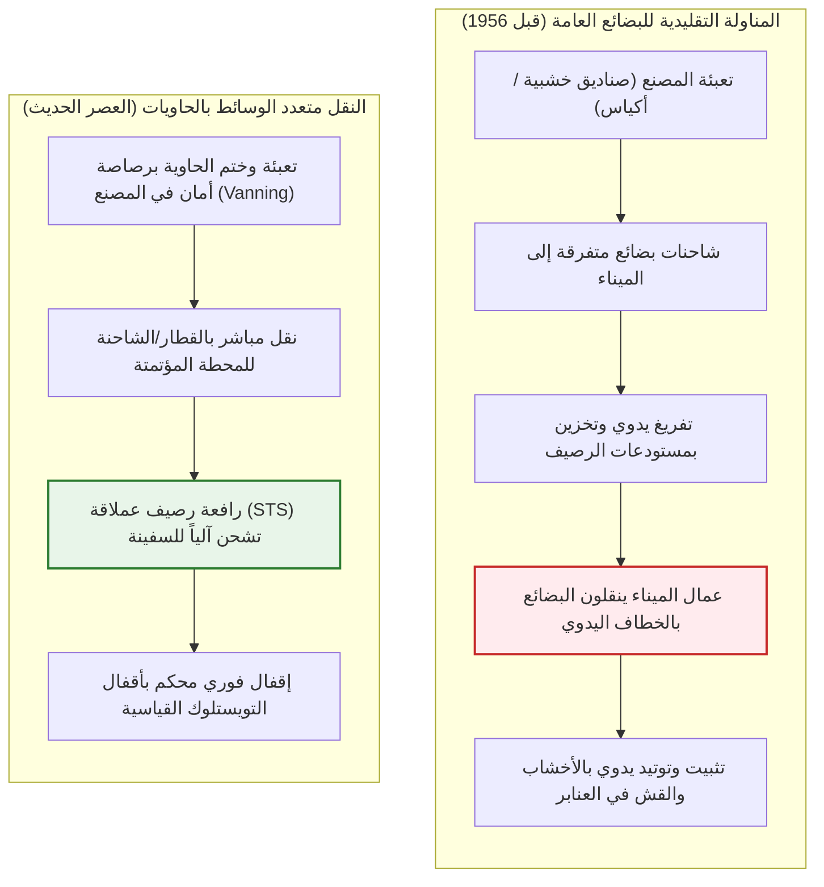
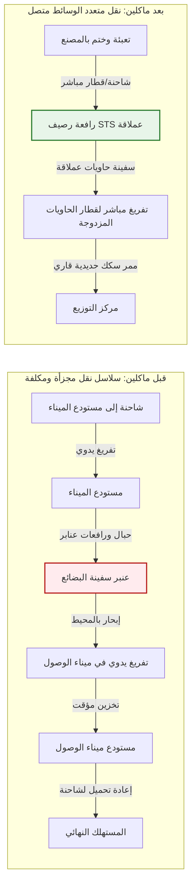
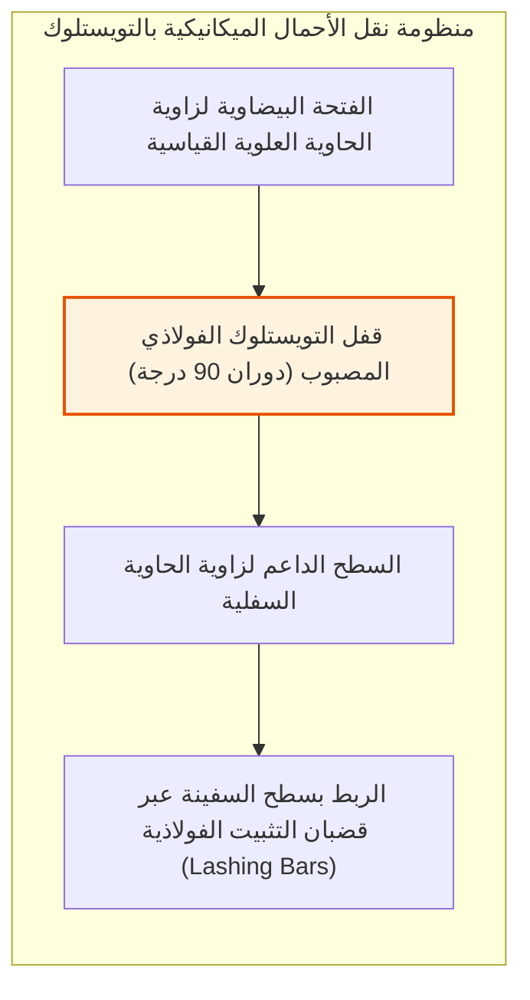
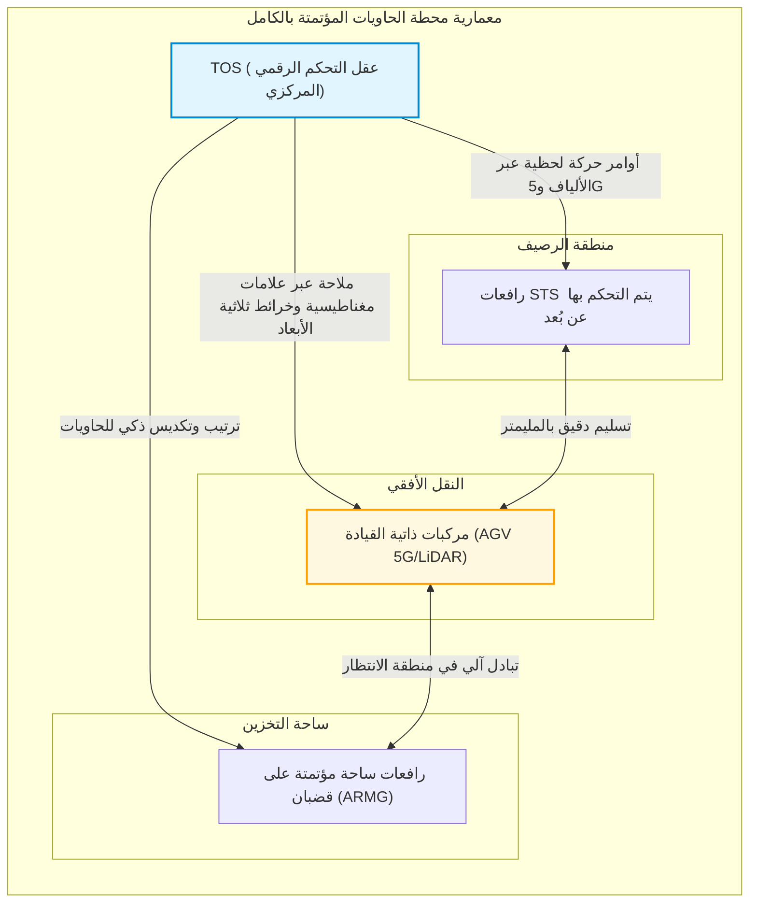
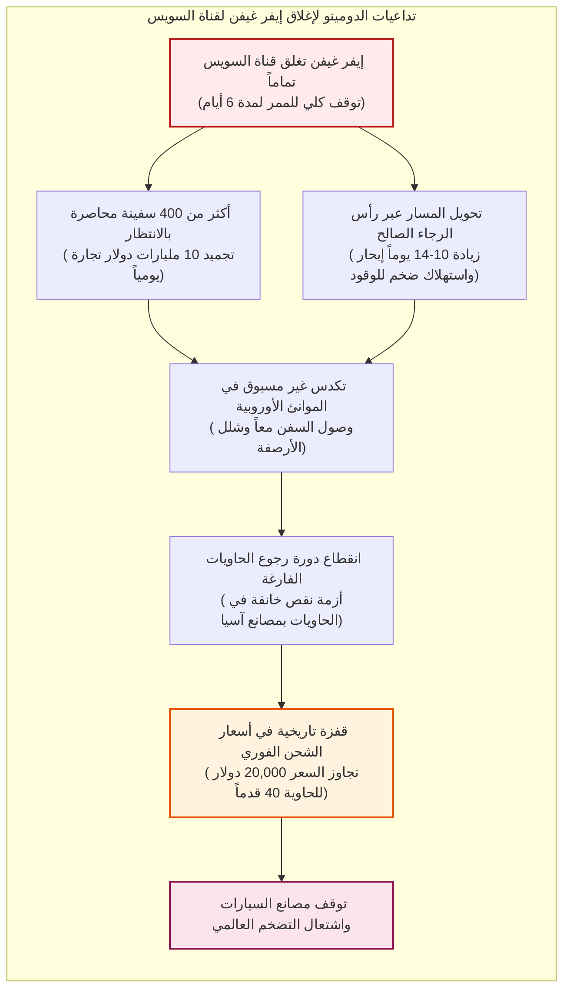

## مقدمة: أعظم معجزة اقتصادية في التاريخ الحديث ولدت من صندوق فولاذي متواضع

عندما تمسك بهاتفك الذكي، أو ترتدي ملابس صُنعت في قارة أخرى، أو تحتسي فنجاناً من القهوة قادماً من مزارع تبعد آلاف الكيلومترات، فأنت تلمس النتاج المادي لأعظم آلة لوجستية بنتها الحضارة الإنسانية على الإطلاق.

إن الأساس المادي الذي يدعم التجارة العالمية اليوم – والتي تتجاوز قيمتها السنوية 25 تريليون دولار – ليس طائرات الشحن بوينغ 747 ولا كابلات الألياف الضوئية البحرية، بل هو هيكل متوازي مستطيلات فولاذي مموج من فولاذ كورتن يبدو للوهلة الأولى عادياً تماماً: **حاوية الشحن البحري القياسية وفق معايير ISO**.

قبل خمسينيات القرن العشرين، كان نقل البضائع عبر المحيطات كابوساً مروعاً من انعدام الكفاءة وهدر الموارد. كانت سفن البضائع العامة التقليدية تقضي أسابيع طويلة راسية عند الأرصفة. مئات من عمال الشحن والتفريغ (Stevedores) كانوا ينقلون الصناديق والبراميل والأكياس يدوياً باستخدام خطافات حديدية إلى عنابر السفن الرطبة والمظلمة. كانت تكلفة المناولة في الموانئ تلتهم أكثر من 50% من إجمالي تكاليف الشحن، بينما كانت السرقات والتلفيات أمراً معتاداً.

في 26 أبريل 1956، كسر مقاول شاحنات أمريكي يدعى **مالكوم ماكلين (Malcom McLean)** هذا الجمود المستمر منذ آلاف السنين عبر ناقلة نفط معدلة أطلق عليها اسم *إيديال إكس (Ideal-X)*. لم تكن فكرته تعتمد على إلكترونيات معقدة، بل على **تجريد بنيوي للمنظومة (Systemic Abstraction)**: فصل وحدة الشحن عن وسيلة النقل، وتأسيس حاوية مادية موحدة تنتقل بسلاسة متناهية بين الشاحنات والقطارات وسفن المحيطات.

خلال سنوات وجيزة، هوت تكلفة مناولة طن البضائع من 5.83 دولار إلى 0.16 دولار فقط – وهو هبوط مذهل تجاوز 97%. وتقلص نصيب الشحن البحري في السعر النهائي للسلع الاستهلاكية إلى نسبة هامشية لا تتعدى 1% إلى 2%. كان هذا الصندوق الحديدي هو المحرك الحقيقي وراء التقسيم الدولي للعمل الصناعي، وصعود آسيا كورشة للعالم، وبناء الاقتصاد المعولم المعاصر.

---

## الفصل الأول: آلاف السنين من الهدر — العصر المظلم للبضائع العامة

### 1.1 النظام البيئي الذي حكمه خطاف الشحن اليدوي

قبل ظهور الحاوية، لم تتغير الطبيعة الجوهرية للتجارة البحرية منذ عهد الفينيقيين. كانت كافة السلع تُنقل كـ **بضائع عامة مجزأة (Break-Bulk Cargo)**: براميل نبيذ، أكياس بن، صناديق قطع غيار آلات، أو بالات قطن خام.

كانت الأداة الأساسية للعمل في الميناء هي **الخطاف الفولاذي الحاد (Cargo Hook)** الذي يعلقه العامل على حزامه. يغرس العمال الخطاف في الأكياس ويسحبون الصناديق على ظهورهم إلى أعماق العنابر. ولمنع تحرك الحمولة أثناء العواصف في عرض البحر، كان يتحتم حشو كل فراغ بأوتاد خشبية وألواح وقش (*dunnage*).

أدى هذا العمل البدني الشاق إلى نشوء نقابات عمالية مغلقة خضعت في كثير من الأحيان لسيطرة المافيا والجريمة المنظمة (مثل الرابطة الدولية لعمال الموانئ ILA). كما كان تفشي السرقات (*shrinkage*) أمراً لا مفر منه: في خمسينيات القرن الماضي بموانئ نيويورك ولندن، كان ما بين 10% إلى 15% من السلع الثمينة يختفي تماماً أثناء المناولة.

### 1.2 «السفينة لا تكسب المال إلا في البحر»: الإفلاس الهيكلي لأساطيل الشحن

تقول حكمة بحرية عريقة: **«السفينة تكسب المال فقط عندما تمخر عباب البحر، أما في الميناء فهي تبتلع رأس المال.»**

في عصر البضائع التقليدية، كانت سفن الشحن تقضي **50% إلى 65% من عمرها التشغيلي متوقفة بلا حراك عند الأرصفة** في انتظار التفريغ والتحميل اليدوي. وكانت تكاليف إهلاك السفن، ورواتب الطواقم، ورسوم الرسو تستنزف الشركات دون أي عائد تشغيلي.

| المؤشر | شحن البضائع العامة التقليدية (1950) | شحن الحاويات القياسية (2020) | قفزة الكفاءة |
| :--- | :--- | :--- | :--- |
| **معدل المناولة** | ~ 15 – 25 طن / فريق عمل / ساعة | > 1,000 – 2,000 طن / رافعة / ساعة | مضاعفة من **60 إلى 100 ضعف** |
| **زمن البقاء بالرصيف** | 10 – 14 يوماً (قد يصل لشهور) | 12 – 24 ساعة | اختصار زمن الرسو بنسبة **> 90%** |
| **نسبة تكلفة الميناء** | **50% – 65%** من إجمالي تكلفة الشحن | **10% – 15%** من إجمالي تكلفة الشحن | انهيار هائل في النفقات |
| **نسبة التلف والسرقة** | تتراوح بين **5% – 15%** عادة | أقل من **0.01%** (أختام فولاذية) | تلاشي الفاقد تقريباً |

---

## الفصل الثاني: جرأة مالكوم ماكلين وملحمة السفينة *إيديال إكس*

### 2.1 إشراقة فكرة سائق شاحنة في ميناء هوبوكن

لم يكن رائد الحاوية الحديثة، **مالكوم ماكلين**، سليل عائلات ملاك السفن ولا مهندساً بحرياً. لقد بدأ حياته كسائق شاحنة فقير في ولاية كارولاينا الشمالية يمتلك شاحنة واحدة مستعملة، واستطاع بعزيمته الصارمة أن يبني شركة *ماكلين للشاحنات (McLean Trucking)* لتصبح خامس أكبر أسطول بري في الولايات المتحدة.

في عام 1937، بينما كان ينتظر يوماً كاملاً في شاحنته المحملة ببالات القطن في ميناء هوبوكن بنيوجيرسي، مراقباً عمال الميناء وهم يفرغون حمولته بالة تلو الأخرى، خطرت له فكرة ثورية:
> **«لماذا نصر على تفريغ البضائع وإعادة تحميلها مراراً وتكراراً؟ لماذا لا نرفع صندوق الشاحنة بالكامل بالرافعة، ونضعه فوق سطح السفينة، وعند وصولها إلى ميناء المقصد، نثبته ببساطة فوق عجلات شاحنة أخرى لتنطلق فوراً؟»**

كانت تلك الفكرة البسيطة هي النواة الأولى لنظام **النقل متعدد الوسائط (Intermodal Transport)**.

### 2.2 26 أبريل 1956: الرحلة التاريخية للسفينة *إيديال إكس*

لتحقيق حلمه، واجه ماكلين قوانين مكافحة الاحتكار الأمريكية التي كانت تحظر على شركات الشاحنات امتلاك خطوط ملاحية. فباع كامل حصصه في شركة الشاحنات، واشترى شركة الملاحة المتعثرة *بان أتلانتيك (Pan-Atlantic Steamship Corporation)* عبر قروض مصرفية ضخمة.

اشترى ناقلة نفط قديمة من طراز T-2 متبقية من الحرب العالمية الثانية، أطلق عليها اسم ***إيديال إكس (Ideal-X)***، وشيد منصة فولاذية معززة فوق أنابيب النفط. في 26 أبريل 1956، بميناء نيوارك في نيوجيرسي، رفعت رافعة الرصيف 58 حاوية ألمنيوم بطول 33 قدماً في غضون ثماني ساعات فقط، وانطلقت السفينة مبحرة نحو هيوستن بولاية تكساس.

عندما رست السفينة في هيوستن، كانت هياكل الشاحنات تنتظر على الرصيف؛ تم تثبيت الحاويات خلال دقائق وانطلقت على الفور عبر الطرق السريعة. حينها، أطلق زعيم نقابة عمال الموانئ فريدي فيلدز عبارته التاريخية الشهيرة:
> **«أيها السادة، لقد وقعنا للتو على وثيقة إعدام وظائفنا بأيدينا.»**

### 2.3 الانهيار الرأسي لتكاليف الشحن: من 5.83 دولار إلى 0.16 دولار للطن

أذهلت الأرقام الاقتصادية لتلك الرحلة المستثمرين وخبراء الملاحة:
- تكلفة مناولة الطن بالطريقة التقليدية: **5.83 دولار**
- تكلفة مناولة الطن بنظام حاويات ماكلين: **0.158 دولار (~ 0.16 دولار)**

**هبوط صاعق في تكاليف المناولة بنسبة 97.3%!**

في اقتصاديات النقل الحديثة، يُعبر عن معادلة التكلفة الإجمالية للنقل متعدد الوسائط كما يلي:

$$C_{\text{transport}} = C_{\text{handling}} + C_{\text{sea}} + C_{\text{inland}} + C_{\text{inventory}}$$

حيث يمثل $C_{\text{handling}}$ تكلفة مناولة الموانئ، و$C_{\text{sea}}$ تكاليف الشحن البحري، و$C_{\text{inland}}$ تكلفة النقل البري الداخلي، بينما يمثل $C_{\text{inventory}}$ تكلفة رأس المال المجمد للبضائع أثناء نقلها. لم تكتفِ الحاوية بسحق $C_{\text{handling}}$ ليقترب من الصفر، بل إن تقليص مدة رسو السفن من أسابيع إلى ساعات سحق أيضاً تكلفة $C_{\text{inventory}}$.

### 2.4 حرب فيتنام و«معجزة خليج كام رانه»

غالباً ما تحتاج الابتكارات التقنية الثورية إلى أزمة جيوسياسية كبرى لتسريع تبنيها عالمياً. بالنسبة للحاويات، كانت تلك الأزمة هي **حرب فيتنام**.

في عام 1965، أدى التدفق الهائل للقوات الأمريكية في جنوب فيتنام إلى شلل تام في ميناء سايغون. مئات السفن تكدست لأشهر في مصب نهر ميكونغ، وتلفت العتاد العسكري على الأرصفة.

استعان وزير الدفاع الأمريكي روبرت ماكنامارا بماكلين. شيدت شركة سي لاند (Sea-Land) محطة حاويات في المياه العميقة في **خليج كام رانه**. وكانت النتيجة مذهلة: السفن التي كانت تتطلب 40 يوماً لتفريغها باتت تُفرغ بالكامل وتغادر الميناء في غضون **48 ساعة**.

والأهم اقتصادياً هو ما فعله ماكلين في رحلات العودة: حتى لا تبحر السفن فارغة عبر المحيط الهادئ، وجهها للتوقف في موانئ **يوكوهاما وكوبي** باليابان، محملة بأجهزة الراديو والتلفزيون والدراجات النارية اليابانية بأسعار شحن متدنية للغاية متجهة إلى كاليفورنيا. كانت تلك بداية أول خط تجاري منتظم للحاويات عبر المحيط الهادئ، ومولد المعجزة التصديرية الآسيوية.

---

## الفصل الثالث: معايير ISO القياسية (TEU) وهندسة أقفال التويستلوك

### 3.1 صراع المقاسات: 35 قدماً ضد 24 قدماً

في البداية، حاولت كل شركة ملاحية فرض أبعادها المحمية ببراءات اختراع:
- استخدمت شركة **سي لاند (Sea-Land)** حاويات بطول **35 قدماً** (الحد القانوني لمقطورات الطرق في شرق الولايات المتحدة).
- استخدمت شركة **ماتسون (Matson)** في خط هاواي حاويات بطول **24 قدماً** (مثالية للأوزان الثقيلة كالسكر والأناناس).

كانت الحاويات غير متوافقة بين الشركات، مما هدد بتمزيق التجارة العالمية إلى جزر معزولة.

### 3.2 لجان المنظمة الدولية للمعايير وولادة وحدة الـ «TEU»

في عام 1961، أنشأت منظمة ISO اللجنة الفنية **ISO/TC 104**. وفي عام 1968، أُقرت المعايير العالمية الموحدة في معيار **ISO 668**:
1. العرض القياسي: **8 أقدام (2.438 م)**
2. الارتفاع القياسي: **8 أقدام و6 بوصات (2.591 م)** (مع إضافة طراز High Cube لاحقاً بارتفاع 9'6")
3. الأطوال القياسية المعتمدة: **20 قدماً (6.058 م)** و**40 قدماً (12.192 م)**

ومن هنا وُلدت وحدة القياس العالمية لسعة السفن والموانئ: **وحدة مكافئة لعشرين قدماً TEU (Twenty-foot Equivalent Unit)**، والحاوية الأربعينية **FEU (Forty-foot Equivalent Unit)**.

وفي خطوة تاريخية نبيلة عام 1967، تنازل مالكوم ماكلين طواعية عن كافة حقوق الملكية وبراءات الاختراع الخاصة بـ **الزوايا المصبوبة (Corner Castings)** و**أقفال التويستلوك (Twistlocks)**، جاعلاً إياها ملكاً مشاعاً ومجانياً للبشرية جمعاء دون أي مقابل، مما مهد الطريق لتبني الحاويات في أركان الكوكب الأربعة.

### 3.3 ميكانيكا الزوايا الفولاذية وأقفال التويستلوك

لتتمكن الحاويات من الصمود في رصات تصل إلى عشر طبقات فوق سفن تترنح في خضم عواصف عاتية، تتركز قوة التحمل بالكامل في ثماني قطع فولاذية مصبوبة في أركان الحاوية: **Corner Castings** وأقفال الدوران الميكانيكية **Twistlocks**.

أثناء إبحار السفينة، تؤدي حركات التمايل الجانبي والطولي إلى توليد تسارعات ديناميكية تتراوح بين $1.5 \sim 1.8 G$.

تُحسب إجهادات الشد والقص المؤثرة على قفل التويستلوك بالمعادلة:

$$\sigma = \frac{F_{\text{tensile}}}{A_{\text{lock}}} \le \sigma_{\text{allowable}}, \quad \tau = \frac{F_{\text{shear}}}{A_{\text{lock}}} \le \tau_{\text{allowable}}$$

ويخضع الحمل الانضغاطي الاستاتيكي الواقع على الأعمدة الأربعة للزوايا السفلية للمعادلة:

$$\sigma_{\text{stack}} = \frac{M_{\text{stack}} \cdot g}{4 \cdot A_{\text{corner}}}$$

وفقاً لمعيار ISO 1496-1، يجب أن تتحمل زاوية الحاوية السفلية الواحدة حملاً رأسياً استاتيكياً لا يقل عن **86,400 كجم (حوالي 848 كيلو نيوتن)**، لضمان عدم سحق الحاوية السفلية تحت وطأة آلاف الأطنان من الصناديق المتراصة فوقها.

---

## الفصل الرابع: النقل متعدد الوسائط والبنية التحتية الرقمية

### 4.1 جوهر التكامل متعدد الوسائط

الحاوية هي واجهة الربط المادية الموحدة التي تدمج البحر والسكك الحديدية والطرق السريعة. بمجرد إغلاق باب الحاوية وتثبيت ختم الرصاص المشفر (Bolt Seal) في المصنع، لا يلمس أحد البضائع نهائياً حتى وصولها لوجهتها النهائية.

في أمريكا الشمالية، تمثل قطارات **الحاويات المزدوجة (Double-Stack Trains)** ذروة هذا الاندماج؛ قطارات تمتد لأكثر من 3 كيلومترات تحمل مئات الحاويات المرصوفة على طبقتين تعبر جبال روكي كـ «جسر بري قاري (Landbridge)» يربط المحيط الهادئ بشيكاغو ونيويورك.

### 4.2 الثورة الرقمية: من بوالص الشحن الورقية إلى EDI وأنظمة TOS

أتاح التبادل الإلكتروني للبيانات (**EDI**) وفق معايير عالمية (CODECO, BAPLIE) مزامنة حركة ملايين الحاويات لحظياً بين الخطوط الملاحية والجمارك والموانئ.

في غرف التحكم، تدير أنظمة تشغيل المحطات الذكية (**TOS**، مثل Navis N4) عمليات معقدة لتوزيع الأوزان على السفينة، وتحديد الارتفاع الميتاسنتري (GM)، وتنظيم حركة الرافعات لتفادي النقل المزدوج غير الضروري.

---

## الفصل الخامس: السفن العملاقة، قوانين الدفع الهيدروديناميكي والموانئ المؤتمتة

### 5.1 من 1,000 إلى 24,000 نمطية: سباق وفورات الحجم

توسعت سعة السفن بشكل هائل عبر العقود:
- الجيل الأول (الستينيات): **500 – 1,000 نمطية**
- باناماكس (الثمانينيات): **4,500 نمطية** (أقصى عرض 32.3 م)
- بوست باناماكس (الألفينات): **8,000 – 10,000 نمطية**
- السفن العملاقة الحديثة Megamax (عقد 2020): **أكثر من 24,000 نمطية** (بطول 400 م وعرض 61 م، مثل *MSC Irina*)

الهدف المالي وراء بناء هذه القلاع البحرية هو تقليص التكلفة التشغيلية لكل حاوية:

$$C_{\text{unit}} = \frac{C_{\text{capital}} + C_{\text{crew}} + C_{\text{fuel}} + C_{\text{port}}}{Q_{\text{capacity}} \times \alpha_{\text{utilization}}}$$

السفينة التي تحمل 24,000 نمطية تشغل طاقماً مكوناً من 22 إلى 26 بحاراً فقط، وهو نفس عدد طاقم سفينة أصغر بست مرات، مما يخفض تكلفة أجور الطاقم للحاوية الواحدة بنسبة تزيد على 80%.

### 5.2 قانون القوة التكعيبية والملاحة البطيئة (Slow Steaming)

في الهيدروديناميكا البحرية، تتناسب القوة الدافعة المطلوبة للمحرك $P$ طردياً مع مكعب سرعة إبحار السفينة $V$:

$$P \propto V^3$$

ويتطابق استهلاك الوقود الثقيل اليومي $F_{\text{day}}$ مع هذه العلاقة:

$$F_{\text{day}} = c \cdot \Delta^{2/3} \cdot V^3$$

أما استهلاك الوقود الإجمالي للرحلة ذات المسافة $D$ فيتناسب مع مربع السرعة:

$$F_{\text{total}} = F_{\text{day}} \cdot T = \left( k \cdot V^3 \right) \cdot \left( \frac{D}{24 \cdot V} \right) = \frac{k \cdot D}{24} \cdot V^2$$

وعند خفض السرعة من 24 إلى 18 عقدة (بنسبة 25%، وهي استراتيجية **Slow Steaming**)، ينخفض استهلاك الوقود الإجمالي للرحلة بنسبة:

$$\Delta F_{\text{total}} \approx 1 - \left( \frac{18}{24} \right)^2 = 1 - 0.5625 = 43.75\%$$

**خفض السرعة بمقدار الربع يوفر ما يقارب 44% من تكلفة الوقود بالكامل!**

### 5.3 الموانئ المؤتمتة وروبوتات الـ AGV

في أحدث موانئ العالم (روتردام ماسفلاكت 2، شنغهاي يانغشان 4)، لم يعد هناك وجود للعمال البشريين عند حافة الرصيف:

1. **رافعات الرصيف المتحكم بها عن بُعد**: يقودها مشغلون يجلسون في مكاتب مكيفة تبعد كيلومترات عبر كاميرات 4K ومقابض توجيه إلكترونية.
2. **مركبات AGV المستقلة**: شاحنات كهربائية بدون كبائن تتحرك ذاتياً عبر علامات مغناطيسية تحت الأسفلت ورادارات ليدار.
3. **رافعات ARMG الآلية**: ترتب الحاويات ليلاً ذاتياً (*housekeeping*) لتكون جاهزة للاستلام الفوري نهاراً.

### 5.4 التحالفات الملاحية الثلاثة الكبرى

دفعت التكاليف الباهظة لبناء السفن العملاقة كبرى شركات الملاحة إلى تشكيل **ثلاثة تحالفات عالمية** تحتكر أكثر من 80% من الطاقة الاستيعابية للشحن المنتظم في العالم:
1. **تحالف 2M**: ميرسك وMSC (في مرحلة إعادة الهيكلة)
2. **تحالف أوشن (Ocean Alliance)**: كوسكو، CMA CGM، إيفرغرين، OOCL
3. **تحالف ذا / بريمير (THE / Premier Alliance)**: ONE، HMM، يانغ مينغ

---

## الفصل السادس: أزمات سلاسل الإمداد والهشاشة الجيوسياسية

### 6.1 فخ الإنتاج اللحظي (Just-in-Time)

شجعت دقة مواعيد الحاويات الصناعات العالمية على تبني مفهوم **الإنتاج في الوقت المحدد (Just-in-Time)**. تم الاستغناء عن المخزونات الاحتياطية – وأصبحت «سفن الحاويات في البحار مستودعات عائمة متحركة».

ولكن هذا النموذج يعتمد على افتراض هش للغاية: أن السلسلة المادية لن تنقطع أبداً. فأي خلل يسبب انهياراً تتابعياً مدمراً كأحجار الدومينو.

### 6.2 كارثة جنوح سفينة *إيفر غيفن* في قناة السويس (2021)

في 23 مارس 2021، جنحت سفينة الحاويات العملاقة *إيفر غيفن* (20,124 نمطية) بعرض قناة السويس، مغلقة شرياناً يمر عبره 12% من التجارة العالمية لستة أيام كاملة.

تسببت الأيام الستة في اضطراب سلاسل التوريد لقرابة عام كامل، ونقص حاد في الحاويات بآسيا، وقفزة قياسية في أسعار الشحن الفوري لتتجاوز 20,000 دولار للحاوية.

### 6.3 المضائق الجيوسياسية: جفاف بنما وهجمات البحر الأحمر

1. **جفاف قناة بنما**: انخفاض منسوب بحيرة غاتون أجبر هيئة القناة على خفض عبور السفن اليومي بنسبة 40%.
2. **أزمة البحر الأحمر**: أجبرت هجمات الحوثيين الصاروخية في مضيق باب المندب السفن على الالتفاف حول إفريقيا، مما استنزف 15% من طاقة الأسطول العالمي.

تثبت هذه الأزمات أن العالم الرقمي الفائق لا يزال أسيراً لعدد قليل من الممرات المائية الضيقة.

---

## الفصل السابع: الخاتمة — مستقبل الحضارة في صندوق فولاذي

### 7.1 جوهر الابتكار الحقيقي

الدرس الأعمق من قصة الحاوية هو:
**إن أعظم الابتكارات التي تغير مجرى التاريخ نادراً ما تكون تقنيات معقدة للغاية، بل هي معايير وبروتوكولات موحدة تقضي على الاحتكاك بين المنظومات.**

كما وحّد بروتوكول TCP/IP حزم البيانات الرقمية ليصنع شبكة الإنترنت، فإن حاوية الشحن هي **حزمة البيانات المادية للعالم الواقعي**، التي نسقت بين المصانع والشاحنات والقطارات والسفن العملاقة في منظومة واحدة متناغمة.

### 7.2 إزالة الكربون وبناء المرونة في القرن الحادي والعشرين

استجابة لأهداف المنظمة البحرية الدولية لخفض الانبعاثات بحلول 2050، تسارع الأساطيل لاستبدال الوقود الأحفوري بـ **الميثانول الأخضر والغاز الطبيعي المسال والأمونيا النظيفة**. كما تتحول المصانع من نظام *Just-in-Time* إلى استراتيجية *Just-in-Case* لتعزيز الأمان.

ومهما تغيرت محركات الدفع، سيبقى الصندوق الفولاذي ذو **العرض 8 أقدام والطول 20 أو 40 قدماً** الهيكل العظمي الصلب الذي يحمل أعباء الرخاء الإنساني.
