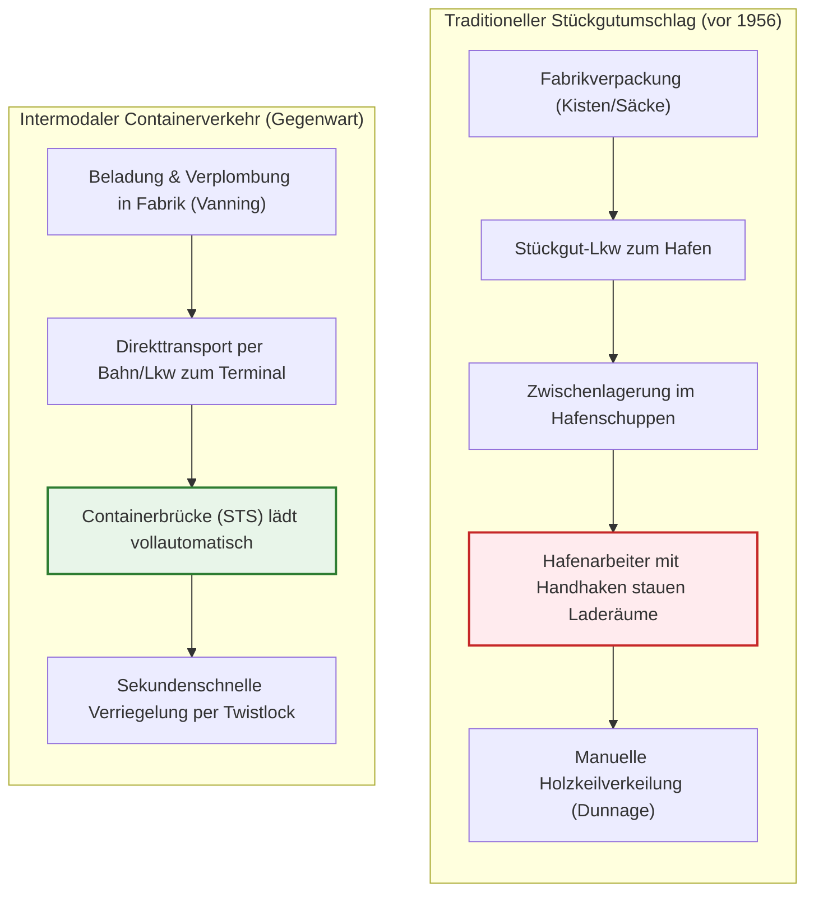
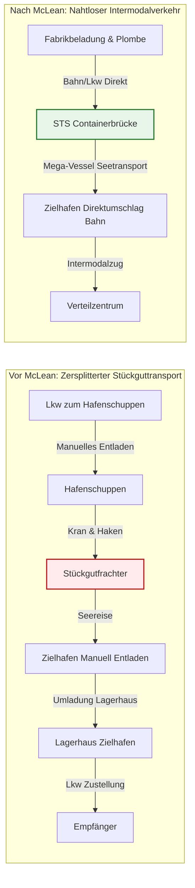
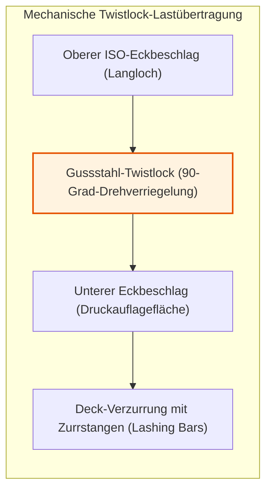
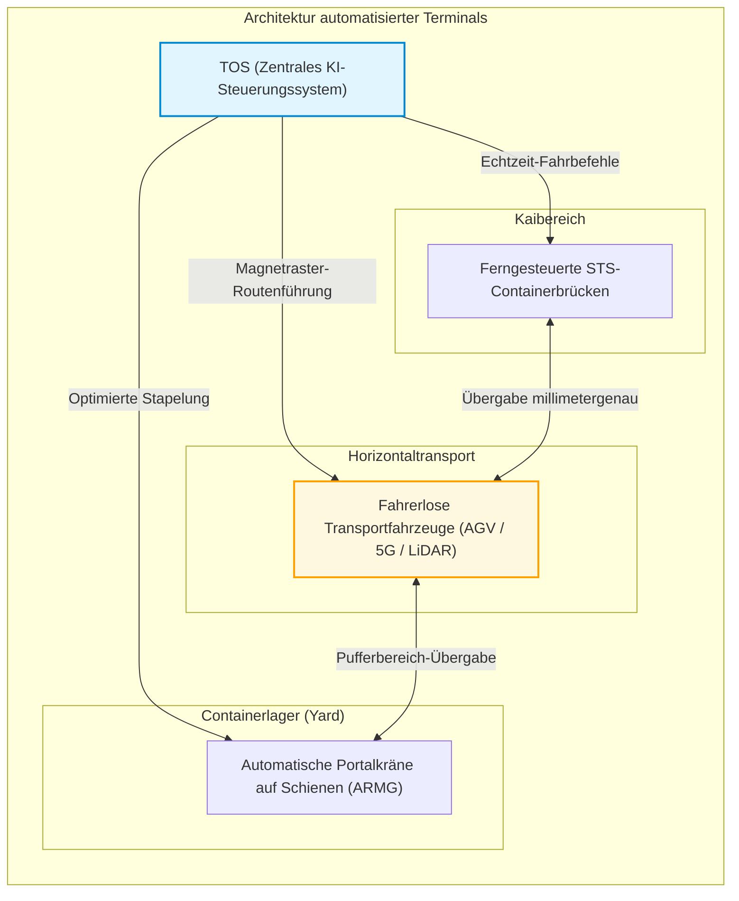
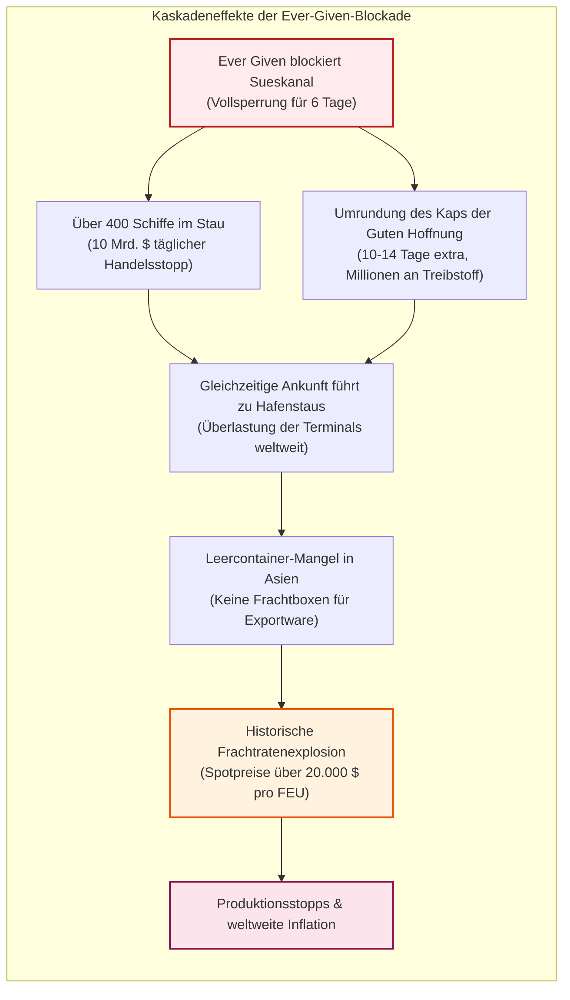

## Einleitung: Das größte Wirtschaftswunder der Moderne, geboren aus einer gewöhnlichen Stahlbox

Wenn Sie ein modernes Smartphone in den Händen halten, Kleidung tragen, die auf einem anderen Kontinent genäht wurde, oder Kaffee aus fernen Hochländern genießen, berühren Sie das greifbare Ergebnis der gewaltigsten physischen Maschinerie der Menschheitsgeschichte.

Das Fundament des heutigen Welthandels mit einem jährlichen Warenvolumen von über 25 Billionen Dollar ist weder das Frachtflugzeug Boeing 747 noch das transozeanische Glasfaserkabel. Es ist ein auf den ersten Blick banaler, aus gewelltem Cortenstahl verschweißter Quader: der **ISO-Standard-Seefrachtcontainer**.

Vor den 1950er-Jahren war der Überseehandel ein logistischer Albtraum von atemberaubender Ineffizienz. Ein konventioneller Stückgutfrachter verbrachte oft Wochen im Hafen. Hunderttausende von Hafenarbeitern (Stevedores) wuchteten Kisten, Fässer und Säcke mit bloßer Muskelkraft, Seilwinden und eisernen Handhaken in feuchte Laderäume. Die Umschlagskosten im Hafen machten über 50 % der gesamten Frachtkosten aus; Diebstahl und Bruch waren an der Tagesordnung.

Am 26. April 1956 veränderte ein US-amerikanischer Fuhrunternehmer namens **Malcom McLean** mit dem umgebauten Tanker *Ideal-X* die Welt für immer. Seine Idee war keine hochentwickelte Elektronik, sondern eine **systemische Abstraktion**: Die Entkopplung der Ladeeinheit vom Transportmittel und die Schaffung eines einheitlichen Behälterstandards für Lkw, Bahn und Schiff.

Binnen weniger Jahre stürzten die Umschlags- und Ladekosten pro Tonne Fracht von 5,83 Dollar auf 0,16 Dollar ab – ein dramatischer Rückgang um über 97 %. Die Seetransportkosten fielen im Endpreis der Güter auf vernachlässigbare 1 bis 2 % ab. Erst dieser Stahlkasten ermöglichte die transozeanische Arbeitsteilung, den wirtschaftlichen Aufstieg Asiens zur „Werkbank der Welt“ und die Globalisierung, wie wir sie heute kennen.

Dieser Leitfaden analysiert die mechanischen, ökonomischen und geopolitischen Dimensionen des Containers: von den brutalen Dockkämpfen über die ISO-Standardisierung bis hin zu den physikalischen Grenzen moderner Mega-Vessels und der Fragilität moderner Lieferketten.

---

## Kapitel 1: Jahrtausende der Ineffizienz – Die finstere Ära des Stückguts

### 1.1 Das Ökosystem des Ladehakens

Vor dem Container hatte sich die Grundstruktur der Seeschifffahrt seit den Phöniziern kaum verändert. Sämtliche Güter wurden als **Stückgut (Break-Bulk Cargo)** transportiert: Weinfässer, Getreidesäcke, Kisten mit Maschinenteilen, Tabakballen oder unverpackter Stahl.

Das zentrale Werkzeug der Hafenarbeit war der eiserne **Handhaken (Cargo Hook)**, den die Hafenarbeiter im Gürtel trugen. Mit ihm wurden Kisten gepackt, Säcke gewuchtet und Schiffsrümpfe Schicht für Schicht beladen. Um ein Verrutschen der Ladung bei schwerer See zu verhindern, mussten Lücken millimetergenau mit Holzbohlen, Keilen und Strohmatten ausgefüllt werden.

Diese Arbeit war nicht nur mörderisch schwer und unfallträchtig, sondern brachte mächtige, teils von der organisierten Kriminalität unterwanderte Gewerkschaftsstrukturen hervor (wie die International Longshoremen’s Association, ILA). Warenschwund (*Shrinkage*) war allgegenwärtig: In den 1950er-Jahren verschwanden in den Häfen von New York und London bis zu 15 % aller hochwertigen Konsumgüter (Whisky, Uhren, Textilien) spurlos.

### 1.2 „Schiffe verdienen nur auf See Geld“: Der strukturelle Ruin der Reeder

Eine alte Reeder-Weisheit besagt: **„Ein Schiff verdient nur Geld, wenn es auf See fährt; im Hafen frisst es Kapital.“**

Im Stückgutzeitalter verbrachten Frachtschiffe **50 % bis 65 % ihrer Lebensdauer unbeweglich an der Kaimauer**. Kapitalverzinsung, Besatzungslöhne und Liegegebühren liefen ununterbrochen weiter, während hunderte Arbeiter winzige Ladungsmengen manuell verstauten.

| Kennzahl | Stückgut-Ära (1950er-Jahre) | Container-Ära (2020er-Jahre) | Effizienzgewinn |
| :--- | :--- | :--- | :--- |
| **Umschlagleistung** | ca. 15 – 25 Tonnen / Gang-Stunde | > 1.000 – 2.000 Tonnen / Brückenstunde | Steigerung um **60- bis 100-fach** |
| **Liegezeit am Kai** | 10 – 14 Tage (bis zu 4 Wochen) | 12 – 24 Stunden | Reduktion um **> 90 %** |
| **Umschlagkostenanteil** | **50 % – 65 %** der Gesamtfracht | **10 % – 15 %** der Gesamtfracht | Kosten kollabieren dramatisch |
| **Ladungsverlust / Bruch** | Häufig **5 % – 15 %** | Unter **0,01 %** (Hochsicherheitsplombe) | Quasi eliminiert |

---

## Kapitel 2: Malcom McLeans Wagnis – Vom Fuhrunternehmer zur *Ideal-X*

### 2.1 Der Geistesblitz eines Truckers in Hoboken

Der Vater des modernen Containers, **Malcom McLean**, war kein Seemann und kein Schiffbauingenieur. Er begann als mittelloser Lkw-Fahrer in North Carolina und baute mit unbändigem Ehrgeiz die *McLean Trucking Company* zur fünftgrößten Spedition der USA auf.

1937 saß McLean in seinem mit Baumwollballen beladenen Lkw am Hafen von Hoboken, New Jersey. Er musste einen ganzen Tag lang tatenlos warten, während Arbeiter Ballen für Ballen mühsam vom Anhänger hievten. Dabei kam ihm der revolutionäre Gedanke:
> **„Warum laden wir die Ware überhaupt ab und wieder auf? Warum heben wir nicht einfach den gesamten Lkw-Aufbau vom Fahrgestell ab, setzen ihn auf das Schiff und kuppeln ihn am Zielort wieder an einen Lkw an?“**

Diese Idee markierte die Geburtsstunde des modernen **intermodalen Verkehrs**.

### 2.2 26. April 1956: Die historische Jungfernfahrt der *Ideal-X*

Um seine Vision umzusetzen, musste McLean gewaltige regulatorische Hürden überwinden. US-Gesetze verboten Speditionen den gleichzeitigen Besitz von Reedereien. McLean verkaufte kurzerhand sein gesamtes Lkw-Imperium und kaufte die hochverschuldete *Pan-Atlantic Steamship Corporation*.

Er erwarb den Weltkriegs-Tanker *Ideal-X* und ließ ein verstärktes Stahlgitterdeck über den Rohrleitungen montieren. Am 26. April 1956 wurden im Hafen von Newark, New Jersey, in weniger als acht Stunden 58 Aluminiumcontainer (33 Fuß lang) an Bord geladen.

Als das Schiff in Houston, Texas, anlegte und wartende Zugmaschinen die Container sofort auf den Highway zogen, sprach der ILA-Gewerkschaftsführer Freddy Fields die prophetischen Worte:
> **„Meine Herren, wir haben soeben unser eigenes Todesurteil unterschrieben.“**

### 2.3 Der vertikale Sturz der Ladekosten: Von $5,83 auf $0,16 pro Tonne

Die Zahlen der Jungfernfahrt versetzten die Finanzwelt in Staunen:
- Umschlagskosten für Stückgut: **5,83 Dollar pro Tonne**
- McLeans Containerumschlag: **0,158 Dollar pro Tonne (ca. 0,16 $)**

**Ein Kostenabsturz um 97,3 %!**

In der Transportökonomie beschreibt die folgende Gleichung die Gesamtkosten eines Transports:

$$C_{\text{transport}} = C_{\text{handling}} + C_{\text{sea}} + C_{\text{inland}} + C_{\text{inventory}}$$

Container minimierten $C_{\text{handling}}$ gegen null und drückten $C_{\text{inventory}}$ (die Kosten gebundenen Kapitals während des Transports) durch die Beseitigung der Hafenliegezeiten auf ein Minimum.

### 2.4 Der Vietnamkrieg und das „Wunder von Cam Ranh Bay“

Jede disruptive Technologie benötigt ein Katalysator-Ereignis. Für den Container war dies der **Vietnamkrieg**.

Als 1965 hunderttausende US-Soldaten nach Südvietnam verlegt wurden, brach die Logistik in Saigon zusammen. Schiffe lagen monatelang auf Reede; Nachschub verrottete an den Kais. US-Verteidigungsminister Robert McNamara beauftragte McLean mit dem Bau von Tiefwasser-Containerterminals in **Cam Ranh Bay**.

Das Ergebnis war spektakulär: Schiffe, deren Entladung zuvor 40 Tage gedauert hatte, wurden nun in **48 Stunden** gelöscht und traten die Rückreise an.

Entscheidend für die Weltwirtschaft war jedoch McLeans kaufmännischer Schachzug für den Rückweg: Um nicht mit leeren Boxen über den Pazifik zu fahren, ließ er die Schiffe in **Yokohama und Kobe** Zwischenstopps einlegen. Japanische Elektronik- und Motorradhersteller erhielten unschlagbar günstige Frachtraten nach Kalifornien. Damit begann der weltweite Siegeszug asiatischer Exportgüter.

---

## Kapitel 3: Der Kampf um die Norm – ISO-Standardisierung und Twistlock-Technik

### 3.1 Der Normenkrieg: 35 Fuß gegen 24 Fuß

In den Anfangsjahren versuchte jede Reederei, ein proprietäres Containersystem durchzusetzen:
- McLeans **Sea-Land**: **35-Fuß-Container** (maximale US-Straßenanhängerlänge im Osten).
- **Matson** (Hawaii-Linie): **24-Fuß-Container** (optimiert für schwere Zucker- und Ananasladungen).
- Andere Reeder nutzten 17- oder 8-Fuß-Boxen.

Kein Sea-Land-Container passte auf Matson-Schiffe oder -Krane. Der globale Handel drohte in inkompatible Silos zu zerfallen.

### 3.2 Die ISO-Kommission und die Geburt der „TEU“

1961 gründete die Internationale Organisation für Normung das technische Komitee **ISO/TC 104**. Nach jahrelangem Tauziehen zwischen europäischen Bahnen, Regierungen und US-Reedern entstand der weltweite **ISO 668-Standard**:
1. Breite: **8 Fuß (2,438 m)**
2. Höhe: **8 Fuß 6 Zoll (2,591 m)** (später ergänzt durch 9 Fuß 6 Zoll High-Cube)
3. Länge: **20 Fuß (6,058 m)** und **40 Fuß (12,192 m)**

Damit war die weltweite Recheneinheit geboren: **TEU (Twenty-foot Equivalent Unit)** und **FEU (Forty-foot Equivalent Unit)**.

1967 vollbrachte McLean eine historische Tat: Er gab die Patente auf **Eckbeschläge (Corner Castings)** und **Twistlocks** lizenzgebührenfrei für die gesamte Menschheit frei. Dieser Verzicht machte den Weg für die weltweite Akzeptanz frei.

### 3.3 Die Präzisionsmechanik von Twistlock und Eckbeschlag

Damit Container auf schwankenden Schiffen bis zu 10 Lagen hoch gestapelt werden können, sind an allen acht Ecken massive Gussstahlteile montiert: die **Corner Castings**. In diese greifen die mechanischen Drehverriegelungen, die **Twistlocks**.

Bei Seegang wirken Beschleunigungskräfte von bis zu $1,8 G$ durch Roll-, Stampf- und Gierbewegungen auf den Stapel.

Die mechanische Beanspruchung berechnet sich nach:

$$\sigma = \frac{F_{\text{tensile}}}{A_{\text{lock}}} \le \sigma_{\text{allowable}}, \quad \tau = \frac{F_{\text{shear}}}{A_{\text{lock}}} \le \tau_{\text{allowable}}$$

Die statische Druckbelastung auf die vier Eckpfosten des untersten Containers beträgt:

$$\sigma_{\text{stack}} = \frac{M_{\text{stack}} \cdot g}{4 \cdot A_{\text{corner}}}$$

Nach ISO 1496-1 muss ein einzelner Eckbeschlag einer vertikalen Last von mindestens **86.400 kg (ca. 848 kN)** standhalten – dies garantiert, dass tausende Tonnen Stahl selbst bei orkanartiger See stabil bleiben.

---

## Kapitel 4: Intermodaler Verkehr und digitale Infrastruktur

### 4.1 Das Wesen des Intermodalismus

Der Container fungiert als universelle **physische Schnittstelle (API)** für Straße, Schiene und Wasser. Vom Moment der Verplombung im Werk bis zum Auspacken im Empfängerlager bleibt die Fracht unberührt.

In Nordamerika revolutionierten **Double-Stack-Züge** den Hinterlandverkehr: Züge von über 3 km Länge transportieren hunderte Container doppelstöckig quer über die Rocky Mountains und fungieren als „Landbrücke“ zwischen Pazifik und Atlantik.

### 4.2 Von Papier-Konnossementen zu EDI und Smart TOS

Früher reiste das papierne **Konnossement (Bill of Lading, B/L)** oft langsamer als das Schiff, was zu teuren Verzögerungen führte. Seit den 1970ern synchronisiert **EDI (Electronic Data Interchange)** mit Standards wie CODECO und BAPLIE Frachtdaten weltweit in Millisekunden.

Moderne Terminals werden von KI-gestützten **Terminal Operating Systems (TOS)** wie Navis N4 gesteuert. Sie berechnen Schiffsstabilität, Metazentrumshöhe (GM) und optimale Lagerstrategien in Echtzeit.

---

## Kapitel 5: Megaschiffe, Verbrauchsphysik und autonome Terminals

### 5.1 Skaleneffekte: Von 1.000 zu 24.000 TEU

Die Frachtkapazität wuchs exponentiell:
- 1. Generation (1960er): **500 – 1.000 TEU**
- Panamax (1980er): **4.500 TEU** (Schleusenbreite 32,3 m)
- Post-Panamax (2000er): **8.000 – 10.000 TEU**
- Megamax / ULCV (2020er): **über 24.000 TEU** (z. B. *MSC Irina*, 400 m Länge, 61 m Breite)

Das ökonomische Ziel ist die Minimierung der Einheitskosten pro TEU:

$$C_{\text{unit}} = \frac{C_{\text{capital}} + C_{\text{crew}} + C_{\text{fuel}} + C_{\text{port}}}{Q_{\text{capacity}} \times \alpha_{\text{utilization}}}$$

Ein 24.000-TEU-Riese benötigt kaum mehr Besatzung (ca. 24 Personen) als ein Schiff mit 4.000 TEU. Die Personalkosten pro Container sinken um über 80 %.

### 5.2 Das Gesetz der 3. Potenz und Slow Steaming

Hydrodynamisch wächst die erforderliche Maschinenleistung $P$ mit der 3. Potenz der Schiffsgeschwindigkeit $V$:

$$P \propto V^3$$

Der tägliche Treibstoffverbrauch $F_{\text{day}}$ folgt derselben Gesetzmäßigkeit:

$$F_{\text{day}} = c \cdot \Delta^{2/3} \cdot V^3$$

Für die Gesamtreise (Distanz $D$) ergibt sich:

$$F_{\text{total}} = F_{\text{day}} \cdot T = \left( k \cdot V^3 \right) \cdot \left( \frac{D}{24 \cdot V} \right) = \frac{k \cdot D}{24} \cdot V^2$$

Wird die Geschwindigkeit von 24 auf 18 Knoten gedrosselt (25 % Temporeduktion, **Slow Steaming**), spart die Reederei:

$$\Delta F_{\text{total}} \approx 1 - \left( \frac{18}{24} \right)^2 = 1 - 0,5625 = 43,75\%$$

**25 % weniger Geschwindigkeit spart fast 44 % Treibstoff!**

### 5.3 Vollautomatisierte Terminals: Die Ära der AGVs

Moderne Terminals (z. B. Hamburg-Altenwerder, Rotterdam Maasvlakte II, Shanghai Yangshan) arbeiten weitgehend menschenleer:

1. **Remote-STS**: Brückenfahrer steuern per Joystick und 4K-Kameras aus klimatisierten Büros.
2. **AGVs**: Autonome Fahrzeuge navigieren mit Lasersensoren und Transpondern auf Zentimeter genau.
3. **ARMG-Kräne**: Stapeln Container nachts vollautomatisch um (*Housekeeping*), damit morgens keine Wartezeiten entstehen.

### 5.4 Die drei Allianzen und das globale Oligopol

Wegen der immensen Investitionen (150–200 Mio. $ pro Schiff) beherrschen **drei Allianzen** über 80 % des weltweiten Linienverkehrs:
1. **2M**: Maersk & MSC (im Umbruch)
2. **Ocean Alliance**: COSCO, CMA CGM, Evergreen, OOCL
3. **THE Alliance / Premier Alliance**: ONE, HMM, Yang Ming

---

## Kapitel 6: Globale Krisen und die Fragilität der Lieferketten

### 6.1 Die Just-in-Time-Falle

Verlässliche Containerfahrpläne ermöglichten die weltweite Einführung von **Just-in-Time (JIT)**. Lagerbestände wurden drastisch reduziert – „die Schiffe auf dem Ozean sind das rollende Lagerhaus“.

Diese Effizienz beruht jedoch auf der fragilen Annahme ununterbrochener Ketten ohne jede Störung.

### 6.2 Die Havarie der *Ever Given* im Sueskanal 2021

Am 23. März 2021 blockierte das 20.000-TEU-Schiff *Ever Given* den Sueskanal für sechs Tage.

Die Blockade fror täglich Waren im Wert von 10 Milliarden Dollar ein. Nach der Freigabe kam es zu weltweitem Containermangel und astronomischen Frachtraten.

### 6.3 Geopolitische Engpässe: Panama-Dürre und Rotes Meer

1. **Panama-Kanal**: Dürre im Gatún-See zwang zur Reduzierung der Durchfahrten um 40 %.
2. **Krise im Roten Meer**: Angriffe der Huthi-Miliz zwingen Schiffe zur Route um Afrika, was 10–14 Tage extra bedeutet und 15 % der globalen Kapazitäten bindet.

Die materielle Zivilisation hängt nach wie vor von wenigen geographischen Nadelöhren ab.

---

## Kapitel 7: Fazit – Die Zukunft der Zivilisation in der Stahlbox

### 7.1 Was wahre Innovation bedeutet

Die wichtigste Lehre des Containers:
**Wahre weltverändernde Innovationen sind selten extrem komplexe High-Tech-Erfindungen, sondern radikale Standardisierungen, die Schnittstellenreibung auf null senken.**

Wie TCP/IP heterogene Rechnernetze zum globalen Internet verband, fungiert der Container als universelles „physisches Datenpaket“ der materiellen Welt.

### 7.2 Dekarbonisierung und Resilienz

Um die IMO-Ziele für 2050 (Netto-Null-Treibhausgase) zu erreichen, stellen Reeder ihre Flotten auf **grünes Methanol, LNG und Ammoniak** um. Zudem vollzieht die Industrie den Wandel von *Just-in-Time* zu *Just-in-Case*.

Doch wie immer Schiffe angetrieben und gesteuert werden: Die standardisierte Box aus Cortenstahl bleibt das unerschütterliche Skelett des globalen Wohlstands.
