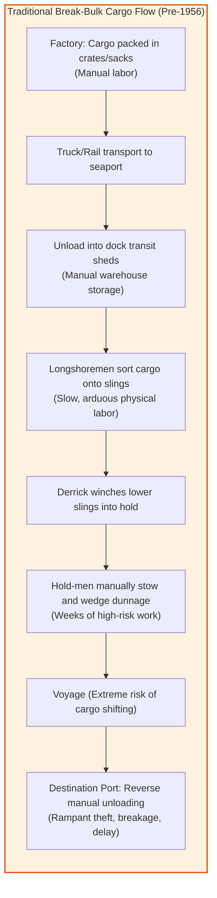
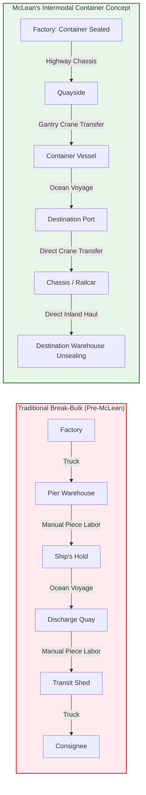
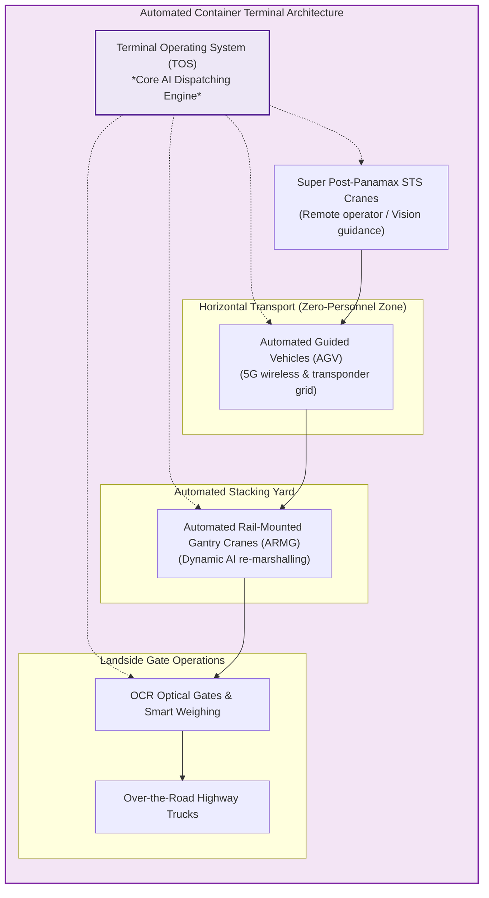
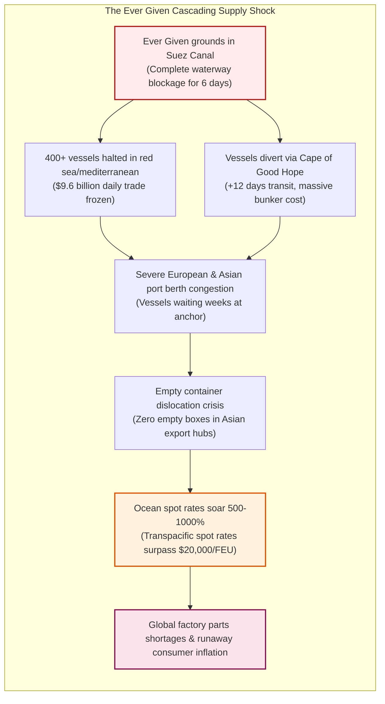

## Introduction: The Greatest Miracle in Economic History Born from an Ordinary Box

Look around your immediate environment. The smartphone resting on your desk, the cotton shirt you wear, the LED fixture illuminating your ceiling, or the roasted coffee beans in your kitchen—virtually every physical artifact of modern existence was manufactured thousands of miles away in distant industrial centers or agricultural heartlands.

To modern citizens, receiving consumer goods fabricated on the opposite side of the planet at negligible cost within mere days of placing an order is as unremarkable as drawing breath. Yet rewind history a mere seven decades, and this seamless global integration was not merely difficult; it was physically and economically impossible.

Historically, the paramount bottleneck stifling international commerce was neither protective tariff walls nor violent oceanic storms. It was the **desperately inefficient, back-breaking physical labor of loading cargo into a ship and unloading it onto a pier**.

Barrels, jute sacks, wooden crates, and steel drums—irregular, loose cargo hoisted on the backs of longshoremen (stevedores) and lowered into cavernous holds via simple rope slings. Vessels spent vastly more time languishing idle at docks awaiting manual stowage than actually traversing the oceans. Pilferage, cargo damage, and demurrage consumed well over half of all ocean shipping expenditures. In that era, the concept of a synchronized global supply chain was an economic impossibility.

The humble innovation that dismantled millennia of maritime inefficiency and catalyzed the explosive engine of modern globalization was nothing more than **an unadorned, corrugated steel box measuring 20 or 40 feet in length: the intermodal shipping container**.

```
"The container’s significance lies not in the box itself,
but in its creation of an entirely integrated, automated transport system
linking ships, trains, trucks, cranes, and data networks into a unified whole."
— Marc Levinson, Economist and Author of "The Box"
```

If the steam engine conquered terrestrial distance and the internet dissolved informational delay, the shipping container **reduced the friction and cost of moving physical goods virtually to zero**. Containerization collapsed transportation costs to mere pennies per item—often less than one percent of a manufactured product's retail value. Consequently, multinational corporations could distribute manufacturing across global nodes based on competitive labor, materials, and technological expertise, laying the infrastructure for Japan, the Asian Tiger economies, and China to rise as the workshops of the world.

Yet in the twenty-first century, this ruthless optimization has revealed severe, systemic vulnerabilities. The 2021 grounding of the 20,000 TEU *Ever Given* in the Suez Canal, historic droughts constraining the Panama Canal, and geopolitical attacks in the Red Sea diverting fleets around the Cape of Good Hope have demonstrated that our hyper-efficient civilization rests upon a fragile, brittle chain of steel boxes.

This treatise explores the comprehensive history, maritime engineering, microeconomics, and geopolitical dynamics of the global shipping container revolution.

---

## Chapter 1: Millennia of Inefficiency: The Dark Era of Break-Bulk Cargo and Dock Labor

### 1.1 The Ecosystem of the Cargo Hook

Until the mid-1950s, maritime freight transport remained virtually indistinguishable from the methods employed by ancient Phoenician galleys or eighteenth-century East Indiamen. In maritime parlance, this traditional methodology is designated as **break-bulk cargo handling**.

Under the break-bulk regime, commodities arrived at the docks in a dizzying chaos of dimensions: bales of cotton, wooden crates of machine components, barrels of liquor, bags of grain, glass sheets, and drums of chemicals. 

Stowing this disparate cargo required massive gangs of dockworkers known as **stevedores or longshoremen**. Equipped with iron cargo hooks slung from their belts, they manually hauled bags, hoisted crates, assembled slung pallets, and signaled shipboard derrick winches to swing cargo into the dark holds. Below deck, gangs of hold-men packed the cargo by hand, wedging raw lumber (**dunnage**) into every crevice to prevent shifting during oceanic transit.



Loading a standard 10,000-ton freighter required days or weeks of round-the-clock manual exertion by hundreds of laborers. Arriving at the destination port, the entire agonizing ritual had to be repeated in reverse.

### 1.2 "Ships Only Earn Money at Sea": The Economic Sclerosis of Break-Bulk Shipping

In maritime economics, it is axiomatic that a commercial vessel generates revenue only when underway at sea. In the break-bulk era, however, cargo freighters spent **50 to 60 percent of their operational lifespans tethered to quaysides**, waiting for cargo to be painstakingly packed or unpacked.

Throughout these protracted port calls, capital depreciation, crew wages, insurance premiums, and harbor dues accrued relentlessly. Moreover, two systemic plagues eroded profits: **breakage and pilferage**.
Liquor, luxury garments, precision tools, and tobacco were routinely stolen on the docks; in mid-twentieth-century New York Harbor, longshoremen’s households were notoriously well-supplied with contraband goods. Packaging costs were exorbitant, and marine insurance rates reflected the staggering casualty rate of dropped crates and water-damaged textiles.

> [!WARNING]
> **The Invisible Tariff of Transport Costs**
> In the early 1950s, moving manufactured goods from a US factory to European distributors frequently incurred freight and handling costs equal to **25% to 50% of the factory-gate production price**. Terminal handling friction constituted a greater trade barrier than national tariffs.

---

## Chapter 2: Malcom McLean's Gambol: The Ideal-X and the Intermodal Genesis

### 2.1 A Trucker's Heresy: "Why Unload the Cargo?"

The individual who shattered this centuries-old impasse was neither an admiral nor a naval architect, but a southern trucking entrepreneur: **Malcom Purcell McLean (1913–2001)**.

Born into rural poverty in North Carolina during the Great Depression, McLean bought a second-hand truck in 1934 and built McLean Trucking into one of the largest transport empires in the United States. McLean’s foundational insight struck him as early as 1937, while waiting hours at a Jersey City pier for dockworkers to manually unload cotton bales from his trailer:

```
"Why do we waste days unloading cargo from a truck trailer, 
only to hoist it piece-by-piece into a ship's hold, 
and then pack it back into another truck at the other end? 
Why not simply hoist the entire trailer body onto the ship?"
```

At the time, rail, trucking, and maritime shipping functioned as hostile, hermetically sealed industries regulated by separate bureaucracies and entrenched unions. Shipping executives viewed themselves strictly as custodians of vessels, indifferent to landward transit. McLean discarded this parochial view, conceptualizing transport as a **seamless, end-to-end freight distribution pipeline**.

### 2.2 April 26, 1956: The Historic Voyage of the *Ideal-X*

Circumventing Interstate Commerce Commission (ICC) antitrust laws that barred trucking firms from owning maritime lines, McLean divested his trucking empire and acquired Pan-Atlantic Steamship Corporation (later rechristened **Sea-Land Service**).

McLean purchased surplus World War II T-2 tankers and retrofitted the *Ideal-X* with a reinforced spardeck designed to lock 33-foot aluminum container bodies above the piping.



On April 26, 1956, amid the industrial docks of Port Newark, New Jersey, a shore crane hoisted 58 containers onto the deck of the *Ideal-X* in less than eight hours. As the vessel sounded its horn bound for Houston, Texas, an watching International Longshoremen's Association (ILA) official remarked: *"I’d like to sink that bastard."*

### 2.3 The Vertical Collapse of Loading Costs: From $5.83 to $0.16 per Ton

The empirical data generated by the *Ideal-X* devastated traditional maritime economics:
- Break-bulk handling cost: **$5.83 per ton**
- *Ideal-X* containerized handling cost: **$0.158 per ton**

Loading expenses experienced an astounding **97 percent reduction**, while port dwell times contracted from weeks to hours. Vessels achieved unprecedented operational velocity, transforming the economics of global trade forever.

### 2.4 The Vietnam War and Cam Ranh Bay: The Catalyst for Global Diffusion

While containerization gained traction along US coastlines, international shipowners resisted the colossal capital expenditures required for purpose-built vessels and automated quays. The historical event that converted containerization into an irreversible global standard was the logistics nightmare of the **Vietnam War (1965–1970)**.

As American forces surged into Indochina, hundreds of break-bulk freighters anchored off Saigon and Da Nang, waiting months to discharge military supplies. Rations rotted in tropical monsoon rains, ammunition crates were plundered, and military logistics faced imminent paralysis.

In 1966, the Pentagon commissioned Malcom McLean to construct container terminals at Cam Ranh Bay and Qui Nhon. Sea-Land deployed container ships that discharged combat cargo in hours rather than months, eliminating theft and supply line breakage. 

Crucially, McLean leveraged the return leg. Instead of sailing empty containers directly back to California, Sea-Land vessels routed via **Yokohama and Kobe, Japan**. Japanese consumer electronics, motorcycles, and textiles were packed into empty containers and dispatched to North American markets at record speed and minimal cost, jump-starting East Asia’s export-led economic miracle.

---

## Chapter 3: Standards as Geopolitical Hegemony: ISO Standardization and Twistlock Engineering

### 3.1 The Standards War: 35ft vs 24ft

Following Sea-Land's success, competing carriers adopted divergent proprietary container sizes:
- **Sea-Land (McLean)**: 35-foot length (conforming to eastern US highway weight regulations)
- **Matson Navigation**: 24-foot length (optimized for Pacific West Coast and Hawaiian agriculture)
- **European Railroads**: Proprietary, smaller metric boxes suited to narrow tunnel clearances

Without universal geometric uniformity, cranes, ship holds, railcars, and highway chassis could not interlock. The International Organization for Standardization (ISO) convened Technical Committee 104 (ISO/TC 104) in 1961, initiating fierce international debates.

In 1968, the compromise that birthed modern globalization was ratified:
- **Width**: Standardized at 8 feet (2,438 mm)
- **Height**: Standardized at 8 feet 6 inches (2,591 mm) [later accommodating 9ft 6in High Cubes]
- **Lengths**: Standardized at **20 feet (6,058 mm)** and **40 feet (12,192 mm)**

```
【The Global Unit of Shipping: TEU Explained】
The Twenty-foot Equivalent Unit (1 TEU) represents a standard 20×8×8.5 ft container.
A 40-foot container equals 2 TEU (or 1 FEU: Forty-foot Equivalent Unit).
All vessel carrying capacities, port throughput metrics, and global shipping statistics 
are denominated in TEU.
```

McLean famously relinquished his proprietary patents on container corner fittings, offering them royalty-free to the ISO. He understood that global market expansion outweighed short-term licensing monopolies.

### 3.2 The Precision Mechanics of Corner Castings and Twistlocks

The mechanical linchpin of global shipping is the **Corner Casting**—an alloy steel block welded into all eight corners of a container—and the **Twistlock** mechanism that secures them.

```
       [ Corner Casting Block ]
            ┌─────────┐
            │  ( O )  │  ← Elongated Aperture
            └─────────┘
                 ▲
                 │
            ┌─────────┐
            │   ─┬─   │  ← Conical Twistlock Head
            │    ┴    │     rotates 90° to lock
            └─────────┘
```

During winter North Pacific voyages, container vessels roll dynamically up to 30 degrees. Deck stacks reach **7 to 10 tiers high (over 20 meters tall)**, subjecting bottom-tier corner fittings to simultaneous compressive, tensile, and horizontal shear forces.

The governing mechanical stress equations for securing twistlocks are:

$$\sigma = \frac{F_{\text{tensile}}}{A_{\text{lock}}} \le \sigma_{\text{allowable}}, \quad \tau = \frac{F_{\text{shear}}}{A_{\text{lock}}} \le \tau_{\text{allowable}}$$

Where $\sigma$ represents tensile stress, $\tau$ represents shear stress, and $A_{\text{lock}}$ is the cross-sectional shear area of the twistlock shaft.

The spreader of a ship-to-shore (STS) gantry crane drops onto the container corners; hydraulic actuators rotate the twistlocks 90 degrees with a crisp metallic click. Within 30 seconds, a 30-ton box is locked with millimeter-level geometric precision, enabling rapid, automated crane cycles.

---

## Chapter 4: The Physical and Digital Architecture of Intermodal Freight

### 4.1 Intermodalism: Eliminating the Friction of Cargo Transfer

The container achieved the seamless integration of **Ship, Rail, and Road**. Once packed and sealed with a tamper-evident bolt seal at an inland factory, cargo moves across thousands of miles without ever being handled directly.

In North America, intermodalism reached its zenith with the development of the **Double-Stack Railcar**. Intermodal trains stretching over 3 kilometers in length carry over 500 containers stacked two-high across the Rocky Mountains, functioning as an inland "Landbridge" connecting Pacific seaports directly to Chicago, Memphis, and New York.

```mermaid
flowchart LR
    subgraph Origin["Origin (Asian Factory)"]
        Factory["Factory Vanning<br/>(Stuffing & Bolt Seal)"]
        Truck1["Drayage Trucking"]
        Factory --> Truck1
    end

    subgraph PortOut["Export Hub Port"]
        GateIn["Gate-In & Container Yard"]
        GantryOut["STS Gantry Crane Loading"]
        GateIn --> GantryOut
    end

    subgraph OceanVoyage["Ocean Trunk Transit"]
        MegaVessel["Ultra-Large Container Vessel<br/>(Trans-Pacific / Asia-Europe)"]
    end

    subgraph PortIn["Import Gateway Port"]
        GantryIn["Discharge & Railhead Staging"]
        RailOut["On-Dock Rail Transfer"]
        GantryIn --> RailOut
    end

    subgraph Destination["Inland Destination & Distribution"]
        DoubleStack["Double-Stack Rail Corridors<br/>(Coast-to-Coast 3,000+ km)"]
        Truck2["Last-Mile Drayage"]
        DC["Fulfillment Center & Retail Shelf"]
        DoubleStack --> Truck2
        Truck2 --> DC
    end

    Truck1 --> GateIn
    GantryOut --> MegaVessel
    MegaVessel --> GantryIn
    RailOut --> DoubleStack

    style OceanVoyage fill:#e3f2fd,stroke:#1565c0,stroke-width:2px
    style Destination fill:#e8f5e9,stroke:#2e7d32,stroke-width:2px
```



### 4.2 Digital Orchestration: From Bills of Lading to AI-Driven TOS

Physical standardization demanded informational synchronization. From early Electronic Data Interchange (EDI) protocols in the 1970s to modern cloud-based **Terminal Operating Systems (TOS)**, algorithms calculate ship stability, hydrostatic trim, and container stacking plans in milliseconds, eliminating human stowage errors.

---

## Chapter 5: Mega-Ship Hydrodynamics and Automated Marine Terminals

### 5.1 The Scaling Law of Ultra-Large Container Vessels (ULCV)

The per-TEU unit voyage cost $C_{\text{unit}}$ is governed by the economies of scale:

$$C_{\text{unit}} = \frac{C_{\text{capital}} + C_{\text{crew}} + C_{\text{fuel}} + C_{\text{port}}}{Q_{\text{capacity}} \times \alpha_{\text{utilization}}}$$

Doubling vessel capacity requires negligible additional crew (a 24,000 TEU vessel operates with merely 20 to 25 mariners). Modern ULCVs (such as the *MSC Irina*, boasting 24,346 TEU) span **400 meters in length and 61.5 meters in beam**, carrying cargo equivalent to millions of retail products in a single transit.

### 5.2 The Cubic Velocity Law and Slow Steaming

Marine resistance scales quadratically with speed, while required propulsion power $P$ scales with the cube of velocity:

$$P \propto V^3$$

Daily bunker fuel consumption $F_{\text{day}}$ follows:

$$F_{\text{day}} = c \cdot \Delta^{2/3} \cdot V^3$$

By reducing service speeds from 25 knots to **17–18 knots ("Slow Steaming")**, global carriers slashed fuel consumption by over 50 percent, curbing operational costs and emissions.

### 5.3 Automated Terminal Architecture: AGVs and Neural Networks



At deepwater terminals like Rotterdam’s Maasvlakte II and Shanghai’s Yangshan Phase IV, automated guided vehicles (AGVs) navigate via thousands of magnetic transponders embedded in the concrete, while Automated Rail-Mounted Gantry Cranes (ARMGs) stack boxes with mathematical precision 24 hours a day without human personnel on the apron.

### 5.4 Global Shipping Alliances and Oligopolistic Consolidation

Building and deploying fleets of 24,000 TEU vessels requires billions in capital and disciplined slot management. Today, three global alliances control over 80 percent of East-West container capacity:
1. **2M Alliance** (MSC, Maersk)
2. **Ocean Alliance** (CMA CGM, COSCO, Evergreen, OOCL)
3. **THE Alliance / Premier Alliance** (ONE, HMM, Yang Ming)

While pooling vessels ensures weekly departure frequencies, it concentrates market pricing power, raising regulatory scrutiny worldwide.

---

## Chapter 6: Supply Chain Geopolitics and Fragility

### 6.1 The Fragility of Just-in-Time (JIT) Supply Chains

The absolute reliability of maritime transport enabled global manufacturers to adopt **Just-in-Time (JIT)** manufacturing. Eliminating safety inventory, factories treated container ships at sea as floating warehouses. Yet this hypersensitive design assumed that maritime conduits would never clog.

### 6.2 The 2021 *Ever Given* Crisis: Anatomy of a Global Choke Point



When the 20,000 TEU *Ever Given* lodged diagonally across the Suez Canal in March 2021, it bottlenecked 12 percent of global trade for six days. The resulting berth congestion in Europe and empty container starvation in Asia triggered record rate spikes exceeding $20,000 per 40ft box, driving severe global inflation.

### 6.3 Choke Point Geopolitics: Panama Drought and Red Sea Crisis

In the mid-2020s, maritime choke points remain fraught:
- **Panama Drought**: El Niño-induced lake depletion forced the Panama Canal Authority to restrict vessel transits from 36 to 20 daily, curbing cargo drafts.
- **Red Sea Attacks**: Houthi drone and missile strikes forced major carriers to reroute around Africa's Cape of Good Hope, adding thousands of nautical miles, burning millions in extra bunker fuel, and straining global logistics resilience.

---

## Chapter 7: Conclusion: The Steel Box and the Future of Civilization

The ultimate lesson of the shipping container is profound: **The innovations that reshape human history are rarely complex gadgets; they are universal, standardized systems**.

The shipping container is simply a corrugated steel box. Its genius was transforming global commerce into a standardized, friction-free physical internet, where a container serves as the physical packet routed across global networks.

As international shipping embarks on the urgent transition toward zero-carbon fuels (green methanol, ammonia, LNG) and supply chains pivot from "Just-in-Time" to "Just-in-Case," the physical foundation of our civilization remains unchanged: an eight-by-eight-by-forty-foot steel box, endlessly sailing across the oceans of the world.
