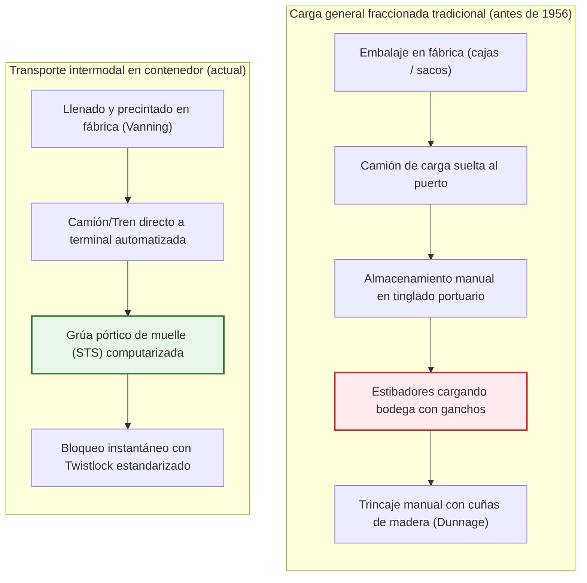
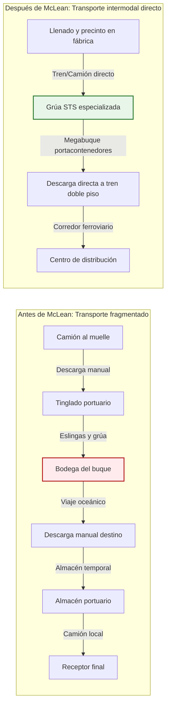
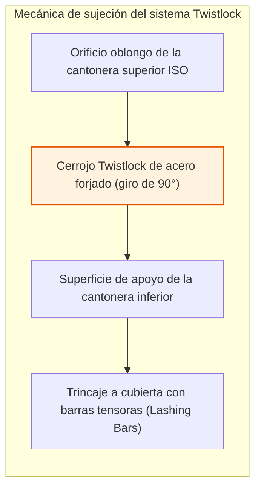
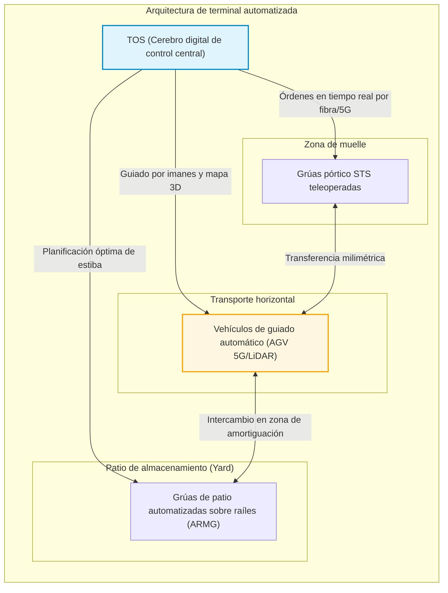
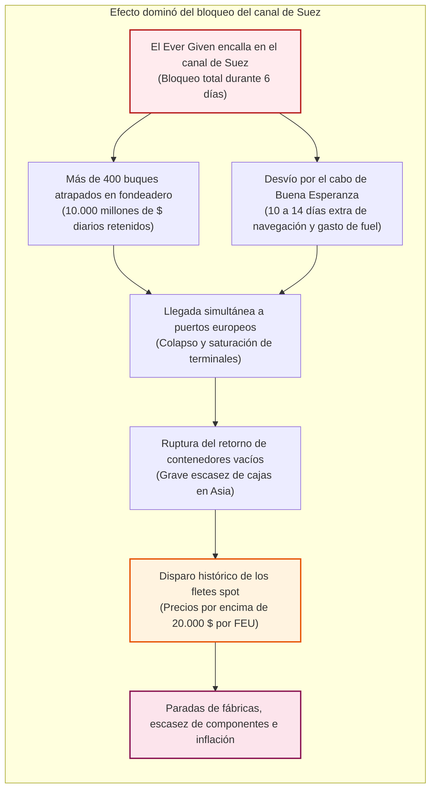

## Introducción: El mayor milagro económico moderno nacido de una modesta caja de acero

Cuando sostienes un smartphone en tus manos, vistes una prenda confeccionada en otro continente o disfrutas de un café cultivado a diez mil kilómetros de distancia, estás tocando el fruto tangible de la maquinaria física más colosal de la historia humana.

La base que sostiene el comercio mundial actual de más de 25 billones de dólares anuales no es el avión de carga Boeing 747 ni las redes submarinas de fibra óptica. Es un prisma rectangular aparentemente anodino hecho de planchas de acero Corten soldadas: el **contenedor marítimo estandarizado ISO**.

Antes de la década de 1950, el transporte de mercancías a través de los océanos era una pesadilla desesperadamente ineficiente. Un carguero convencional pasaba semanas amarrado al muelle. Cientos de estibadores portuarios movían cajas, sacos y barriles a mano o con cabrestantes y ganchos de acero hacia bodegas húmedas y asfixiantes. Los costes de manipulación portuaria superaban el 50 % del flete total, y los robos y roturas eran endémicos.

El 26 de abril de 1956, un empresario estadounidense de camiones llamado **Malcom McLean** rompió este estancamiento milenario con un petrolero adaptado, el *Ideal-X*. Su genialidad no fue una tecnología electrónica compleja, sino una **abstracción sistémica**: separar la unidad de carga del medio de transporte y crear un recipiente estándar compatible con camiones, trenes y barcos.

En pocos años, el coste de manipular una tonelada de carga se desplomó de 5,83 dólares a solo 0,16 dólares, una reducción fulminante de más del 97 %. El transporte marítimo pasó a representar apenas el 1 o 2 % del precio final de los bienes de consumo. Esta caja de acero hizo posible la deslocalización manufacturera, el milagro industrial de Asia y la globalización moderna.

---

## Capítulo 1: Milenios de ineficiencia — La era oscura de la carga general

### 1.1 El ecosistema dominado por el gancho de estibador

Antes de la llegada del contenedor, el transporte marítimo apenas había cambiado en lo esencial desde los tiempos de los fenicios. Toda la mercancía viajaba como **carga general fraccionada (Break-Bulk Cargo)**: barriles de vino, fardos de algodón, sacos de café o cajas de repuestos.

La herramienta reina del muelle era el afilado **gancho de estibador (Cargo Hook)** que los trabajadores llevaban al cinto. Con él clavaban los sacos, volteaban las cajas y apilaban la carga en las entrañas del barco. Para evitar que la carga se moviese durante las tormentas, era necesario calzar cada rincón con maderas, tablas y paja (*dunnage*).

Este trabajo peligroso y extenuante originó sindicatos herméticos y a menudo vinculados al crimen organizado (como la International Longshoremen's Association, ILA). El robo de mercancías (*shrinkage*) era una práctica generalizada: en la década de 1950, en los puertos de Nueva York o Londres, entre el 10 % y el 15 % de los productos valiosos (whisky, relojes, medias de nailon) desaparecía misteriosamente en el muelle.

### 1.2 «Los barcos solo ganan dinero en el mar»: La ruina estructural de las navieras

Un viejo axioma de la navegación afirma: **«Un barco solo gana dinero cuando navega por el mar; en el puerto devora capital.»**

En la era de la carga fraccionada, los cargueros pasaban entre el **50 % y el 65 % de su vida útil amarrados en el muelle** esperando ser cargados o descargados. La depreciación del buque, los sueldos de la tripulación y las tarifas de atraque corrían sin generar valor alguno.

| Indicador | Carga tradicional fraccionada (años 50) | Carga en contenedor (años 2020) | Salto de eficiencia |
| :--- | :--- | :--- | :--- |
| **Rendimiento de estiba** | ~ 15 – 25 toneladas / cuadrilla / hora | > 1.000 – 2.000 toneladas / grúa / hora | Mejora de **60 a 100 veces** |
| **Estancia en muelle** | 10 – 14 días (hasta un mes) | 12 – 24 horas | Reducción de tiempo **> 90 %** |
| **Coste portuario relativo** | **50 % – 65 %** del flete total | **10 % – 15 %** del flete total | Desplome drástico de costes |
| **Averías y sustracciones** | Frecuentemente **5 % – 15 %** | Menos del **0,01 %** (precinto de seguridad) | Daños casi nulos |

---

## Capítulo 2: La audacia de Malcom McLean y la odisea del *Ideal-X*

### 2.1 La revelación de un camionero en Hoboken

El padre del contenedor moderno, **Malcom McLean**, no procedía del mundo marítimo. Empezó con un único camión de segunda mano en Carolina del Norte y levantó con tenacidad la *McLean Trucking Company*, una de las mayores empresas de transporte por carretera de EE. UU.

En 1937, mientras esperaba un día entero en el muelle de Hoboken (Nueva Jersey) a que los estibadores descargaran fardo a fardo su camión de algodón, tuvo una idea revolucionaria:
> **«¿Por qué tenemos que descargar y volver a cargar la mercancía? ¿Por qué no levantamos la caja del camión completa con una grúa, la ponemos en la cubierta del barco y la volvemos a enganchar a otro camión en el puerto de destino?»**

Aquella idea elemental fue la chispa del **transporte intermodal**.

### 2.2 26 de abril de 1956: La histórica travesía del *Ideal-X*

Para materializar su visión, McLean sorteó duras leyes antimonopolio que prohibían a empresas de camiones poseer navieras. Vendió su empresa de transporte terrestre y adquirió la endeudada *Pan-Atlantic Steamship Corporation*.

Compró el petrolero T-2 de la Segunda Guerra Mundial, el ***Ideal-X***, e instaló una cubierta de vigas de acero sobre sus tuberías. El 26 de abril de 1956, en Newark (Nueva Jersey), cargó 58 contenedores de aluminio de 33 pies en menos de ocho horas. El barco partió hacia Houston, Texas.

A su llegada, los camiones acoplaron las cajas de inmediato y salieron a la autopista. Freddy Fields, líder del sindicato de estibadores, sentenció al presenciarlo:
> **«Caballeros, acabamos de firmar nuestra sentencia de muerte.»**

### 2.3 El colapso vertical de costes: De $5,83 a $0,16 por tonelada

Las cifras económicas del viaje asombraron a Wall Street:
- Coste de carga convencional: **5,83 dólares por tonelada**
- Coste con el contenedor de McLean: **0,158 dólares por tonelada (~ 0,16 $)**

**¡Un desplome directo del 97,3 %!**

El coste total del transporte intermodal responde a la ecuación:

$$C_{\text{transport}} = C_{\text{handling}} + C_{\text{sea}} + C_{\text{inland}} + C_{\text{inventory}}$$

El contenedor redujo $C_{\text{handling}}$ prácticamente a cero y comprimió $C_{\text{inventory}}$ al acortar los tiempos de escala portuaria de semanas a horas.

### 2.4 La Guerra de Vietnam y el «milagro de Cam Ranh»

Toda tecnología disruptiva necesita un gran suceso como catalizador. Para el contenedor, fue la **Guerra de Vietnam**.

En 1965, la llegada masiva de tropas estadounidenses provocó un colapso logístico sin precedentes en el puerto de Saigón. Cientos de buques fondeaban durante meses en el delta del Mekong y los suministros se pudrían al aire libre.

El secretario de Defensa Robert McNamara contrató a McLean. Sea-Land construyó terminales de contenedores en aguas profundas en **Cam Ranh Bay**. Los barcos convencionales tardaban 40 días en ser descargados; los buques de McLean lo hacían en tan solo **48 horas**.

Además, McLean aprovechó el viaje de regreso de los barcos vacíos: los desvió hacia los puertos de **Yokohama y Kobe**, donde cargó radios, televisores y motocicletas japonesas con destino a California a precios extraordinariamente reducidos. Nacía la primera ruta regular transpacífica de contenedores.

---

## Capítulo 3: La hegemonía de las normas — Estandarización ISO y mecánica del Twistlock

### 3.1 La guerra de las medidas: 35 pies frente a 24 pies

En los primeros años, cada naviera intentó imponer su formato:
- **Sea-Land** de McLean utilizaba contenedores de **35 pies** (longitud máxima de los remolques en la costa este).
- **Matson** (línea de Hawái) apostó por **24 pies** (optimizado para cargas pesadas de piña y azúcar).

La incompatibilidad entre navieras amenazaba con fragmentar el transporte mundial en compartimentos estancos.

### 3.2 La norma ISO y el nacimiento del TEU

En 1961, la Organización Internacional de Normalización creó el comité **ISO/TC 104**. En 1968 se acordó la histórica norma **ISO 668**:
1. Anchura: **8 pies (2,438 m)**
2. Altura: **8 pies y 6 pulgadas (2,591 m)** (posteriormente High Cube de 9'6")
3. Longitudes estándar: **20 pies (6,058 m)** y **40 pies (12,192 m)**

Así nació la unidad mundial de medida: el **TEU (Twenty-foot Equivalent Unit)** y el **FEU (Forty-foot Equivalent Unit)**.

En 1967, McLean tomó una decisión histórica: liberó de forma altruista y gratuita todas las patentes de las **piezas de esquina (Corner Castings)** y los **mecanismos de cierre (Twistlocks)** para toda la humanidad.

### 3.3 Ingeniería de precisión de las cantoneras y el Twistlock

Para apilar contenedores hasta diez alturas en buques sacudidos por temporales extremos, el secreto radica en las cantoneras de acero fundido situadas en los ocho vértices del contenedor: las **Corner Castings** y sus cierres giratorios, los **Twistlocks**.

Durante la navegación, las fuerzas dinámicas por balanceo, cabeceo y guiñada alcanzan aceleraciones de hasta $1,5 \sim 1,8 G$.

Las tensiones de tracción y cizallamiento en el twistlock se verifican mediante:

$$\sigma = \frac{F_{\text{tensile}}}{A_{\text{lock}}} \le \sigma_{\text{allowable}}, \quad \tau = \frac{F_{\text{shear}}}{A_{\text{lock}}} \le \tau_{\text{allowable}}$$

La carga de compresión estática sobre los cuatro pilares de esquina del contenedor inferior sigue la fórmula:

$$\sigma_{\text{stack}} = \frac{M_{\text{stack}} \cdot g}{4 \cdot A_{\text{corner}}}$$

La norma ISO 1496-1 exige que cada cantonera inferior resista una carga estática vertical mínima de **86.400 kg (unos 848 kN)**, garantizando que pilas de miles de toneladas no colapsen en altamar.

---

## Capítulo 4: Transporte intermodal e infraestructura digital

### 4.1 La esencia del intermodalismo

El contenedor es la interfaz universal que conecta buques, ferrocarriles y carreteras. Desde el momento del precintado en fábrica con un perno de seguridad único, la carga permanece intacta hasta su destino final.

En Norteamérica, los trenes **Double-Stack** (que llevan contenedores apilados en dos niveles a lo largo de más de 3 km de longitud) cruzan las Rocosas y funcionan como un puente terrestre (*Landbridge*) directo entre el Pacífico y el Atlántico.

```mermaid
flowchart LR
    subgraph Origin["Origen (Fábrica en Asia)"]
        Factory["Carga y precinto de alta seguridad<br/>(Vanning & Bolt Seal)"]
        Truck1["Transporte por carretera al puerto"]
        Factory --> Truck1
    end

    subgraph PortOut["Puerto de embarque"]
        GateIn["Control de acceso y patio de contenedores"]
        GantryOut["Grúa pórtico de muelle STS gigante"]
        GateIn --> GantryOut
    end

    subgraph OceanVoyage["Travesía marítima"]
        MegaVessel["Portacontenedores gigante (ULCV)<br/>Ruta Asia-Europa / Transpacífico"]
    end

    subgraph PortIn["Puerto de descarga"]
        GantryIn["Descarga y transferencia a ferrocarril"]
        RailOut["Terminal ferroviaria de muelle"]
        GantryIn --> RailOut
    end

    subgraph Destination["Destino (Plataforma interior)"]
        DoubleStack["Tren de contenedores de doble piso<br/>(Miles de km hacia el interior)"]
        Truck2["Distribución de última milla"]
        Store["Centro de distribución y tienda"]
        DoubleStack --> Truck2
        Truck2 --> Store
    end

    Truck1 --> GateIn
    GantryOut --> MegaVessel
    MegaVessel --> GantryIn
    RailOut --> DoubleStack

    style OceanVoyage fill:#e3f2fd,stroke:#1565c0,stroke-width:2px
    style Destination fill:#e8f5e9,stroke:#2e7d32,stroke-width:2px
```

### 4.2 La evolución digital: Del conocimiento de embarque a EDI y TOS

El intercambio electrónico de datos (**EDI**) bajo normas internacionales (CODECO, BAPLIE) permite rastrear cada caja en tiempo real.

En los centros de control, los sistemas de gestión de terminales (**TOS**, como Navis N4) calculan mediante algoritmos de optimización combinatoria la estabilidad del buque (altura metacéntrica GM), las reglas de estiba de mercancías peligrosas y la reducción de movimientos improductivos.

---

## Capítulo 5: Megabuques, leyes de propulsión y terminales autónomas

### 5.1 De 1.000 a 24.000 TEU: La búsqueda de economías de escala

La capacidad de los buques se ha multiplicado exponencialmente:
- 1ª generación (años 60): **500 – 1.000 TEU**
- Panamax (años 80): **4.500 TEU** (manga de 32,3 m)
- Post-Panamax (años 2000): **8.000 – 10.000 TEU**
- ULCV / Megamax (años 2020): **más de 24.000 TEU** (400 m de eslora, 61 m de manga, ej. *MSC Irina*)

El objetivo económico es minimizar el coste unitario por contenedor transportado:

$$C_{\text{unit}} = \frac{C_{\text{capital}} + C_{\text{crew}} + C_{\text{fuel}} + C_{\text{port}}}{Q_{\text{capacity}} \times \alpha_{\text{utilization}}}$$

Un coloso de 24.000 TEU opera con una tripulación de solo 22 a 26 marineros, casi igual que un buque de 4.000 TEU, reduciendo el coste salarial por contenedor en más del 80 %.

### 5.2 La ley cúbica de velocidad y el Slow Steaming

En hidrodinámica naval, la potencia propulsora $P$ es proporcional al cubo de la velocidad de navegación $V$:

$$P \propto V^3$$

El consumo diario de combustible $F_{\text{day}}$ sigue esta misma ley:

$$F_{\text{day}} = c \cdot \Delta^{2/3} \cdot V^3$$

Para un viaje de distancia $D$, el consumo total varía con el cuadrado de la velocidad:

$$F_{\text{total}} = F_{\text{day}} \cdot T = \left( k \cdot V^3 \right) \cdot \left( \frac{D}{24 \cdot V} \right) = \frac{k \cdot D}{24} \cdot V^2$$

Reducir la velocidad de 24 a 18 nudos (una rebaja del 25 %, **Slow Steaming**) produce un ahorro extraordinario:

$$\Delta F_{\text{total}} \approx 1 - \left( \frac{18}{24} \right)^2 = 1 - 0,5625 = 43,75\%$$

**¡Reducir la velocidad un cuarto ahorra casi un 44 % de combustible!**

### 5.3 Terminales totalmente automatizadas: El reinado de los AGV

En las terminales más avanzadas (Rotterdam Maasvlakte II, Qingdao, Shanghái Yangshan 4), los estibadores han abandonado el muelle:

1. **Grúas STS teleoperadas**: manejadas desde salas de control remotas con cámaras 4K y joysticks.
2. **AGVs**: vehículos eléctricos autónomos guiados por sensores magnéticos subterráneos y LiDAR.
3. **Grúas ARMG**: reorganizan de noche los contenedores (*housekeeping*) para agilizar la entrega diurna.

### 5.4 Las tres grandes alianzas marítimas

El coste de los megabuques impulsó a las navieras a agruparse en **tres alianzas globales** que controlan más del 80 % de la capacidad:
1. **2M**: Maersk y MSC (en proceso de reestructuración)
2. **Ocean Alliance**: COSCO, CMA CGM, Evergreen, OOCL
3. **THE Alliance / Premier Alliance**: ONE, HMM, Yang Ming

---

## Capítulo 6: Crisis globales y la extrema fragilidad de las cadenas de suministro

### 6.1 La trampa del Just-in-Time (Flujo tenso)

La fiabilidad de los horarios del contenedor instauró la cultura del **Just-in-Time (JIT)**. Se suprimieron los almacenes de seguridad: «los buques en el océano son el almacén en movimiento».

Sin embargo, este modelo presupone una regularidad perfecta. La menor disrupción provoca un colapso en cadena.

### 6.2 La catástrofe del encallamiento del *Ever Given* en Suez (2021)

El 23 de marzo de 2021, el portacontenedores de 20.124 TEU *Ever Given* encalló en el canal de Suez, bloqueando el 12 % del comercio mundial durante seis días.

Este bloqueo de seis días paralizó la logística global durante meses, provocando falta de contenedores en Asia y fletes récord de más de 20.000 dólares por FEU.

### 6.3 Cuellos de botella geopolíticos: Sequía en Panamá y crisis del mar Rojo

1. **Canal de Panamá**: La sequía en el lago Gatún obligó a recortar un 40 % los tránsitos diarios.
2. **Mar Rojo**: Los ataques de rebeldes hutíes obligaron a rodear África, sumando dos semanas de navegación y absorbiendo el 15 % de la flota mundial.

El comercio físico sigue atado a un puñado de pasos marítimos estratégicos.

---

## Capítulo 7: Conclusión — El porvenir de la civilización en una caja de acero

### 7.1 La verdadera esencia de la innovación

La lección perdurable del contenedor es clara:
**Las innovaciones que transforman el mundo rara vez son inventos hipercomplejos, sino estándares universales que eliminan la fricción entre sistemas.**

Así como el protocolo TCP/IP articula Internet mediante paquetes de datos homogéneos, el contenedor es el **paquete IP del mundo físico**, integrando armónicamente fábricas, camiones, trenes y barcos.

### 7.2 Descarbonización y resiliencia para el siglo XXI

Para cumplir con los objetivos de cero emisiones netas de la OMI en 2050, las flotas están sustituyendo el fuelóleo pesado por **metanol verde, GNL y amoníaco limpio**. Al mismo tiempo, las industrias adoptan modelos *Just-in-Case* para protegerse ante crisis.

No obstante, sea cual sea el combustible o la automatización futura, la caja estándar de **8 pies de ancho por 20 o 40 de largo** continuará surcando los océanos como el esqueleto insustituible de la economía global.
