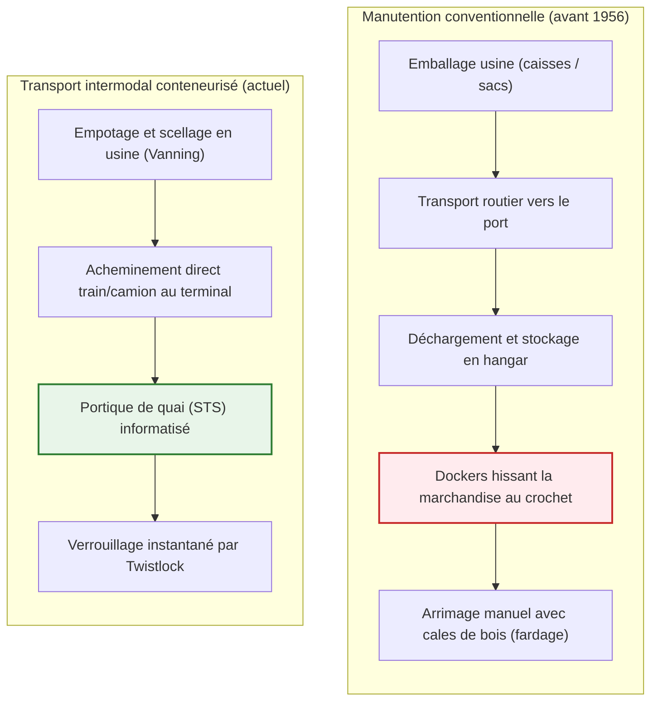
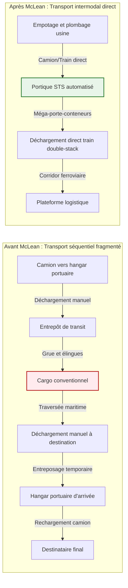
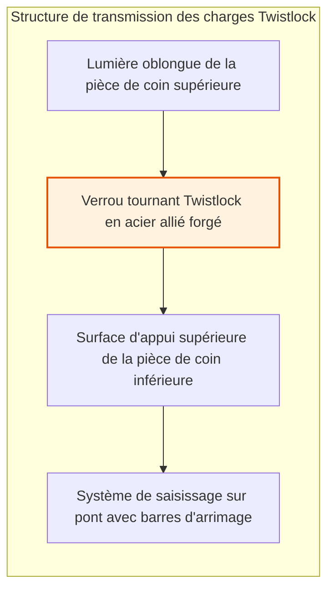
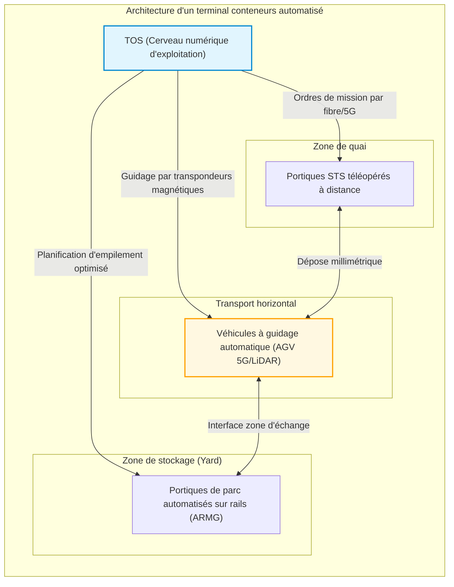
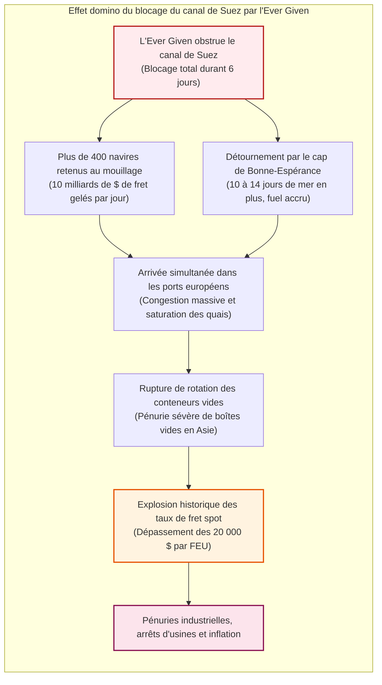

## Introduction : Le plus grand miracle économique moderne né d'une simple boîte métallique

Lorsque vous tenez un smartphone, portez un vêtement confectionné à des milliers de kilomètres ou savourez un café récolté sur un autre continent, vous touchez le résultat tangible de la machine logistique la plus colossale de l'histoire humaine.

Le socle du commerce mondial contemporain – représentant plus de 25 000 milliards de dollars d'échanges annuels – n'est ni l'avion cargo Boeing 747, ni les câbles sous-marins à fibre optique. C'est un parallélépipède d'apparence banale fait de tôles ondulées d'acier Corten soudées : le **conteneur maritime standard ISO**.

Avant les années 1950, le transport maritime transocéanique était un calvaire d'une inefficacité accablante. Un cargo conventionnel passait des semaines à quai. Des centaines de dockers manipulaient manuellement caisses, tonneaux et sacs dans des cales humides à l'aide de cordages et de crochets de fer. La manutention portuaire engloutissait plus de 50 % du coût total du fret, tandis que les vols et les avaries étaient monnaie courante.

Le 26 avril 1956, un transporteur routier américain nommé **Malcom McLean** brisa ce statu quo millénaire à l'aide d'un pétrolier reconverti, l'*Ideal-X*. Son intuition ne reposait pas sur une technologie de pointe, mais sur une **abstraction systémique** : dissocier l'unité de charge du véhicule de transport et concevoir un réceptacle standard interopérable pour les camions, les trains et les navires.

En quelques années, le coût de manutention d'une tonne de fret s'effondra de 5,83 dollars à seulement 0,16 dollar, soit une réduction spectaculaire de plus de 97 %. La part du transport maritime dans le prix final des biens de consommation devint dérisoire (1 à 2 %). Cette boîte en acier a rendu possible la division internationale du travail, l'essor industriel de l'Asie et la mondialisation moderne.

---

## Chapitre 1 : Des millénaires d'inefficacité — L'ère sombre du vrac conventionnel

### 1.1 L'écosystème du crochet de docker

Avant le conteneur, le transport maritime n'avait pas fondamentalement changé depuis l'Antiquité. Toutes les cargaisons voyageaient sous forme de **marchandises diverses (Break-Bulk Cargo)** : barils de vin, sacs de café, caisses de pièces mécaniques ou balles de coton brut.

L'outil roi du quai était le redoutable **crochet d'arrimeur (Cargo Hook)** que chaque docker portait à la ceinture. Les hommes crochetaient les sacs, hissaient les caisses et empilaient les charges dans les profondeurs du navire. Pour empêcher tout mouvement de la cargaison en mer, il fallait combler chaque recoin avec des cales de bois, des paillons et des coins de calage (*fardage*).

Ce travail harassant favorisait l'émergence de puissants syndicats fermés (telle l'International Longshoremen's Association, ILA), souvent sous l'influence du crime organisé. Le vol de cargaison (*shrinkage*) était institutionnalisé : dans les années 1950, dans les ports de New York ou de Londres, 10 à 15 % des produits de valeur s'évaporaient mystérieusement lors du transit.

### 1.2 « Les navires ne gagnent de l'argent qu'en mer » : L'impasse économique des armateurs

Un vieil adage maritime rappelle : **« Un navire ne gagne de l'argent qu'en mer ; à quai, il dévore le capital. »**

À l'époque du vrac conventionnel, les cargos passaient **50 % à 65 % de leur durée de vie immobilisés au port** en opérations de manutention interminables. L'amortissement financier, les salaires d'équipage et les taxes portuaires s'accumulaient sans contrepartie productive.

| Indicateur | Époque conventionnelle (années 1950) | Époque conteneurisée (années 2020) | Gain d'efficacité |
| :--- | :--- | :--- | :--- |
| **Cadence de manutention** | ~ 15 – 25 tonnes / équipe / heure | > 1 000 – 2 000 tonnes / portique / heure | Amélioration de **60 à 100 fois** |
| **Temps d'escale à quai** | 10 à 14 jours (voire un mois) | 12 à 24 heures | Temps d'escale réduit de **> 90 %** |
| **Part du coût portuaire** | **50 % à 65 %** du fret maritime | **10 % à 15 %** du fret maritime | Effondrement des coûts |
| **Taux de casse / vol** | Souvent **5 % à 15 %** | Moins de **0,01 %** (scellé haute sécurité) | Pertes virtuellement nulles |

---

## Chapitre 2 : L'audace de Malcom McLean — De la route à l'océan et l'*Ideal-X*

### 2.1 L'épiphanie d'un routier à Hoboken

Le père du conteneur moderne, **Malcom McLean**, n'appartenait pas au sérail maritime. Ayant débuté avec un unique camion d'occasion en Caroline du Nord, il avait bâti la cinquième plus grande compagnie de transport routier des États-Unis.

En 1937, alors qu'il attendait une journée entière sur les quais de Hoboken (New Jersey) que des dockers déchargent balle par balle son camion de coton, une idée lumineuse s'imposa à lui :
> **« Pourquoi décharger et recharger la cargaison ? Pourquoi ne pas détacher l'ensemble de la remorque du châssis, la hisser directement sur le pont du navire, puis la replacer sur des essieux à destination ? »**

C'était l'acte de naissance du **transport multimodal intermodal**.

### 2.2 26 avril 1956 : Le périple fondateur de l'*Ideal-X*

Pour contourner la réglementation américaine de l'ICC qui interdisait à un transporteur routier de posséder une compagnie maritime, McLean vendit ses parts dans sa société de transport terrestre et acheta la *Pan-Atlantic Steamship Corporation*.

Il acheta un pétrolier T-2 rescapé de la Seconde Guerre mondiale, l'***Ideal-X***, et y fit installer une plate-forme métallique au-dessus des tuyauteries. Le 26 avril 1956, au port de Newark, une grue chargea 58 conteneurs en aluminium de 33 pieds en moins de huit heures. Le navire cingla vers Houston, Texas.

À son arrivée, des tracteurs routiers attendaient sur le quai pour acheminer immédiatement les conteneurs sur l'autoroute. Freddy Fields, dirigeant syndical de l'ILA, déclara alors lucidement :
> **« Messieurs, nous venons tous de signer notre arrêt de mort. »**

### 2.3 L'effondrement vertical des coûts : de 5,83 $ à 0,16 $ par tonne

Les résultats économiques de ce voyage stupéfièrent Wall Street :
- Coût de manutention conventionnelle : **5,83 dollars par tonne**
- Coût avec le conteneur de McLean : **0,158 dollar par tonne (~ 0,16 $)**

**Une chute vertigineuse de 97,3 % !**

Le coût global du transport intermodal s'exprime par la formule :

$$C_{\text{transport}} = C_{\text{handling}} + C_{\text{sea}} + C_{\text{inland}} + C_{\text{inventory}}$$

Le conteneur a réduit $C_{\text{handling}}$ à une valeur dérisoire et comprimé $C_{\text{inventory}}$ (coût du capital immobilisé) en ramenant les escales de plusieurs semaines à quelques heures.

### 2.4 La guerre du Vietnam et le « miracle de Cam Ranh »

La diffusion planétaire du conteneur trouva son catalyseur dans la **guerre du Vietnam**. En 1965, l'afflux massif de troupes américaines provoqua l'engorgement total du port de Saigon. Les navires attendaient deux à trois mois dans l'estuaire du Mékong ; le matériel militaire pourrissait sur les quais.

Le secrétaire à la Défense Robert McNamara fit appel à McLean. Sa compagnie, Sea-Land, construisit un terminal conteneurs moderne en eau profonde à **Cam Ranh Bay**. Les navires conventionnels mettaient 40 jours à être déchargés ; les porte-conteneurs de McLean n'avaient besoin que de **48 heures**.

McLean eut alors l'idée de génie commerciale d'utiliser les navires revenant à vide d'Asie : il les fit relâcher dans les ports de **Yokohama et Kobe** pour charger des radios, téléviseurs et motos japonaises à destination des États-Unis à des tarifs dérisoires. La première route commerciale transpacifique de conteneurs était née.

---

## Chapitre 3 : La standardisation ISO et l'ingénierie du Twistlock

### 3.1 La guerre des gabarits : 35 pieds contre 24 pieds

À l'origine, chaque armateur défendait son format propriétaire :
- **Sea-Land** de McLean utilisait des conteneurs de **35 pieds** (taille légale des remorques sur la côte Est).
- **Matson** (vers Hawaï) exploitait des conteneurs de **24 pieds** (optimisés pour les charges denses d'ananas et de sucre).

L'impossibilité d'échanger les boîtes entre compagnies menaçait de paralyser l'essor du système.

### 3.2 La norme ISO et l'acte de naissance de l'EVP

En 1961, l'ISO créa le comité **ISO/TC 104**. Après d'âpres négociations internationales, la norme **ISO 668** fut promulguée en 1968 :
1. Largeur standard : **8 pieds (2,438 m)**
2. Hauteur standard : **8 pieds 6 pouces (2,591 m)** (puis High Cube à 9 pieds 6 pouces)
3. Longueurs de référence : **20 pieds (6,058 m)** et **40 pieds (12,192 m)**

L'unité de mesure universelle de l'industrie était née : l'**EVP (Équivalent Vingt Pieds)**, ou **TEU** en anglais.

En 1967, McLean céda l'ensemble de ses brevets sur les **pièces de coin (Corner Castings)** et les **verrous tournants (Twistlocks)** dans le domaine public mondial sans exiger la moindre redevance.

### 3.3 Résistance mécanique des pièces de coin et twistlocks

Pour gerber des conteneurs sur dix hauteurs sur un navire soumis à une houle furieuse, toute la contrainte repose sur les huit pièces d'acier moulé soudées aux angles : les **pièces de coin** et les **verrous tournants (twistlocks)**.

En haute mer, les mouvements de roulis, tangage et pilonnement génèrent des accélérations atteignant $1,5 \sim 1,8 G$.

Les contraintes de cisaillement et de traction sur le verrou sont vérifiées par :

$$\sigma = \frac{F_{\text{tensile}}}{A_{\text{lock}}} \le \sigma_{\text{allowable}}, \quad \tau = \frac{F_{\text{shear}}}{A_{\text{lock}}} \le \tau_{\text{allowable}}$$

La contrainte d'écrasement sur les quatre montants d'angle du conteneur inférieur répond à la loi :

$$\sigma_{\text{stack}} = \frac{M_{\text{stack}} \cdot g}{4 \cdot A_{\text{corner}}}$$

Selon la norme ISO 1496-1, chaque pièce de coin inférieure doit résister à une charge statique verticale minimale de **86 400 kg (environ 848 kN)**, soit plus de 210 tonnes de pression par angle.

---

## Chapitre 4 : Transport intermodal et terminaux automatisés

### 4.1 L'intermodalisme intégral

Le conteneur constitue l'interface universelle permettant le transit ininterrompu entre la mer, le rail et la route. En Amérique du Nord, les trains **Double-Stack** (qui transportent des conteneurs empilés sur deux niveaux sur plus de 3 km de long) franchissent les Rocheuses et constituent un pont terrestre (*Landbridge*) direct entre le Pacifique et la côte Est.

```mermaid
flowchart LR
    subgraph Origin["Origine (Usine en Asie)"]
        Factory["Empotage et scellé de sécurité<br/>(Vanning & Bolt Seal)"]
        Truck1["Acheminement routier au port"]
        Factory --> Truck1
    end

    subgraph PortOut["Port d'embarquement"]
        GateIn["Contrôle d'accès & Parc à conteneurs"]
        GantryOut["Portique de quai géant STS"]
        GateIn --> GantryOut
    end

    subgraph OceanVoyage["Traversée maritime"]
        MegaVessel["Porte-conteneurs géant (ULCV)<br/>Ligne Asie-Europe / Transpacifique"]
    end

    subgraph PortIn["Port de débarquement"]
        GantryIn["Déchargement et transfert rail"]
        RailOut["Terminal ferroviaire portuaire"]
        GantryIn --> RailOut
    end

    subgraph Destination["Destination (Plateforme intérieure)"]
        DoubleStack["Train double-stack transcontinental<br/>(Traversée de milliers de km)"]
        Truck2["Livraison du dernier kilomètre"]
        Store["Plateforme logistique & Rayon"]
        DoubleStack --> Truck2
        Truck2 --> Store
    end

    Truck1 --> GateIn
    GantryOut --> MegaVessel
    MegaVessel --> GantryIn
    RailOut --> DoubleStack

    style OceanVoyage fill:#e3f2fd,stroke:#1565c0,stroke-width:2px
    style Destination fill:#e8f5e9,stroke:#2e7d32,stroke-width:2px
```

### 4.2 La révolution numérique : De l'EDI aux TOS intelligents

L'échange de données informatisé (**EDI**) sous les standards internationaux (CODECO, BAPLIE) synchronise en temps réel les mouvements des boîtes à l'échelle planétaire.

Dans les postes de contrôle, les systèmes d'exploitation de terminaux (**TOS**, tel Navis N4) utilisent des algorithmes d'optimisation combinatoire pour équilibrer la stabilité du navire (hauteur métacentrique GM), les règles de ségrégation des matières dangereuses et la réduction des manipulations inutiles (*re-handling*).

---

## Chapitre 5 : Les géants des mers et la loi cubique de la consommation

### 5.1 De 1 000 à 24 000 EVP : L'impératif des économies d'échelle

La course au gigantisme a vu la capacité unitaire des navires multipliée par 25 :
- 1ère génération (1960) : **500 – 1 000 EVP**
- Panamax (1980) : **4 500 EVP** (largeur de 32,3 m)
- Post-Panamax (2000) : **8 000 – 10 000 EVP**
- ULCV / Megamax (2020) : **plus de 24 000 EVP** (400 m de long, 61 m de large, ex. *MSC Irina*)

Le moteur de cette expansion est la réduction du coût unitaire par conteneur transporté :

$$C_{\text{unit}} = \frac{C_{\text{capital}} + C_{\text{crew}} + C_{\text{fuel}} + C_{\text{port}}}{Q_{\text{capacity}} \times \alpha_{\text{utilization}}}$$

Un géant de 24 000 EVP ne nécessite qu'un équipage d'environ 24 marins, quasiment identique à celui d'un navire six fois plus petit.

### 5.2 La loi cubique de la vitesse et le Slow Steaming

En hydrodynamique navale, la puissance motrice requise $P$ est proportionnelle au cube de la vitesse du navire $V$ :

$$P \propto V^3$$

La consommation journalière de fioul lourd $F_{\text{day}}$ obéit à la même loi :

$$F_{\text{day}} = c \cdot \Delta^{2/3} \cdot V^3$$

Pour une traversée complète de distance $D$, la consommation globale $F_{\text{total}}$ varie avec le carré de la vitesse :

$$F_{\text{total}} = F_{\text{day}} \cdot T = \left( k \cdot V^3 \right) \cdot \left( \frac{D}{24 \cdot V} \right) = \frac{k \cdot D}{24} \cdot V^2$$

Réduire la vitesse de 24 à 18 nœuds (une baisse de 25 %, pratique dite de **Slow Steaming**) permet une économie spectaculaire :

$$\Delta F_{\text{total}} \approx 1 - \left( \frac{18}{24} \right)^2 = 1 - 0,5625 = 43,75\%$$

**Une réduction de vitesse d'un quart permet d'économiser près de 44 % de carburant !**

### 5.3 Les terminaux automatisés : Le ballet des AGV

Dans les terminaux de pointe (Rotterdam Maasvlakte II, Shanghai Yangshan 4), les conducteurs ont quitté les quais :

1. **Portiques STS téléopérés** : pilotés à distance depuis des salles de contrôle climatisées via des caméras 4K à latence ultra-faible.
2. **AGV (Automated Guided Vehicles)** : plateformes robotisées lourdes électriques guidées par transpondeurs magnétiques au sol et LiDAR.
3. **ARMG (Automated Rail Mounted Gantries)** : grues de parc assurant de nuit le repositionnement prédictif des boîtes (*housekeeping*).

### 5.4 Les trois grandes alliances maritimes

Le coût d'un navire géant (150 à 200 millions de dollars) a poussé les armateurs à se regrouper au sein de **trois alliances majeures** contrôlant plus de 80 % de la capacité mondiale :
1. **2M** : Maersk et MSC (en cours de reconfiguration)
2. **Ocean Alliance** : COSCO, CMA CGM, Evergreen, OOCL
3. **THE Alliance / Premier Alliance** : ONE, HMM, Yang Ming

---

## Chapitre 6 : Les crises mondiales et la fragilité des chaînes logistiques

### 6.1 Le piège du Just-in-Time (Flux tendu)

La fiabilité du conteneur a démocratisé le culte du **Juste-à-temps (JIT)**. Les stocks de précaution ont été éliminés : les navires en mer sont devenus des entrepôts flottants.

Toutefois, cette optimisation repose sur l'hypothèse d'une fluidité parfaite et perpétuelle. Le moindre grain de sable déclenche une défaillance systémique en cascade.

### 6.2 L'échouement de l'*Ever Given* dans le canal de Suez (2021)

Le 23 mars 2021, le géant de 20 124 EVP *Ever Given* s'est encastré en travers du canal de Suez, bloquant 12 % du commerce mondial pendant six jours.

Ce blocage de seulement six jours a désynchronisé les flottes mondiales pendant près d'un an, provoquant une pénurie de boîtes vides en Asie et une flambée record des taux de fret spot au-delà de 20 000 dollars par FEU.

### 6.3 La géopolitique des goulets d'étranglement : Panama et mer Rouge

1. **Sécheresse au canal de Panama** : le manque d'eau douce dans le lac Gatún a contraint l'autorité du canal à réduire de 40 % le nombre de passages quotidiens.
2. **Attaques en mer Rouge** : les tirs de missiles et drones houthis dans le détroit de Bab el-Mandeb ont contraint les flottes à contourner l'Afrique, rallongeant les trajets de deux semaines et immobilisant 15 % de la capacité mondiale.

Ces crises démontrent que le monde moderne reste physiquement prisonnier de quelques détroits maritimes névralgiques.

---

## Chapitre 7 : Conclusion — L'avenir de la civilisation dans une boîte en acier

### 7.1 L'essence de la véritable innovation

L'histoire du conteneur nous livre une leçon philosophique fondamentale :
**Les innovations les plus radicales ne sont pas des technologies ésotériques ou hyper-complexes, mais des protocoles universels d'une simplicité désarmante qui éliminent la friction aux interfaces.**

À l'instar du protocole TCP/IP qui structure l'Internet mondial en paquets de données numériques standardisés, le conteneur est le **paquet IP du monde physique**, articulant harmonieusement usines, camions, voies ferrées et navires géants.

### 7.2 Décarbonation et résilience pour le XXIe siècle

Face aux impératifs de décarbonation de l'Organisation maritime internationale (neutralité carbone en 2050), les porte-conteneurs abandonnent le fioul lourd pour adopter le **méthanol vert, le GNL et l'ammoniac vert**. Parallèlement, le monde industriel passe du *Juste-à-temps* au *Just-in-case* (sécurisation des stocks stratégiques).

Pourtant, quelle que soit la propulsion des navires ou l'intelligence des algorithmes qui les pilotent, la boîte standard de **8 pieds de large et 20 ou 40 pieds de long** continuera de sillonner les océans du monde, colonne vertébrale inébranlable de la prospérité humaine.
