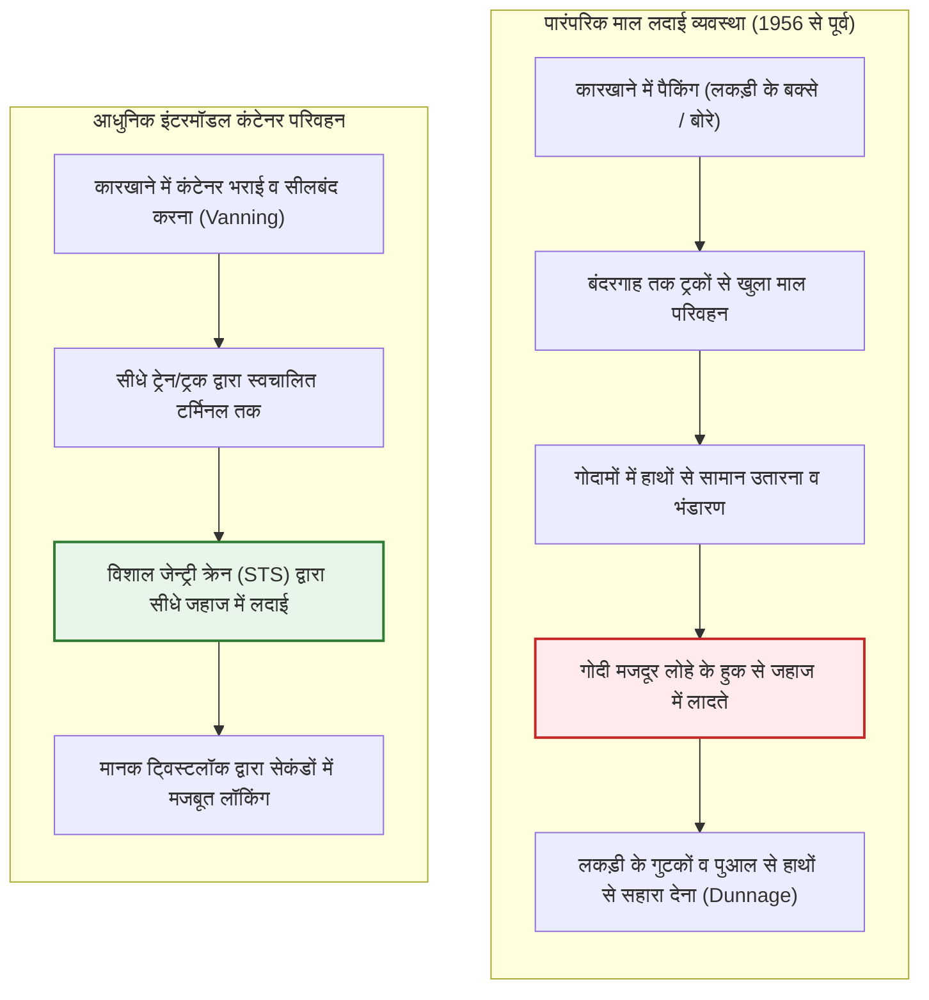
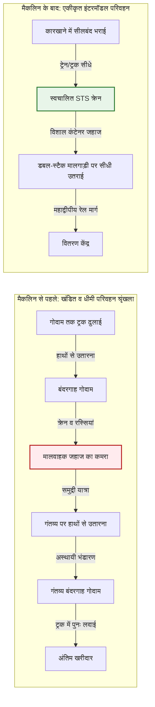
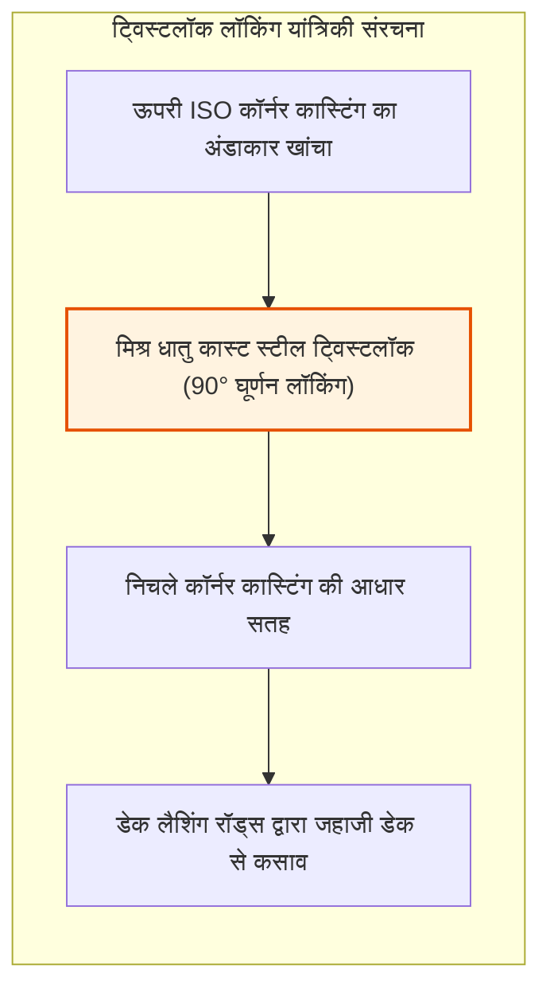
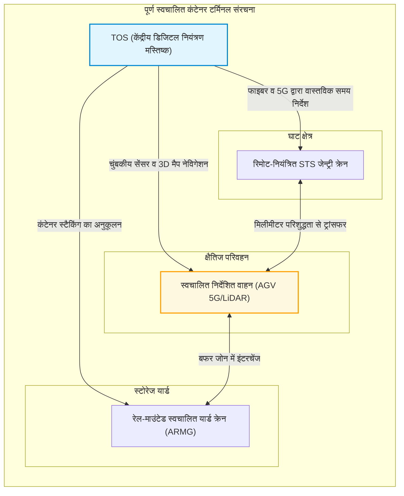
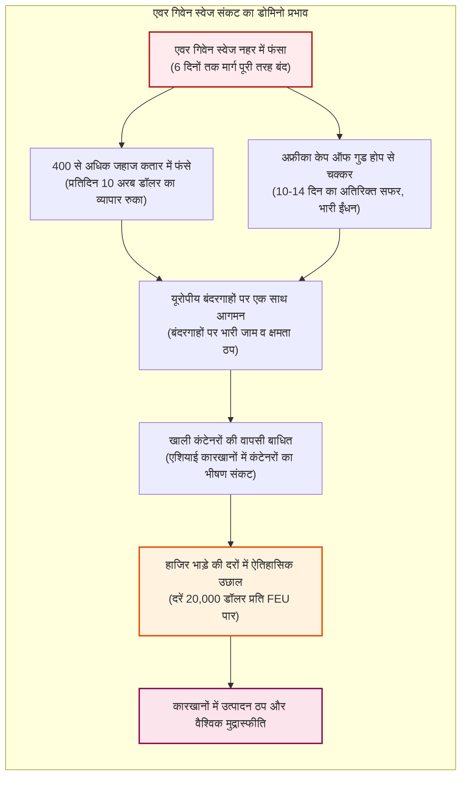

## प्रस्तावना: एक साधारण स्टील बॉक्स से हुआ दुनिया का सबसे बड़ा आर्थिक चमत्कार

जब आप हाथ में स्मार्टफोन पकड़ते हैं, किसी अन्य महाद्वीप में सिले कपड़े पहनते हैं, या हजारों मील दूर के बागानों की कॉफी पीते हैं, तो आप मानव सभ्यता की सबसे विशाल भौतिक मशीनरी का उत्पाद छू रहे होते हैं।

सालाना 25 ट्रिलियन डॉलर से अधिक के आधुनिक वैश्विक व्यापार की नींव बोइंग 747 कार्गो विमान या समुद्र के नीचे बिछे फाइबर ऑप्टिक केबल नहीं हैं। यह वेल्ड किए गए नालीदार कोर्टेन स्टील से बना एक सीधा-सादा बक्सा है: **ISO मानक समुद्री शिपिंग कंटेनर (Shipping Container)**।

1950 के दशक से पहले, महासागरों के पार माल ढुलाई भारी अक्षमता और बर्बादी का दुःस्वप्न थी। एक पारंपरिक मालवाहक जहाज बंदरगाह पर हफ्तों तक खड़ा रहता था। सैकड़ों गोदी मजदूर (Stevedores) लोहे के हुक और रस्सियों की मदद से बक्सों, बोरियों और पीपों को नम और अंधेरे जहाजी कमरों में हाथों से लादते थे। बंदरगाह पर माल उतारने-चढ़ाने का खर्च कुल समुद्री भाड़े के 50% से अधिक होता था, और चोरी तथा टूट-फूट आम बात थी।

26 अप्रैल 1956 को, अमेरिकी ट्रक व्यवसायी **मैल्कम मैकलिन (Malcom McLean)** ने एक रूपांतरित तेल टैंकर *आइडियल-एक्स (Ideal-X)* के साथ इस सदियों पुरानी व्यवस्था को बदल दिया। उनका विचार कोई जटिल इलेक्ट्रॉनिक्स नहीं था, बल्कि एक **प्रणालीगत अमूर्तता (Systemic Abstraction)** थी: माल के कंटेनर को वाहन से अलग करना और ट्रकों, ट्रेनों तथा जहाजों के बीच निर्बाध रूप से स्थानांतरित होने वाला एक समान मानक बनाना।

कुछ ही वर्षों में, एक टन माल की लदाई लागत 5.83 डॉलर से गिरकर मात्र 0.16 डॉलर रह गई – 97% से अधिक की भारी गिरावट। उपभोक्ता वस्तुओं की अंतिम कीमत में समुद्री भाड़े का हिस्सा घटकर नगण्य 1 से 2% रह गया। इसी लोहे के डिब्बे ने वैश्विक विनिर्माण विभाजन, एशिया के कारखाने के रूप में उभरने और आधुनिक वैश्वीकरण को संभव बनाया।

---

## अध्याय 1: अक्षमता के हजारों वर्ष — खुले माल और गोदी श्रम का अंधकार युग

### 1.1 कार्गो हुक के नियंत्रण वाला बंदरगाह तंत्र

कंटेनर के आने से पहले, समुद्री व्यापार का बुनियादी तरीका फोनिशियन काल से लगभग अपरिवर्तित था। सारा माल **खुले फुटकर माल (Break-Bulk Cargo)** के रूप में ढोया जाता था: शराब के पीपे, कॉफी की बोरियां, मशीनों के कलपुर्जे और कपास की गांठें।

गोदी मजदूरों का मुख्य औजार कमर में खोंसा जाने वाला **लोहे का हुक (Cargo Hook)** था। मजदूर बोरियों में हुक फंसाकर उन्हें कंधों पर लादते और जहाज की तली में पहुंचाते थे। समुद्र में हिचकोलों से माल को सुरक्षित रखने के लिए लकड़ी के तख्तों और तिनकों (*dunnage*) से खाली जगह भरी जाती थी।

यह भीषण श्रम न केवल जानलेवा था, बल्कि इसने शक्तिशाली और माफिया-नियंत्रित बंदरगाह यूनियनों (जैसे अमेरिका की ILA) को जन्म दिया। सामान की चोरी (*shrinkage*) आम थी: 1950 के दशक में न्यूयॉर्क और लंदन के बंदरगाहों पर 10% से 15% कीमती सामान रहस्यमय तरीके से गायब हो जाता था।

### 1.2 "जहाज केवल समुद्र में कमाते हैं": पारंपरिक शिपिंग कंपनियों का घाटा

शिपिंग जगत की एक पुरानी कहावत है: **"जहाज केवल तभी पैसा कमाता है जब वह समुद्र में तैर रहा हो; बंदरगाह में खड़ा जहाज केवल पूंजी निगलता है।"**

पारंपरिक युग में मालवाहक जहाज अपने जीवनकाल का **50% से 65% समय बंदरगाह पर खड़े रहकर** माल चढ़ाने-उतारने के इंतजार में गंवा देते थे। जहाजों का मूल्यह्रास, चालक दल का वेतन और बंदरगाह शुल्क बिना किसी आय के लगातार चुकाने पड़ते थे।

| मूल्यांकन पैमाना | पारंपरिक खुला माल युग (1950 का दशक) | आधुनिक कंटेनर युग (2020 का दशक) | दक्षता में छलांग |
| :--- | :--- | :--- | :--- |
| **लदाई की गति** | ~ 15 – 25 टन / दल / घंटा | > 1,000 – 2,000 टन / क्रेन / घंटा | **60 से 100 गुना वृद्धि** |
| **बंदरगाह में ठहराव** | 10 – 14 दिन (महीनों तक) | 12 – 24 घंटे | ठहराव समय में **> 90% की कमी** |
| **बंदरगाह लागत का अनुपात** | कुल समुद्री भाड़े का **50% – 65%** | कुल समुद्री भाड़े का **10% – 15%** | लागत में भारी गिरावट |
| **नुकसान व चोरी की दर** | प्रायः **5% – 15%** तक | **0.01% से कम** (हाई-सिक्योरिटी सील) | नुकसान लगभग शून्य |

---

## अध्याय 2: मैल्कम मैकलिन का साहसिक दांव और *आइडियल-एक्स* का जन्म

### 2.1 होबोकेन बंदरगाह पर एक ट्रक ड्राइवर का विचार

आधुनिक कंटेनर के जनक **मैल्कम मैकलिन** कोई नौसैनिक या जहाज निर्माता नहीं थे। वे नॉर्थ कैरोलिना में एक पुराने ट्रक से शुरुआत करके अपनी कंपनी *मैकलिन ट्रकिंग* को अमेरिका के पांच सबसे बड़े सड़क परिवहन बेड़ों में शामिल करने वाले दृढ़ निश्चयी व्यवसायी थे।

1937 में, न्यू जर्सी के होबोकेन बंदरगाह पर अपनी कपास से लदी गाड़ी को दिन भर खड़े रखकर मजदूरों द्वारा एक-एक बोरी उतारे जाने को देखते हुए मैकलिन ने सोचा:
> **"हम बार-बार सामान उतारते और चढ़ाते क्यों हैं? क्यों न हम पूरे ट्रक के बक्से को ही क्रेन से उठाकर जहाज के डेक पर रख दें, और गंतव्य पर पहुंचकर उसे फिर से ट्रक के पहियों पर कसकर रवाना कर दें?"**

यही साधारण विचार **इंटरमॉडल परिवहन (Intermodal Transport)** की मूल प्रेरणा बना।

### 2.2 26 अप्रैल 1956: *आइडियल-एक्स* की ऐतिहासिक यात्रा

अपने विचार को साकार करने के लिए मैकलिन ने कड़े अमेरिकी नियमों को मात दी। उन्होंने अपनी ट्रक कंपनी बेच दी और भारी कर्ज लेकर संकटग्रस्त शिपिंग कंपनी *पैन-अटलांटिक* को खरीदा।

उन्होंने द्वितीय विश्व युद्ध का पुराना टी-2 टैंकर खरीदा, जिसका नाम ***आइडियल-एक्स (Ideal-X)*** रखा और उसके पाइपों के ऊपर एक मजबूत स्टील डेक बनाया। 26 अप्रैल 1956 को नेवार्क बंदरगाह पर क्रेन ने 58 एल्युमिनियम कंटेनरों (33 फीट लंबे) को आठ घंटे से भी कम समय में लाद दिया। जहाज ह्यूस्टन के लिए रवाना हुआ।

ह्यूस्टन पहुंचने पर ट्रकों ने मिनटों में डिब्बों को खींचा और हाईवे पर निकल पड़े। बंदरगाह यूनियन के शीर्ष नेता फ्रेडी फील्ड्स ने इसे देखकर कहा था:
> **"सज्जनों, हमने अभी-अभी अपनी नौकरियों के मृत्यु वारंट पर हस्ताक्षर किए हैं।"**

### 2.3 लदाई लागत का ऐतिहासिक पतन: $5.83 से $0.16 प्रति टन

उस पहली यात्रा के वित्तीय परिणामों ने उद्योग जगत को हिला दिया:
- खुले माल की पारंपरिक लदाई लागत: **5.83 डॉलर प्रति टन**
- मैकलिन की कंटेनर लदाई लागत: **0.158 डॉलर प्रति टन (~ 0.16 $)**

**लागत में 97.3% की भारी कमी!**

परिवहन अर्थशास्त्र में कुल लागत का समीकरण इस प्रकार है:

$$C_{\text{transport}} = C_{\text{handling}} + C_{\text{sea}} + C_{\text{inland}} + C_{\text{inventory}}$$

कंटेनर ने $C_{\text{handling}}$ को लगभग शून्य के करीब ला दिया और बंदरगाह पर लगने वाले हफ्तों के समय को घंटों में समेटकर $C_{\text{inventory}}$ (रास्ते में फंसी पूंजी की लागत) को भी न्यूनतम कर दिया।

### 2.4 वियतनाम युद्ध और 'कैम रैन खाड़ी का चमत्कार'

किसी भी क्रांतिकारी तकनीक को बड़े पैमाने पर अपनाने के लिए एक ऐतिहासिक संकट की आवश्यकता होती है। कंटेनर के लिए वह संकट **वियतनाम युद्ध** था।

1965 में भारी अमेरिकी सैन्य तैनाती के कारण साइगॉन बंदरगाह पूरी तरह ठप हो गया। सैकड़ों जहाज मेकांग नदी में महीनों तक खड़े रहे और रसद खुले में सड़ती रही।

रक्षा मंत्री रॉबर्ट मैकनामारा ने मैकलिन से संपर्क किया। सी-लैंड कंपनी ने **कैम रैन खाड़ी (Cam Ranh Bay)** में गहरे पानी का कंटेनर टर्मिनल बनाया। परिणाम आश्चर्यजनक था: जिन जहाजों को खाली करने में 40 दिन लगते थे, वे कंटेनर प्रणाली से मात्र **48 घंटे** में खाली होकर रवाना होने लगे।

वापसी की यात्रा में मैकलिन ने खाली जहाजों को **योकोहामा और कोबे** (जापान) के बंदरगाहों पर भेजा। वहां से उन्होंने सस्ते भाड़े पर जापानी ट्रांजिस्टर रेडियो, टीवी और मोटरसाइकिलें कैलिफोर्निया पहुंचाईं। यह प्रशांत महासागर का पहला नियमित वाणिज्यिक कंटेनर मार्ग बना, जिसने एशियाई विनिर्माण के स्वर्ण युग की शुरुआत की।

---

## अध्याय 3: वैश्विक मानक — ISO मानकीकरण (TEU) और ट्विस्टलॉक इंजीनियरिंग

### 3.1 आकारों का संघर्ष: 35 फीट बनाम 24 फीट

शुरुआत में प्रत्येक कंपनी ने अपना पेटेंट आकार थोपने की कोशिश की:
- **सी-लैंड**: पूर्वी अमेरिका के सड़क नियमों के अनुसार **35 फीट**।
- **मैटसन (हवाई मार्ग)**: भारी चीनी और अनानास के अनुसार **24 फीट**।

इस असंगति के कारण सी-लैंड का कंटेनर मैटसन की क्रेन से नहीं उठाया जा सकता था, जिससे प्रणाली के बिखरने का खतरा पैदा हो गया।

### 3.2 ISO अंतर्राष्ट्रीय मानक और 'TEU' का उदय

1961 में अंतर्राष्ट्रीय मानकीकरण संगठन ने **ISO/TC 104** तकनीकी समिति बनाई। 1968 में ऐतिहासिक **ISO 668 मानक** स्थापित हुआ:
1. मानक चौड़ाई: **8 फीट (2.438 मीटर)**
2. मानक ऊंचाई: **8 फीट 6 इंच (2.591 मीटर)** (बाद में 9'6" हाई क्यूब)
3. मानक लंबाई: **20 फीट (6.058 मीटर)** और **40 फीट (12.192 मीटर)**

इस प्रकार वैश्विक मानक इकाई का जन्म हुआ: **TEU (Twenty-foot Equivalent Unit)** और 40 फीट का **FEU (Forty-foot Equivalent Unit)**।

1967 में मैकलिन ने एक महान निर्णय लिया: उन्होंने कंटेनर के **कोने के खांचों (Corner Castings)** और **ट्विस्टलॉक (Twistlocks)** के सभी पेटेंट अधिकार पूरी मानवता के लिए निःशुल्क समर्पित कर दिए।

### 3.3 कॉर्नर कास्टिंग और ट्विस्टलॉक की यांत्रिकी

तूफानी समुद्र में हिचकोले खाते जहाजों पर कंटेनरों को 10 परतों तक सुरक्षित रखने का राज आठ कोनों पर वेल्ड किए गए कास्ट स्टील के पुर्जों में छिपा है: **कॉर्नर कास्टिंग** और रोटेटिंग लॉक **ट्विस्टलॉक**।

समुद्र में जहाज के हिलने-डुलने से $1.5 \sim 1.8 G$ तक का गतिशील त्वरण उत्पन्न होता है।

ट्विस्टलॉक पर तनाव और कतरनी बल का सूत्र:

$$\sigma = \frac{F_{\text{tensile}}}{A_{\text{lock}}} \le \sigma_{\text{allowable}}, \quad \tau = \frac{F_{\text{shear}}}{A_{\text{lock}}} \le \tau_{\text{allowable}}$$

सबसे नीचे के कंटेनर के चारों कोनों पर दबाव का सूत्र:

$$\sigma_{\text{stack}} = \frac{M_{\text{stack}} \cdot g}{4 \cdot A_{\text{corner}}}$$

ISO 1496-1 के तहत निचले कोने को कम से कम **86,400 किलोग्राम (लगभग 848 kN)** का लंबवत दबाव सहने में सक्षम होना चाहिए ताकि हजारों टन का भार सुरक्षित रहे।

---

## अध्याय 4: इंटरमॉडल परिवहन और डिजिटल बुनियादी ढांचा

### 4.1 इंटरमॉडल प्रणाली की वास्तविकता

कंटेनर जहाजों, ट्रेनों और ट्रकों के बीच एक सार्वभौमिक भौतिक इंटरफेस है। कारखाने में उच्च सुरक्षा बोल्ट सील लगने के बाद गंतव्य तक पहुंचने तक सामान को कोई नहीं छूता।

उत्तरी अमेरिका में 3 किमी से अधिक लंबी **डबल-स्टैक ट्रेनें** रॉकी पर्वतों को पार कर प्रशांत और अटलांटिक महासागरों के बीच एक "लैंडब्रिज" के रूप में काम करती हैं।

### 4.2 डिजिटल क्रांति: पेपर बी/एल से EDI और स्मार्ट TOS तक

इलेक्ट्रॉनिक डेटा इंटरचेंज (**EDI**) मानकों (CODECO, BAPLIE) ने दुनिया भर में कंटेनरों की सटीक निगरानी को संभव बनाया।

टर्मिनल ऑपरेटिंग सिस्टम (**TOS**, जैसे Navis N4) जहाज के संतुलन (मेटासेंट्रिक ऊंचाई GM) और कंटेनरों की सही व्यवस्था की वास्तविक समय में गणना करते हैं।

---

## अध्याय 5: विशालकाय जहाज, गति के नियम और स्वचालित टर्मिनल

### 5.1 1,000 से 24,000 TEU: पैमाने की अर्थव्यवस्था

जहाजों का आकार तेजी से बढ़ा:
- पहली पीढ़ी (1960): **500 – 1,000 TEU**
- पैनामैक्स (1980): **4,500 TEU** (चौड़ाई 32.3 मी)
- पोस्ट-पैनामैक्स (2000): **8,000 – 10,000 TEU**
- आधुनिक मेगामैक्स (2020): **24,000 TEU से अधिक** (लंबाई 400 मी, चौड़ाई 61 मी, जैसे *MSC Irina*)

इन विशाल जहाजों का मुख्य उद्देश्य प्रति कंटेनर लागत कम करना है:

$$C_{\text{unit}} = \frac{C_{\text{capital}} + C_{\text{crew}} + C_{\text{fuel}} + C_{\text{port}}}{Q_{\text{capacity}} \times \alpha_{\text{utilization}}}$$

24,000 TEU के जहाज पर केवल 22 से 26 नाविकों की आवश्यकता होती है, जिससे प्रति कंटेनर वेतन लागत 80% से अधिक कम हो जाती है।

### 5.2 गति का घन नियम और स्लो स्टीमिंग (Slow Steaming)

नौसैनिक हाइड्रोडायनामिक्स में इंजन की शक्ति $P$ जहाज की गति $V$ के घन (Cube) के समानुपाती होती है:

$$P \propto V^3$$

दैनिक ईंधन खपत $F_{\text{day}}$ भी इसी नियम का पालन करती है:

$$F_{\text{day}} = c \cdot \Delta^{2/3} \cdot V^3$$

दूरी $D$ की कुल यात्रा के लिए ईंधन की कुल खपत गति के वर्ग के समानुपाती होती है:

$$F_{\text{total}} = F_{\text{day}} \cdot T = \left( k \cdot V^3 \right) \cdot \left( \frac{D}{24 \cdot V} \right) = \frac{k \cdot D}{24} \cdot V^2$$

गति को 24 से घटाकर 18 नॉट करने पर (25% की कमी, जिसे **Slow Steaming** कहा जाता है) भारी बचत होती है:

$$\Delta F_{\text{total}} \approx 1 - \left( \frac{18}{24} \right)^2 = 1 - 0.5625 = 43.75\%$$

**गति में 25% की कमी से यात्रा का लगभग 44% ईंधन बचता है!**

### 5.3 स्वचालित टर्मिनल और AGV रोबोट बेड़ा

अत्याधुनिक बंदरगाहों (रॉटरडैम, शंघाई यांगशान 4) पर इंसान गोदी से हट चुके हैं:

1. **रिमोट क्रेन**: ऑपरेटर 4K कैमरों और जॉयस्टिक से दूर बैठकर क्रेन चलाते हैं।
2. **AGVs**: जमीन के चुंबकीय सेंसरों और LiDAR की मदद से चलने वाले स्वायत्त इलेक्ट्रिक वाहन।
3. **ARMG क्रेन**: रात में कंटेनरों को स्वचालित रूप से पुनर्व्यवस्थित (*housekeeping*) करते हैं।

### 5.4 तीन बड़े शिपिंग गठबंधन

विशाल जहाजों की भारी लागत के कारण दुनिया के 80% से अधिक व्यापार पर **तीन गठबंधनों** का नियंत्रण है:
1. **2M**: Maersk और MSC
2. **Ocean Alliance**: COSCO, CMA CGM, Evergreen, OOCL
3. **THE Alliance / Premier Alliance**: ONE, HMM, Yang Ming

---

## अध्याय 6: वैश्विक संकट और आपूर्ति श्रृंखला की संवेदनशीलता

### 6.1 जस्ट-इन-टाइम (JIT) का जाल

कंटेनरों की समय की पाबंदी ने विनिर्माण में **Just-in-Time (JIT)** को बढ़ावा दिया। गोदाम हटा दिए गए और समुद्र में तैरते जहाजों को ही चलता-फिरता गोदाम मान लिया गया।

परंतु यह प्रणाली इस नाजुक धारणा पर टिकी है कि आपूर्ति कभी बाधित नहीं होगी। एक छोटा सा व्यवधान भी भारी तबाही ला सकता है।

### 6.2 स्वेज नहर में *एवर गिवेन* का फंसना (2021)

23 मार्च 2021 को 20,124 TEU का जहाज *एवर गिवेन* स्वेज नहर में तिरछा फंस गया, जिससे दुनिया का 12% व्यापार छह दिनों तक पूरी तरह रुक गया।

इस छह दिन के अवरोध ने महीनों तक वैश्विक व्यापार को प्रभावित किया, जिससे भाड़े की दरें रिकॉर्ड 20,000 डॉलर प्रति कंटेनर को पार कर गईं।

### 6.3 भू-राजनीतिक चोकपॉइंट: पनामा का सूखा और लाल सागर संकट

1. **पनामा नहर सूखा**: गैटून झील में पानी की कमी से दैनिक आवागमन में 40% की कटौती हुई।
2. **लाल सागर संकट**: बाब अल-मंदेब में मिसाइल हमलों ने जहाजों को अफ्रीका के चारों ओर चक्कर लगाने पर मजबूर किया, जिससे वैश्विक क्षमता का 15% हिस्सा जाम हो गया।

यह स्पष्ट करता है कि हमारी भौतिक दुनिया अभी भी कुछ संकीर्ण समुद्री गलियारों पर निर्भर है।

---

## अध्याय 7: निष्कर्ष — स्टील के बक्से में सभ्यता का भविष्य

### 7.1 वास्तविक नवाचार की सीख

कंटेनर के इतिहास का सबसे बड़ा सबक यह है:
**दुनिया को बदलने वाले महानतम आविष्कार अक्सर जटिल हाई-टेक उपकरण नहीं होते, बल्कि सरल और सार्वभौमिक मानक होते हैं जो प्रणालियों के बीच घर्षण को समाप्त करते हैं।**

जैसे TCP/IP ने कंप्यूटर नेटवर्कों को इंटरनेट में बदला, वैसे ही कंटेनर **भौतिक दुनिया का IP पैकेट** है, जिसने कारखानों, ट्रकों, ट्रेनों और जहाजों को एक सूत्र में पिरोया है।

### 7.2 21वीं सदी में डीकार्बोनाइजेशन और लचीलापन

IMO के 2050 शुद्ध-शून्य उत्सर्जन लक्ष्यों के तहत जहाजों को **ग्रीन मेथनॉल, LNG और अमोनिया** से चलाने की दिशा में तेजी से काम हो रहा है। साथ ही उद्योग *Just-in-Time* से *Just-in-Case* सुरक्षा मॉडल की ओर बढ़ रहे हैं।

भविष्य में जहाजों का ईंधन चाहे जो भी हो, **8 फीट चौड़ा और 20 या 40 फीट लंबा यह स्टील का बक्सा** मानव समृद्धि की रीढ़ बनकर समुद्रों में तैरता रहेगा।
