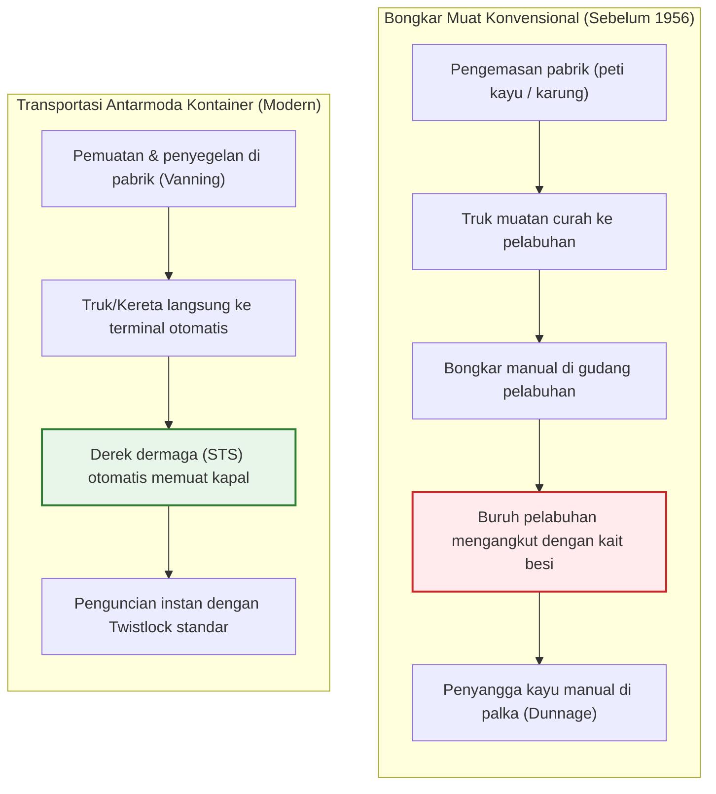
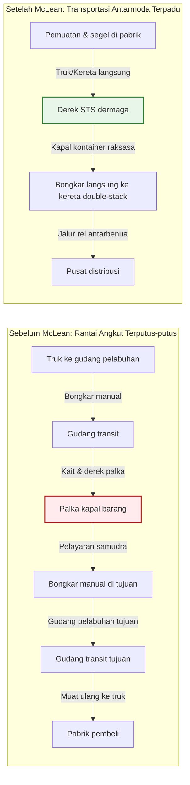
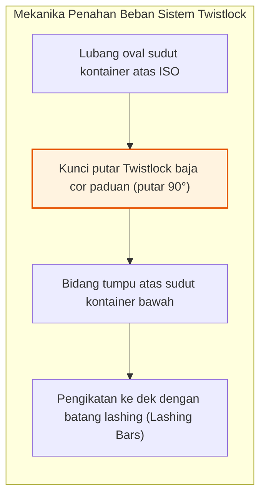
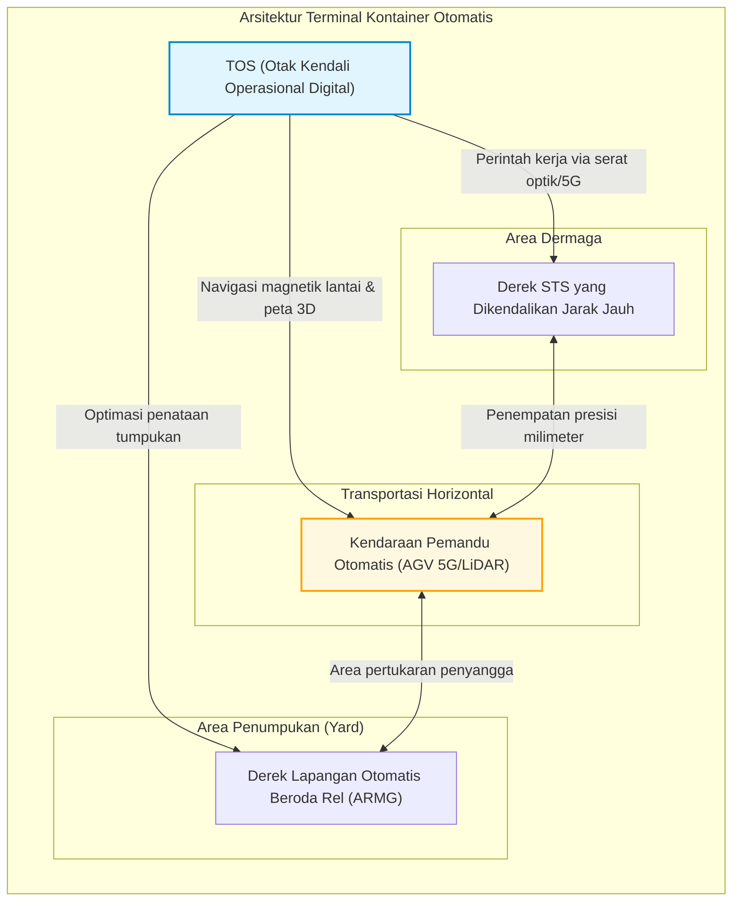
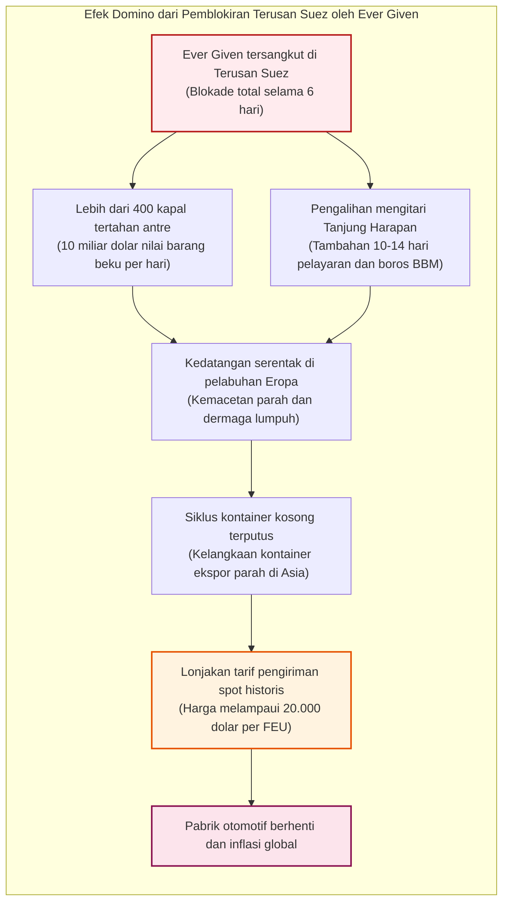

## Pendahuluan: Keajaiban Ekonomi Terbesar Dunia yang Lahir dari Kotak Baja Sederhana

Saat Anda menggenggam ponsel pintar, mengenakan pakaian buatan pabrik di seberang samudra, atau menikmati kopi dari perkebunan ribuan kilometer jauhnya, Anda sedang menyentuh hasil kerja mesin fisik terhebat dalam sejarah peradaban manusia.

Pondasi utama perdagangan dunia saat ini yang bernilai lebih dari 25 triliun dolar per tahun bukanlah pesawat kargo Boeing 747 atau kabel serat optik bawah laut. Fondasi itu adalah sebuah kotak persegi panjang sederhana dari baja Corten bergelombang: **kontainer pelayaran standar ISO (Shipping Container)**.

Sebelum dekade 1950-an, pengiriman kargo lintas samudra adalah mimpi buruk yang sangat tidak efisien dan mahal. Kapal barang konvensional menghabiskan waktu berminggu-minggu di dermaga. Ratusan kuli pelabuhan (stevedores) memindahkan peti, karung, dan tong secara manual dengan pengait besi ke dalam palka yang pengap. Biaya bongkar muat di pelabuhan menelan lebih dari 50 % dari total biaya pengiriman, dengan tingkat pencurian dan kerusakan yang sangat tinggi.

Pada 26 April 1956, seorang pengusaha truk asal Amerika Serikat bernama **Malcom McLean** memecahkan kebuntuan tersebut dengan kapal tanker modifikasi, *Ideal-X*. Idenya bukanlah teknologi tinggi yang rumit, melainkan sebuah **abstraksi sistemik**: memisahkan wadah muatan dari kendaraan pengangkut dan menciptakan wadah standar yang dapat berpindah mulus antara truk, kereta api, dan kapal laut.

Hanya dalam beberapa tahun, biaya bongkar muat kargo per ton merosot tajam dari 5,83 dolar menjadi hanya 0,16 dolar – penurunan drastis lebih dari 97 %. Biaya pengiriman laut dalam harga akhir barang konsumsi menyusut hingga tinggal 1 hingga 2 %. Kotak baja inilah yang memungkinkan pembagian kerja manufaktur global, mendorong kebangkitan industri Asia sebagai bengkel dunia, dan membentuk era globalisasi modern.

---

## Bab 1: Ribuan Tahun Ketidakefisienan — Era Kelam Kargo Konvensional

### 1.1 Ekosistem yang Dikuasai Pengait Kargo

Sebelum kontainer hadir, cara pengiriman laut hampir tidak berubah sejak zaman bangsa Fenisia. Barang dikirim sebagai **kargo curah terpisah (Break-Bulk Cargo)**: tong kayu anggur, karung biji kopi, peti suku cadang mesin, atau gulungan tembakau.

Alat utama di dermaga adalah **pengait besi (Cargo Hook)** yang diselipkan buruh di pinggang mereka. Para buruh mengait karung dan memikulnya ke dalam palka kapal. Agar muatan tidak bergeser saat diterjang ombak, setiap celah harus disumpal dengan pasak kayu dan jerami (*dunnage*).

Pekerjaan berat ini melahirkan serikat buruh pelabuhan tertutup yang kerap dikuasai mafia (seperti International Longshoremen's Association, ILA). Pencurian muatan (*shrinkage*) terjadi secara merajalela: pada 1950-an di pelabuhan New York atau London, 10 % hingga 15 % barang berharga raib saat proses bongkar muat.

### 1.2 «Kapal Hanya Menghasilkan Uang Saat Berlayar»: Kerugian Pemilik Kapal

Sebuah pepatah pelayaran kuno menyatakan: **«Kapal hanya menghasilkan uang saat berlayar di laut; di pelabuhan, kapal menelan modal.»**

Pada era kargo konvensional, kapal menghabiskan **50 % hingga 65 % masa pakainya bersandar di dermaga**, menunggu proses bongkar muat manual. Penyusutan modal, gaji awak kapal, dan biaya tambat terus berjalan tanpa menghasilkan pendapatan.

| Parameter | Kargo Konvensional (1950-an) | Era Kontainer (2020-an) | Lompatan Efisiensi |
| :--- | :--- | :--- | :--- |
| **Kecepatan bongkar muat** | ~ 15 – 25 ton / regu / jam | > 1.000 – 2.000 ton / derek / jam | Meningkat **60 hingga 100 kali lipat** |
| **Waktu sandar di dermaga** | 10 – 14 hari (hingga sebulan) | 12 – 24 jam | Waktu sandar berkurang **> 90 %** |
| **Proporsi biaya pelabuhan** | **50 % – 65 %** dari total tarif | **10 % – 15 %** dari total tarif | Penurunan biaya sangat tajam |
| **Tingkat kerusakan / pencurian** | Sering mencapai **5 % – 15 %** | Di bawah **0,01 %** (segel baut pengaman) | Kerugian hampir nol |

---

## Bab 2: Keberanian Malcom McLean dan Kisah Kapal *Ideal-X*

### 2.1 Pencerahan Seorang Sopir Truk di Hoboken

Bapak kontainer modern, **Malcom McLean**, bukan berasal dari kalangan pelaut. Ia memulai kariernya sebagai sopir truk bekas di North Carolina dan berhasil membangun *McLean Trucking Company* menjadi salah satu armada logistik jalan raya terbesar di Amerika Serikat.

Pada tahun 1937, saat menunggu seharian di dermaga Hoboken (New Jersey) menyaksikan buruh membongkar muatan kapas dari truknya karung demi karung, McLean berpikir:
> **«Mengapa kita harus membongkar dan memuat barang berulang kali? Mengapa tidak mengangkat seluruh bak truk dengan derek, menaruhnya di atas dek kapal, lalu di pelabuhan tujuan tinggal dipasang kembali ke roda truk?»**

Gagasan sederhana ini merupakan akar dari **transportasi antarmoda (Intermodal Transport)**.

### 2.2 26 April 1956: Pelayaran Perdana *Ideal-X*

Untuk mewujudkan rencananya, McLean harus mengatasi regulasi ketat komisi transportasi AS (ICC) yang melarang perusahaan truk memiliki armada kapal. Ia menjual seluruh saham perusahaan truknya dan membeli perusahaan pelayaran yang hampir bangkrut, *Pan-Atlantic Steamship Corporation*.

Ia membeli kapal tanker era Perang Dunia II, ***Ideal-X***, dan memasang dek baja di atas saluran pipa minyak. Pada 26 April 1956 di Newark, New Jersey, derek memuat 58 kontainer aluminium berukuran 33 kaki dalam waktu kurang dari delapan jam. Kapal berlayar menuju Houston, Texas.

Saat tiba di Houston, truk trailer yang telah menanti langsung mengunci kontainer dan tancap gas ke jalan raya bebas hambatan. Freddy Fields, pemimpin serikat buruh pelabuhan, berujar pasrah:
> **«Tuan-tuan, kita baru saja menandatangani surat hukuman mati bagi profesi kita.»**

### 2.3 Runtuhnya Biaya Logistik: Dari $5,83 Menjadi $0,16 per Ton

Data finansial dari pelayaran perdana tersebut mengguncang dunia industri:
- Biaya penanganan kargo konvensional: **5,83 dolar per ton**
- Biaya penanganan sistem kontainer McLean: **0,158 dolar per ton (~ 0,16 $)**

**Biaya anjlok sebesar 97,3 %!**

Total biaya transportasi antarmoda dapat dimodelkan dengan persamaan:

$$C_{\text{transport}} = C_{\text{handling}} + C_{\text{sea}} + C_{\text{inland}} + C_{\text{inventory}}$$

Kontainer menekan $C_{\text{handling}}$ hingga mendekati nol dan memangkas waktu sandar pelabuhan dari berminggu-minggu menjadi hitungan jam, sekaligus memangkas $C_{\text{inventory}}$ (biaya modal barang yang tertahan di perjalanan).

### 2.4 Perang Vietnam dan «Mukjizat Teluk Cam Ranh»

Setiap inovasi besar membutuhkan krisis geopolitik sebagai pemicu adopsi massal. Bagi kontainer, krisis tersebut adalah **Perang Vietnam**.

Pada 1965, pengerahan pasukan AS dalam skala besar memicu kemacetan parah di pelabuhan Saigon. Ratusan kapal tertahan berbulan-bulan di muara Sungai Mekong, dan perbekalan militer membusuk di dermaga.

Menteri Pertahanan Robert McNamara meminta bantuan McLean. Perusahaan Sea-Land membangun terminal kontainer laut dalam di **Teluk Cam Ranh**. Hasilnya mencengangkan: kapal yang biasanya membutuhkan waktu bongkar 40 hari dapat diselesaikan dalam **48 jam**.

Selain itu, McLean memanfaatkan pelayaran pulang kapal-kapal kosongnya dengan singgah di pelabuhan **Yokohama dan Kobe**, Jepang. Kapal-kapal itu diisi radio, televisi, dan sepeda motor buatan Jepang menuju California dengan tarif murah. Inilah rute kontainer trans-Pasifik komersial pertama yang memicu lompatan ekonomi manufaktur Asia.

---

## Bab 3: Standarisasi Global — Norma ISO (TEU) dan Rekayasa Presisi Twistlock

### 3.1 Perang Ukuran: 35 Kaki vs 24 Kaki

Pada masa-masa awal, setiap perusahaan pelayaran berusaha mempertahankan ukuran eksklusif mereka:
- **Sea-Land** memilih kontainer **35 kaki** (panjang legal trailer di pesisir timur AS).
- **Matson** (rute Hawaii) memilih kontainer **24 kaki** (dioptimalkan untuk muatan gula dan nanas yang padat dan berat).

Ketidakcocokan ini sempat mengancam masa depan sistem kontainer karena peti kemas Sea-Land tidak dapat diangkat oleh derek milik Matson.

### 3.2 Komite ISO dan Kelahiran Konsep «TEU»

Pada 1961, Organisasi Internasional untuk Standardisasi membentuk komite teknis **ISO/TC 104**. Pada 1968, lahir standar resmi **ISO 668**:
1. Lebar standar: **8 kaki (2,438 m)**
2. Tinggi standar: **8 kaki 6 inci (2,591 m)** (kemudian ditambah tipe High Cube 9'6")
3. Panjang standar: **20 kaki (6,058 m)** dan **40 kaki (12,192 m)**

Dari sinilah lahir satuan standar muatan kapal di seluruh dunia: **TEU (Twenty-foot Equivalent Unit)** dan **FEU (Forty-foot Equivalent Unit)**.

Pada tahun 1967, Malcom McLean membuat keputusan bersejarah: ia melepas seluruh hak paten atas **sudut kontainer (Corner Castings)** dan **kunci putar (Twistlocks)** secara cuma-cuma kepada dunia tanpa memungut royalti.

### 3.3 Mekanika Presisi Sudut Cor dan Twistlock

Untuk menahan tumpukan kontainer hingga sepuluh tingkat di atas kapal yang terombang-ambing badai ganas di laut lepas, seluruh beban ditopang oleh delapan komponen baja cor di sudut-sudut kontainer: **Corner Castings** dan pengunci putar **Twistlocks**.

Di laut lepas, gerakan oleng (roll), angguk (pitch), dan turun-naik (heave) menghasilkan akselerasi dinamis hingga $1,5 \sim 1,8 G$.

Tegangan tarik dan geser pada twistlock diverifikasi dengan:

$$\sigma = \frac{F_{\text{tensile}}}{A_{\text{lock}}} \le \sigma_{\text{allowable}}, \quad \tau = \frac{F_{\text{shear}}}{A_{\text{lock}}} \le \tau_{\text{allowable}}$$

Beban tekan statis pada empat pilar sudut kontainer paling bawah dihitung dengan:

$$\sigma_{\text{stack}} = \frac{M_{\text{stack}} \cdot g}{4 \cdot A_{\text{corner}}}$$

Berdasarkan standar ISO 1496-1, setiap sudut kontainer bagian bawah wajib mampu menahan beban tekan vertikal minimal **86.400 kg (sekitar 848 kN)**, memastikan tumpukan ribuan ton tidak remuk di tengah badai samudra.

---

## Bab 4: Transportasi Antarmoda dan Arsitektur Digital

### 4.1 Hakikat Integrasi Antarmoda

Kontainer adalah antarmuka fisik universal bagi kapal, kereta api, dan truk. Begitu segel kontainer (bolt seal) dipasang di pabrik, tidak ada seorang pun yang menyentuh barang tersebut hingga tiba di tempat tujuan.

Di Amerika Utara, kereta api **Double-Stack** (rangkaian kereta sepanjang lebih dari 3 km yang mengangkut kontainer bertumpuk dua) melintasi Pegunungan Rocky, berfungsi sebagai jembatan darat (*Landbridge*) antara Samudra Pasifik dan Atlantik.

```mermaid
flowchart LR
    subgraph Origin["Asal (Pabrik di Asia)"]
        Factory["Pemuatan barang & segel baut<br/>(Vanning & Bolt Seal)"]
        Truck1["Truk kontainer ke pelabuhan"]
        Factory --> Truck1
    end

    subgraph PortOut["Pelabuhan Muat"]
        GateIn["Pemeriksaan gerbang & lapangan penumpukan"]
        GantryOut["Derek raksasa dermaga STS"]
        GateIn --> GantryOut
    end

    subgraph OceanVoyage["Pelayaran Samudra"]
        MegaVessel["Kapal Kontainer Raksasa (ULCV)<br/>Rute Asia-Eropa / Trans-Pasifik"]
    end

    subgraph PortIn["Pelabuhan Bongkar"]
        GantryIn["Bongkar muat & transfer rel"]
        RailOut["Terminal rel dermaga"]
        GantryIn --> RailOut
    end

    subgraph Destination["Tujuan (Hub Logistik Darat)"]
        DoubleStack["Kereta kontainer double-stack<br/>(Ribuan km melintasi daratan)"]
        Truck2["Pengiriman jarak akhir (last mile)"]
        Store["Pusat distribusi & toko"]
        DoubleStack --> Truck2
        Truck2 --> Store
    end

    Truck1 --> GateIn
    GantryOut --> MegaVessel
    MegaVessel --> GantryIn
    RailOut --> DoubleStack

    style OceanVoyage fill:#e3f2fd,stroke:#1565c0,stroke-width:2px
    style Destination fill:#e8f5e9,stroke:#2e7d32,stroke-width:2px
```

### 4.2 Evolusi Informasi: Dari Surat Muatan Kertas ke EDI dan TOS

Pertukaran Data Elektronik (**EDI**) dengan format internasional (CODECO, BAPLIE) memungkinkan sinkronisasi posisi setiap kontainer dalam hitungan milidetik di seluruh dunia.

Di ruang kendali pelabuhan, sistem operasi terminal (**TOS**, seperti Navis N4) menggunakan algoritma optimasi kombinatorial untuk menghitung kestabilan kapal (tinggi metasentrik GM) dan urutan bongkar muat guna menghindari pemindahan kontainer ganda yang tidak perlu.

---

## Bab 5: Kapal Raksasa, Hukum Propulsi, dan Terminal Otomatis

### 5.1 Dari 1.000 Hingga 24.000 TEU: Pengejaran Skala Ekonomi

Kapasitas kapal kontainer meningkat secara eksponensial:
- Generasi ke-1 (1960-an): **500 – 1.000 TEU**
- Panamax (1980-an): **4.500 TEU** (lebar pintu air 32,3 m)
- Post-Panamax (2000-an): **8.000 – 10.000 TEU**
- ULCV / Megamax (2020-an): **lebih dari 24.000 TEU** (panjang 400 m, lebar 61 m, mis. *MSC Irina*)

Dorongan ekonomi di balik pembuatan kapal raksasa adalah meminimalkan biaya per unit kontainer:

$$C_{\text{unit}} = \frac{C_{\text{capital}} + C_{\text{crew}} + C_{\text{fuel}} + C_{\text{port}}}{Q_{\text{capacity}} \times \alpha_{\text{utilization}}}$$

Kapal raksasa 24.000 TEU hanya membutuhkan awak 22 hingga 26 orang, hampir sama dengan kapal 4.000 TEU, memangkas biaya gaji awak per kontainer lebih dari 80 %.

### 5.2 Hukum Kubik Kecepatan dan Praktik Slow Steaming

Dalam hidrodinamika kapal, daya mesin penggerak $P$ berbanding lurus dengan pangkat tiga kecepatan jelajah kapal $V$:

$$P \propto V^3$$

Konsumsi bahan bakar harian $F_{\text{day}}$ mengikuti proporsi serupa:

$$F_{\text{day}} = c \cdot \Delta^{2/3} \cdot V^3$$

Total konsumsi bahan bakar untuk satu pelayaran berjarak $D$ berbanding lurus dengan kuadrat kecepatan:

$$F_{\text{total}} = F_{\text{day}} \cdot T = \left( k \cdot V^3 \right) \cdot \left( \frac{D}{24 \cdot V} \right) = \frac{k \cdot D}{24} \cdot V^2$$

Menurunkan kecepatan dari 24 menjadi 18 knot (turun 25 %, strategi **Slow Steaming**) menghasilkan penghematan luar biasa:

$$\Delta F_{\text{total}} \approx 1 - \left( \frac{18}{24} \right)^2 = 1 - 0,5625 = 43,75\%$$

**Mengurangi kecepatan seperempat menghemat bahan bakar hampir 44 %!**

### 5.3 Terminal Otomatis dan Armada Robot AGV

Di pelabuhan modern terkemuka (Rotterdam Maasvlakte II, Shanghai Yangshan 4), dermaga beroperasi tanpa manusia:

1. **Derek STS Kendali Jarak Jauh**: dioperasikan dari ruang kontrol ber-AC menggunakan kamera 4K dan joystick.
2. **AGV Listrik Otomatis**: armada pengangkut nirawak yang bernavigasi menggunakan sensor magnet tanah dan laser LiDAR.
3. **Derek Lapangan ARMG**: menata ulang tumpukan kontainer pada malam hari (*housekeeping*) agar siap diambil cepat pada siang hari.

### 5.4 Tiga Aliansi Pelayaran Global

Biaya pembuatan kapal raksasa mendorong operator bergabung ke dalam **tiga aliansi besar** yang menguasai lebih dari 80 % kapasitas pelayaran global:
1. **2M**: Maersk dan MSC (dalam restrukturisasi)
2. **Ocean Alliance**: COSCO, CMA CGM, Evergreen, OOCL
3. **THE Alliance / Premier Alliance**: ONE, HMM, Yang Ming

---

## Bab 6: Krisis Rantai Pasok dan Kerentanan Geopolitik

### 6.1 Jebakan Manufaktur Tepat Waktu (Just-in-Time)

Ketepatan jadwal kontainer mempopulerkan sistem **Just-in-Time (JIT)** di dunia manufaktur. Gudang cadangan dihilangkan – «kapal di laut dianggap sebagai gudang berjalan».

Namun, model ini bergantung pada asumsi rapuh bahwa rantai pasok tidak akan pernah terputus. Satu hambatan kecil saja dapat memicu keruntuhan sistemik secara berantai.

### 6.2 Terjadinya Kandasnya Kapal *Ever Given* di Terusan Suez (2021)

Pada 23 Maret 2021, kapal raksasa 20.124 TEU *Ever Given* kandas melintang di Terusan Suez, menyumbat 12 % rute perdagangan global selama enam hari penuh.

Penyumbatan selama enam hari ini mengacaukan rotasi kontainer selama hampir setahun, memicu kelangkaan kontainer di Asia dan melambungkan tarif sewa hingga lebih dari 20.000 dolar per kontainer.

### 6.3 Titik Rawan Geopolitik: Kekeringan Panama dan Krisis Laut Merah

1. **Kekeringan Terusan Panama**: Menipisnya cadangan air di Danau Gatun memangkas kuota penyeberangan kapal hingga 40 %.
2. **Serangan di Laut Merah**: Serangan rudal dan drone kelompok Houthi di Selat Bab el-Mandeb memaksa kapal memutar mengelilingi Afrika, menyerap 15 % dari total kapasitas armada dunia.

Fakta ini menegaskan bahwa kemakmuran dunia masih terikat erat pada segelintir celah sempit di lautan.

---

## Bab 7: Kesimpulan — Masa Depan Peradaban di Dalam Kotak Baja

### 7.1 Hakikat Sejati dari Suatu Inovasi

Pelajaran terbesar dari sejarah kontainer adalah:
**Inovasi paling revolusioner bukanlah teknologi tinggi yang rumit, melainkan protokol standar sederhana yang menghapuskan gesekan antar-sistem.**

Sama seperti protokol TCP/IP yang menyatukan jaringan komputer menjadi Internet global, kontainer adalah **paket data fisik dunia nyata**, menghubungkan pabrik, truk, rel kereta api, dan kapal laut secara harmonis.

### 7.2 Dekarbonisasi dan Ketahanan Logistik Abad ke-21

Untuk memenuhi target nol emisi gas rumah kaca IMO pada tahun 2050, kapal-kapal kontainer kini mulai beralih menggunakan **metanol hijau, LNG, dan amonia ramah lingkungan**. Pada saat yang sama, industri beralih dari strategi *Just-in-Time* menuju pendekatan *Just-in-Case*.

Namun, apa pun bahan bakar penggeraknya di masa depan, kotak baja berukuran **lebar 8 kaki serta panjang 20 atau 40 kaki** ini akan tetap menjadi kerangka kokoh penopang peradaban dunia.
