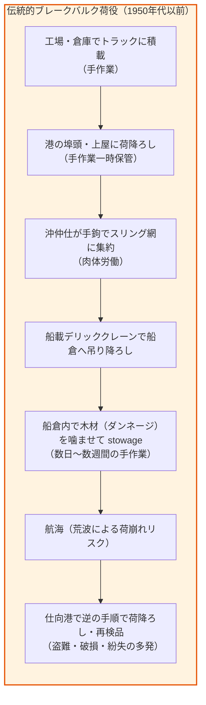
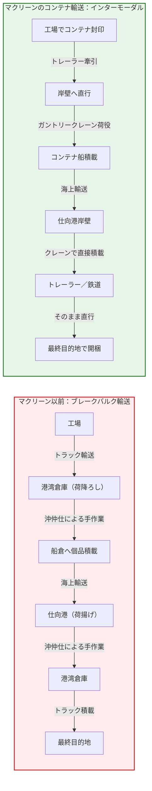
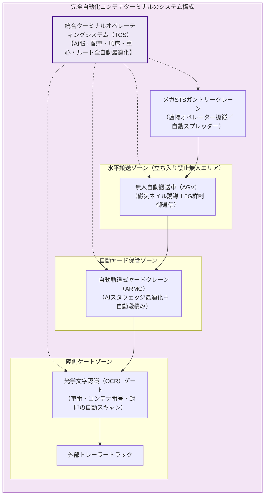
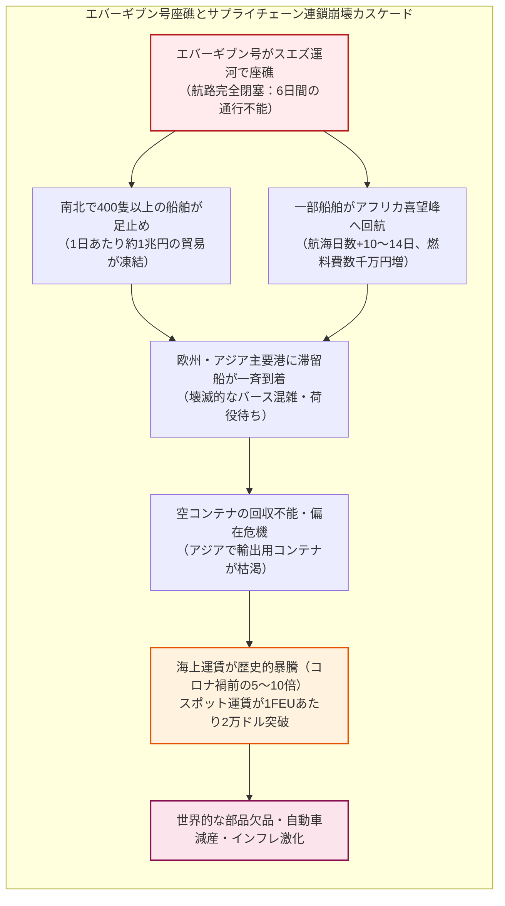

## はじめに：ありふれた鉄の箱が引き起こした世界史最大の奇跡

私たちの日常生活を見渡してほしい。手元にあるスマートフォン、袖を通しているシャツ、部屋を照らすLED照明、あるいは朝食のテーブルに並ぶ珈琲豆に至るまで、身の回りの物品のほぼすべては、自国とは何千キロメートルも離れた異国の工場や農園で生産されている。

現代人にとって、地球の裏側で作られた工業製品が、驚くほど安価に、そして注文からわずか数日で手元に届くことは、もはや空気のように当たり前の日常である。しかし、歴史の針をわずか70年ほど巻き戻すだけで、この「当たり前」は物理的にも経済的にも完全に不可能なSFの世界であった。

かつて、国際貿易における最大の障壁は、国家間の関税でもなければ、大海原の荒波でもなかった。それは、**「港で船に荷物を積み、船から荷物を降ろす」という、港湾における泥臭く絶望的な手作業**であった。

樽、麻袋、木箱、ドラム缶——不揃いな荷物を屈強な港湾労働者（沖仲仕）たちが背負い、一本のロープで船倉へと吊り降ろす。船が海を航行している時間よりも、港に停泊して荷役を待つ時間の方がはるかに長く、荷物の抜き荷（盗難）や破損が日常茶飯事であり、港湾荷役費だけで海上輸送コストの半分以上が吹き飛んでいた。当時の世界において、地球規模のサプライチェーンなどという発想は、経済的自殺以外の何物でもなかったのである。

この何千年と続いた海運の暗黒時代を根底から覆し、世界経済を爆発的なグローバリゼーションへと駆り立てた立役者——それこそが、**長さわずか20フィート（約6メートル）または40フィート（約12メートル）の、波板状の鋼鉄で作られた無骨な「海上コンテナ」**である。

```
「コンテナというイノベーションの本質は、箱そのものにあるのではない。
箱という単一のハードウェアを核として、船、鉄道、トラック、港湾クレーン、
そして情報システムに至るすべてを完全に一体化させた『巨大な自動化システム』の創出にある。」
—— マーク・レビンソン（経済史家、『コンテナ物語』著者）
```

蒸気機関が陸の距離を縮め、インターネットが情報の距離を消滅させたとするならば、海上コンテナは**「モノを運ぶコストと摩擦」を事実上ゼロへと近づけた**。コンテナの登場によって、輸送コストは製品価格の数パーセント、時には1パーセント未満へと激減した。その結果、企業は人件費や技術力に最も適した場所へと地球規模で工場を分散させることが可能になり、日本、アジア四小龍（韓国、台湾、香港、シンガポール）、そして中国が「世界の工場」へと駆け上がる産業革命のレールが敷かれたのである。

しかし、効率の極限を追求したこの「鉄の箱のシステム」は、21世紀の現代、未曾有の脆弱性（フラジリティ）を露呈し始めている。2021年の超巨大コンテナ船「エバーギブン号」によるスエズ運河座礁事故、気候変動に伴うパナマ運河の記録的干魃、そして紅海における地政学的危機による喜望峰回航——。世界貿易の9割を海運に依存する現代文明は、ひとたびこの鉄の箱の連鎖が滞れば、地球規模のインフレと供給麻痺に直面することが白日の下に晒された。

本稿では、海事工学、国際物流経済学、産業技術史、そして現代地政学の最前線から、海上コンテナという「世紀の怪物」の全貌を徹底的に解剖する。

---

## 第1章：失われた数千年の非効率——ブレークバルク荷役と港湾労働の暗黒時代

### 1.1 「荷役鈎（フック）」が支配した港の生態系

1950年代初頭に至るまで、海運の基本構造は古代フェニキア人や大航海時代のガレオン船の時代と本質的に変わっていなかった。この伝統的な輸送形態を、海運用語で**「ブレークバルク（Break Bulk：個品荷役／ばら積み一般貨物）」**と呼ぶ。

ブレークバルク輸送において、港に持ち込まれる貨物は千差万別であった。綿花の俵、機械部品の木箱、ウイスキー樽、穀物の麻袋、板ガラス、ドラム缶——形状も、重量も、強度も全く異なる貨物が、港の倉庫（上屋）に山積みにされていた。

これらの不揃いな貨物を船の船倉（ホールド）へと積み込むのは、**「沖仲仕（スティーブドア / ロングショアマン）」**と呼ばれる屈強な港湾労働者たちの肉体労働であった。彼らの必需品は、腰に差した鉄製の「手鉤（荷役フック）」である。フックを荷物に引っ掛け、人力で持ち上げ、スリング（ロープ網）にまとめ、本船のデリッククレーンで船倉へ吊り降ろす。船倉の底では、別の労働者たちが船の揺れで荷崩れが起きないよう、木材（ダンネージ）を隙間に詰め込みながら、テトリスのように隙間なく荷物を敷き詰めていった。



この作業には、驚異的な時間と人手が必要であった。典型的な中型貨物船（約1万トン）を満載にするためには、数十人から数百人の労働者が交代で作業にあたり、**積み込みだけで1週間から数週間**を要した。仕向地の港に到着すれば、再び同じ日数をかけて荷物を1個ずつ取り出さなければならなかった。

### 1.2 「船は港で金を食う」：海運資本の構造的破綻

海運業界には古くから「船は海を走っているときにしか金を稼がない」という鉄則がある。しかしブレークバルク時代、一般的な貨物船の生涯稼働時間のうち、**海を航行している時間はわずか40〜50%に過ぎず、残りの50〜60%は港に停泊して荷役作業を待つ時間**に費やされていた。

港に停泊している間も、船員への給与、港湾使用料、船舶の減価償却費、保険料などの固定費は容赦なく発生し続ける。これに加えて、港湾労働者への莫大な賃金支払いが重くのしかかった。

さらに深刻だったのが、**「荷抜き（盗難）」と「貨物破損」**である。
ウイスキーやタバコ、高級衣類などの高価な消費財は、港湾荷役の過程で日常的に抜き取られた。当時のニューヨーク港では「沖仲仕の家には酒と煙草が溢れている」と公然と囁かれていたほどである。また、手作業による落下の衝撃や、航行中の荒波による荷崩れによって、貨物が破壊される事故が絶えなかった。荷主は高額な海上保険料を支払わねばならず、これらすべての摩擦コストが最終的な製品価格に上乗せされていた。

> [!WARNING]
> **物流コストが形成した「見えない関税障壁」**
> 1950年代初頭の試算によれば、アメリカからヨーロッパへ一般消費財を輸送する場合、輸送運賃と荷役費の合計は、製品の工場出荷価格の**25%から50%**に達することも珍しくなかった。海上輸送の絶望的な非効率性こそが、国家間の自由な貿易を阻む最大の障壁となっていたのである。

---

## 第2章：マルコム・マクリーンの狂気——「陸から海へ」の逆転発想とアイディアルX号

### 2.1 トラック運送業者が抱いた素朴な疑問

この数千年にわたる海運の常識を打ち破ったのは、船乗りでも造船技師でもなく、海運の外の世界からやってきた一人のトラック運送業者であった。彼の名は**マルコム・パーセル・マクリーン（Malcom Purcell McLean, 1913–2001）**。

ノースカロライナ州の貧しい農家に生まれたマクリーンは、大恐慌の嵐が吹き荒れる1934年、中古のトラック1台を購入して運送業を始めた。持ち前の商才と不屈のガッツで会社を急成長させ、1950年代には全米第2位の規模を誇るトラック会社「マクリーン・トラッキング・カンパニー」の社長に登り詰めていた。

マクリーンがコンテナの着想を得たのは、彼がまだ若きトラック運転手だった1937年のことである。綿花の俵を満載したトラックを運転してニュージャージー州の港へ運んだ彼は、自分のトラックから降ろされた綿花が、沖仲仕たちの手によって何時間もかけて小型クレーンで船倉へ積み込まれるのを、運転席からぼんやりと眺めていた。

```
「なぜ、トラックの荷台（トレーラーの箱）から荷物をいちいち取り出して
船に積み直す必要があるのだ？
トレーラーの箱ごとそのままクレーンで吊り上げ、
船の上にポンと載せてしまえばいいではないか。」
```

この極めてシンプルで直感的な閃きこそが、世界経済の構造を塗り替える革命の種火であった。

当時の常識では、陸上輸送（トラック・鉄道）と海上輸送（船）は完全に別個の業界であり、それぞれが独立したルール、労働慣行、組合構造で運営されていた。船会社は「船の運航」だけを考え、トラック会社は「道路の走行」だけを考えていた。しかしマクリーンは、自らを「トラック業者」ではなく**「荷物を地点Aから地点Bへ届ける輸送業者」**と定義していた。輸送のボトルネックが港の荷役にあるのなら、船を陸上輸送の延長線上に位置づければよいと考えたのである。

### 2.2 1956年4月26日：「アイディアルX号」の歴史的航跡

当時のアメリカでは、陸上運送会社が船会社を直接保有することを規制する独占禁止法（州間通商委員会：ICCの規制）が存在した。マクリーンは自らが創業したトラック会社の株式をすべて売却し、銀行から莫大な借金をして、負債を抱えていた老舗船会社「パンアトランティック汽船（後のシーランド社：Sea-Land）」を買収するという大博打に出た。

マクリーンは第二次世界大戦型の中古タンカー「ポトレロ・ヒルズ号」を購入し、デッキの上にコンテナを固定するための特殊な鋼鉄製フレームを架装した。これが、歴史に名を残す世界初の商業コンテナ船**「アイディアルX号（Ideal-X）」**である。



1956年4月26日、霧に包まれたニュージャージー州ニューアーク港。
アイディアルX号の甲板には、33フィート（約10メートル）のアルミ製コンテナ58個が、専用の大型クレーンによってわずか8時間足らずで整然と積み付けられた。船は汽笛を鳴らし、テキサス州ヒューストン港へ向けて出航した。

その歴史的瞬間を見つめていた国際港湾労働者協会（ILA）の幹部は、記者にこう吐き捨てたという。
**「あの船の棺桶を見ろ。あの中に、俺たち沖仲仕の未来の死体が詰め込まれているんだ。」**

### 2.3 荷役コストの垂直落下：1トンあたり5.83ドルから0.16ドルへ

アイディアルX号の航海が海運界に与えた衝撃は、あまりにも破壊的であった。
マクリーンが弾き出した荷役コストのデータは、業界の度肝を抜いた。

- 従来のブレークバルク荷役コスト：**1トンあたり約 5.83 ドル**
- アイディアルX号のコンテナ荷役コスト：**1トンあたりわずか 0.158 ドル（約16セント）**

荷役コストは、実に**37分の1（約97%削減）**という、産業史上に類を見ない垂直落下を記録したのである。積み込みにかかる時間も数週間から数時間へと圧縮され、船舶の回転率は劇的に向上した。船が港で無駄に眠る時間は消滅し、海上輸送は一気に高効率なマス・トランスポーテーションへと変貌を遂げた。

| 比較項目 | 伝統的ブレークバルク荷役（1950年代） | 初期の海上コンテナ輸送（1960年代） | 現代のメガコンテナ輸送（2020年代） |
| :--- | :--- | :--- | :--- |
| **荷役方式** | 人力手作業＋スリング網デリッククレーン | クレーンによるコンテナ一括揚降 | 自動化ガントリークレーン（自動スプレッダー） |
| **荷役速度** | 毎時 10〜25 トン程度 | 毎时 400〜500 トン程度 | 毎時 2,000〜4,000 トン超（複数クレーン） |
| **停泊日数** | 1航海あたり 7〜20 日間 | 1航海あたり 1〜2 日間 | 1航海あたり 12〜24 時間（メガ船でも数日） |
| **貨物安全性** | 抜き荷・盗難・雨濡れ・破損多発 | 封印（シール）による盗難・破損激減 | 完全密閉・GPS/IoT温度管理（リーファー） |
| **輸送コスト比重** | 物流費が製品価格の 20〜50% | 物流費が製品価格の 5〜10% | 物流費が製品価格の **1% 未満**（工業製品） |

---


### 2.4 ベトナム戦争と「カムラン湾の奇跡」：コンテナの世界展開を決定づけた契機

アイディアルX号の成功から10年あまり、海上コンテナはアメリカ国内沿岸航路を中心に普及しつつあったものの、世界中の海運会社や港湾当局は、莫大な設備投資への恐れと労働組合の反発から、国際航路への全面導入を躊躇していた。この躊躇を一気に打ち破り、コンテナの世界標準化を不可逆のものとした歴史的転換点こそが、皮肉にも**「ベトナム戦争（1960年代後半）」**であった。

1965年、アメリカ軍がベトナムへ本格介入を開始すると、サイゴン港やダナン港には数十万トンもの軍需物資（弾薬、食料、燃料、車両、医薬品）が一斉に押し寄せた。しかし当時のベトナムの港湾は、近代的な荷役設備を持たない脆弱なブレークバルク港であった。

港湾は瞬く間に大混乱に陥り、100隻以上もの補給船が沖合に何ヶ月も錨を下ろして滞船した。物資は海岸の砂浜に野積みされ、熱帯の豪雨で腐敗し、現地ゲリラやブラックマーケットへの横流し・略奪が横行した。アメリカ軍の兵站（ロジスティクス）は完全に崩壊の危機に瀕していた。

```
「この泥沼の兵站危機を救える民間人は、マルコム・マクリーンしかいない。」
```

1966年、米国防総省から特命を受けたマクリーンは、天然の深水湾であったカムラン湾に自前の仮設桟橋とガントリークレーンを突貫工事で建設し、シーランド社のコンテナ船を就航させた。コンテナに鍵をかけ、一度も開けることなく最前線へと物資を届けるシステムを構築したのである。

その結果は奇跡的であった。**数ヶ月かかっていた軍需物資の揚陸はわずか数日へと短縮され、破損や横流しはゼロになった**。コンテナ化によって米軍の補給線は劇的に回復したのである。

さらにマクリーンが天才的だったのは、その「帰り便」の活用であった。ベトナムへ軍需物資を運んだ後のコンテナ船は、空っぽのままアメリカへ戻る。マクリーンはこの空船を、急激な経済復興を遂げつつあった**日本（横浜港・神戸港）**へと立ち寄らせたのである。

当時、トランジスタラジオ、テレビ、オートバイなどの対米輸出を爆発させていた日本の製造業にとって、安全かつ超低コストでアメリカへ運んでくれるコンテナ船の登場は、まさに天の恵みであった。こうして、ベトナム戦争の兵站支援を契機として、太平洋をまたぐ日米コンテナ定期航路が開設され、日本を皮切りとするアジアの輸出主導型経済成長の導火線に火がついたのである。

---

## 第3章：規格という名の世界覇権——ISO規格統一（TEU/FEU）とツイストロックの精密工学

### 3.1 規格戦争：35フィート vs 24フィートの激突

マクリーンの成功を見た世界中の海運会社は、雪崩を打ってコンテナ化へと舵を切った。しかし、ここで新たな巨大な壁が立ちはだかった。**「箱のサイズがバラバラ」**だったのである。

- **シーランド社（マクリーン）**: アメリカ東海岸の道路交通規制に合わせた**「長さ35フィート（約10.67m）、高さ8フィート、幅8フィート」**
- **マトソン社（Matson）**: ハワイ航路のトラック規制に最適化した**「長さ24フィート（約7.32m）」**
- **アメリカ海軍**: 軍用補給に用いていた小型の「コングリックス（CONEX）ボックス」（長さ約8.5フィート）
- **欧州鉄道各社**: 欧州の狭いトンネル断面に合わせた独自の小型コンテナ

もし各社がバラバラのサイズのコンテナを使い続ければ、港のクレーンも、船の船倉ガイドレールも、鉄道の貨車も、トレーラーのシャーシも、すべて特定の会社専用に作らなければならない。これでは、マクリーンが夢見た「世界中どこでもシームレスに荷物がリレーされるユニバーサルな輸送システム」は実現不可能であった。

### 3.2 ISO国際標準化の激闘と「TEU」の誕生

1961年から国際標準化機構（ISO）の第104技術委員会（ISO/TC 104）において、血を洗うような国際規格統一交渉が開始された。各国の海運会社、鉄道会社、軍部、政府代表が、自国の既存インフラと投資を守るために激しく対立した。

激論の末、1968年に最終合意に達した世界標準規格こそが、今日私たちが目にするISOコンテナ規格である。

- **基準の幅と高さ**: 幅 8フィート（2,438mm）、高さ 8フィート6インチ（2,591mm）※後に背高のハイキューブ（9フィート6インチ）が登場
- **基準の長さ**:
  - **20フィート（実長 19フィート10.5インチ = 6,058mm）**
  - **40フィート（実長 40フィート0インチ = 12,192mm）**

```
【コンテナ統計の共通言語：TEUとは何か？】
20フィートコンテナ1個分を換算基準として「1 TEU（Twenty-foot Equivalent Unit）」と呼ぶ。
40フィートコンテナは2本分に相当するため「2 TEU（または1 FEU: Forty-foot Equivalent Unit）」とカウントされる。
コンテナ船の積載能力や港湾の年間取扱量は、すべてこの「TEU」を単位として記述される。
```

マクリーンは、自社が莫大な投資を行っていた35フィートの特許技術を無償で一般公開し、ISO世界規格への統一を後押しした。自社のエゴを捨てて世界標準を受け入れることこそが、海運市場全体を無限に拡大させる鍵であることを、彼は見抜いていたのである。

### 3.3 ツイストロックとコーナーキャスティングの精密工学

コンテナが世界標準となり得た最大の工学的秘密は、箱の八隅に埋め込まれた鋳鋼製のブロック**「コーナーキャスティング（Corner Casting）」**と、それらを上下左右に強固に結合する金具**「ツイストロック（Twistlock）」**の機構にある。

```
     [ コーナーキャスティング ]
          ┌───────┐
          │ ( O ) │  ← 特殊な長円形の開口部
          └───────┘
              ▲
              │
          ┌───────┐
          │  ─┬─  │  ← 90度回転して噛み合う
          │   ┴   │     円錐状のツイストロック頭部
          └───────┘
```

冬の北太平洋や北大西洋の荒波の中、コンテナ船は最大30度以上も左右にローリング（横揺れ）する。甲板上には、重量30トンにも達するコンテナが**7段から10段（高さ20メートル以上）**積み上げられている。タワー全体の重量は何百トンにも達し、最下段のコンテナとツイストロックには、破壊的な圧縮応力、引き抜き力、そして水平方向のせん断応力（Shear Stress）が同時に襲いかかる。

材料力学におけるツイストロックの基礎方程式は以下の通りである。

$$\sigma = \frac{F_{\text{tensile}}}{A_{\text{lock}}} \le \sigma_{\text{allowable}}, \quad \tau = \frac{F_{\text{shear}}}{A_{\text{lock}}} \le \tau_{\text{allowable}}$$

ここで、$\sigma$ は引張応力、$\tau$ はせん断応力、$A_{\text{lock}}$ はツイストロックの首部断面積である。

ISO規格で厳密に公差が規定されたコーナーキャスティングの開口部に、ガントリークレーンのスプレッダー（吊り具）からツイストロックが差し込まれ、油圧アクチュエータによって頭部が90度回転する。**「カチャリ」という乾いた金属音とともに、ミリ単位の精度で巨大な箱が完全にロックされる**。この極限の剛性と幾何学的互換性があるからこそ、人間が手作業でロープを結ぶことなく、クレーンがわずか数十秒でコンテナを掴み、吊り上げ、固定することが可能になったのである。

---

## 第4章：世界を縮小させた「複合一貫輸送」の物理・情報アーキテクチャ

### 4.1 インターモーダル輸送（Intermodal Freight Transport）の真髄

海上コンテナの真の破壊力は、船の上にとどまらない。コンテナは、**「船（海）」「鉄道（陸）」「トレーラー（陸）」の境界線を完全に消滅させた**。

従来の物流では、トラックから貨物列車へ、貨物列車から船へと移し替えるたびに、荷物を倉庫へ降ろして仕分け、検品し、積み直すという莫大な「積み替え摩擦」が発生していた。しかしコンテナ輸送においては、**貨物は発地の工場で一度箱の中に詰められ封印（シール）されたら、最終仕向地の受取人の倉庫に到着するまで、何千何万キロメートル移動しようと、一度も扉を開けられることがない**。


この「荷物を一度も積み替えることなく、複数の輸送モードをシームレスにリレーする」輸送形態を**「複合一貫輸送（インターモーダル輸送）」**と呼ぶ。

アメリカ大陸では、西海岸のロサンゼルス／ロングビーチ港に陸揚げされたアジアからのコンテナが、そのまま港内のオン・ドック・レール（岸壁直結鉄道）へ運ばれ、全長3キロメートル、200両以上にも及ぶ巨大貨物列車に**2段重ね（ダブルスタック）**で積み上げられる。この「ダブルスタックトレイン」がロッキー山脈を越えてシカゴやニューヨークへと疾走することで、パナマ運河を経由するよりもはるかに速く、かつ低コストでアメリカ全土へアジアの製品が供給される「陸上架橋（ランドブリッジ）」が完成した。

### 4.2 情報アーキテクチャの革命：船荷証券（B/L）からEDI、そしてブロックチェーンへ

物理的な箱の移動と並行して、コンテナ革命は世界貿易の「情報の流れ」を根本から刷新した。

何万個ものコンテナが世界中を行き交う現代において、どの箱に誰の荷物が入り、どこで船を乗り換え、いつ通関するのかを紙の書類で管理することは不可能である。1970年代から導入が進んだ**EDI（電子データ交換）**は、船荷証券（B/L: Bill of Lading）、マニフェスト（積荷目録）、通関書類を標準化されたデジタルデータへと変換した。

今日では、港湾コミュニティシステム（PCS）やターミナルオペレーティングシステム（TOS）が、数万本のコンテナの位置情報をリアルタイムで把握し、AIが船のトリム（傾き）や荷降ろし順序をミリ秒単位で計算して最適な積載プラン（スタウェッジプラン）を自動生成している。

---

## 第5章：メガコンテナ船の物理限界と自動化ターミナル

### 5.1 1,000 TEUから24,000 TEUへ：規模の経済の追求

コンテナ化の進展は、船の巨大化競争を引き起こした。海運会社にとって、コンテナ船を大型化することは単位あたりの輸送コストを劇的に引き下げる最も確実な手段であったからである。

単一航海における1TEUあたりの輸送コスト $C_{\text{unit}}$ は、以下の経済モデルで記述される。

$$C_{\text{unit}} = \frac{C_{\text{capital}} + C_{\text{crew}} + C_{\text{fuel}} + C_{\text{port}}}{Q_{\text{capacity}} \times \alpha_{\text{utilization}}}$$

ここで、$C_{\text{capital}}$ は船体建造費の償却費、$C_{\text{crew}}$ は船員人件費、$C_{\text{fuel}}$ は燃料費、$C_{\text{port}}$ は運河・港湾使用料、$Q_{\text{capacity}}$ は船の公称積載能力（TEU）、$\alpha_{\text{utilization}}$ は積載率である。

船のサイズを2倍にしても、船を操縦する船員の数はほとんど変わらない（2万TEU超のメガ船でも乗組員はわずか20〜25人程度である）。船体重量に対する積載量の比率も向上するため、**船を大型化すればするほど、コンテナ1個あたりの固定費と運航費は極限まで希釈される（規模の経済）**。

```
【コンテナ船の世代交代と巨大化の歴史】
・第1世代（1960年代）：1,000 TEU 未満（全長約130m）
・パナマックス（1980年代）：3,000〜4,500 TEU（旧パナマ運河を通過できる最大幅32.3m）
・ポストパナマックス（1990年代）：6,000〜8,000 TEU（パナマ運河の制限を突破）
・メガマックス / ULCV（2020年代）：24,000 TEU 超（全長約400m、全幅約61.5m）
```

現代の最新鋭メガコンテナ船（MSCイリーナ、エバーエースなど）は、**全長約400メートル、幅61.5メートル**に達する。これは東京タワーを横倒しにした長さを遥かに超え、甲板上には20フィートコンテナを横に24列、縦に25段積み上げることができる。この船1隻で、スニーカーなら数千万足、ワインなら数千万本を一気に輸送できる文字通りの「浮かぶ巨大物流都市」である。

### 5.2 航行速度と燃料消費の「3乗則」：スロースチーミングの力学

巨大船の経済性を支配する流体力学の鉄則が、**「船体推進馬力と航行速度の3乗則（立方則）」**である。

流体中を進む船舶の抵抗は速度の2乗に比例し、必要な主機馬力（パワー $P$）は速度の3乗に比例する。

$$P \propto V^3$$

1日あたりの燃料消費量 $F_{\text{day}}$ も、速度の3乗におよそ比例して急増する。

$$F_{\text{day}} = c \cdot \Delta^{2/3} \cdot V^3$$

ここで、$c$ はアドミラルティ係数（Admiralty Coefficient）、$\Delta$ は排水量（トン）、$V$ は航海速力（ノット）である。

```
【航行速度と燃料消費の劇的変化（2万TEU級メガ船のシミュレーション）】
・巡航速度 25 ノット（全速力）：燃料消費量 約 250〜300 トン/日
・減速航行 18 ノット（スロースチーミング）：燃料消費量 約 90〜110 トン/日（約 60% 削減！）
・超減速航行 14 ノット（スーパースロースチーミング）：燃料消費量 約 50〜60 トン/日（約 80% 削減！）
```

2008年のリーマンショックによる運賃暴落と原油高騰に直面した海運業界は、航行速度をあえて24ノットから16〜18ノットへと落とす**「スロースチーミング（減速航行）」**を一斉に採用した。航海日数は数日延びるものの、燃料消費量は半分以下に激減し、膨大なCO2排出量と運航コストを抑制することが可能になったのである。

### 5.3 自動化コンテナターミナル：無人AGVと群制御の宇宙

船が巨大化すればするほど、陸側のターミナルには超人的な荷役能力が求められる。24,000TEUのメガ船が接岸した際、数日間で数万本ものコンテナを捌き切らなければ、船のスケジュールが狂い、港湾全体が麻痺してしまうからである。

この課題を克服するために誕生したのが、ロッテルダム港（オランダ）、上海港（洋山深水港）、青島港（中国）、ロングビーチ港（米国）などに建設された**完全自動化コンテナターミナル（Automated Container Terminal）**である。



完全自動化ターミナルの埠頭には、人影が一切存在しない。
遠隔操作室のオペレーターが高解像度カメラとジョイスティックで巨大なシップ・トゥ・ショア（STS）クレーンを操り、船からコンテナを吊り上げて**AGV（Automated Guided Vehicle：無人搬送車）**の背中に下ろす。AGVは地面に埋め込まれた数万個の磁気マーカーと5Gミリ波通信によって誘導され、時速20kmで障害物を自動回避しながら自律走行する。

ヤードに到着したコンテナは、AIによって統括制御された**ARMG（自動軌道式ヤードクレーン）**によってミリ単位の精度で幾何学的に積み上げられる。船の出港予定、荷主の引き取り予定時間、コンテナの重量バランスをディープラーニングが予測し、夜間にクレーンが自律的にコンテナの配置換えを行って、朝一番にトラックが取りに来るコンテナを一番上に並べ替えておく。この無人のハイテク自動化によって、現代の港湾は24時間365日、寸分の狂いもなく貨物を処理し続けている。

---


### 5.4 海運アライアンス（国際海運同盟）とメガキャリアの寡頭支配

2万TEUを超えるメガコンテナ船を建造するには、1隻あたり約1億5,000万〜2億ドル（数百億円）もの莫大な資本が必要となる。さらに、主要航路で荷主を惹きつけるためには、「週1便」の定期運航スケジュールを維持しなければならず、1つの航路ループを維持するだけで同型のメガ船が10〜12隻（総額2,000億円超）必要となる。

いかに巨大な海運会社であっても、単独で世界中の航路に何十隻ものメガ船を配備し、その膨大な船倉を常に満載にし続けることは至難の業である。そこで生まれたのが、船会社同士が互いの船のスペース（スロット）を融通し合い、共同運航を行う**「海運アライアンス（Global Alliances）」**である。

現代の世界コンテナ定期航路は、以下の3大アライアンス（および合従連衡）によって、世界シェアの約8割以上が寡頭支配されている。

1. **2M（MSC、マースク）**: 世界最大手2社による巨人同盟（※2025年以降は提携解消し新体制へ再編）
2. **オーシャン・アライアンス（Ocean Alliance）**: CMA CGM（仏）、COSCO（中国遠洋海運）、エバーグリーン（台湾）、OOCL（香港）による最大規模の船隊
3. **ザ・アライアンス / プレミア・アライアンス（THE Alliance / Premier Alliance）**: オーシャン・ネットワーク・エクスプレス（ONE：日本郵船・商船三井・川崎汽船の定期船統合会社）、HMM（韓国）、ヤンミン（台湾）らによる連合

この寡頭支配体制は、運航コストの削減と航路ネットワークの網羅性を高めた一方で、世界的な海運市況や運賃水準に対する価格支配力を強める結果ともなり、世界各国の公正取引当局や荷主団体との間で激しい摩擦を生む要因にもなっている。

---

## 第6章：サプライチェーンの地政学と脆性（フラジリティ）

### 6.1 ジャストインタイム（JIT）の罠：究極の効率が招いた脆弱性

海上コンテナによる輸送コストの極小化とスケジュールの正確性は、製造業に革命的な経営思想をもたらした。それこそが、トヨタ自動車に代表される**「ジャストインタイム（JIT / かんばん方式）」**の世界的普及である。

倉庫に大量の在庫（安全在庫）を抱えることは、資本の滞留であり「悪」とみなされた。工場は、明日組み立てる部品を今日の朝届くコンテナから直接ラインへと流し込む。海の上を走る数万隻のコンテナ船そのものが、「巨大な動く倉庫」となったのである。

しかし、この極限まで無駄を削ぎ落としたグローバルサプライチェーンは、**「すべての輸送リンクが100%予定通りに稼働し続ける」という脆弱な前提**の上に築かれた砂上の楼閣でもあった。一度どこかの結節点（ノード）が詰まれば、代替のバッファーを持たない生産ラインは世界中で瞬時に玉突き衝突を起こし、全停止に追い込まれるのである。

### 6.2 2021年エバーギブン号スエズ運河座礁事故の衝撃

この悪夢が現実となったのが、2021年3月23日に発生した**超大型コンテナ船「エバーギブン（Ever Given）」号によるスエズ運河座礁事故**である。

全長400メートル、20,000 TEU積みの巨船が、突風に煽られて運河の土砂に船首を突っ込み、斜めに座礁して運河を完全に塞ぎ止めた。



スエズ運河は、アジアと欧州を結ぶ世界貿易の約12%が通過する大動脈である。座礁による遮断はわずか6日間であったが、その余波は世界経済を数ヶ月にわたって麻痺させた。

運河の手前で立ち往生した400隻以上の船が、通航再開後に欧州の港へ一斉に押し寄せたため、港湾の受入能力がパンク。沖合に何十隻ものコンテナ船が何週間もアンカーを下ろして停泊待機を余儀なくされ、コンテナが港から出せないため、アジアの輸出国では工場に積むべき「空コンテナ」が完全に枯渇した。コンテナ不足から海上運賃はコロナ禍前の5倍から10倍へと跳ね上がり、サプライチェーンの麻痺は世界的なインフレの導火線となった。

### 6.3 チョークポイント地政学：パナマ運河渇水と紅海危機

2020年代半ば、海上コンテナ物流は新たな地政学的・環境的危機に直面している。

1. **パナマ運河の渇水危機**:
   パナマ運河は閘門（こうもん）式運河であり、船を通過させるたびに膨大な淡水（ガトゥン湖の水）を海へ排水する。近年の気候変動に伴う深刻なエルニーニョ現象と干魃により湖の水位が低下し、1日あたりの通航隻数が平時の36隻から一時は20隻前後へと大幅制限され、船の喫水（積載可能重量）も厳しく制限された。
2. **紅海危機（イエメン・フーシ派による商船攻撃）**:
   中東情勢の緊迫化に伴い、イエメンの武装勢力が紅海・バブ・エル・マンデブ海峡を通過する商船に対してドローンや対艦ミサイルによる攻撃を頻発。大手海運各社（マースク、MSC、ハパックロイド、ONEなど）はスエズ航路を断念し、アフリカ最南端の**喜望峰を回る大迂回ルート**への変更を余儀なくされた。航海日数は片道で10〜14日延び、運航コストとCO2排出量は急増した。

世界がどれほどデジタル化し、クラウドやメタバースが発達しようとも、私たちが消費する物理的な物資の90%以上は、依然として狭いチョークポイント（マラッカ海峡、ホルムズ海峡、スエズ運河、パナマ運河）を通過する「鉄の箱」に依存しているという冷厳な事実を、これらの危機は突きつけている。

---

## 第7章：結論——鉄の箱が紡ぐ文明の未来

### 7.1 究極の標準化が教えたイノベーションの本質

海上コンテナの物語が私たちに与える最大の教訓とは何だろうか。それは、**「真に世界を変えるイノベーションとは、必ずしも高度で複雑なハイテク技術ではない」**ということである。

コンテナそのものは、ただの波板鋼板を溶接した長方形の鉄の箱に過ぎない。トランジスタも、マイクロプロセッサも、バイオテクノロジーも使われていない。マクリーンが成し遂げた真の偉業は、箱を作ったことではなく、**「箱」という極めて単純な標準インターフェースを起点として、港、船、クレーン、鉄道、道路、法制度、情報網のすべてを再設計し、世界規模のひとつの統合システムへと昇華させたこと**にある。

ITの世界において、パケット通信規格（TCP/IP）が異なるコンピュータ同士をシームレスにつなぎ世界規模のインターネットを爆発させたように、海上コンテナは**「物理的なモノのパケット（Physical Packet）」**として機能し、世界経済という巨大なハードウェアを接続したのである。

### 7.2 脱炭素化とレジリエンス：21世紀の新たな航路へ

今、海上コンテナ物流は、誕生以来最大のパラダイムシフトを迎えている。

国際海事機関（IMO）が掲げる「2050年頃までの国際海運GHG（温室効果ガス）排出ネットゼロ」という過酷な目標に向け、重油を燃料としてきた巨大コンテナ船は、**グリーンメタノール、液化天然ガス（LNG）、さらにはアンモニアや水素**を燃料とする次世代ゼロエミッション船へと巨額の投資を進めている。また、地政学的リスクの高まりは、従来の「ジャストインタイム（効率最優先）」から、在庫をあえて多めに抱え調達先を複線化する「ジャストインケース（レジリエンス最優先）」への構造転換を促している。

しかし、どれほど燃料が変わり、情報システムがAIに置き換わろうとも、世界を支える基盤が「縦8フィート、横8フィート、長さ20フィートまたは40フィートの鉄の箱」であり続けることは疑いようがない。

今日も、世界のどこかの海で、数万個のコンテナを満載したメガ船が漆黒の夜の海を切り裂いて進んでいる。無数の人々の欲望と勤勉、そして文明の息吹をその鉄の胃袋に飲み込みながら、世界をつなぐ鉄の箱の航海は、これからも果てしなく続いていく。
