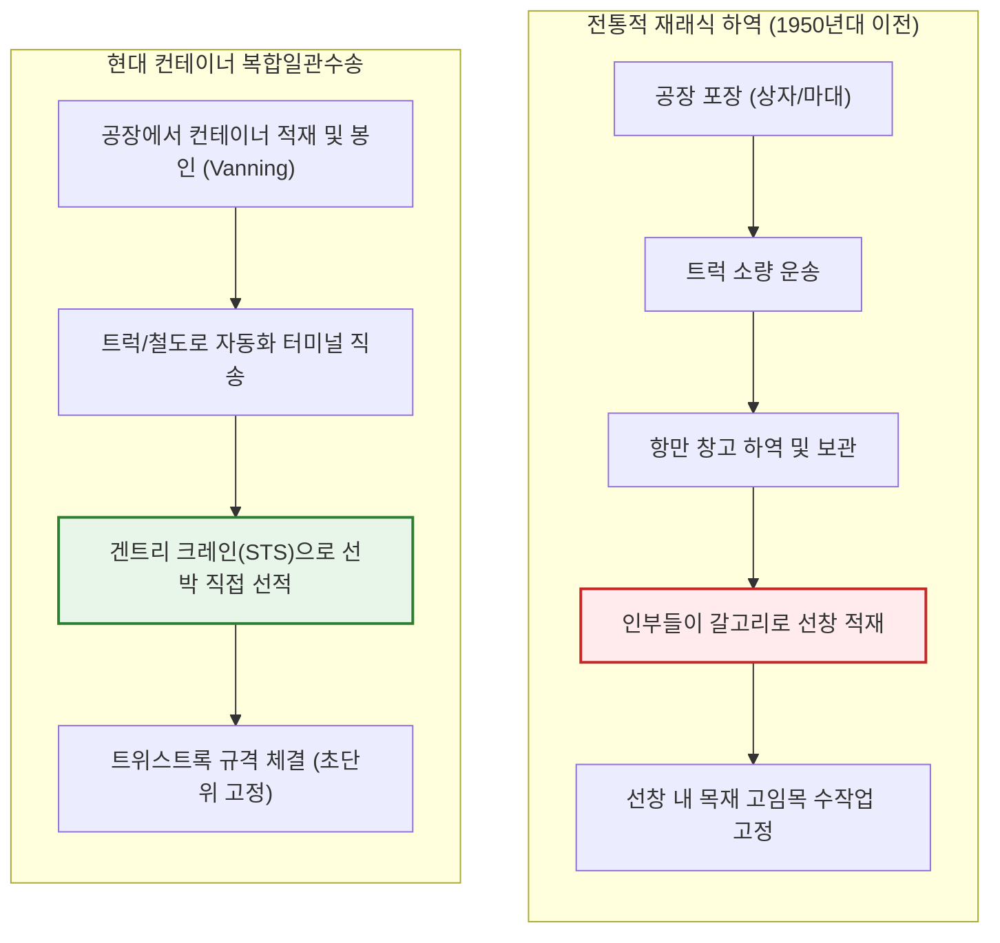
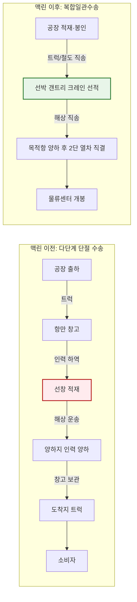
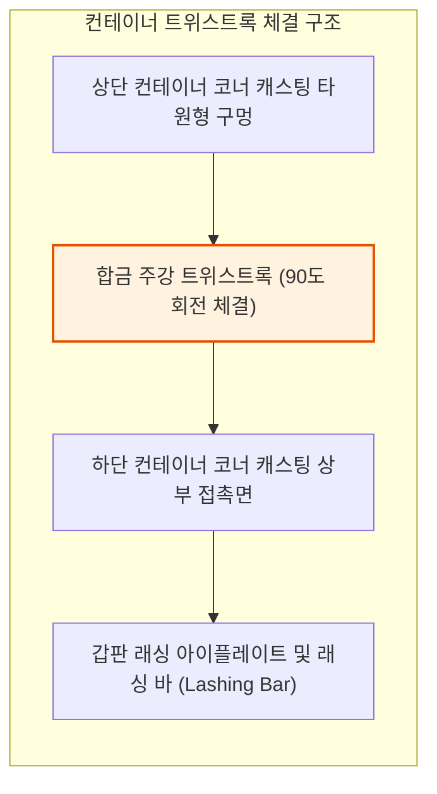
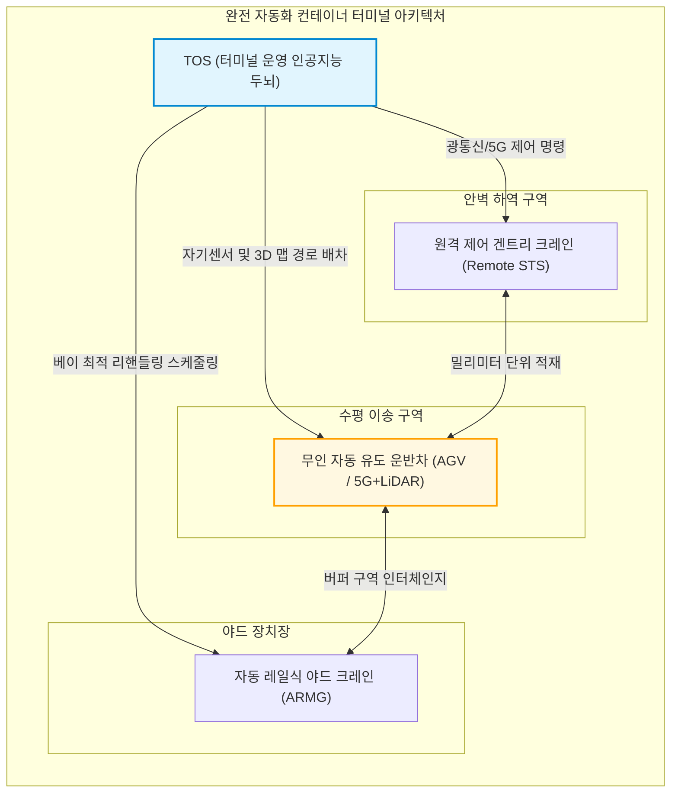
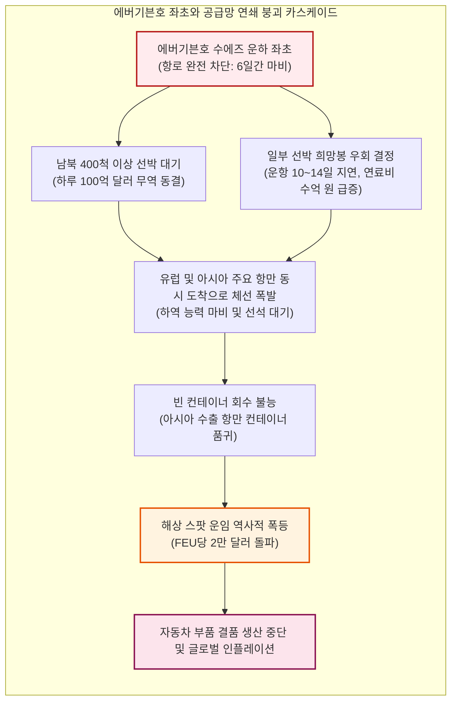

## 서론: 평범한 철제 상자가 일으킨 세계사 최대의 경제 기적

오늘날 스마트폰을 손에 쥐거나, 해외 공장에서 제조된 옷을 입고, 지구 반대편 농장에서 재배된 커피를 마실 때 우리는 인류 산업 문명사상 가장 정교하고 거대한 물리적 네트워크의 혜택을 누리고 있다.

연간 25조 달러가 넘는 글로벌 상품 무역을 지탱하는 이 거대한 인프라의 핵심은 보잉 747 화물기도, 해저 광케이블도 아니다. 그것은 주름진 내후성 강판을 용접해 만든 직사각형 상자, 바로 **ISO 표준 해상 컨테이너(Shipping Container)**다.

1950년대 이전까지만 해도 해상 운송은 극도로 비효율적이고 위험하며 천문학적인 비용이 드는 작업이었다. 일반 잡화선(Break-Bulk Ship)이 항구에 접안하면 화물을 싣고 내리는 데만 수주일이 걸렸다. 수백 명의 항만 하역 노동자(Stevedores)가 쇠갈고리(Cargo Hook)와 밧줄에 의지해 마대, 나무 궤짝, 드럼통을 좁고 습한 선창에 하나하나 손으로 쌓아 넣었다. 항만 하역비는 전체 해상 운송 비용의 50% 이상을 차지했고 화물의 도난과 파손은 일상적이었다.

그러나 1956년, 미국의 한 트럭 운송업자 **맬컴 맥린(Malcom McLean)**이 개조된 유조선 '아이디얼 X(Ideal-X)'호를 띄우며 수천 년 동안 이어진 패러다임을 단번에 파괴했다. 그가 제시한 것은 첨단 하이테크가 아닌 **'운송 단위의 추상화(Abstraction)'**였다. 트럭 차체를 배에 그대로 싣는다는 단순한 발상이 트럭, 철도, 선박을 하나로 잇는 물리적 표준으로 진화했다.

단 몇 년 만에 화물 1톤당 하역 비용은 5.83달러에서 0.16달러로 97% 이상 수직 낙하했다. 최종 소비재 가격에서 해상 운임이 차지하는 비중은 1~2% 수준으로 급감했다. 이 '철의 상자'가 있었기에 아시아의 대규모 제조업 분업과 현대 글로벌 공급망, 그리고 전 세계적 세계화(Globalization)가 실현될 수 있었다.

본 글에서는 공학, 경제학, 해운 지정학의 관점에서 해상 컨테이너 시스템의 탄생 배경, ISO 규격 표준화의 기술사, 메가 컨테이너선의 물리적 한계, 그리고 극단적 효율성이 초래한 현대 공급망의 취약성까지 철저하게 해부한다.

---

## 제1장: 잃어버린 수천 년의 비효율——재래 화물 하역과 부두 노동의 암흑기

### 1.1 '하역 갈고리(Cargo Hook)'가 지배하던 항만의 생태계

컨테이너가 등장하기 전까지 인류의 해상 무역 방식은 고대 페니키아 시대 이래 근본적으로 변하지 않았다. 모든 화물은 포장 단위가 제각각인 **재래 화물(Break-Bulk Cargo)** 형태로 운송되었다. 나무통에 담긴 와인, 마대에 담긴 커피콩, 궤짝에 담긴 기계 부품 등이 부두에 무질서하게 쌓였다.

부두의 핵심 도구는 하역 노동자들의 허리춤에 꽂혀 있던 쇠갈고리(Cargo Hook)였다. 인부들은 갈고리로 포대를 찍어 어깨에 메고 선창 깊숙한 곳까지 날랐다. 선박이 항해 중 흔들려 화물이 무너지지 않도록 빈 공간마다 목재 쐐기와 짚단(Dunnage)을 쑤셔 넣는 고된 노동이 이어졌다.

이 작업은 극도로 위험했을 뿐 아니라, 마피아와 결탁한 항만 노동조합의 강력한 카르텔(예: 미국 국제항만노동자협회 ILA)을 형성했다. 또한 '화물 축소(Shrinkage)'라 불리는 도난 행위가 만연하여, 1950년대 뉴욕항에서는 고가 화물의 10~15%가 하역 과정에서 분실되거나 파손되었다.

### 1.2 "배는 항구에서 돈을 갉아먹는다": 해운 자본의 구조적 파탄

해운업계에는 오랜 격언이 있다. **"배는 바다를 항해할 때만 돈을 벌고, 항구에 머무는 순간 돈을 삼킨다(A ship only earns money when it is at sea)."**

재래 화물선 시대에 선박은 수명의 **50%에서 65% 이상을 부두에 정박한 채** 하역 작업을 기다리는 데 허비했다. 선박의 감가상각비, 선원 인건비, 항만 정박료는 아무런 부가가치를 창출하지 못하고 증발했다.

| 평가 지표 | 전통적 재래식 하역 (1950년대) | 현대 컨테이너 하역 (2020년대) | 효율 혁신 격차 |
| :--- | :--- | :--- | :--- |
| **하역 생산성** | 약 15 ~ 25 톤 / 시간·갱 | 1,000 ~ 2,000 톤 이상 / 크레인·시간 | 약 **60~100배 향상** |
| **선석 정박 시간** | 10 ~ 14일 (최대 1개월) | 12 ~ 24시간 (즉시 출항) | 항만 체류시간 **90% 단축** |
| **하역비 비중** | 총 운임의 **50% ~ 65%** | 총 운임의 **10% ~ 15%** | 하역비용 대폭 절감 |
| **화물 사고율** | 약 **5% ~ 15%** (도난·파손) | **0.01% 미만** (고유 봉인) | 화물 사고 사실상 소멸 |

---

## 제2장: 맬컴 맥린의 집념——육상 운송업자의 역발상과 '아이디얼 X'호

### 2.1 트럭 운전사가 품었던 단순한 의문

현대 컨테이너의 아버지 **맬컴 맥린(Malcom McLean)**은 해운업계 출신이 아니었다. 노스캐롤라이나에서 중고 트럭 한 대로 사업을 시작해 미국 5대 트럭 회사로 키워낸 불굴의 육상 운송업자였다.

1937년, 뉴저지주 호보컨 부두에서 면화 자루를 싣고 간 청년 맥린은 부두에 늘어선 트럭 행렬 속에서 하루 종일 대기하며 인부들이 면화를 하나하나 내리는 비효율적인 광경을 목격했다.
> **"왜 화물을 트럭에 실었다가 다시 내려서 배에 쑤셔 넣어야 하는가? 트럭 차체(트레일러)를 통째로 크레인으로 들어 올려 배에 싣고, 목적지에 도착하면 다시 트럭 바퀴에 얹어 달리면 되지 않는가?"**

이 단순하고도 명쾌한 착상이 현대 **복합일관수송(Intermodal Transport)**의 시작이었다.

### 2.2 1956년 4월 26일: '아이디얼 X호'의 역사적 항해

맥린은 철도와 도로를 보호하려는 미국 주정부 및 주간통상위원회(ICC)의 복잡한 규제를 피하기 위해 자신의 트럭 회사 지분을 모두 매각하는 도박을 감행했다. 그리고 적자에 허덕이던 팬애틀랜틱 해운(Pan-Atlantic Steamship Corporation)을 전격 인수했다.

그는 제2차 세계대전 당시 건조된 T-2 유조선 **'아이디얼 X(Ideal-X)'호**를 구입해 상부 배관 위에 강철 데크를 덧대는 개조를 단행했다.

1956년 4월 26일, 뉴저지 뉴어크항. 노동조합의 싸늘한 시선 속에서 크레인은 단 8시간 만에 33피트 알루미늄 컨테이너 58개를 아이디얼 X호 갑판 위에 선적했다. 배는 텍사스 휴스턴으로 출항했다.

휴스턴에 도착한 컨테이너들은 즉시 트럭에 연결되어 내륙 고속도로로 질주했다. 당시 항만노조 간부였던 프레디 필즈는 부두에서 이 광경을 보며 다음과 같이 탄식했다.
> **"신사 여러분, 방금 우리 모두의 사형 집행장에 서명이 끝났습니다."**

### 2.3 하역 비용의 수직 낙하: 톤당 5.83달러에서 0.16달러로

아이디얼 X호의 처녀항해는 해운 경제학의 판도를 뒤흔들었다.
- 전통적 재래식 하역비: **톤당 5.83달러**
- 맥린의 컨테이너 하역비: **톤당 0.158달러 (약 0.16달러)**

**하역비가 무려 97.3% 폭락했다.**

복합 운송의 총 물류비용 모델은 다음과 같이 표현된다:

$$C_{\text{transport}} = C_{\text{handling}} + C_{\text{sea}} + C_{\text{inland}} + C_{\text{inventory}}$$

여기서 $C_{\text{handling}}$은 항만 하역비, $C_{\text{sea}}$는 해상 운송비, $C_{\text{inland}}$는 내륙 운송비, $C_{\text{inventory}}$는 화물 이동 중 자본 정체 비용이다. 컨테이너는 $C_{\text{handling}}$을 거의 0에 가깝게 만들었을 뿐 아니라 정박 시간을 대폭 줄여 $C_{\text{inventory}}$를 극적으로 압축시켰다.

### 2.4 베트남 전쟁과 '깜라인만의 기적': 컨테이너 세계화의 기폭제

새로운 기술의 정착에는 거대한 국가적 위기가 기폭제로 작용하곤 한다. 컨테이너에게는 **베트남 전쟁(Vietnam War)**이 바로 그 계기였다.

1965년 미군이 베트남에 대규모 병력을 파병하자 사이공항은 극심한 병목에 빠졌다. 수백 척의 보급선이 메콩강 하구에서 2~3개월씩 대기했고, 보급품은 부두에 방치되어 썩어갔다.

로버트 맥나마라 미 국방장관은 맥린을 긴급 호출했다. 맥린은 베트남 남부 깜라인만(Cam Ranh Bay)에 전용 컨테이너 부두를 짓고 시랜드(Sea-Land)사의 컨테이너선을 투입했다. 결과는 경이로웠다. 재래식 화물선으로 40일이 걸리던 하역 작업이 컨테이너선 도입 후 단 **48시간** 만에 완료되었다.

더욱 중요한 것은 그 이후였다. 베트남으로 군수물자를 실어 나른 컨테이너선들은 돌아올 때 텅 빈 상태였다. 맥린은 이 빈 컨테이너선을 전후 고도성장기에 진입한 **일본 요코하마와 고베항**에 기항시켰다. 그리고 파격적인 저렴한 운임으로 일본산 트랜지스터 라디오, 오토바이, TV를 미국 서부로 실어 날랐다.

이것이 인류 최초의 태평양 횡단 상업 컨테이너 항로의 시작이었으며, 아시아 제조업이 세계 시장을 석권하는 무역 혁명의 서막이었다.

---

## 제3장: 표준화라는 이름의 세계 패권——ISO 규격 통일(TEU)과 트위스트록 정밀공학

### 3.1 규격 전쟁: 35피트 vs 24피트의 격돌

초기 컨테이너 시장은 규격 혼란의 각축장이었다.
- 맥린의 **시랜드(Sea-Land)**: 펜실베이니아 고속도로 트레일러 규격에 맞춘 **35피트** 채택.
- 하와이 항로의 **맷슨(Matson)**: 설탕, 파인애플 등 고중량 화물에 최적화된 **24피트** 채택.
- 그 외 17피트, 8피트 등 각사마다 제각각의 규격을 도입했다.

이로 인해 시랜드의 컨테이너는 맷슨의 크레인으로 들어 올릴 수 없었고 철도 화차 규격과도 맞지 않는 심각한 파편화가 발생했다.

### 3.2 ISO 국제표준의 정립과 'TEU'의 탄생

1961년, 국제표준화기구(ISO)는 제104기술위원회(**ISO/TC 104**)를 설립하고 표준화 협상에 착수했다. 유럽 각국의 좁은 도로 여건과 미국 철도 및 해운업계의 이해관계가 치열하게 부딪힌 끝에 1968년 **ISO 668 규격**이 완성되었다:
1. 폭: **8피트 (2.438 m)**
2. 높이: **8피트 6인치 (2.591 m)** (후에 9피트 6인치 하이큐브 추가)
3. 길이: **20피트 (6.058 m)** 및 **40피트 (12.192 m)**

이로써 해운업계의 절대적 물동량 기준 단위인 **TEU(Twenty-foot Equivalent Unit, 20피트 환산 단위)**와 40피트 기준인 **FEU(Forty-foot Equivalent Unit)**가 확립되었다.

특히 맥린은 1967년 자신이 특허를 보유하고 있던 핵심 기술인 **'코너 캐스팅(Corner Casting)'과 '트위스트록(Twistlock)'의 특허권을 전 세계에 무상으로 영구 개방**했다. 이 결단 덕분에 컨테이너는 특정 기업의 독점 기술이 아닌 인류 공공의 인프라로 자리 잡을 수 있었다.

### 3.3 트위스트록과 코너 캐스팅의 기계공학

수만 톤의 거대 선박 위에서 컨테이너를 9단, 10단으로 안전하게 쌓아 올릴 수 있는 비밀은 컨테이너 상하좌우 모서리에 부착된 주강 부품인 **코너 캐스팅**과 이를 결속하는 **트위스트록**에 있다.

코너 캐스팅은 저온 충격에 강한 고장력 합금 주강(BS 3100 Grade A1 등)으로 제작되며 타원형 구멍이 뚫려 있다. 트위스트록의 헤드가 이 구멍에 삽입된 뒤 레버를 90도 회전하면 내부 턱에 단단히 걸리며 기계적으로 완벽히 맞물린다.

선박 항해 시 파도에 의해 발생하는 횡요(Roll), 종요(Pitch), 상하동(Heave)에 의해 컨테이너 결속부에는 최대 $1.5 \sim 1.8G$의 동적 가속도가 작용한다.

트위스트록과 코너 캐스팅의 전단 및 인장 응력 한계는 다음과 같다:

$$\sigma = \frac{F_{\text{tensile}}}{A_{\text{lock}}} \le \sigma_{\text{allowable}}, \quad \tau = \frac{F_{\text{shear}}}{A_{\text{lock}}} \le \tau_{\text{allowable}}$$

맨 아래층 컨테이너의 코너 기둥(Corner Posts)에 가해지는 정적 적재 하중은 다음 식을 따른다:

$$\sigma_{\text{stack}} = \frac{M_{\text{stack}} \cdot g}{4 \cdot A_{\text{corner}}}$$

ISO 1496-1 표준에 따라 최하단 코너 캐스팅 1개는 최소 **86,400 kg (약 848 kN)** 이상의 수직 압축 하중을 견디도록 설계되어, 10단 이상 적재된 거대한 컨테이너 탑이 거친 바다에서도 스스로 무너지지 않도록 지탱한다.

---

## 제4장: 세계를 축소시킨 '복합일관수송'의 물리·정보 아키텍처

### 4.1 인터모달 수송(Intermodalism)의 진수

컨테이너는 해상, 철도, 도로를 완전히 하나의 유기체로 융합시켰다. 공장에서 제품을 적재한 뒤 고유 번호가 각인된 볼트 씰(Bolt Seal)로 봉인하면, 수천 킬로미터를 이동하는 동안 최종 목적지에 도달할 때까지 그 누구도 화물을 직접 건드리지 않는다.

북미 대륙에서는 **더블 스택 트레인(Double-Stack Train)**이 인터모달 수송의 절정을 보여준다. 수천 마력의 디젤 기관차들이 견인하는 총 길이 3 km가 넘는 열차가 2단으로 적재된 컨테이너 500개 이상을 싣고 로키산맥을 넘어 태평양 연안과 시카고, 뉴욕을 직결하는 '대륙 랜드브리지(Landbridge)' 역할을 수행한다.

### 4.2 정보 아키텍처의 진화: 선하증권(B/L)에서 EDI, 스마트 TOS까지

물리적 컨테이너가 막힘없이 흐르기 위해서는 이를 통제하는 정교한 디지털 정보망이 뒷받침되어야 한다.

초기에는 두꺼운 종이 **선하증권(Bill of Lading, B/L)**이 우편으로 화물보다 늦게 도착해 항구에서 화물을 찾지 못하는 지연이 빈번했다. 1970년대 이후 **전자데이터교환(EDI)** 표준(UN/EDIFACT, ANSI X12)이 보급되면서 전 세계 선사, 세관, 터미널 간에 CODECO(반출입 보고), BAPLIE(본선 적부도 데이터) 등의 전자 문서가 실시간으로 교환되기 시작했다.

현대 터미널의 두뇌 역할을 하는 **터미널 운영 시스템(TOS, Navis N4 등)**은 수만 개의 컨테이너가 배의 무게중심(GM값), 복원력, 양하지 순서에 맞게 최적 배치되도록 조합 최적화 알고리즘을 수행한다.

---

## 제5장: 메가 컨테이너선의 물리적 한계와 완전 자동화 터미널

### 5.1 1,000 TEU에서 24,000 TEU로: 규모의 경제의 질주

상용 컨테이너선의 크기는 반세기 동안 기하급수적으로 거대화되었다:
- 1세대(1960년대): **500 ~ 1,000 TEU**
- 파나맥스(1980년대): 구 파나마 운하 폭(32.3 m)에 맞춘 **4,500 TEU**
- 포스트 파나맥스(2000년대): **8,000 ~ 10,000 TEU**
- 현대 초대형선(ULCV / Megamax, 2020년대): 길이 **400 m**, 폭 **61 m** 이상의 에버알롯(Ever Alot)호, MSC 이리나(MSC Irina)호 등 **24,000 TEU 이상**

선박이 거대해지는 이유는 명확하다. 바로 **단위당 운송 원가($C_{\text{unit}}$)의 극소화**다:

$$C_{\text{unit}} = \frac{C_{\text{capital}} + C_{\text{crew}} + C_{\text{fuel}} + C_{\text{port}}}{Q_{\text{capacity}} \times \alpha_{\text{utilization}}}$$

24,000 TEU선에 필요한 선원은 약 22~26명으로, 4,000 TEU급 선박과 거의 차이가 없다. 컨테이너 1개당 배분되는 승무원 인건비는 80% 이상 희석된다.

### 5.2 항해 속도와 연료 소비의 '3제곱 법칙': 슬로우 스티밍(Slow Steaming)

선박 유체역학에서 추진 동력 $P$는 항해 속도 $V$의 3제곱에 비례한다:

$$P \propto V^3$$

선박의 하루 연료 소비량 $F_{\text{day}}$ 역시 속도의 3제곱에 비례한다:

$$F_{\text{day}} = c \cdot \Delta^{2/3} \cdot V^3$$

여기서 $\Delta$는 만재 배수량, $c$는 상수다. 편도 항해(거리 $D$)의 총 연료 소비량 $F_{\text{total}}$은 다음과 같다:

$$F_{\text{total}} = F_{\text{day}} \cdot T = \left( k \cdot V^3 \right) \cdot \left( \frac{D}{24 \cdot V} \right) = \frac{k \cdot D}{24} \cdot V^2$$

**즉, 항차당 총 연료 소비량은 속도의 2제곱에 비례한다.**

속도를 24노트에서 18노트로 25% 감속(슬로우 스티밍)하면:

$$\Delta F_{\text{total}} \approx 1 - \left( \frac{18}{24} \right)^2 = 1 - (0.75)^2 = 43.75\%$$

**속도를 25%만 줄여도 전체 연료 소비량이 약 44%나 절감된다.** 이것이 현대 해운사들이 선박 속도를 늦추어 운항하는 근본적인 물리적·경제적 이유다.

### 5.3 자동화 터미널: 무인 AGV와 군집 제어 알고리즘

현대 최첨단 컨테이너 항만(양산항 4단계, 로테르담항, 부산신항 자동화 부두 등)에는 하역 인부가 보이지 않는다.

1. **원격 제어 STS 크레인**: 조종사가 수 킬로미터 떨어진 관제실에서 4K 카메라를 보며 선적 작업을 지휘한다.
2. **무인 운반차(AGV)**: 수백 대의 배터리 구동식 중하중 AGV가 바닥의 자기 마커와 5G 통신으로 자율 주행한다.
3. **무인 야드 크레인(ARMG)**: 야드 내의 컨테이너를 밤사이에 AI가 재배치(Housekeeping)하여 주간 반출 속도를 극대화한다.

### 5.4 3대 해운동맹(Alliances)의 과점 구조

선박 건조에 척당 수천억 원이 투입되면서 선사들은 위험을 분산하기 위해 동맹을 결성했다:
1. **2M**: MSC, 머스크(Maersk) (최근 개편 진행)
2. **Ocean Alliance**: CMA CGM, COSCO, 에버그린(Evergreen), OOCL
3. **THE Alliance / Premier Alliance**: HMM, ONE, 양밍(Yang Ming)

이들 3대 동맹이 글로벌 원양 선복량의 80% 이상을 과점하고 있다.

---

## 제6장: 공급망의 지정학적 위기와 취약성(Fragility)

### 6.1 적기 생산(Just-in-Time)의 함정

컨테이너가 보장한 저렴하고 정확한 물류는 제조업에 **적기 공급 생산(JIT)** 방식을 정착시켰다. "바다 위의 컨테이너선이 곧 움직이는 창고"가 되면서 기업들은 안전 재고를 줄였다.

그러나 이는 **'물류 사슬이 단 1초도 멈추지 않는다'**는 취약한 가정 위에 세워진 사상누각이었다.

### 6.2 2021년 에버기븐(Ever Given)호 수에즈 운하 좌초 참사

2021년 3월 23일, 20,000 TEU급 초대형 컨테이너선 **'에버기븐호'**가 강풍으로 수에즈 운하 양안에 좌초되어 운하를 6일간 완전히 가로막았다.

단 6일간의 차단이었지만, 그 여파로 유럽 항만의 적체가 극에 달했고 아시아에서는 빈 컨테이너가 고갈되었다. 해상 운임은 사상 최고치를 경신했으며 완성차 공장들이 부품 부족으로 멈춰 섰다.

### 6.3 초크포인트 지정학: 파나마 가뭄과 홍해 위기

2020년대 중반, 글로벌 공급망은 기후변화와 무력 충돌이라는 이중고에 직면해 있다:
1. **파나마 운하 가뭄**: 엘니뇨로 인한 호수 수위 저하로 일일 통항 척수가 40% 가까이 감축되었다.
2. **홍해 후티 반군 공격**: 예멘 후티 반군의 상선 미사일 공격으로 희망봉 우회가 강제되어 운항 일수가 2주 늘어나고 유효 선복량이 15% 이상 증발했다.

디지털 기술이 발전해도 인류 문명의 90% 이상은 여전히 이 좁은 해상 병목(초크포인트)을 통과하는 컨테이너선에 의존하고 있다.

---

## 제7장: 결론——주름진 철제 상자가 그려갈 문명의 미래

### 7.1 궁극의 표준화가 일깨워준 혁신의 본질

컨테이너의 역사가 우리에게 주는 가장 깊은 교훈은 다음과 같다:

**"세계를 진정으로 바꾸는 위대한 혁신은 복잡하고 화려한 첨단 기술이 아니라, 시스템의 마찰을 제거하는 단순하고 완벽한 표준 인터페이스(Interface)다."**

컨테이너에는 반도체도 인공지능도 들어있지 않다. 그것은 단지 규격화된 강철 껍데기에 불과하다. 그러나 인터넷의 TCP/IP가 이종 컴퓨터 간의 데이터 통신을 연결해 정보 혁명을 일으켰듯, 컨테이너는 공장, 트럭, 기차, 선박을 하나로 묶어 물리적 세계의 거대한 버스(Bus) 역할을 수행했다.

### 7.2 탈탄소화와 회복탄력성: 21세기의 새로운 항로

국제해사기구(IMO)의 2050 온실가스 넷제로 규제에 발맞추어, 벙커C유를 태우던 거대 선박들은 이제 **친환경 메탄올, LNG, 암모니아** 등 대체 연료 추진선으로 빠르게 전환되고 있다. 또한 JIT의 취약성을 보완하기 위해 '만약을 대비하는(Just-in-Case)' 공급망 다변화가 진행 중이다.

그러나 선박의 연료가 바뀌고 물류 관리가 AI로 진화하더라도, 그 화물을 담는 **높이 8.5피트, 폭 8피트, 길이 20/40피트의 철제 상자**는 결코 사라지지 않을 것이다.

지금 이 순간에도 수만 개의 컨테이너를 실은 거대 선박들이 칠흑 같은 바다를 가르며 인류의 삶을 실어 나르고 있다. 이 소박한 철의 상자는 앞으로도 세계 경제와 문명을 지탱하는 굳건한 뼈대로 남아 있을 것이다.
