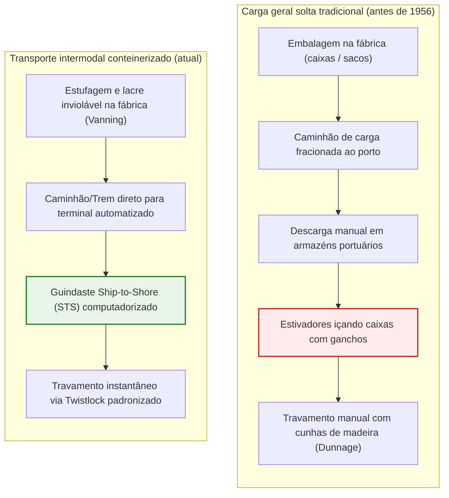
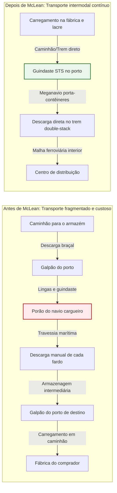
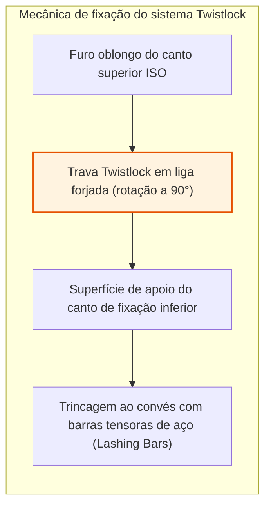
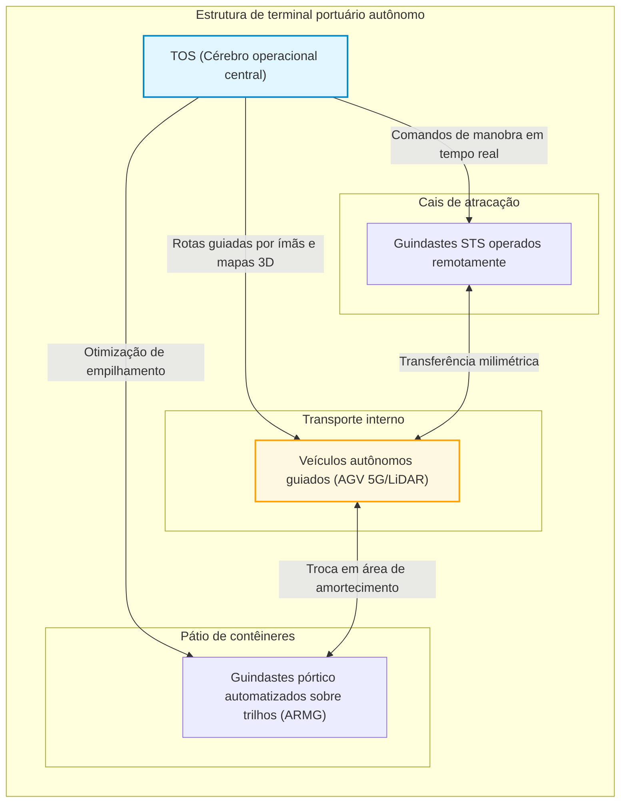
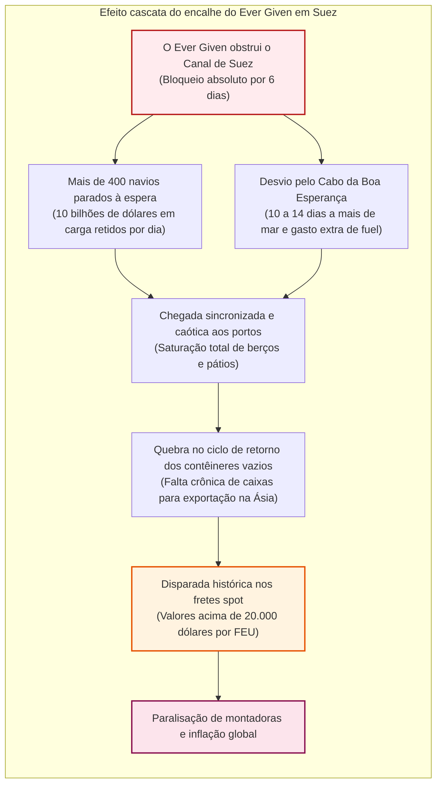

## Introdução: O maior milagre econômico da era moderna nascido de uma simples caixa de aço

Quando você segura um smartphone nas mãos, veste uma roupa confeccionada do outro lado do planeta ou degusta um café cultivado a dez mil quilômetros de distância, está tocando a manifestação física da máquina logística mais formidável já criada pela civilização humana.

A base que sustenta o comércio mundial moderno – movimentando anualmente mais de 25 trilhões de dólares – não é a aeronave cargueira Boeing 747 nem os cabos de fibra óptica transoceânicos. Trata-se de um prisma retangular aparentemente banal, soldado com chapas de aço Corten corrugado: o **contêiner marítimo padrão ISO**.

Até meados da década de 1950, o transporte transoceânico de mercadorias era um pesadelo sufocante de ineficiência e desperdício. Um navio cargueiro convencional passava semanas atracado ao cais. Centenas de estivadores manuseavam fardos, caixotes, sacos e barris manualmente, recorrendo a guinchos rudimentares e ganchos de ferro para empilhá-los em porões úmidos e escuros. Os custos de movimentação portuária consumiam mais da metade do valor total do frete marítimo, e furtos e avarias eram corriqueiros.

Em 26 de abril de 1956, um caminhoneiro e empresário norte-americano chamado **Malcom McLean** rompeu esse impasse secular ao lançar o petroleiro adaptado *Ideal-X*. Sua revolução não dependeu de circuitos eletrônicos avançados, mas sim de uma **abstração sistêmica**: dissociar o recipiente de carga do veículo propulsor e estabelecer uma unidade física padronizada, capaz de transitar perfeitamente entre caminhões, trens e navios.

Em poucos anos, o custo para carregar uma tonelada de carga despencou de 5,83 dólares para míseros 0,16 dólar – uma queda vertical de mais de 97 %. O custo do frete marítimo no valor final das mercadorias caiu para insignificantes 1 a 2 %. Essa caixa de aço viabilizou a divisão internacional da manufatura, impulsionou a transformação da Ásia na oficina fabril do mundo e forjou a globalização contemporânea.

---

## Capítulo 1: Milênios de ineficiência — A era sombria da carga geral solta

### 1.1 O ecossistema dominado pelo gancho de estivador

Antes do contêiner, a dinâmica das viagens marítimas preservava praticamente os mesmos princípios operacionais da época dos fenícios. As mercadorias eram transportadas como **carga fracionada (Break-Bulk Cargo)**: barricas de carvalho com vinho, sacas de juta com café, caixas de madeira com peças industriais e fardos de algodão.

A ferramenta indispensável no cais era o temível **gancho de mão (Cargo Hook)**, empunhado na cintura pelos estivadores. Com ele, fisgavam sacos e puxavam caixotes, acumulando peso sobre os ombros até as profundezas do porão. Para evitar desmoronamentos durante tempestades, cada vão livre entre as cargas precisava ser calçado artesanalmente com tábuas e palha (*dunnage*).

Esse processo brutal não só provocava frequentes acidentes fatais, como também alimentava sindicatos portuários fechados e fortemente cooptados pelo crime organizado (como a International Longshoremen's Association, ILA). O roubo sistemático (*shrinkage*) era crônico: nos anos 1950, nos portos de Nova York e Londres, entre 10 % e 15 % das mercadorias de alto valor simplesmente desapareciam durante a estiva.

### 1.2 «Navios só dão lucro no mar»: O colapso financeiro das frotas convencionais

Um dos mais antigos provérbios marítimos sentencia: **«Um navio só ganha dinheiro quando está navegando; atracado no porto, ele apenas sangra capital.»**

Na era da carga fracionada, os navios mercantes passavam **50 % a 65 % de sua vida útil imóveis no cais**, aguardando operações manuais lentas. Enquanto isso, juros de financiamento, depreciação e salários da tripulação continuavam sendo pagos ininterruptamente.

| Indicador | Carga Geral Convencional (década de 1950) | Carga Conteinerizada (década de 2020) | Salto de Produtividade |
| :--- | :--- | :--- | :--- |
| **Produtividade de estiva** | ~ 15 a 25 toneladas / terno / hora | > 1.000 a 2.000 toneladas / guindaste / hora | Salto de **60 a 100 vezes** |
| **Tempo de atracação** | 10 a 14 dias (até 1 mês) | 12 a 24 horas | Redução de tempo **> 90 %** |
| **Participação dos custos portuários** | **50 % a 65 %** do frete total | **10 % a 15 %** do frete total | Queda drástica de custos |
| **Índice de perda e quebra** | Entre **5 % e 15 %** frequentes | Abaixo de **0,01 %** (lacres de alta segurança) | Quase eliminado |

---

## Capítulo 2: A determinação de Malcom McLean e a saga do *Ideal-X*

### 2.1 O estalo de um caminhoneiro em Hoboken

O visionário do contêiner moderno, **Malcom McLean**, era um homem de estrada. Sem formação em arquitetura naval, começou comprando um caminhão usado em plena Grande Depressão na Carolina do Norte e, com determinação implacável, transformou a *McLean Trucking Company* em uma das cinco maiores transportadoras rodoviárias dos Estados Unidos.

Em 1937, aguardando um dia inteiro no cais de Hoboken (Nova Jersey) enquanto estivadores descarregavam fardo por fardo de algodão da sua carroceria, McLean se questionou:
> **«Por que precisamos descarregar e carregar mercadorias repetidamente? Por que não desatracar a carroceria inteira do caminhão, içá-la diretamente para o convés do navio e, no porto de destino, simplesmente acoplá-la a outro chassi rodoviário?»**

Nascia ali o princípio motor do **transporte intermodal**.

### 2.2 26 de abril de 1956: A travessia inaugural do *Ideal-X*

Para concretizar sua ambição, McLean precisou enfrentar pesadas regulamentações da Comissão de Comércio Interestadual (ICC), que proibiam companhias rodoviárias de controlar empresas marítimas. Ele vendeu todas as ações de sua transportadora e comprou a endividada *Pan-Atlantic Steamship Corporation*.

McLean adquiriu o petroleiro T-2 remanescente da guerra, batizado de ***Ideal-X***, e construiu uma estrutura metálica reforçada acima dos dutos do convés. No dia 26 de abril de 1956, no porto de Newark (Nova Jersey), guindastes embarcaram 58 contêineres de alumínio de 33 pés em menos de oito horas. O navio partiu rumo a Houston, Texas.

Ao atracar em Houston, cavalos mecânicos já aguardavam no cais e engataram as caixas em minutos, rumando imediatamente para as rodovias. Diante daquela cena, Freddy Fields, influente líder dos estivadores, declarou com pesar:
> **«Senhores, acabamos de assinar nossa própria sentença de morte.»**

### 2.3 O colapso vertical dos custos: De 5,83 $ para 0,16 $ por tonelada

A contabilidade daquela primeira viagem espantou os investidores:
- Custo de movimentação da carga solta: **5,83 dólares por tonelada**
- Custo com o sistema conteinerizado: **0,158 dólar por tonelada (~ 0,16 $)**

**Uma inacreditável contração de 97,3 % nos custos de manuseio!**

Na economia dos transportes, o modelo de custo total ponta a ponta é dado por:

$$C_{\text{transport}} = C_{\text{handling}} + C_{\text{sea}} + C_{\text{inland}} + C_{\text{inventory}}$$

Ao derrubar $C_{\text{handling}}$ para próximo de zero e reduzir drasticamente o tempo de atracação de semanas para poucas horas, o contêiner esmagou igualmente $C_{\text{inventory}}$ (o custo de oportunidade do capital imobilizado durante o transporte).

### 2.4 A Guerra do Vietnã e o «milagre de Cam Ranh Bay»

Grandes disrupções técnicas costumam encontrar seu divisor de águas em momentos de crise geopolítica. Para o contêiner, essa prova de fogo foi a **Guerra do Vietnã**.

A partir de 1965, o envio massivo de tropas e equipamentos americanos provocou um congestionamento catastrófico no porto de Saigon. Mais de cem navios mercantes ficavam parados meses na foz do rio Mekong, e os mantimentos apodreciam à beira do cais.

O secretário de Defesa Robert McNamara convocou McLean. Sua empresa, a Sea-Land, construiu um terminal de contêineres em águas profundas na baía de **Cam Ranh**. O resultado foi fulminante: navios que antes exigiam 40 dias para descarregar passavam a ser desovados e liberados em apenas **48 horas**.

Adicionalmente, McLean concebeu uma jogada mercadológica magistral: para não trazer os navios vazios de volta pela rota transpacífica, ele os desviou para os portos japoneses de **Yokohama e Kobe**. A bordo vieram rádios, motocicletas e televisores japoneses com fretes incrivelmente baixos para a Califórnia. Foi a semente da rota regular de contêineres no Pacífico e da explosão industrial do Leste Asiático.

---

## Capítulo 3: A padronização global — Normas ISO (TEU) e a engenharia do Twistlock

### 3.1 A batalha dos padrões: 35 pés contra 24 pés

Durante a década inicial, cada pioneiro tentou fechar o mercado com suas próprias medidas patenteadas:
- A **Sea-Land** adotou caixas de **35 pés** (limite legal para carretas nas estradas do leste dos EUA).
- A **Matson** (rota do Havaí) utilizava contêineres de **24 pés** (otimizados para fardos pesados de açúcar e abacaxi).

Essa fragmentação impedia que um contêiner da Sea-Land fosse manuseado pelos guindastes da Matson ou colocado em vagões ferroviários compatíveis, criando o risco de inviabilizar o sistema intermodal.

### 3.2 O comitê internacional ISO e a consagração do TEU

Em 1961, a Organização Internacional de Normalização criou o comitê técnico **ISO/TC 104**. Em 1968, estabeleceu-se o acordo histórico que deu origem ao padrão **ISO 668**:
1. Largura padrão: **8 pés (2,438 m)**
2. Altura padrão: **8 pés e 6 polegadas (2,591 m)** (com a posterior criação do modelo High Cube de 9 pés e 6 polegadas)
3. Comprimentos oficiais: **20 pés (6,058 m)** e **40 pés (12,192 m)**

Estabeleceu-se, assim, a métrica global da marinha mercante: o **TEU (Twenty-foot Equivalent Unit)** e o **FEU (Forty-foot Equivalent Unit)**.

Em um ato de rara visão estratégica, Malcom McLean abriu mão de todos os direitos autorais e patentes sobre os **cantos de fixação (Corner Castings)** e os **mecanismos de trava (Twistlocks)**, doando-os gratuitamente à humanidade em 1967. Esse gesto permitiu que o contêiner se transformasse em uma infraestrutura global universal.

### 3.3 Mecânica dos cantos de fixação e twistlocks

Para permitir que contêineres sejam empilhados em até dez camadas nos conveses de navios castigados por tempestades de força 10, toda a rigidez depende de oito peças de aço fundido soldadas nos vértices: os **Corner Castings** e suas travas giratórias, os **Twistlocks**.

Em mar aberto, a combinação de caturro, balanço lateral e arfagem gera acelerações verticais e transversais de até $1,5 \sim 1,8 G$.

As tensões de tração e cisalhamento sobre o twistlock seguem:

$$\sigma = \frac{F_{\text{tensile}}}{A_{\text{lock}}} \le \sigma_{\text{allowable}}, \quad \tau = \frac{F_{\text{shear}}}{A_{\text{lock}}} \le \tau_{\text{allowable}}$$

A carga compressiva estática incidente sobre os quatro pilares do contêiner mais baixo obedece à equação:

$$\sigma_{\text{stack}} = \frac{M_{\text{stack}} \cdot g}{4 \cdot A_{\text{corner}}}$$

Segundo a norma ISO 1496-1, cada canto de fixação inferior deve resistir a uma carga estática vertical de no mínimo **86.400 kg (cerca de 848 kN)**, garantindo que colunas de milhares de toneladas não desabem sob seu próprio peso.

---

## Capítulo 4: Transporte intermodal e infraestrutura digital

### 4.1 A integração intermodal plena

O contêiner atua como uma interface universal para navios, ferrovias e caminhões. A partir do momento em que o lacre de alta segurança é instalado nas portas da fábrica, ninguém mais tem contato direto com os produtos até a entrega ao destinatário final.

Na América do Norte, os trens **Double-Stack** (com contêineres empilhados em dois níveis estendendo-se por mais de 3 km de composição) cruzam as Montanhas Rochosas e atuam como uma verdadeira ponte terrestre (*Landbridge*), unindo a costa oeste ao Meio-Oeste e à costa atlântica.

```mermaid
flowchart LR
    subgraph Origin["Origem (Fábrica na Ásia)"]
        Factory["Estufagem e lacre de segurança<br/>(Vanning & Bolt Seal)"]
        Truck1["Transporte rodoviário até o porto"]
        Factory --> Truck1
    end

    subgraph PortOut["Porto de exportação"]
        GateIn["Controle de portaria e pátio"]
        GantryOut["Superguindaste STS de cais"]
        GateIn --> GantryOut
    end

    subgraph OceanVoyage["Travessia oceânica"]
        MegaVessel["Meganavio porta-contêineres (ULCV)<br/>Rotas Transpacífica / Ásia-Europa"]
    end

    subgraph PortIn["Porto de importação"]
        GantryIn["Desembarque e transbordo ferroviário"]
        RailOut["Pátio rodoferroviário portuário"]
        GantryIn --> RailOut
    end

    subgraph Destination["Destino (Hub logístico interior)"]
        DoubleStack["Composição ferroviária double-stack<br/>(Milhares de quilômetros)"]
        Truck2["Distribuição local de última milha"]
        Store["Centro de distribuição e gôndola"]
        DoubleStack --> Truck2
        Truck2 --> Store
    end

    Truck1 --> GateIn
    GantryOut --> MegaVessel
    MegaVessel --> GantryIn
    RailOut --> DoubleStack

    style OceanVoyage fill:#e3f2fd,stroke:#1565c0,stroke-width:2px
    style Destination fill:#e8f5e9,stroke:#2e7d32,stroke-width:2px
```

### 4.2 A infraestrutura de dados: Do conhecimento em papel ao EDI e TOS

O rastreamento de milhões de unidades exigiu o desenvolvimento do intercâmbio eletrônico de dados (**EDI**) com padrões internacionais (CODECO, BAPLIE), garantindo a atualização das cargas em frações de segundo.

Nos terminais modernos, os sistemas de operação portuária (**TOS**, como Navis N4) utilizam algoritmos de otimização combinatória para definir a distribuição de peso, estabilidade hidrostática (altura metacêntrica GM) e ordenação de desembarque sem manobras improdutivas.

---

## Capítulo 5: Megatransporte, leis de propulsão e terminais autônomos

### 5.1 De 1.000 para 24.000 TEUs: Economias de escala extremas

O crescimento da capacidade de carga foi vertiginoso:
- 1ª geração (anos 1960): **500 a 1.000 TEUs**
- Panamax (anos 1980): **4.500 TEUs** (boca limitada a 32,3 m)
- Pós-Panamax (anos 2000): **8.000 a 10.000 TEUs**
- Megamax / ULCV (anos 2020): **mais de 24.000 TEUs** (400 m de comprimento, 61 m de largura, como o *MSC Irina*)

A razão financeira para esse gigantismo reside na minimização do custo unitário por contêiner transportado:

$$C_{\text{unit}} = \frac{C_{\text{capital}} + C_{\text{crew}} + C_{\text{fuel}} + C_{\text{port}}}{Q_{\text{capacity}} \times \alpha_{\text{utilization}}}$$

Um navio com 24.000 TEUs opera com uma tripulação de cerca de 24 tripulantes, praticamente idêntica à de um navio de 4.000 TEUs, reduzindo os custos de folha salarial por contêiner em mais de 80 %.

### 5.2 A lei cúbica da velocidade e o Slow Steaming

Em hidrodinâmica naval, a potência exigida $P$ varia com o cubo da velocidade de navegação $V$:

$$P \propto V^3$$

O consumo diário de combustível pesado $F_{\text{day}}$ acompanha essa mesma proporção:

$$F_{\text{day}} = c \cdot \Delta^{2/3} \cdot V^3$$

Para uma travessia completa de distância $D$, o consumo total por viagem é proporcional ao quadrado da velocidade:

$$F_{\text{total}} = F_{\text{day}} \cdot T = \left( k \cdot V^3 \right) \cdot \left( \frac{D}{24 \cdot V} \right) = \frac{k \cdot D}{24} \cdot V^2$$

Reduzir a velocidade operacional de 24 para 18 nós (uma redução de 25 %, prática conhecida como **Slow Steaming**) traz uma economia espetacular:

$$\Delta F_{\text{total}} \approx 1 - \left( \frac{18}{24} \right)^2 = 1 - 0,5625 = 43,75\%$$

**Reduzir a velocidade em um quarto corta quase 44 % de todo o combustível da viagem!**

### 5.3 Terminais autônomos e frotas de robôs AGV

Nos terminais portuários de última geração (Rotterdam Maasvlakte II, Qingdao, Yangshan 4 em Xangai), os operadores não circulam mais pelo cais:

1. **Guindastes STS remotos**: operados a quilômetros de distância em salas climatizadas via monitores 4K de baixíssima latência.
2. **AGVs autônomos**: carretas elétricas sem cabine que navegam com sensores magnéticos no piso e laser LiDAR.
3. **Pórticos ARMG**: guindastes sobre trilhos que reorganizam os contêineres de madrugada (*housekeeping*) para agilizar as retiradas diurnas.

### 5.4 As três grandes alianças e o oligopólio mundial

O valor de um meganavio (150 a 200 milhões de dólares) obrigou as principais armadoras a se articularem em **três mega-alianças globais** que dominam mais de 80 % da capacidade mundial de transporte:
1. **2M**: Maersk e MSC (em fase de reestruturação)
2. **Ocean Alliance**: COSCO, CMA CGM, Evergreen e OOCL
3. **THE Alliance / Premier Alliance**: ONE, HMM e Yang Ming

---

## Capítulo 6: Tensões geopolíticas e a fragilidade das cadeias globais

### 6.1 A armadilha do Just-in-Time

A impressionante precisão dos navios de contêineres sedimentou a mentalidade do **Just-in-Time (JIT)** na indústria. Empresas eliminaram estoques intermediários – «os navios no mar tornaram-se galpões em trânsito».

No entanto, essa eficiência extrema baseia-se na suposição de que a engrenagem nunca falha. Qualquer perturbação pontual desencadeia uma reação em cadeia incontrolável.

### 6.2 O encalhe do *Ever Given* no Canal de Suez (2021)

Em 23 de março de 2021, o meganavio *Ever Given* (20.124 TEUs) encalhou e atravessou o Canal de Suez, interrompendo 12 % de todo o tráfego marítimo mundial por seis dias inteiros.

O impacto do bloqueio reverberou por meses: centenas de navios chegaram simultaneamente aos portos europeus, os contêineres vazios ficaram retidos longe das fábricas asiáticas e as cotações do frete spot explodiram acima de 20.000 dólares por unidade.

### 6.3 Gargalos geoestratégicos: A seca no Panamá e a crise no Mar Vermelho

1. **Seca no Canal do Panamá**: A escassez hídrica no lago Gatún forçou uma redução de quase 40 % no fluxo de trânsito diário.
2. **Ataques no Mar Vermelho**: Os disparos de mísseis e drones dos rebeldes Houthi no estreito de Bab el-Mandeb obrigaram os navios a contornar o continente africano, absorvendo 15 % de toda a frota mundial de contêineres.

Fica evidente que a civilização moderna continua fisicamente refém de um punhado de canais marítimos estreitos.

---

## Capítulo 7: Conclusão — O destino da civilização contido na caixa de aço

### 7.1 O que a verdadeira inovação nos ensina

A trajetória do contêiner nos deixa uma reflexão profunda sobre inovação:
**As transformações que realmente reconfiguram a história raramente são invenções esotéricas e complexas, mas sim protocolos unificados e elegantes que abolem o atrito operacional.**

Assim como o TCP/IP unificou redes de computadores para dar origem à Internet, o contêiner marítimo é o **pacote IP da economia material**, integrando harmonicamente fábricas, carretas, ferrovias e navios.

### 7.2 Descarbonização, resiliência e as novas rotas do século XXI

Para cumprir as metas de emissão líquida zero da OMI em 2050, a frota mundial está adotando **metanol verde, GNL e amônia limpa**. Concomitantemente, o setor produtivo migra do *Just-in-Time* para modelos *Just-in-Case* de proteção estratégica.

Contudo, qualquer que seja a propulsão do futuro, a caixa de aço padronizada de **8 pés de largura por 20 ou 40 pés de comprimento** continuará singrando os oceanos, sustentando o pulso ininterrupto da economia mundial.
