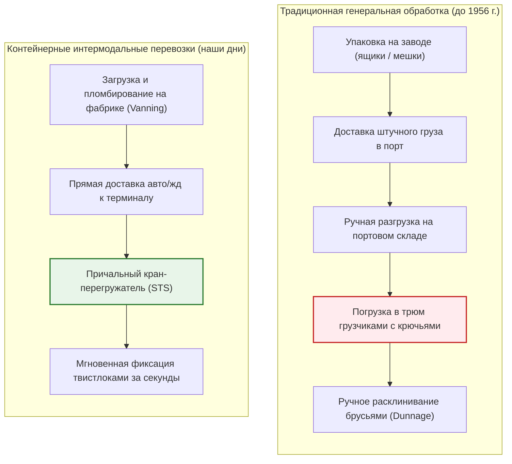
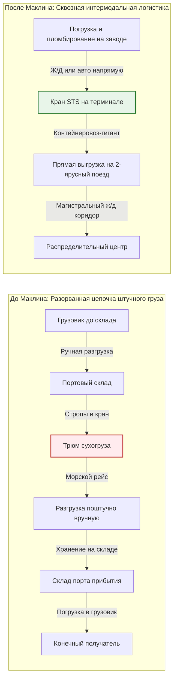
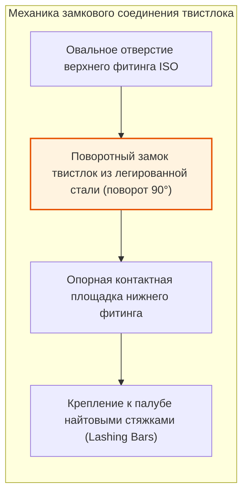
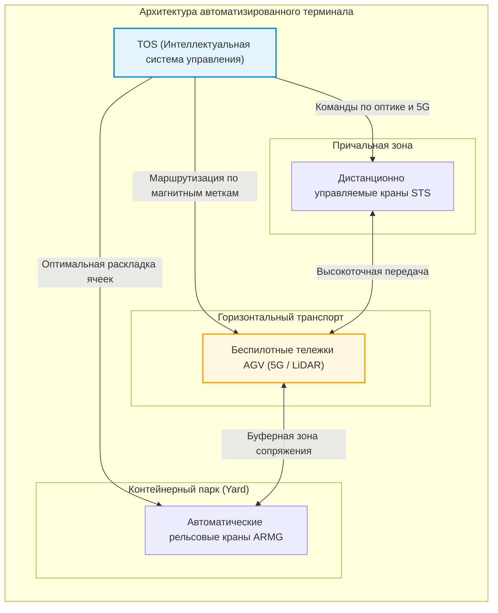
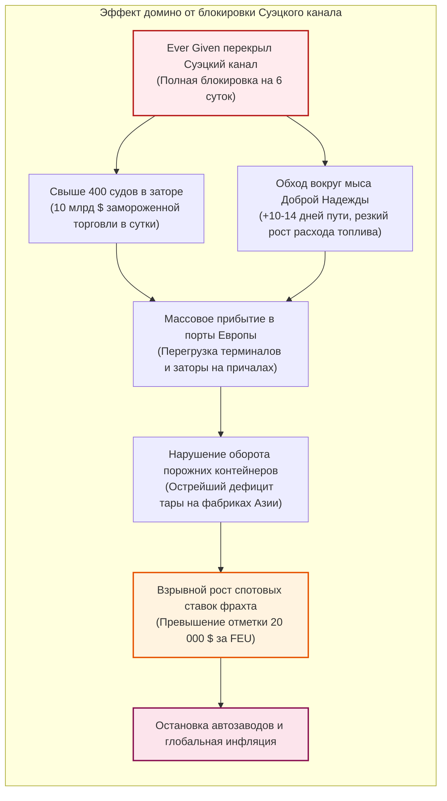

## Введение: Величайшее экономическое чудо, рожденное из простого стального ящика

Когда вы держите в руках смартфон, надеваете одежду, сшитую на другом краю планеты, или наслаждаетесь кофе, выращенным за океаном, вы соприкасаетесь с плодами самой колоссальной физической логистической системы в истории цивилизации.

Фундаментом современной мировой торговли с годовым оборотом свыше 25 триллионов долларов являются вовсе не грузовые самолеты Boeing 747 и не трансокеанские оптические кабели. Это невзрачный на вид прямоугольный ящик из гофрированной кортеновской стали: **стандартный морской контейнер ISO**.

До середины 1950-х годов морские грузоперевозки оставались кошмаром неэффективности. Обычный сухогруз неделями простаивал у причала. Сотни портовых грузчиков вручную, с помощью железных крючьев и веревок, укладывали ящики, бочки и мешки в душные трюмы. Расходы на портовую обработку груза составляли более 50 % от общей стоимости фрахта, а порча и хищения были нормой.

26 апреля 1956 года американский автоперевозчик **Малком Маклин** перевернул этот многовековой уклад, отправив в рейс переоборудованный танкер *Ideal-X*. Его прорывом стала не сложная электроника, а **системная абстракция**: отделение грузового модуля от транспортного средства и создание универсального физического стандарта для грузовика, поезда и корабля.

Всего за несколько лет стоимость погрузки тонны груза обвалилась с 5,83 доллара до скромных 0,16 доллара — фантастическое падение более чем на 97 %! Доля морской транспортировки в конечной цене товаров сократилась до 1–2 %. Именно этот стальной ящик сделал возможным мировое разделение труда, взлет азиатской промышленности и глобализацию в ее современном виде.

---

## Глава 1: Тысячелетия неэффективности — Темная эпоха штучных грузов

### 1.1 Экосистема, которой правил стивидорный крюк

До появления контейнера принципы морских перевозок оставались неизменными со времен финикийцев. Все товары перевозились как **генеральный штучный груз (Break-Bulk Cargo)**: бочки с вином, мешки с кофе, ящики с механизмами, кипы хлопка.

Главным орудием труда в порту был острый стальной **грузовой крюк (Cargo Hook)**, который каждый докер носил за поясом. Им подцепляли мешки, перекатывали тюки и громоздили ящики под палубой. Чтобы груз не смещался во время качки, пустоты плотно забивали деревянными клиньями и соломой (*dunnage*).

Этот каторжный труд порождал закрытые портовые профсоюзы, нередко контролируемые организованной преступностью (такие как Международная ассоциация портовых рабочих ILA). Повсеместным явлением было воровство (*shrinkage*): в 1950-х годах в портах Нью-Йорка и Лондона до 15 % ценных товаров бесследно исчезало прямо на причалах.

### 1.2 «Корабль приносит прибыль только в море»: Финансовый тупик судовладельцев

Старинная морская мудрость гласит: **«Судно зарабатывает деньги только тогда, когда оно идет в море; в порту оно пожирает капитал».**

В эпоху генеральных грузов суда проводили **от 50 % до 65 % времени своей службы у причальной стенки**, ожидая завершения погрузочно-разгрузочных работ. Амортизация судна, жалованье экипажа и портовые сборы продолжали начисляться непрерывно.

| Показатель | Эпоха штучных грузов (1950-е гг.) | Эпоха контейнеризации (2020-е гг.) | Прирост эффективности |
| :--- | :--- | :--- | :--- |
| **Скорость перевалки** | ~ 15 – 25 т / бригада в час | > 1 000 – 2 000 т / кран в час | Рост в **60–100 раз** |
| **Время стоянки в порту** | 10 – 14 дней (до месяца) | 12 – 24 часа | Сокращение простоя **> 90 %** |
| **Доля портовых расходов** | **50 % – 65 %** от ставки фрахта | **10 % – 15 %** от ставки фрахта | Резкое падение затрат |
| **Потери и бой груза** | Часто **5 % – 15 %** | Менее **0,01 %** (пломба высшей защиты) | Практически сведены к нулю |

---

## Глава 2: Дерзость Малкома Маклина и рождение *Ideal-X*

### 2.1 Озарение водителя грузовика в Хобокене

Создатель современного контейнера **Малком Маклин** не был мореплавателем или кораблестроителем. Он начинал простым водителем подержанного грузовика в Северной Каролине и построил компанию *McLean Trucking*, ставшую пятым по величине автоперевозчиком США.

В 1937 году, простояв целый день в порту Хобокена (Нью-Джерси) в ожидании, пока докеры вручную выгрузят из его кузова кипы хлопка, Маклин подумал:
> **«Зачем перегружать товар из машины в трюм и обратно? Почему нельзя просто поднять весь кузов грузовика краном, поставить его на палубу корабля, а в порту назначения снова прицепить к тягачу?»**

Эта простая мысль легла в основу **интермодальных перевозок**.

### 2.2 26 апреля 1956 года: Исторический рейс *Ideal-X*

Чтобы реализовать задуманное, Маклину пришлось преодолевать жесткие антимонопольные законы США. Он продал свою автотранспортную компанию и купил находившуюся на грани банкротства судоходную компанию *Pan-Atlantic Steamship Corporation*.

Он приобрел танкер времен войны T-2, названный ***Ideal-X***, установив над его трубопроводами стальную платформу. 26 апреля 1956 года в порту Ньюарка кран погрузил на палубу 58 алюминиевых 33-футовых контейнеров менее чем за восемь часов. Судно взяло курс на Хьюстон.

По прибытии в Хьюстон ожидавших тягачи мгновенно зацепили контейнеры и выехали на шоссе. Присутствовавший при этом лидер портового профсоюза Фредди Филдс произнес историческую фразу:
> **«Джентльмены, мы только что подписали собственный смертный приговор».**

### 2.3 Вертикальный обвал затрат: С 5,83 $ до 0,16 $ за тонну

Экономические результаты первого рейса ошеломили бизнес:
- Погрузка штучного груза: **5,83 доллара за тонну**
- Погрузка в системе Маклина: **0,158 доллара за тонну (~ 0,16 $)**

**Затраты на погрузку упали на невероятные 97,3 %!**

В экономике транспорта модель общих логистических издержек выражается формулой:

$$C_{\text{transport}} = C_{\text{handling}} + C_{\text{sea}} + C_{\text{inland}} + C_{\text{inventory}}$$

Контейнер свел $C_{\text{handling}}$ практически к нулю, а благодаря сокращению стоянки судов с недель до часов кардинально снизил $C_{\text{inventory}}$ (стоимость замороженного капитала в пути).

### 2.4 Вьетнамская война и «чудо залива Камрань»

Для всемирного признания новой технологии требовался кризис колоссального масштаба. Им стала **война во Вьетнаме**.

В 1965 году переброска войск США вызвала транспортный коллапс в порту Сайгона. Сотни судов месяцами ждали разгрузки, а военные грузы гнили на пирсах.

Министр обороны США Роберт Макнамара обратился к Маклину. Компания Sea-Land построила глубоководный контейнерный терминал в **заливе Камрань**. Суда, разгрузка которых раньше занимала 40 дней, теперь обрабатывались за **48 часов**.

Более того, возвращая суда порожняком через Тихий океан, Маклин направил их в порты **Иокогамы и Кобе**, заполнив японскими радиоприемниками, мотоциклами и телевизорами по сверхнизким тарифам. Так родилась транстихоокеанская контейнерная магистраль, заложившая основу промышленного взлета Азии.

---

## Глава 3: Битва стандартов — Унификация ISO (TEU) и механика твистлока

### 3.1 Война типоразмеров: 35 футов против 24 футов

В первые годы каждый оператор продвигал собственный закрытый формат:
- **Sea-Land** использовала контейнеры длиной **35 футов** (максимальный габарит прицепов на востоке США).
- **Matson** (линия на Гавайи) применяла контейнеры **24 фута** (рассчитанные на плотные тяжелые грузы сахара и ананасов).

Несовместимость грозила расколоть мировую логистику на изолированные фрагменты.

### 3.2 Технический комитет ISO и рождение TEU

В 1961 году Международная организация по стандартизации создала комитет **ISO/TC 104**. В 1968 году был принят стандарт **ISO 668**:
1. Ширина: **8 футов (2,438 м)**
2. Высота: **8 футов 6 дюймов (2,591 м)** (позже дополненная версией High Cube 9'6")
3. Стандартные длины: **20 футов (6,058 м)** и **40 футов (12,192 м)**

Так появилась универсальная мера вместимости: **TEU (Twenty-foot Equivalent Unit)** и **FEU (Forty-foot Equivalent Unit)**.

В 1967 году Маклин совершил поступок исторического масштаба: он безвозмездно передал патенты на **угловые фитинги (Corner Castings)** и поворотные замки **твистлоки (Twistlocks)** в общественное достояние.

### 3.3 Прецизионная механика фитингов и твистлоков

Чтобы контейнеры могли выдерживать штабелирование до 10 ярусов в условиях штормового океана, в их углах установлены стальные отливки — **фитинги**, фиксируемые замками-**твистлоками**.

В открытом море качка создает перегрузки до $1,5 \sim 1,8 G$.

Напряжения растяжения и среза в замке проверяются по формулам:

$$\sigma = \frac{F_{\text{tensile}}}{A_{\text{lock}}} \le \sigma_{\text{allowable}}, \quad \tau = \frac{F_{\text{shear}}}{A_{\text{lock}}} \le \tau_{\text{allowable}}$$

Статическая сжимающая нагрузка на угловые стойки нижнего контейнера составляет:

$$\sigma_{\text{stack}} = \frac{M_{\text{stack}} \cdot g}{4 \cdot A_{\text{corner}}}$$

По стандарту ISO 1496-1 каждый нижний угловой фитинг обязан выдерживать вертикальное статическое усилие не менее **86 400 кг (около 848 кН)**, что исключает разрушение штабелей массой в тысячи тонн.

---

## Глава 4: Интермодальные перевозки и цифровая архитектура

### 4.1 Принцип интермодализма

Контейнер представляет собой физический интерфейс между морем, железной дорогой и шоссе. С момента опломбирования на заводе груз остается неприкосновенным до склада получателя.

В Северной Америке поезда **Double-Stack** (с двухъярусной погрузкой контейнеров, длиной свыше 3 км) пересекают Скалистые горы, образуя континентальный «сухопутный мост» (*Landbridge*) между Тихим и Атлантическим океанами.

### 4.2 Цифровая революция: От коносаментов к EDI и TOS

Система электронного обмена данными (**EDI**) по стандартам CODECO и BAPLIE обеспечивает синхронизацию перемещения миллионов контейнеров в реальном времени.

Терминальные операционные системы (**TOS**, например Navis N4) рассчитывают остойчивость судна (метацентрическую высоту GM), правила сегрегации опасных грузов и минимизацию непродуктивных перестановок.

---

## Глава 5: Мегасуда, гидродинамика и автоматизированные терминалы

### 5.1 Эффект масштаба: От 1 000 до 24 000 TEU

Вместимость контейнеровозов росла взрывными темпами:
- 1-е поколение (1960-е): **500 – 1 000 TEU**
- Panamax (1980-е): **4 500 TEU** (ширина шлюзов 32,3 м)
- Post-Panamax (2000-е): **8 000 – 10 000 TEU**
- ULCV / Megamax (2020-е): **свыше 24 000 TEU** (длина 400 м, ширина 61 м, напр. *MSC Irina*)

Экономический стимул гигантизма — минимизация удельных затрат на один контейнер:

$$C_{\text{unit}} = \frac{C_{\text{capital}} + C_{\text{crew}} + C_{\text{fuel}} + C_{\text{port}}}{Q_{\text{capacity}} \times \alpha_{\text{utilization}}}$$

Экипаж судна на 24 000 TEU составляет всего 22–26 человек — столько же, сколько на судне вместимостью 4 000 TEU. Затраты на экипаж в расчете на контейнер снижаются более чем на 80 %.

### 5.2 Закон кубической зависимости и Slow Steaming

В гидродинамике мощность силовой установки $P$ пропорциональна кубу скорости движения $V$:

$$P \propto V^3$$

Суточный расход тяжелого мазута $F_{\text{day}}$ подчиняется той же зависимости:

$$F_{\text{day}} = c \cdot \Delta^{2/3} \cdot V^3$$

Суммарный расход топлива на рейс дистанцией $D$ пропорционален квадрату скорости:

$$F_{\text{total}} = F_{\text{day}} \cdot T = \left( k \cdot V^3 \right) \cdot \left( \frac{D}{24 \cdot V} \right) = \frac{k \cdot D}{24} \cdot V^2$$

Снижение скорости с 24 до 18 узлов (на 25 %, практика **Slow Steaming**) обеспечивает колоссальную экономию:

$$\Delta F_{\text{total}} \approx 1 - \left( \frac{18}{24} \right)^2 = 1 - 0,5625 = 43,75\%$$

**Снижение скорости на четверть экономит почти 44 % топлива на весь рейс!**

### 5.3 Безлюдные терминалы и роботы AGV

На передовых терминалах мира (Роттердам Maasvlakte II, Шанхай Яншань 4) причалы опустели:

1. **Краны STS с телеуправлением**: операторы управляют ими из кондиционированных залов с экранами 4K.
2. **Роботизированные тележки AGV**: электрические беспилотные платформы ориентируются по тысячам магнитов под асфальтом и лидарам.
3. **Краны ARMG**: по ночам автоматически переставляют контейнеры (*housekeeping*), готовя их к выдаче утром.

### 5.4 Три глобальных судоходных альянса

Огромная стоимость судов вынудила операторов объединиться в **три альянса**, контролирующих более 80 % мирового флота:
1. **2M**: Maersk и MSC (в стадии реорганизации)
2. **Ocean Alliance**: COSCO, CMA CGM, Evergreen, OOCL
3. **THE Alliance / Premier Alliance**: ONE, HMM, Yang Ming

---

## Глава 6: Кризисы и хрупкость мировых цепочек поставок

### 6.1 Ловушка Just-in-Time

Точность контейнерного расписания породила концепцию **Just-in-Time (JIT)**. Склады были ликвидированы — «контейнеровозы в море стали плавучими складами».

Однако эта система зиждется на предположении о стопроцентной непрерывности потока. Любой сбой вызывает лавинообразный коллапс.

### 6.2 Блокировка Суэцкого канала судном *Ever Given* (2021)

23 марта 2021 года судно *Ever Given* (20 124 TEU) село на мель в Суэцком канале, парализовав 12 % мировой торговли на шесть дней.

Блокировка на 6 дней вызвала дефицит контейнеров в Азии, а спотовые ставки подскочили до рекордных 20 000 долларов за FEU.

### 6.3 Узкие места геополитики: Панамская засуха и Красное море

1. **Засуха в Панамском канале**: Падение уровня озера Гатун привело к сокращению пропускной способности на 40 %.
2. **Кризис в Красном море**: Атаки хуситов в Баб-эль-Мандебском проливе вынудили суда обходить Африку, связав 15 % мирового флота.

Материальная цивилизация по-прежнему зависит от нескольких узких морских проливов.

---

## Глава 7: Заключение — Будущее цивилизации в стальном контейнере

### 7.1 В чем суть подлинных инноваций

История контейнера раскрывает фундаментальную истину:
**Величайшие инновации — это не сложные наукоемкие приборы, а простые универсальные протоколы, уничтожающие системное трение.**

Подобно протоколу TCP/IP, создавшему Интернет через стандартные пакеты данных, контейнер стал **физическим IP-пакетом материального мира**, соединив заводы, грузовики, железные дороги и морские гиганты.

### 7.2 Декарбонизация и устойчивость в XXI веке

В соответствии с целями ИМО по углеродной нейтральности к 2050 году флот переходит на **зеленый метанол, СПГ и аммиак**. В то же время промышленность переходит от модели *Just-in-Time* к стратегии *Just-in-Case*.

И все же, какое бы топливо ни использовалось в будущем, стандартный ящик **шириной 8 футов и длиной 20 или 40 футов** останется незыблемым стальным каркасом мировой цивилизации.
