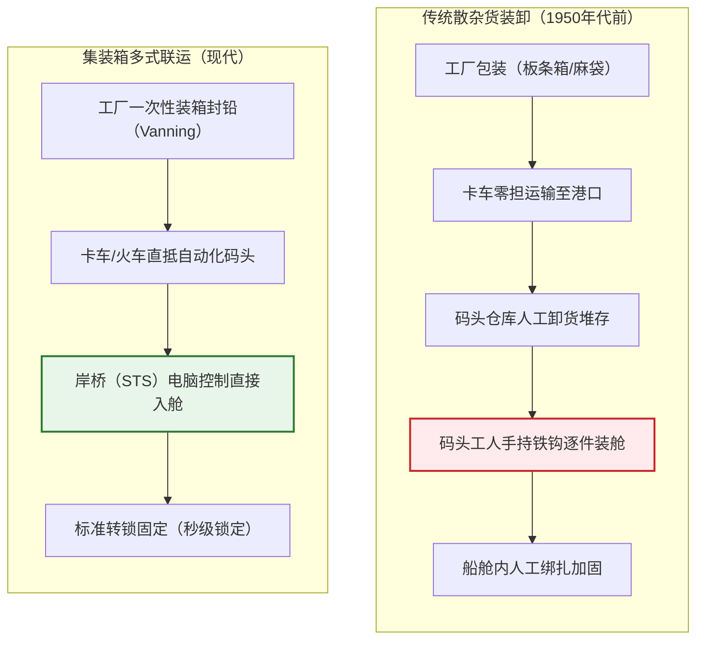
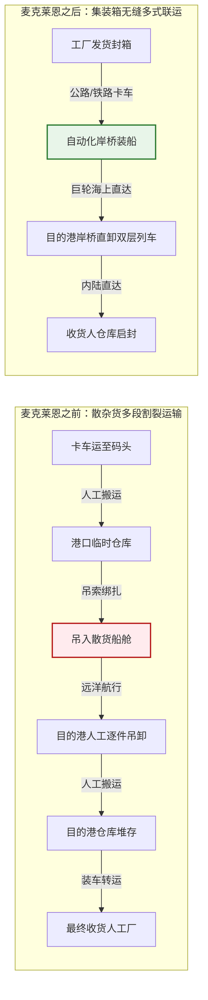
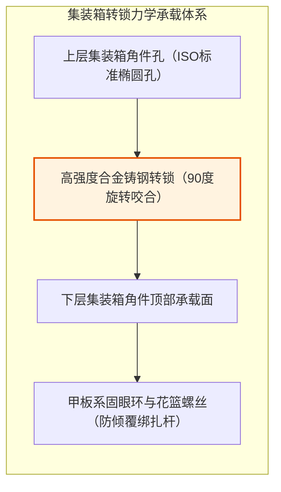
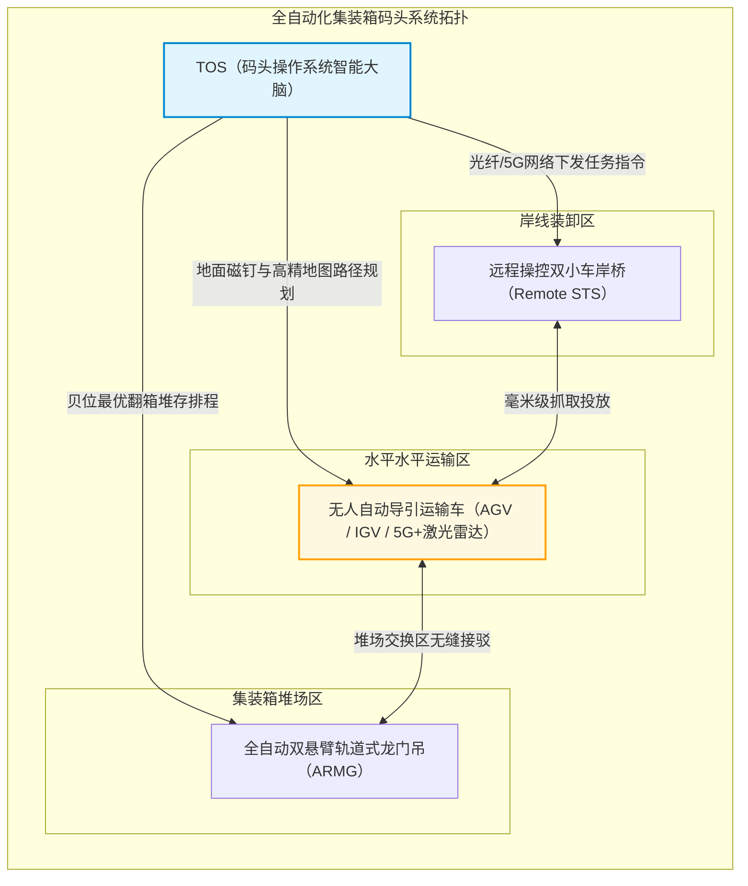
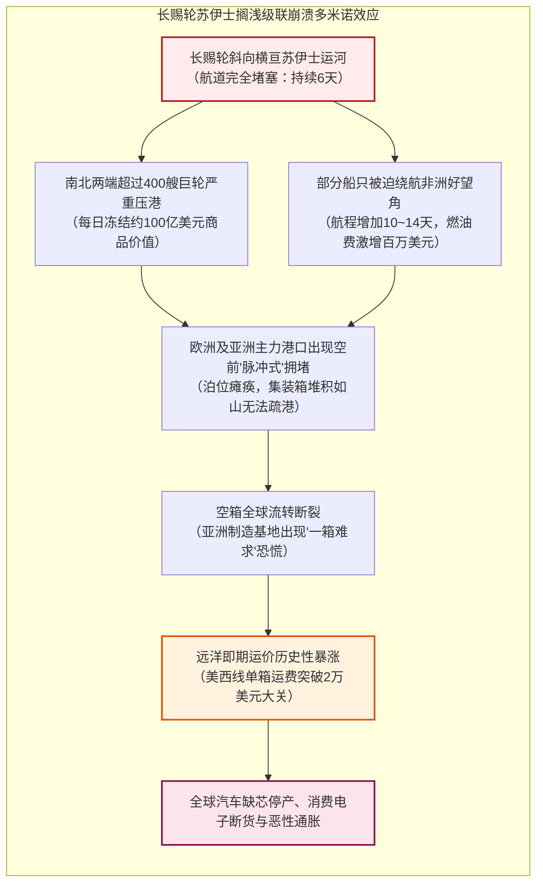

## 引言：平凡钢箱所引爆的世界史最大经济奇迹

当你手握一部智能手机、身穿一件海外工厂制造的衣服，或是喝着来自万里之外庄园的咖啡时，你所触碰的，实际上是人类工业文明史上最精妙、最庞大的一套物流机器的产物。

而在支撑当今每年超过25万亿美元全球商品贸易的底层物理基础设施中，最重要的基石既不是波音747货机，也不是跨洋海底光缆，而是一个外表平平无奇、由波纹钢板焊接而成的长方形铁箱——**ISO标准海运集装箱（Shipping Container）**。

在20世纪50年代之前，跨洋货运是一场极其昂贵、混乱且效率低下得令人绝望的噩梦。一艘散杂货轮在码头装卸货物往往需要耗费数周时间；成百上千名码头装卸工（Stevedores）凭借原始的体力、滑轮和铁钩，把一箱箱威士忌、一袋袋面粉、一捆捆原棉艰难地塞进逼仄潮湿的船舱。彼时，货物在港口的装卸成本占据了整条远洋航线运输总成本的50%以上，盗窃率、破损率居高不下。

然而，1956年，一位名叫**马尔科姆·麦克莱恩（Malcom McLean）**的美国卡车运输商用一艘改装油轮“理想X号（Ideal-X）”彻底打破了这个延续了数千年的僵局。他所倡导的并非高深的微电子技术，而是一种纯粹的**系统化抽象（Systemic Abstraction）**：将运输载体与运输工具剥离，建立一个从卡车、火车到货轮无缝衔接的物理容器标准。

短短数十年间，每吨货物的装卸成本从5.83美元暴跌至区区0.16美元，降幅高达97%以上。远洋运费在终端商品价格中所占的比重被直接压缩到可忽略不计的1%至2%。正是这个不起眼的铁箱，使得全球制造业供应链的跨洋大分工成为可能，催生了东亚的“世界工厂”奇迹，重塑了现代全球地缘经济版图。

本文将以宏大的工程学、经济学与产业地缘政治视角，全景解剖现代海运集装箱体系的诞生、演进、机械物理架构，以及它在极端高效下所暴露出的全球供应链脆弱性。

---

## 第一章：被遗忘的数千年低效——散杂货装卸与码头工人的黑暗时代

### 1.1 “铁钩（Cargo Hook）”所统治的码头生态

在集装箱诞生之前，人类的海运形态在数千年中几乎没有发生本质改变。从腓尼基人的桨帆船、威尼斯商船，一直到二战时期的万吨“胜利轮（Victory Ship）”，货物都必须以**散杂货（Break-Bulk Cargo）**的形式一件一件装入船舱。

所谓散杂货，是指各种形态各异、尺寸不一的包装物：木桶装的葡萄酒、麻袋装的咖啡豆、板条箱装的机械零件、纸箱装的卷烟，乃至裸露捆扎的生铁和木材。

码头上的核心生产工具只有一样：装卸工别在腰间的一柄锋利钢制**铁钩（Cargo Hook）**。工人们用铁钩勾住木箱或麻袋的边缘，靠人力将其搬运、翻滚并塞入船舱深处的角落。为了防止船只在海上剧烈颠簸时货物移位导致倾覆，工人们必须像玩实体“俄罗斯方块”一样，用木楔、稻草垫料（Dunnage）填满每一处空隙。

这种劳动不仅极其繁重危险，更催生了高度封闭、甚至被黑手党所渗透的港口工会垄断网络（如美国国际长岸码头工人协会 ILA）。码头工人的招聘往往基于血缘、地缘与帮派派系；货物盗窃（Shrinkage）更是港口司空见惯的潜规则。据历史数据统计，在1950年代纽约港的散杂货装卸中，高达10%至15%的高价值货物（如名酒、名表、尼龙丝袜）在转运过程中因偷盗或破损而凭空消失。

### 1.2 “船只唯有在海上才赚钱”：传统航运资本的结构性溃败

航运界有一句传承百年的格言：**“船只唯有在海上航行时才赚钱，一旦停靠港口便是在吞噬金钱（A ship only earns money when it is at sea）。”**

在散杂货时代，这句格言成为了各大船东无法摆脱的资本诅咒。一艘典型的散杂货轮在一次航程中，通常有**50%至65%的时间是静止停泊在码头**等待装卸的。巨额的船舶折旧、船员薪资、港口停泊费在毫无产出的等待中持续流逝。

下表直观揭示了散杂货装卸与现代集装箱作业之间的鸿沟：

| 评估指标 | 传统散杂货作业（1950年代） | 现代集装箱作业（2020年代） | 效率跃迁幅度 |
| :--- | :--- | :--- | :--- |
| **装卸效率** | 约 15 ~ 25 吨 / 工班·小时 | 超过 1,000 ~ 2,000 吨 / 岸桥·小时 | 提升约 **60~100倍** |
| **泊位停靠周期** | 10 ~ 14 天（甚至长达一个月） | 12 ~ 24 小时（即卸即装） | 港口周转提速 **90%以上** |
| **装卸成本占比** | 占航运总收入的 **50% ~ 65%** | 占航运总收入的 **10% ~ 15%** | 成本断崖式下跌 |
| **货物残损/失窃率** | 普遍达到 **5% ~ 15%** | 低于 **0.01%**（高等级封铅） | 货损几乎归零 |

这种深重的结构性危机表明：远洋运输真正的瓶颈从来不在浩瀚的大洋上，而是在陆地与海洋交汇的那条窄窄的码头边缘。

---

## 第二章：马尔科姆·麦克莱恩的执念——从陆运逆向突破与“理想X号”传奇

### 2.1 一名卡车司机在霍博肯码头的顿悟

现代集装箱之父**马尔科姆·麦克莱恩（Malcom McLean）**并非出身航运世家，也没有造船工程学位。他最初只是北卡罗来纳州一名贫穷的卡车司机，靠着一辆二手卡车拉货起家，最终凭借惊人的商业直觉将“麦克莱恩卡车公司（McLean Trucking）”打造为全美第五大公路运输车队。

1937年的一天，年轻的麦克莱恩开着一辆装满棉花包的卡车来到新泽西州的霍博肯码头。他被迫排在绵延数公里的卡车长队中，足足等待了整整一天，眼睁睁看着码头工人慢慢悠悠地解开绳索，将棉花包一捆一捆卸下车、过磅、堆入仓库，几天后再吊装进船舱。

麦克莱恩在驾驶室里萌生了一个惊世骇俗的念头：
> **“为什么我们非要把货物装上卡车、卸下卡车，再塞进船舱？为什么不能直接把卡车车厢整个卸下来，直接吊装到轮船甲板上，到了目的港再装回卡车底盘直接开走？”**

这个朴素的想法，就是现代**多式联运（Intermodal Freight Transport）**的终极原点。

### 2.2 1956年4月26日：“理想X号”的破浪启航

为了将这个构想化为现实，麦克莱恩不得不跨越美国严苛的跨行业垄断监管壁垒。依照当时美国州际商业委员会（ICC）的反垄断法规，公路运输公司严禁兼营航运公司。麦克莱恩毅然决然做出了极其疯狂的豪赌：他出售了自己在麦克莱恩卡车公司的全部股权，以巨额银行杠杆借贷收购了摇摇欲坠的**泛大西洋轮船公司（Pan-Atlantic Steamship Corporation）**。

他买下二战时期遗留下的T-2型油轮**“理想X号（Ideal-X）”**，并在油轮的输油管道上方加装了加固钢结构平台（Spud Spar Deck）。

1956年4月26日，新泽西州纽瓦克港。在一群工会领袖冷眼旁观和怀疑的目光中，一台岸边起重机仅用了不到8小时，便将58个33英尺长的铝合金集装箱稳稳安放在“理想X号”的甲板上。随后，这艘巨轮鸣笛启航，驶向德克萨斯州休斯敦。

当“理想X号”抵达休斯敦时，岸上早已等候的卡车底盘迅速将集装箱拖走并驶入州际公路。国际长岸码头工人协会的高级官员弗雷迪·菲尔兹在岸边目睹这一切后，留下了那句著名的历史谶言：
> **“先生们，我们所有人的死刑判决书，刚刚已经签署了。”**

### 2.3 装卸成本的垂直坍塌：从每吨5.83美元暴跌至0.16美元

“理想X号”首航所展现出的经济核算数据，让整个华尔街与全球航运界为之震颤：
- 在传统散杂货装卸模式下，每吨货物的港口综合处理成本高达 **5.83 美元**。
- 而在麦克莱恩的集装箱系统下，装卸58个集装箱的总装卸成本仅为每吨 **0.158 美元（约0.16美元）**！

**成本瞬间暴跌了 97.3%！**

在现代物流经济学中，综合端到端运输成本模型可以抽象为以下方程式：

$$C_{\text{transport}} = C_{\text{handling}} + C_{\text{sea}} + C_{\text{inland}} + C_{\text{inventory}}$$

其中，$C_{\text{handling}}$ 代表港口与中转节点的装卸处理成本，$C_{\text{sea}}$ 为海上航行燃料与租金成本，$C_{\text{inland}}$ 为陆运支线成本，而 $C_{\text{inventory}}$ 则代表货物在途期间占用的在途资金持有成本。集装箱革命不仅将 $C_{\text{handling}}$ 压缩至接近于零，更通过将港口周转周期从半个月缩短至1天以内，极大地降低了全球商业的 $C_{\text{inventory}}$。

### 2.4 越战与“金兰湾奇迹”：集装箱全球扩张的历史催化剂

一项革命性技术的普及往往需要一场不可抗力的宏大危机作为催化剂。对于集装箱而言，这场催化剂便是**越南战争（Vietnam War）**。

1965年，美军在南越大规模增兵。数十万美军所需的弹药、口粮、卡车零部件及军需物资如潮水般涌入西贡港。然而，西贡港当时仅有落后的散杂货泊位，数百艘商船在湄公河口排成长达数十公里的漫长船队，滞港等待时间长达两到三个月。美军补给线陷入灾难性瘫痪，码头物资由于露天堆放和严重失窃而腐烂变质。

美国国防部长罗伯特·麦克纳马拉（Robert McNamara）紧急约见了麦克莱恩。麦克莱恩向五角大楼立下军令状：在南越的金兰湾（Cam Ranh Bay）建造现代化的深水集装箱泊位，由海陆联运公司（Sea-Land Service）全权接管美军后勤专线。

结果令人瞠目结舌：一艘原本需要整整40天才能人工卸空的万吨军火船，集装箱船仅需**48小时**即可完成卸货并返航。金兰湾彻底打破了美军的后勤泥潭。

更具划时代经济意义的是麦克莱恩的商业妙手：运送军火物资前往越南的集装箱船在返程时大多空放。麦克莱恩敏锐地意识到这一点，让返程空船顺道停靠正处于战后工业崛起初期的**日本横滨与神户港**，以极低的惊人运费将日本制造的收音机、摩托车、显像管电视机满载运往美国西海岸。

这标志着人类历史上第一条横跨太平洋的现代化集装箱商业航线正式诞生，由此拉开了亚洲制造业席卷全球的辉煌序幕。

---

## 第三章：标准化的全球霸权——ISO统一规格（TEU）与角件锁扣的机械精密工学

### 3.1 规格之争：35英尺与24英尺的生死对决

集装箱早期的野蛮生长期，各大航运先驱都试图推行自己的专利尺寸，构建排他性的商业护城河：
- 麦克莱恩的**海陆联运（Sea-Land）**采用**35英尺**集装箱（因为这正是当时美国公路卡车拖车车厢的最大合法长度）。
- 垄断夏威夷航线的**马特森公司（Matson）**则采用**24英尺**集装箱（基于西海岸甘蔗与菠萝高密度货物的承重上限计算）。
- 更有航运公司推出了17英尺、8英尺的各种私有规格。

这种群雄割据的私有标准导致严重的系统割裂：海陆联运的集装箱无法被马特森的吊车抓取，马特森的集装箱无法装上东海岸的铁路车皮。全球物流网络面临退化为无数个“数据孤岛”的巨大风险。

### 3.2 ISO国际标准委员会与“TEU”的诞生

1961年，国际标准化组织成立第104技术委员会（**ISO/TC 104**），开启了一场长达数年、充满国家地缘利益博弈的国际大谈判。欧洲国家因公路狭窄强烈反对美国过长的35英尺标准；铁路系统则坚决要求符合国际铁路车辆装载限界。

最终达成的全球历史性妥协诞生了现代**ISO 668标准**体系：
1. 集装箱宽度统一设定为 **8英尺（2.438米）**。
2. 集装箱高度统一设定为 **8英尺6英寸（2.591米）**（后续发展出9英尺6英寸的超高箱 High Cube）。
3. 长度基准确立为两大主力标准：**20英尺（6.058米）** 与 **40英尺（12.192米）**。

由此，国际航运界诞生了一个衡量运力与港口吞吐量的绝对基准单位——**TEU（Twenty-foot Equivalent Unit，20英尺标准箱当量）**，而40英尺箱则被称为 **FEU（Forty-foot Equivalent Unit）**。

更为伟大的是麦克莱恩的人格胸襟：1967年，麦克莱恩宣布将海陆联运公司斥巨资研发并持有的集装箱核心专利——**角件（Corner Casting）与转锁机构**，无偿、免专利费向全人类彻底开源。这一无私举措扫清了全球工业标准化的最后绊脚石，使集装箱迅速成为全人类共享的公共技术基石。

### 3.3 转锁（Twistlock）与角件（Corner Casting）的机械物理学

集装箱之所以能够抵抗十二级台风的狂风巨浪并在万吨巨轮上堆叠至9层乃至11层之高，其力学灵魂全部凝结在箱体八个角落处看似平淡无奇的铸钢构件上：**角件（Corner Casting）**与插入其中的**转锁（Twistlock）**。

角件由高强度耐低温铸钢（如BS 3100 Grade A1铸钢）精密熔铸而成，表面开有标准长圆孔。转锁由上部锁头、锁定轴杆与旋转手柄构成。当上层集装箱对准下层箱角落下落时，锁头旋入角件孔内；人工或半自动机构旋转手柄90度，锁头的梯形凸耳即与角件内腔的斜切卡槽紧密咬合，形成刚性锁死。

在巨轮航行于深海时，集装箱堆垛必须承受横摇（Roll）、纵摇（Pitch）、垂荡（Heave）所产生的剧烈动态加速度，峰值加速度可达重力加速度的 $1.5 \sim 1.8G$。

转锁与角件的极限应力校核遵循材料力学公式：

$$\sigma = \frac{F_{\text{tensile}}}{A_{\text{lock}}} \le \sigma_{\text{allowable}}, \quad \tau = \frac{F_{\text{shear}}}{A_{\text{lock}}} \le \tau_{\text{allowable}}$$

而在最下层集装箱的四个角立柱（Corner Posts）上，其承受的垂直压缩静力堆叠极限根据公式：

$$\sigma_{\text{stack}} = \frac{M_{\text{stack}} \cdot g}{4 \cdot A_{\text{corner}}}$$

依照ISO 1496-1规范，现代标准集装箱底角件必须具备承受至少 **86,400 kg（约848 kN）** 垂直静载荷的抗压能力，这意味着最下层的单只角件能够轻松承受超过210吨的向下压强，保障超大型船舱内深达10层的“集装箱大楼”不会在狂浪颠簸中被自身重量压垮粉碎。

---

## 第四章：缩地成寸的“多式联运”物理与信息架构

### 4.1 无缝多式联运（Intermodalism）的终极逻辑

集装箱绝不仅仅是一个海运工具，它是打通**海运、铁路、公路公路运输壁垒的通用物理API**。

在货物离开亚洲工厂仓库的一瞬间，集装箱门即被关上并施加拥有全球唯一识别码的高保封条（Bolt Seal）。自此，无论是经过数百公里的公路拖车拉运、起重机吊入港口岸桥装入万吨巨轮，还是在跨越大洋后被卸下并吊上跨大陆双层货运列车，箱体内的货物从未被任何外界人员直接触碰。

在北美洲，这一理念在**双层集装箱货运列车（Double-Stack Train）**上发挥到了极致。一列由4到5台数千马力重载柴油机车牵引、绵延超过3公里的重载双层列车，可以一次性搭载超过500个标准集装箱，如同陆地上的巨型钢铁蜈蚣，直接翻越落基山脉，构成横跨北美大陆的“陆桥（Landbridge）”，将远东货物以极高时效从西海岸港口直抵芝加哥与纽约。

### 4.2 数字化信息架构的演进：从纸质提单（B/L）到EDI与智能TOS

物理集装箱的全球高效流转，必须有一套同等精密的数字化信息网络作为“数字镜像”进行协同指挥。

在早期，每一票货物的转移都伴随着厚达数十页的纸质**海运提单（Bill of Lading, B/L）**。纸质单证的邮寄速度甚至常常落后于快船航速，导致集装箱已抵港而收货人因未拿到正本提单无法提货的“单等货”尴尬局面。

20世纪70年代起，**电子数据交换（EDI, Electronic Data Interchange）**标准（如UN/EDIFACT和ANSI X12）彻底重塑了海运信息链。CODECO（集装箱进出闸报告）、COARRI（装卸船作业报告）、BAPLIE（船舶集装箱配载图报文）等标准报文格式，使得分布在世界各地的船公司、海关、港务局与货运代理能够毫秒级同步每一只集装箱的状态。

在现代集装箱码头的控制中心，运行着高度智能的**码头操作系统（TOS, Terminal Operating System，如Navis N4）**。TOS核心引擎必须实时计算包含数万个集装箱在船舱内的重心力矩平衡、船舶初稳心高度（GM值）、危险品隔离规则以及目的港倒箱翻倒最小化算法，其背后的组合优化数学复杂度堪比火箭发射控制。

---

## 第五章：万箱巨轮的物理工程极限与全自动化码头宇宙

### 5.1 从1,000 TEU到24,000 TEU：规模经济的终极追逐

半个世纪以来，商用集装箱船的载箱量经历了一场令人叹为观止的指数级膨胀：
- **第一代（1960年代）**：改装散货船与油轮，载箱量仅为 **500 ~ 1,000 TEU**。
- **巴拿马型（Panamax, 1980年代）**：受制于老巴拿马运河船闸尺寸（宽32.3米），极限载箱量约为 **4,500 TEU**。
- **超巴拿马型（Post-Panamax, 2000年代）**：突破运河限制，载箱量跨入 **8,000 ~ 10,000 TEU**。
- **现代超大型巨轮（ULCV / Megamax, 2020年代）**：如中国船舶长兴造船制造的长荣“长益号（Ever Alot）”、地中海航运“MSC Irina号”，船长达到惊人的 **400米**，船宽超过 **61米**，甲板面积相当于4个标准足球场，单船最大载箱量突破了 **24,000 TEU**！

驱动船舶不断走向庞大化巨兽的核心逻辑，是残酷而坚定的经济学法则——**单箱运力成本极小化**：

$$C_{\text{unit}} = \frac{C_{\text{capital}} + C_{\text{crew}} + C_{\text{fuel}} + C_{\text{port}}}{Q_{\text{capacity}} \times \alpha_{\text{utilization}}}$$

一艘载箱量24,000 TEU的巨轮，其所需的船员编制仅为22至26人，与一艘4,000 TEU的小型集装箱船几乎完全相同。这意味着单箱分摊的船员工资被稀释了近80%以上；巨轮的单箱建造折旧费与主机燃油消耗亦呈现显著的边际递减效应。

### 5.2 航行速度与燃油消耗的“3次方定律”：慢速航行（Slow Steaming）物理学

在船舶流体力学与海事动力工程中，大型集装箱船舶的主机推进功率 $P$ 与航行航速 $V$ 之间存在着极为陡峭的非线性关系，即著名的**3次方关系定律**：

$$P \propto V^3$$

对应地，船舶每日消耗的重油燃料量 $F_{\text{day}}$ 也与航速的3次方成正比：

$$F_{\text{day}} = c \cdot \Delta^{2/3} \cdot V^3$$

其中 $\Delta$ 为船舶的满载排水量，$c$ 为海军系数综合常数。

若将单次航次（总航程距离为 $D$）的总燃油消耗量 $F_{\text{total}}$ 展开计算：

$$F_{\text{total}} = F_{\text{day}} \cdot T = \left( k \cdot V^3 \right) \cdot \left( \frac{D}{24 \cdot V} \right) = \frac{k \cdot D}{24} \cdot V^2$$

**单航次的总燃油消耗量与航速的平方（2次方）成正比！**

这一物理法则在商业上产生了深远影响：
假设一艘20,000 TEU的巨轮原设计巡航航速为24节。当航运公司为了节省昂贵的燃油支出，实施**慢速航行策略（Slow Steaming）**，将航速降低25%至18节时，其单航次总燃油消耗降幅高达：

$$\Delta F_{\text{total}} \approx 1 - \left( \frac{18}{24} \right)^2 = 1 - (0.75)^2 = 1 - 0.5625 = 43.75\%$$

**航速仅仅降低四分之一，燃油成本几乎减半！** 这正是为什么现代全球集装箱干线网络普遍选择“慢吞吞”航行的最底层物理与财务动因。

### 5.3 自动化集装箱码头：AGV与群控算法构筑的黑灯无人宇宙

在现代顶尖集装箱枢纽港（如上海洋山港四期、青岛港自动化码头、鹿特丹港马斯平拉克二期），人类装卸工人的身影已经彻底从码头前沿消失。取而代之的，是一片由数字化算法与电力驱动的庞大“工业机器人宇宙”。

1. **远程操控岸桥（Remote STS）**：作业司机坐在数公里外空调控制中心的操纵台前，通过几十路4K超高清低时延摄像头与操纵手柄，轻松完成对船舱集装箱的精准吊放。
2. **无人自动导引小车（AGV）**：数百台数十吨重的纯电动无轨AGV，依靠埋设在地表之下的数万枚地下磁钉或激光LiDAR + 5G传感器，以厘米级精度在码头前沿如钢铁工蚁般纵横穿梭，自主充电、交替避让。
3. **自动化轨道吊（ARMG）**：堆场内的ARMG起重机在人工智能调度下，自动完成夜间集装箱的“预翻箱（Housekeeping）”，将次日清晨即将提离的箱子自动倒腾至最顶层，实现白天秒级提箱。

### 5.4 航运三大联盟（Alliances）的全球运力寡头垄断

巨型船舶高达1.5亿至2亿美元的单船造价，使得没有任何单一航运巨头能够独自维持覆盖全球各主要干线的超高密度班期网络。由此，国际班轮航运业走向了深度的资本抱团，形成了瓜分全球超过80%干线运力的**三大航运联盟（Shipping Alliances）**：
1. **2M 联盟**：马士基（Maersk）与地中海航运（MSC）（注：已于近年协议期满走向重组）。
2. **海洋联盟（Ocean Alliance）**：中远海运（COSCO Shipping）、法国达飞海运（CMA CGM）、长荣海运（Evergreen）、东方海外（OOCL）。
3. **THE Alliance / Premier Alliance**：海洋网联船务（ONE）、韩新海运（HMM）、阳明海运（Yang Ming）。

联盟内部实行高度紧密的舱位互换（Vessel Sharing Agreements, VSA）、联合航线排期与码头协同，形成了无可撼动的全球物流寡头格局。

---

## 第六章：供应链的地缘政治与脆性（Fragility）

### 6.1 精益生产（Just-in-Time）的终极脆弱性陷阱

集装箱海运以极度廉价、极其守时的确定性，深刻重构了现代工业的生产组织形态。以丰田生产方式为代表的**精益生产（Just-in-Time, JIT）**思想席卷全球：企业不再需要建立庞大的原料与零部件安全库存，因为“海上的集装箱船本身就是漂浮在移动大洋上的流动仓库”。

然而，这种将缓冲冗余彻底榨干的极限精益模式，隐含着一个极其致命的前提假设：**整个全球物理物流网络必须100%永远保持绝对顺畅。**

一旦其中某一个不可替代的关键物理节点遭受非线性扰动，整个全球供应链便会迅速爆发灾难性的多米诺骨牌式坍塌。

### 6.2 2021年“长赐轮（Ever Given）”苏伊士运河搁浅灾难

2021年3月23日，长荣海运旗下载箱量达20,124 TEU的巨型集装箱船**“长赐轮（Ever Given）”**在遭遇沙尘暴强风后，船头狠狠扎入了苏伊士运河狭窄单向航道的泥沙岸壁中，船体横向打横，将这条承载着全球12%商品贸易的咽喉大动脉彻底切断了整整6天。

苏伊士运河的短短6天停摆，其剧烈的蝴蝶效应在全球经济体系中震荡了长达近一年之久。压港船舶在疏通后同时涌入欧洲各港口，直接摧毁了港口的装卸承载上限；大量集装箱滞留在欧美内陆无法及时返空亚洲，亚洲工厂因极度缺箱而不得不推迟出货；即期海运运费暴涨近十倍，最终直接传导为全球广泛的供应链断供与通胀危机。

### 6.3 咽喉地缘政治：巴拿马干旱与红海胡塞危机

进入2020年代中期，人类物理贸易的脆弱性进一步被气候异常与地缘武装冲突撕开：
1. **巴拿马运河极端干旱危机**：巴拿马运河采用船闸式蓄水抬升设计，船舶每次过闸都需要从加通湖（Gatun Lake）向海洋排放数千万加仑淡水。受强厄尔尼诺现象影响，严重旱情迫使运河管理局将单日通行船舶数量削减了近40%，大批巨轮不得不面临支付数百万美元天价竞拍优先过闸权或绕行麦哲伦海峡的绝境。
2. **红海商船遇袭危机**：也门胡塞武装对曼德海峡（Bab el-Mandeb）通行的商船发射反舰弹道导弹与自杀式无人机，迫使各大海运联盟集体中止红海航线，全线改道绕行非洲好望角。这导致单航次单程时间延长10至14天，不仅直接吞噬了全球近15%的实际有效运力，更使得全球碳排放与燃料账单急剧攀升。

物理世界的地缘现实无情地证明：**无论数字虚拟世界如何发达，人类现代文明的物质躯壳依然被死死锚定在几处狭窄的海洋咽喉通道之上。**

---

## 第七章：结语——波纹铁箱所铸就的人类文明未来

### 7.1 终极标准化所启示的创新哲学本质

回顾海上集装箱诞生的全部历史，它给予现代科技界与产业界最深邃的启示或许在于：

**真正颠覆人类历史进程的伟大创新，往往不是某种极其精密玄奥的尖端高技术，而是一套对底层混乱系统进行极致解构与彻底标准化的“元协议（Meta-Protocol）”。**

集装箱本身没有搭载半导体芯片，没有应用量子物理，它仅仅是一个由廉价耐候钢（Corten Steel）压制折弯焊接而成的矩形壳体。马尔科姆·麦克莱恩所真正创造的，是一套**消灭跨界摩擦的系统互操作接口（Interoperability Interface）**。

正如在计算机软件世界中，TCP/IP协议簇将纷繁异构的各类局域网抽象为统一的IP数据包，从而引爆了全球互联网信息革命一样；在物理实体世界中，集装箱正是那个完美的“物理IP数据包”，它将全球所有的工厂、卡车、铁轨、货轮与港口无缝联结为一个整齐划一的全球工业计算总线。

### 7.2 绿色脱碳、供应链韧性与新世纪航向

今天，站在新一轮能源与地缘大变革的交汇十字路口，海上集装箱体系正在经历自诞生以来最深刻的脱碳与韧性重塑：
- 为满足国际海事组织（IMO）“2050年全球航运温室气体净零排放”的严苛减排红线，曾经吞吐重油黑烟的巨轮正在加速换装双燃料引擎，拥抱**绿色甲醇（Green Methanol）、液化天然气（LNG）与绿色氨能（Green Ammonia）**。
- 全球企业界正在从单纯追求极致低成本的“精益及时制（JIT）”向追求安全冗余与弹性的“以防万一制（Just-in-Case, JIC）”深刻转型，近岸外包（Nearshoring）与多源采购重塑着航线网络。

然而，无论船舶的燃料如何改变，航线的网络如何重组，那只**高8英尺6英寸、宽8英尺、长20英尺或40英尺的波纹钢箱**，依然将在未来的大洋与大陆间轰鸣穿行。

在漆黑寂静的远洋深处，一艘艘承载着人类制造智慧与生存必需品的万箱巨轮，正破开如墨的夜色破浪向前——这只朴实无华的铁箱，将继续作为全球文明不可动摇的钢铁骨骼，默默丈量并托举着人类经济生活的每一次脉搏。
