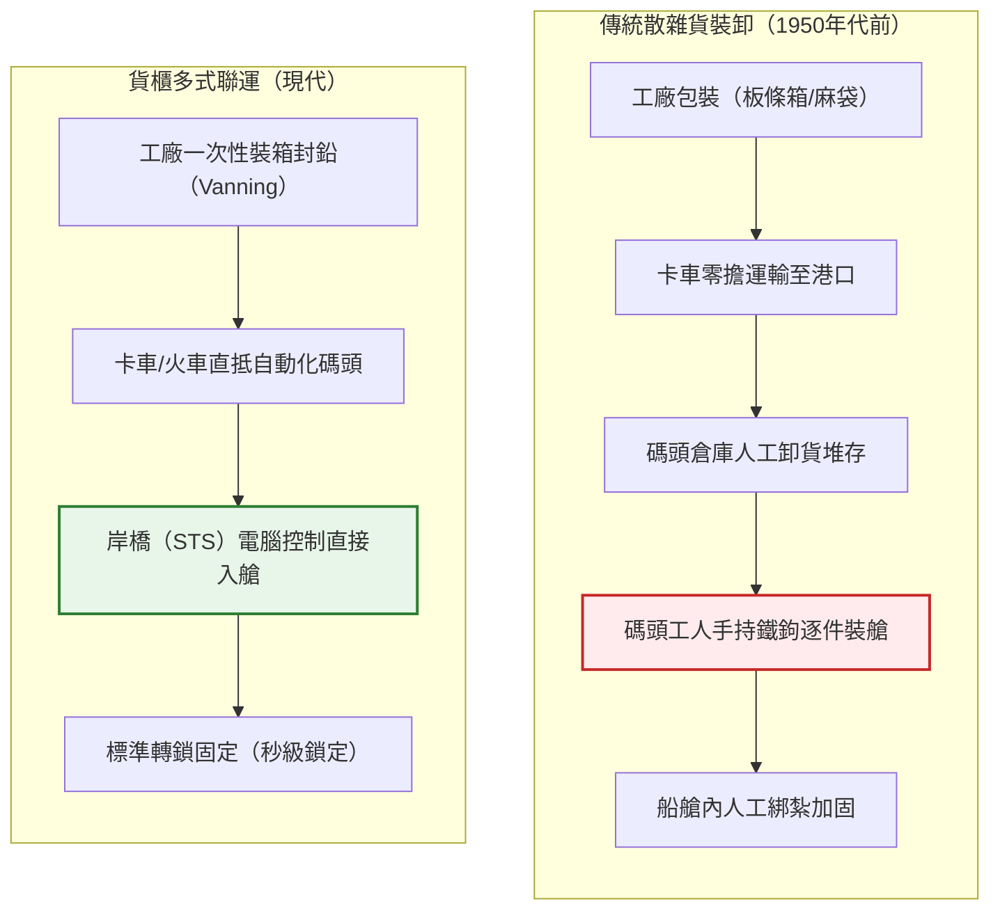
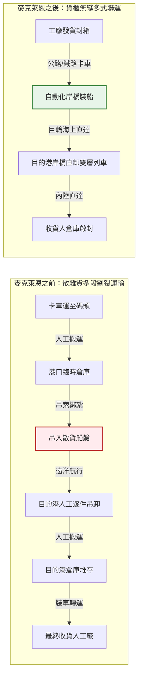
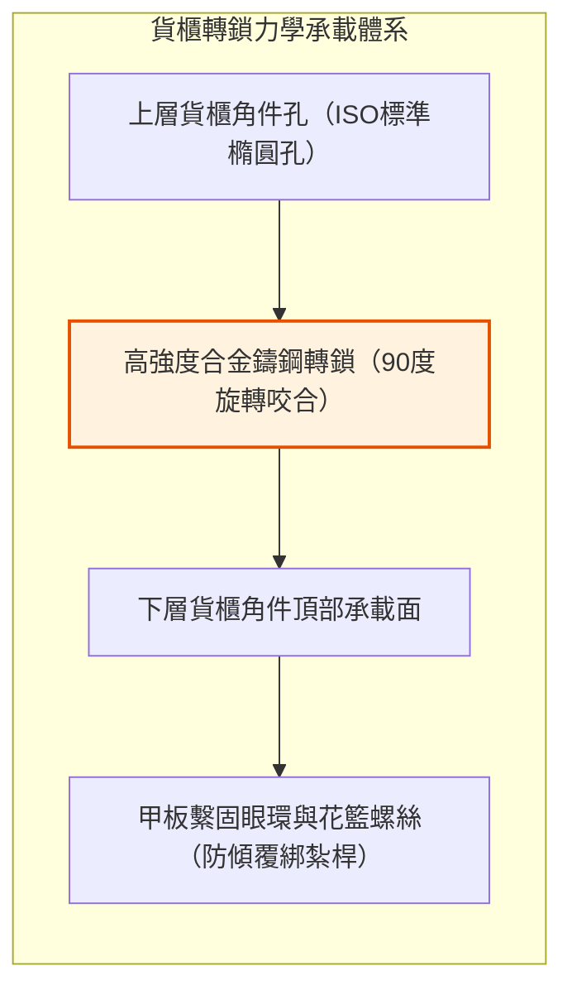
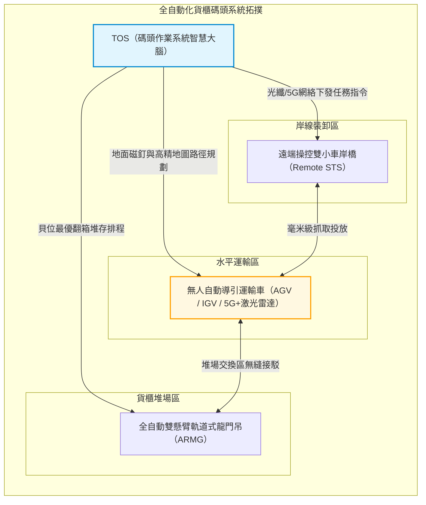
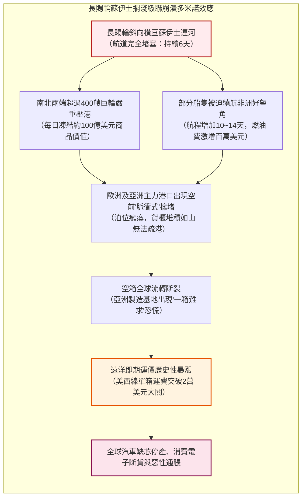

## 引言：平凡鋼箱所引爆的世界史最大經濟奇蹟

當你手握一部智慧型手機、身穿一件海外工廠製造的成衣，或是品飲著來自萬里之外莊園的精選咖啡時，你所觸碰的，實際上是人類工業文明史上最精妙、最龐大的一套物流機器的產物。

而在支撐當今每年超過25兆美元全球商品貿易的底層實體基礎設施中，最重要的基石既不是波音747貨機，也不是跨洋海底光纜，而是一個外表平平無奇、由波紋鋼板焊接而成的長方形鐵箱——**ISO標準海運貨櫃（Shipping Container）**。

在20世紀50年代之前，跨洋貨運是一場極其昂貴、混亂且效率低下得令人絕望的噩夢。一艘散雜貨輪在碼頭裝卸貨物往往需要耗費數週時間；成百上千名碼頭裝卸工人（Stevedores）憑藉原始的體力、滑輪和手鉤，把一箱箱威士忌、一袋袋麵粉、一捆捆原棉艱難地塞進逼仄潮濕的船艙。彼時，貨物在港口的裝卸成本佔據了整條遠洋航線運輸總成本的50%以上，盜竊率、破損率居高不下。

然而，1956年，一位名叫**馬爾科姆·麥克萊恩（Malcom McLean）**的美國卡車運輸業者用一艘改裝油輪「理想X號（Ideal-X）」徹底打破了這個延續了數千年的僵局。他所倡導的並非高深的微電子技術，而是一種純粹的**系統化抽象（Systemic Abstraction）**：將運輸載體與運輸工具剝離，建立一個從卡車、火車到貨輪無縫銜接的實體容器標準。

短短數十年間，每噸貨物的裝卸成本從5.83美元暴跌至區區0.16美元，跌幅高達97%以上。遠洋運費在終端商品價格中所佔的比重被直接壓縮到可忽略不計的1%至2%。正是這個不起眼的鐵箱，使得全球製造業供應鏈的跨洋大分工成為可能，催生了東亞的「世界工廠」奇蹟，重塑了現代全球地緣經濟版圖。

本文將以宏大的工程學、經濟學與產業地緣政治視角，全景解剖現代海運貨櫃體系的誕生、演進、機械物理架構，以及它在極端高效下所暴露出的全球供應鏈脆弱性。

---

## 第一章：被遺忘的數千年低效——散雜貨裝卸與碼頭工人的黑暗時代

### 1.1 「鐵鉤（Cargo Hook）」所統治的碼頭生態

在貨櫃誕生之前，人類的海運型態在數千年中幾乎沒有發生本質改變。從腓尼基人的槳帆船、威尼斯商船，一直到二戰時期的萬噸「勝利輪（Victory Ship）」，貨物都必須以**散雜貨（Break-Bulk Cargo）**的形式一件一件裝入船艙。

所謂散雜貨，是指各種形態各異、尺寸不一的包裝物：木桶裝的葡萄酒、麻袋裝的咖啡豆、板條箱裝的機械零件、紙箱裝的捲煙，乃至裸露捆紮的生鐵和木材。

碼頭上的核心生產工具只有一樣：裝卸工別在腰間的一柄鋒利鋼製**鐵鉤（Cargo Hook）**。工人們用鐵鉤勾住木箱或麻袋的邊緣，靠人力將其搬運、翻滾並塞入船艙深處的角落。為了防止船隻在海上劇烈顛簸時貨物移位導致傾覆，工人們必須像玩實體「俄羅斯方塊」一樣，用木楔、稻草墊料（Dunnage）填滿每一處空隙。

這種勞動不僅極其繁重危險，更催生了高度封閉、甚至被黑手黨所滲透的港口工會壟斷網絡（如美國國際長岸碼頭工人協會 ILA）。碼頭工人的招聘往往基於血緣、地緣與幫派派系；貨物盜竊（Shrinkage）更是港口司空見慣的潛規則。據歷史數據統計，在1950年代紐約港的散雜貨裝卸中，高達10%至15%的高價值貨物（如名酒、名錶、尼龍絲襪）在轉運過程中因偷盜或破損而憑空消失。

### 1.2 「船隻唯有在海上才賺錢」：傳統航運資本的結構性潰敗

航運界有一句傳承百年的格言：**「船隻唯有在海上航行時才賺錢，一旦停靠港口便是在吞噬金錢（A ship only earns money when it is at sea）。」**

在散雜貨時代，這句格言成為了各大船東無法擺脫的資本詛咒。一艘典型的散雜貨輪在一次航程中，通常有**50%至65%的時間是靜止停泊在碼頭**等待裝卸的。巨額的船舶折舊、船員薪資、港口停泊費在毫無產出的等待中持續流逝。

下表直觀揭示了散雜貨裝卸與現代貨櫃作業之間的鴻溝：

| 評估指標 | 傳統散雜貨作業（1950年代） | 現代貨櫃作業（2020年代） | 效率躍遷幅度 |
| :--- | :--- | :--- | :--- |
| **裝卸效率** | 約 15 ~ 25 噸 / 工班·小時 | 超過 1,000 ~ 2,000 噸 / 岸橋·小時 | 提升約 **60~100倍** |
| **泊位停靠週期** | 10 ~ 14 天（甚至長達一個月） | 12 ~ 24 小時（即卸即裝） | 港口週轉提速 **90%以上** |
| **裝卸成本佔比** | 佔航運總收入的 **50% ~ 65%** | 佔航運總收入的 **10% ~ 15%** | 成本斷崖式下跌 |
| **貨物殘損/失竊率** | 普遍達到 **5% ~ 15%** | 低於 **0.01%**（高規格封籤） | 貨損幾乎歸零 |

這種深重的結構性危機表明：遠洋運輸真正的瓶頸從來不在浩瀚的大洋上，而是在陸地與海洋交匯的那條窄窄的碼頭邊緣。

---

## 第二章：馬爾科姆·麥克萊恩的執念——從陸運逆向突破與「理想X號」傳奇

### 2.1 一名卡車司機在霍博肯碼頭的頓悟

現代貨櫃之父**馬爾科姆·麥克萊恩（Malcom McLean）**並非出身航運世家，也沒有造船工程學位。他最初只是北卡羅來納州一名貧窮的卡車司機，靠著一輛二手卡車拉貨起家，最終憑藉驚人的商業直覺將「麥克萊恩卡車公司（McLean Trucking）」打造為全美第五大公路運輸車隊。

1937年的一天，年輕的麥克萊恩開著一輛裝滿棉花包的卡車來到紐澤西州的霍博肯碼頭。他被迫排在綿延數公里的卡車長隊中，足足等待了整整一天，眼睜睜看著碼頭工人慢慢悠悠地解開繩索，將棉花包一捆一捆卸下車、過磅、堆入倉庫，幾天後再吊裝進船艙。

麥克萊恩在駕駛室裡萌生了一個驚世駭俗的念頭：
> **「為什麼我們非要把貨物裝上卡車、卸下卡車，再塞進船艙？為什麼不能直接把卡車車廂整個卸下來，直接吊裝到輪船甲板上，到了目的港再裝回卡車底盤直接開走？」**

這個樸素的想法，就是現代**多式聯運（Intermodal Freight Transport）**的終極原點。

### 2.2 1956年4月26日：「理想X號」的破浪啟航

為了將這個構想化為現實，麥克萊恩不得不跨越美國嚴苛的跨行業壟斷監管壁壘。依照當時美國州際商業委員會（ICC）的反壟斷法規，公路運輸公司嚴禁兼營航運公司。麥克萊恩毅然決然做出了極其瘋狂的豪賭：他出售了自己在麥克萊恩卡車公司的全部股權，以巨額銀行槓桿借貸收購了搖搖欲墜的**泛大西洋輪船公司（Pan-Atlantic Steamship Corporation）**。

他買下二戰時期遺留下來的T-2型油輪**「理想X號（Ideal-X）」**，並在油輪的輸油管道上方加裝了加固鋼結構平台（Spud Spar Deck）。

1956年4月26日，紐澤西州紐瓦克港。在一群工會領袖冷眼旁觀和懷疑的目光中，一台岸邊起重機僅用了不到8小時，便將58個33英尺長的鋁合金貨櫃穩穩安放在「理想X號」的甲板上。隨後，這艘巨輪鳴笛啟航，駛向德克薩斯州休士頓。

當「理想X號」抵達休士頓時，岸上早已等候的卡車底盤迅速將貨櫃拖走並駛入州際公路。國際長岸碼頭工人協會的高級官員弗雷迪·菲爾茲在岸邊目睹這一切後，留下了那句著名的歷史讖言：
> **「先生們，我們所有人的死刑判決書，剛剛已經簽署了。」**

### 2.3 裝卸成本的垂直坍塌：從每噸5.83美元暴跌至0.16美元

「理想X號」首航所展現出的經濟核算數據，讓整個華爾街與全球航運界為之震顫：
- 在傳統散雜貨裝卸模式下，每噸貨物的港口綜合處理成本高達 **5.83 美元**。
- 而在麥克萊恩的貨櫃系統下，裝卸58個貨櫃的總裝卸成本僅為每噸 **0.158 美元（約0.16美元）**！

**成本瞬間暴跌了 97.3%！**

在現代物流經濟學中，綜合端到端運輸成本模型可以抽象為以下方程式：

$$C_{\text{transport}} = C_{\text{handling}} + C_{\text{sea}} + C_{\text{inland}} + C_{\text{inventory}}$$

其中，$C_{\text{handling}}$ 代表港口與中轉節點的裝卸處理成本，$C_{\text{sea}}$ 為海上航行燃料與租金成本，$C_{\text{inland}}$ 為陸運支線成本，而 $C_{\text{inventory}}$ 則代表貨物在途期間佔用的在途資金持有成本。貨櫃革命不僅將 $C_{\text{handling}}$ 壓縮至接近於零，更透過將港口週轉週期從半個月縮短至1天以內，極大地降低了全球商業的 $C_{\text{inventory}}$。

### 2.4 越戰與「金蘭灣奇蹟」：貨櫃全球擴張的歷史催化劑

一項革命性技術的普及往往需要一場不可抗力的宏大危機作為催化劑。對於貨櫃而言，這場催化劑便是**越南戰爭（Vietnam War）**。

1965年，美軍在南越大規模增兵。數十萬美軍所需的彈藥、口糧、卡車零組件及軍需物資如潮水般湧入西貢港。然而，西貢港當時僅有落後的散雜貨泊位，數百艘商船在湄公河口排成長達數十公里的漫長船隊，滯港等待時間長達兩到三個月。美軍補給線陷入災難性癱瘓，碼頭物資由於露天堆放和嚴重失竊而腐爛變質。

美國國防部長羅伯特·麥克納馬拉（Robert McNamara）緊急約見了麥克萊恩。麥克萊恩向五角大廈立下軍令狀：在南越的金蘭灣（Cam Ranh Bay）建造現代化的深水貨櫃泊位，由海陸聯運公司（Sea-Land Service）全權接管美軍後勤專線。

結果令人瞠目結舌：一艘原本需要整整40天才能人工卸空的萬噸軍火船，貨櫃船僅需**48小時**即可完成卸貨並返航。金蘭灣徹底打破了美軍的後勤泥淖。

更具劃時代經濟意義的是麥克萊恩的商業妙手：運送軍火物資前往越南的貨櫃船在返程時大多空放。麥克萊恩敏銳地意識到這一點，讓返程空船順道停靠正處於戰後工業崛起初期的**日本橫濱與神戶港**，以極低的驚人運費將日本製造的收音機、摩托車、顯像管電視機滿載運往美國西海岸。

這標誌著人類歷史上第一條橫跨太平洋的現代化貨櫃商業航線正式誕生，由此拉開了亞洲製造業席捲全球的輝煌序幕。

---

## 第三章：標準化的全球霸權——ISO統一規格（TEU）與角件鎖扣的機械精密工學

### 3.1 規格之爭：35英尺與24英尺的生死對決

貨櫃早期的野蠻生長期，各大航運先驅都試圖推行自己的專利尺寸，構建排他性的商業護城河：
- 麥克萊恩的**海陸聯運（Sea-Land）**採用**35英尺**貨櫃（因為這正是當時美國公路卡車拖車車廂的最大合法長度）。
- 壟斷夏威夷航線的**馬特森公司（Matson）**則採用**24英尺**貨櫃（基於西海岸甘蔗與鳳梨高密度貨物的承重上限計算）。
- 更有航運公司推出了17英尺、8英尺的各種私有規格。

這種群雄割據的私有標準導致嚴重的系統割裂：海陸聯運的貨櫃無法被馬特森的吊車抓取，馬特森的貨櫃無法裝上東海岸的鐵路車皮。全球物流網絡面臨退化為無數個「數據孤島」的巨大風險。

### 3.2 ISO國際標準委員會與「TEU」的誕生

1961年，國際標準化組織成立第104技術委員會（**ISO/TC 104**），開啟了一場長達數年、充滿國家地緣利益博弈的國際大談判。歐洲國家因公路狹窄強烈反對美國過長的35英尺標準；鐵路系統則堅決要求符合國際鐵路車輛裝載限界。

最終達成的全球歷史性妥協誕生了現代**ISO 668標準**體系：
1. 貨櫃寬度統一設定為 **8英尺（2.438公尺）**。
2. 貨櫃高度統一設定為 **8英尺6英寸（2.591公尺）**（後續發展出9英尺6英寸的超高箱 High Cube）。
3. 長度基準確立為兩大主力標準：**20英尺（6.058公尺）** 與 **40英尺（12.192公尺）**。

由此，國際航運界誕生了一個衡量運力與港口吞吐量的絕對基準單位——**TEU（Twenty-foot Equivalent Unit，20英尺標準箱當量）**，而40英尺箱則被稱為 **FEU（Forty-foot Equivalent Unit）**。

更為偉大的是麥克萊恩的人格胸襟：1967年，麥克萊恩宣布將海陸聯運公司斥巨資研發並持有的貨櫃核心專利——**角件（Corner Casting）與轉鎖機構**，無償、免專利費向全人類徹底開源。這一無私舉措掃清了全球工業標準化的最後絆腳石，使貨櫃迅速成為全人類共享的公共技術基石。

### 3.3 轉鎖（Twistlock）與角件（Corner Casting）的機械物理學

貨櫃之所以能夠抵抗十二級颱風的狂風巨浪並在萬噸巨輪上堆疊至9層乃至11層之高，其力學靈魂全部凝結在箱體八個角落處看似平淡無奇的鑄鋼構件上：**角件（Corner Casting）**與插入其中的**轉鎖（Twistlock）**。

角件由高強度耐低溫鑄鋼（如BS 3100 Grade A1鑄鋼）精密熔鑄而成，表面開有標準長圓孔。轉鎖由上部鎖頭、鎖定軸桿與旋轉手柄構成。當上層貨櫃對準下層箱角落下落時，鎖頭旋入角件孔內；人工或半自動機構旋轉手柄90度，鎖頭的梯形凸耳即與角件內腔的斜切卡槽緊密咬合，形成剛性鎖死。

在巨輪航行於深海時，貨櫃堆垛必須承受橫搖（Roll）、縱搖（Pitch）、垂蕩（Heave）所產生的劇烈動態加速度，峰值加速度可達重力加速度的 $1.5 \sim 1.8G$。

轉鎖與角件的極限應力校核遵循材料力學公式：

$$\sigma = \frac{F_{\text{tensile}}}{A_{\text{lock}}} \le \sigma_{\text{allowable}}, \quad \tau = \frac{F_{\text{shear}}}{A_{\text{lock}}} \le \tau_{\text{allowable}}$$

而在最下層貨櫃的四個角柱（Corner Posts）上，其承受的垂直壓縮靜力堆疊極限根據公式：

$$\sigma_{\text{stack}} = \frac{M_{\text{stack}} \cdot g}{4 \cdot A_{\text{corner}}}$$

依照ISO 1496-1規範，現代標準貨櫃底角件必須具備承受至少 **86,400 kg（約848 kN）** 垂直靜載荷的抗壓能力，這意味著最下層的單隻角件能夠輕鬆承受超過210噸的向下壓強，保障超大型船艙內深達10層的「貨櫃大樓」不會在狂浪顛簸中被自身重量壓垮粉碎。

---

## 第四章：縮地成寸的「多式聯運」物理與資訊架構

### 4.1 無縫多式聯運（Intermodalism）的終極邏輯

貨櫃絕不僅僅是一個海運工具，它是打通**海運、鐵路、公路運輸壁壘的通用實體API**。

在貨物離開亞洲工廠倉庫的一瞬間，貨櫃門即被關上並施加擁有全球唯一識別碼的高保封條（Bolt Seal）。自此，無論是經過數百公里的公路拖車拉運、起重機吊入港口岸橋裝入萬噸巨輪，還是在跨越大洋後被卸下並吊上跨大陸雙層貨運列車，箱體內的貨物從未被任何外界人員直接觸碰。

在北美洲，這一理念在**雙層貨櫃貨運列車（Double-Stack Train）**上發揮到了極致。一列由4到5台數千馬力重載柴油機車牽引、綿延超過3公里的重載雙層列車，可以一次性搭載超過500個標準貨櫃，如同陸地上的巨型鋼鐵蜈蚣，直接翻越落基山脈，構成橫跨北美大陸的「陸橋（Landbridge）」，將遠東貨物以極高時效從西海岸港口直抵芝加哥與紐約。

### 4.2 數位化資訊架構的演進：從紙質提單（B/L）到EDI與智慧TOS

實體貨櫃的全球高效流轉，必須有一套同等精密的數位化資訊網絡作為「數位鏡像」進行協同指揮。

在早期，每一票貨物的轉移都伴隨著厚達數十頁的紙本**海運提單（Bill of Lading, B/L）**。紙本單證的郵寄速度甚至常常落後於快船航速，導致貨櫃已抵港而收貨人因未拿到正本提單無法提貨的「單等貨」尷尬局面。

20世紀70年代起，**電子資料交換（EDI, Electronic Data Interchange）**標準（如UN/EDIFACT和ANSI X12）徹底重塑了海運資訊鏈。CODECO（貨櫃進出閘報告）、COARRI（裝卸船作業報告）、BAPLIE（船舶貨櫃配載圖報文）等標準報文格式，使得分布在世界各地的船公司、海關、港務局與貨運代理能夠毫秒級同步每一隻貨櫃的狀態。

在現代貨櫃碼頭的控制中心，運行著高度智慧的**碼頭作業系統（TOS, Terminal Operating System，如Navis N4）**。TOS核心引擎必須即時計算包含數萬個貨櫃在船艙內的重心力矩平衡、船舶初穩心高度（GM值）、危險品隔離規則以及目的港倒箱翻倒最小化演算法，其背後的組合優化數學複雜度堪比火箭發射控制。

---

## 第五章：萬箱巨輪的物理工程極限與全自動化碼頭宇宙

### 5.1 從1,000 TEU到24,000 TEU：規模經濟的終極追逐

半個世紀以來，商用貨櫃船的載箱量經歷了一場令人嘆為觀止的指數級膨脹：
- **第一代（1960年代）**：改裝散貨船與油輪，載箱量僅為 **500 ~ 1,000 TEU**。
- **巴拿馬型（Panamax, 1980年代）**：受制於老巴拿馬運河船閘尺寸（寬32.3公尺），極限載箱量約為 **4,500 TEU**。
- **超巴拿馬型（Post-Panamax, 2000年代）**：突破運河限制，載箱量跨入 **8,000 ~ 10,000 TEU**。
- **現代超大型巨輪（ULCV / Megamax, 2020年代）**：如長榮「長益號（Ever Alot）」、地中海航運「MSC Irina號」，船長達到驚人的 **400公尺**，船寬超過 **61公尺**，甲板面積相當於4個標準足球場，單船最大載箱量突破了 **24,000 TEU**！

驅動船舶不斷走向龐大化巨獸的核心邏輯，是殘酷而堅定的經濟學法則——**單箱運力成本極小化**：

$$C_{\text{unit}} = \frac{C_{\text{capital}} + C_{\text{crew}} + C_{\text{fuel}} + C_{\text{port}}}{Q_{\text{capacity}} \times \alpha_{\text{utilization}}}$$

一艘載箱量24,000 TEU的巨輪，其所需的船員編制僅為22至26人，與一艘4,000 TEU的小型貨櫃船幾乎完全相同。這意味著單箱分攤的船員工資被稀釋了近80%以上；巨輪的單箱建造折舊費與主機燃油消耗亦呈現顯著的邊際遞減效應。

### 5.2 航行速度與燃油消耗的「3次方定律」：慢速航行（Slow Steaming）物理學

在船舶流體力學與海事動力工程中，大型貨櫃船舶的主機推進功率 $P$ 與航行航速 $V$ 之間存在著極為陡峭的非線性關係，即著名的**3次方關係定律**：

$$P \propto V^3$$

對應地，船舶每日消耗的重油燃料量 $F_{\text{day}}$ 也與航速的3次方成正比：

$$F_{\text{day}} = c \cdot \Delta^{2/3} \cdot V^3$$

其中 $\Delta$ 為船舶的滿載排水量，$c$ 為海軍係數綜合常數。

若將單次航次（總航程距離為 $D$）的總燃油消耗量 $F_{\text{total}}$ 展開計算：

$$F_{\text{total}} = F_{\text{day}} \cdot T = \left( k \cdot V^3 \right) \cdot \left( \frac{D}{24 \cdot V} \right) = \frac{k \cdot D}{24} \cdot V^2$$

**單航次的總燃油消耗量與航速的平方（2次方）成正比！**

這一物理法則在商業上產生了深遠影響：
假設一艘20,000 TEU的巨輪原設計巡航航速為24節。當航運公司為了節省昂貴的燃油支出，實施**慢速航行策略（Slow Steaming）**，將航速降低25%至18節時，其單航次總燃油消耗降幅高達：

$$\Delta F_{\text{total}} \approx 1 - \left( \frac{18}{24} \right)^2 = 1 - (0.75)^2 = 1 - 0.5625 = 43.75\%$$

**航速僅僅降低四分之一，燃油成本幾乎減半！** 這正是為什麼現代全球貨櫃幹線網絡普遍選擇「慢吞吞」航行的最底層物理與財務動因。

### 5.3 自動化貨櫃碼頭：AGV與群控演算法構築的黑燈無人宇宙

在現代頂尖貨櫃樞紐港（如上海洋山港四期、青島港自動化碼頭、鹿特丹港馬斯平拉克二期），人類裝卸工人的身影已經徹底從碼頭前沿消失。取而代之的，是一片由數位化演算法與電力驅動的龐大「工業機器人宇宙」。

1. **遠端操控岸橋（Remote STS）**：作業司機坐在數公里外空調控制中心的操縱台前，透過幾十路4K超高清低時延攝影機與操縱手柄，輕鬆完成對船艙貨櫃的精準吊放。
2. **無人自動導引小車（AGV）**：數百台數十噸重的純電動無軌AGV，依靠埋設在地表之下的數萬枚地下磁釘或雷射LiDAR + 5G感測器，以公分級精度在碼頭前沿如鋼鐵工蟻般縱橫穿梭，自主充電、交替避讓。
3. **自動化軌道吊（ARMG）**：堆場內的ARMG起重機在人工智慧調度下，自動完成夜間貨櫃的「預翻箱（Housekeeping）」，將次日清晨即將提離的箱子自動倒騰至最頂層，實現白天秒級提箱。

### 5.4 航運三大聯盟（Alliances）的全球運力寡頭壟斷

巨型船舶高達1.5億至2億美元的單船造價，使得沒有任何單一航運巨頭能夠獨自維持覆蓋全球各主要幹線的超高密度班期網絡。由此，國際班輪航運業走向了深度的資本抱團，形成了瓜分全球超過80%幹線運力的**三大航運聯盟（Shipping Alliances）**：
1. **2M 聯盟**：馬士基（Maersk）與地中海航運（MSC）（注：已於近年協議期滿走向重組）。
2. **海洋聯盟（Ocean Alliance）**：中遠海運（COSCO Shipping）、法國達飛海運（CMA CGM）、長榮海運（Evergreen）、東方海外（OOCL）。
3. **THE Alliance / Premier Alliance**：海洋網聯船務（ONE）、韓新海運（HMM）、陽明海運（Yang Ming）。

聯盟內部實行高度緊密的艙位互換（Vessel Sharing Agreements, VSA）、聯合航線排期與碼頭協同，形成了無可撼動的全球物流寡頭格局。

---

## 第六章：供應鏈的地緣政治與脆性（Fragility）

### 6.1 精益生產（Just-in-Time）的終極脆弱性陷阱

貨櫃海運以極度廉價、極其守時的確定性，深刻重構了現代工業的生產組織形態。以豐田生產方式為代表的**精益生產（Just-in-Time, JIT）**思想席捲全球：企業不再需要建立龐大的原料與零組件安全庫存，因為「海上的貨櫃船本身就是漂浮在移動大洋上的流動倉庫」。

然而，這種將緩衝冗餘徹底榨乾的極限精益模式，隱含著一個極其致命的前提假設：**整個全球實體物流網絡必須100%永遠保持絕對順暢。**

一旦其中某一個不可替代的關鍵實體節點遭受非線性擾動，整個全球供應鏈便會迅速爆發災難性的多米諾骨牌式坍塌。

### 6.2 2021年「長賜輪（Ever Given）」蘇伊士運河擱淺災難

2021年3月23日，長榮海運旗下載箱量達20,124 TEU的巨型貨櫃船**「長賜輪（Ever Given）」**在遭遇沙塵暴強風後，船頭狠狠扎入了蘇伊士運河狹窄單向航道的泥沙岸壁中，船體橫向打橫，將這條承載著全球12%商品貿易的咽喉大動脈徹底切斷了整整6天。

蘇伊士運河的短短6天停擺，其劇烈的蝴蝶效應在全球經濟體系中震盪了長達近一年之久。壓港船舶在疏通後同時湧入歐洲各港口，直接摧毀了港口的裝卸承載上限；大量貨櫃滯留在歐美內陸無法及時返空亞洲，亞洲工廠因極度缺箱而不得不推遲出貨；即期海運運費暴漲近十倍，最終直接傳導為全球廣泛的供應鏈斷供與通脹危機。

### 6.3 咽喉地緣政治：巴拿馬乾旱與紅海胡塞危機

進入2020年代中期，人類實體貿易的脆弱性進一步被氣候異常與地緣武裝衝突撕開：
1. **巴拿馬運河極端乾旱危機**：巴拿馬運河採用船閘式蓄水抬升設計，船舶每次過閘都需要從加通湖（Gatun Lake）向海洋排放數千萬加侖淡水。受強聖嬰現象影響，嚴重旱情迫使運河管理局將單日通行船舶數量削減了近40%，大批巨輪不得不面臨支付數百萬美元天價競拍優先過閘權或繞行麥哲倫海峽的絕境。
2. **紅海商船遇襲危機**：葉門胡塞武裝對曼德海峽（Bab el-Mandeb）通行的商船發射反艦彈道飛彈與自殺式無人機，迫使各大海運聯盟集體中止紅海航線，全線改道繞行非洲好望角。這導致單航次單程時間延長10至14天，不僅直接吞噬了全球近15%的實際有效運力，更使得全球碳排放與燃料帳單急劇攀升。

實體世界的地緣現實無情地證明：**無論數位虛擬世界如何發達，人類現代文明的物質軀殼依然被死死錨定在幾處狹窄的海洋咽喉通道之上。**

---

## 第七章：結語——波紋鐵箱所鑄就的人類文明未來

### 7.1 終極標準化所啟示的創新哲學本質

回顧海上貨櫃誕生的全部歷史，它給予現代科技界與產業界最深邃的啟示或許在於：

**真正顛覆人類歷史進程的偉大創新，往往不是某種極其精密玄奧的尖端高技術，而是一套對底層混亂系統進行極致解構與徹底標準化的「元協議（Meta-Protocol）」。**

貨櫃本身沒有搭載半導體晶片，沒有應用量子物理，它僅僅是一個由廉價耐候鋼（Corten Steel）壓制折彎焊接而成的矩形殼體。馬爾科姆·麥克萊恩所真正創造的，是一套**消滅跨界摩擦的系統互操作介面（Interoperability Interface）**。

正如在電腦軟體世界中，TCP/IP協定簇將紛繁異構的各類區域網路抽象為統一的IP數據包，從而引爆了全球網際網路資訊革命一樣；在實體世界中，貨櫃正是那個完美的「實體IP數據包」，它將全球所有的工廠、卡車、鐵軌、貨輪與港口無縫聯結為一個整齊劃一的全球工業計算總線。

### 7.2 綠色脫碳、供應鏈韌性與新世紀航向

今天，站在新一輪能源與地緣大變革的交匯十字路口，海上貨櫃體系正在經歷自誕生以來最深刻的脫碳與韌性重塑：
- 為滿足國際海事組織（IMO）「2050年全球航運溫室氣體淨零排放」的嚴苛減排紅線，曾經吞吐重油黑煙的巨輪正在加速換裝雙燃料引擎，擁抱**綠色甲醇（Green Methanol）、液化天然氣（LNG）與綠色氨能（Green Ammonia）**。
- 全球企業界正在從單純追求極致低成本的「精益即時制（JIT）」向追求安全冗餘與彈性的「以防萬一制（Just-in-Case, JIC）」深刻轉型，近岸外包（Nearshoring）與多源採購重塑著航線網絡。

然而，無論船舶的燃料如何改變，航線的網絡如何重組，那隻**高8英尺6英寸、寬8英尺、長20英尺或40英尺的波紋鋼箱**，依然將在未來的大洋與大陸間轟鳴穿行。

在漆黑寂靜的遠洋深處，一艘艘承載著人類製造智慧與生存必需品的萬箱巨輪，正破開如墨的夜色破浪向前——這只樸實無華的鐵箱，將繼續作為全球文明不可動搖的鋼鐵骨骼，默默丈量並托舉著人類經濟生活的每一次脈搏。
