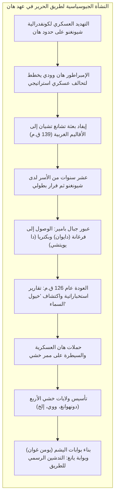
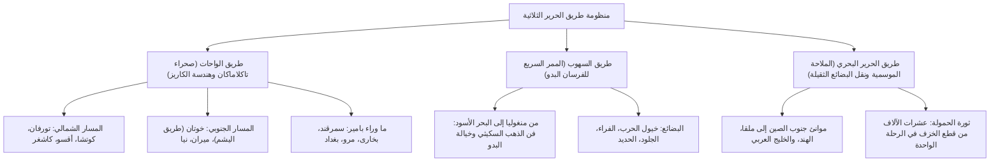
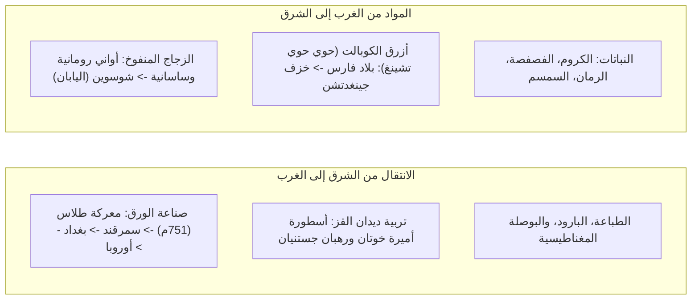

في عام 1877، صاغ الجغرافي الألماني البارز فرديناند فون ريختهوفن المصطلح الخالد <strong>"طريق الحرير" (Seidenstraße)</strong> في مؤلفه الشهير *China*. ورغم ما يحمله هذا الاسم من طابع أسطوري ورومانسي عززته رحلات سفين هيدين وأوريل شتاين، إلا أن الأبحاث الأثرية والتاريخية الحديثة برهنت أن طريق الحرير لم يكن درباً فردياً مستقيماً، بل كان <strong>شبكة أوراسية قارية متعددة المراكز شديدة التعقيد والحيوية</strong>، تربط الممرات الصحراوية والمضائق الجليدية وسهول الأعشاب اللانهائية بالمسارات البحرية.

تألفت هذه المنظومة من ثلاثة محاور استراتيجية كبرى:
1. <strong>طريق الواحات (طريق الصحراء)</strong>: التف حول صحراء تاكلاماكان القاحلة وسلسلة جبال بامير، معتمداً على هندسة قنوات المياه الجوفية الفريدة (*الكاريز*) لتأمين واحات المدن المستقلة.
2. <strong>طريق السهوب</strong>: امتد عبر مروج شمال أوراسيا الشاسعة من منشوريا إلى حوض بانونيا في المجر، تقوده مهارات الفروسية الفائقة للشعوب البدوية (السكيثيون والهون والترك والمغول).
3. <strong>طريق الحرير البحري (طريق الخزف والتوابل)</strong>: قادته الرياح الموسمية الدورية في المحيط الهندي وبحر الصين الجنوبي، رابطاً موانئ غوانغتشو وتشيوانتشو بمضيق ملقا والهند والخليج العربي والبحر الأحمر لنقل البضائع الضخمة.

---

## 1. النشأة الجيوسياسية: بعثة تشانغ تشيان وإستراتيجية أسرة هان

لم تكن انطلاقة طريق الحرير وليدة نزوة تجارية عابرة، بل كانت استجابة عسكرية حتمية لأمن الإمبراطورية القومي إبان عهد أسرة هان الغربية في صراعها مع اتحاد <strong>شيونغنو</strong> البدوي.

في عام 139 قبل الميلاد، أوفد الإمبراطور هان وودي القائد <strong>تشانغ تشيان</strong> في مهمة محفوفة بالمخاطر لعقد حلف استراتيجي مع قبائل <strong>دا يويتشي</strong> التي طردها شيونغنو نحو آسيا الوسطى. وقع تشانغ تشيان في الأسر وقضى أكثر من عقد محتفظاً بصولجان السفارة الإمبراطورية. وبعد هروبه الملحمي، عبر جبال بامير الجليدية وبلغ وادي فرغانة (<strong>دايوان</strong>) وبكتريا. وعلى الرغم من رفض يويتشي تجديد الحرب، إلا أن المعلومات الجغرافية والسياسية التي جلبها إلى تشانغآن عام 126 ق.م أحدثت ثورة معرفية كبرى.

أبدى الإمبراطور شغفاً استثنائياً باقتناء <strong>"خيول السماء" (汗血馬)</strong> في فرغانة لتمتعها بقدرة فائقة على الصمود في الحروب لمواجهة خيالة شيونغنو. وشن جيش هان حملات مظفرة طهرت <strong>ممر خشي</strong>، وأنشأ حاميات <strong>دونهوانغ</strong> وبنى <strong>بوابة اليشم (يومن غوان)</strong>، مما أرست دعائم التجارة القارية.

---

## 2. ديناميكيات المسارات الثلاثة الكبرى

### 2.1 طريق الواحات وقنوات الكاريز الجوفية

لعبور صحراء تاكلاماكان الرهيبة، اعتمدت القوافل على مدن الواحات التي تغذت بواسطة نظام <strong>الكاريز (القنوات الجوفية)</strong>: وهي قنوات ممتدة تحت الأرض لعشرات الكيلومترات تجلب مياه ذوبان ثلوج الجبال وتمنع تبخرها، لتروي المحاصيل وتزود القوافل. وبعد اجتياز كاشغر وقمم بامير الشاهقة، بلغت القوافل مدينتي <strong>سمرقند</strong> و<strong>بخارى</strong> في بلاد الصغد، ومنها عبرت بلاد فارس نحو الشام والبحر المتوسط.

### 2.2 طريق السهوب والسرعة الفائقة

بينما كانت قوافل الإبل في الصحراء تقطع 25 إلى 30 كم يومياً، كان الفرسان البدو في سهوب أوراسيا مع خيول التبديل يقطعون ما بين 80 إلى 120 كم يومياً. استخدمت الإمبراطوريات البدوية هذا الممر السريع لمبادلة الخيول والفراء بحرير وشاي الصين.

### 2.3 طريق الحرير البحري

استفادت السفن البحرية من انتظام <strong>الرياح الموسمية</strong>. حملت السفن الصينية ذات الحجرات المعزولة وسفن الداو العربية المخيطة بألياف جوز الهند حمولات هائلة؛ حيث عُثر في حطام سفينة <strong>بيليتونغ</strong> (القرن التاسع الميلادي) في إندونيسيا على أكثر من 60 ألف قطعة خزفية متجهة إلى موانئ الخليج العربي.

---

## 3. تجار الصغد ورواد الائتمان التجاري

كان المحرك الأساسي للقوافل البرية هم <strong>الصغديون</strong>، وهم شعب إيراني سكن وادي زرافشان (أوزبكستان الحالية).

أسس الصغديون مستوطنات تجارية ذاتية الحكم في كل محطات الطريق حتى عاصمتي الصين تشانغآن ولويانغ، بقيادة زعيم القافلة (<strong>سارتافاها</strong>). اعترفت أسرة تانغ بإدارتهم الذاتية وعينت زعماءهم في منصب رسمي يُعرف بـ <strong>ساباو (薩寶)</strong>. تكشف <strong>رسائل الصغد القديمة</strong> (حوالي 313م) عن ممارسات مالية متقدمة شملت خطابات الاعتماد المصرفية، والقروض بفوائد مركبة، واستخدام أثواب الحرير كعملة احتياطية دولية.

---

## 4. نقل التكنولوجيا والاندماج المادي

### 4.1 معركة طلاس (751م) وثورة الورق العالمية

في يوليو 751م، اشتبك جيش تانغ الصيني مع جيش الخلافة العباسية على ضفاف نهر <strong>طلاس</strong>. أدى تمرد مرتزقة القارلوق إلى هزيمة الجيش الصيني.

نُقل صناع الورق الصينيون المأسورون إلى سمرقند، حيث وُلد <strong>ورق سمرقند</strong> ذو الجودة الفائقة. وانتقلت التقنية إلى بغداد عام 793م، مشكلة الأساس المادي لـ <strong>بيت الحكمة</strong> والعصر الذهبي للحضارة الإسلامية، قبل أن تنتقل إلى الأندلس وإيطاليا، ممهدة لعصر الطباعة والنهضة الأوروبية.

### 4.2 الخزف الأزرق والأبيض: إبداع صيني-فارسي مشترك

في القرن الرابع عشر، وُلد <strong>الخزف الأزرق والأبيض (تشينغهوا)</strong> في جينغدتشن بالصين: اندمج طين الكاولين النقي المحروق عند 1300 درجة مئوية مع خام الكوبالت النقي المستورد من مناجم قاشان في بلاد فارس (المعروف في الصين بـ <strong>الأزرق المحمدي / حوي حوي تشينغ</strong>)، لتنتج تحف فاخرة غزت قصور السلاطين العثمانيين والصفويين.

---

## 5. التمازج الروحي وفن غاندهارا البوذي اليوناني

كان طريق الحرير منتدى كبرى الديانات العالمية:
- <strong>فن غاندهارا</strong>: امتزجت التقاليد الفنية الهلنستية الناتجة عن فتوحات الإسكندر الأكبر مع البوذية، ليظهر تمثال بوذا لأول مرة في هيئة بشرية بملامح الإله الإغريقي <strong>أبولو</strong> مرتدياً طيات التوجة الرومانية، بينما تمثل الحارس فاجراباني في هيئة البطل الإغريقي <strong>هرقل</strong>.
- <strong>رحلة تشوانزانغ</strong>: ارتحل الراهب الصيني تشوانزانغ لمدة 16 عاماً إلى الهند (629–645م) ودرس في جامعة نالاندا وألف كتابه الشهير *سجلات المناطق الغربية*.
- <strong>التسامح في تشانغآن</strong>: ازدهرت في العاصمة الصينية المسيحية النسطورية (كما توثق شاهدة عام 781م)، والمانوية، والزرادشتية إلى جانب البوذية.

---

## 6. السلام المغولي ومنظومة بريد يام

في القرن الثالث عشر، وحدت الإمبراطورية المغولية أوراسيا تحت مظلة <strong>السلام المغولي (Pax Mongolica)</strong>.

كان العمود الفقري للإمبراطورية نظام محطات البريد السريع <strong>يام (Yam / Zhanchi)</strong>: محطة كل 40 كم تضم خيولاً وإمدادات. انطلق الرسل الحاملون للألواح الإمبراطورية (<strong>بايزة</strong>) قاطعين 200 كم يومياً. وعبر رحالة كبار مثل ماركو بولو وابن بطوطة القارة بأمان، بينما جرى تداول النقود الورقية (<strong>جياوتشاو</strong>).

إلا أن هذه الشبكة السريعة كانت أيضاً سبباً في تفشي طاعون <strong>الموت الأسود (1346–1353م)</strong> الذي أودى بثلث سكان أوراسيا وقوض أركان المنظومة القارية.

---

## 7. عصر الملاحة وأفول المسار البري

مع اكتشاف فاسكو دا غاما لطريق رأس الرجاء الصالح عام 1498، حلت السفن البحرية الضخمة محل القوافل البرية بتكاليف زهيدة ودون ضرائب عبور قاسية.

وتزامن ذلك مع برودة العصر الجليدي الصغير وجفاف أنهار الواحات، فابتلعت الرمال مدناً عريقة مثل لولان ونيا، لينحسر طريق الحرير البري إلى تجارات محلية محدودة.

---

## 8. الخاتمة: حكمة طريق الحرير للقرن الحادي والعشرين

تتمثل الرسالة الخالدة لطريق الحرير في أن: <strong>الحضارات لا تزدهر في العزلة والجمود، بل تنمو وتتألق عبر الحوار والانفتاح والتلاقح الثقافي الخلاق.</strong>

اليوم، تعيد قطارات <strong>China Railway Express</strong>، وخطوط أنابيب الطاقة، وكابلات الألياف الضوئية إحياء هذا الرابط الأوراسي العريق، مؤكدة أن بناء الجسور هو المسار الوحيد لازدهار الإنسانية المشترك.