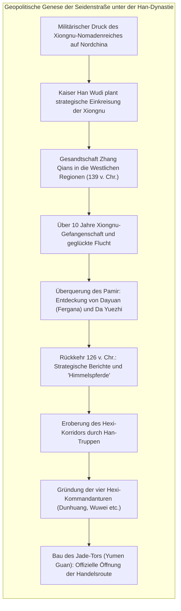
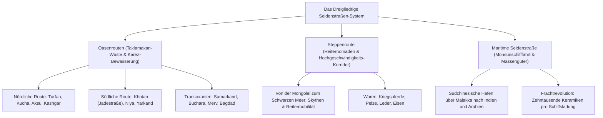
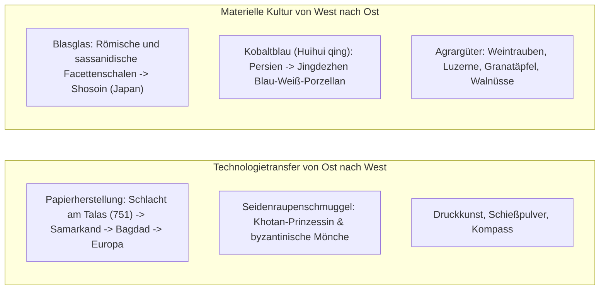

Im Jahr 1877 prägte der deutsche Geograph und Forschungsreisende Ferdinand Freiherr von Richthofen in seinem Grundlagenwerk *China: Ergebnisse eigener Reisen und darauf gegründeter Studien* den unvergänglichen Begriff <strong>"Seidenstraße" (Seidenstraßen)</strong> für jene uralten Verkehrs- und Handelsverbindungen, die Ostasien über Zentralasien mit dem Mittelmeerraum verknüpften. Popularisiert durch Forscher wie Sven Hedin, Sir Marc Aurel Stein und Paul Pelliot, beflügelte dieser Terminus Generationen.

Die moderne Geschichtswissenschaft, Archäologie und Wirtschaftsanthropologie haben jedoch gezeigt, dass die Seidenstraße keine einzelne, geradlinige Karawanenstraße war, sondern ein hochdynamisches, vielschichtiges <strong>Netzwerk aus Wüstenpfaden, Gebirgspässen, Steppenkorridoren und maritimen Seewegen</strong>.

Drei primäre Verkehrsachsen bildeten das Rückgrat dieses kontinentalen Gefüges:
1. <strong>Die Oasenrouten (Wüsten-Seidenstraße)</strong>: Entlang der nördlichen und südlichen Ränder der todbringenden Taklamakan-Wüste und über das Pamir-Gebirge, gestützt auf unterirdische Karez-Bewässerungssysteme und befestigte Stadtstaaten.
2. <strong>Die Steppenroute</strong>: Über das endlose eurasische Grasland von der Mandschurei bis zur ungarischen Puszta, betrieben durch die Reitermobilität nomadischer Föderationen (Skythen, Xiongnu, Göktürken, Mongolen).
3. <strong>Die Maritime Seidenstraße (Porzellan- und Gewürzroute)</strong>: Gesteuert durch die zyklischen Monsunwinde des Indischen Ozeans, die Häfen wie Guangzhou und Quanzhou mit Malakka, Indien, dem Persischen Golf und dem Roten Meer für den massenhaften Gütertransport verband.

---

## 1. Geopolitische Ursprünge: Zhang Qians Mission und die Han-Strategie

Die offizielle Eröffnung der Seidenstraße entsprang keinem romantischen Handelsgeist, sondern existentiellen sicherheitspolitischen Zwängen des Han-Reiches.

Im 2. Jahrhundert v. Chr. beherrschten die <strong>Xiongnu-Reiternomaden</strong> die Steppen nördlich Chinas und erpressten durch ständige Überfälle demütigende Jahrgelder an Seide, Getreide und kaiserlichen Prinzessinnen. Kaiser Han Wudi (reg. 141–87 v. Chr.) beschloss, dieses System zu zerschlagen. Als er erfuhr, dass das Volk der <strong>Da Yuezhi</strong> von den Xiongnu nach Westen vertrieben worden war, entsandte er 139 v. Chr. den Offizier <strong>Zhang Qian</strong> mit rund 100 Mann, um ein Militärbündnis zu schmieden.

Zhang Qian geriet rasch in Xiongnu-Gefangenschaft, in der er über ein Jahrzehnt ausharrte. Nach seiner Flucht überquerte er die eisigen Pässe des Pamir-Gebirges und erreichte das fruchtbare Ferganatal (<strong>Dayuan</strong>) sowie Baktrien. Zwar lehnten die Yuezhi einen neuen Krieg ab, doch die Berichte, die Zhang Qian 126 v. Chr. nach Chang'an brachte, revolutionierten das chinesische Weltbild.

Besonders fasziniert war Kaiser Wudi von den <strong>"Himmelspferden" (汗血馬)</strong> aus Fergana, die den chinesischen Rassen an Ausdauer und Kampfkraft weit überlegen waren. Um diese Pferde zu sichern, eroberte die Han-Armee den <strong>Hexi-Korridor</strong> (Gansu), errichtete die Festungen <strong>Yumen Guan (Jade-Tor)</strong> und Yang Guan und schuf den infrastrukturellen Rahmen der transkontinentalen Oasenroute.

---

## 2. Die drei Hauptachsen der eurasischen Zirkulation

### 2.1 Die Oasenstraße und die Karez-Hydraulik

Die Karawanenroute umging die lebensfeindliche Taklamakan-Wüste im Norden (über Turfan, Kucha, Kashgar) oder im Süden (über Khotan, berühmt für Nephrit-Jade). Das Überleben der Oasenstädte verdankte sich dem ausgeklügelten <strong>Karez-System</strong>: Unterirdische Kanäle leiteten das Schmelzwasser der Gletscher über Dutzende Kilometer verdunstungsfrei zu Feldern und Siedlungen. Nach Kashgar überwanden Karawanen das über 4.000 Meter hohe Pamir-Dach der Welt, um die Metropolen <strong>Samarkand</strong> und <strong>Buchara</strong> in Transoxanien zu erreichen.

### 2.2 Die Steppenroute: Der Reiterkorridor

Über die endlosen Steppengürtel Eurasiens operierten nomadische Stammesföderationen. Während Wüstenkamele nur 25–30 km täglich bewältigten, legten Steppenreiter mit Wechselpferden 80–120 km pro Tag zurück. Bereits im 1. Jahrtausend v. Chr. schufen die <strong>Skythen</strong> einen dynamischen Tierstil in Gold und Bronze. Die Steppenroute war die militärische und logistische Schnellstraße des Kontinents.

### 2.3 Die Maritime Seidenstraße: Monsunschifffahrt

Die Seeroute nutzte den halbjährlichen Wechsel des <strong>Monsuns</strong> im Indischen Ozean. Arabische Dhaus und chinesische Dschunken mit wasserdichten Querschotten transportierten gigantische Frachtmengen: Ein Schiff konnte bis zu 60.000 Keramikgefäße fassen (wie das 1998 geborgene Belitung-Wrack aus dem 9. Jahrhundert belegt), was auf dem Landweg Tausende von Kamelladungen erfordert hätte.

---

## 3. Die Sogdischen Kaufleute: Pioniere des Kreditwesens

Den eigentlichen Herzschlag des kontinentalen Handels bildeten die <strong>Sogdier</strong>, ein iranischsprachiges Handelsvolk aus dem Zeravshan-Tal (modernes Usbekistan).

Sie gründeten Kolonien entlang der gesamten Seidenstraße bis nach Chang'an und Luoyang. Ihre Karawanen wurden von einem <strong>Sārtavāha</strong> geführt. Die Tang-Dynastie integrierte sie administrativ über das offizielle Amt des <strong>Sabao (薩寶)</strong>, der zivile Streitigkeiten schlichtete und die zoroastrischen Feuertempel beaufsichtigte.

Die 1907 von Stein entdeckten <strong>Sogdischen Alten Briefe</strong> (ca. 313 n. Chr.) belegen hochentwickelte Finanzinstrumente: bargeldlose Kreditbriefe, Wechsel, Zinseszins-Darlehen und die Nutzung standardisierter Seidenballen (*pi*) als internationale Leitwährung. In Chang'an prägte die sogdische Präsenz die Mode: "Hu-Kultur" mit Weinstuben, exotischen Tänzen (Huxuanwu), engen Reitgewändern und Lautenmusik erfasste den kaiserlichen Hof.

---

## 4. Technologietransfer und materielle Hybridität

### 4.1 Die Schlacht am Talas (751 n. Chr.) und die globale Papierrevolution

Im Juli 751 trafen am Fluss <strong>Talas</strong> die Armeen der Tang-Dynastie unter General Gao Xianzhi und des Abbasiden-Kalifats aufeinander. Nach dem Verrat karlukischer Söldner erlitten die chinesischen Truppen eine schwere Niederlage.

Unter den Gefangenen befanden sich chinesische Papiermacher, die nach Samarkand gebracht wurden. Das dort gefertigte geschmeidige <strong>Samarkand-Papier</strong> trat einen Siegeszug an: 793 n. Chr. entstand die erste Papiermühle in Bagdad, wo es das Fundament für das <strong>Haus der Weisheit (Bayt al-Hikma)</strong> und das islamische Goldene Zeitalter bildete. Über Spanien und Italien erreichte das Papier Europa und ermöglichte Gutenbergs Buchdruck und die Aufklärung.

### 4.2 Blau-Weiß-Porzellan: Die Synthese von Kobalt und Kaolin

Im 14. Jahrhundert entstand unter der mongolischen Yuan-Dynastie das weltberühmte <strong>Blau-Weiß-Porzellan (Qinghua)</strong> in Jingdezhen:
- <strong>Chinesischer Anteil</strong>: Hochfeiner Kaolinton und Brenntechnik bei 1.300 °C in reduzierender Atmosphäre.
- <strong>Persischer Anteil</strong>: Natürliches, manganarmes Kobalterz aus Kashan (Iran), bekannt als <strong>Huihui qing (Mohammedanerblau)</strong>.
Diese hybriden Luxusobjekte wurden über maritime Routen an osmanische und safawidische Höfe reexportiert und entfachten in Europa die Chinoiserie.

---

## 5. Religiöse Transformationen und Gandhara-Kunst

Die Seidenstraße war das bedeutendste theologische Laboratorium der Antike:
- <strong>Gandhara-Kunst</strong>: Nach den Feldzügen Alexanders des Großen verschmolzen griechische Ästhetik und Mahayana-Buddhismus. Der Buddha wurde erstmals in menschlicher Gestalt dargestellt – mit den edlen Zügen des griechischen Sonnengottes <strong>Apollo</strong> und den Faltenwürfen einer römischen Toga. Der Beschützer Vajrapani geht direkt auf <strong>Herakles</strong> zurück.
- <strong>Xuanzangs Pilgerfahrt</strong>: Der Tang-Mönch Xuanzang reiste 629–645 n. Chr. nach Indien, studierte an der Universität Nalanda und verfasste die *Aufzeichnungen über die Westlichen Regionen (Da Tang Xiyu Ji)*, die im 19. Jahrhundert Archäologen als Reiseführer dienten.
- <strong>Drei Fremde Religionen</strong>: Neben dem Buddhismus blühten in Chang'an das nestorianische Christentum (Jingjiao, bezeugt durch die Stele von 781 n. Chr.), der Manichäismus (Staatsreligion des Uigurischen Khaganats 762 n. Chr.) und der Zoroastrismus.

---

## 6. Pax Mongolica und das Yam-Postsystem

Im 13. Jahrhundert schuf das Weltreich Dschingis Khans eine beispiellose transkontinentale Friedensepoche: die <strong>Pax Mongolica</strong>.

Das Rückgrat bildete das <strong>Yam-Poststationssystem (Örtöö / Zhanchi)</strong>: Alle 40 km standen frische Pferde und Verpflegung bereit. Kuriere mit kaiserlichen <strong>Paiza-Pässen</strong> ritten Tag und Nacht und legten bis zu 200 km täglich zurück. Kaufleute wie Marco Polo und Ibn Battuta durchquerten Eurasien ungehindert, während die ersten echten Papierwährungen (<strong>Jiaochao</strong>) zirkulierten.

Jedoch übertrug dieses Hochgeschwindigkeitsnetz auch biologische Katastrophen: Ab 1346 verbreitete sich das Bakterium *Yersinia pestis* (der <strong>Schwarze Tod</strong>) entlang der Routen und tötete ein Drittel der europäischen und asiatischen Bevölkerung, was den Zusammenbruch des mongolischen Weltsystems beschleunigte.

---

## 7. Das Zeitalter der Entdeckungen und der Niedergang

Mit Vasco da Gamas Umrundung des Kaps der Guten Hoffnung (1498) verlagerte sich der Welthandel auf die Ozeane. Ein einziges Karavellenschiff transportierte die Ladung von Tausenden Kamelen zu einem Bruchteil der Kosten, ohne Zölle und Raubüberfälle.

Gleichzeitig führte die Kleine Eiszeit zur Austrocknung zentralasiatischer Flüsse; Oasenstädte wie Loulan und Niya versanken im Wüstensand. Die Seidenstraße verlor ihre Rolle als Weltverkehrsader.

---

## 8. Fazit: Das zivilisatorische Vermächtnis

Die Seidenstraße beweist: <strong>Kulturen gedeihen nicht in hermetischer Abschottung, sondern durch gegenseitige Durchdringung, Dialog und Synthese.</strong>

Im 21. Jahrhundert erlebt Eurasien eine infrastrukturelle Renaissance: Güterzüge des <strong>China Railway Express</strong>, Gaspipelines und transkontinentale Glasfasernetze beleben die historischen Korridore wieder. Die Geschichte der Seidenstraße mahnt uns, dass der wahrhafte Reichtum der Menschheit in der Überwindung von Grenzen und dem kooperativen Austausch liegt.