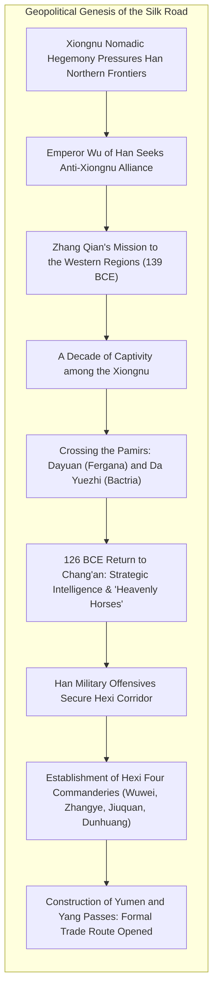
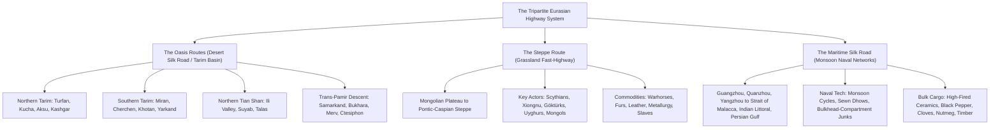
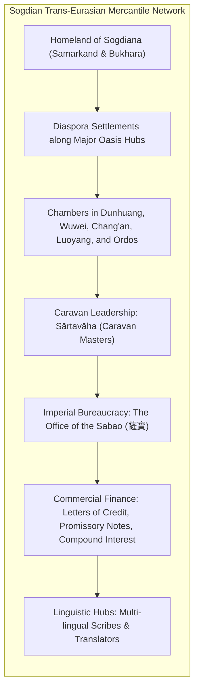
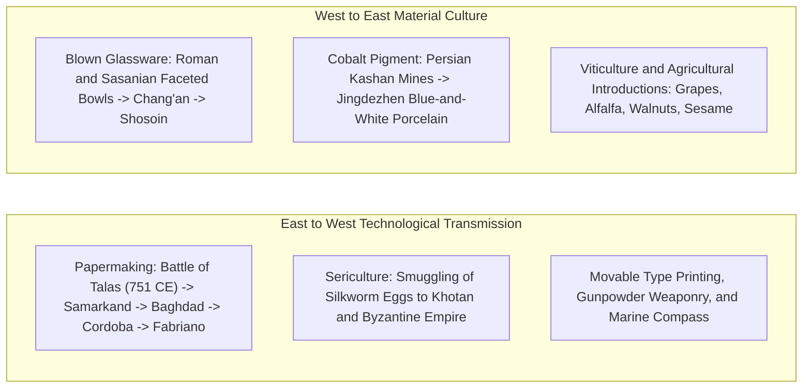
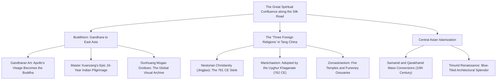
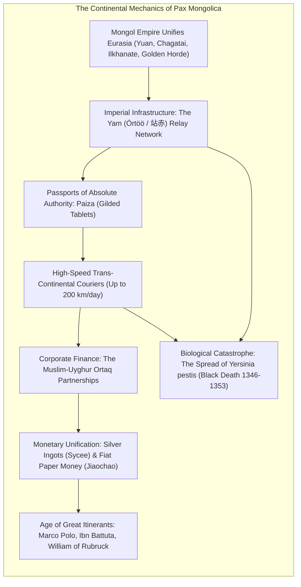
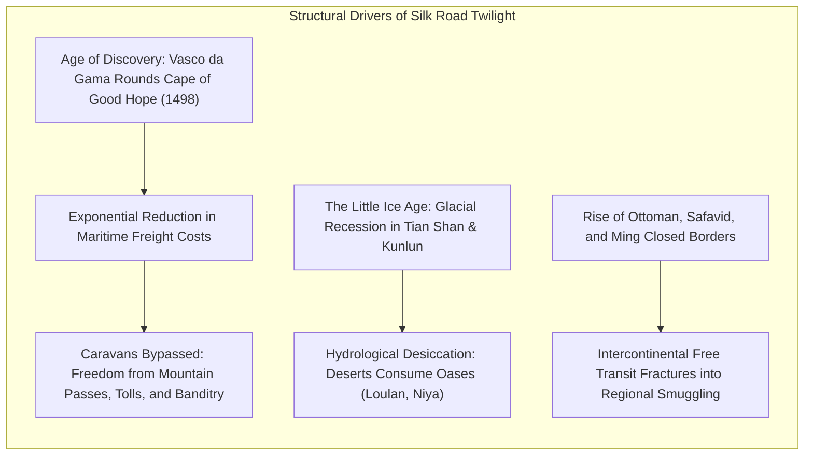
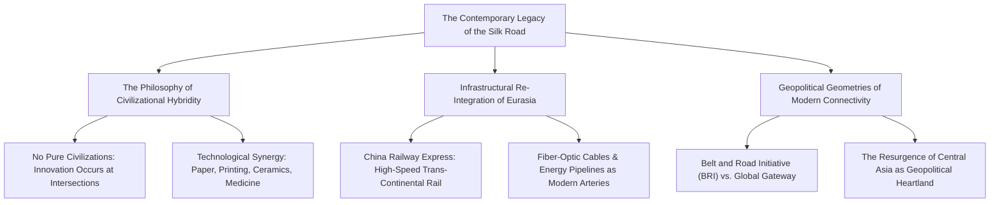

In 1877, the eminent German geographer and traveler Baron Ferdinand von Richthofen coined the term <strong>"Seidenstraße" (Silk Road)</strong> in his monumental treatise *China: Ergebnisse eigener Reisen und darauf gegründeter Studien*. The phrase captured global imagination, later popularized worldwide through the daring expeditions of his pupil Sven Hedin, Sir Marc Aurel Stein, and Paul Pelliot. Yet modern historiography, archaeology, and economic anthropology have thoroughly dismantled the romantic myth of the Silk Road as a single, static highway traversed continuously by lone merchants from China to Rome.

In reality, the Silk Road constituted a dynamic, polycentric, and multi-tiered <strong>intercontinental network of desert tracks, mountain passes, steppe corridors, and maritime sea lanes</strong>. It operated across three primary continental corridors:
1. <strong>The Oasis Routes (The Desert Silk Road)</strong>: Threading the perimeter of the formidable Taklamakan and Gobi deserts, linking fortified oasis city-states across the Tarim Basin, the Pamir Knot, and Transoxiana.
2. <strong>The Steppe Route</strong>: Spanning the continuous grasslands of northern Eurasia from Manchuria to the Hungarian Pannonian Basin, sustained by the mobility and metallurgical prowess of pastoral nomad empires (Scythians, Xiongnu, Turks, and Mongols).
3. <strong>The Maritime Silk Road (Porcelain and Spice Routes)</strong>: Guided by the cyclical monsoon winds across the South China Sea, the Strait of Malacca, the Indian Ocean, the Arabian Sea, and the Persian Gulf, conveying bulk cargo of ceramics, spices, and textiles on an unprecedented scale.

Along these arterial corridors flowed far more than luxury goods like raw Chinese silk, Roman blown glassware, and Sasanian silver repoussé vessels. They functioned as the primary catalyst for the <strong>diffusion of foundational technologies</strong>—papermaking, block printing, the magnetic compass, gunpowder, sericulture, and high-fired glazed ceramics—that remade global economic productivity. Furthermore, they served as an open theological laboratory where Gandharan Greco-Buddhist statuary, Nestorian Christianity, Manichaeism, Zoroastrianism, and Islam crossed linguistic and political frontiers, transforming the spiritual landscape of humanity.

This treatise provides an exhaustive, multidisciplinary inquiry into the structural mechanics, economic systems, material culture, and spiritual syncretism of the Silk Road, tracing its trajectory from the Western Han Dynasty to the apex of the Pax Mongolica and its eventual twilight in the early modern era.

---

## 1. Geopolitical Genesis: Zhang Qian's Expedition and Western Han Frontier Strategy

The inception of the Silk Road was rooted not in peaceful commercial curiosity, but in urgent imperial geopolitics and strategic national defense.

### 1.1 The Xiongnu Hegemony and the Quest for the Yuezhi

At the dawn of the 2nd century BCE, the nascent Western Han Dynasty faced an existential security crisis along its northern frontier. The <strong>Xiongnu Empire</strong>, unified under the charismatic chanyu Modu (Mao-tun), possessed superior mounted archery and devastating cavalry mobility. Following Emperor Gaozu's humiliating encirclement at the Battle of Baideng in 200 BCE, the Han court was coerced into adopting the humiliating policy of *heqin* (harmonious alliance)—annually dispatching substantial quantities of silk bolts, grain, liquor, and imperial princesses in marriage to appease the nomadic rulers.

When Emperor Wu (*Han Wudi*, r. 141–87 BCE) ascended the throne, he determined to dismantle this asymmetric relationship through decisive offensive strategy. Imperial intelligence revealed that the <strong>Da Yuezhi</strong> (Greater Yuezhi), a nomadic pastoral people formerly inhabiting the Hexi Corridor, had been decisively defeated by the Xiongnu, their king slain and his skull fashioned into a ceremonial drinking vessel by the Xiongnu chanyu. Driven westward into Central Asia, the Yuezhi harbored deep generational enmity against their conquerors. Emperor Wu conceived an audacious strategy: forge a military coalition with the distant Yuezhi to pinch the Xiongnu Empire in a continental pincer movement.

In 139 BCE, an imperial officer named <strong>Zhang Qian (張騫)</strong> volunteered to lead an expedition of approximately one hundred personnel, guided by a Xiongnu scout named Tangyi Fu (Gan Fu). Shortly after departing the imperial capital of Chang'an, the mission was intercepted by Xiongnu patrols. Zhang Qian was brought before the Chanyu and detained in captivity for over ten years. Despite taking a nomadic wife and establishing a household, Zhang Qian steadfastly preserved his imperial tally of credentials (*jie*). Seizing an opportunity during a lapse in surveillance, Zhang Qian, his wife, and Gan Fu executed a daring escape westward.

### 1.2 Crossing the Pamirs and the Discovery of Fergana

Zhang Qian's party pushed across the perilous sands of the Tarim Basin and ascended the glaciated passes of the Pamir Mountains (the *Congling*), descending into the fertile Fergana Basin—known to Chinese records as <strong>Dayuan (大宛)</strong>. The King of Dayuan, who had long desired commercial relations with the wealthy Han civilization, greeted the emissaries with honor and provided guides onward through Kangju (Sogdiana) to the northern banks of the Oxus River (Amu Darya) in Bactria (Daxia), where the Da Yuezhi had relocated their royal encampment.

To Zhang Qian's dismay, however, the geopolitical landscape had fundamentally shifted. Settled in the lush, agricultural valley of the Oxus, unmolested by external foes, the Da Yuezhi had lost all appetite for a hazardous, trans-continental war against the distant Xiongnu. After spending over a year in the region observing local societies, markets, and governance, Zhang Qian recognized that a military alliance was unattainable.

Embarking on his return journey via the southern rim of the Tarim Basin beneath the Kunlun Mountains, Zhang Qian was once again captured by the Xiongnu. He remained imprisoned for another year until the death of the Chanyu triggered dynastic infighting, allowing him to escape back to Chang'an in 126 BCE. Of the original expedition of one hundred men, only Zhang Qian and Gan Fu returned alive.

### 1.3 The Heavenly Horses and the Conquest of the Hexi Corridor

Although Zhang Qian failed in his direct diplomatic goal, his comprehensive debriefing electrified the Han court. He provided unprecedented eyewitness accounts of complex agricultural and urban civilizations throughout Central Asia, West Asia (Anxi/Parthia), and South Asia (Shendu/India).

Foremost among his reports was the existence of the famed <strong>"Heavenly Horses" (汗血馬, *hanxuema*, literally "blood-sweating horses")</strong> bred in Dayuan. These magnificent equines possessed extraordinary endurance, skeletal density, and speed—attributes vital for countering the rapid maneuvering of Xiongnu light cavalry. The indigenous Han horse breeds, small and stocky, could neither match the stride nor sustain the prolonged tactical charges demanded in steppe warfare.

Determined to procure these mounts and severed the Xiongnu from their Western tributaries, Emperor Wu launched extensive military campaigns led by brilliant young generals Wei Qing and Huo Qubing. By 121 BCE, Han forces decisively shattered Xiongnu control over the Gansu region, incorporating the narrow 1,000-kilometer passage between the Tibetan Plateau and the Gobi Desert known as the <strong>Hexi Corridor</strong>.

To consolidate imperial control, Han established the <strong>Four Commanderies of Hexi</strong>:
- <strong>Wuwei (武威)</strong>: Securing the eastern bottleneck.
- <strong>Zhangye (張掖)</strong>: Guarding the central fertile oasis.
- <strong>Jiuquan (酒泉)</strong>: Providing strategic staging depots and horse-breeding garrisons.
- <strong>Dunhuang (敦煌)</strong>: Serving as the western imperial outpost and marshalling hub for all outbound routes.

Beyond Dunhuang, Han engineers extended the Great Wall into the desert sands, establishing two fortified customs portals: the <strong>Yumen Pass (Jade Gate)</strong> to the northwest, guarding the northern oasis routes, and the <strong>Yang Pass (Sun Gate)</strong> to the southwest, guarding the southern piedmont trails. A military garrison system supported by agricultural colonies (*tuntian*) provided grain, relay posts, and armed escorts, institutionalizing the continental oasis trade route.

---

## 2. The Tripartite Highway System and Spatial Dynamics

The spatial architecture of trans-Eurasian exchange comprised three macro-corridors shaped by geology, river hydrology, and seasonal weather patterns. Rather than mutually exclusive paths, these routes operated in dynamic equilibrium, re-routing trade whenever wars, climate shifts, or blockades obstructed a specific vector.

### 2.1 The Oasis Routes: Negotiating the Taklamakan Desert

The desert routes were dictated by the hyper-arid geography of the Taklamakan Desert—a hyper-arid expanse of shifting dunes bounded by the Tian Shan to the north, the Kunlun Mountains to the south, and the Pamir Knot to the west. Trade caravans departing Dunhuang split into two primary branches:

1. <strong>The Northern Oasis Route (Tianshan Nanlu)</strong>: Departing through the Yumen Pass, caravans traversed the salt-crusted wastes of the White Dragon Dunes (*Bailongdui*) to reach the Turfan Depression (Gaochang), continuing along the southern foothills of the Tian Shan through Karasahr (Yanqi), Kucha (Qiuci), and Aksu before converging on <strong>Kashgar</strong>. Because snowmelt streams from the Tian Shan sustained large agricultural oases, this route carried high traffic volumes and nurtured vibrant monastic kingdoms.
2. <strong>The Southern Oasis Route</strong>: Departing via the Yang Pass, this arduous path traced the northern piedmont of the Kunlun range through Miran, Charklik, Cherchen (Qiemo), Niya, Khotan (Hetian), and Yarkand, terminating at Kashgar. Khotan was famed across Eurasia as the sole source of nephrite jade (*Hetian yu*), mined from the white jade riverbeds, giving birth to the ancient "Jade Road" that preceded silk commerce by over a millennium.
3. <strong>The Northern Tian Shan Route (Tianshan Beilu)</strong>: Running north of the mountains through Hami, Urumqi, the Ili River Valley, and Lake Issyk-Kul toward <strong>Suyab</strong> (modern Kyrgyzstan), this route directly interfaced the oasis agriculturalists with the pastoral nomadic confederations of the northern steppe.

Caravan survival along these routes depended upon sophisticated sub-surface hydraulic engineering known as <strong>karez (qanat)</strong>. To prevent water from evaporating under the blistering desert heat, engineers sank vertical access shafts every twenty to thirty meters, tunneling underground galleries that channeled alluvial aquifer runoff from mountain foothills across dozens of kilometers directly into oasis vineyards, cotton fields, and urban cisterns.

Beyond Kashgar, caravans faced the grueling ascent of the <strong>Pamir Knot</strong>—traversing passes exceeding 4,200 meters, battling altitude sickness (*touxuan*), rockfalls, and sudden blizzards. Descending into Transoxiana (the Land Beyond the Oxus), travelers arrived at the bustling mercantile capitals of <strong>Samarkand</strong> and <strong>Bukhara</strong>, threading through Merv (Turkmenistan), Rayy (Tehran), and Ctesiphon (Baghdad) toward Antioch, Palmyra, Tyre, and the ports of Alexandria and Constantinople.

### 2.2 The Steppe Route: The High-Speed Equestrian Corridor

North of the desert oases stretched the vast Eurasian Steppe belt—a continuous sea of grass extending from Manchuria through the Altai Mountains, the Kazakh Steppe, the southern Russian plains, and the Pontic littoral into the Pannonian basin of Hungary.

This grassland highway was pioneered in the first millennium BCE by the <strong>Scythians</strong>, early nomadic masters of mounted archery and composite bows. Scythian metallurgical artisans developed the distinctive <strong>Animal Style</strong> art—fusing predatory beasts, eagles, deer, and griffins into dynamic gold repoussé ornaments that circulated from the Black Sea to the Ordos Loop in northern China.

The defining characteristic of the Steppe Route was its <strong>unprecedented transit velocity</strong>. While a desert camel caravan averaged 25 to 30 kilometers per day, nomadic couriers and cavalry formations operating remount strings could comfortably cover 80 to 120 kilometers daily. The pastoral nomad empires—Xiongnu, Rouran, Göktürks, Uyghurs, and Mongols—leveraged this mobile infrastructure to control the flow of northern steppe commodities: superior cavalry remounts, fine sables, beaver pelts, felt, iron weaponry, and captive labor, exchanging them for southern luxuries of silk brocades, tea bricks, and grain.

### 2.3 The Maritime Silk Road: Monsoons, Junks, and Bulk Commerce

Complementing the overland tracks, the <strong>Maritime Silk Road</strong> linked the southeastern coastal ports of China with Southeast Asia, the Indian Ocean, the Arabian Sea, and the Persian Gulf.

Maritime navigation was dictated by the seasonal mechanics of the <strong>Indian Ocean Monsoon</strong>:
- <strong>Northeast Monsoon (November to March)</strong>: Cold, dry continental winds propelled vessels southwest from the ports of Guangzhou and Quanzhou through the South China Sea, across the Strait of Malacca, and into the Indian Ocean toward Sri Lanka, Malabar, and Oman.
- <strong>Southwest Monsoon (May to September)</strong>: Warm, moisture-laden oceanic winds pushed ships on the reciprocal leg back toward the East Asian coast.

Navigators deployed two revolutionary naval traditions:
- <strong>The Arab/Persian Dhow</strong>: Constructed of teak planks sewn together with coir cords spun from coconut fiber, featuring lateen sails that permitted tacking against the wind.
- <strong>The Chinese Junk</strong>: Characterized by multi-layered pine hull planking, transom sterns, sternpost rudders, and crucially, <strong>transverse watertight bulkheads</strong> that prevented flooding from sinking the vessel.

The decisive historical advantage of the sea route lay in its <strong>exponentially higher freight capacity</strong>. A single camel carried approximately 200–250 kilograms; a large desert caravan of five hundred camels transported around 100 metric tons under enormous logistical peril. By contrast, a standard Song- or Yuan-era merchant junk displaced 300 to 500 tons, capable of stowing tens of thousands of ceramic vessels, timber spars, and hundreds of sacks of black pepper in a single hold.

Archaeological proof emerged in 1998 with the salvage of the <strong>Belitung Shipwreck</strong> in Indonesian waters—a 9th-century Arab sewn dhow containing over 60,000 individual Tang-era ceramic pieces (Changsha stoneware, Xing white wares, Yue celadons), alongside exquisite gold and silver ingots cast for Abbasid aristocratic clientele. This discovery proved conclusively that high-volume, industrialized global sea trade was fully mature eight centuries before the European Industrial Revolution.

---

## 3. Sogdian Merchants: Networks, Commercial Diasporas, and Ancient Credit Capitalism

If Chinese emperors supplied the initial geopolitical impetus and nomadic warriors provided corridor security, the operational engine of the overland Silk Road was driven by an Iranian-speaking commercial people: the <strong>Sogdians</strong>.

### 3.1 Diaspora Colonies and the Sabao Institution

Originating in the fertile valley of the Zeravshan River (modern Uzbekistan and Tajikistan), the Sogdians established permanent self-governing mercantile colonies along every critical node of the Silk Road from the 4th to the 8th centuries CE. Chinese dynastic histories observed with astonishment that whenever a Sogdian male child was born, his parents placed honey upon his tongue and glue upon his hands, so that in maturity his speech would be persuasive and currency would stick permanently to his palms.

To organize long-distance expeditions, Sogdians formed expeditionary enterprises under the command of a <strong>sārtavāha</strong> (caravan leader). The sārtavāha orchestrated hundreds of camels, hired mercenary archers for protection, coordinated translators and veterinarians, and navigated the legal codes of passing sovereignties.

Recognizing the indispensable commercial and intelligence functions performed by these foreign enclaves, the Tang imperial state integrated them into its administrative hierarchy by appointing Sogdian elders to the official government post of <strong>Sabao (薩寶)</strong>, derived directly from the Sogdian term *s'rtp'w* (caravan leader). The Sabao exercised civil and judicial jurisdiction over the foreign resident quarters, arbitrated contractual disputes, collected customs dues, and supervised the rituals of the Zoroastrian fire temples (*Xianci*).

Recent excavations in Xi'an and Taiyuan of the lavish limestone sarcophagi and couch funerary monuments of Sogdian nobles (An Bei, Shi Jun, Yu Hong, and Kang Ye) reveal a spectacular cultural synthesis: Chinese cloud-scrolls and architraves enclosing finely carved bas-reliefs of Persian winged deities, banqueting scenes with rhyton drinking horns, and Zoroastrian priests wearing mouth-veils (*padam*) presiding over sacrificial braziers.

### 3.2 The Sogdian Ancient Letters and Financial Instruments

Discovered in 1907 by Sir Marc Aurel Stein in an abandoned watchtower along the Great Wall near Dunhuang, the <strong>Sogdian Ancient Letters</strong> (dated to ca. 313–314 CE) provide an unvarnished, firsthand window into early commercial capitalism along the Silk Road.

Written in Sogdian script (derived from Aramaic) on paper and silk, these letters contain communications sent by Sogdian merchants residing in Wuwei, Dunhuang, and Luoyang to their partners and kin in Samarkand. They detail market prices for raw silk, musk, pepper, flax, and silver bullion, debate currency fluctuations, discuss cargo losses due to political rebellions, and lament unpaid debts.

The documents demonstrate that the Sogdian mercantile elite had established sophisticated financial mechanisms:
- <strong>Letters of Credit and Drafts</strong>: Merchants avoided transporting heavy metal coinage through bandit-infested passes by depositing funds at a regional depot and carrying authenticated draft vouchers redeemable at branch offices thousands of kilometers away.
- <strong>Commercial Loans with Compounding Interest</strong>: Caravaneers raised startup capital from domestic syndicates, repaying principal plus steep contractual interest rates (often 30% to 50% per annum) following the liquidation of exotic goods.
- <strong>Silk as an International Reserve Currency</strong>: In addition to copper cash and Sasanian silver drachms, bolts of standard-grade raw silk (*pi*) served as universal, portable fiat money across all Eurasian boundaries.

### 3.3 Cosmopolitan Chang'an and the Craze for "Hu" Culture

During the early and high Tang periods, Chang'an was the world's most populous and cosmopolitan metropolis, housing over one million residents within its grid-planned walls. Sogdian presence fundamentally transformed urban consumer habits, igniting an imperial obsession with <strong>Hu (Western Barbarian)</strong> culture:

- <strong>Hu Wine Shops and Exotic Hostesses</strong>: In the West Market and entertainment wards, Sogdian and Persian women (*Huji*) poured fragrant grape wine fermented from Turfan grapes into chased silver ewers, serenading literati. Poets such as Li Bai celebrated these establishments in immortal verse.
- <strong>Hu Dress and Equestrian Liberation</strong>: Traditional voluminous robes were replaced by body-fitting tunics, narrow sleeves, buckled leather belts, and riding boots, allowing high-born Tang aristocratic women to ride horseback through city streets without face-veiling screens.
- <strong>The Sogdian Whirl Dance (Huxuanwu)</strong>: A high-tempo athletic dance performed on small circular carpets, characterized by dizzying rotations and acrobatic leaps. Emperor Xuanzong's favored consort, Lady Yang Guifei, and the rebel general An Lushan (himself of Sogdian-Turkic lineage) were celebrated virtuosos of the dance.

---

## 4. Highways of Technological Transfer and Material Hybridity

The enduring legacy of the Silk Road was its function as a continental conduit for technology transfers that dismantled monopolies and permanently elevated global manufacturing and intellectual capabilities.

### 4.1 The Battle of Talas (751 CE) and the Global Diffusion of Paper

Among all technologies transmitted along the Silk Road, none reshaped the intellectual architecture of civilization more profoundly than the Chinese method of <strong>papermaking</strong>, formalized in 105 CE by the Han court official Cai Lun. Made from matted plant fibers, rags, and hemp beaten in water and dried on fine screens, paper was vastly superior to European parchment (animal skin) and Egyptian papyrus in cost, weight, and production scalability.

The critical geopolitical turning point for the transmission of papermaking occurred in July 751 CE at the <strong>Battle of Talas</strong>, fought near the modern border of Kazakhstan and Kyrgyzstan.

An imperial Tang army of approximately 30,000 troops under the command of General <strong>Gao Xianzhi</strong> (a brilliant Korean general in Tang service) confronted the expanding forces of the newly founded <strong>Abbasid Caliphate</strong> under Ziyad ibn Salih. During the climax of the engagement, the Karluk Turkic mercenaries fighting alongside the Tang mutinied, attacking the Tang rear while Abbasid heavy infantry smashed the front. The Tang force collapsed into a catastrophic rout.

Among the Chinese prisoners marched back to Samarkand were master paper artisans. Recognizing the immense economic and administrative value of their craft, the Abbasid governor established a royal paper mill in Samarkand. Blessed with mountain water and abundant flax, the city began producing <strong>Samarkand paper (Kogazi Samarkand)</strong>, renowned for its glassy smoothness, durability, and resistance to insect damage.

The technology diffused across the Islamic world with astonishing speed:
- <strong>Baghdad (793 CE)</strong>: The Caliph Harun al-Rashid mandated paper for all imperial chancery records.
- <strong>Damascus and Cairo (10th Century)</strong>: Supplanting papyrus production.
- <strong>Fez and Muslim Spain (Xàtiva, 1150 CE)</strong>: Establishing the first paper mills on European soil.
- <strong>Italy (Fabriano, 1268 CE)</strong>: Laying the material groundwork for Gutenberg's printing press, the Protestant Reformation, and the European Scientific Revolution.

Paper became the material bedrock of the <strong>Islamic Golden Age</strong>. At the <strong>House of Wisdom (Bayt al-Hikma)</strong> in Baghdad, teams of Arab, Persian, Jewish, and Christian scholars translated, synthesized, and expanded the philosophical, mathematical, and astronomical corpuses of ancient Greece, India, and Persia—a feat entirely reliant on the affordability of paper reams.

### 4.2 Sericulture Espionage and the Demise of the Silk Monopoly

For millennia, Chinese imperial dynasties protected the secrets of sericulture (silkworm breeding and silk reeling) under penalty of death. In imperial Rome, silk was so rare and precious that Emperor Aurelian famously refused his wife a silk mantle on the grounds that it cost its equal weight in refined gold.

This jealously guarded state secret was dismantled by two historic acts of industrial espionage:

1. <strong>The Legend of the Khotan Princess</strong>: As recorded by Xuanzang, the King of Khotan sought a royal Han princess in marriage, privately sending an envoy requesting that she bring silkworms so that she might never lack silk clothing in her new home. Knowing that frontier guards searched baggage but dared not inspect the person of a royal bride, the princess concealed silkworm eggs and mulberry seeds within her elaborate, towering headdress, successfully clearing the frontier gates. Sir Marc Aurel Stein confirmed this tale through the discovery of an 8th-century painted wooden panel at Dandan-Uiliq showing a high-born lady flanked by an attendant pointing toward her headdress.
2. <strong>Justinian's Nestorian Monks (ca. 552 CE)</strong>: According to the Byzantine historian Procopius, two Nestorian Christian monks who had lived in Central Asia or China learned the biological lifecycle of *Bombyx mori*. They approached Emperor Justinian I in Constantinople, offering to acquire the source of silk. Traveling to the East, the monks procured silkworm eggs, concealed them inside hollow bamboo walking staffs, and smuggled them across Eurasia to Constantinople.

The imperial Byzantine court established royal silk workshops in Constantinople, Antioch, and Beirut, ending Chinese monopoly over Mediterranean silk markets and giving birth to the famous imperial Byzantine silk brocades.

### 4.3 Cobalt Blue-and-White Porcelain: The Masterwork of Ceramic Hybridity

The pinnacle of material synthesis between East and West occurred during the 14th-century Yuan Dynasty with the perfection of <strong>Blue-and-White Porcelain (Qinghua)</strong> at the imperial kilns of Jingdezhen.

True blue-and-white porcelain was not an indigenous Chinese invention, but an exquisite cross-civilizational collaboration:
- <strong>The Chinese Component</strong>: Exceptional high-temperature kiln architecture capable of sustaining 1,300°C in a reducing atmosphere, coupled with petuntse (porcelain stone) and pure kaolin clay found in Jiangxi province, yielding vitrified, translucent white porcelain bodies.
- <strong>The West Asian Component</strong>: Exceptional cobalt ore mined near Kashan in central Persia. Known in China as <strong>Huihui qing (Mohammedan Blue)</strong> or *Suleimani*, this cobalt was remarkably low in manganese and high in iron, yielding a brilliant sapphire hue upon firing without blurring or blackening.

Under the Pax Mongolica, Muslim merchants operating under imperial charter transported tons of Persian cobalt ore along maritime and overland routes to Jingdezhen, commissioning massive charger plates and ewers configured to Middle Eastern communal banqueting dining customs, decorated with Islamic arabesque scrolling. Once fired, these luxury ceramics were exported back to the royal courts of the Middle East, gracing the dining halls of Ottoman sultans in the Topkapi Palace and Safavid shahs in the Ardabil Shrine.

### 4.4 The Shosoin Repository: Terminal Archive of the Silk Road

At the easternmost terminus of the Eurasian landmass, the <strong>Shosoin Imperial Repository</strong> in Nara, Japan, stands as an unparalleled time capsule of the 8th-century Silk Road. Dedicated in 756 CE by Empress Komyo to the memory of Emperor Shomu, the timber storehouse preserved thousands of international treasures in mint condition:

- <strong>The White Cut Glass Bowl</strong>: A pristine vessel of cast, wheel-cut soda-lime glass featuring relief roundels in a hexagonal pattern. Modern non-destructive chemical analysis proved it was manufactured in 6th-century <strong>Sasanian Persia</strong>, conveyed across the oasis routes to Chang'an, and brought to Japan by imperial Kentoshi embassies.
- <strong>The Five-Stringed Lute with Mother-of-Pearl Inlay (Raden Shitan Gogen Biwa)</strong>: Originating in ancient India, this five-stringed straight-necked lute is the sole surviving specimen on Earth. Crafted of precious red sandalwood, its face is inlaid with tropical mother-of-pearl (*Turbo marmoratus*), amber, and tortoiseshell, depicting a curly-haired Western barbari (*Huren*) riding a Bactrian camel and playing a lute beneath palm fronds.

---

## 5. Spiritual Transfigurations: Syncretism and Religious Crossing

Beyond commodities and physical technologies, the Silk Road functioned as humanity's primary spiritual highway. The collision of world faiths produced radical theological adaptations, syncretic iconography, and enduring monastic communities across the continent.

### 5.1 Gandharan Art: The Hellenistic Genesis of the Anthropomorphic Buddha

For the first four centuries following the death of Siddhartha Gautama (ca. 5th century BCE), early Buddhist tradition strictly adhered to <strong>aniconism</strong>. To render the Enlightened One in finite human form was considered spiritually impossible. Artists symbolized the Buddha's presence solely through abstract indices: his <strong>footprints (Buddhapada)</strong>, the <strong>Wheel of the Law (Dharmachakra)</strong>, the <strong>Bodhi tree</strong>, an <strong>empty throne</strong>, or an <strong>umbrella</strong>.

This profound theological constraint was broken in <strong>Gandhara</strong> (modern northern Pakistan and eastern Afghanistan) during the 1st and 2nd centuries CE under the Kushan Empire.

Gandhara had been profoundly Hellenized following Alexander the Great's conquests in 326 BCE, which left behind thriving Greco-Bactrian and Indo-Greek kingdoms where Greek was spoken and Greek architectural orders were standard. When the Kushan rulers (originating from the Da Yuezhi) embraced Mahayana Buddhism, Greco-Bactrian sculptors applied Mediterranean artistic conventions to the Buddhist pantheon:

- <strong>The Apollonian Buddha</strong>: The Buddha was sculpted for the first time as a youthful, idealized human figure possessing the noble facial proportions of the Greek sun-god <strong>Apollo</strong>, featuring wavy tresses drawn up into a topknot (*ushnisha*, styled after the Greek *krobylos*), deep-set eyes, an aquiline nose, and draped in the heavy, realistic folds of a Roman toga (*pallium*).
- <strong>Herakles as Vajrapani</strong>: The thunderbolt-wielding guardian of the Buddha, <strong>Vajrapani</strong>, was sculpted directly on the model of the Greek mythic hero <strong>Herakles</strong>, depicted with muscular anatomy, bearded countenance, and gripping a stone club or vajra. Over centuries of eastward migration across Central Asia and China, this image evolved into the fearsome temple guardian deities: the <strong>Niō (Kongorikishi)</strong> of Japan.

This <strong>Greco-Buddhist artistic paradigm</strong> migrated along the northern oasis routes, illuminating the cliff faces of Bamiyan, Kizil, Dunhuang, Yungang, and Longmen, ultimately defining the visual canon of East Asian Buddhist statuary.

### 5.2 Xuanzang's Quest and the *Great Tang Records on the Western Regions*

The monumental intellectual hero of Buddhist transmission was the Tang scholar-monk <strong>Xuanzang (玄奘, 602–664 CE)</strong>. Troubled by glaring theological contradictions and translational ambiguities in existing Chinese Buddhist scriptures, Xuanzang defied imperial travel bans during the reign of Emperor Taizong, sneaking out of Chang'an in 629 CE on a solo pilgrimage to India to retrieve original Sanskrit manuscripts.

His sixteen-year, 16,000-kilometer odyssey remains an epic of human perseverance. Nearly dying of dehydration in the Gobi desert, Xuanzang reached the oasis kingdom of <strong>Gaochang (Turfan)</strong>, where King Qu Wentai became his fervent patron, outfitting him with gold, silk, horses, and introductory letters to twenty-four Central Asian rulers. Crossing the glaciated passes of the Tian Shan into the domain of the Western Turkic Khaganate at Suyab, he secured safe conduct across Samarkand, Balkh, Bamiyan, and through the Khyber Pass into India.

In India, Xuanzang studied for five years at <strong>Nalanda University</strong>, the premier Buddhist intellectual sanctuary, mastering Yogacara philosophy under the centenarian abbot Silabhadra. He defeated rival theologians in grand imperial debates presided over by King Harsha.

In 645 CE, Xuanzang returned triumphantly to Chang'an, greeted by jubilation from hundreds of thousands of citizens. Rather than punishing him for leaving illegally, Emperor Taizong granted him palace quarters and sponsored a vast translation bureau at the Giant Wild Goose Pagoda (*Dayanta*). Xuanzang translated 74 distinct Sanskrit works totaling 1,335 fascicles with unprecedented fidelity, establishing the "New Translation" canon.

Furthermore, upon imperial command, Xuanzang authored the <strong>Da Tang Xiyu Ji (Great Tang Records on the Western Regions)</strong> in 646 CE. Spanning twelve volumes, it systematically documented the geography, topography, climate, agricultural products, local customs, and religious institutions of 138 kingdoms across Central and South Asia. For 19th- and 20th-century archaeologists like Alexander Cunningham, Sir Marc Aurel Stein, and Sven Hedin, Xuanzang's text served as the indispensable geographical blueprint for rediscovering buried cities and forgotten stupas across the deserts of Asia.

### 5.3 Coexistence of the Three Foreign Religions: Nestorianism, Manichaeism, and Zoroastrianism

Tang Chang'an was an oasis of theological pluralism, officially recognizing three Western faiths known collectively as the <strong>Tang San Yijiao</strong>:

1. <strong>Jingjiao (Nestorian Christianity / Church of the East)</strong>: Condemned at the Council of Ephesus (431 CE), Nestorian Christians flourished in Sasanian Persia and spread along the caravan routes. In 635 CE, the Syrian missionary-priest <strong>Alopen</strong> arrived in Chang'an. Emperor Taizong welcomed him, ordered Christian scriptures translated in the imperial library, and officially endorsed the faith, permitting the construction of the Daqin Monastery. In 781 CE, the community erected the <strong>Nestorian Stele (Daqin Jingjiao Liuxing Zhongguo Bei)</strong>, featuring over 1,700 Chinese characters alongside Syriac script, expressing Christian theology through Daoist and Buddhist terminological analogies.
2. <strong>Manichaeism (Mingjiao)</strong>: Founded by the 3rd-century Persian prophet Mani, this gnostic faith posited a cosmic dualism between primordial Light and Darkness. Carried east by Sogdian merchants, it achieved extraordinary political prominence in 762 CE when Bögü Khagan of the <strong>Uyghur Khaganate</strong> adopted Manichaeism as the official state religion, turning the steppe empire into a global sanctuary for the faith.
3. <strong>Zoroastrianism (Xianjiao)</strong>: The ancient dualistic state religion of Sasanian Iran was deeply practiced by Sogdian diasporas. Across Central Asian sites, archaeologists have uncovered ceramic funerary <strong>ossuaries (bone-receptacles)</strong> embellished with scenes of the Chinvat Bridge, guardian dogs, and the winged solar disk (*Faravahar*).

---

## 6. Pax Mongolica: Continental Integration and the Yam System

In the 13th century, the pastoral equestrian tribes of the Mongolian Plateau were unified by Temüjin, crowned as <strong>Chinggis Khan</strong>. Within two generations, the Mongol armies dismantled the Jin, Western Xia, Song, Khwarazmian, Abbasid, and Kievan Rus' states, constructing the largest contiguous land empire in human history.

This unprecedented geopolitical consolidation eliminated fragmented border checks, regional tariffs, and highway banditry across the Eurasian landmass, creating an era of continental peace and commercial prosperity known as the <strong>Pax Mongolica</strong>.

### 6.1 The Yam (Örtöö) System and the Paiza Passport

The logistical spine of the Pax Mongolica was the <strong>Yam (Örtöö / Chinese: 站赤, *Zhanchi*)</strong> postal relay system. Instituted by Chinggis Khan and expanded systematically by his successor Ögedei, the Yam spanned tens of thousands of kilometers across Eurasia.

Relay post stations (*morin örtöö*) were spaced roughly 40 kilometers apart (a day's ride). Each station maintained strings of fresh horses, camels, food stocks, and armed security guards. An imperial messenger carrying an emergency dispatch was cinched with leather bands around his waist and chest to endure days in the saddle without dismounting. Warning stationmasters by sounding a bronze horn as he approached, the rider leaped directly onto a fresh horse brought out onto the trail, continuing without delay.

Through this relay apparatus, couriers routinely covered <strong>150 to 200 kilometers in a twenty-four-hour cycle</strong>. Dispatches between Karakorum or Dadu (Beijing) and the Volga or Tabriz were completed in a matter of weeks—an unprecedented communication velocity that remained unmatched until the invention of the electric telegraph.

Privileged travelers, envoys, and imperial merchants were issued the <strong>Paiza (Gerege / 牌符)</strong>—a metallic tablet of gold, silver, or bronze worn on the belt. Inscribed in Phags-pa or Uyghur script with the formula: *"By the strength of the Eternal Heaven, Holy be the name of the Khan. He who does not respect it shall be slain and die,"* the tablet compelled any local governor, stationmaster, or nomadic camp to furnish mounts, escorts, and rations on demand under penalty of death.

### 6.2 Ortaq Partnerships and the Paper Money Experiment

The Mongol aristocracy amassed vast quantities of looted silver ingots (*sycee*), which they systematically reinvested through commercial partnerships known as <strong>Ortaq (斡脱)</strong>.

In an ortaq arrangement, Mongol princes supplied capital in silver to Muslim or Uyghur merchants, who managed long-distance trading caravans, tax-farming concessions, and mining ventures. The profits were shared between the aristocratic investors and the mercantile operators. The ortaq network effectively operated as an early modern joint-stock enterprise, providing marine and terrestrial insurance, pooled capital, and standardized weights and measures across four interconnected Mongol khanates (the Yuan Dynasty, the Chagatai Khanate, the Ilkhanate of Persia, and the Golden Horde).

Furthermore, the Yuan Dynasty pioneered the world's first comprehensive fiat currency system through the widespread issuance of <strong>Jiaochao (交鈔)</strong> paper money. Backed by imperial reserves of silver and mandated by absolute imperial authority, paper bank notes displaced metallic currency across the Chinese heartland. When European traveler Marco Polo witnessed this monetary regime, he marvelled that the Great Khan had discovered the secret of true alchemy—turning ordinary tree bark into universal wealth.

### 6.3 The Great Itinerants: Polo, Ibn Battuta, and Franciscan Friars

Under the protective umbrella of the Pax Mongolica, individuals crossed the breadth of Eurasia with an ease unimaginable in earlier centuries:

- <strong>Marco Polo (1254–1324)</strong>: The Venetian merchant traversed the Middle East, the Pamirs, and the Tarim Basin with his father and uncle, arriving at the court of Kublai Khan in 1275. Serving the Great Khan for seventeen years as an administrator and diplomat, Polo returned to Europe via the Maritime Silk Road. His *Devisement du Monde* (The Travels of Marco Polo), dictated in a Genoese prison, revealed the extraordinary scale and wealth of Asian civilization to a skeptical Europe, igniting the ambitions of Christopher Columbus two centuries later.
- <strong>Ibn Battuta (1304–1368/69)</strong>: The Moroccan Islamic jurist journeyed for thirty years over 117,000 kilometers across North Africa, the Middle East, the Swahili coast, the Golden Horde, Central Asia, India, the Maldives, Southeast Asia, and Yuan China. His travelogue, the *Rihla*, celebrated the astonishing cultural continuity of the *Dar al-Islam* and the extraordinary safety of travel under Mongol hegemony.
- <strong>Franciscan Diplomats and Papal Legations</strong>: Friars John of Plano Carpini (1245) and William of Rubruck (1253) journeyed to the imperial capital at Karakorum, delivering papal bulls and recording insightful sociological ethnographies of nomadic court life. In 1294, John of Montecorvino arrived in Dadu, establishing the first Roman Catholic archbishopric in China.

### 6.4 The Dark Shadow of Continental Integration: The Black Death

The very network density and transit velocity that enabled unparalleled commercial prosperity became the vehicle for history's most devastating biological apocalypse: the <strong>Black Death (1346–1353 CE)</strong>.

The bacterium <strong>Yersinia pestis</strong>, endemic to the burrowing rodent populations (marmots and gerbils) of the Central Asian steppes and the Yunnan plateau, found an ideal vector in the grain sacks, camel saddles, and horse blankets moving along the Yam postal highway. Fleas harbored by black rats (*Rattus rattus*) infected riders, horses, and baggage.

In 1346, the plague erupted within the army of the Golden Horde besieging the Genoese trading fortress of <strong>Caffa</strong> on the Crimean peninsula. In an early instance of biological warfare, the Mongol commander Janibeg catapulted plague-ridden corpses over the defensive walls. Genoese galleys fleeing Caffa carried the infection into Constantinople, Sicily, Genoa, and Marseille.

Between 1347 and 1351, the Black Death exterminated between <strong>30% and 60% of the entire European population</strong>—claiming an estimated 25 to 50 million lives. Similar catastrophic mortalities ravaged the Islamic world from Baghdad to Cairo, while China suffered massive demographic collapses that accelerated the fall of the Mongol Yuan Dynasty in 1368.

The pandemic shattered the commercial arteries of Eurasia. Fear of infection caused cities to seal their gates, quarantine protocols paralyzed merchant shipping, and trade volume collapsed. The demographic catastrophe dismantled the geopolitical fabric of the Pax Mongolica, casting the overland Silk Road into irreversible structural fragmentation.

---

## 7. The Maritime Transition and the Twilight of the Overland Silk Road

By the close of the 15th century, the historic epoch of the overland Silk Road drew to a close. Its decline was driven not by a single political conquest, but by the convergence of <strong>revolutionary nautical economics</strong>, <strong>destabilizing regional geopolitical fragmentation</strong>, and <strong>macro-climatic ecological shifts</strong>.

### 7.1 Nautical Capitalism and the Collapse of Caravan Economics

The decisive deathblow to the overland trade routes was struck by the European <strong>Age of Discovery</strong>.

In May 1498, the Portuguese navigator <strong>Vasco da Gama</strong> completed his voyage around the Cape of Good Hope, landing at Calicut on the Malabar Coast of India. Within two decades, Portuguese caravel fleets secured the maritime choke points of Ormuz (Persian Gulf), Goa (India), and Malacca (Southeast Asia), opening a direct oceanic highway between Asia and Lisbon. Soon after, Dutch and English East India Companies institutionalized joint-stock oceanic commerce on a planetary scale.

The economic fundamentals of the oceanic route were overwhelmingly superior to overland transit:
- <strong>Tonnage and Operational Overhead</strong>: A single armed Portuguese naue or Dutch East Indiaman carried between 600 and 1,200 metric tons of cargo, crewed by eighty to one hundred sailors. To transport equivalent freight overland required a staggered armada of 3,000 to 5,000 camels, hundreds of armed horsemen, and months of fodder purchases, ballooning operational overhead to unsustainable levels.
- <strong>Tolls and Territorial Risk</strong>: An overland caravan crossing Central Asia had to pay extortive transit taxes, protection fees, and customs duties at dozens of regional emirates, khanates, and tribal checkpoints, facing constant peril from nomadic raiders. By contrast, once an ocean vessel entered international sea lanes, transit was free of foreign fiscal predation.

High-value, heavy commodities—raw silk, porcelain, tea, indigo, pepper, and cinnamon—shifted completely into oceanic holds, sailing directly into the ports of Amsterdam, London, and Lisbon. The overland Silk Road was abruptly relegated from the world's premier commercial artery to a minor network of local, short-haul barter routes.

### 7.2 Ecological Desiccation and the Submergence of Oasis Cities

Simultaneously, severe ecological transformations struck the interior of Central Asia. With the onset of the <strong>Little Ice Age</strong> (14th to 19th centuries), precipitation patterns shifted across the continental landmass. Glacial meltwater from the high peaks of the Tian Shan and Kunlun ranges diminished, causing downstream terminals of the Tarim, Keriya, and Niya rivers to shrink.

Without adequate water supplies to recharge the karez sub-irrigation grids, agriculture became unsustainable. Fluvial sand dunes driven by seasonal gales marched across the oasis margins, engulfing fortified cities:
- <strong>Loulan (Kroran)</strong>: Once the bustling capital of the Shanshan Kingdom on the shores of Lake Lop Nor, Loulan was abandoned as the lake migrated, its wooden temples and stupas buried under sand.
- <strong>Niya and Miran</strong>: Rich agricultural settlements renowned for their Gandhari-language Kharosthi wooden tablets were suffocated under sand dunes, preserved in hyper-arid conditions as archaeological time capsules.

Furthermore, the disintegration of the Mongol Empire led to political fragmentation. The rise of the <strong>Ming Dynasty</strong> in China (which retreated behind the Great Wall at Jiayuguan and instituted strict isolationist maritime bans), the <strong>Safavid Empire</strong> in Persia, the <strong>Ottoman Empire</strong> in the Eastern Mediterranean, and the three rival Uzbek Khanates of Central Asia (Bukhara, Khiva, and Kokand) fractured the continental highway into hostile, fortified frontiers. The free, universal transit that had characterized the Silk Road for over a millennium ceased to exist.

---

## 8. Civilizational Epilogue: Lessons for Contemporary Eurasia and Modern Geopolitics

When late 19th- and early 20th-century explorers like Sir Marc Aurel Stein, Sven Hedin, and Paul Pelliot excavated ancient wooden manuscripts, Sanskrit birch bark scrolls, and Greco-Buddhist wall paintings from the sands of the Taklamakan, they resurrected far more than dry antiquities. They unveiled a profound civilizational reality: <strong>that human progress is not the unilateral product of isolated cultures, but an emergent property of cross-border hybridity, open networks, and mutual exchange</strong>.

### 8.1 The Paradigm of Cultural Hybridity

The history of the Silk Road decisively demolishes the essentialist doctrine of the "Clash of Civilizations." It demonstrates that the most celebrated achievements of human history were born precisely when disparate cultural paradigms intersected:
- Buddhist sculptors in Gandhara adopted the physical proportions of Greek gods to convey the transcendent peace of Indian nirvana.
- Persian cobalt joined Chinese kaolin clay in the kilns of Jingdezhen to produce the global masterwork of blue-and-white porcelain.
- Chinese papermaking technology enabled Arab scholars in Baghdad to preserve Greek philosophy, which was then retransmitted to Latin Europe to catalyze the Renaissance.

Civilizations wither in isolation; they flourish through friction, dialogue, and synthesis with the Other.

### 8.2 The Re-Emergence of the Eurasian Continental Heartland

In the 21st century, the ancient memory of the Silk Road is undergoing a dramatic geopolitical resurrection. Halford Mackinder's famous 1904 thesis of the <strong>Eurasian Heartland</strong> as the ultimate pivot of world power is finding new expression in an interconnected terrestrial landscape:

- <strong>The Modern Iron Silk Road (China Railway Express / 中欧班列)</strong>: Freight trains now depart hubs like Chongqing, Xi'an, and Yiwu, traversing Kazakhstan, Russia, Belarus, and Poland to reach Duisburg, Hamburg, and Madrid in just twelve to fourteen days—a fraction of the forty-day oceanic transit time.
- <strong>Pipelines and Digital High-Ways</strong>: Massive trans-Caspian and Central Asian natural gas pipelines, high-voltage direct current (HVDC) power grids, and trans-continental terrestrial fiber-optic cables trace the exact contours of the ancient oasis and steppe corridors.
- <strong>The Belt and Road Initiative (BRI)</strong>: Launched by China in 2013 under the evocative banners of the "Silk Road Economic Belt" and the "21st Century Maritime Silk Road," this multi-trillion-dollar infrastructure project represents an explicit geopolitical effort to reconstruct the trade primacy of the Eurasian landmass.

As Central Asia reclaims its historic role as the connective hinge of global civilization rather than a remote hinterland, the lessons of the Silk Road remain vital. The true wealth of the Silk Road was never merely the gold, the jade, or the raw silk exchanged along its path, but the enduring capacity of diverse peoples to overcome geography, prejudice, and conflict to forge a shared civilizational destiny.

---

## Academic References and Historiography

1. Von Richthofen, Ferdinand. *China: Ergebnisse eigener Reisen und darauf gegründeter Studien*. Berlin: Dietrich Reimer, 1877.
2. Stein, M. Aurel. *Ruins of Desert Cathay: Personal Narrative of Explorations in Central Asia and Westernmost China*. London: Macmillan & Co., 1912.
3. Stein, M. Aurel. *Innermost Asia: Detailed Report of Explorations in Central Asia, Kan-su and Eastern Iran*. Oxford: Clarendon Press, 1928.
4. Hedin, Sven. *Through Asia*. London: Methuen & Co., 1898.
5. Xuanzang. *The Great Tang Records on the Western Regions (Da Tang Xiyu Ji)*. Translated by Samuel Beal. London: Trübner & Co., 1884.
6. Polo, Marco. *The Travels of Marco Polo*. Translated by Ronald Latham. London: Penguin Classics, 1958.
7. Ibn Battuta. *The Travels of Ibn Battuta, A.D. 1325–1354*. Translated by H. A. R. Gibb. Cambridge: Hakluyt Society, 1958–1994.
8. Frankopan, Peter. *The Silk Roads: A New History of the World*. London: Bloomsbury Publishing, 2015.
9. Hansen, Valerie. *The Silk Road: A New History*. Oxford: Oxford University Press, 2012.
10. Whitfield, Susan. *Life Along the Silk Road*. Berkeley: University of California Press, 1999.
11. De la Vaissière, Étienne. *Sogdian Traders: A History*. Translated by James Ward. Leiden: Brill, 2005.
12. Beckwith, Christopher I. *Empires of the Silk Road: A History of Central Eurasia from the Bronze Age to the Present*. Princeton: Princeton University Press, 2009.
13. Allsen, Thomas T. *Culture and Conquest in Mongol Eurasia*. Cambridge: Cambridge University Press, 2001.
14. Bentley, Jerry H. *Old World Encounters: Cross-Cultural Contacts and Exchanges in Pre-Modern Times*. Oxford: Oxford University Press, 1993.