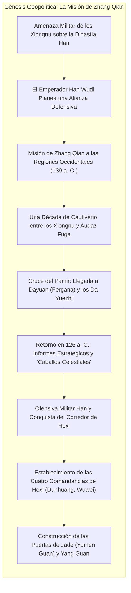
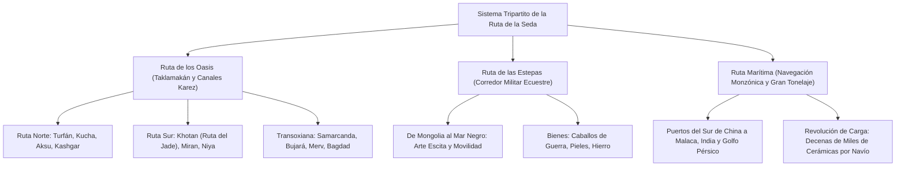
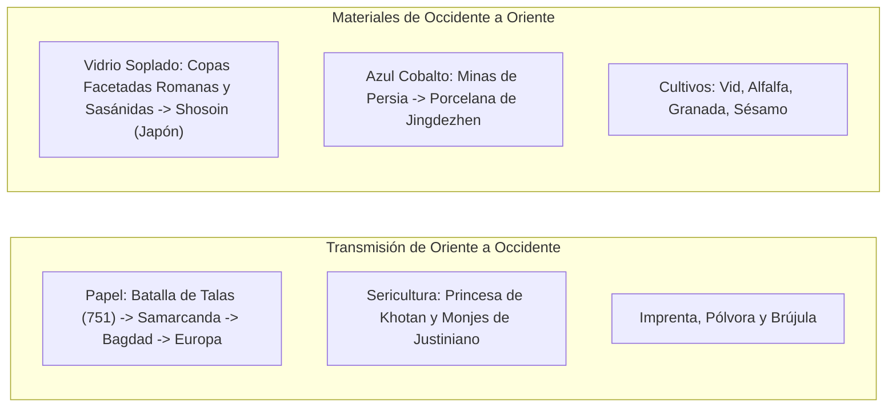

En 1877, el célebre geógrafo alemán Ferdinand von Richthofen acuñó el término imperecedero <strong>"Ruta de la Seda" (Seidenstraße)</strong> en su obra magna *China*. Popularizado mundialmente por exploradores como Sven Hedin, Sir Aurel Stein y Paul Pelliot, el concepto evocó un romanticismo legendario. Sin embargo, la investigación histórica y arqueológica moderna demuestra que no se trataba de una calzada única y rectilínea, sino de una <strong>red intercontinental compleja, dinámica y multicéntrica</strong> de senderos desérticos, pasos montañosos, autopistas esteparias y rutas marítimas.

Esta red se estructuraba en tres arterias esenciales:
1. <strong>La Ruta de los Oasis (Ruta del Desierto)</strong>: Bordeaba el temible desierto de Taklamakán y la cordillera del Pamir, conectando ciudades-estado gracias a la ingeniería hidráulica de canales subterráneos (*karez*).
2. <strong>La Ruta de las Estepas</strong>: Cruzaba las vastas praderas boreales desde Manchuria hasta Hungría, impulsada por la extraordinaria movilidad de los pueblos jinetes (escitas, xiongnu, turcos y mongoles).
3. <strong>La Ruta Marítima de la Seda (Ruta de las Especias y la Porcelana)</strong>: Articulada por los vientos monzónicos periódicos del océano Índico, comunicando los puertos de Guangzhou y Quanzhou con el sudeste asiático, la India, el golfo Pérsico y el mar Rojo.

---

## 1. Génesis Geopolítica: Zhang Qian y la Apertura de Occidente

La Ruta de la Seda nació como una necesidad estratégica de seguridad imperial para la dinastía Han frente a la confederación nómada de los <strong>Xiongnu</strong>.

En el 139 a. C., el emperador Han Wudi envió al oficial <strong>Zhang Qian</strong> para forjar una alianza con los <strong>Da Yuezhi</strong>, un pueblo nómada desplazado hacia Asia Central. Tras sufrir diez años de cautiverio entre los xiongnu, Zhang Qian logró escapar, cruzó las cumbres glaciares del Pamir y exploró el valle de Ferganá (<strong>Dayuan</strong>) y Bactriana. Aunque la alianza bélica no prosperó, la información traída a Chang'an en 126 a. C. revolucionó la visión geopolítica china.

Fascinado por los veloces <strong>"Caballos Celestiales" (汗血馬)</strong> de Ferganá, vitales para modernizar la caballería, el emperador Wudi conquistó el <strong>Corredor de Hexi</strong>, fundó la comandancia de <strong>Dunhuang</strong> y erigió las fortalezas aduaneras de <strong>Yumen Guan (Puerta de Jade)</strong> y Yang Guan, inaugurando la gran vía oficial transcontinental.

---

## 2. Dinámica Espacial de las Tres Grandes Arterias

### 2.1 La Ruta de los Oasis y la Hidráulica de los Karez

Para bordear las arenas asfixiantes del Taklamakán, las caravanas dependían de ciudades oasis alimentadas por los <strong>karez (qanat)</strong>: canales subterráneos excavados en los abanicos aluviales que conducían el agua de deshielo sin pérdida por evaporación. Al superar Kashgar y la barrera del Pamir a más de 4.000 metros, las caravanas alcanzaban los emporios de <strong>Samarcanda</strong> y <strong>Bujará</strong> en Sogdiana, dirigiéndose luego a Persia y el Mediterráneo.

### 2.2 La Ruta de las Estepas y el Poderío Nómada

En las praderas eurasiáticas, mientras las recuas de camellos avanzaban 25 km diarios, los jinetes nómadas con monturas de recambio recorrían de 80 a 120 km al día. Desde el primer milenio a. C., los <strong>escitas</strong> desarrollaron un fastuoso arte zoomorfo en oro. Esta vía veloz conectó los imperios nómadas con los centros urbanos sedentarios.

### 2.3 La Ruta Marítima de la Seda

La navegación marítima aprovechó los <strong>monzones del océano Índico</strong>. Juncos chinos con compartimentos estancos y dhows árabes cosidos trasladaron cargamentos colosales: el naufragio del <strong>Belitung</strong> (siglo IX) hallado en Indonesia albergaba más de 60.000 piezas cerámicas de época Tang rumbo al golfo Pérsico.

---

## 3. Los Comerciantes Sogdianos y el Crédito Financiero

Los verdaderos intermediarios de la ruta fueron los <strong>sogdianos</strong>, pueblo de lengua irania del valle de Zarafshán (Uzbekistán).

Establecieron colonias mercantiles a lo largo de toda la ruta. Sus caravanas eran guiadas por un <strong>sārtavāha</strong>. La corte Tang integró su autogobierno designando líderes al rango oficial de <strong>Sabao (薩寶)</strong>, quienes custodiaban también los templos zoroastrianos del fuego. Las <strong>Antiguas Cartas Sogdianas</strong> descubiertas por Stein demuestran el uso precoz de letras de cambio, préstamos a interés compuesto y el rol de las piezas de seda como patrón monetario internacional.

---

## 4. Transferencias Tecnológicas y Fusión Material

### 4.1 La Batalla de Talas (751 d. C.) y la Difusión Mundial del Papel

En 751 d. C., los ejércitos de la dinastía Tang y del califato abasí colisionaron en las márgenes del río <strong>Talas</strong>. Tras la deserción de mercenarios qarluq, las fuerzas chinas fueron derrotadas.

Artesanos papeleros capturados fueron trasladados a Samarcanda, inaugurando la producción del afamado <strong>papel de Samarcanda</strong>. La técnica se propagó a Bagdad (793), donde impulsó la <strong>Casa de la Sabiduría (Bayt al-Hikma)</strong> y la Edad de Oro del Islam, llegando a España (Játiva, 1150) e Italia (Fabriano, 1268), sentando las bases de la imprenta moderna.

### 4.2 Porcelana Azul y Blanca: La Obra Maestra Híbrida

En el siglo XIV, bajo el imperio mongol Yuan, cristalizó la <strong>porcelana azul y blanca (Qinghua)</strong> en Jingdezhen: arcilla caolínica cocida a 1.300 °C combinada con mineral de cobalto puro extraído en Kashán (Persia), conocido como <strong>azul mahometano (Huihui qing)</strong>. Estas piezas de lujo se exportaron masivamente a los imperios otomano y safávida, desatando la fiebre por las *chinoiseries* en Europa.

---

## 5. El Encuentro Espiritual y el Arte de Gandhara

La Ruta de la Seda albergó el mayor diálogo teológico de la Antigüedad:
- <strong>Arte de Gandhara</strong>: Tras las conquistas de Alejandro Magno, la estética helenística humanizó la figura de Buda bajo los rasgos del dios griego <strong>Apolo</strong>, envuelto en los pliegues de una toga romana. La deidad protectora Vajrapani se modeló sobre el héroe <strong>Heracles</strong>.
- <strong>La Peregrinación de Xuanzang</strong>: Entre 629 y 645 d. C., el monje Xuanzang viajó a la India, residió en la Universidad de Nalanda y escribió el célebre *Da Tang Xiyu Ji*, brújula arqueológica del siglo XIX.
- <strong>Pluralismo Religioso</strong>: En Chang'an convivieron el budismo, el cristianismo nestoriano (Estepa de 781), el maniqueísmo y el zoroastrismo.

---

## 6. Pax Mongolica y el Sistema de Postas Yam

En el siglo XIII, el imperio de Gengis Kan unificó Eurasia bajo la <strong>Pax Mongolica</strong>.

Su columna vertebral fue el sistema postal de postas <strong>Yam (Örtöö / Zhanchi)</strong>: cada 40 km se disponían caballos frescos y provisiones. Emisarios portadores de la tableta imperial (<strong>Paiza</strong>) cabalgaban día y noche alcanzando 200 km en 24 horas. Viajeros como Marco Polo e Ibn Battuta recorrieron el continente con seguridad, empleándose el papel moneda (<strong>Jiaochao</strong>).

Sin embargo, esta velocidad facilitó la propagación del bacilo *Yersinia pestis* (la <strong>Peste Negra</strong> de 1346–1353), que aniquiló a un tercio de la población euroasiática y aceleró la caída del orden mongol.

---

## 7. La Era Marina y el Crepúsculo Continental

El viaje de Vasco da Gama en 1498 inauguró las rutas oceánicas. Un navío transportaba el tonelaje de miles de camellos a bajo costo, eludiendo peajes y riesgos terrestres.

El enfriamiento de la Pequeña Edad de Hielo secó los ríos glaciares, sepultando ciudades como Loulan y Niya bajo las dunas. La Ruta de la Seda terrestre quedó reducida a redes comarcales.

---

## 8. Conclusión: El Legado Vivo para el Siglo XXI

La gran lección de la Ruta de la Seda permanece indiscutible: <strong>las civilizaciones no son islas cerradas, sino organismos que florecen mediante la permeabilidad, el intercambio y la síntesis con el Otro.</strong>

Hoy, los trenes de carga del <strong>China Railway Express</strong>, los gasoductos transcontinentales y las redes de fibra óptica reconstruyen la conectividad euroasiática. Recordar la Ruta de la Seda es recuperar la sabiduría del encuentro para tender puentes en un mundo fragmentado.