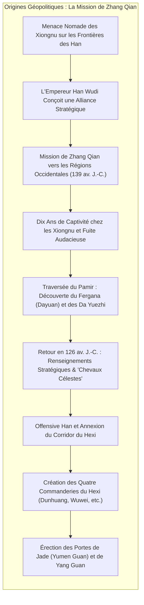
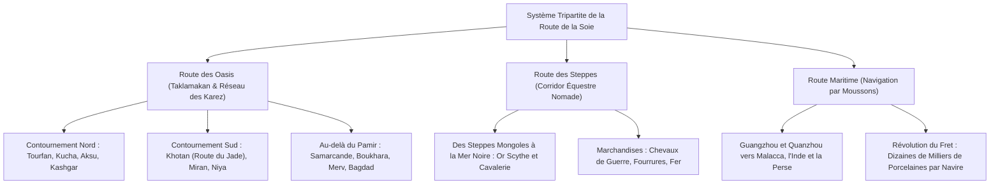
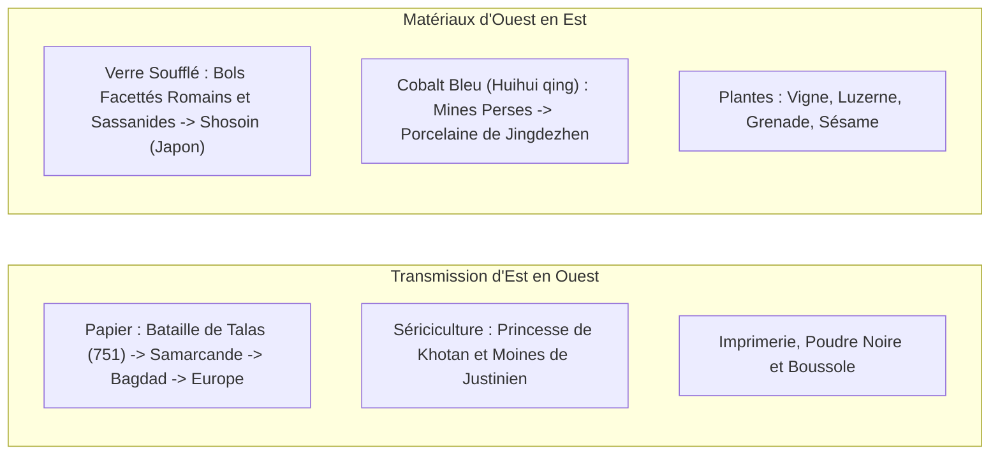

En 1877, le grand géographe allemand Ferdinand von Richthofen forgea l'expression mémorable <strong>"Route de la Soie" (Seidenstraße)</strong> dans son œuvre maîtresse *China*. Ce terme poétique, popularisé par les expéditions de Sven Hedin, Sir Aurel Stein et Paul Pelliot, a captivé l'imaginaire universel. Pourtant, l'historiographie moderne et l'archéologie démontrent que la Route de la Soie ne fut jamais une piste linéaire unique, mais un <strong>réseau continental polycentrique, dynamique et interconnecté</strong> de pistes désertiques, de passes glaciaires, de corridors steppiques et de voies maritimes.

Ce réseau s'articulait autour de trois grands corridors :
1. <strong>La Route des Oasis (Route des Déserts)</strong> : Longeant le bassin aride du Tarim et les contreforts du Pamir, reliant les cités-États fortifiées grâce au génie hydraulique des puits artésiens souterrains (*karez*).
2. <strong>La Route des Steppes</strong> : S'étendant de la Mandchourie aux rives de la mer Noire et à la plaine hongroise, propulsée par la mobilité équestre des nomades pasteurs (Scythes, Xiongnu, Göktürks, Mongols).
3. <strong>La Route Maritime de la Soie (Route des Épices et de la Porcelaine)</strong> : Rythmée par les moussons de l'océan Indien et de la mer de Chine méridionale, reliant Guangzhou et Quanzhou au détroit de Malacca, à l'Inde, à la mer Rouge et au golfe Persique pour le transport de masse.

---

## 1. Genèse Géopolitique : La Mission de Zhang Qian

L'émergence formelle de la Route de la Soie ne découla point d'une curiosité marchande innocente, mais des impératifs de sécurité nationale de la dynastie des Han occidentaux.

Au IIe siècle avant notre ère, la confédération nomade des <strong>Xiongnu</strong> dominait les steppes de Mongolie et harcelait l'Empire Han, exigeant d'humiliants tributs annuels de soie, de grain et d'épouses impériales. Pour briser cet étau, l'empereur Han Wudi envoya en 139 av. J.-C. l'officier <strong>Zhang Qian</strong> avec une centaine d'hommes pour négocier une alliance militaire avec les <strong>Da Yuezhi</strong>, un peuple nomade chassé en Asie centrale par les Xiongnu.

Capturé presque immédiatement, Zhang Qian demeura dix ans prisonnier des Xiongnu sans jamais abandonner les insignes de son autorité impériale. Échappé avec audace, il franchit le Pamir, explora la vallée de Fergana (<strong>Dayuan</strong>) et la Bactriane. Bien que les Yuezhi eussent renoncé à la guerre, le rapport minutieux que Zhang Qian remit à Chang'an en 126 av. J.-C. bouleversa la vision chinoise du monde.

L'empereur Wudi fut subjugué par l'existence des <strong>"Chevaux Célestes" (汗血馬)</strong> du Fergana, dont la vigueur et l'endurance étaient indispensables pour créer une cavalerie lourde capable de vaincre les Xiongnu. L'armée impériale conquit alors le <strong>Corridor du Hexi</strong>, érigea les quatre commanderies (dont Dunhuang) et bâtit la célèbre <strong>Porte de Jade (Yumen Guan)</strong>, institutionnalisant l'artère officielle du commerce continental.

---

## 2. La Dynamique Spatiale des Trois Corridors

### 2.1 La Route des Oasis et l'Hydraulique des Karez

Pour traverser le redoutable désert du Taklamakan, les caravanes empruntaient la route nord ou la route sud, bordées de royaumes oasiens. La survie de ces cités dépendait du système des <strong>karez (qanats)</strong> : de longues galeries souterraines captant les nappes phréatiques au pied des glaciers pour irriguer vignobles et cultures sans évaporation.

Après Kashgar, les caravaniers escaladaient le Pamir à plus de 4 000 mètres d'altitude avant de redescendre vers les opulentes métropoles de <strong>Samarcande</strong> et <strong>Boukhara</strong> en Sogdiane, pour gagner ensuite la Perse et la Méditerranée.

### 2.2 La Route des Steppes : L'Autoroute Équestre

Tandis qu'une caravane de chameaux parcourait 25 à 30 km par jour, les cavaliers nomades disposant de chevaux de remonte franchissaient 80 à 120 km quotidiennement. Dès le premier millénaire avant notre ère, les <strong>Scythes</strong> y avaient développé un art animalier raffiné en or. Les empires nomades successifs utilisèrent cette voie rapide pour échanger chevaux et fourrures contre les soieries et le thé chinois.

### 2.3 La Route Maritime de la Soie : L'Économie d'Échelle

La route maritime exploitait l'alternance semestrielle des <strong>moussons de l'océan Indien</strong>. Les jonques chinoises à cloisons étanches et les boutres cousus arabes transportaient des volumes monumentaux : le naufrage du <strong>Belitung</strong> (IXe siècle), découvert en Indonésie en 1998, a livré plus de 60 000 pièces de céramique des Tang destinées au golfe Persique.

---

## 3. Les Marchands Sogdiens : Architectes de la Finance Antique

Le moteur commercial de la Route de la Soie terrestre reposait sur les <strong>Sogdiens</strong>, peuple commerçant de langue iranienne originaire de la vallée du Zeravchan (Ouzbékistan).

Les Sogdiens établirent des colonies autonomes le long de toutes les étapes clés jusqu'à Chang'an et Luoyang. Leurs caravanes étaient dirigées par un <strong>sārtavāha</strong>. La dynastie des Tang leur accorda un statut d'auto-gouvernance sous la juridiction d'un magistrat impérial appelé <strong>Sabao (薩寶)</strong>, qui veillait également sur les temples zoroastriens du feu.

Les <strong>Lettres Anciennes Sogdiennes</strong> découvertes par Stein en 1907 révèlent l'usage d'instruments financiers novateurs : lettres de crédit, prêts commerciaux à intérêts composés et utilisation des pièces de soie standardisées (*pi*) comme monnaie de réserve internationale. À Chang'an, la culture sogdienne ("mode Hu") suscita une fascination durable : auberges à vin, danses tournoyantes (*Huxuanwu*) et musique de luth.

---

## 4. Transferts Technologiques et Hybridation Matérielle

### 4.1 La Bataille de Talas (751) et la Révolution Mondiale du Papier

En juillet 751, sur les rives du fleuve <strong>Talas</strong>, l'armée chinoise des Tang affronta les forces du califat abbasside. La trahison des mercenaires qarluqs entraîna la défaite des Tang.

Des artisans papetiers chinois capturés furent emmenés à Samarcande, où naquit le réputé <strong>papier de Samarcande</strong>. L'invention gagna Bagdad en 793, alimentant les travaux de la <strong>Maison de la Sagesse (Bayt al-Hikma)</strong> et l'âge d'or islamique, avant d'essaimer en Espagne (Xàtiva, 1150) et en Italie (Fabriano, 1268), préparant le terrain pour l'imprimerie de Gutenberg.

### 4.2 La Porcelaine Bleu et Blanc : Fusion Sino-Persane

Au XIVe siècle, sous la dynastie mongole des Yuan, la <strong>porcelaine bleu et blanc (Qinghua)</strong> de Jingdezhen consacra une symbiose éclatante :
- <strong>L'apport chinois</strong> : Argile kaolinique pure et maîtrise de la cuisson à 1 300 °C en atmosphère réductrice.
- <strong>L'apport persan</strong> : Minerai de cobalt naturel à faible teneur en manganèse extrait à Kashan en Iran (<strong>bleu mohamétan</strong> ou *Huihui qing*).
Ces chefs-d'œuvre hybrides furent massivement réexportés vers les cours ottomanes et safavides, enchantant ensuite l'Europe de la Renaissance.

---

## 5. Syncrétismes Religieux et Art Gréco-Bouddhique du Gandhara

La Route de la Soie fut un laboratoire théologique universel :
- <strong>L'Art du Gandhara</strong> : Suite aux expéditions d'Alexandre le Grand, les artistes gréco-bactriens sculptèrent les premières représentations humaines du Bouddha sous les traits du dieu grec <strong>Apollon</strong>, vêtu des plis réalistes d'une toge romaine. Le protecteur Vajrapani fut figuré sous l'apparence d'<strong>Héraclès</strong>.
- <strong>La Quête de Xuanzang</strong> : Le moine érudit Xuanzang voyagea seize ans en Inde (629–645), étudia à l'université de Nalanda et rédigea ses *Mémoires sur les Régions Occidentales (Da Tang Xiyu Ji)*.
- <strong>Le Pluralisme de Chang'an</strong> : Outre le bouddhisme, Chang'an accueillit le christianisme nestorien (comme en témoigne la stèle de 781), le manichéisme (religion officielle du Khaganat ouïghour) et le zoroastrisme.

---

## 6. La Pax Mongolica et le Système Postal du Yam

Au XIIIe siècle, l'Empire mongol de Gengis Khan élimina les barrières douanières à travers l'Eurasie, inaugurant la <strong>Pax Mongolica</strong>.

L'artère impériale reposait sur le réseau postal du <strong>Yam (Örtöö / Zhanchi)</strong> : des stations espacées de 40 km fournissaient montures et vivres. Les courriers munis de tablettes impériales (<strong>Paiza</strong>) galopaient jour et nuit, couvrant jusqu'à 200 km par jour. Marco Polo et Ibn Battuta purent ainsi voyager d'un bout à l'autre du monde, tandis que le papier-monnaie (<strong>Jiaochao</strong>) facilitait les échanges.

Néanmoins, cette autoroute planétaire accéléra la diffusion du bacille *Yersinia pestis* (la <strong>Peste Noire</strong> de 1346–1353), qui décima un tiers de la population eurasienne et précipita la fragmentation de l'ordre mongol.

---

## 7. L'Ère Maritime et le Crépuscule de la Route Terrestre

Le contournement de l'Afrique par Vasco de Gama en 1498 ouvrit l'ère des grandes navigations. Une seule caravelle transportait l'équivalent de milliers de chameaux à un coût infinitésimal, sans péages ni pillages.

Parallèlement, l'assèchement climatique lié au Petit Âge Glaciaire engloutit sous les sables des cités comme Loulan et Niya. La Route de la Soie terrestre perdit alors son statut d'artère mondiale pour ne redevenir qu'un réseau d'échanges pastoraux locaux.

---

## 8. Conclusion : L'Héritage pour le XXIe Siècle

La leçon magistrale de la Route de la Soie résonne avec force : <strong>les civilisations ne s'épanouissent pas dans l'isolement, mais dans l'hybridation, le dialogue et le métissage culturel.</strong>

Aujourd'hui, les convois ferroviaires du <strong>China Railway Express</strong>, les gazoducs transcaspiens et les câbles à fibre optique réactivent ces anciens corridors sous la forme d'une nouvelle connectivité eurasienne. Méditer l'histoire de la Route de la Soie, c'est puiser dans une source inépuisable de sagesse pour transcender les divisions et construire un avenir partagé.